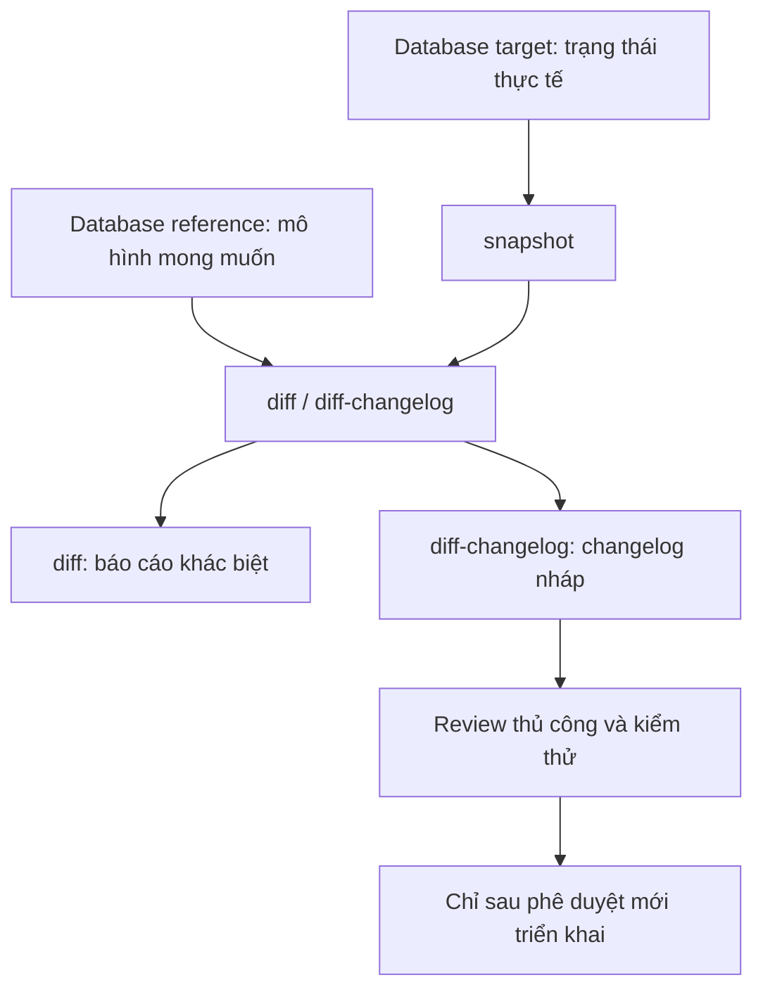
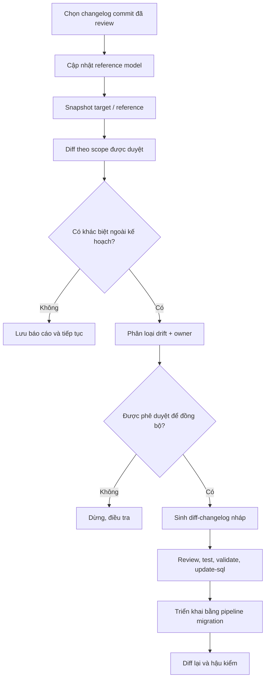

# Vai trò của snapshot, diff và diff-changelog

## 1. Vì sao cần so sánh lược đồ?

Trong module **DATABASE_SCHEMA_MIGRATION_LIQUIBASE**, người học quản lý thay đổi schema và dữ liệu bằng Liquibase qua changelog, changeset, precondition, checksum và lịch sử triển khai; thực hành migration có kiểm chứng, rollback, phối hợp nhiều môi trường và tích hợp Spring Boot hoặc CI/CD. Một quy trình migration đáng tin cậy cần trả lời được câu hỏi: **database thực tế có đúng với mô hình lược đồ mà nhóm dự định triển khai hay không?**

Trong thực tế, các môi trường có thể lệch nhau vì nhiều nguyên nhân:

- Một DBA tạo index hoặc sửa cột thủ công để xử lý sự cố.
- Một migration đã chạy ở staging nhưng chưa chạy ở production.
- Một bản deploy thất bại giữa chừng hoặc được khôi phục từ backup.
- Một nhóm phát triển thay đổi database local ngoài changelog.
- Một object được tạo bởi script khác, ứng dụng hoặc công cụ quản trị.
- Một môi trường có schema, quyền, extension hoặc phiên bản DBMS khác môi trường còn lại.

Liquibase cung cấp các lệnh **snapshot**, **diff** và **diff-changelog** để quan sát và so sánh trạng thái database. Ba lệnh liên quan nhưng giải quyết ba nhiệm vụ khác nhau:

- `snapshot` ghi nhận trạng thái object/schema của một database tại một thời điểm.
- `diff` so sánh hai trạng thái và báo cáo điểm khác biệt.
- `diff-changelog` tạo changelog chứa những thay đổi có thể triển khai nhằm đưa database đích gần với database tham chiếu.

Các công cụ này giúp phát hiện **schema drift** và tạo đầu vào cho review. Chúng không thay thế changelog đã được kiểm soát, không tự chứng minh dữ liệu nghiệp vụ đúng và không biến một changelog sinh tự động thành migration an toàn để chạy ngay.

### Mục tiêu học tập

Sau bài học, bạn có thể:

1. Giải thích vai trò và đầu ra của snapshot, diff và diff-changelog.
2. Phân biệt database tham chiếu (`reference/source`) với database đích (`target`).
3. Chọn đúng hướng so sánh để không tạo changelog ngược chiều.
4. Dùng snapshot JSON/YAML để lưu trạng thái schema và so sánh offline.
5. Hiểu loại object được so sánh, phạm vi schema và giới hạn theo DBMS/phiên bản/edition.
6. Review changelog sinh tự động trước khi đưa vào source control hoặc triển khai.
7. Phát hiện schema drift giữa dev, staging, production và mô hình mong muốn.
8. Tích hợp kiểm tra khác biệt vào Spring Boot hoặc CI/CD mà không tự động áp dụng thay đổi chưa được duyệt.

## 2. Mô hình tổng quát: snapshot, diff và diff-changelog

| Công cụ | Đầu vào chính | Đầu ra | Mục đích |
|---|---|---|---|
| `snapshot` | Một database đích đang kết nối | Bản mô tả trạng thái object/schema, có thể ở JSON, YAML hoặc văn bản | Lưu mốc trạng thái để so sánh về sau |
| `snapshot-reference` | Database tham chiếu qua `--reference-url` | Bản mô tả trạng thái database nguồn | Lưu mốc của nguồn chuẩn |
| `diff` | Reference và target, hoặc snapshot/offline database | Báo cáo missing, unexpected, changed | Quan sát khác biệt, phát hiện drift |
| `diff-changelog` | Reference và target, hoặc snapshot/offline database | Báo cáo và changelog có changeset được sinh | Tạo bản nháp để đồng bộ target với reference |
| `generate-changelog` | Một database hiện có | Changelog mô tả baseline của database | Đưa database hiện có vào quản lý Liquibase ban đầu |

Có thể hình dung:



`snapshot` lưu **mô tả cấu trúc database** tại thời điểm chụp; nó không phải bản sao lưu các hàng dữ liệu và không thay thế backup, snapshot lưu trữ hoặc point-in-time recovery (PITR). Một snapshot JSON có thể giúp Liquibase so sánh object mà không cần kết nối trực tuyến tới database đã được chụp, nhưng nó không thể tự cập nhật theo database sau đó.

### 2.1. Cần phân biệt snapshot với backup

| Snapshot của Liquibase | Backup database |
|---|---|
| Mô tả object/schema mà Liquibase có thể nhận diện | Lưu dữ liệu và cấu trúc theo cơ chế backup của DBMS/nền tảng |
| Hỗ trợ so sánh schema ở các thời điểm | Hỗ trợ khôi phục dữ liệu/đối tượng theo chính sách backup |
| Có thể là JSON/YAML/văn bản | Có định dạng và công cụ restore riêng |
| Không phục hồi các hàng đã mất | Có thể phục hồi hàng/dữ liệu nếu backup đầy đủ và hợp lệ |
| Không thay thế RPO/RTO | Là một thành phần của kế hoạch RPO/RTO |

Tên gọi “snapshot” dễ gây nhầm với snapshot ở storage hoặc database engine. Trong bài này, `snapshot` là **lệnh kiểm tra database của Liquibase**, không phải thao tác tạo bản sao phục hồi production.

## 3. Reference và target: xác định chiều so sánh trước khi chạy

Đây là điểm quan trọng nhất khi sử dụng `diff` và `diff-changelog`.

- `--reference-url`: database nguồn/tham chiếu, làm cơ sở để so sánh.
- `--url`: database đích được so sánh với nguồn; đây là nơi Liquibase hướng các thay đổi được sinh ra tới.

Giả sử:

- **Reference** là database dev đã được cập nhật theo changelog chuẩn và đại diện cho schema mong muốn.
- **Target** là database staging cần được so sánh và đồng bộ với dev.

Nếu staging thiếu một bảng có trong dev, báo cáo diff sẽ ghi nhận object đó là **Missing** trên target. Nếu staging có một bảng không có ở dev, object đó là **Unexpected** trên target.

```text
REFERENCE / SOURCE
  Schema mong muốn
  Bảng orders
  Cột status
  Index idx_orders_status
          |
          | compare
          v
TARGET
  Schema thực tế
  Bảng orders
  Chưa có cột status
  Có index cũ idx_orders_legacy
```

Khi dùng `diff-changelog` theo chiều này, Liquibase tạo changelog nhằm giải quyết những khác biệt để target tiến gần reference. Nếu đảo nhầm hai URL, changelog có thể mô tả hướng thay đổi ngược lại.

### 3.1. Ba loại khác biệt trong báo cáo diff

| Loại | Ý nghĩa | Ví dụ |
|---|---|---|
| **Missing** | Object có ở reference nhưng không có ở target | Reference có bảng `orders`, target chưa có |
| **Unexpected** | Object có ở target nhưng không có ở reference | Target có bảng `tmp_debug`, reference không có |
| **Changed** | Cùng object tồn tại nhưng định nghĩa khác nhau | Cột `status` có kiểu hoặc thuộc tính khác |

Điểm cần nhớ: báo cáo `Changed` cho biết object khác nhau; nó không nhất thiết mô tả đầy đủ câu lệnh SQL cần dùng để thay đổi object. `diff-changelog` có thể tạo changeset giải quyết phần lớn khác biệt mà Liquibase hỗ trợ, nhưng kết quả cần được review.

### 3.2. Hướng đồng bộ không phải quyết định nghiệp vụ

Một database có object “Unexpected” chưa chắc phải xóa object đó. Có thể nó được tạo có chủ đích bởi DBA, extension, công cụ monitoring hoặc một ứng dụng khác. Tương tự, object “Missing” chưa chắc phải tạo ngay: có thể target đang ở giai đoạn triển khai khác hoặc object chưa được phép xuất hiện.

**Không dùng báo cáo diff như lệnh tự động dọn database.** Hãy quyết định reference nào là nguồn sự thật, object nào thuộc phạm vi quản lý và sự khác biệt nào được chấp nhận.

## 4. `snapshot`: ghi nhận trạng thái database tại một thời điểm

Lệnh `snapshot` thu thập trạng thái hiện tại của database được cấu hình bằng `--url`. Khi chạy không kèm định dạng file, nó có thể hiển thị mô tả văn bản ra STDOUT. Khi cần tái sử dụng trong so sánh, nên tạo snapshot có cấu trúc như JSON hoặc YAML.

Ví dụ tạo JSON snapshot của database target:

```bash
liquibase \
  --url="jdbc:postgresql://target-host:5432/orders" \
  --username=inspection_user \
  --output-file=target-snapshot.json \
  snapshot \
  --snapshot-format=json
```

Ví dụ tạo snapshot cho database reference:

```bash
liquibase \
  --reference-url="jdbc:postgresql://reference-host:5432/orders" \
  --reference-username=inspection_user \
  --output-file=reference-snapshot.json \
  snapshot-reference \
  --snapshot-format=json
```

Các lệnh minh họa dùng tên option CLI phổ biến trong Liquibase 5.x. Hãy xác nhận cú pháp với phiên bản thực tế bằng `liquibase snapshot --help` hoặc `liquibase snapshot-reference --help`. Cấu hình credential nên được cấp qua cơ chế bảo mật của môi trường; không đưa mật khẩu thật vào lịch sử shell hoặc file changelog.

### 4.1. JSON, YAML hay văn bản?

| Định dạng | Dùng khi nào | Hạn chế |
|---|---|---|
| JSON | Lưu snapshot để tái sử dụng trong diff/diff-changelog | File có thể lớn và cần quản lý phiên bản |
| YAML | Muốn định dạng dễ đọc hơn nhưng vẫn có cấu trúc | Cần kiểm tra parser và khả năng tương thích của phiên bản |
| TXT/STDOUT | Quan sát nhanh hoặc lưu báo cáo đọc thủ công | Không phù hợp làm snapshot đầu vào so sánh về sau |

Một bản snapshot văn bản in ra terminal có ích để xem nhanh, nhưng nếu cần so sánh sau này hãy lưu định dạng máy có thể đọc được. JSON là lựa chọn phổ biến trong workflow snapshot/offline.

### 4.2. Snapshot có thời hạn đúng theo thời điểm chụp

Snapshot không tự theo dõi database. Nếu DBA thay đổi bảng, Liquibase chạy `update` hoặc ứng dụng/công cụ khác sửa object sau khi snapshot được tạo, file snapshot vẫn phản ánh **trạng thái cũ**.

Ví dụ:

1. 09:00 chụp `target-snapshot.json`.
2. 09:30 DBA thêm index thủ công.
3. 10:00 dùng snapshot 09:00 để so sánh với reference.
4. Kết quả diff không thể phản ánh index được thêm lúc 09:30 vì snapshot không được cập nhật.

Hãy gắn snapshot với thời điểm, môi trường, DBMS/version, schema scope, commit và mục đích so sánh. Không dùng snapshot cũ như thể nó là trạng thái trực tiếp của production.

### 4.3. Snapshot lưu object nào?

Liquibase thu thập các loại object mà phiên bản, edition, database platform, quyền và cấu hình snapshot hỗ trợ. Thông thường có thể gồm catalog, schema, table, column, primary key, foreign key, index, unique constraint, sequence và view; các object stored logic như function, procedure, trigger hoặc package có thể phụ thuộc edition/DBMS.

Không được mặc định snapshot bao gồm mọi thứ trong database. Trước khi dùng kết quả làm bằng chứng, hãy xác định:

- Các schema/catalog nào được bao gồm.
- User kết nối có quyền đọc metadata của object nào.
- Những loại object nào được hỗ trợ.
- Những loại object nào bị lọc hoặc bỏ qua.
- Có tham chiếu chéo schema nào không được snapshot đầy đủ.
- Tên object có phân biệt chữ hoa/chữ thường hay cần preserve schema case không.

### 4.4. Snapshot không chứa bản sao dữ liệu nghiệp vụ

Một snapshot schema không phải bản dump của `orders` với toàn bộ hàng đơn hàng. Nó giúp so sánh cấu trúc và metadata; không chứng minh hai bảng có cùng số hàng hoặc cùng giá trị.

Một số phiên bản/edition có khả năng so sánh loại dữ liệu hoặc chức năng bổ sung riêng. Hãy kiểm tra tính năng và loại diff được hỗ trợ thay vì suy ra từ việc snapshot JSON tồn tại. Nếu cần đối chiếu dữ liệu, hãy thiết kế truy vấn invariant, data validation hoặc công cụ kiểm tra dữ liệu riêng.

## 5. `diff`: báo cáo khác biệt giữa hai trạng thái

`diff` so sánh reference và target, có thể là hai database trực tuyến hoặc một database với snapshot/offline database. Nó hữu ích để:

- Kiểm tra database đích có lệch mô hình schema chuẩn không.
- Phát hiện object thiếu hoặc ngoài dự kiến.
- Xác định object cùng tên nhưng định nghĩa khác.
- Kiểm tra kết quả của một đợt triển khai.
- Theo dõi thay đổi thủ công ngoài Liquibase.
- So sánh hai snapshot của cùng database tại các thời điểm khác nhau.

Ví dụ so sánh hai database PostgreSQL:

```bash
liquibase \
  --reference-url="jdbc:postgresql://dev-host:5432/orders" \
  --reference-username=inspection_user \
  --url="jdbc:postgresql://staging-host:5432/orders" \
  --username=inspection_user \
  diff
```

Trong ví dụ, dev là reference và staging là target. Kết quả báo cáo khác biệt theo các nhóm object được chọn và khả năng hỗ trợ của phiên bản.

### 5.1. Cách đọc báo cáo

Giả sử output rút gọn:

```text
Missing:
  Column: app.orders.status
  Index: app.idx_orders_status

Unexpected:
  Table: app.debug_orders

Changed:
  Column: app.customers.email
```

Có thể diễn giải:

- Staging thiếu cột `orders.status` và index `idx_orders_status` có trong reference.
- Staging có bảng `debug_orders` không thấy ở reference.
- Cột `customers.email` có tồn tại ở cả hai nhưng thuộc tính khác nhau.

Đây là ví dụ minh họa cách phân loại, không phải output thực thi. Với `Changed`, cần xem chi tiết metadata để biết chính xác kiểu, default, nullability hoặc thuộc tính nào khác. Không kết luận “chỉ khác độ dài varchar” nếu báo cáo không cung cấp bằng chứng đó.

### 5.2. `diff` không tạo changelog triển khai

`diff` chủ yếu tạo báo cáo khác biệt. Nó không phải công cụ tự sửa target và không thay thế review changeset. Khi cần tạo bản nháp thay đổi, dùng `diff-changelog` sau khi xác định đúng hướng source/target.

### 5.3. Loại object và phạm vi so sánh

Có thể giới hạn loại object qua `--diff-types` và lọc object theo tên bằng các tham số include/exclude nếu phiên bản hỗ trợ.

Ví dụ chỉ so sánh bảng, index và view:

```bash
liquibase \
  --reference-url="jdbc:postgresql://dev-host:5432/orders" \
  --url="jdbc:postgresql://staging-host:5432/orders" \
  --diff-types=tables,indexes,views \
  diff
```

Khi giới hạn phạm vi, kết quả chỉ trả lời câu hỏi trong phạm vi đã chọn. Không thể kết luận hai schema hoàn toàn giống nhau nếu đã bỏ qua function, trigger, constraint hoặc schema khác.

Một số loại diff có thể yêu cầu Liquibase edition hoặc phiên bản nhất định. Ví dụ các loại stored logic, function, procedure, trigger, check constraint hoặc data comparison có thể khác giữa Community và Secure. Kiểm tra danh sách được hỗ trợ cho DBMS/edition cụ thể.

### 5.4. Giới hạn về thuộc tính object

Không phải mọi thuộc tính của mọi DBMS đều được so sánh đầy đủ. Khả năng introspection của JDBC driver và Liquibase có thể khác. Tài liệu Liquibase cũng lưu ý một số trường hợp diff không kiểm tra độ dài datatype; vì vậy, nếu độ dài cột là điều kiện quan trọng, hãy xác minh metadata trực tiếp và bổ sung test riêng.

Đặc biệt, đừng giả định một báo cáo “no differences” chứng minh mọi thứ giống hệt ở cấp database engine. Nó chỉ cho biết **không phát hiện khác biệt trong loại object và thuộc tính mà công cụ đã kiểm tra trong cấu hình hiện tại**.

## 6. `diff-changelog`: tạo changelog nháp từ khác biệt

`diff-changelog` vừa báo cáo khác biệt, vừa sinh changelog chứa các changeset có thể triển khai để giải quyết **phần lớn** khác biệt giữa reference và target mà Liquibase hỗ trợ.

Ví dụ:

```bash
liquibase \
  --reference-url="jdbc:postgresql://dev-host:5432/orders" \
  --reference-username=inspection_user \
  --url="jdbc:postgresql://staging-host:5432/orders" \
  --username=inspection_user \
  --changelog-file=generated-staging-sync.yaml \
  diff-changelog
```

Trong ví dụ:

- Dev là nguồn schema mong muốn.
- Staging là database đích.
- Changelog sinh ra nhằm đưa staging tiến gần dev.
- File output là **bản nháp cần review**, chưa phải lệnh cập nhật staging.

### 6.1. Những gì changelog sinh tự động có thể chứa

Tùy loại object và DBMS, output có thể mô tả việc tạo object thiếu, sửa object khác định nghĩa hoặc xử lý object ngoài dự kiến để target đồng bộ với reference. Các change type có thể gồm create/modify/drop table, column, index, constraint, sequence hoặc view nếu được hỗ trợ.

Không nên đoán trước chính xác mọi changeset sẽ sinh ra. Cần mở file output và kiểm tra từng thay đổi, nhất là:

- `dropTable`, `dropColumn` hoặc thao tác xóa object ngoài dự kiến.
- `modifyDataType`, thay đổi nullability/default/constraint.
- Foreign key có thể ảnh hưởng thứ tự tạo bảng và dữ liệu hiện có.
- View/function/trigger phụ thuộc DBMS và edition.
- Tên schema/default schema được sinh ra.
- Thay đổi có thể khóa bảng hoặc gây downtime.
- Những khác biệt không được Liquibase biểu diễn tự động.

### 6.2. Changelog được sinh không đồng nghĩa changelog đúng nghiệp vụ

Giả sử staging có bảng `app.manual_audit` nhưng reference không có. Diff có thể đánh dấu bảng này là unexpected. Changelog đồng bộ có thể đề xuất xóa bảng để target giống reference.

Nhưng bảng đó có thể được tạo bởi nhóm bảo mật và vẫn đang được sử dụng. **Đưa staging giống reference về mặt object không phải lúc nào cũng là mục tiêu đúng**. Phải xác minh nguồn gốc, owner và tác dụng nghiệp vụ trước khi chấp thuận xóa.

### 6.3. Review file sinh ra trước khi triển khai

Một quy trình review nên gồm:

1. Xác nhận reference và target đúng chiều.
2. Xác nhận schema/catalog và phạm vi object.
3. Đọc toàn bộ changeset, không chỉ số lượng.
4. Phân loại DDL phá hủy và thay đổi có thể ảnh hưởng dữ liệu.
5. Xem SQL được sinh bằng lệnh preview phù hợp.
6. Bổ sung precondition, rollback, context/label hoặc chia changeset nếu cần.
7. Thử trên database clone hoặc môi trường disposable.
8. Chạy diff lại sau thử nghiệm để kiểm tra mục tiêu.
9. Chỉ đưa vào changelog chính thức sau khi review và phê duyệt.

Liquibase có thể tạo một phần changeset có thể triển khai, nhưng một số object và dependency không thể biểu diễn tự động đầy đủ. Định nghĩa sinh ra có thể cần chỉnh thủ công hoặc bổ sung script riêng.

### 6.4. Tránh append nhầm vào changelog đang dùng

Nếu file changelog output đã tồn tại, hành vi của lệnh có thể append changeset vào file hiện có theo cách tài liệu phiên bản mô tả. Dùng một file nháp riêng có tên rõ ràng cho mỗi lần so sánh, kiểm tra trước khi chạy và không trỏ thẳng vào changelog production đang được quản lý.

Không dùng file output diff làm root changelog chính thức trước khi đã review danh tính changeset, đường dẫn, thứ tự và khả năng rollback.

## 7. Phân biệt `diff-changelog` với `generate-changelog`

Hai lệnh dễ bị nhầm vì đều tạo changelog:

| Tiêu chí | `generate-changelog` | `diff-changelog` |
|---|---|---|
| Số database đầu vào | Một database hiện có | Reference và target (hoặc snapshot/offline tương ứng) |
| Mục đích | Tạo baseline mô tả trạng thái database để bắt đầu quản lý bằng Liquibase | Tạo delta để đồng bộ target với reference |
| Câu hỏi | “Database hiện có gồm những object nào?” | “Target khác reference ở đâu và cần thay đổi gì để đồng bộ?” |
| Phạm vi | Baseline của database được introspect | Phần khác biệt trong phạm vi diff |
| Sử dụng | Onboarding database cũ vào Liquibase | Đồng bộ môi trường hoặc phát hiện drift |

Ví dụ, một dự án có database legacy chưa dùng Liquibase có thể dùng `generate-changelog` để tạo baseline ban đầu. Khi đã có quy trình changelog chuẩn và muốn so sánh staging với reference, `diff` hoặc `diff-changelog` phù hợp hơn.

**Không dùng generate-changelog như một bản delta** giữa hai môi trường. Nó mô tả trạng thái của một database, không có nghĩa chỉ chứa những thay đổi mới nhất.

## 8. So sánh trực tiếp hai database hay dùng snapshot offline?

### 8.1. So sánh trực tiếp

Ưu điểm:

- Lấy metadata trực tiếp từ cả hai database tại thời điểm chạy.
- Không cần quản lý file snapshot riêng.
- Phù hợp khi hai môi trường có thể truy cập an toàn trong cùng phiên kiểm tra.

Hạn chế:

- Cần quyền kết nối và JDBC driver cho cả hai phía.
- Nếu database thay đổi trong lúc introspection, kết quả có thể phản ánh hai thời điểm không hoàn toàn đồng nhất.
- Kết nối đến production cần được kiểm soát quyền và network.
- Chạy lặp lại có thể tốn thời gian với database lớn.

### 8.2. So sánh với snapshot/offline database

Ưu điểm:

- Không cần kết nối trực tiếp tới database đã được snapshot ở thời điểm so sánh.
- Có thể lưu snapshot làm bằng chứng trạng thái tại một mốc.
- Có thể so sánh một snapshot cũ với database online hoặc snapshot khác.
- Có thể giảm thời gian so sánh khi một phía đã được lưu thành snapshot.

Hạn chế:

- Snapshot có thể đã cũ so với database hiện tại.
- Cần lưu file, metadata nguồn và phạm vi schema đúng.
- Không có object ngoài phạm vi snapshot.
- Snapshot không phải backup dữ liệu và không thể phục hồi database.

### 8.3. Ví dụ dùng target snapshot làm phía offline

Chụp snapshot target:

```bash
liquibase \
  --url="jdbc:postgresql://staging-host:5432/orders" \
  --username=inspection_user \
  --output-file=staging-snapshot.json \
  snapshot \
  --snapshot-format=json
```

So sánh reference online với target snapshot:

```bash
liquibase \
  --reference-url="jdbc:postgresql://dev-host:5432/orders" \
  --reference-username=inspection_user \
  --url="offline:postgresql?snapshot=staging-snapshot.json" \
  --changelog-file=generated-staging-sync.yaml \
  diff-changelog
```

Trong mẫu này, snapshot thuộc target nên được dùng ở tham số `--url`. Nếu snapshot thuộc reference, cần dùng đúng vị trí `--reference-url` với offline URL. **Đặt snapshot nhầm phía sẽ đảo chiều ý nghĩa so sánh.**

Cú pháp offline URL có dạng `offline:<dbms-short-name>?snapshot=<path>`; DBMS short name và đường dẫn phải khớp với snapshot. Xác nhận cú pháp theo phiên bản và database platform.

## 9. Chọn phạm vi: schema, catalog và loại object

Một database có thể có nhiều schema, và tên bảng trùng nhau giữa các schema. Nếu không cố định phạm vi, diff có thể so sánh nhầm object hoặc bỏ qua object cần kiểm tra.

### 9.1. Xác định schema/catalog

Cần biết:

- Default schema của user kết nối.
- Các schema cần so sánh ở reference và target.
- Schema hệ thống hoặc schema do extension quản lý có cần loại trừ không.
- Có tên object trùng giữa các schema không.
- Có cần include schema trong changelog sinh ra không.

Các tham số như `--schemas`, `--reference-schemas`, `--default-schema-name`, `--reference-default-schema-name` hoặc `--include-schema` có thể liên quan tùy lệnh và phiên bản. Kiểm tra cách viết chính xác và thứ tự schema khi dùng nhiều schema.

### 9.2. Chọn loại object

Một bộ lọc diff có thể tập trung vào các loại object cần review, ví dụ:

```bash
liquibase \
  --reference-url="jdbc:postgresql://dev-host:5432/orders" \
  --url="jdbc:postgresql://staging-host:5432/orders" \
  --diff-types=tables,columns,indexes,foreignkeys,views \
  diff
```

Lọc object giúp giảm nhiễu và có thể cải thiện hiệu năng. Tuy nhiên, nếu bỏ qua sequence, trigger hoặc function, bạn không thể kết luận các thành phần đó đồng bộ. Tài liệu Liquibase mô tả danh sách diff types và edition hỗ trợ theo từng phiên bản; không giả định tất cả giá trị đều có trên mọi edition.

### 9.3. Quyền đọc metadata

Một user thiếu quyền có thể không nhìn thấy object mà user khác tạo. Kết quả diff khi đó có thể báo thiếu hoặc bỏ sót object. Trước khi kết luận drift, xác minh tài khoản kiểm tra có quyền đọc metadata cần thiết ở cả hai phía.

Dùng quyền chỉ đọc cho các lệnh inspection khi phù hợp. Không cấp quyền DDL production chỉ để so sánh schema nếu không cần thiết.

## 10. Giới hạn kỹ thuật và những gì diff không chứng minh

### 10.1. Không thay thế kiểm tra dữ liệu nghiệp vụ

Diff schema chủ yếu so sánh metadata/object. Nó không mặc nhiên kiểm tra:

- Hai bảng có cùng số hàng hay không.
- Giá trị từng bản ghi có khớp hay không.
- Tổng tiền, số dư hoặc trạng thái nghiệp vụ có đúng không.
- Các bản ghi có bị thiếu hoặc trùng theo khóa nghiệp vụ không.
- Dữ liệu đã được backfill theo mapping đúng chưa.

Một số tính năng/edition có thể hỗ trợ so sánh data ở phạm vi nhất định; phải xác nhận chính xác trước khi dùng. Nếu cần kiểm tra dữ liệu, bổ sung truy vấn invariant, data reconciliation hoặc công cụ chuyên dụng.

### 10.2. Không kiểm tra toàn bộ hành vi runtime

Hai schema có thể giống nhau nhưng ứng dụng vẫn khác hành vi vì:

- Quyền/grant, role hoặc cấu hình session khác.
- Extension, collation, timezone hoặc database parameter khác.
- Dữ liệu và execution plan khác.
- Trigger/function có thể không được snapshot/diff đầy đủ.
- Phiên bản DBMS hoặc driver khác nhau.
- Hệ thống cache, CDC, ETL hoặc message consumer khác.

Diff là một lớp bằng chứng, không phải integration test.

### 10.3. Không phải mọi object đều được biểu diễn tự động

Liquibase có thể không hỗ trợ hoặc không so sánh đầy đủ một số object/thuộc tính tùy DBMS/edition/version. Một số khác biệt cần SQL thủ công. Ví dụ, tài liệu hiện hành có lưu ý về giới hạn kiểm tra độ dài datatype trong diff-changelog; nếu thuộc tính này quan trọng, cần kiểm tra trực tiếp metadata.

### 10.4. Cross-DBMS không có nghĩa schema tương đương nghiệp vụ

Liquibase có thể so sánh database khác loại trong một số trường hợp, nhưng mapping kiểu dữ liệu và tính năng DBMS có thể khác. Ví dụ `NUMBER`, `DECIMAL`, `TIMESTAMP WITH TIME ZONE` hoặc kiểu JSON có semantics không giống nhau hoàn toàn. Changelog sinh ra từ một DBMS có thể không chạy nguyên trạng trên DBMS khác.

Nếu mục tiêu là portability, phải review mapping kiểu, default, generated column, sequence/identity, index, constraint và SQL đặc thù. Không dùng một báo cáo diff cross-DBMS như bằng chứng tự động chuyển đổi thành công.

## 11. Quy trình phát hiện schema drift

**Schema drift** là sự khác biệt giữa database thực tế và mô hình/schema được tổ chức chấp nhận. Nguồn drift có thể là thao tác thủ công, migration chưa triển khai, restore sai thời điểm hoặc thay đổi ngoài pipeline.

### 11.1. Chọn nguồn reference đáng tin

Một reference tốt thường là:

- Database được tạo/cập nhật từ changelog đã review trên commit/tag xác định; hoặc
- Môi trường chuẩn được tổ chức phê duyệt và quản lý chặt; hoặc
- Snapshot của reference ở một thời điểm được ghi nhận rõ.

Không tự động coi production là nguồn chuẩn chỉ vì nó đang chạy. Production có thể chứa hotfix thủ công chưa được đưa về source control.

### 11.2. Kiểm tra staging/production

Quy trình định kỳ:

1. Khóa commit và phiên bản Liquibase.
2. Xác định reference model và target database.
3. Chụp snapshot hoặc kết nối trực tiếp.
4. Chạy `diff` với phạm vi schema/object đã duyệt.
5. Phân loại missing/unexpected/changed.
6. Điều tra từng khác biệt và xác định owner.
7. Chuyển thay đổi hợp lệ vào changelog có kiểm soát.
8. Với drift không được phép, lập kế hoạch sửa và kiểm chứng.

### 11.3. Drift có thể là hợp lệ hoặc không hợp lệ

| Tình huống | Đánh giá | Hành động |
|---|---|---|
| DBA hotfix index để xử lý sự cố, đã được phê duyệt | Có thể hợp lệ nhưng chưa được quản lý bằng changelog | Đưa thay đổi vào source control và đồng bộ lịch sử phù hợp |
| Bảng debug do cá nhân tạo trong production | Có thể không hợp lệ | Điều tra owner, dependency, dữ liệu trước khi dọn |
| Staging thiếu constraint so với reference | Có thể là deploy bị bỏ sót | Kiểm tra changeset và dữ liệu trước khi bổ sung |
| Production có cột mới chưa có trong Git | Drift cần giải thích | Xác định nguồn thay đổi, không tự động drop |
| Khác biệt do filter/schema scope | Có thể là so sánh sai cấu hình | Chạy lại với phạm vi và tham số đúng |

**Không tự động sửa drift chỉ vì diff phát hiện.** Trước hết phải xác định trạng thái nào là đúng và liệu thay đổi có mục đích vận hành.

## 12. Workflow thực hành đầy đủ: từ snapshot tới diff-changelog

Giả sử dev là reference và staging là target. Mục tiêu là xác định staging có thiếu object so với schema chuẩn hay không và tạo bản nháp changeset để review.

### Bước 1: Cố định phiên bản và kết nối

Ghi lại:

- Commit/tag chứa changelog chuẩn.
- Phiên bản Liquibase, JDBC driver và DBMS.
- URL database reference/target.
- Schema/catalog và user.
- Các bộ lọc diff types/include/exclude.
- Thời điểm snapshot và thời điểm so sánh.

Dùng credential được bảo vệ; không ghi password vào changelog, snapshot hoặc báo cáo công khai.

### Bước 2: Đồng bộ reference theo changelog đã review

Nếu reference là database dev được quản lý bằng Liquibase, cập nhật nó theo changelog chuẩn trước khi chụp snapshot. Nếu reference không phản ánh mô hình được duyệt, kết quả diff sẽ so target với một trạng thái sai.

### Bước 3: Chụp snapshot target hoặc reference

Ví dụ snapshot target thành JSON:

```bash
liquibase \
  --url="jdbc:postgresql://staging-host:5432/orders" \
  --username=inspection_user \
  --output-file=staging-snapshot.json \
  snapshot \
  --snapshot-format=json
```

Có thể chụp cả reference nếu muốn lưu bằng chứng hai phía hoặc dùng snapshot làm đầu vào offline.

### Bước 4: Chạy diff trước để hiểu phạm vi

```bash
liquibase \
  --reference-url="jdbc:postgresql://dev-host:5432/orders" \
  --url="offline:postgresql?snapshot=staging-snapshot.json" \
  diff
```

Đọc từng nhóm Missing/Unexpected/Changed và xác nhận đúng hướng. Nếu báo cáo có object ngoài phạm vi, điều tra schema và quyền trước khi kết luận.

### Bước 5: Tạo changelog nháp nếu cần

```bash
liquibase \
  --reference-url="jdbc:postgresql://dev-host:5432/orders" \
  --url="offline:postgresql?snapshot=staging-snapshot.json" \
  --changelog-file=generated-staging-sync.yaml \
  diff-changelog
```

Đầu ra là bản nháp dựa trên snapshot target. Không áp dụng trực tiếp lên staging chỉ vì file sinh ra thành công. Mở changelog, xem DDL, dependency, schema và các thao tác drop/modify.

### Bước 6: Review và kiểm thử trên database tạm

- Bổ sung precondition hoặc thay đổi thứ tự nếu cần.
- Xem SQL sinh ra bằng lệnh preview phù hợp.
- Kiểm tra rollback cho từng change.
- Áp dụng trên clone/disposable database với dữ liệu đại diện.
- Chạy smoke test và kiểm tra object phụ thuộc.
- Xác minh không có thao tác ngoài phạm vi.

### Bước 7: Đưa thay đổi đã duyệt vào source control

Chọn changeset phù hợp, ID/author/path ổn định, context/label nếu cần, rollback và comment giải thích mục tiêu. Không để file sinh tự động chứa nhiều thay đổi không liên quan mà không review.

### Bước 8: Sau triển khai, chạy diff lại

Sau khi changelog chính thức đã triển khai lên staging, chạy lại `diff` với cùng phạm vi. Kết quả không còn khác biệt ngoài những khác biệt được chấp nhận là một bằng chứng tốt hơn về schema alignment. Vẫn cần hậu kiểm dữ liệu và ứng dụng.

## 13. Tổ chức kết quả diff-changelog như một bản nháp

Changelog sinh tự động cần được xem như **mã nguồn chưa review**. Không nên ghi thẳng vào root changelog của production hoặc chạy ngay từ pipeline.

Một quy trình review tốt:

1. Lưu output ở file nháp tách biệt theo lần so sánh.
2. Xem metadata của mỗi changeset: ID, author, path, context/label nếu có.
3. Đọc từng change và SQL tương ứng.
4. Xác minh tên object, schema và default schema.
5. Kiểm tra mọi thay đổi phá hủy hoặc có thể làm mất dữ liệu.
6. Kiểm tra thứ tự phụ thuộc: table trước foreign key, object trước view/function cần nó.
7. Bổ sung precondition, rollback và kiểm tra dữ liệu nếu thiếu.
8. Chạy `validate` và `update-sql` trên bản changelog đã review.
9. Thử triển khai/rollback trong môi trường không sản xuất.
10. Commit vào source control và review như một migration bình thường.

### 13.1. Không dùng changelog sinh tự động để ghi đè lịch sử

Nếu target có thay đổi thủ công, việc tạo changeset mới để “sửa cho giống” không tự động giải quyết dòng lịch sử Liquibase. Cần xem `DATABASECHANGELOG`, checksum, `EXECTYPE` và cách thay đổi được áp dụng. Đặc biệt, nếu một object đã được DBA tạo thủ công nhưng chưa được ghi nhận bởi Liquibase, việc chạy changeset tạo object đó có thể lỗi vì object đã tồn tại.

Các lựa chọn như `changelog-sync` hoặc đánh dấu changeset đã chạy có tác động tới lịch sử và phải được dùng theo quy trình riêng sau khi xác minh schema thật; không phải công cụ thay thế review diff.

### 13.2. Changeset sinh ra có thể thiếu rollback

Một changelog được sinh để đồng bộ schema không nhất thiết có rollback phù hợp với dữ liệu production. Ví dụ drop cột có thể được sinh ra từ một khác biệt object, nhưng rollback chỉ tạo lại cột rỗng. Với thay đổi có nguy cơ mất dữ liệu, phải thiết kế nguồn phục hồi riêng hoặc từ chối thao tác cho tới khi có phương án được duyệt.

## 14. Các sai lệch và false positive thường gặp

| Triệu chứng | Nguyên nhân có thể | Cách xử lý |
|---|---|---|
| Báo thiếu nhiều object nhưng database có thật | User không có quyền xem metadata hoặc scope schema sai | Kiểm tra quyền, default schema và danh sách schema |
| Báo unexpected object | Target có object hợp lệ ngoài reference | Xác minh owner và mục đích trước khi xóa |
| Cùng object nhưng báo changed | Kiểu dữ liệu, default, quoting hoặc thuộc tính khác | Xem metadata chi tiết trên hai DBMS |
| Diff không phát hiện độ dài datatype khác | Giới hạn introspection/so sánh của phiên bản | Truy vấn metadata trực tiếp và viết hậu kiểm |
| Snapshot không khớp database hiện tại | Snapshot đã cũ sau khi object thay đổi | Chụp lại, gắn timestamp/commit |
| Changelog sinh ra ngược chiều | Đảo reference và target | Xác nhận source/target trước khi chạy |
| Changelog chứa DROP không mong muốn | Target có object ngoài reference | Điều tra dependency và nguồn gốc; không áp dụng tự động |
| Không thấy function/trigger | Edition, DBMS hoặc diff-types không hỗ trợ | Kiểm tra danh sách object được hỗ trợ và bổ sung kiểm tra thủ công |
| Output quá lớn/chậm | Scope quá rộng, nhiều schema/object | Chọn schema và diff types cần thiết |
| Diff báo khác giữa dev và prod dù changelog giống | Thay đổi thủ công hoặc lịch sử khác nhau | Đối chiếu metadata, history và thực tế database |
| File diff-changelog chứa changeset lặp | Chạy lặp trên output file cũ hoặc append | Dùng file nháp mới và review ID/nội dung |
| Diff không phản ánh dữ liệu khác | Schema diff không phải data reconciliation | Dùng kiểm tra dữ liệu riêng |

### 14.1. Chẩn đoán theo thứ tự

1. Xác nhận URL, DBMS, database, schema và user ở cả hai phía.
2. Xác nhận reference/target không bị đảo.
3. Kiểm tra snapshot còn mới và đúng DBMS.
4. Xác nhận schema/object filters và quyền đọc metadata.
5. Xem loại object/thuộc tính mà phiên bản Liquibase hỗ trợ.
6. Đối chiếu thủ công metadata ở những object quan trọng.
7. Chỉ sau đó mới kết luận drift hoặc chấp thuận changelog sinh tự động.

## 15. Tích hợp kiểm tra snapshot/diff trong CI/CD

Snapshot và diff có thể trở thành một quality gate định kỳ, đặc biệt khi tổ chức muốn phát hiện thay đổi thủ công ngoài changelog.

### 15.1. Pipeline gợi ý



Không nên mặc định mọi khác biệt đều làm pipeline fail ngay: một số object có thể được phép tồn tại ngoài phạm vi. Nhưng phải có allowlist/denylist được review, owner và thời hạn cho ngoại lệ. Tránh tạo allowlist vô hạn làm mất ý nghĩa phát hiện drift.

### 15.2. Lưu bằng chứng

Một bản ghi kiểm tra có thể bao gồm:

- Commit/tag của changelog reference.
- Môi trường target, DBMS/version và thời điểm snapshot.
- Schema/catalog và diff types.
- Số lượng Missing/Unexpected/Changed.
- Danh sách khác biệt và owner.
- Link tới review hoặc quyết định phê duyệt.
- Changelog nháp nếu có và trạng thái review.
- Kết quả diff sau khi đồng bộ.

Snapshot/report có thể tiết lộ tên schema, bảng, cột và cấu trúc nội bộ. Xử lý chúng như artifact nội bộ; giới hạn quyền đọc và thời gian lưu. Không ghi password hoặc credential trong output.

### 15.3. Không triển khai tự động từ mọi diff

Một pipeline có thể tự động tạo pull request hoặc artifact changelog nháp, nhưng không nên tự động áp dụng mọi khác biệt production. Một object unexpected có thể chứa dữ liệu quan trọng; một thay đổi datatype có thể làm mất dữ liệu; một drop có thể gây downtime.

Chỉ những thay đổi đã qua review, có điều kiện, rollback/recovery và phê duyệt mới được đưa vào bước `update`.

## 16. Bài thực hành: đồng bộ staging với reference

**Bối cảnh:** Nhóm có database dev làm reference và staging làm target. Dev có:

- Bảng `app.orders` với cột `order_id`, `status`.
- Index `idx_orders_status`.
- View `app.v_order_summary`.

Staging có bảng `app.orders` nhưng thiếu cột `status`, thiếu index và có view cũ. Ngoài ra staging có bảng `app.manual_audit` do nhóm vận hành tạo.

### 16.1. Phân tích trước khi chạy

Kết quả diff có thể cho thấy:

- `status` và index là Missing trên staging.
- View là Changed.
- `manual_audit` là Unexpected trên staging.

Nhưng không thể kết luận phải xóa `manual_audit` chỉ vì reference không có. Cần xác định bảng thuộc nhóm nào, có chứa dữ liệu vận hành và có hệ thống nào dùng không. Nếu bảng cần giữ, tổ chức phải quyết định cách quản lý nó hoặc điều chỉnh scope/reference; không tạo changelog xóa tự động.

### 16.2. Chọn hướng đúng

`reference-url` trỏ dev, `url` trỏ staging. Changelog sinh ra nhằm đưa staging tới trạng thái gần với dev trong phạm vi object được chọn. Nếu đảo hai URL, kết quả có thể tạo thay đổi để đưa dev theo staging — trái mục tiêu.

### 16.3. Review và thử nghiệm

1. Chụp snapshot staging.
2. Chạy diff với đúng scope.
3. Sinh diff-changelog vào file nháp riêng.
4. Review việc thêm cột, index và cập nhật view.
5. Xem lại mọi thao tác có thể drop object.
6. Kiểm tra dữ liệu hiện có trước khi thêm constraint hoặc thay đổi kiểu.
7. Áp dụng trên bản clone staging.
8. Chạy test ứng dụng và diff lại.
9. Đưa changeset được duyệt vào repository và triển khai qua pipeline.

### 16.4. Tiêu chí hoàn thành

Bài thực hành chỉ đạt khi:

- Hướng reference/target được giải thích đúng.
- Các khác biệt được phân loại và có owner.
- Không tự động xóa bảng ngoài dự kiến.
- Changelog sinh ra được review và kiểm thử.
- Diff sau triển khai không còn drift ngoài ngoại lệ đã phê duyệt.
- Dữ liệu và hành vi ứng dụng được xác minh riêng, không chỉ dựa trên schema diff.

## 17. Câu hỏi tự kiểm tra

1. `snapshot` của Liquibase lưu loại thông tin gì? Vì sao nó không phải backup dữ liệu?
2. Khác nhau giữa `snapshot` và `snapshot-reference` là gì?
3. Khi reference có object mà target không có, diff báo Missing hay Unexpected?
4. `diff` khác `diff-changelog` ở đầu ra và mục đích nào?
5. Vì sao đảo `--reference-url` và `--url` có thể tạo changelog sai hướng?
6. Vì sao changelog sinh tự động cần review từng changeset?
7. `generate-changelog` phù hợp với onboarding database legacy hay đồng bộ delta giữa hai môi trường?
8. Nếu snapshot được tạo trước một thay đổi thủ công, nó có còn phản ánh database hiện tại không?
9. Vì sao diff không đủ để chứng minh dữ liệu nghiệp vụ giống nhau?
10. Khi diff báo bảng unexpected, tại sao không nên xóa ngay?
11. Điều gì có thể khiến object không xuất hiện trong kết quả diff dù database có object đó?
12. Vì sao cần lưu thời điểm, commit và schema scope cùng với snapshot?

## 18. Nguyên tắc ghi nhớ

- **Snapshot** là bản ghi trạng thái object/schema tại một thời điểm, không phải bản sao dữ liệu để restore.
- **Diff** là báo cáo so sánh reference và target; hiểu rõ Missing, Unexpected và Changed.
- **Diff-changelog** tạo changelog nháp để giải quyết phần lớn khác biệt được hỗ trợ; không tự động đảm bảo đúng nghiệp vụ.
- **Generate-changelog** tạo baseline từ một database hiện có, khác với delta giữa hai database.
- Luôn xác định reference là nguồn chuẩn và target là nơi cần so sánh/đồng bộ.
- Lưu snapshot JSON/YAML nếu cần tái sử dụng; gắn thời điểm và phạm vi để tránh dùng snapshot cũ.
- Xác định schema, catalog, quyền đọc metadata và diff types trước khi kết luận.
- Kiểm tra edition, DBMS và phiên bản vì phạm vi object/thuộc tính được hỗ trợ khác nhau.
- Không dùng schema diff thay cho data reconciliation, backup, integration test hoặc kiểm tra runtime.
- Review các thay đổi DROP/ALTER và dependency trong changelog được sinh tự động.
- Không đưa thẳng output diff-changelog vào production; hãy review, test, kiểm tra SQL và phê duyệt.
- Chạy diff lại sau triển khai để xác minh schema trong phạm vi đã chọn, rồi kiểm tra dữ liệu và ứng dụng riêng.
- Lưu report/snapshot như artifact nội bộ vì chúng có thể tiết lộ cấu trúc database.

**Kết luận:** Snapshot, diff và diff-changelog tạo thành bộ công cụ quan sát và phân tích khác biệt lược đồ trong Liquibase. Snapshot giữ mốc cấu trúc; diff chỉ ra trạng thái thiếu, ngoài dự kiến hoặc khác nhau; diff-changelog đề xuất một tập changeset để đồng bộ target với reference. Giá trị của chúng phụ thuộc vào việc chọn đúng nguồn chuẩn, đúng chiều so sánh, đúng phạm vi object và review thủ công đầu ra. Khi kết hợp cùng changelog có kiểm soát, hậu kiểm dữ liệu và quy trình CI/CD, nhóm có thể phát hiện schema drift sớm và biến khác biệt database thành thay đổi có thể review, kiểm thử và truy vết.

