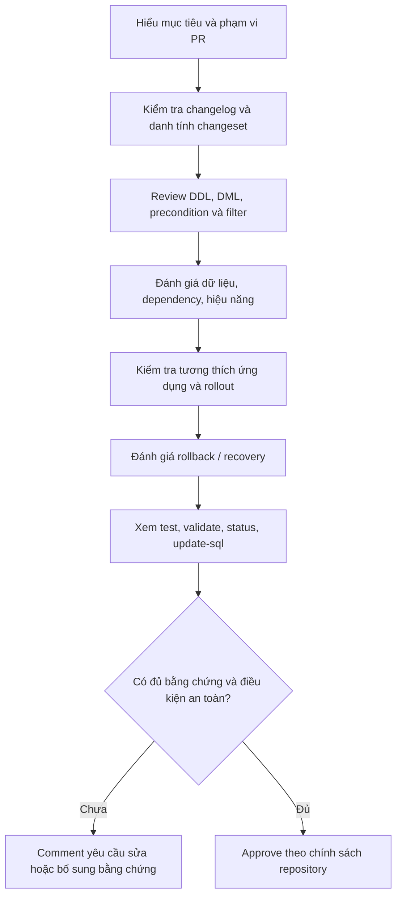
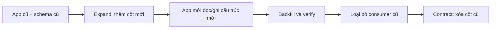

# Rà soát migration trong pull request

## 1. Vì sao migration cần được review như một thay đổi có rủi ro riêng?

Trong module **DATABASE_SCHEMA_MIGRATION_LIQUIBASE**, người học nắm cách quản lý thay đổi schema và dữ liệu bằng Liquibase qua changelog, changeset, precondition, checksum và lịch sử triển khai; thực hành migration có kiểm chứng, rollback, phối hợp nhiều môi trường và tích hợp Spring Boot hoặc CI/CD. Khi một thay đổi database được gửi qua pull request (PR), người review phải đánh giá **mã changelog, SQL thực thi, dữ liệu hiện có, các phiên bản ứng dụng cùng hoạt động và khả năng phục hồi**.

Một PR thêm cột có thể chỉ vài dòng YAML:

```yaml
- changeSet:
    id: 20261119-add-order-status
    author: team-orders
    changes:
      - addColumn:
          schemaName: app
          tableName: orders
          columns:
            - column:
                name: status
                type: varchar(24)
```

Nhưng người review vẫn cần trả lời:

- Bảng `app.orders` có đúng là đối tượng mà dịch vụ cần thay đổi?
- Cột mới có nullable/default phù hợp với dữ liệu hiện có không?
- Ứng dụng phiên bản cũ có tiếp tục hoạt động khi cột xuất hiện không?
- Có cần backfill dữ liệu? Nếu có, phạm vi và thời gian chạy là bao lâu?
- Database nào sẽ chạy changeset và bằng chứng nào xác nhận đúng môi trường?
- Nếu deploy ứng dụng thất bại sau khi schema đã đổi, có cần rollback schema không?
- Nếu rollback chỉ tạo lại cấu trúc nhưng mất dữ liệu, nhóm sẽ khôi phục từ đâu?

Review migration khác review một hàm Java thông thường vì tác động có thể tồn tại lâu dài trong database, khó hoàn nguyên, ảnh hưởng nhiều phiên bản ứng dụng và không phải lúc nào cũng nằm trọn trong một transaction.

### Mục tiêu học tập

Sau bài học, bạn có thể:

1. Tổ chức review PR migration theo phạm vi, rủi ro và bằng chứng.
2. Kiểm tra danh tính changeset, thứ tự changelog, include, checksum và tính bất biến của migration đã triển khai.
3. Đánh giá DDL, DML, precondition, context/label/DBMS filter và SQL đặc thù.
4. Nhận diện rủi ro dữ liệu, lock, transaction, hiệu năng và khả năng phục hồi.
5. Kiểm tra tính tương thích giữa schema mới và các phiên bản ứng dụng đang chạy.
6. Đánh giá rollback, forward-fix, backup và phương án xử lý khi migration lỗi một phần.
7. Yêu cầu đúng bằng chứng từ validate, status, update-sql, test và hậu kiểm.
8. Đưa quality gate phù hợp vào CI/CD mà vẫn giữ trách nhiệm review của con người.

**Nguyên tắc:** Một PR migration chỉ sẵn sàng merge khi người review hiểu rõ database sẽ thay đổi gì, dữ liệu nào có thể bị ảnh hưởng, các phiên bản ứng dụng có tương thích không và nhóm sẽ xử lý ra sao nếu kết quả khác dự kiến.

## 2. Xác định phạm vi của PR trước khi đọc từng dòng

Bắt đầu bằng cách xác định PR đang làm gì và thay đổi được triển khai trong giai đoạn nào. Không phải mọi PR có file changelog đều có cùng mức rủi ro.

### 2.1. Phân loại thay đổi

| Nhóm | Ví dụ | Điểm review trọng tâm |
|---|---|---|
| Thêm cấu trúc | Add table/column/index | Default, nullability, lock, quyền, tương thích app cũ |
| Sửa cấu trúc | Rename/modify datatype/constraint | Mất dữ liệu, dependency, thời gian DDL |
| Xóa cấu trúc | Drop column/table/view | Dữ liệu bị mất, dependency, thời điểm contract |
| Chuyển đổi dữ liệu | Update/backfill/delete/insert-select | Mapping, số hàng, idempotency, snapshot và rollback |
| Stored logic | View/function/procedure/trigger | DBMS, delimiter, quyền, dependency và test hành vi |
| Vận hành | Context, label, parameter, include | Chọn đúng changeset và đúng môi trường |
| Đồng bộ drift | Diff-changelog, baseline | Reference/target, object ngoài dự kiến, lịch sử |

Một PR có thể thuộc nhiều nhóm. Ví dụ thêm cột, backfill và thêm NOT NULL là ba thay đổi với điều kiện an toàn khác nhau; nên xem xét tách thành các pha nếu ứng dụng hoặc dữ liệu không thể chuyển đổi nguyên tử.

### 2.2. Đọc mục tiêu nghiệp vụ trước khi đánh giá giải pháp

Người review cần hiểu:

- Vấn đề nghiệp vụ nào yêu cầu migration?
- Trạng thái trước và sau phải như thế nào?
- Phạm vi tenant, bảng, partition hoặc bản ghi nào bị tác động?
- Có yêu cầu retention, audit, privacy hoặc đối soát tài chính không?
- Ứng dụng nào đọc/ghi đối tượng này?
- Thay đổi cần hoàn tất trong một release hay có thể triển khai nhiều pha?

Nếu PR chỉ ghi “thêm trường trạng thái mới” mà không giải thích nguồn dữ liệu, mapping và cách ứng dụng chuyển sang trường mới, reviewer chưa có đủ thông tin để kết luận migration đúng.

### 2.3. Xác định tất cả tài nguyên liên quan

Review toàn bộ tập thay đổi được PR đưa ra, đặc biệt:

- Changelog root và các changelog được include.
- Changeset mới hoặc thay đổi liên quan.
- File SQL được tham chiếu qua `sqlFile`.
- Cấu hình Liquibase/Spring Boot và parameter nếu thay đổi.
- Entity, repository, query, API, worker hoặc batch job dùng schema mới.
- Test migration, integration test và tài liệu vận hành nếu có.

Đừng chỉ review file YAML được sửa trực tiếp. Một thay đổi đường dẫn include hoặc SQL resource có thể làm nội dung thực thi khác hẳn phần hiển thị trong một file.

## 3. Quy trình review theo thứ tự

Một trình tự dễ áp dụng:



Thứ tự này giúp reviewer hiểu ý định trước khi tập trung vào cú pháp. Nếu phát hiện thao tác phá hủy nghiêm trọng, có thể dừng review chi tiết và yêu cầu tác giả làm rõ tác động/khôi phục trước.

### 3.1. Phân biệt blocker và góp ý cải thiện

- **Blocker:** Có thể xóa nhầm dữ liệu, sai database/schema, không tương thích ứng dụng, thay đổi không có phương án phục hồi, migration không chạy được hoặc thiếu bằng chứng bắt buộc.
- **Yêu cầu sửa:** Thiếu precondition quan trọng, SQL khó hiểu, thứ tự changeset sai, thiếu test cho nhánh dữ liệu.
- **Góp ý:** Tên ID/author, mô tả, cấu trúc file, cách chia changeset hoặc tài liệu có thể rõ hơn mà không làm thay đổi mức rủi ro.

Không hạ một rủi ro mất dữ liệu thành góp ý tùy chọn chỉ vì thay đổi có ít dòng code. Ngược lại, không nên chặn PR chỉ vì phong cách khác sở thích nếu nó không làm giảm độ an toàn hay khả năng bảo trì.

## 4. Kiểm tra danh tính và tính bất biến của changeset

Liquibase nhận diện changeset chủ yếu qua `id`, `author` và định danh đường dẫn changelog (có thể chịu ảnh hưởng của `logicalFilePath`). Các giá trị này gắn với lịch sử trong `DATABASECHANGELOG`.

### 4.1. Changeset mới phải có định danh ổn định

Ví dụ:

```yaml
databaseChangeLog:
  - changeSet:
      id: 20261119-add-orders-status
      author: team-orders
      changes:
        - addColumn:
            schemaName: app
            tableName: orders
            columns:
              - column:
                  name: status
                  type: varchar(24)
```

Review các câu hỏi:

- ID có rõ mục đích, không trùng changeset khác trong cùng định danh changelog?
- Author có theo quy ước dự án để truy vết?
- Changelog file path có ổn định không?
- Changeset có được đặt trong file include đúng thứ tự không?
- Có vô tình đổi tên/move file changelog đã triển khai khiến danh tính thay đổi không?
- Có sửa changeset cũ đã chạy thay vì thêm changeset mới không?

ID có thể chứa ngày hoặc mã ticket theo quy ước nhóm. Không có một định dạng duy nhất phù hợp mọi dự án, nhưng định danh phải duy nhất, dễ truy vết và ổn định.

### 4.2. Không sửa nội dung changeset đã triển khai để thay đổi hành vi

Sau khi changeset đã chạy ở một môi trường, nội dung của nó là một phần lịch sử migration. Sửa câu SQL, change type hoặc file SQL bên ngoài có thể làm checksum khác với giá trị đã ghi nhận.

Ví dụ changeset:

```yaml
- changeSet:
    id: 101-backfill-status
    author: team-orders
    changes:
      - sql:
          sql: >
            UPDATE app.orders
            SET status = 'OPEN'
            WHERE legacy_status = 'NEW'
```

Nếu staging đã chạy nội dung này rồi PR sửa điều kiện `WHERE` thành quy tắc khác trong cùng ID, staging và production có thể thực thi hành vi khác nhau. Cách thông thường là tạo changeset mới cho phần sửa/bù, ghi rõ lý do và điều kiện.

Trường hợp cần sửa metadata do lỗi lịch sử phải tuân theo quy trình được phê duyệt. Không tự xóa dòng `DATABASECHANGELOG` hoặc làm mới checksum để che sự khác biệt.

### 4.3. `runOnChange` và `runAlways` cần được review riêng

- `runOnChange: true` cho phép changeset được xét chạy lại khi định nghĩa liên quan thay đổi theo cơ chế checksum của Liquibase. Thường gặp với định nghĩa view/procedure có thể thay thế.
- `runAlways: true` làm changeset được xét chạy lại trong các lần update phù hợp, dù nội dung không đổi.

Reviewer cần hỏi:

- Thao tác có an toàn khi chạy lại không?
- Có tác dụng phụ hoặc ghi dữ liệu lặp không?
- Có đúng là object cần thay thế định nghĩa, hay migration một lần?
- Nếu chạy lại, rollback và lịch sử sẽ được hiểu thế nào?
- Những thay đổi chỉ về comment/khoảng trắng có tác động checksum theo phiên bản không?

Không dùng `runAlways` để retry một changeset thất bại hoặc né quy trình migration mới.

## 5. Kiểm tra cấu trúc changelog và thứ tự triển khai

### 5.1. Root changelog, `include` và `includeAll`

Người review phải biết changeset mới thực sự được nạp từ đâu:

```yaml
databaseChangeLog:
  - include:
      file: db/changelog/001-schema.yaml
  - include:
      file: db/changelog/002-orders.yaml
  - includeAll:
      path: db/changelog/releases
```

Câu hỏi review:

- File mới có được include từ root changelog đang dùng không?
- Path có đúng khi chạy từ CLI, classpath hoặc Spring Boot JAR không?
- `includeAll` có thể vô tình nạp file SQL thuần hoặc file nháp không?
- Tên file có thứ tự ổn định khi migration phụ thuộc nhau không?
- Có include vòng hoặc cùng một changeset được nạp qua nhiều đường không?
- Có thay đổi đường dẫn làm ảnh hưởng danh tính changeset đã triển khai không?

Đặt SQL thuần trong thư mục riêng nếu được `sqlFile` tham chiếu; đừng để `includeAll` quét nhầm chúng như changelog.

### 5.2. Thứ tự changeset phải tôn trọng dependency

Ví dụ tạo bảng trước, sau đó thêm foreign key:

```yaml
databaseChangeLog:
  - changeSet:
      id: 201-create-customers
      author: team-orders
      changes:
        - createTable:
            schemaName: app
            tableName: customers
            columns:
              - column:
                  name: customer_id
                  type: bigint
                  constraints:
                    primaryKey: true
                    nullable: false

  - changeSet:
      id: 202-create-orders
      author: team-orders
      changes:
        - createTable:
            schemaName: app
            tableName: orders
            columns:
              - column:
                  name: order_id
                  type: bigint
                  constraints:
                    primaryKey: true
                    nullable: false
              - column:
                  name: customer_id
                  type: bigint
        - addForeignKeyConstraint:
            baseTableSchemaName: app
            baseTableName: orders
            baseColumnNames: customer_id
            referencedTableSchemaName: app
            referencedTableName: customers
            referencedColumnNames: customer_id
```

Review các phụ thuộc giữa bảng, view, function, index, sequence, trigger và dữ liệu. Một changeset có thể hợp lệ độc lập nhưng thất bại khi chạy vì object nó tham chiếu chưa tồn tại hoặc constraint bị dữ liệu hiện có vi phạm.

### 5.3. Chia changeset theo ranh giới có thể kiểm soát

Một changeset chứa nhiều thao tác có cùng transaction boundary có thể hợp lý. Nhưng nếu vừa thêm cột, backfill hàng triệu bản ghi, tạo index lâu và xóa cột cũ trong một changeset, việc xác định trạng thái khi lỗi và rollback sẽ khó.

Nên cân nhắc tách:

1. Expand schema.
2. Backfill dữ liệu theo batch.
3. Verify và chuyển ứng dụng.
4. Contract/xóa cấu trúc cũ sau giai đoạn tương thích.

Chia nhỏ không phải mục tiêu tự thân; ranh giới nên phản ánh điểm kiểm chứng, khả năng phục hồi và thứ tự rollout.

## 6. Review DDL: thêm, đổi, xóa đối tượng

### 6.1. Thêm cột

Khi review `addColumn`, kiểm tra:

- Kiểu dữ liệu và độ dài có đúng miền nghiệp vụ?
- Nullable hay NOT NULL? Dữ liệu cũ sẽ nhận giá trị gì?
- Default có cần cho hàng hiện có hay chỉ cho insert mới?
- Default có phải giá trị hằng hay biểu thức DBMS-specific?
- Có cần index, constraint hoặc comment?
- Ứng dụng phiên bản cũ có bỏ qua cột mới an toàn không?
- Việc thêm cột có lock hoặc rewrite table trên DBMS/version đích không?

Ví dụ thêm cột nullable:

```yaml
- changeSet:
    id: 301-add-order-source
    author: team-orders
    changes:
      - addColumn:
          schemaName: app
          tableName: orders
          columns:
            - column:
                name: source
                type: varchar(32)
```

Đây thường là bước expand dễ tương thích hơn việc thêm cột NOT NULL ngay lập tức, nhưng vẫn cần xem DBMS, kích thước bảng và default/lock.

### 6.2. Thêm NOT NULL hoặc constraint

Nếu bảng đã có dữ liệu, không thể giả định cột mới đã có giá trị hợp lệ cho mọi hàng. Một quy trình an toàn thường là:

1. Thêm cột nullable hoặc với cách default được DBMS hỗ trợ và đã đánh giá.
2. Backfill dữ liệu.
3. Kiểm tra số hàng NULL và mapping.
4. Đảm bảo ứng dụng ghi giá trị mới.
5. Thêm constraint ở changeset riêng khi dữ liệu đã đạt điều kiện.

Ví dụ precondition chặn khi còn NULL:

```yaml
- changeSet:
    id: 302-enforce-order-source-not-null
    author: team-orders
    preConditions:
      - onFail: HALT
      - sqlCheck:
          expectedResult: "0"
          sql: >
            SELECT COUNT(*)
            FROM app.orders
            WHERE source IS NULL
    changes:
      - addNotNullConstraint:
          schemaName: app
          tableName: orders
          columnName: source
          columnDataType: varchar(32)
```

Precondition chỉ kiểm tra tại thời điểm đánh giá. Nếu ứng dụng có thể ghi NULL giữa kiểm tra và DDL, vẫn có race condition. Cần kiểm soát ghi hoặc dùng cơ chế DBMS phù hợp.

### 6.3. Sửa kiểu dữ liệu

`modifyDataType` có thể làm dữ liệu bị cắt, làm tròn, overflow hoặc không chuyển đổi được. Review phải có bằng chứng về phân bố giá trị hiện tại, giá trị lớn nhất/nhỏ nhất, độ dài và các giá trị không thể cast.

Ví dụ PostgreSQL kiểm tra mã dài hơn 40 ký tự:

```sql
SELECT COUNT(*) AS over_limit
FROM app.customers
WHERE customer_code IS NOT NULL
  AND char_length(customer_code) > 40;
```

Nếu kết quả khác 0, không tự động cắt dữ liệu. Cần quyết định nghiệp vụ hoặc mapping được duyệt. Câu kiểm tra và cú pháp kiểu phải được điều chỉnh theo DBMS thực tế.

### 6.4. Rename hoặc drop

Rename có thể giữ dữ liệu nhưng phá tương thích với app cũ. Drop có thể xóa dữ liệu và không thể khôi phục bằng cách tạo lại cột/bảng rỗng.

Với `dropColumn` hoặc `dropTable`, reviewer cần yêu cầu:

- Bằng chứng không còn consumer sử dụng object.
- Danh sách dependency DBMS và ứng dụng.
- Kế hoạch expand-contract nếu cần rolling deployment.
- Backup/archive/PITR và thời gian lưu giữ hợp lệ.
- Kịch bản khôi phục nếu ứng dụng mới lỗi sau khi contract.
- Review SQL sinh ra, lock và phạm vi cascade.

Không chấp nhận `CASCADE` chỉ để vượt lỗi dependency nếu chưa biết chính xác object nào bị xóa.

## 7. Review DML và chuyển đổi dữ liệu

DML thường khó review hơn DDL vì cú pháp hợp lệ không chứng minh mapping đúng.

### 7.1. Xác định tập dữ liệu bị tác động

Với mỗi `UPDATE`/`DELETE`, hỏi:

- Điều kiện `WHERE` xác định đúng tập ID/tenant không?
- Số hàng dự kiến là bao nhiêu?
- Có hàng NULL, dữ liệu lỗi hoặc giá trị ngoài miền không?
- Có thể chạy lại không? Nếu retry, có cập nhật trùng hoặc ghi đè không?
- Có ứng dụng tiếp tục ghi đồng thời không?
- Có lưu giá trị gốc nếu phép biến đổi mất thông tin không?
- Có truy vấn hậu kiểm và ngưỡng dừng không?

Ví dụ:

```sql
UPDATE app.orders
SET status = 'OPEN'
WHERE legacy_status IN ('NEW', 'PENDING');
```

Reviewer không nên chỉ nhìn thấy `WHERE` rồi kết luận an toàn. Cần kiểm tra phân bố `legacy_status`, số hàng, ý nghĩa mapping và những hàng đã có `status` mới.

### 7.2. Mapping phải được mô tả tường minh

| Giá trị cũ | Giá trị mới | Quy tắc |
|---|---|---|
| NEW | OPEN | Chuyển trạng thái |
| PENDING | OPEN | Gộp vào cùng trạng thái |
| PAID | PAID | Giữ nguyên |
| CANCELLED | CANCELLED | Giữ nguyên |
| NULL | Chưa xác định | Phải có quyết định nghiệp vụ |

Nếu hai giá trị cũ cùng chuyển thành một giá trị mới, mapping không thể đảo ngược chỉ từ kết quả. Cần lưu nguồn theo ID, audit hoặc một nguồn khôi phục khác nếu được phép.

### 7.3. Idempotency và khả năng đảo ngược là hai tiêu chí khác nhau

Một câu SQL có thể chạy lặp mà không thay đổi thêm dữ liệu nhưng vẫn mất thông tin từ lần đầu:

```sql
UPDATE app.orders
SET status = 'OPEN'
WHERE status IN ('NEW', 'PENDING');
```

Lần chạy sau có thể không còn hàng phù hợp, nhưng trạng thái NEW/PENDING ban đầu vẫn mất. Reviewer cần đánh giá riêng:

- **Idempotency:** chạy lại có tạo thêm tác dụng phụ không?
- **Reversibility:** có tái tạo chính xác giá trị trước đó không?
- **Atomicity:** các lệnh có được commit/rollback cùng nhau không?
- **Consistency:** invariant nghiệp vụ có được giữ trong suốt quá trình không?

### 7.4. Backfill lớn cần kế hoạch vận hành

Nếu migration cập nhật hàng triệu bản ghi, yêu cầu tác giả cung cấp:

- Ước lượng số hàng, dung lượng và thời gian.
- Kích thước batch, checkpoint và khả năng resume.
- Lock, transaction duration, WAL/redo log, replication lag.
- Index/trigger ảnh hưởng tới tốc độ.
- Thời gian chạy phù hợp với SLA/maintenance window.
- Cách đo tiến độ và điều kiện dừng.
- Cách đối chiếu sau từng batch và sau toàn bộ migration.

Một changeset duy nhất chạy DML toàn bảng có thể giữ transaction lâu và gây áp lực DBMS. Có thể cần job backfill chuyên trách hoặc migration theo pha; lựa chọn phải phù hợp tính nhất quán và khả năng vận hành.

## 8. Review precondition và filter

### 8.1. Precondition kiểm tra đúng giả định nào?

Precondition nên bảo vệ một giả định quan trọng của changeset, chẳng hạn bảng/cột tồn tại, dữ liệu đạt ngưỡng hoặc object chưa tồn tại.

Ví dụ:

```yaml
preConditions:
  - onFail: HALT
  - tableExists:
      schemaName: app
      tableName: orders
  - columnExists:
      schemaName: app
      tableName: orders
      columnName: legacy_status
```

Reviewer cần hỏi:

- Điều kiện có liên quan trực tiếp đến thay đổi không?
- Nó kiểm tra đúng schema/catalog không?
- Có thể trả kết quả sai do quyền hoặc default schema không?
- Nếu fail, hành vi là HALT, WARN, CONTINUE hay MARK_RAN?
- Có race condition giữa lúc check và lúc thực thi không?
- Hậu kiểm độc lập nào xác minh kết quả?

Với điều kiện an toàn bắt buộc, `onFail: HALT` thường dễ quan sát hơn việc tiếp tục hoặc đánh dấu đã chạy. `MARK_RAN` có thể khiến lịch sử ghi nhận changeset dù phần thay đổi không thực thi; phải có lý do rõ ràng và hậu kiểm phù hợp.

### 8.2. Context, label và DBMS

Các bộ lọc context, label và DBMS có thể khiến changeset được chọn ở môi trường này nhưng không ở môi trường khác.

Review:

- Context có được truyền tường minh trong pipeline không?
- Label filter có đúng biểu thức logic và cú pháp phiên bản?
- Có changeset dành cho dev/test bị chọn nhầm trong production không?
- `dbms` có giới hạn đúng SQL đặc thù?
- Không truyền filter có làm changeset vẫn được xét không?
- Có dùng filter như cơ chế bảo mật duy nhất không?

Không giả định changeset có context/label sẽ tự động bị loại nếu pipeline không truyền filter. Hành vi phụ thuộc cách khai báo và phiên bản Liquibase; cần kiểm tra bằng `status` trên cấu hình đích.

## 9. Review SQL bên ngoài qua `sqlFile`

Khi changeset tham chiếu file SQL, file đó là một phần của migration và phải được review cùng changelog.

Ví dụ:

```yaml
- changeSet:
    id: 401-create-order-view
    author: team-orders
    dbms: postgresql
    runOnChange: true
    changes:
      - sqlFile:
          path: sql/views/v_order_summary.sql
          relativeToChangelogFile: true
          encoding: UTF-8
          splitStatements: false
```

Reviewer kiểm tra:

- File SQL có nằm trong PR và đúng path không?
- Path có hoạt động từ CLI/classpath/JAR không?
- SQL có đặc thù DBMS và được giới hạn bằng `dbms` không?
- `splitStatements`/`endDelimiter` có cắt đúng function/procedure không?
- `stripComments` có vô tình loại optimizer hint hoặc comment có ý nghĩa không?
- File có secret hoặc thông tin môi trường bị hardcode không?
- SQL đã triển khai có bị sửa, ảnh hưởng checksum không?
- Rollback có file riêng và file đó thực sự khôi phục được điều gì?

Không review changelog mà bỏ qua SQL file. Một file SQL đúng cú pháp vẫn có thể được tham chiếu sai đường dẫn hoặc chạy sai môi trường.

## 10. Đánh giá transaction, lock và hiệu năng

### 10.1. Transaction DDL phụ thuộc DBMS

Không giả định mọi DBMS có cùng khả năng transactional DDL. Một số thao tác có implicit commit, lock mạnh hoặc không thể rollback theo cách ứng dụng mong muốn. `runInTransaction` của Liquibase cần được xem cùng loại SQL và DBMS.

Nếu changeset dùng `runInTransaction: false`, reviewer cần hiểu rõ trạng thái khi câu lệnh thứ hai thất bại sau khi câu lệnh thứ nhất đã commit. Với changeset nhiều câu lệnh, có thể xảy ra áp dụng một phần và lịch sử chưa phản ánh đầy đủ.

### 10.2. Lock và downtime

Đối với mỗi DDL/DML đáng kể, đánh giá:

- Lock mode và thời gian giữ lock.
- Có chờ transaction dài hoặc deadlock không?
- Bảng lớn có cần rewrite hoặc scan toàn bộ không?
- Tạo index có thể chạy online/concurrently không, và DBMS yêu cầu transaction thế nào?
- Ảnh hưởng đến replication, CDC, backup và connection pool.
- Có cần maintenance window hoặc chia migration thành nhiều đợt không?

Ví dụ PostgreSQL `CREATE INDEX CONCURRENTLY` có quy tắc transaction riêng và không thể được review như một câu `CREATE INDEX` thông thường. SQL cần được thử trên đúng phiên bản DBMS và executor.

### 10.3. Review quy mô dữ liệu

Một câu SQL 5 dòng có thể cập nhật 50 triệu hàng. Yêu cầu tác giả cung cấp ước lượng dữ liệu và phương pháp kiểm tra. Không chấp nhận lý do “SQL đơn giản nên chạy nhanh” thay cho bằng chứng.

## 11. Đánh giá rollback và recovery trong PR

### 11.1. Không đồng nhất rollback cấu trúc với phục hồi dữ liệu

Ví dụ drop column và thêm lại cột trong rollback chỉ tái tạo cấu trúc. Nó không phục hồi giá trị từng hàng. Với DML gộp trạng thái, cắt chuỗi hoặc xóa hàng, phải có nguồn dữ liệu gốc theo khóa hoặc backup/PITR nếu muốn khôi phục chính xác.

### 11.2. Các câu hỏi bắt buộc

- Change type có auto rollback theo DBMS/phiên bản không?
- Nếu không, rollback thủ công đã được định nghĩa chưa?
- Rollback có thể chạy sau khi ứng dụng đã ghi dữ liệu mới không?
- Có thể làm mất các giao dịch hợp lệ phát sinh sau deploy không?
- Cần backup, archive, audit hoặc PITR nào?
- Đã thử restore trên môi trường gần production chưa?
- Nếu không thể rollback an toàn, forward-fix nào được chuẩn bị?
- Ai quyết định dừng ghi, chạy recovery và mở dịch vụ lại?

### 11.3. Ví dụ rollback chỉ phù hợp trong cửa sổ kiểm soát

```yaml
- changeSet:
    id: 501-merge-order-status
    author: team-orders
    changes:
      - sql:
          sql: >
            UPDATE app.orders
            SET status = 'OPEN'
            WHERE status IN ('NEW', 'PENDING')
    rollback:
      - sql:
          sql: >
            UPDATE app.orders AS o
            SET status = b.status_before
            FROM app.order_status_before_merge AS b
            WHERE o.order_id = b.order_id
              AND o.status = 'OPEN'
```

Rollback dựa trên bảng snapshot theo ID. Nhưng nếu ứng dụng đã cập nhật một hàng thành `OPEN` vì nghiệp vụ sau migration, điều kiện `o.status='OPEN'` không phân biệt được nguồn thay đổi. Reviewer phải yêu cầu kiểm soát ghi hoặc row version/audit và không chấp thuận rollback mù quáng.

### 11.4. RPO và RTO

Nếu PR có thay đổi khó đảo ngược, cần xem phương án recovery có đáp ứng:

- **RPO:** dữ liệu tối đa có thể mất theo thời gian.
- **RTO:** thời gian tối đa để khôi phục dịch vụ/chức năng.
- Backup/PITR có được diễn tập?
- Restore vào DB tạm và merge dữ liệu mới có được tính đến?
- Có thể xử lý side effect ở CDC, event, cache hoặc báo cáo không?

“Có backup” không phải bằng chứng đủ nếu chưa biết restore mất bao lâu hoặc sẽ ghi đè dữ liệu mới thế nào.

## 12. Tương thích ứng dụng: review theo thứ tự rollout

Migration thường không chạy đồng thời với tất cả service. Trong rolling deployment, có thể tồn tại phiên bản cũ và mới cùng lúc. Review cần xem **schema và app có tương thích ở từng bước triển khai** không.

### 12.1. Expand-contract



Ví dụ đổi `legacy_status` thành `status`:

1. Thêm `status` nullable, giữ `legacy_status`.
2. Triển khai app có thể đọc/ghi cấu trúc mới và duy trì tương thích trong thời gian chuyển tiếp.
3. Backfill theo batch, đối chiếu theo ID.
4. Chuyển tất cả worker, API, report và job sang cấu trúc mới.
5. Theo dõi đủ chu kỳ vận hành để xác nhận không còn consumer cũ.
6. Xóa `legacy_status` trong một PR/release riêng.

Reviewer nên yêu cầu bằng chứng rằng job chạy theo tháng/quý cũng đã chuyển đổi; “không thấy query trong vài ngày” chưa đủ nếu chu kỳ sử dụng dài.

### 12.2. Tương thích ngược và tiến

Một PR tốt nêu rõ:

- Phiên bản ứng dụng tối thiểu có thể chạy với schema mới.
- Có thể deploy schema trước app hay app trước schema?
- App cũ có thể đọc/ghi trong thời gian chuyển tiếp không?
- Rollback ứng dụng có cần schema cũ không?
- Khi nào được phép contract?
- Có cần feature flag hoặc dual-write không?

Đừng gộp schema break và app switch vào một bước nếu hệ thống cần rolling deployment mà không có cơ chế tương thích.

## 13. Bằng chứng kiểm thử cần có trong PR

Một PR migration nên có bằng chứng phù hợp với mức rủi ro. Không phải mọi thay đổi đều cần một bộ test lớn, nhưng destructive/data migration không nên chỉ có ảnh chụp validate thành công.

### 13.1. Các lớp kiểm tra

| Lớp | Mục đích | Bằng chứng |
|---|---|---|
| Cấu trúc changelog | Định nghĩa và resource hợp lệ | `validate`, code review |
| Tập changeset | Đúng changeset được chọn trên DB đích | `status --verbose` |
| SQL dự kiến | Xem tác động DDL/DML | `update-sql`, review output |
| Migration integration | DBMS chấp nhận thay đổi | Chạy trên DBMS/version phù hợp |
| Dữ liệu | Mapping và invariant đúng | Query assertions, số hàng, tập ID |
| Rollback/recovery | Có thể xử lý lỗi theo runbook | Thử rollback/restore trên clone |
| Ứng dụng | App và worker tương thích | Integration/smoke test |
| Vận hành | Lock/latency nằm trong ngưỡng | Thời gian chạy, metric, replication |

### 13.2. Validate, status và update-sql

Các lệnh minh họa với CLI đã cấu hình kết nối an toàn:

```bash
liquibase --changelog-file=db/changelog.yaml validate
liquibase --changelog-file=db/changelog.yaml status --verbose
liquibase --changelog-file=db/changelog.yaml update-sql
```

- `validate` kiểm tra changelog theo những quy tắc Liquibase hỗ trợ; không chứng minh SQL runtime hoặc dữ liệu đúng.
- `status` giúp xem changeset pending theo lịch sử và filter hiện tại.
- `update-sql` tạo SQL dự kiến; không phải lần thực thi thật và không đo hết lock/tác dụng phụ.

Tên option/lệnh và hành vi cụ thể cần xác nhận với phiên bản Liquibase của dự án. Credential không được hardcode vào PR hoặc log.

### 13.3. Test database cần phản ánh đúng DBMS

Nếu production dùng PostgreSQL, test trên H2 không thể chứng minh mọi cú pháp PostgreSQL, lock hoặc DDL behavior sẽ đúng. Với SQL đặc thù, dùng DBMS và phiên bản phù hợp trong test environment/container được tổ chức hỗ trợ.

Kiểm tra cả:

- Database mới hoàn toàn (fresh install).
- Database đã có lịch sử changeset cũ (upgrade path).
- Dữ liệu đại diện, NULL, duplicate và trường hợp biên.
- Retry hoặc failure giữa chừng nếu migration không nguyên tử.
- Các ứng dụng cũ/mới trong thời gian rolling deploy.

### 13.4. Hậu kiểm không được chỉ sao chép giả định của SQL

Nếu changeset đặt `status='OPEN'` cho một tập hàng, truy vấn hậu kiểm phải kiểm tra mapping theo ID/giá trị và những hàng ngoài phạm vi không bị đổi. Đừng viết assertion giống hệt điều kiện SQL mà không kiểm tra kết quả nghiệp vụ độc lập; nếu giả định trong SQL sai, assertion lặp lại giả định đó sẽ cùng sai.

## 14. Review file SQL và thay đổi ngoài YAML

Nếu PR thay file `sqlFile`, review toàn bộ file và những tham số ảnh hưởng việc nạp/chạy:

- `path`, `relativeToChangelogFile` và resource có nằm trong artifact không.
- `encoding` có đúng UTF-8 và ký tự Unicode không.
- `splitStatements`, `endDelimiter` có cắt đúng function/procedure không.
- `stripComments` có loại bỏ hint/chỉ thị cần thiết không.
- SQL có đúng dialect/DBMS và được giới hạn phù hợp không.
- File rollback có tồn tại và có thể khôi phục điều gì?
- Nội dung file đã triển khai có bị sửa làm checksum thay đổi không?

Ví dụ file function PostgreSQL chứa dấu chấm phẩy nội bộ có thể cần `splitStatements: false`; cần kiểm thử với executor thực tế. Một SQL file chạy được qua công cụ DBA không tự động có nghĩa Liquibase JDBC executor sẽ xử lý delimiter giống hệt.

## 15. Kiểm tra cấu hình và môi trường triển khai

Một changeset có thể đúng nhưng chạy sai nơi do cấu hình:

- `spring.liquibase.change-log` trỏ nhầm root changelog.
- URL, default schema hoặc catalog sai.
- Context/label filter không được truyền hoặc truyền sai.
- Property substitution dùng schema không đúng.
- Driver hoặc Liquibase version khác giữa CI và production.
- `includeAll` nạp thêm file nháp.
- Tài khoản migration thiếu quyền hoặc có quyền rộng hơn cần thiết.

Reviewer nên kiểm tra pipeline có cố định artifact, version, URL/secret source và filter giữa các bước preview/update không. Với production, một job migration riêng có thể giúp tách quyền DDL khỏi quyền runtime của ứng dụng, tùy kiến trúc dự án.

**Không dùng context/label như cơ chế bảo mật duy nhất.** Quyền DBMS, phân quyền pipeline, approval và xác nhận môi trường vẫn cần thiết.

## 16. Comment review hiệu quả

Một comment tốt chỉ rõ **vị trí, rủi ro, bằng chứng còn thiếu và thay đổi cần thiết**. Tránh comment chung chung như “migration nguy hiểm” mà không giải thích điều gì có thể xảy ra.

### 16.1. Comment cho DML không rõ phạm vi

> **Blocker:** Điều kiện `WHERE status <> 'ARCHIVED'` có thể bao gồm các trạng thái mới mà mapping chưa được xác định. Vui lòng bổ sung danh sách trạng thái đầu vào được phép, truy vấn đếm số hàng dự kiến và assertion đối chiếu theo ID trước khi chạy ở production.

### 16.2. Comment cho drop column quá sớm

> **Blocker:** Changeset xóa `legacy_status` trong cùng release với việc chuyển ứng dụng sang `status`. Trong rolling deployment, instance cũ vẫn có thể truy vấn cột này. Hãy tách bước contract sang release sau và xác minh worker/report không còn dùng cột cũ.

### 16.3. Comment cho rollback không phục hồi dữ liệu

> **Blocker:** Rollback hiện chỉ thêm lại cột `old_note`, nên giá trị đã xóa sẽ không được khôi phục. Vui lòng mô tả nguồn phục hồi dữ liệu, hoặc xác định rõ đây là thao tác không thể rollback dữ liệu và cung cấp backup/restore plan đã thử.

### 16.4. Comment cho changeset đã triển khai bị sửa

> **Blocker:** Changeset này đã có thể chạy ở staging. Sửa SQL trong cùng ID có thể gây checksum mismatch hoặc hành vi khác giữa staging và production. Hãy giữ changeset cũ và tạo changeset bù mới có ID riêng.

### 16.5. Comment cho thiếu test DBMS

> **Request changes:** Migration dùng cú pháp PostgreSQL đặc thù nhưng bằng chứng hiện tại chỉ chạy trên H2. Vui lòng bổ sung kiểm tra trên PostgreSQL cùng major version hoặc môi trường tương đương production, gồm SQL preview và hậu kiểm dữ liệu.

Comment nên hướng đến giải pháp có thể review lại. Nếu cần thêm thông tin, hỏi tác giả về giả định dữ liệu hoặc thứ tự rollout thay vì yêu cầu họ “làm an toàn hơn” một cách mơ hồ.

## 17. Mẫu nội dung PR dành cho migration

Có thể yêu cầu tác giả điền một mẫu ngắn trong mô tả PR:

```markdown
## Mục tiêu
- Vấn đề nghiệp vụ:
- Schema/data được thay đổi:

## Phạm vi
- Database/DBMS và phiên bản:
- Bảng/cột/object:
- Số hàng dự kiến:
- Context/label/DBMS filter:

## Triển khai
- Changeset mới:
- Thứ tự rollout schema/app:
- Backfill hoặc batch:
- Lock/downtime dự kiến:

## An toàn dữ liệu
- Precondition:
- Hậu kiểm/invariant:
- Backup/archive/PITR:
- Dữ liệu có mất thông tin không?

## Rollback và phục hồi
- Rollback DDL:
- Phục hồi dữ liệu:
- Forward-fix nếu có ghi mới:
- RPO/RTO và runbook:

## Bằng chứng
- validate:
- status:
- update-sql:
- DBMS integration test:
- Data assertions:
- App smoke test:
```

Mẫu này là hướng dẫn review, không phải format bắt buộc của Liquibase. Repository có thể có template riêng; mục tiêu là cung cấp bằng chứng đủ để reviewer quyết định.

## 18. Các anti-pattern trong review migration

| Anti-pattern | Vì sao nguy hiểm | Hướng sửa |
|---|---|---|
| Chỉ xem YAML, bỏ qua SQL file | SQL thật có thể khác giả định | Review cả resource và path |
| Approve chỉ vì `validate` pass | Chưa kiểm tra runtime và dữ liệu | Bổ sung SQL preview, DBMS test và hậu kiểm |
| Sửa changeset đã triển khai | Checksum/lịch sử lệch giữa môi trường | Tạo changeset mới |
| Drop cột cùng lúc app đổi code | Rolling deployment làm app cũ lỗi | Expand-contract |
| Rollback chỉ tạo lại cột | Dữ liệu cũ không được phục hồi | Backup/snapshot theo khóa |
| Không ước lượng số hàng DML | Có thể cập nhật quá rộng | Query baseline và assertion |
| Dùng `MARK_RAN` để bỏ lỗi | Lịch sử có thể nói đã xử lý dù SQL chưa chạy | Điều tra trạng thái thật |
| Dùng `runAlways` làm retry | Có thể lặp tác dụng phụ | Thiết kế retry/idempotency riêng |
| Không test trên DBMS thật | Khác biệt dialect/transaction/lock | Test đúng DBMS/version |
| Chấp nhận diff-changelog tự động | Có thể sinh DROP không mong muốn | Review từng changeset |
| Chỉ test database rỗng | Bỏ qua dữ liệu cũ và upgrade path | Test cả fresh và populated database |
| Không xem xét worker/batch hiếm chạy | Lỗi xuất hiện sau nhiều ngày/tuần | Theo dõi đủ chu kỳ nghiệp vụ |

## 19. Checklist review có thể dùng trực tiếp

### Mục tiêu và phạm vi

- [ ] PR giải thích vấn đề nghiệp vụ và trạng thái mong muốn.
- [ ] Đúng database, schema, bảng, cột và loại object.
- [ ] Xác định ứng dụng, worker, batch, report và downstream bị ảnh hưởng.
- [ ] Số hàng/đối tượng dự kiến được ước lượng.

### Changelog và changeset

- [ ] ID/author/path ổn định, không trùng.
- [ ] Changeset cũ đã triển khai không bị sửa tùy tiện.
- [ ] Root changelog include đúng file, thứ tự dependency hợp lệ.
- [ ] Context/label/dbms filter được hiểu và kiểm tra.
- [ ] `runAlways`/`runOnChange` có lý do và an toàn khi chạy lại.
- [ ] SQL file và resource có trong artifact.

### Dữ liệu và DBMS

- [ ] DML có điều kiện chính xác và mapping rõ.
- [ ] Có precondition phù hợp và hành vi HALT khi điều kiện bắt buộc không đạt.
- [ ] Có baseline, hậu kiểm và invariant theo ID/giá trị.
- [ ] Đánh giá NULL, duplicate, outlier và dữ liệu biên.
- [ ] Đánh giá lock, transaction, hiệu năng và replication.
- [ ] SQL đã được thử trên đúng DBMS/version khi cần.

### Tương thích và phục hồi

- [ ] Có thứ tự rollout tương thích với phiên bản app cũ/mới.
- [ ] Destructive change được tách khỏi bước chuyển app khi cần.
- [ ] Rollback được đánh giá cả cấu trúc lẫn dữ liệu.
- [ ] Backup/restore/PITR đã có bằng chứng phù hợp.
- [ ] Forward-fix và xử lý ghi mới sau migration được xem xét.
- [ ] RPO/RTO, người phụ trách và runbook rõ ràng.

### Bằng chứng và vận hành

- [ ] `validate`, `status`, `update-sql` có kết quả phù hợp.
- [ ] Integration test dùng DBMS/version phù hợp.
- [ ] Data assertions và smoke test đạt.
- [ ] Pipeline dùng cùng artifact/config/filter giữa preview và update.
- [ ] Có approval/quality gate theo mức rủi ro.
- [ ] Log và report không làm lộ secret hoặc dữ liệu nhạy cảm.

Không phải mọi PR đều cần mọi mục ở cùng mức độ. Reviewer có thể đánh dấu “không áp dụng” nếu giải thích được; các mục liên quan trực tiếp đến destructive change hoặc mất dữ liệu không được bỏ qua chỉ để rút ngắn review.

## 20. Bài thực hành: review một pull request migration

**Bối cảnh:** Một PR đề xuất:

1. Thêm cột `status` vào `app.orders`.
2. Chuyển `NEW` và `PENDING` trong `legacy_status` thành `OPEN`.
3. Thêm NOT NULL cho `status`.
4. Xóa `legacy_status` trong cùng changeset.
5. Rollback chỉ thêm lại `legacy_status` kiểu `varchar(24)`.

### 20.1. Những vấn đề reviewer cần nêu

- **Mapping mất thông tin:** sau khi gộp, không thể biết từng hàng vốn là NEW hay PENDING nếu không lưu nguồn.
- **NOT NULL quá sớm:** cột mới có thể chưa được backfill đầy đủ khi constraint chạy.
- **Drop quá sớm:** app cũ hoặc worker có thể còn đọc/ghi `legacy_status`.
- **Rollback không đầy đủ:** thêm lại cột không phục hồi giá trị cũ.
- **Không có pha quan sát:** nhóm chưa xác nhận job/report hiếm chạy đã chuyển đổi.
- **Thiếu bằng chứng:** không có số hàng dự kiến, hậu kiểm theo ID, test DBMS và recovery plan.

### 20.2. Đề xuất cấu trúc PR an toàn hơn

**PR/pha 1 — Expand**

- Thêm `status` nullable.
- Giữ `legacy_status`.
- Cập nhật ứng dụng có thể đọc/ghi tương thích trong giai đoạn chuyển tiếp.
- Test app cũ và mới cùng schema.

**PR/pha 2 — Backfill**

- Lưu mapping nguồn theo ID nếu được phép.
- Chạy backfill có checkpoint/batch.
- Kiểm tra phân bố, số hàng và mismatch.
- Không thêm NOT NULL cho tới khi dữ liệu và ghi mới đáp ứng.

**PR/pha 3 — Switch**

- Chuyển toàn bộ service, worker, report và downstream.
- Quan sát đủ chu kỳ nghiệp vụ.
- Giữ khả năng phục hồi trong cửa sổ đã định.

**PR/pha 4 — Contract**

- Xác nhận không còn consumer dùng cột cũ.
- Có backup/restore và approval.
- Xóa cột cũ bằng changeset riêng.
- Hậu kiểm schema, app và downstream.

### 20.3. Cách kết luận review

Một kết luận tốt có thể là:

> **Request changes.** PR hiện kết hợp expand, backfill, contract và rollback trong một changeset. Mapping NEW/PENDING → OPEN làm mất thông tin nguồn, trong khi rollback chỉ tạo lại cột cũ rỗng. Hãy tách migration thành các pha, cung cấp kiểm tra theo khóa, phương án lưu/khôi phục dữ liệu và bằng chứng tương thích trong rolling deployment. Sau khi có các thay đổi này, reviewer có thể đánh giá lại SQL, thời gian lock và hậu kiểm.

## 21. Kết luận

Rà soát migration trong pull request là hoạt động kiểm soát rủi ro ở giao điểm giữa schema, dữ liệu, DBMS, ứng dụng và vận hành. Reviewer cần hiểu mục tiêu nghiệp vụ, kiểm tra danh tính/định nghĩa changeset, đánh giá SQL và dữ liệu, xem dependency và tương thích ứng dụng, rồi xác nhận test và kế hoạch phục hồi có bằng chứng.

Liquibase cung cấp changelog, changeset, precondition, checksum và lịch sử để thay đổi có thể truy vết. Nhưng những cơ chế đó không tự chứng minh SQL đúng nghiệp vụ, không thay thế test trên DBMS thật và không tự khôi phục dữ liệu bị mất. Một PR tốt làm rõ **điều gì sẽ thay đổi, vì sao an toàn, cách kiểm chứng và cách xử lý khi thất bại**. Khi reviewer có đủ bằng chứng ở từng bước, migration mới có thể được triển khai có kiểm soát qua các môi trường và phiên bản ứng dụng.

