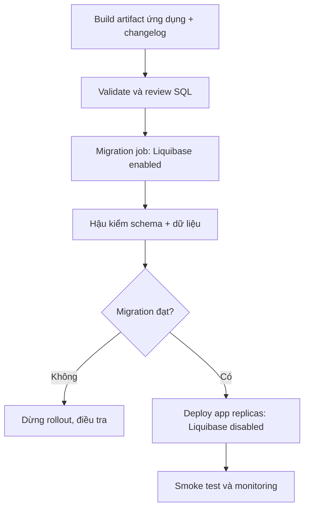
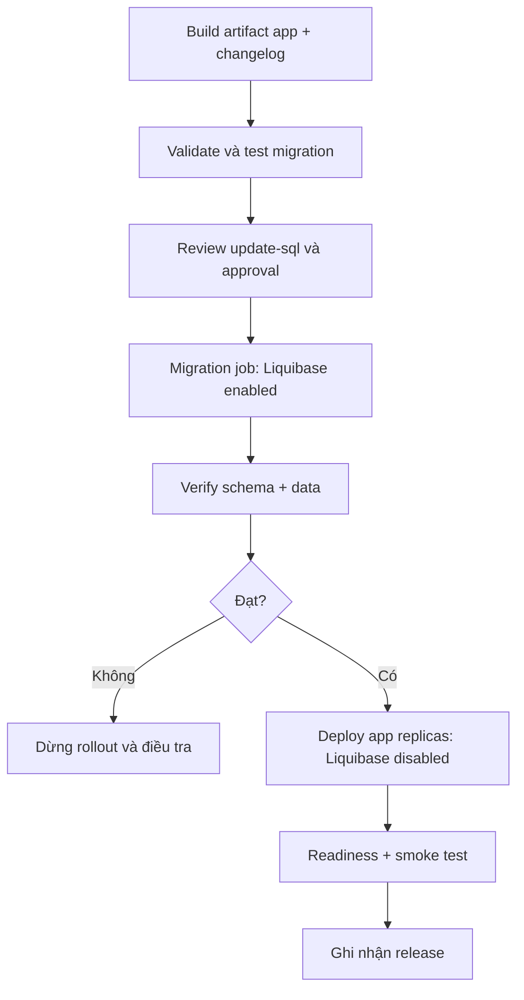

# Tắt migration có chủ đích trong một số môi trường

## 1. Vì sao cần điều khiển thời điểm chạy Liquibase?

Trong module **DATABASE_SCHEMA_MIGRATION_LIQUIBASE**, nhóm học cách quản lý thay đổi schema và dữ liệu bằng Liquibase qua changelog, changeset, precondition, checksum và lịch sử triển khai; thực hành migration có kiểm chứng, rollback, phối hợp nhiều môi trường và tích hợp Spring Boot hoặc CI/CD. Khi tích hợp Liquibase với Spring Boot, một quyết định vận hành quan trọng là **ứng dụng có tự chạy migration trong quá trình khởi động hay không**.

Trong nhiều dự án, Spring Boot tự cấu hình Liquibase khi thư viện tích hợp có mặt trên classpath. Điều này thuận tiện ở môi trường phát triển: khởi động ứng dụng, Liquibase đọc changelog và áp dụng những changeset còn thiếu. Nhưng cùng hành vi đó không phải lúc nào cũng phù hợp:

- Một integration test cần khởi tạo schema từ fixture riêng và muốn kiểm soát chính xác dữ liệu mẫu.
- Một môi trường demo hoặc sandbox dùng database được cấp phát sẵn, không cho ứng dụng thay đổi schema.
- Production triển khai nhiều replica và nhóm muốn chạy migration bằng một job chuyên trách trước khi rollout ứng dụng.
- Một dịch vụ chỉ đọc database do nhóm nền tảng khác quản lý.
- Một tiến trình kiểm thử cần xác minh ứng dụng hoạt động với schema đã được chuẩn bị từ trước.

Spring Boot cung cấp thuộc tính `spring.liquibase.enabled` để bật hoặc tắt Liquibase auto-configuration trong ứng dụng. Khi được đặt thành `false`, Spring Boot không tạo bean Liquibase tự động theo cấu hình mặc định; ứng dụng không tự chạy migration thông qua tích hợp auto-configured đó trong startup.

**Tắt migration có chủ đích không có nghĩa database không cần migration.** Điều đó có nghĩa trách nhiệm cập nhật schema được chuyển sang một bước hoặc một hệ thống khác, hoặc môi trường đó được xác định rõ là không thực hiện migration.

### Mục tiêu học tập

Sau bài học, bạn có thể:

1. Cấu hình `spring.liquibase.enabled` theo môi trường bằng application properties/YAML, profile và biến môi trường.
2. Phân biệt tắt Liquibase auto-configuration với tắt toàn bộ những cơ chế có thể thay đổi schema.
3. Quyết định môi trường nào nên để Liquibase chạy khi ứng dụng khởi động và môi trường nào nên dùng migration job riêng.
4. Bảo đảm database đã được chuẩn bị và tương thích khi ứng dụng khởi động mà Liquibase bị tắt.
5. Tránh các lỗi do profile, property precedence, custom bean hoặc cấu hình môi trường ghi đè ngoài dự kiến.
6. Thiết kế test, CI/CD, logging và quality gate để chứng minh migration được chạy đúng nơi, đúng thời điểm.
7. Xử lý sự cố khi migration vô tình bị tắt hoặc bị chạy ở môi trường không được phép.

**Nguyên tắc:** Chỉ tắt migration khi đã xác định rõ ai chịu trách nhiệm tạo/cập nhật schema, bước đó chạy khi nào và bằng chứng nào xác nhận database tương thích với phiên bản ứng dụng.

## 2. Cơ chế Spring Boot tích hợp Liquibase

Khi dependency Liquibase phù hợp có trong ứng dụng Spring Boot và auto-configuration được kích hoạt, Spring Boot có thể tạo bean `SpringLiquibase`. Bean này sử dụng datasource và các thuộc tính cấu hình để đọc changelog, kiểm tra lịch sử và chạy những changeset cần thiết trong vòng đời khởi động ứng dụng.

Cấu hình tối thiểu thường có dạng:

```yaml
spring:
  liquibase:
    enabled: true
    change-log: classpath:db/changelog/db.changelog-master.yaml
```

Trong cấu hình này:

- `enabled: true` yêu cầu tích hợp Liquibase tự động được bật.
- `change-log` xác định changelog root.
- Connection, schema, contexts, labels và những thuộc tính khác có thể được cấu hình riêng theo dự án.

Trong Spring Boot, thuộc tính `spring.liquibase.enabled` thường mặc định là `true` khi Liquibase auto-configuration có mặt và được áp dụng, trừ khi cấu hình hoặc điều kiện auto-configuration thay đổi. Hãy xác minh hành vi trên phiên bản Spring Boot và dependency đang dùng; không dựa vào giả định mặc định khi triển khai production.

### 2.1. Điều gì xảy ra khi đặt enabled thành false?

Ví dụ:

```yaml
spring:
  liquibase:
    enabled: false
```

Với auto-configuration chuẩn, Spring Boot không tạo bean Liquibase tự động theo cấu hình đó. Vì vậy:

- Changelog không được tự động thực thi qua bean auto-configured trong startup.
- Liquibase không tự ghi thêm changeset vào `DATABASECHANGELOG` thông qua lần khởi động đó.
- Các bước khởi tạo ứng dụng khác vẫn có thể chạy.
- Ứng dụng phải kết nối tới một database có schema phù hợp với phiên bản ứng dụng.

**Lưu ý:** Thuộc tính này điều khiển tích hợp auto-configuration của Spring Boot. Nó không vô hiệu hóa mọi cách chạy Liquibase. Một `SpringLiquibase` bean do dự án tự khai báo, một lời gọi Liquibase API thủ công, một CLI process, một migration job khác hoặc pipeline độc lập vẫn có thể chạy migration nếu được cấu hình.

### 2.2. Tắt Liquibase không tự động tắt mọi schema initialization

Một ứng dụng có thể đồng thời có nhiều cơ chế quản lý schema:

- Liquibase.
- Flyway.
- Hibernate/JPA schema generation.
- Spring SQL initialization từ `schema.sql` và `data.sql`.
- Script do container, DBA, operator hoặc migration job thực thi.

Do đó, `spring.liquibase.enabled=false` chỉ nói rằng tích hợp Liquibase auto-configured không chạy. Nó **không** đảm bảo không có cơ chế khác tạo hoặc sửa schema.

Phải kiểm tra cấu hình của toàn bộ cơ chế liên quan trước khi tuyên bố môi trường đang ở chế độ “không tự thay đổi schema”.

## 3. Cấu hình bật mặc định và tắt theo profile

Một cách dễ hiểu là đặt chính sách mặc định trong `application.yml` rồi ghi đè rõ ràng ở profile có nhu cầu khác.

### 3.1. Cấu hình mặc định

```yaml
# application.yml
spring:
  liquibase:
    enabled: true
    change-log: classpath:db/changelog/db.changelog-master.yaml
```

Cấu hình này giúp các môi trường không có override sử dụng Liquibase auto-configuration. Việc để mặc định bật phù hợp khi ứng dụng chịu trách nhiệm cập nhật schema trong startup.

### 3.2. Tắt ở profile sandbox

```yaml
# application-sandbox.yml
spring:
  liquibase:
    enabled: false
```

Khởi động ứng dụng với profile `sandbox`:

```bash
java -jar orders-service.jar --spring.profiles.active=sandbox
```

Hoặc qua biến môi trường:

```bash
SPRING_PROFILES_ACTIVE=sandbox
```

Khi profile này được kích hoạt, cấu hình `spring.liquibase.enabled=false` có thể ghi đè giá trị mặc định, tùy thứ tự property source và cách ứng dụng nạp cấu hình. Người vận hành cần xác nhận profile thực sự được kích hoạt và giá trị cuối cùng của property.

### 3.3. Không tạo profile tên môi trường một cách máy móc

Không phải mọi dự án đều cần `application-dev.yml`, `application-test.yml`, `application-staging.yml` và `application-prod.yml` với cùng một chính sách. Profile nên đại diện cho nhóm cấu hình hoặc hành vi có ý nghĩa.

Ví dụ, một nhóm có thể muốn:

| Môi trường | Chính sách Liquibase | Lý do |
|---|---|---|
| Local developer | Bật | Ứng dụng tự tạo schema để phát triển nhanh |
| Unit test không dùng DB | Tùy cấu hình test | Không cần database migration |
| Integration test dùng DB thật | Thường bật | Kiểm tra changelog chạy được |
| Test có schema fixture được chuẩn bị trước | Có thể tắt | Fixture là nguồn schema có kiểm soát |
| Sandbox chỉ đọc | Tắt | Database được cấp phát sẵn và không cho sửa |
| Staging | Bật trong app hoặc chạy job riêng | Phải kiểm thử đúng quy trình production |
| Production | Theo một cơ chế duy nhất đã chọn | Tránh nhiều tiến trình cùng chịu trách nhiệm migration |

Bảng này là ví dụ chính sách, không phải quy định bắt buộc. Điểm quan trọng là ghi rõ ai sở hữu migration ở mỗi môi trường.

## 4. Cấu hình nhiều profile trong một file YAML

Spring Boot hỗ trợ nhiều document trong cùng file YAML. Có thể dùng `spring.config.activate.on-profile` để áp dụng cấu hình cho profile cụ thể:

```yaml
spring:
  liquibase:
    enabled: true
    change-log: classpath:db/changelog/db.changelog-master.yaml

---
spring:
  config:
    activate:
      on-profile: sandbox
  liquibase:
    enabled: false
```

Document đầu tiên cung cấp cấu hình chung; document thứ hai chỉ được áp dụng khi profile `sandbox` được kích hoạt.

Khi review cấu hình nhiều document, hãy kiểm tra:

- Tên profile có khớp với cấu hình triển khai không?
- Có profile group hoặc profile include làm kích hoạt thêm cấu hình ngoài dự kiến không?
- Có file `application-sandbox.yml` khác ghi đè giá trị không?
- Biến môi trường hoặc tham số dòng lệnh có ghi đè profile YAML không?
- Có nhiều document khai báo cùng property khiến người đọc khó xác định giá trị cuối cùng không?

Không nên đặt các document profile lồng nhau tùy tiện hoặc sao chép nhiều giá trị `enabled` không có chính sách rõ ràng.

## 5. Biến môi trường và thứ tự ưu tiên cấu hình

Trong môi trường container/Kubernetes hoặc nền tảng triển khai, biến môi trường thường thuận tiện hơn việc tạo một file cấu hình riêng cho từng instance.

Tên biến môi trường tương ứng:

```bash
SPRING_LIQUIBASE_ENABLED=false
```

Ví dụ chạy JAR:

```bash
SPRING_LIQUIBASE_ENABLED=false java -jar orders-service.jar
```

Trong Spring Boot, giá trị property được lấy từ nhiều nguồn cấu hình. Các nguồn có độ ưu tiên khác nhau; command-line arguments, system properties, environment variables và các nguồn cấu hình khác có thể ghi đè giá trị trong file application YAML/properties. Thứ tự chính xác và các nguồn được sử dụng phụ thuộc cách khởi chạy và phiên bản Spring Boot.

### 5.1. Vì sao profile YAML nói false nhưng ứng dụng vẫn chạy Liquibase?

Có thể do:

- Biến môi trường `SPRING_LIQUIBASE_ENABLED=true` được khai báo trong deployment.
- Tham số dòng lệnh có giá trị khác.
- Một `SPRING_APPLICATION_JSON` cung cấp property khác.
- Profile dự kiến không được kích hoạt.
- Một file cấu hình ngoài JAR được mount và ghi đè.
- Dự án tự khai báo `SpringLiquibase` bean hoặc gọi Liquibase thủ công.

Tương tự, file cấu hình đặt `enabled: true` nhưng biến môi trường production đặt `false` có thể làm migration bị tắt ngoài dự kiến.

### 5.2. Cách xác minh giá trị cuối cùng

Có thể dùng Actuator/configuration diagnostics trong môi trường được bảo vệ để xem property đã được bind, hoặc ghi log an toàn lúc startup về:

- Profile đang hoạt động.
- Giá trị hiệu lực của `spring.liquibase.enabled`.
- Cơ chế migration được chọn (startup bean hay job độc lập).
- Phiên bản ứng dụng và commit/artifact.
- Database/schema đích dưới dạng định danh không chứa credential.

Không công khai endpoint cấu hình hoặc giá trị nhạy cảm ra internet. Nếu dùng Actuator `env` hoặc `configprops`, cần giới hạn quyền truy cập và masking.

## 6. Khi nào nên tắt migration trong ứng dụng?

### 6.1. Database do hệ thống khác quản lý

Một dịch vụ có thể chỉ là consumer của database do nhóm dữ liệu hoặc nền tảng sở hữu. Dịch vụ không có quyền thay đổi schema và chỉ được phép đọc/ghi theo hợp đồng.

Trong trường hợp này, đặt `spring.liquibase.enabled=false` có thể là chính sách phù hợp. Nhưng cần bảo đảm:

- Database đã được provision trước khi ứng dụng khởi động.
- Schema version nằm trong phạm vi mà ứng dụng hỗ trợ.
- Có hợp đồng thay đổi schema giữa nhóm owner và consumer.
- Có cơ chế phát hiện schema không tương thích.
- User runtime không có quyền DDL nếu không cần.

### 6.2. Production dùng migration job chuyên trách

Một mô hình phổ biến là tách bước migration khỏi startup của các replica ứng dụng:

1. Pipeline build artifact ứng dụng và changelog cùng revision.
2. Job migration khởi chạy một lần với quyền DDL/DML được kiểm soát.
3. Job chạy validate, kiểm tra kế hoạch và cập nhật database.
4. Job hậu kiểm schema/dữ liệu và báo kết quả.
5. Chỉ khi migration đạt, pipeline mới rollout phiên bản ứng dụng.
6. Các replica ứng dụng khởi động với `spring.liquibase.enabled=false`.

Mục tiêu là làm rõ một tiến trình duy nhất chịu trách nhiệm migration, giảm việc nhiều replica cùng thực hiện khởi tạo và tách quyền database của ứng dụng khỏi quyền thay đổi schema.

**Quan trọng:** Nếu job migration dùng Spring Boot và cùng auto-configuration, job đó phải được cấu hình bật Liquibase. Nếu job dùng Liquibase CLI, thuộc tính Spring Boot không điều khiển tiến trình CLI; job phải cấu hình CLI riêng.

### 6.3. Môi trường demo/sandbox không được phép thay đổi schema

Sandbox có thể dùng database chia sẻ, database copy hoặc schema được cấp phát trước. Nếu ứng dụng tự chạy migration có thể ảnh hưởng người dùng khác hoặc làm môi trường mất khả năng tái lập. Tắt auto migration có ý nghĩa khi có quy trình provision/refresh schema riêng.

### 6.4. Test sử dụng schema fixture

Một test có thể tạo schema bằng fixture, script hoặc container image đã chuẩn bị trước. Tắt Liquibase trong test context giúp tránh migration chạy thêm và làm sai trạng thái fixture.

Tuy nhiên, nếu mục tiêu test là kiểm tra migration, **không tắt Liquibase**. Nên có một bộ integration test chạy changelog từ database rỗng và từ phiên bản schema cũ.

## 7. Khi nào không nên tắt?

Không tắt chỉ để làm ứng dụng khởi động nhanh hơn nếu chưa có cách cập nhật schema khác.

Những trường hợp cần thận trọng:

- Local developer cần Liquibase tạo schema để ứng dụng hoạt động.
- Integration test nhằm xác minh migration.
- Staging là nơi diễn tập quy trình giống production.
- Production chưa có migration job hoặc cơ chế DBA thay thế.
- Release mới yêu cầu cột/index/constraint chưa tồn tại.
- Chưa có cách kiểm tra schema version tương thích.
- Có thay đổi dữ liệu cần chạy trước khi app đọc dữ liệu mới.

Nếu tắt migration trong một môi trường nhưng không chạy migration ở nơi khác, ứng dụng có thể khởi động thành công rồi thất bại khi truy vấn bảng/cột mới. Một số lỗi chỉ xuất hiện khi endpoint hoặc batch job được gọi, khiến sự cố đến muộn hơn startup.

## 8. Phân biệt tắt Liquibase với các cơ chế khởi tạo schema khác

Đây là một trong những điểm dễ gây nhầm lẫn khi vận hành Spring Boot.

### 8.1. Liquibase

```yaml
spring:
  liquibase:
    enabled: false
```

Tắt auto-configuration Liquibase theo thuộc tính Spring Boot.

### 8.2. Hibernate/JPA schema generation

```yaml
spring:
  jpa:
    hibernate:
      ddl-auto: none
```

`spring.jpa.hibernate.ddl-auto` điều khiển hành vi schema generation của Hibernate, với các giá trị thường gặp như `none`, `validate`, `update`, `create` và `create-drop`. Ý nghĩa cụ thể còn phụ thuộc môi trường và cấu hình.

- `none`: không yêu cầu Hibernate tự quản lý DDL.
- `validate`: kiểm tra mapping với schema theo khả năng Hibernate, không tự sửa schema.
- `update`: có thể thay đổi schema để phù hợp mapping; không nên xem là thay thế migration có kiểm soát.
- `create`/`create-drop`: có thể tạo hoặc xóa cấu trúc theo lifecycle, đặc biệt nguy hiểm nếu dùng nhầm dữ liệu thật.

Tắt Liquibase nhưng để `ddl-auto=update` vẫn có thể khiến Hibernate thay đổi schema. Nếu Liquibase là nguồn quản lý schema duy nhất, thường nên cấu hình Hibernate theo chính sách không tự sửa schema; `validate` có thể hữu ích nếu muốn kiểm tra mapping, nhưng phải đánh giá khả năng và thời điểm kiểm tra.

### 8.3. Spring SQL initialization

```yaml
spring:
  sql:
    init:
      mode: never
```

`spring.sql.init.mode` điều khiển cơ chế khởi tạo bằng các script SQL như `schema.sql`/`data.sql` theo cách Spring Boot hỗ trợ. Nó không phải công tắc của Liquibase.

Nếu cần tắt Spring SQL initialization, hãy cấu hình riêng. Không cho rằng `spring.liquibase.enabled=false` sẽ làm `schema.sql` ngừng chạy.

### 8.4. Flyway

```yaml
spring:
  flyway:
    enabled: false
```

Flyway là một công cụ migration khác. Nếu dự án có cả dependency/configuration Flyway, cần xác định rõ công cụ nào chịu trách nhiệm. Không để Flyway và Liquibase cùng thay đổi một schema trong cùng một môi trường mà không có thiết kế ownership và thứ tự rõ ràng.

### 8.5. Bảng phân biệt

| Cơ chế | Thuộc tính điều khiển | Vai trò |
|---|---|---|
| Liquibase auto-configuration | `spring.liquibase.enabled` | Chạy changelog qua Spring Boot |
| Hibernate DDL | `spring.jpa.hibernate.ddl-auto` | Kiểm tra/tạo/sửa schema theo mapping |
| Spring SQL initialization | `spring.sql.init.mode` | Nạp script schema/data |
| Flyway auto-configuration | `spring.flyway.enabled` | Chạy migration Flyway |
| CLI/job độc lập | Cấu hình riêng của tiến trình | Chạy migration ngoài app startup |

Khi một PR thay đổi `spring.liquibase.enabled`, reviewer nên xem cả những property khác có thể tiếp tục thay đổi database.

## 9. Thiết kế chính sách theo môi trường

Một bảng chính sách rõ ràng giúp tránh tình trạng một profile tắt migration nhưng không ai biết ai chịu trách nhiệm thay thế.

| Môi trường | Liquibase trong app | Nguồn schema | Kiểm tra bắt buộc |
|---|---|---|---|
| Local cá nhân | Thường bật | Changelog cùng source | Khởi động từ database rỗng |
| Unit test không DB | Không liên quan hoặc tắt | Không có database | Test logic độc lập |
| Integration test | Thường bật | Changelog | Chạy migration trên DBMS tương ứng |
| Test dùng fixture | Có thể tắt | Fixture được version hóa | Kiểm tra fixture version/contract |
| Sandbox chia sẻ | Có thể tắt | Platform/provision job | Kiểm tra schema version và quyền |
| Staging | Theo mô hình production | App startup hoặc migration job | Diễn tập end-to-end |
| Production nhiều replica | Thường cân nhắc job riêng | Migration pipeline | Một owner, hậu kiểm, approval |
| Read-only consumer | Tắt | Database owner bên ngoài | Schema compatibility và quyền chỉ đọc |

Không có chính sách duy nhất cho mọi kiến trúc. Điều quan trọng là tài liệu hóa **migration owner**, trigger, artifact, quyền, thứ tự và điều kiện chấp nhận.

## 10. Mô hình production: migration job riêng

Khi ứng dụng có nhiều replica, để từng replica tự chạy migration có thể gây khó khăn trong việc điều phối thời điểm, quyền và quan sát. Liquibase có cơ chế lock lịch sử để điều phối các tiến trình cùng sử dụng một changelog/database, nhưng lock không thay thế quy trình release và không giải quyết mọi cạnh tranh từ hệ thống bên ngoài.

Một mô hình tách biệt:



### 10.1. Hai cấu hình cho hai tiến trình

Ứng dụng runtime:

```yaml
# application-production.yml
spring:
  liquibase:
    enabled: false
    change-log: classpath:db/changelog/db.changelog-master.yaml
  jpa:
    hibernate:
      ddl-auto: validate
```

Migration job dùng Spring Boot:

```yaml
# application-migration.yml
spring:
  liquibase:
    enabled: true
    change-log: classpath:db/changelog/db.changelog-master.yaml
```

Job migration cần chạy profile/cấu hình migration đã được kiểm soát, cùng artifact và cùng changelog revision với app sắp triển khai. Nếu app runtime và job lấy changelog từ hai commit khác nhau, có thể migration schema không phù hợp code mới.

### 10.2. Thứ tự release

1. Xây artifact bất biến, ghi nhận commit/version.
2. Chạy validate và kiểm tra kế hoạch trên database mục tiêu.
3. Kiểm tra backup/precondition và approval.
4. Chạy migration job đúng một lần theo orchestration.
5. Chạy hậu kiểm cấu trúc và dữ liệu.
6. Nếu đạt, rollout ứng dụng.
7. Nếu không đạt, dừng rollout và kích hoạt quy trình sự cố.
8. Ghi lại changeset, thời gian, kết quả và artifact.

Nếu migration job thất bại, không bật Liquibase trong tất cả app replica như một cách chữa cháy tức thời. Trước tiên cần xác định changeset nào đã commit, dữ liệu đã đổi tới đâu và có thể retry an toàn không.

### 10.3. Tách quyền database

Một lợi ích của migration job riêng là có thể dùng:

- User migration có quyền DDL/DML cần thiết trong thời gian chạy.
- User runtime có quyền ứng dụng cần, không nhất thiết có quyền tạo/xóa schema.
- User hậu kiểm chỉ đọc metadata và dữ liệu cần xác minh.

Không lưu credential migration trong image hoặc repository. Cấp secret ở runtime, giới hạn thời gian và phạm vi quyền, đồng thời bảo vệ log.

## 11. Test: khi nào tắt Liquibase trong test context?

### 11.1. Test cần xác minh migration

Với integration test migration, nên để Liquibase chạy trên database thử nghiệm:

- Tạo database rỗng hoặc container DBMS.
- Khởi động context ứng dụng có Liquibase enabled.
- Xác minh các changeset được áp dụng.
- Kiểm tra schema, constraint, dữ liệu và lịch sử.
- Chạy test tương thích repository/entity.

Nếu luôn tắt Liquibase trong mọi test, nhóm có thể không phát hiện changelog lỗi cho tới staging hoặc production.

### 11.2. Test dùng schema fixture

Có thể tắt Liquibase nếu test chủ động tạo schema bằng fixture được quản lý riêng:

```java
@SpringBootTest(properties = "spring.liquibase.enabled=false")
class OrdersReadOnlyIntegrationTest {
    // Test sử dụng schema fixture đã được chuẩn bị trước.
}
```

Fixture phải tương thích với phiên bản ứng dụng. Cần có bước kiểm tra fixture, không giả định database đã tồn tại là đúng.

### 11.3. Test dùng biến môi trường hoặc dynamic property

Ví dụ với `@DynamicPropertySource`:

```java
@SpringBootTest
class OrdersFixtureTest {

    @DynamicPropertySource
    static void properties(DynamicPropertyRegistry registry) {
        registry.add("spring.liquibase.enabled", () -> "false");
    }
}
```

Đây là cách truyền property động trong test. Cần xác nhận không có test config khác ghi đè hoặc tự tạo bean Liquibase.

### 11.4. Tách bộ test theo mục đích

Một chiến lược hợp lý:

| Loại test | Liquibase | Mục tiêu |
|---|---|---|
| Unit test | Không cần database | Logic Java độc lập |
| Repository integration | Bật hoặc dùng fixture có kiểm soát | Query/mapping với schema thật |
| Migration integration | Bật | Chạy changelog và kiểm tra kết quả |
| Application compatibility | Có thể tắt nếu schema được provision riêng | Xác minh app trên schema version xác định |
| Test migration job | Bật trong tiến trình job | Kiểm tra đúng cơ chế triển khai |

Nếu test dùng cùng database giữa nhiều class, phải quản lý thứ tự, reset dữ liệu và trạng thái `DATABASECHANGELOG`. Không để test chạy migration cạnh tranh hoặc dựa vào schema do test trước để lại.

## 12. Những cách tắt khác và vì sao cần thận trọng

### 12.1. Tắt bằng profile

`application-sandbox.yml` là cách rõ ràng nếu profile đại diện cho môi trường sandbox. Tuy nhiên, nếu deployment quên profile, ứng dụng có thể chạy với cấu hình mặc định và migration bật.

### 12.2. Tắt bằng biến môi trường

`SPRING_LIQUIBASE_ENABLED=false` tiện cho container và orchestrator. Nhưng một biến môi trường có thể bị áp dụng nhầm cho nhiều deployment nếu dùng chung ConfigMap/manifest. Nên khai báo rõ ở workload cần tắt.

### 12.3. Tắt bằng command-line property

```bash
java -jar orders-service.jar --spring.liquibase.enabled=false
```

Cách này hữu ích cho một lần chạy có chủ đích, nhưng có thể khó truy vết nếu tham số không được ghi nhận trong cấu hình triển khai. Cần lưu lại command/manifest và giá trị hiệu lực.

### 12.4. Tắt auto-configuration bằng annotation hoặc exclude

Dự án có thể exclude auto-configuration hoặc tùy biến bean theo profile. Cách này thay đổi cấu trúc wiring của ứng dụng và thường khó quan sát hơn một property đơn giản.

Chỉ nên làm khi có yêu cầu kiến trúc rõ ràng. Nếu mục tiêu chỉ là bật/tắt theo môi trường, property chuyên dụng thường dễ đọc, dễ kiểm thử và dễ vận hành hơn.

### 12.5. Tự khai báo SpringLiquibase bean

Nếu dự án tự tạo bean `SpringLiquibase`, cần review điều kiện tạo bean và profile. `spring.liquibase.enabled=false` điều khiển auto-configuration, không tự vô hiệu hóa mọi bean tùy chỉnh do ứng dụng khai báo.

Ví dụ một bean được gắn `@Profile("migration")` có thể chỉ xuất hiện khi profile migration hoạt động. Khi thay đổi cách cấu hình, phải test cả trường hợp profile bật và tắt để tránh chạy hai lần hoặc không chạy lần nào.

## 13. Các lỗi thường gặp khi tắt migration

| Triệu chứng | Nguyên nhân có thể | Cách kiểm tra |
|---|---|---|
| App khởi động nhưng endpoint lỗi thiếu cột | Liquibase bị tắt, migration chưa chạy | Kiểm tra schema version, changeset và log |
| Migration vẫn chạy dù property false | Custom bean, API call hoặc job khác | Tìm nguồn tạo `SpringLiquibase` và quy trình CLI/job |
| Local chạy nhưng staging thiếu schema | Profile/biến môi trường khác | Xem active profiles và property hiệu lực |
| Hibernate tự tạo/sửa schema | `ddl-auto` vẫn là update/create | Review JPA schema generation |
| `schema.sql` vẫn chạy | SQL initialization còn bật | Kiểm tra `spring.sql.init.mode` |
| Test migration không chạy | Test profile tắt Liquibase | Kiểm tra test properties và context |
| Production app không chạy migration nhưng job cũng không chạy | Không có owner thay thế | Kiểm tra pipeline dependency và rollout gate |
| Job migration chạy sai changelog | Artifact/job không cùng revision với app | So commit, image digest và changelog path |
| Có hai tiến trình cùng chạy migration | App startup và job cùng bật | Xác định một migration owner |
| Startup pass nhưng app không tương thích | Không có hậu kiểm schema/contract | Chạy schema compatibility và smoke test |
| Config báo false nhưng vẫn có DDL | Flyway, Hibernate, script hoặc custom code | Kiểm tra mọi schema initializer |
| Profile sandbox vô tình bật migration | Profile không active hoặc property bị ghi đè | Kiểm tra property source và deployment manifest |

### 13.1. Không dùng startup thành công làm bằng chứng schema đúng

Khi Liquibase bị tắt, Spring Boot có thể khởi động mà không hề kiểm tra changelog hoặc áp dụng changeset. Nếu code chưa chạm vào bảng/cột thiếu, lỗi có thể chỉ xuất hiện ở request đầu tiên hoặc job chạy sau nhiều giờ.

Nên có kiểm tra tương thích rõ ràng trước khi nhận traffic, chẳng hạn một health/readiness check đọc schema version hoặc truy vấn object quan trọng. Không để endpoint kiểm tra vô tình thực thi DDL.

## 14. Quan sát và chứng minh migration đã bị tắt có chủ đích

Khi tắt Liquibase, người vận hành cần biết trạng thái này là chính sách hay sự cố cấu hình.

Một startup log an toàn có thể ghi:

```text
Application: orders-service
Profile: production
Liquibase auto-run: disabled
Schema owner: deployment-migration-job
Expected schema release: orders-db-2026.11
Application release: orders-service-4.8.0
```

Đây là mẫu log minh họa. Không ghi URL chứa credential, password, token hoặc dữ liệu cá nhân.

### 14.1. Những thông tin cần quan sát

- Active profile và nguồn cấu hình có liên quan.
- Giá trị cuối cùng của `spring.liquibase.enabled`.
- Migration owner và job/run identifier.
- Artifact/changelog revision dự kiến.
- Database/schema đích ở dạng định danh an toàn.
- Schema version hoặc tập changeset cần thiết.
- Kết quả hậu kiểm trước khi mở traffic.

### 14.2. Health check và readiness

Nếu ứng dụng không tự chạy Liquibase, readiness có thể phụ thuộc vào một bước kiểm tra schema version. Ví dụ hệ thống có bảng version do nền tảng quản lý, hoặc kiểm tra các object bắt buộc.

Cần phân biệt:

- **Liveness:** tiến trình có còn hoạt động không?
- **Readiness:** ứng dụng có sẵn sàng nhận traffic không?
- **Schema compatibility:** database có đáp ứng hợp đồng mà phiên bản app yêu cầu không?

Không đặt một truy vấn nặng hoặc quét toàn bảng vào health endpoint chạy liên tục. Kiểm tra schema nên có chi phí thấp, quyền chỉ đọc và hành vi fail rõ ràng.

## 15. Quan hệ với DATABASECHANGELOG và trạng thái migration

Khi Liquibase auto-run bị tắt, ứng dụng không tự cập nhật lịch sử changeset thông qua auto-configured bean đó. Nhưng bảng `DATABASECHANGELOG` vẫn tồn tại từ các lần chạy trước và có thể được một migration job hoặc tiến trình khác cập nhật.

Một truy vấn tham khảo:

```sql
SELECT ID, AUTHOR, FILENAME, DATEEXECUTED, EXECTYPE, MD5SUM
FROM DATABASECHANGELOG
ORDER BY DATEEXECUTED, ORDEREXECUTED;
```

Không nên chỉ kiểm tra bảng này rồi kết luận database tương thích. Nó ghi nhận changeset theo lịch sử Liquibase; nó không chứng minh DBA chưa sửa schema thủ công, dữ liệu đã đúng hoặc tất cả changeset được chọn cho release mới đã chạy.

### 15.1. Đối chiếu schema version với application release

Nếu ứng dụng yêu cầu một schema version tối thiểu, pipeline hoặc readiness check cần so sánh version yêu cầu với trạng thái database. Có thể dùng bảng version do tổ chức quản lý hoặc quy tắc xác định từ lịch sử changeset.

Không hardcode một ID changeset trong nhiều nơi mà không có quy trình cập nhật đồng bộ. Tốt hơn là định nghĩa rõ compatibility contract giữa app release và schema release.

### 15.2. Database mới cấp phát

Nếu Liquibase bị tắt trong một môi trường mới tạo, database có thể hoàn toàn rỗng. Khi đó ứng dụng có thể không khởi động hoặc lỗi ở lần truy vấn đầu tiên. Quy trình provision phải chạy migration trước, hoặc môi trường phải được tạo từ image/snapshot đã được chuẩn bị và kiểm chứng.

## 16. An toàn khi rollout nhiều replica

Nếu mọi replica đều có Liquibase bật, cơ chế lock của Liquibase giúp điều phối các lần cập nhật cùng database. Tuy nhiên, nhóm vẫn phải kiểm soát thứ tự release và tương thích.

Nếu chuyển sang migration job riêng:

1. Bật migration ở job.
2. Tắt migration ở deployment ứng dụng.
3. Bảo đảm job hoàn tất trước khi app mới nhận traffic.
4. Chỉ rollout app khi hậu kiểm đạt.
5. Giữ một nguồn sở hữu duy nhất cho changeset.
6. Ngăn job cũ hoặc retry không kiểm soát chạy lại trên artifact khác.

### 16.1. Khi job migration thất bại

Không bật migration đồng loạt trên tất cả replica để “thử lại”. Cần:

- Dừng rollout.
- Đọc log Liquibase và DBMS.
- Xem changeset nào đã ghi trong `DATABASECHANGELOG`.
- Kiểm tra schema/data có thay đổi một phần không.
- Xác định transaction/DDL có thể rollback không.
- Chỉ retry khi trạng thái database và tính idempotent đã được xác minh.
- Nếu cần, dùng changeset bù hoặc runbook phục hồi.

Một job kết thúc non-zero không chứng minh không có SQL nào được commit. DBMS và loại thao tác quyết định khả năng transaction.

## 17. CI/CD: biến chính sách bật/tắt thành một hợp đồng rõ ràng

Pipeline cần phân biệt **job migration** và **job deploy application**.

### 17.1. Pipeline đề xuất



Mô hình này là một lựa chọn khi tổ chức muốn migration có approval riêng. Nếu dự án chọn app startup làm migration owner, pipeline phải bảo đảm chỉ đúng một cơ chế đó chạy và có hậu kiểm tương ứng.

### 17.2. Quality gate trước khi tắt trong app

Trước khi đặt `SPRING_LIQUIBASE_ENABLED=false` cho workload ứng dụng, pipeline nên xác minh:

- Migration job của đúng release đã chạy thành công.
- Changelog/artifact và database target khớp.
- Các changeset cần thiết có trạng thái lịch sử phù hợp.
- Hậu kiểm schema và dữ liệu đạt.
- Ứng dụng mới tương thích với schema vừa triển khai.
- Readiness check có thể xác nhận điều kiện nhận traffic.

Nếu thiếu bất kỳ điều kiện bắt buộc nào, pipeline không nên tiếp tục rollout app chỉ vì tiến trình khởi động được.

### 17.3. Quality gate khi môi trường phải tắt vĩnh viễn

Với consumer/read-only service, có thể yêu cầu pipeline kiểm tra property false và user runtime không có quyền DDL. Đồng thời cần kiểm tra schema contract từ owner database và một bài test kết nối thực tế.

Tắt migration mà không kiểm tra quyền chỉ là chính sách ở tầng ứng dụng; nếu user runtime vẫn có quyền DDL, code hoặc công cụ khác vẫn có thể sửa schema.

## 18. Checklist review thay đổi cấu hình

Khi PR thêm hoặc sửa `spring.liquibase.enabled`, reviewer có thể dùng checklist sau.

### Mục đích và ownership

- [ ] PR giải thích tại sao môi trường cần tắt migration.
- [ ] Có tên tiến trình/nhóm chịu trách nhiệm cập nhật schema thay thế.
- [ ] Có thời điểm và điều kiện chạy migration.
- [ ] Không có hai cơ chế migration cùng sở hữu một schema.

### Cấu hình

- [ ] Giá trị mặc định được hiểu và có chủ đích.
- [ ] Profile thực tế được kích hoạt đúng.
- [ ] Environment variable/command-line override được kiểm tra.
- [ ] Không có file cấu hình ngoài JAR ghi đè ngoài dự kiến.
- [ ] Custom `SpringLiquibase` bean hoặc API call được xem xét.
- [ ] Hibernate, Flyway và SQL initialization không thay đổi schema ngoài kế hoạch.

### Database và tương thích

- [ ] Database đã được provision/migrate trước khi app cần dùng.
- [ ] Schema version tương thích với application release.
- [ ] User runtime có quyền tối thiểu phù hợp.
- [ ] Readiness/smoke test xác minh object cần thiết.
- [ ] Database mới tạo có quy trình bootstrap.

### Pipeline và vận hành

- [ ] Migration job dùng cùng artifact/changelog revision với app.
- [ ] Job hoàn tất trước rollout nếu app tắt auto migration.
- [ ] Hậu kiểm schema/dữ liệu là quality gate.
- [ ] Có log cho biết migration bị tắt có chủ đích.
- [ ] Có cảnh báo khi job không chạy hoặc schema version không đạt.
- [ ] Runbook xử lý job lỗi, áp dụng một phần và retry.

## 19. Bài thực hành: tách migration job khỏi Spring Boot application

**Bối cảnh:** Dịch vụ `orders-service` chạy 4 replica ở production. Trước đây mỗi instance tự chạy Liquibase khi khởi động. Nhóm muốn chuyển sang một migration job duy nhất để có approval và hậu kiểm trước khi deploy ứng dụng.

### 19.1. Trạng thái trước

- Dependency Liquibase nằm trong ứng dụng.
- `spring.liquibase.enabled` chưa được cấu hình tường minh.
- Mỗi lần rollout, các replica khởi động gần nhau.
- Pipeline chưa có bước kiểm tra schema độc lập.
- Tài khoản runtime có quyền cao hơn mức ứng dụng cần.

### 19.2. Thiết kế sau

**Cấu hình chung:**

```yaml
spring:
  liquibase:
    change-log: classpath:db/changelog/db.changelog-master.yaml
```

**Migration job:**

```yaml
spring:
  liquibase:
    enabled: true
```

**Application production:**

```yaml
spring:
  liquibase:
    enabled: false
  jpa:
    hibernate:
      ddl-auto: validate
```

### 19.3. Trình tự triển khai

1. Build một artifact chứa app và changelog.
2. Chạy validate, test migration và review SQL.
3. Khởi chạy migration job với user có quyền migration.
4. Kiểm tra kết quả changeset và hậu kiểm schema/data.
5. Nếu đạt, rollout 4 replica app với Liquibase disabled và user runtime quyền giới hạn.
6. Chạy readiness/smoke test.
7. Ghi nhận release, changelog revision và migration job run ID.

### 19.4. Những trường hợp phải xử lý

- **Job không khởi chạy:** dừng rollout app.
- **Job thất bại giữa changeset:** kiểm tra transaction, SQL đã commit và history trước retry.
- **Job thành công nhưng hậu kiểm sai:** dừng rollout, dùng recovery plan.
- **App khởi động nhưng readiness fail:** kiểm tra schema contract và phiên bản app.
- **Một deployment cũ vẫn bật Liquibase:** kiểm tra cấu hình workload, tránh hai owner cùng chạy.
- **Job và app dùng artifact khác revision:** không tiếp tục; tạo lại release nhất quán.

### 19.5. Tiêu chí đạt

Bài thực hành đạt khi:

- Có đúng một migration owner trong release.
- Job dùng đúng artifact/changelog.
- App production không tự chạy Liquibase.
- Schema được cập nhật trước app.
- Hậu kiểm là điều kiện bắt buộc để rollout.
- Quyền migration và runtime được tách hợp lý.
- Runbook xử lý failure/retry có thể thực hiện được.

## 20. Câu hỏi tự kiểm tra

1. `spring.liquibase.enabled=false` điều khiển thành phần nào trong Spring Boot?
2. Vì sao tắt auto-configuration không ngăn một CLI process hoặc custom bean chạy Liquibase?
3. Nếu profile `sandbox` đặt false nhưng environment variable đặt true, cần kiểm tra điều gì?
4. Tắt Liquibase có làm Hibernate `ddl-auto=update` ngừng thay đổi schema không?
5. `spring.sql.init.mode=never` có thay thế `spring.liquibase.enabled=false` không?
6. Khi nào integration test nên bật Liquibase thay vì dùng schema fixture?
7. Trong mô hình migration job riêng, vì sao job và app phải dùng cùng artifact/changelog revision?
8. Nếu job thất bại nhưng một số DDL đã commit, vì sao không nên retry mù quáng?
9. Khi app tắt migration, readiness nên xác minh điều kiện gì?
10. Tại sao production nhiều replica có thể chọn migration job chuyên trách?
11. Một service read-only có thể tắt Liquibase nhưng vẫn cần kiểm tra schema compatibility như thế nào?
12. Vì sao cần giới hạn quyền DDL của tài khoản runtime nếu migration được chuyển ra job riêng?

## 21. Nguyên tắc ghi nhớ

- `spring.liquibase.enabled` điều khiển Liquibase auto-configuration trong Spring Boot.
- Tắt auto-run chỉ an toàn khi có migration owner hoặc nguồn schema được quản lý rõ ràng.
- Dùng profile, environment variable hoặc command-line property có chủ đích; luôn xác minh giá trị hiệu lực.
- Không giả định tắt Liquibase sẽ tắt Hibernate DDL, Flyway, `schema.sql` hoặc custom initializer.
- Integration test cần chạy migration ở ít nhất một luồng kiểm thử để phát hiện lỗi changelog.
- Với production nhiều replica, cân nhắc migration job riêng và tắt auto-run ở application replicas.
- Migration job và app phải dùng cùng artifact, changelog revision và database target.
- Không rollout app nếu migration job hoặc hậu kiểm chưa đạt.
- Readiness cần xác minh schema compatibility khi app không tự chạy migration.
- Tách quyền DDL của migration khỏi quyền runtime khi kiến trúc cho phép.
- Không retry job lỗi trước khi xác định changeset, transaction và trạng thái database thực tế.
- Ghi log rõ migration được tắt theo chính sách nào và ai chịu trách nhiệm cập nhật schema.

**Kết luận:** Tắt migration có chủ đích trong một số môi trường là một quyết định về ownership và thứ tự triển khai. `spring.liquibase.enabled=false` hữu ích khi database đã được provision hoặc một migration job riêng chịu trách nhiệm cập nhật. Nhưng nếu không có bước thay thế, ứng dụng có thể chạy trên schema cũ và chỉ lỗi khi truy cập dữ liệu. Hãy kết hợp cấu hình theo môi trường, kiểm tra property precedence, quản lý các cơ chế schema khác, quality gate CI/CD và hậu kiểm tương thích để bảo đảm Liquibase chạy đúng nơi, đúng thời điểm.

