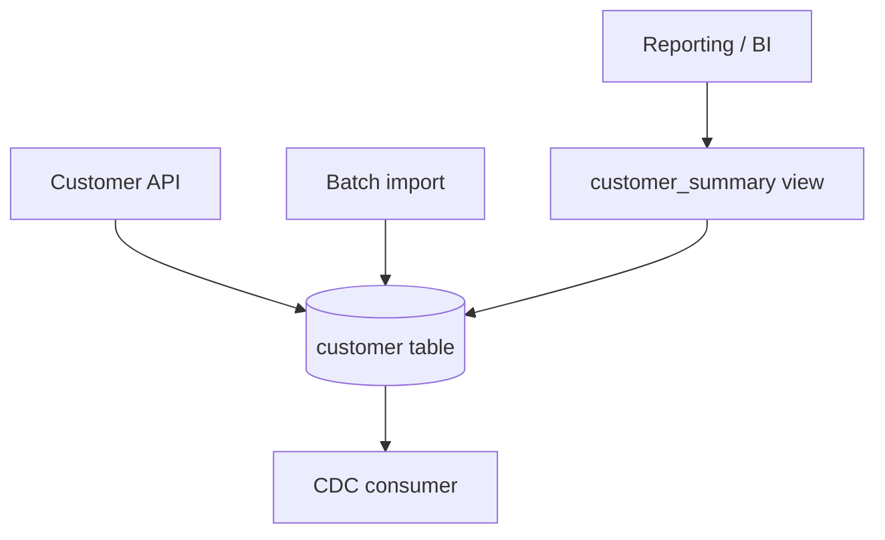

# Đánh giá tác động trước thay đổi trên production

Trong module `DATABASE_SCHEMA_MIGRATION_LIQUIBASE`, chúng ta học cách quản lý thay đổi schema và dữ liệu bằng **changelog, changeset, precondition, checksum và lịch sử triển khai**; thực hành migration có kiểm chứng, rollback, phối hợp nhiều môi trường và tích hợp Spring Boot hoặc CI/CD. Một changeset hợp lệ về cú pháp vẫn có thể làm gián đoạn dịch vụ, khóa bảng lớn, tăng độ trễ truy vấn hoặc khiến phiên bản ứng dụng cũ không còn tương thích. Vì vậy, trước khi thay đổi production, nhóm phải đánh giá **tác động kỹ thuật, dữ liệu, ứng dụng và vận hành** trên trạng thái thực tế của hệ thống.

Bài học thuộc chương **Triển khai an toàn**, tập trung vào cách phân tích phạm vi ảnh hưởng, xác định rủi ro, đo chi phí DDL/DML, kiểm tra tương thích giữa schema và ứng dụng, chuẩn bị phương án rollout/rollback, và thiết lập điều kiện dừng trong quy trình phát hành Liquibase. Mục tiêu là biến một yêu cầu thay đổi thành một kế hoạch có thể review: biết đối tượng nào bị tác động, ai phụ thuộc vào chúng, thay đổi kéo dài bao lâu, có thể phát hiện lỗi bằng cách nào và phải làm gì khi kết quả khác dự kiến.

## 1. Đánh giá tác động là gì?

Đánh giá tác động (*impact assessment*) là quá trình dự đoán và kiểm chứng những gì có thể thay đổi khi áp dụng một migration vào database đang phục vụ người dùng. Nó trả lời:

1. **Thay đổi cái gì?** Bảng, cột, constraint, index, view, routine, dữ liệu hay quyền?
2. **Ai bị ảnh hưởng?** Ứng dụng, phiên bản service, job nền, báo cáo, ETL, consumer hoặc DBA?
3. **Khi nào ảnh hưởng xuất hiện?** Lúc lấy lock, scan/backfill, chuyển traffic hay sau khi bật code mới?
4. **Mức độ ảnh hưởng ra sao?** Thời gian chờ, latency, lỗi ghi, dung lượng, replication lag hoặc mất khả năng tương thích?
5. **Làm sao nhận biết?** Metric, log, query kiểm tra, alert và tiêu chí thành công?
6. **Nếu thất bại thì làm gì?** Dừng, retry, forward-fix, rollback hay restore từ backup?

Đánh giá không phải một biểu mẫu hành chính được điền sau khi đã quyết định chạy lệnh. Kết quả phải có khả năng làm thay đổi thiết kế: tách changeset, chia batch, thêm precondition, đổi thứ tự triển khai, chọn kỹ thuật DDL khác hoặc hoãn phát hành.

Một migration có thể nhỏ về số dòng YAML nhưng lớn về tác động. Ví dụ, `ALTER TABLE` thêm một cột có default trên bảng hàng trăm triệu hàng có thể có chi phí rất khác giữa các phiên bản PostgreSQL, MySQL và SQL Server. Tương tự, thêm unique constraint chỉ là một change type trong changelog nhưng có thể phải quét dữ liệu, xây index và từ chối các giao dịch đang ghi giá trị trùng.

## 2. Xác định phạm vi thay đổi trước khi ước lượng rủi ro

Đọc changeset và liệt kê từng đối tượng database bị tác động. Không chỉ ghi tên bảng; cần ghi cột, constraint, index, kiểu dữ liệu, điều kiện lọc và dữ liệu liên quan.

| Nhóm | Câu hỏi khảo sát | Ví dụ tác động |
|---|---|---|
| Bảng/cột | Thêm, bỏ, đổi tên hay đổi kiểu? Nullable/default thay đổi thế nào? | Ứng dụng cũ không biết cột mới hoặc không ghi được cột bắt buộc |
| Khóa/ràng buộc | Có thêm PK, UNIQUE, FK, CHECK hoặc NOT NULL? | Dữ liệu cũ vi phạm hoặc giao dịch mới bị từ chối |
| Index | Index thường, unique, biểu thức hay partial? | Tốn CPU/I/O/disk, ảnh hưởng ghi và lock |
| Dữ liệu | Backfill, update, delete, import hay chuyển kiểu? | Transaction dài, log lớn, deadlock, sai dữ liệu |
| View/routine/trigger | Định nghĩa hoặc dependency có thay đổi? | Báo cáo, trigger hoặc stored procedure lỗi |
| Sequence/identity | Có đổi nguồn cấp ID hoặc giá trị hiện tại? | Trùng khóa hoặc nhảy số ngoài dự kiến |
| Schema/security | Owner, grant, role, policy hoặc search path? | Service mất quyền hoặc vô tình được quyền rộng hơn |
| Hạ tầng DB | Partition, extension, replication, collation? | DDL không tương thích hoặc phát sinh tải vận hành |

Với từng đối tượng, ghi trạng thái hiện tại, trạng thái mong muốn, môi trường áp dụng và nguồn xác minh. Nếu changeset gọi SQL tùy chỉnh hoặc `sqlFile`, đọc cả câu SQL thực tế; không đánh giá chỉ từ tên ID hoặc comment.

## 3. Lập bản đồ dependency của ứng dụng và database

Schema là hợp đồng giữa database với tất cả consumer. Một bảng có thể được dùng bởi nhiều service, batch và báo cáo mà nhóm viết migration không trực tiếp sở hữu.

Hãy kiểm tra:

- Entity/ORM mapping, repository, native SQL và stored procedure call.
- API/service khác đọc trực tiếp bảng hoặc view.
- Job định kỳ, scheduler, ETL/import/export và script vận hành.
- Dashboard, BI, materialized view và truy vấn ad hoc được cấp quyền.
- Trigger, function, foreign key và cascade behavior.
- CDC, replication, outbox hoặc consumer dựa trên cấu trúc bản ghi.
- Phiên bản ứng dụng cũ còn chạy trong rolling deployment hoặc rollback ứng dụng.

Ví dụ: thêm `customer.status` có thể đơn giản với service mới, nhưng báo cáo cũ dùng `SELECT *` và ánh xạ kết quả theo vị trí cột có thể bị ảnh hưởng. Đổi `customer.code` thành `customer.external_code` có thể làm hỏng batch hoặc service khác dù service chính đã cập nhật.

### 3.1. Sơ đồ dependency minh họa



Sơ đồ này nhắc rằng một thay đổi trên bảng có thể lan tới nhiều đường đọc/ghi. Sơ đồ thật cần được xác nhận từ catalog, source code, log truy vấn, danh mục service và chủ sở hữu dữ liệu. Metadata database không thể hiện mọi truy vấn SQL nằm trong ứng dụng.

## 4. Đánh giá mức độ rủi ro

Một cách thực tế là xem xét đồng thời **khả năng xảy ra**, **mức độ ảnh hưởng**, **khả năng phát hiện** và **khả năng khôi phục**. Không cần giả vờ rằng một con số duy nhất mô tả chính xác rủi ro; mục đích là làm lộ các yếu tố khiến migration cần thêm kiểm soát.

| Mức | Ví dụ | Kiểm soát thường cần |
|---|---|---|
| Thấp | Thêm bảng mới chưa có consumer, ít dữ liệu, không ảnh hưởng luồng hiện tại | Review, validate, preview và thử trên staging |
| Trung bình | Thêm cột nullable vào bảng đang dùng, tạo index nhỏ | Kiểm tra tương thích ứng dụng, thời gian DDL, lock và metric |
| Cao | Thêm UNIQUE/FK/NOT NULL trên bảng lớn, backfill nhiều hàng | Profiling dữ liệu, rehearsal, batch plan, backup, cửa sổ triển khai và điều kiện dừng |
| Rất cao | Drop/rename cột đang dùng, đổi kiểu có chuyển đổi dữ liệu, xóa bảng hoặc cập nhật diện rộng | Thiết kế nhiều giai đoạn, xác nhận mọi consumer, khôi phục đã diễn tập, phê duyệt rõ ràng |

### 4.1. Đánh giá blast radius

*Blast radius* là phạm vi hệ thống có thể bị ảnh hưởng nếu thay đổi thất bại hoặc hoạt động chậm. Hãy xem:

- Một bảng hay nhiều schema/database?
- Một tenant hay toàn bộ tenant?
- Một service hay nhiều consumer?
- Chỉ ảnh hưởng truy vấn đọc hay cả giao dịch ghi?
- Ảnh hưởng trong vài giây hay kéo dài trong toàn bộ quá trình backfill?
- Có thể cô lập thay đổi theo batch, tenant hoặc feature flag không?

Một index trên bảng dùng chung bởi nhiều service có blast radius lớn hơn index trên bảng nội bộ của một job. Một lệnh `UPDATE` không có điều kiện giới hạn có thể tác động toàn bộ dữ liệu và có rủi ro cao dù chỉ nằm trong một changeset.

### 4.2. Đánh giá khả năng phát hiện

Rủi ro khó kiểm soát hơn khi hệ thống không có metric hoặc query để nhận ra tác động. Trước khi triển khai, xác định cách theo dõi:

- Lock wait, deadlock, transaction duration và active sessions.
- Query latency, throughput, timeout và tỷ lệ lỗi ứng dụng.
- CPU, memory, disk I/O, dung lượng tạm và WAL/redo log.
- Replication lag/CDC lag và trạng thái replica.
- Số hàng được insert/update, số hàng còn thiếu và số vi phạm constraint.
- Error log của DBMS, Liquibase và ứng dụng.

Không chờ người dùng báo lỗi mới biết migration đã gây ảnh hưởng. Chọn metric có ngưỡng và người chịu trách nhiệm theo dõi trước khi bắt đầu.

## 5. Đánh giá quy mô dữ liệu và chi phí thực thi

Trước DDL/DML trên production, ước lượng quy mô:

| Chỉ số | Cần biết | Vì sao |
|---|---|---|
| Row count | Số hàng hiện tại và tốc độ tăng | Ước lượng scan/backfill |
| Table/index size | Dung lượng dữ liệu và index | Dự đoán disk, I/O và thời gian build |
| Write rate | Số giao dịch ghi/giây và peak | Đánh giá cạnh tranh lock |
| Read workload | Truy vấn quan trọng, tần suất, latency | Phát hiện ảnh hưởng query plan |
| Transaction size | Số hàng cập nhật mỗi transaction | Đánh giá lock duration và rollback cost |
| Replication | Lag, WAL/redo throughput, replica capacity | Tránh replica tụt quá xa |
| Growth | Tốc độ tăng và thời gian retention | Dự đoán chi phí sau triển khai |

Trên PostgreSQL, có thể xem kích thước bảng và index:

```sql
SELECT
    schemaname,
    relname AS table_name,
    pg_size_pretty(pg_total_relation_size(
        quote_ident(schemaname) || '.' || quote_ident(relname)
    )) AS total_size
FROM pg_stat_user_tables
ORDER BY pg_total_relation_size(
    quote_ident(schemaname) || '.' || quote_ident(relname)
) DESC;
```

Đây là ví dụ PostgreSQL; catalog và cách ước lượng row count khác ở DBMS khác. Thống kê có thể không chính xác tuyệt đối và không thay thế phép đo trên bản sao dữ liệu. Khi chạy query có scan lớn trên production, thống nhất với DBA về thời điểm và tải cho phép.

## 6. Đánh giá tác động của DDL và lock

DDL thường được nghĩ là thao tác nhanh vì chỉ có một câu lệnh. Thực tế, một thay đổi có thể cần metadata lock, scan bảng, rewrite dữ liệu, build index hoặc chờ các transaction hiện tại kết thúc.

Trước khi thêm cột, đổi kiểu, thêm constraint hoặc tạo index, xác định:

1. DBMS và phiên bản có hỗ trợ thao tác online/in-place không?
2. Lệnh cần loại lock nào và có thể giữ lock bao lâu?
3. Có phải quét/rewrite toàn bộ bảng không?
4. Có thể chạy cùng lúc với traffic ghi không?
5. Có cần thêm dung lượng disk tạm hoặc WAL/redo log không?
6. Nếu lệnh chờ lock quá lâu, cách hủy có an toàn không?
7. Nếu thất bại giữa chừng, đối tượng hoặc index có thể ở trạng thái dở dang không?

### 6.1. PostgreSQL: lock timeout và statement timeout

Trong một kịch bản PostgreSQL phù hợp, có thể giới hạn thời gian chờ lock và thời gian câu lệnh:

```sql
SET lock_timeout = '5s';
SET statement_timeout = '10min';
```

Các giá trị trên chỉ là ví dụ cho một session thử nghiệm, không phải ngưỡng khuyến nghị chung cho mọi production. `lock_timeout` giới hạn thời gian chờ lock; `statement_timeout` giới hạn thời gian thực thi câu lệnh. Phạm vi session/transaction và cách driver chạy nhiều statement cần được xác minh.

Không đặt timeout bằng cách thêm một câu `SET` vào changeset rồi giả định nó chắc chắn áp dụng cho câu DDL sau trong mọi cấu hình. Cần kiểm tra Liquibase có thực thi cùng connection/session và transaction như dự kiến hay không.

### 6.2. Tạo index trên bảng đang hoạt động

Trên PostgreSQL, `CREATE INDEX CONCURRENTLY` có thể giảm mức khóa ghi so với cách tạo index thông thường, nhưng có giới hạn riêng: không chạy bên trong transaction block thông thường, có thể để lại index không hợp lệ nếu thất bại và cần kế hoạch xử lý. Cách dùng qua Liquibase phải được thử với `runInTransaction`, phiên bản và driver thực tế.

Trên MySQL, SQL Server, Oracle và các DBMS khác, online/in-place DDL có cú pháp, giới hạn và thuật ngữ khác nhau. Không chuyển nguyên câu SQL hoặc giả định khóa của PostgreSQL sang DBMS khác.

### 6.3. Thêm cột có default

Thêm cột nullable không default thường khác đáng kể so với thêm cột `NOT NULL` có default trên bảng lớn. Phiên bản DBMS có thể tối ưu một số trường hợp nhưng không phải mọi kiểu default/DDL đều không rewrite. Cần kiểm tra phiên bản và SQL thực tế, không kết luận từ một lần thử trên database nhỏ.

## 7. Đánh giá thay đổi constraint và tính hợp lệ dữ liệu

Constraint mới có thể khiến những giao dịch trước đây được chấp nhận bị từ chối. Trước khi thêm:

- UNIQUE: tìm duplicate theo đúng cột/tổ hợp/biểu thức, collation và quy tắc NULL.
- NOT NULL: đếm NULL, xác định nguồn điền giá trị và cách xử lý hàng cũ.
- FOREIGN KEY: tìm orphan, kiểm tra kiểu và index của cột liên quan.
- CHECK: thống kê giá trị nằm ngoài miền hợp lệ, xác minh quy tắc nghiệp vụ.
- PRIMARY KEY: xác định khóa ổn định, không null và duy nhất.

Ví dụ kiểm tra duplicate trước khi thêm unique:

```sql
SELECT tenant_id, email, COUNT(*) AS duplicate_count
FROM customer
WHERE email IS NOT NULL
GROUP BY tenant_id, email
HAVING COUNT(*) > 1;
```

Truy vấn phải phản ánh đúng unique key dự định tạo. Nếu nghiệp vụ không phân biệt chữ hoa/thường hoặc bỏ khoảng trắng, kiểm tra cùng biểu thức chuẩn hóa với index/constraint. Không dùng kết quả `GROUP BY` đơn giản để khẳng định một functional unique index sẽ tạo thành công.

### 7.1. Precondition không khóa chặt dữ liệu

Liquibase có thể dùng `preConditions` để dừng khi dữ liệu chưa đạt điều kiện:

```yaml
databaseChangeLog:
  - changeSet:
      id: "SAFE-2101-add-customer-email-unique"
      author: "customer-platform"
      preConditions:
        - onFail: HALT
        - onError: HALT
        - sqlCheck:
            expectedResult: "0"
            sql: |-
              SELECT COUNT(*)
              FROM (
                  SELECT tenant_id, email
                  FROM customer
                  WHERE email IS NOT NULL
                  GROUP BY tenant_id, email
                  HAVING COUNT(*) > 1
              ) duplicate_groups
      changes:
        - addUniqueConstraint:
            tableName: customer
            columnNames: tenant_id, email
            constraintName: uq_customer_tenant_email
```

Ví dụ kiểm tra số nhóm duplicate theo cặp tenant/email trước khi tạo unique. Cú pháp và kiểu kết quả phải được xác minh trên DBMS/phiên bản Liquibase cụ thể.

Precondition là một hàng rào hữu ích, nhưng **không loại trừ race condition**: tiến trình khác có thể ghi duplicate sau lúc query kiểm tra và trước lúc DDL được thực thi. Constraint của database vẫn là nơi cưỡng chế bất biến; cần kiểm soát writer và thử trên workload thực tế.

## 8. Đánh giá tác động của data migration và backfill

Data migration thường rủi ro hơn một thay đổi schema nhỏ vì nó tác động trực tiếp tới dữ liệu nghiệp vụ đang được sử dụng.

Trước khi chạy backfill, xác định:

- Phạm vi hàng: toàn bảng, theo tenant, theo ngày hay theo trạng thái?
- Quy tắc chuyển đổi: có mất thông tin, làm tròn, chuẩn hóa hoặc đổi ý nghĩa không?
- Số lượng và tốc độ: bao nhiêu hàng, mỗi batch bao nhiêu, thời gian dự kiến?
- Tính idempotent: chạy lại batch có tạo dữ liệu sai hoặc cập nhật lặp không?
- Ghi đồng thời: ứng dụng có tiếp tục thay đổi cùng hàng trong lúc backfill?
- Transaction: mỗi batch commit riêng hay toàn bộ trong một transaction?
- Log và replication: lượng WAL/redo, binlog, CDC event và replica lag?
- Kiểm chứng: tổng số hàng, checksum nghiệp vụ, số giá trị null/sai và mẫu đối chiếu?

### 8.1. Tránh một transaction khổng lồ

Ví dụ một câu lệnh cập nhật toàn bảng:

```sql
UPDATE customer
SET normalized_email = lower(trim(email))
WHERE normalized_email IS NULL;
```

Trên bảng nhỏ, câu lệnh có thể chấp nhận được. Trên bảng rất lớn, nó có thể giữ lock lâu, tạo lượng WAL lớn, làm replica chậm và khiến rollback tốn thời gian. Cần đánh giá chia batch theo khóa ổn định hoặc theo partition, giới hạn tốc độ và theo dõi tiến độ.

Một batch phải có điều kiện rõ ràng để không xử lý lặp vô hạn. Ví dụ dùng khóa tăng dần hoặc cột trạng thái xử lý; tuy nhiên cách phân trang phải tính đến hàng mới được ghi trong lúc chạy và thứ tự khóa. Không dùng `OFFSET` trên bảng thay đổi liên tục mà không đánh giá chi phí và tính ổn định.

### 8.2. Ghi nhận số liệu trước và sau

Lập baseline:

| Chỉ số | Trước migration | Sau migration | Điều kiện đạt |
|---|---:|---:|---|
| Tổng số hàng thuộc phạm vi | Ghi nhận | Ghi nhận | Không mất hàng ngoài dự kiến |
| Hàng cần backfill | Ghi nhận | Ghi nhận | Còn 0 hoặc số dư đã giải thích |
| Hàng lỗi/không chuyển đổi được | Ghi nhận | Ghi nhận | Có xử lý theo chính sách |
| Hàng bị thay đổi | Ghi nhận | Ghi nhận | Khớp phạm vi được phê duyệt |
| Replication lag | Ghi nhận | Ghi nhận | Trở về ngưỡng vận hành |
| Thời gian/lock wait | Ghi nhận | Ghi nhận | Trong giới hạn đã đặt |

Nếu thay đổi dữ liệu tài chính, số dư, trạng thái đơn hàng hoặc quyền truy cập, cần có đối soát nghiệp vụ chứ không chỉ đếm số hàng.

## 9. Kiểm tra tính tương thích giữa ứng dụng và schema

Một migration an toàn phải tính tới việc nhiều phiên bản ứng dụng có thể cùng tồn tại. Rolling deployment thường không thay toàn bộ instance trong một thời điểm; phiên bản cũ và mới có thể cùng đọc/ghi database.

Hãy hỏi:

- Phiên bản cũ có bỏ qua cột mới không?
- Phiên bản mới có chạy được khi cột mới chưa tồn tại không?
- Khi rename/drop cột, có consumer nào còn truy cập tên cũ không?
- Khi thêm NOT NULL, mọi writer đã cung cấp giá trị chưa?
- Khi đổi enum/status, code cũ có hiểu giá trị mới không?
- Khi thay đổi format dữ liệu, batch/CDC/BI có được cập nhật không?
- Nếu rollback ứng dụng, schema mới có còn tương thích không?

### 9.1. Chiến lược expand–migrate–contract

Đối với thay đổi không tương thích, chia thành các giai đoạn:

1. **Expand:** thêm cột/bảng mới theo cách tương thích; chưa xóa cấu trúc cũ.
2. **Deploy compatible code:** ứng dụng mới có thể đọc cả cấu trúc cũ và mới; writer được điều chỉnh để duy trì dữ liệu cần thiết.
3. **Migrate:** backfill dữ liệu cũ theo batch, đối chiếu và chuyển truy vấn sang cấu trúc mới.
4. **Observe:** theo dõi các instance cũ, job và consumer; xác nhận không còn truy cập cấu trúc cũ.
5. **Contract:** trong một release sau, gỡ cột/constraint cũ khi chắc chắn không còn dependency.

Ví dụ đổi `customer.name` thành `customer.display_name`: thêm `display_name`, backfill từ `name`, triển khai code đọc/ghi mới, theo dõi, rồi mới bỏ `name`. Không rename/drop trực tiếp trong cùng lần phát hành nếu phiên bản ứng dụng cũ vẫn còn chạy.

### 9.2. Tương thích khi rollback ứng dụng

Rollback ứng dụng không nhất thiết kéo theo rollback database. Một phiên bản ứng dụng cũ có thể hoạt động tốt trên schema đã expand nhưng không hoạt động nếu schema đã contract. Do đó, thiết kế migration để giữ tương thích ngược trong khoảng thời gian rollback ứng dụng có thể xảy ra.

## 10. Đánh giá thay đổi theo DBMS và phiên bản

Liquibase cung cấp abstraction cho nhiều DBMS, nhưng không làm mọi DDL trở nên giống nhau.

| Chủ đề | Câu hỏi theo DBMS |
|---|---|
| DDL transaction | Lệnh có commit ngầm không? Có thể rollback nguyên tử không? |
| Lock | Loại lock và thời gian giữ lock là gì? |
| Index | Có online/concurrent build không? Có trạng thái index không hợp lệ sau lỗi không? |
| Type conversion | Có rewrite bảng, truncate hoặc lỗi với giá trị cũ không? |
| Default/identity | Hành vi default và sequence khác nhau ra sao? |
| Constraint | Có validate ngay hay hỗ trợ trạng thái chưa validate/trusted không? |
| Collation | So sánh chuỗi, unique và index có khác giữa môi trường không? |
| Partition | DDL có áp dụng tự động cho partition hay cần xử lý từng partition? |
| Replication | DDL/DML được replicate như thế nào? Có ảnh hưởng replica/CDC không? |

Ghi rõ DBMS, phiên bản và driver được dùng trong staging. Không dùng một lần chạy trên PostgreSQL để phê duyệt SQL cho MySQL hoặc SQL Server. Khi changelog có SQL đặc thù, thể hiện phạm vi bằng `dbms`/context/label phù hợp và kiểm tra tất cả nhánh triển khai.

## 11. Đánh giá changeset Liquibase trước khi phát hành

Với từng changeset, review ít nhất:

- `id`, `author`, filename và `logicalFilePath` có ổn định không?
- Change type có đúng với mục tiêu không?
- `preConditions` có chặn trạng thái không hợp lệ không?
- `contextFilter`, labels và `dbms` có khiến thay đổi chạy đúng môi trường không?
- SQL/SQL file có được đóng gói và tìm thấy trong runtime không?
- `runInTransaction` có phù hợp với DBMS/change type không?
- Rollback có thực sự khôi phục dữ liệu hay chỉ đảo schema?
- Có cần chia changeset để giới hạn transaction và blast radius?
- Có thể retry an toàn nếu tiến trình bị gián đoạn không?

### 11.1. Ví dụ expand an toàn: thêm cột nullable

Một bước đầu của chiến lược expand:

```yaml
databaseChangeLog:
  - changeSet:
      id: "SAFE-2102-expand-customer-display-name"
      author: "customer-platform"
      comment: "Thêm cột mới để triển khai chuyển đổi tên hiển thị theo từng giai đoạn"
      preConditions:
        - onFail: HALT
        - onError: HALT
        - tableExists:
            tableName: customer
      changes:
        - addColumn:
            tableName: customer
            columns:
              - column:
                  name: display_name
                  type: VARCHAR(150)
                  constraints:
                    nullable: true
      rollback:
        - dropColumn:
            tableName: customer
            columnName: display_name
```

Changeset trên chỉ thêm cột nullable nếu bảng đã tồn tại. Nó minh họa cách tách bước expand; không tự backfill dữ liệu, không chứng minh mọi consumer tương thích và không làm cho rollback drop cột trở nên an toàn nếu cột đã có dữ liệu mới.

### 11.2. Đặt giới hạn phạm vi chạy

Context/label có thể dùng để lọc changeset, nhưng không phải cơ chế phân quyền hoặc bằng chứng database đích. Hãy xác nhận:

- Bộ filter được truyền giống nhau trong `status`, `update-sql` và `update`.
- Changeset chỉ chạy ở DBMS được hỗ trợ.
- Seed/test data không bị áp dụng vào production.
- Không có master changelog khác được Spring Boot tự chạy ngoài dự kiến.

### 11.3. Không thay đổi changeset đã triển khai

Liquibase lưu định danh và checksum trong `DATABASECHANGELOG`. Khi đã triển khai, giữ nguyên `id`, `author`, đường dẫn định danh và nội dung changeset. Yêu cầu mới phải được thể hiện bằng changeset mới. Không sửa checksum hoặc xóa lịch sử để vượt qua cảnh báo khi chuẩn bị release.

## 12. Quy trình validate, preview và rehearsal

Một chuỗi kiểm chứng thường gồm:

```bash
# Kiểm tra cấu trúc changelog
liquibase --defaults-file=liquibase.properties validate

# Xem changeset còn pending với filter đã chọn
liquibase --defaults-file=liquibase.properties status

# Sinh SQL dự kiến trước khi thực thi
liquibase --defaults-file=liquibase.properties update-sql
```

Sau khi review SQL và trạng thái database thử nghiệm:

```bash
liquibase --defaults-file=liquibase.properties update
```

`validate` không chứng minh SQL chắc chắn chạy được trên dữ liệu production. `status` không kiểm tra toàn bộ tính an toàn. `update-sql` giúp xem SQL được sinh nhưng không mô phỏng tải, lock, replication hoặc tất cả điều kiện runtime. Rehearsal trên database tương đương mới giúp đo thời gian và quan sát hành vi thực tế.

### 12.1. Rehearsal trên bản sao production

Một lần diễn tập có giá trị nên gần với điều kiện thật:

- Cùng DBMS/version, extension, collation và cấu hình liên quan.
- Schema và lịch sử `DATABASECHANGELOG` từ release hiện tại.
- Dữ liệu có quy mô và phân bố gần production; dữ liệu nhạy cảm được bảo vệ/ẩn danh.
- Tải đọc/ghi và tiến trình nền đại diện cho workload cần đánh giá.
- Cùng artifact, Liquibase version, driver, changelog và CSV/SQL sẽ triển khai.

Đo thời gian từng bước, lock wait, query latency, WAL/redo, disk, replication lag và số hàng xử lý. Nếu rehearsal dùng database nhỏ hơn nhiều, ghi rõ giới hạn và không ngoại suy thời gian tuyến tính một cách tùy tiện.

## 13. Lập kế hoạch rollout theo từng giai đoạn

Với thay đổi có rủi ro, chia kế hoạch thành các bước có điểm kiểm tra:

| Giai đoạn | Công việc | Điều kiện chuyển tiếp |
|---|---|---|
| Chuẩn bị | Backup, xác minh URL/schema, quyền, version, lock và metric | Đúng database, backup có thể phục hồi |
| Expand | Thêm cấu trúc tương thích, chưa bỏ cột cũ | Ứng dụng cũ vẫn hoạt động |
| Migrate | Backfill/chuyển đổi theo batch | Số liệu đối soát đạt, lag/latency trong ngưỡng |
| Switch | Bật code đọc/ghi cấu trúc mới hoặc feature flag | Tỷ lệ lỗi và dữ liệu đồng nhất |
| Observe | Theo dõi service, job, CDC, báo cáo và truy vấn | Không còn dependency cũ |
| Contract | Gỡ cấu trúc cũ trong release riêng | Đã xác nhận không consumer nào sử dụng |

Không bắt buộc mọi thay đổi phải có đủ sáu giai đoạn. Với thay đổi nhỏ, quy trình có thể gọn hơn. Nhưng khi thay đổi phá tương thích hoặc chạm dữ liệu lớn, các điểm kiểm tra cần được thể hiện rõ.

### 13.1. Chọn cửa sổ triển khai

Chọn thời điểm dựa trên workload và khả năng hỗ trợ:

- Tránh giờ peak nếu DDL/DML có thể tranh tài nguyên.
- Không trùng batch, ETL, backup hoặc maintenance nặng.
- Có người theo dõi database và ứng dụng trong suốt thời gian thay đổi.
- Có đủ thời gian quan sát hậu triển khai, không chỉ đủ thời gian chạy lệnh.
- Có phương án dừng nếu vượt ngưỡng lock, latency, lag hoặc lỗi.

“Chạy ban đêm” không tự động an toàn: batch ban đêm có thể là workload lớn nhất, và đội ngũ hỗ trợ có thể không sẵn sàng.

## 14. Backup, restore và phương án khôi phục

Trước thay đổi có khả năng mất dữ liệu, xác định:

1. Backup/snapshot gần nhất và thời điểm của nó.
2. Cơ chế point-in-time recovery (PITR) hoặc log archive của DBMS.
3. RPO/RTO được chấp nhận cho dịch vụ.
4. Người chịu trách nhiệm khởi tạo và xác minh restore.
5. Nơi khôi phục thử nghiệm và cách kiểm tra dữ liệu sau restore.
6. Tác động đến replication, CDC, quyền và kết nối ứng dụng.

Một backup chưa từng thử restore không đủ để chứng minh khả năng phục hồi. Với thay đổi quan trọng, diễn tập restore theo quy trình vận hành và ghi lại thời gian/giới hạn.

## 15. Rollback hay forward-fix?

Không phải sự cố nào cũng nên rollback database.

| Tình huống | Phương án có thể phù hợp | Vì sao |
|---|---|---|
| Thêm cột nullable, chưa có consumer ghi dữ liệu | Rollback có thể khả thi sau khi xác minh | Ít dữ liệu mới cần bảo toàn |
| Backfill đã ghi đè giá trị cũ | Restore snapshot hoặc forward-fix có thể an toàn hơn | Rollback không biết giá trị trước đó |
| Ứng dụng mới lỗi nhưng schema expand vẫn tương thích | Rollback ứng dụng, giữ schema | Tránh thao tác DDL không cần thiết |
| Index mới làm query chậm hoặc build lỗi | Đánh giá drop/rebuild theo trạng thái index và DBMS | Có thể chỉ cần xử lý index |
| Đã contract và xóa cột cũ | Restore/PITR hoặc forward migration | Dữ liệu cũ có thể đã mất |

Liquibase rollback chạy thao tác đảo ngược được khai báo/sinh ra cho changeset; nó không tự khôi phục dữ liệu đã xóa hay giá trị cũ bị ghi đè. Trước khi chọn rollback, xem `rollback-sql`, kiểm tra dữ liệu phát sinh sau deploy và đảm bảo phiên bản ứng dụng sẽ tương thích với schema sau rollback.

Nếu không thể đảo ngược an toàn, forward-fix bằng changeset mới thường dễ kiểm soát hơn: sửa lỗi theo trạng thái hiện tại, giữ nguyên lịch sử và tránh mất dữ liệu hợp lệ.

## 16. Thiết lập tiêu chí dừng và điều kiện thành công

Trước khi chạy, định nghĩa rõ điều gì khiến nhóm phải dừng:

| Theo dõi | Ví dụ tiêu chí dừng (phải được hiệu chỉnh theo SLO thực tế) |
|---|---|
| Lock wait | Vượt ngưỡng chờ đã phê duyệt hoặc ảnh hưởng giao dịch online |
| Query latency | p95/p99 vượt ngân sách trong thời gian liên tục |
| Error rate | Tỷ lệ lỗi DB/application tăng vượt baseline |
| Replication lag | Vượt ngưỡng ảnh hưởng read replica/CDC |
| Backfill | Tốc độ thấp bất thường, deadlock hoặc số hàng ngoài phạm vi |
| Disk/WAL/redo | Dung lượng tiến gần ngưỡng an toàn |
| Data validation | Số hàng sai, null, duplicate hoặc orphan khác dự kiến |
| Liquibase lock | Có tiến trình khác giữ lock hoặc trạng thái job không rõ |

Các ngưỡng cần lấy từ SLO, baseline và năng lực hệ thống, không sao chép số ví dụ thành tiêu chuẩn production. Ghi rõ người có quyền quyết định tiếp tục/dừng, cách hủy job và điều kiện resume.

Điều kiện thành công cũng phải đo được: migration hoàn tất, metadata ghi đúng, schema đạt trạng thái mong muốn, dữ liệu đối soát đạt, ứng dụng hoạt động, metric trở lại ngưỡng và không có consumer bị lỗi.

## 17. Runbook production mẫu

Một runbook có thể tổ chức theo trình tự:

**Trước khi bắt đầu**

- Xác nhận ticket/release, người phê duyệt và người trực vận hành.
- Xác minh JDBC URL, database, schema, DBMS/version và tài khoản migration.
- Xác nhận backup/restore point, trạng thái replication và Liquibase lock.
- Ghi baseline metric và xác nhận không có deployment cạnh tranh.
- Chạy `validate`, `status`, `update-sql`; lưu kết quả review.
- Đọc precondition, SQL, phạm vi dữ liệu và rollback/forward-fix.

**Trong khi chạy**

- Bắt đầu đúng job/artifact và đúng filter.
- Theo dõi lock, active sessions, latency, error rate, disk, WAL/redo và lag.
- Theo dõi số batch/hàng đã xử lý, không chỉ tiến trình CLI.
- Dừng khi vượt ngưỡng đã định; ghi nhận trạng thái thực tế trước hành động tiếp theo.

**Sau khi chạy**

- Kiểm tra `DATABASECHANGELOG` và `DATABASECHANGELOGLOCK`.
- Đối chiếu schema, constraint, index và dữ liệu.
- Kiểm tra ứng dụng, job, báo cáo, CDC và truy vấn trọng yếu.
- Theo dõi metric trong khoảng quan sát đã định.
- Ghi lại kết quả, sai khác, quyết định và người chịu trách nhiệm.

## 18. Tích hợp với Spring Boot và CI/CD

Spring Boot có thể tự chạy Liquibase khi ứng dụng khởi động:

```yaml
spring:
  liquibase:
    enabled: true
    change-log: classpath:db/changelog/master.yaml
```

Đối với migration production có rủi ro, nhóm cần quyết định rõ chạy Liquibase qua CLI/job riêng hay qua startup của ứng dụng. Tránh nhiều instance ứng dụng cùng mang các artifact/changelog khác nhau và cùng cố triển khai schema trong lúc rolling deployment.

Một pipeline có kiểm soát:

```text
Pull request
    |
    v
Review changeset + dependency + impact assessment
    |
    v
Validate + status + update-sql
    |
    v
Rehearsal trên database tương đương
    |
    v
Đối soát thời gian, lock, dữ liệu và metric
    |
    v
Approval + backup/restore readiness
    |
    v
Deploy theo giai đoạn + theo dõi
    |
    v
Post-deploy verification
```

Pipeline nên dùng cùng Liquibase version, JDBC driver, extension, changelog và tài nguyên CSV/SQL với bản phát hành. Các secret lấy từ secret manager, không in ra log. Job triển khai phải dừng khi validation/rehearsal không đạt; không coi việc `update-sql` sinh được SQL là đủ để tự động phê duyệt production.

## 19. Mẫu bảng đánh giá tác động cho một changeset

Trước khi review, có thể điền bảng sau cho từng thay đổi:

| Hạng mục | Nội dung cần ghi |
|---|---|
| Mục tiêu | Vì sao nghiệp vụ cần thay đổi? |
| Changeset | ID, author, file và release |
| Database | DBMS/version, database/schema, môi trường |
| Đối tượng | Bảng/cột/index/constraint/view/routine bị tác động |
| Consumer | Service, ORM, job, ETL, BI, CDC phụ thuộc |
| Dữ liệu | Row count, duplicate/null/orphan, phạm vi backfill |
| Hiệu năng | Lock, scan/rewrite, index build, I/O, WAL/redo |
| Tương thích | Phiên bản ứng dụng cũ/mới, rolling deployment |
| Kế hoạch | Expand/migrate/switch/contract và cửa sổ chạy |
| Kiểm chứng | Validate, SQL preview, rehearsal, query đối soát |
| Quan sát | Metric, log, alert, ngưỡng dừng và owner |
| Khôi phục | Rollback, forward-fix, snapshot/PITR và giới hạn |
| Phê duyệt | Người review kỹ thuật, DBA, owner nghiệp vụ, release |

Không để các ô quan trọng ở dạng “đã kiểm tra” mà thiếu bằng chứng. Gắn link tới SQL preview, kết quả rehearsal, truy vấn đối soát hoặc ticket phê duyệt theo quy định nội bộ.

## 20. Những lỗi đánh giá tác động thường gặp

| Sai lầm | Hậu quả | Cách tránh |
|---|---|---|
| Chỉ đọc YAML, không đọc SQL thực tế | Bỏ sót DML/DDL nguy hiểm trong sql hoặc sqlFile | Review toàn bộ tài nguyên được tham chiếu |
| Thử trên database nhỏ | Ước lượng sai thời gian, lock và disk | Rehearsal trên bản sao có quy mô gần production |
| Chỉ kiểm tra schema, không kiểm tra dữ liệu | Thêm constraint thất bại hoặc dữ liệu bị chuyển sai | Profiling duplicate/null/orphan/domain trước |
| Quên consumer ngoài service chính | Báo cáo, batch hoặc CDC bị lỗi | Lập dependency map và xác nhận owner |
| Cho rằng DDL luôn nhanh/transactional | Lock kéo dài hoặc trạng thái dở dang | Xác minh DBMS/version và hành vi từng change type |
| Dùng precondition thay cho khóa dữ liệu | Race condition giữa check và DDL | Constraint DB, writer coordination và rehearsal |
| Không xác định phiên bản app cũ | Rolling deployment mất tương thích | Expand–migrate–contract |
| Xem rollback là khôi phục dữ liệu | Mất dữ liệu mới hoặc giá trị cũ đã ghi đè | Backup/PITR, snapshot và forward-fix |
| Không có tiêu chí dừng | Tiếp tục migration khi hệ thống đã suy giảm | Đặt ngưỡng và owner quyết định trước |
| Nhiều cơ chế cùng chạy migration | Changeset cạnh tranh hoặc được áp dụng lại | Chỉ định một luồng migration có owner |

## 21. Bài thực hành: đánh giá thay đổi trước production

Giả sử cần thêm cột `customer.display_name`, backfill từ `customer.name`, chuyển ứng dụng sang cột mới và sau đó bỏ cột cũ. Thực hiện trên database thử nghiệm:

1. Liệt kê consumer của `customer.name`: API, ORM, batch, báo cáo, CDC và job.
2. Đo row count, table size, tỷ lệ NULL, độ dài chuỗi và tốc độ ghi.
3. Xác định DBMS/version, lock, transaction và cách thêm cột ít tác động.
4. Viết changeset expand thêm `display_name` nullable; review precondition và rollback.
5. Chạy `validate`, `status`, `update-sql`; ghi SQL preview.
6. Rehearsal trên bản sao có quy mô phù hợp; đo thời gian, lock, WAL/redo và replication lag.
7. Thiết kế backfill theo batch có checkpoint; xác định điều kiện retry/idempotent và cách đối soát.
8. Triển khai code có thể đọc/ghi tương thích; xác nhận phiên bản cũ vẫn chạy.
9. Backfill, kiểm tra số hàng và so sánh giá trị `name`/`display_name`.
10. Theo dõi consumer và chỉ contract khi không còn truy cập cột cũ.
11. Diễn tập rollback ứng dụng, forward-fix và restore trên database thử nghiệm.
12. Viết runbook gồm ngưỡng dừng, người chịu trách nhiệm và kiểm tra hậu triển khai.

### Checklist trước khi phê duyệt production

- [ ] Mục tiêu, changeset và phạm vi database/schema được xác định rõ.
- [ ] Đã lập danh sách bảng/cột/constraint/index/view/routine và tài nguyên SQL liên quan.
- [ ] Đã xác định consumer và dependency ngoài ứng dụng chính.
- [ ] DBMS/version, lock, transaction, online DDL và khác biệt môi trường được kiểm tra.
- [ ] Row count, kích thước, write rate và chất lượng dữ liệu đã được đo.
- [ ] UNIQUE/FK/NOT NULL/CHECK có truy vấn kiểm tra dữ liệu trước.
- [ ] Data migration có batch plan, retry/idempotency và đối soát.
- [ ] Tương thích phiên bản ứng dụng cũ/mới được đảm bảo trong rolling deployment.
- [ ] `validate`, `status`, `update-sql` và rehearsal trên database tương đương đạt yêu cầu.
- [ ] Có backup/snapshot/PITR và phương án restore đã được thử phù hợp.
- [ ] Rollback/forward-fix đã được đánh giá theo dữ liệu thực tế, không chỉ theo YAML.
- [ ] Metric, alert, ngưỡng dừng và người ra quyết định được xác định.
- [ ] Không có migration/job cạnh tranh; owner của luồng triển khai rõ ràng.
- [ ] Có approval, runbook và tiêu chí xác minh sau triển khai.

**Kết luận:** đánh giá tác động trước production là bước nối giữa một changelog hợp lệ và một lần triển khai có thể kiểm soát. Nhóm cần hiểu dependency, dữ liệu, quy mô, lock, hành vi DBMS, tương thích ứng dụng và khả năng phục hồi; sau đó kiểm chứng bằng `validate`, SQL preview, rehearsal và metric. Khi rủi ro đã được đo, rollout được chia giai đoạn và tiêu chí dừng rõ ràng, Liquibase giúp quản lý thay đổi trong `DATABASE_SCHEMA_MIGRATION_LIQUIBASE` với lịch sử minh bạch và khả năng phối hợp giữa phát triển, DBA, vận hành, Spring Boot và CI/CD.
