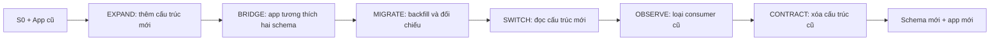
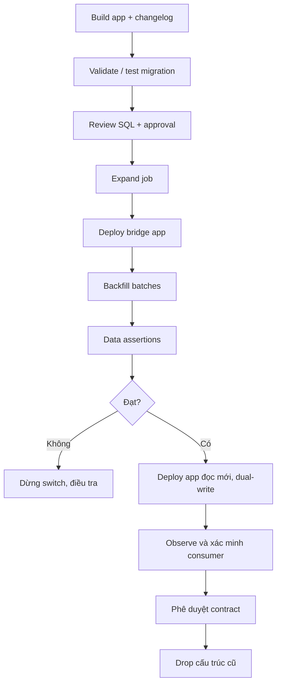

# Thiết kế expand-contract để duy trì tương thích

## 1. Vì sao cần expand-contract?

Trong module **DATABASE_SCHEMA_MIGRATION_LIQUIBASE**, người học nắm cách quản lý thay đổi schema và dữ liệu bằng Liquibase qua changelog, changeset, precondition, checksum và lịch sử triển khai; thực hành migration có kiểm chứng, rollback, phối hợp nhiều môi trường và tích hợp Spring Boot hoặc CI/CD. Khi hệ thống đang phục vụ người dùng, database và ứng dụng thường được cập nhật ở những thời điểm khác nhau. Rolling deployment có thể khiến phiên bản cũ và mới cùng chạy; worker, batch job, báo cáo và consumer tích hợp còn có thể tồn tại lâu hơn API.

Nếu ứng dụng cũ đọc cột `customer_name` trong khi migration đã xóa cột đó, request của instance cũ có thể lỗi. Nếu ứng dụng mới đọc `display_name` trước khi cột tồn tại hoặc dữ liệu được backfill, người dùng có thể thấy lỗi hoặc dữ liệu rỗng. Nếu phiên bản mới chỉ ghi cột mới trong khi worker cũ chỉ đọc cột cũ, dữ liệu sẽ lệch nhau.

**Expand-contract** chia một thay đổi không tương thích thành nhiều pha để schema và các phiên bản ứng dụng cùng tồn tại an toàn:

- **Expand:** thêm cấu trúc mới theo cách tương thích ngược, giữ cấu trúc cũ.
- **Migrate:** chuyển dữ liệu và ứng dụng theo từng bước, có kiểm chứng.
- **Switch:** chuyển luồng đọc/ghi sang cấu trúc mới sau khi dữ liệu sẵn sàng.
- **Contract:** loại bỏ cấu trúc cũ khi không còn consumer phụ thuộc.

Đây là quy trình nhiều release, thường có release cầu nối, backfill, giai đoạn quan sát và phê duyệt; không phải một changeset lớn làm mọi việc cùng lúc.

### Mục tiêu học tập

Sau bài học, bạn có thể:

1. Giải thích vì sao rolling deployment cần schema tương thích với nhiều phiên bản ứng dụng.
2. Thiết kế các pha expand, migrate, switch và contract.
3. Lập ma trận tương thích giữa ứng dụng và schema.
4. Chọn cách dual-write, backfill, đối chiếu và chuyển read path an toàn.
5. Dùng Liquibase changeset để quản lý từng bước schema và constraint.
6. Xác định ranh giới rollback ứng dụng, rollback database và forward-fix.
7. Kiểm tra concurrency, lock, transaction, hiệu năng và consumer chạy nền.
8. Tích hợp trình tự migration với Spring Boot/CI/CD và điều kiện dừng.

**Nguyên tắc:** Chỉ xóa cấu trúc cũ khi đã chứng minh không còn app, worker, báo cáo hoặc hệ thống ngoài nào cần nó; dữ liệu mới đầy đủ; và cửa sổ rollback đã được xử lý có chủ đích.

## 2. Vì sao thay đổi trực tiếp có thể gây downtime?

Giả sử PostgreSQL có bảng:

```sql
CREATE TABLE app.customers (
    customer_id BIGINT PRIMARY KEY,
    customer_name VARCHAR(160) NOT NULL,
    updated_at TIMESTAMPTZ NOT NULL DEFAULT now()
);
```

Ứng dụng `A0` đọc/ghi `customer_name`. Yêu cầu mới muốn dùng `display_name`. Đổi tên trực tiếp:

```sql
ALTER TABLE app.customers
RENAME COLUMN customer_name TO display_name;
```

có thể làm `A0` lỗi vì query cũ vẫn tham chiếu cột đã đổi tên. Nếu deploy app mới trước migration, query mới cũng lỗi vì cột chưa tồn tại.

Các nguyên nhân phổ biến:

- Instance cũ và mới cùng chạy trong rolling deployment.
- Request đang xử lý đi qua thời điểm migration.
- Worker/consumer được deploy riêng với API.
- Migration đã commit nhưng app rollout thất bại.
- App rollback về phiên bản cũ sau khi schema đã đổi.
- Job theo lịch hoặc báo cáo ít chạy vẫn dùng tên cột cũ.

### 2.1. Ma trận tương thích

| Schema | Trạng thái |
|---|---|
| `S0` | Chỉ có `customer_name` |
| `S1` | Có cả `customer_name` và `display_name` |
| `S2` | Chỉ còn `display_name` |

| Ứng dụng | Đọc | Ghi | Khả năng tương thích |
|---|---|---|---|
| `A0` cũ | Cột cũ | Cột cũ | `S0` và thường cả `S1` |
| `A1` cầu nối | Cột cũ | Cả hai cột | `S1` |
| `A2` chuyển đọc | Cột mới | Cả hai cột | `S1` |
| `A3` mới | Cột mới | Cột mới | `S1` hoặc `S2` tùy code |
| `A4` sau contract | Cột mới | Cột mới | `S2` |

`A0` thường chạy được trên `S1` vì bỏ qua cột mới. `A1` không thể chạy trên `S0` vì code đã tham chiếu cột mới. Khi `A2` còn dual-write, có thể quay về `A1` nếu cột cũ vẫn đồng bộ. Sau khi ngừng ghi cột cũ, rollback về app chỉ đọc cột cũ không còn an toàn.

### 2.2. Nguyên tắc tương thích

- Triển khai schema expand trước khi code mới phụ thuộc object mới.
- Code cầu nối phải hoạt động khi phiên bản cũ và mới cùng tồn tại.
- Không switch đọc sang cột mới khi backfill và đồng bộ chưa đạt.
- Không ngừng ghi cột cũ khi còn consumer cần nó.
- Không drop cột cũ trước khi kết thúc cửa sổ rollback và kiểm kê dependency.
- Contract là release riêng, có approval và bằng chứng.

## 3. Các pha của expand-contract



### 3.1. Expand

Thêm cột, bảng, index hoặc cấu trúc mới theo cách không làm phiên bản cũ ngừng hoạt động. Cột mới thường bắt đầu nullable để các hàng hiện có vẫn hợp lệ.

```yaml
databaseChangeLog:
  - changeSet:
      id: 20261119-01-add-display-name
      author: customer-team
      changes:
        - addColumn:
            schemaName: app
            tableName: customers
            columns:
              - column:
                  name: display_name
                  type: varchar(160)
```

Changeset chỉ thêm cột, không đổi tên hoặc xóa `customer_name`. Review đúng schema, kiểu dữ liệu, nullability, include path, DBMS filter và tác động lock.

### 3.2. Bridge release

Triển khai ứng dụng trung gian hiểu cả hai cấu trúc. Nó có thể tiếp tục đọc cột cũ và ghi cùng giá trị vào cả hai cột trong cùng transaction. Mục tiêu là thay dần instance cũ mà không mất khả năng đọc/ghi.

### 3.3. Migrate và verify

Backfill dữ liệu hiện có sang cấu trúc mới. Sau đó kiểm tra theo khóa, invariant, trường hợp NULL và ngoại lệ. Không chuyển read path chỉ vì câu SQL backfill đã chạy xong; phải có bằng chứng dữ liệu đầy đủ và không bị ghi đồng thời làm lệch.

### 3.4. Switch và observe

Triển khai phiên bản đọc cấu trúc mới. Có thể tiếp tục dual-write trong cửa sổ rollback để phiên bản cầu nối cũ vẫn đọc được dữ liệu. Theo dõi lỗi đọc, chênh lệch dữ liệu, worker và consumer cũ.

### 3.5. Contract

Sau khi xác nhận mọi consumer đã chuyển, hết cửa sổ rollback cần thiết và có phê duyệt, mới xóa cột/bảng cũ hoặc compatibility code. Contract làm giảm khả năng quay về app cũ và cần được xem là thay đổi có rủi ro riêng.

## 4. Ví dụ xuyên suốt: đổi customer_name thành display_name

Giả sử bảng `app.customers` có `customer_id`, `customer_name` và `updated_at`. Yêu cầu dùng tên mới `display_name`, triển khai theo rolling deployment và giữ khả năng rollback app trong thời gian chuyển tiếp.

### 4.1. Expand: thêm cột mới

```yaml
databaseChangeLog:
  - changeSet:
      id: 20261119-01-expand-display-name
      author: customer-team
      changes:
        - addColumn:
            schemaName: app
            tableName: customers
            columns:
              - column:
                  name: display_name
                  type: varchar(160)
```

Cột mới nullable; giữ cột cũ và chưa thêm NOT NULL. Cần thử DDL trên đúng DBMS/version, đặc biệt với bảng lớn và default có thể gây rewrite/lock.

### 4.2. Bridge release: dual-write

Sau khi expand đã chạy, triển khai app `A1` ghi cả hai cột. Ví dụ Java minh họa:

```java
@Transactional
public void renameCustomer(long customerId, String value) {
    Customer customer = repository.findById(customerId)
        .orElseThrow();

    customer.setCustomerName(value);
    customer.setDisplayName(value);
}
```

Hai thay đổi phải nằm trong cùng transaction database. Nếu một phần commit còn phần kia thất bại, hai cột có thể lệch. Với JPA cần kiểm tra entity mapping, dirty checking và transaction boundary.

Trong rolling deployment, `A0` cũ có thể còn chạy và chỉ ghi cột cũ. Do đó dual-write của `A1` chưa bảo đảm tất cả hàng được đồng bộ ngay.

**Thứ tự thường an toàn:**

1. Expand cột mới.
2. Deploy bridge app đọc cột cũ, ghi cả hai.
3. Xác nhận mọi writer cũ đã drain: API, worker, batch và scheduled task.
4. Backfill hàng còn thiếu.
5. Đối chiếu hai cột.
6. Deploy app đọc cột mới nhưng tiếp tục ghi cả hai trong cửa sổ rollback.

Nếu không thể drain writer cũ, cần trigger, CDC hoặc versioning và quy tắc giải quyết xung đột. Không chạy backfill đơn giản rồi bỏ qua concurrency.

### 4.3. Backfill theo batch

Với giả định writer cũ đã dừng và cột cũ là nguồn chuẩn:

```sql
UPDATE app.customers
SET display_name = customer_name
WHERE customer_id > :lower_id
  AND customer_id <= :upper_id
  AND display_name IS NULL;
```

Batch theo khoảng khóa giới hạn transaction và giúp theo dõi tiến độ. Placeholder cần được truyền bởi công cụ chạy batch. Với bảng lớn, nên dùng job backfill chuyên trách có checkpoint, retry, throttling và metric thay vì một DML khổng lồ trong startup changeset.

### 4.4. Hậu kiểm dữ liệu

Trên PostgreSQL:

```sql
SELECT COUNT(*) AS missing_display_name
FROM app.customers
WHERE display_name IS NULL;

SELECT COUNT(*) AS mismatched_names
FROM app.customers
WHERE display_name IS DISTINCT FROM customer_name;
```

Hai truy vấn chỉ phù hợp trong giai đoạn hai cột phải giữ cùng giá trị. Nếu NULL hợp lệ hoặc mapping có chuẩn hóa, phải điều chỉnh invariant. Kiểm tra thêm theo khóa, phân bố giá trị, độ dài, batch lỗi và hàng bị loại khỏi mapping. Tổng số hàng bằng nhau chưa đủ chứng minh dữ liệu đúng.

### 4.5. Switch read path

Sau khi hậu kiểm đạt, deploy `A2` đọc `display_name` nhưng vẫn ghi cả hai cột. Trong giai đoạn này, `A1` còn tồn tại vẫn đọc cột cũ; cột cũ phải tiếp tục được cập nhật để có thể rollback về `A1`. Không ngừng dual-write khi còn phiên bản cần đọc cột cũ.

### 4.6. Ngừng ghi cột cũ

Sau khi mọi consumer đã đọc cột mới và cửa sổ rollback về `A1` đã đóng, có thể triển khai `A3` chỉ ghi `display_name`. Từ thời điểm đó, cột cũ có thể lỗi thời. Nếu cần quay về app cũ, phải đồng bộ ngược các thay đổi mới trước; nếu không có cách đáng tin, rollback app không an toàn.

### 4.7. Contract: xóa cột cũ

Sau thời gian quan sát và phê duyệt:

```yaml
databaseChangeLog:
  - changeSet:
      id: 20261119-02-contract-customer-name
      author: customer-team
      preConditions:
        - onFail: HALT
        - columnExists:
            schemaName: app
            tableName: customers
            columnName: customer_name
        - columnExists:
            schemaName: app
            tableName: customers
            columnName: display_name
        - sqlCheck:
            expectedResult: "0"
            sql: >
              SELECT COUNT(*)
              FROM app.customers
              WHERE display_name IS NULL
      changes:
        - dropColumn:
            schemaName: app
            tableName: customers
            columnName: customer_name
```

Precondition xác nhận cột tồn tại và cột mới không còn NULL. Nó không chứng minh không còn ứng dụng cũ truy cập `customer_name`; dependency phải được xác minh qua rollout, telemetry, code và inventory job. Precondition cũng có thể gặp race condition nếu writer vẫn chạy.

Rollback contract chỉ thêm lại `customer_name` rỗng, không phục hồi dữ liệu cũ. Muốn quay lại app cũ cần nguồn dữ liệu phục hồi hoặc đồng bộ ngược có kiểm chứng. Contract là điểm phá vỡ rollback đơn giản.

## 5. Dual-write và các lỗi cần tránh

Dual-write giúp hai mô hình dữ liệu cùng được cập nhật trong thời gian chuyển tiếp, nhưng không tự động bảo đảm nhất quán.

### 5.1. Hai cột trong cùng database

Nếu cả hai cột được cập nhật trong cùng transaction, DBMS có thể bảo đảm atomicity cho các thay đổi đó. Cần xác minh ORM phát ra cả hai cập nhật và transaction bao phủ toàn bộ thao tác.

Không tách thành hai request độc lập nếu không có cơ chế bù/idempotency. Nếu thao tác thứ nhất commit còn thao tác thứ hai thất bại, dữ liệu lệch.

### 5.2. Dual-write qua nhiều hệ thống

Nếu ứng dụng ghi database rồi gửi message hoặc gọi service khác, không có transaction database đơn giản nào bảo đảm hai side effect cùng commit. Cần cân nhắc transactional outbox, CDC, idempotency key, retry và reconciliation.

### 5.3. Xung đột với writer cũ

`A0` chỉ cập nhật cột cũ, `A1` cập nhật cả hai. Nếu backfill chạy đồng thời, một giá trị mới có thể bị chép đè bởi giá trị cũ hoặc ngược lại.

Các lựa chọn:

- Drain toàn bộ writer cũ trước backfill.
- Dùng trigger đồng bộ trong cửa sổ chuyển tiếp.
- Dùng CDC/version để chỉ cập nhật hàng chưa có thay đổi mới hơn.
- Backfill theo batch, rồi lặp lại phần còn thiếu sau khi đã chặn writer cũ.

Timestamp chỉ hữu ích nếu độ chính xác, nguồn thời gian, transaction và thứ tự commit được hiểu rõ. Không dùng `updated_at` làm bằng chứng duy nhất khi nhiều hệ thống có thể ghi đồng thời.

### 5.4. Giới hạn dual-write

Hai cột đồng bộ tăng dung lượng, chi phí ghi và độ phức tạp. Cần owner, metric, thời hạn và tiêu chí kết thúc. Không giữ giai đoạn này vô thời hạn.

## 6. Backfill an toàn và có thể tiếp tục

Với bảng lớn, lập kế hoạch:

- Khóa phân trang ổn định, thường là primary key.
- Kích thước batch và giới hạn transaction.
- Số hàng kỳ vọng, tiến độ và checkpoint.
- Cách retry khi batch thất bại.
- Throttling và maintenance window.
- Lock, WAL/redo log, replication lag và tác động index.
- Điều kiện dừng khi mismatch hoặc latency vượt ngưỡng.

Một job có thể lưu checkpoint `last_processed_id` và batch ID. Checkpoint phải commit nhất quán với phần dữ liệu đã xử lý; nếu không, retry có thể bỏ sót hoặc xử lý lặp.

### 6.1. Idempotency không phải reversibility

Điều kiện `new_column IS NULL` giúp tránh ghi đè giá trị đã có nhưng không tự phát hiện dữ liệu đã ghi sai. Cần kiểm tra mismatch riêng. Với mapping phức tạp, version hóa thuật toán và xử lý ngoại lệ theo quy tắc nghiệp vụ.

### 6.2. Backfill bằng Liquibase hay job riêng?

| Phương án | Phù hợp khi | Lưu ý |
|---|---|---|
| Changeset DML nhỏ | Ít hàng, transaction ngắn | Dễ kiểm soát lịch sử |
| SQL file | Logic SQL tĩnh, DBMS rõ | Khó checkpoint nếu câu lệnh rất lớn |
| Job riêng | Bảng lớn, cần batch/retry/throttling | Phải version hóa và theo dõi ownership |
| Stored procedure/job DBMS | Cần xử lý gần dữ liệu | DBMS-specific, review quyền và transaction |

Liquibase quản lý schema và lịch sử release; job riêng có thể quản lý tiến độ chuyển dữ liệu lớn. Pipeline phải bảo đảm job chạy sau expand và trước switch.

## 7. Constraint và index sau khi dữ liệu đạt

Cột mới thường bắt đầu nullable. Chỉ thêm NOT NULL khi backfill hoàn tất và mọi writer tuân thủ quy tắc.

```yaml
databaseChangeLog:
  - changeSet:
      id: 20261119-03-require-display-name
      author: customer-team
      preConditions:
        - onFail: HALT
        - sqlCheck:
            expectedResult: "0"
            sql: >
              SELECT COUNT(*)
              FROM app.customers
              WHERE display_name IS NULL
      changes:
        - addNotNullConstraint:
            schemaName: app
            tableName: customers
            columnName: display_name
            columnDataType: varchar(160)
```

Precondition là hàng rào trước khi thêm constraint. Cần đánh giá lock/scan trên DBMS và đảm bảo ứng dụng không thể ghi NULL giữa kiểm tra và DDL. Với bảng lớn, có thể dùng chiến lược constraint nhiều pha đặc thù DBMS.

Index cần theo query mới. Trên PostgreSQL, `CREATE INDEX CONCURRENTLY` có quy tắc transaction riêng; nếu dùng SQL này, changeset cần tuân thủ giới hạn DBMS và Liquibase executor, đồng thời có cách xử lý index tạo thất bại một phần.

## 8. Ranh giới rollback qua từng pha

| Pha | Rollback app | Rollback schema | Rủi ro |
|---|---|---|---|
| Trước expand | Về app cũ | Không cần | Thấp |
| Sau expand, chưa ghi cột mới | Có thể về app cũ | Có thể drop cột mới nếu chắc chắn chưa dùng | Thấp hơn |
| Bridge dual-write | Có thể về app cũ nếu cột cũ còn đúng | Giữ cả hai cột | Cần xác minh nhất quán |
| Sau backfill | Có thể về app đọc cũ nếu hai cột khớp | Giữ cả hai | Cần giữ mapping |
| Switch, vẫn dual-write | Có thể về bridge app | Giữ cả hai | Cửa sổ rollback tốt hơn |
| Ngừng ghi cột cũ | Cần đồng bộ ngược trước khi rollback | Giữ cột cũ tạm thời | Cột cũ lỗi thời |
| Sau contract | App cũ cần cột cũ không chạy | Phải tái tạo và phục hồi dữ liệu | Có thể cần backup/PITR |

### 8.1. Rollback expand có thể xóa dữ liệu mới

Rollback changeset thêm cột thường là drop cột. Nếu app mới đã ghi dữ liệu vào đó, rollback sẽ xóa các giá trị mới. Không tự động rollback expand chỉ vì app rollout thất bại; có thể giữ cột mới và sửa app/forward-fix nếu cấu trúc vẫn tương thích.

### 8.2. Contract làm mất đường rollback đơn giản

Sau khi drop cột cũ, thêm lại cột rỗng không phục hồi dữ liệu. Contract cần cửa sổ quan sát, kiểm tra consumer, backup/archive hợp lệ, approval và runbook.

### 8.3. Forward-fix

Nếu schema mới đã nhận ghi hợp lệ, một changeset mới sửa lỗi trên schema hiện tại có thể an toàn hơn rollback toàn bộ. Không sửa changeset đã triển khai; tạo changeset mới có ID, precondition và hậu kiểm rõ ràng.

## 9. Changeset qua nhiều release

Một thay đổi expand-contract thường trải qua nhiều PR. Mỗi changeset cần ID ổn định và nội dung bất biến sau khi triển khai.

Ví dụ tổ chức:

```text
db/changelog/
  db.changelog-master.yaml
  releases/
    2026-11/
      001-expand-display-name.yaml
      002-require-display-name.yaml
      003-contract-customer-name.yaml
```

- **Expand:** chỉ thêm cấu trúc mới; chưa xóa cột cũ.
- **Constraint:** chỉ chạy sau backfill và hậu kiểm.
- **Contract:** tách release riêng, xác minh consumer ngoài SQL và mô tả trung thực rollback.
- **Context/label:** có thể dùng để phân nhóm nhưng không thay thế approval hoặc bảo vệ production. Kiểm tra filter thực tế bằng `status` và `update-sql`.

Không để `includeAll` nạp nhầm file nháp hoặc file SQL không phải changelog. Không sửa changeset cũ để thay đổi hành vi; dùng changeset mới cho bước tiếp theo.

### 9.1. Lịch sử triển khai và checksum

Mỗi pha expand, constraint và contract cần một changeset có định danh ổn định. Liquibase ghi nhận các changeset đã xử lý trong `DATABASECHANGELOG`, thường gồm ID, author, đường dẫn changelog, thời điểm thực thi, loại thực thi và checksum. Khi review release tiếp theo, cần đối chiếu lịch sử này với artifact/changelog revision đang triển khai để biết pha nào đã chạy trên từng database.

Checksum giúp phát hiện nội dung changeset khác với nội dung đã được ghi nhận theo cơ chế Liquibase. Không sửa changeset cũ đã triển khai để đổi hành vi expand/contract; hãy tạo changeset mới cho bước tiếp theo. Không xóa dòng lịch sử hoặc làm mới checksum để che khác biệt giữa các môi trường. Lịch sử changeset cũng không chứng minh dữ liệu đã backfill đúng: vẫn cần truy vấn hậu kiểm theo khóa và invariant.

## 10. Quan sát và tiêu chí chuyển pha

| Chuyển pha | Tiêu chí |
|---|---|
| Expand → Bridge | Cấu trúc mới tồn tại; app cũ vẫn hoạt động |
| Bridge → Backfill | Writer cũ đã drain hoặc cơ chế đồng bộ được kiểm chứng |
| Backfill → Switch | Không còn hàng thiếu; mismatch theo khóa đạt ngưỡng |
| Switch → Stop old write | Consumer đọc mới; lỗi và metric ổn định |
| Stop old write → Contract | Không còn writer/reader cũ; rollback window đóng |
| Contract → Hoàn tất | Schema, app, worker và downstream đạt |

### 10.1. Metric hữu ích

- Số hàng `display_name IS NULL`.
- Số hàng có `display_name` khác `customer_name` trong giai đoạn cần đồng bộ.
- Số lần dual-write thất bại hoặc transaction rollback.
- Số request còn đọc cột cũ (nếu telemetry/query audit cho phép).
- Số worker/job phiên bản cũ còn chạy.
- Backfill progress, throughput, retry và lỗi.
- Lock wait, transaction duration, replication lag, latency và error rate.

Metric cần có owner, ngưỡng cảnh báo và thời gian quan sát. Không chỉ đo API replica; worker, báo cáo và consumer ngoài có thể còn phụ thuộc.

Một truy vấn mismatch trả 0 lúc 10:00 không chứng minh cột luôn đồng bộ nếu writer cũ còn hoạt động lúc 10:01. Cần xác nhận concurrency, theo dõi liên tục và kiểm tra sau khi phiên bản cũ đã drain.

## 11. Tích hợp Spring Boot và CI/CD

Với migration nhiều pha, cần xác định tiến trình nào sở hữu mỗi bước. Một mô hình thường dùng là migration job riêng:

1. Build artifact app và changelog cùng revision.
2. Validate và review SQL.
3. Chạy changeset expand bằng migration job.
4. Rollout bridge app.
5. Chạy backfill job có checkpoint.
6. Chạy hậu kiểm schema/data.
7. Rollout app đọc cấu trúc mới.
8. Quan sát đủ chu kỳ nghiệp vụ.
9. Phê duyệt và chạy changeset contract.

Mô hình này tách quyền DDL/DML khỏi user runtime và kiểm soát thời điểm migration. Nếu ứng dụng tự chạy Liquibase, phải bảo đảm startup ordering và compatibility tương đương.

### 11.1. Cùng artifact, cùng revision

Migration job và application release cần dùng cùng commit hoặc bộ artifact đã version hóa. Nếu job chạy changelog mới nhưng app rollout là image cũ, schema có thể không tương thích. Ngược lại, app mới có thể cần changeset chưa chạy.

Lưu lại commit/changelog revision, image digest, Liquibase/JDBC version, database/schema target, migration job ID, changeset đã chạy, hậu kiểm và approval.

### 11.2. Quality gate



Pipeline nên chặn contract nếu còn mismatch, còn consumer cũ, thiếu approval hoặc backup/recovery chưa đạt. Không tự động xóa cột chỉ vì tất cả API replica đã chạy phiên bản mới.

### 11.3. Nhiều môi trường

Cùng changelog qua dev/test/staging/production không có nghĩa dữ liệu và lock giống nhau. Cần test trên DBMS/version phù hợp, dữ liệu đại diện về kích thước/phân bố, batch size phù hợp, context/label đúng và hậu kiểm riêng trên production.

## 12. Kiểm thử compatibility

| Kiểm thử | Câu hỏi |
|---|---|
| App cũ + schema expand | App cũ chạy khi cột mới xuất hiện? |
| Bridge app + schema expand | Dual-write cùng transaction và đúng mapping? |
| Backfill dữ liệu cũ | NULL, duplicate, outlier được xử lý? |
| Writer đồng thời + backfill | Có ghi đè hoặc bỏ sót cập nhật? |
| App đọc mới + hai cột | Read path mới trả kết quả đúng? |
| Rollback app trong cửa sổ | Cột cũ còn dữ liệu mới nhất? |
| Contract + app mới | Không còn query cần cột cũ? |
| Restore/recovery | Có thể phục hồi theo RPO/RTO? |

Nếu production dùng PostgreSQL, test trên H2 không chứng minh mọi DDL, lock hoặc SQL PostgreSQL sẽ hoạt động giống nhau. Dùng DBMS/version phù hợp, nhất là khi có SQL tùy chỉnh hoặc index concurrent.

Dữ liệu test cần có NULL, giá trị dài nhất, trạng thái hiếm, quan hệ FK, cập nhật đồng thời, dữ liệu lịch sử lớn và nhiều tenant/partition nếu có. Test database rỗng chỉ chứng minh fresh install, không chứng minh upgrade path.

## 13. Anti-pattern thường gặp

| Anti-pattern | Hậu quả | Cách xử lý |
|---|---|---|
| Rename/drop trực tiếp | App cũ lỗi trong rolling deployment | Expand, bridge, switch, contract |
| Thêm NOT NULL ngay | Dữ liệu cũ không đáp ứng | Nullable, backfill, verify, constraint |
| Backfill khi writer cũ còn chạy | Ghi đè hoặc bỏ sót dữ liệu mới | Drain writer hoặc đồng bộ có version |
| Switch đọc quá sớm | Dữ liệu rỗng/sai | Chỉ switch sau data gate |
| Ngừng dual-write quá sớm | App cũ đọc dữ liệu lỗi thời | Giữ qua rollback window |
| Drop cột cùng release app | Mất rollback app đơn giản | Contract ở release riêng |
| Rollback chỉ tạo cột | Giá trị cũ không phục hồi | Archive/backup/PITR |
| Một transaction backfill khổng lồ | Lock lâu, log lớn | Batch/checkpoint/throttling |
| Chỉ so tổng số hàng | Bỏ sót ID sai | Đối chiếu theo khóa/giá trị |
| Dùng `runAlways` để retry | Tác dụng phụ lặp | Job idempotent và checkpoint |
| Sửa changeset đã chạy | Checksum/lịch sử lệch | Changeset mới |
| Chỉ theo dõi API | Bỏ sót worker/report | Kiểm kê mọi consumer |
| Contract sau một lần mismatch=0 | Writer cũ có thể ghi lại | Quan sát đủ chu kỳ |

## 14. Checklist thiết kế

### Trước expand

- [ ] Mục tiêu và mapping dữ liệu rõ ràng.
- [ ] Có danh sách app, worker, batch, report và consumer.
- [ ] Có ma trận tương thích app/schema.
- [ ] Đánh giá DDL, lock, dung lượng và DBMS/version.
- [ ] Changelog expand chỉ bổ sung cấu trúc.
- [ ] Test app cũ trên schema đã expand.

### Trước backfill

- [ ] Bridge app đã triển khai đúng thứ tự.
- [ ] Writer cũ đã drain hoặc có đồng bộ được kiểm chứng.
- [ ] Có batch key, checkpoint, retry và throttling.
- [ ] Có baseline, số hàng dự kiến và query mismatch.
- [ ] Có nguồn phục hồi khi phép biến đổi mất thông tin.
- [ ] Monitoring và ngưỡng dừng đã thiết lập.

### Trước switch

- [ ] Không còn hàng thiếu dữ liệu mới trong phạm vi bắt buộc.
- [ ] Đối chiếu theo ID và invariant đạt.
- [ ] Dual-write ổn định.
- [ ] App mới đọc đúng trên DBMS thực tế.
- [ ] Có thể rollback về bridge app trong cửa sổ đã định.

### Trước contract

- [ ] App/worker/report đã ngừng đọc và ghi cấu trúc cũ.
- [ ] Đã qua đủ chu kỳ job ít thường xuyên.
- [ ] Cửa sổ rollback cũ đã đóng có chủ đích.
- [ ] Backup/recovery được xác minh và phê duyệt.
- [ ] Precondition và hậu kiểm contract đã review.
- [ ] Có runbook khi contract lỗi hoặc còn dependency.

### Sau contract

- [ ] Schema chỉ còn cấu trúc mới theo thiết kế.
- [ ] Ứng dụng, worker và downstream hoạt động.
- [ ] Không còn query lỗi tham chiếu cột cũ.
- [ ] Metric/latency ổn định.
- [ ] Changelog/history được đối chiếu.
- [ ] Archive được giữ/xóa theo retention đã duyệt.

## 15. Bài thực hành: đổi cột email

**Bối cảnh:** Bảng `app.customers` có `email_address`. Hệ thống muốn chuyển sang `contact_email` và chuẩn hóa chữ thường. API có sáu replica, một worker gửi email và báo cáo chạy hằng đêm.

Đây không chỉ là rename column. Chuẩn hóa chữ thường có thể làm mất cách viết gốc và tạo duplicate theo unique constraint. Cần quyết định semantics email, audit và retention trước khi chuyển.

Thiết kế các pha:

1. **Expand:** thêm `contact_email` nullable, giữ `email_address`.
2. **Bridge:** app mới đọc cột cũ và ghi cả hai; xác nhận worker/report tương thích.
3. **Backfill:** sau khi writer cũ drain hoặc có đồng bộ an toàn, copy và chuẩn hóa theo quy tắc được duyệt.
4. **Verify:** kiểm tra NULL, format, uniqueness và xung đột.
5. **Switch:** app và worker đọc `contact_email`, dual-write trong rollback window.
6. **Observe:** đợi báo cáo hằng đêm và các job liên quan chạy thành công.
7. **Stop old write:** sau khi hết rollback window và không còn consumer cũ.
8. **Contract:** drop `email_address` bằng changeset riêng sau approval.

Câu hỏi review:

- Hai email khác chữ hoa/thường có được xem là cùng địa chỉ?
- Chuẩn hóa có tạo duplicate không?
- Có cần giữ giá trị nguồn cho audit?
- Worker và báo cáo đọc cột nào?
- Báo cáo hằng đêm đã chạy qua cửa sổ quan sát chưa?
- Rollback app có thể đọc cột cũ sau khi dữ liệu đã chuẩn hóa không?
- Có cần reindex hoặc cập nhật unique constraint không?

Chỉ contract khi mapping được phê duyệt, backfill và đối chiếu đạt, consumer đã chuyển, cửa sổ rollback đóng và recovery plan sẵn sàng.

## 16. Câu hỏi tự kiểm tra

1. Vì sao không nên rename cột cùng lúc deploy app mới?
2. Expand khác contract ở tác động tương thích nào?
3. Vì sao bridge release thường dual-write?
4. Writer cũ còn hoạt động khi backfill có thể gây lỗi gì?
5. Khi nào được switch read path?
6. Vì sao giữ dual-write trong rollback window?
7. Rollback changeset thêm cột có thể làm mất dữ liệu mới thế nào?
8. Vì sao contract cần release riêng?
9. Khi nào backfill nên dùng job chuyên trách?
10. Vì sao tổng số hàng bằng nhau chưa chứng minh hai cột đồng bộ?
11. Consumer nào có thể bị bỏ sót ngoài API replica?
12. Vì sao cần test trên DBMS/version phù hợp?
13. Khi nào forward-fix phù hợp hơn rollback?
14. Cần quan sát bao lâu trước khi xóa cấu trúc cũ?

## 17. Nguyên tắc ghi nhớ

- Expand-contract chia thay đổi không tương thích thành nhiều pha để app cũ và mới cùng hoạt động.
- Thêm cấu trúc mới trước; giữ cấu trúc cũ cho tới khi mọi consumer đã chuyển.
- Lập ma trận tương thích app/schema và xác định rollback window.
- Bridge release có thể dual-write; kiểm soát atomicity, concurrency và lỗi đồng bộ.
- Drain writer cũ hoặc dùng trigger/CDC/versioning trước backfill để tránh race condition.
- Backfill lớn cần batch, checkpoint, retry, throttling và hậu kiểm theo khóa.
- Chỉ switch read path khi dữ liệu mới đầy đủ và invariant đạt.
- Giữ dual-write trong thời gian cần rollback app về phiên bản cầu nối.
- Contract phá vỡ khả năng rollback đơn giản; cần approval và recovery plan.
- Liquibase quản lý schema changeset; job riêng có thể quản lý dữ liệu lớn.
- Không sửa changeset đã triển khai; dùng changeset mới cho bước tiếp theo.
- Kiểm thử trên DBMS/version phù hợp với dữ liệu cũ và app nhiều phiên bản.
- Theo dõi API, worker, batch, báo cáo, CDC và consumer ngoài ứng dụng.
- Không coi một lần mismatch bằng 0 là bằng chứng đủ để drop cấu trúc cũ.

**Kết luận:** Expand-contract giúp thay đổi schema theo cách có thể triển khai dần, kiểm chứng từng pha và duy trì tương thích trong rolling deployment. Liquibase quản lý lịch sử changeset cho các bước expand và contract; ứng dụng cầu nối, backfill có kiểm soát, data assertions, monitoring và CI/CD quyết định quá trình chuyển đổi có an toàn hay không. Chỉ xóa cấu trúc cũ khi đã chứng minh mọi consumer dùng cấu trúc mới, cửa sổ rollback được xử lý rõ ràng và phương án phục hồi đã được phê duyệt.

