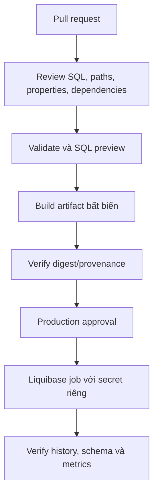

# Rà soát SQL, tham số hóa và nguồn changelog không tin cậy

Trong module `DATABASE_SCHEMA_MIGRATION_LIQUIBASE`, chúng ta học cách quản lý thay đổi schema và dữ liệu bằng **changelog, changeset, precondition, checksum và lịch sử triển khai**; thực hành migration có kiểm chứng, rollback, phối hợp nhiều môi trường và tích hợp Spring Boot hoặc CI/CD. Changelog là mã có khả năng thực thi trên database với quyền cao. Một câu SQL ghép chuỗi không an toàn, một file SQL bị thay thế hoặc một dependency không đáng tin cậy có thể biến lần triển khai schema thành đường thực thi lệnh trái phép.

Bài học thuộc chương **Bảo mật**, tập trung vào ba việc liên kết với nhau: rà soát SQL trong changeset và các truy vấn do ứng dụng tạo ra; tham số hóa dữ liệu đầu vào để ngăn SQL injection; và xác minh nguồn gốc, tính toàn vẹn, quyền truy cập của changelog cùng các tài nguyên mà nó tham chiếu. Mục tiêu là bảo đảm **chỉ migration đã được kiểm tra, đến từ nguồn được tin cậy và chạy bằng danh tính có quyền phù hợp** mới được phép tác động database.

## 1. Mô hình đe dọa khi triển khai Liquibase

Liquibase không tự làm cho SQL an toàn. Nó đọc changelog, xác định changeset cần chạy và gửi câu lệnh tới DBMS. Nếu changelog chứa SQL nguy hiểm hoặc bị thay đổi bởi người không có quyền, Liquibase vẫn có thể thực thi câu lệnh đó bằng tài khoản migration.

Các nguồn rủi ro thường gặp:

| Nguồn | Ví dụ | Hậu quả có thể xảy ra |
|---|---|---|
| SQL do ứng dụng tạo | Ghép chuỗi input vào câu query | SQL injection, đọc/sửa dữ liệu ngoài phạm vi |
| SQL trong changeset | `sql`, `sqlFile`, formatted SQL chứa câu lệnh tùy ý | Thực thi DDL/DML ngoài mục tiêu |
| Property substitution | Giá trị cấu hình không tin cậy được chèn vào SQL | Thay đổi cú pháp câu lệnh hoặc điều kiện |
| Tệp được include | `include`, `includeAll` nạp thêm changelog | Nạp migration không được review |
| Tài nguyên đi kèm | `sqlFile`, CSV cho `loadData`, file cấu hình | Thay đổi nội dung thực thi hoặc dữ liệu được nạp |
| Plugin/extension | Custom change, precondition hoặc ResourceAccessor từ bên ngoài | Thực thi mã trong tiến trình Liquibase |
| Pipeline/build | Artifact, dependency hoặc runner bị thay thế | Triển khai migration độc hại bằng credential hợp lệ |
| Secret và log | Mật khẩu nằm trong URL, property hoặc SQL log | Lộ thông tin kết nối database |

Hãy phân biệt **tính hợp lệ cú pháp**, **tính toàn vẹn nội dung** và **độ tin cậy nguồn gốc**. `validate` có thể phát hiện một số vấn đề về changelog/checksum; checksum có thể phát hiện nội dung changeset không còn khớp lịch sử; cả hai không chứng minh người tạo artifact là người được phép hoặc SQL có ý nghĩa nghiệp vụ an toàn.

## 2. SQL injection và cách dữ liệu đầu vào làm thay đổi câu lệnh

SQL injection xảy ra khi dữ liệu được xem như một phần cú pháp SQL thay vì một giá trị. Ví dụ ứng dụng ghép trực tiếp tên người dùng vào câu truy vấn:

```java
String sql =
    "SELECT id, email FROM customer WHERE email = '" + email + "'";
Statement statement = connection.createStatement();
ResultSet result = statement.executeQuery(sql);
```

Nếu `email` chứa dấu nháy và phần SQL bổ sung, câu truy vấn cuối có thể bị thay đổi. Một ứng dụng có thể vô tình cho phép đọc nhiều hàng, bỏ qua điều kiện xác thực hoặc thực thi thao tác ngoài dự kiến nếu driver và quyền cho phép.

**Không giải quyết vấn đề bằng cách tự thay dấu nháy hoặc xóa một vài ký tự.** Blacklist thường bỏ sót encoding, comment, cú pháp đặc thù DBMS và các cách biểu diễn tương đương. Hãy dùng prepared statement hoặc API hỗ trợ bind parameter.

### 2.1. Tham số hóa bằng JDBC PreparedStatement

```java
String sql =
    "SELECT id, email FROM customer WHERE email = ?";

try (PreparedStatement statement = connection.prepareStatement(sql)) {
    statement.setString(1, email);

    try (ResultSet result = statement.executeQuery()) {
        while (result.next()) {
            long id = result.getLong("id");
            String address = result.getString("email");
            // Xử lý kết quả theo nghiệp vụ.
        }
    }
}
```

Dấu hỏi là vị trí tham số. Driver gửi giá trị `email` như dữ liệu, tách khỏi cấu trúc SQL. Chuỗi giống cú pháp SQL được truyền vào cũng chỉ được so sánh như một giá trị, không trở thành toán tử hoặc câu lệnh mới.

Các nguyên tắc:

- Dùng kiểu bind đúng với cột: `setString`, `setLong`, `setBigDecimal`, `setTimestamp`...
- Không nối giá trị tham số vào chuỗi SQL trước khi gọi `prepareStatement`.
- Không chuyển sang `Statement` chỉ vì muốn tạo câu query động.
- Dùng try-with-resources để đóng statement/result set.
- Kiểm tra quyền database: tham số hóa ngăn thay đổi cú pháp, nhưng không thay thế authorization.

### 2.2. Spring JdbcTemplate và NamedParameterJdbcTemplate

Với Spring JDBC, truyền giá trị qua tham số:

```java
String sql =
    "SELECT id, email FROM customer WHERE tenant_id = ? AND email = ?";

List<CustomerRow> rows = jdbcTemplate.query(
    sql,
    (rs, rowNum) -> new CustomerRow(
        rs.getLong("id"),
        rs.getString("email")
    ),
    tenantId,
    email
);
```

Hoặc dùng tham số có tên:

```java
String sql = """
    SELECT id, email
    FROM customer
    WHERE tenant_id = :tenantId
      AND email = :email
    """;

MapSqlParameterSource params = new MapSqlParameterSource()
    .addValue("tenantId", tenantId)
    .addValue("email", email);

List<CustomerRow> rows =
    namedParameterJdbcTemplate.query(sql, params, rowMapper);
```

Tên tham số giúp câu SQL dễ đọc hơn, nhưng nguyên tắc không đổi: giá trị được bind riêng. Không tự thay thế chuỗi `:email` bằng nội dung người dùng bằng thao tác `String.replace`.

### 2.3. MyBatis: phân biệt bind value và text substitution

Trong MyBatis:

- `#{email}` là cơ chế bind tham số, nên dùng cho giá trị.
- Cú pháp text substitution dùng dấu dollar với placeholder trong ngoặc nhọn để chèn nội dung vào SQL trước khi thực thi; nếu nguồn không tin cậy, đây là nguy cơ injection.

Ví dụ an toàn cho giá trị:

```xml
<select id="findCustomer" resultType="Customer">
    SELECT id, email
    FROM customer
    WHERE email = #{email}
</select>
```

Không dùng text substitution cho dữ liệu đến từ request, file import hoặc người dùng. Nếu cần chọn tên cột hoặc hướng sắp xếp động, phải ánh xạ qua allowlist cố định trong mã nguồn, không truyền nguyên chuỗi tùy ý vào SQL.

## 3. Giá trị có thể bind; tên bảng và tên cột cần allowlist

Tham số SQL thường đại diện cho **giá trị**, không đại diện cho identifier như tên bảng, tên cột, schema, toán tử hoặc từ khóa `ASC`/`DESC`.

Ví dụ sau không hoạt động như mong muốn:

```java
String sql = "SELECT * FROM customer ORDER BY ?";
```

Tham số bind ở vị trí đó thường là một giá trị hằng, không phải tên cột. Không khắc phục bằng cách ghép trực tiếp input:

```java
// Không an toàn nếu sortField đến từ request.
String sql = "SELECT * FROM customer ORDER BY " + sortField;
```

Hãy ánh xạ đầu vào sang một tập identifier cố định:

```java
Map<String, String> allowedSortColumns = Map.of(
    "created", "created_at",
    "email", "email",
    "name", "display_name"
);

String column = allowedSortColumns.get(sortKey);
if (column == null) {
    throw new IllegalArgumentException("Unsupported sort field");
}

String direction = descending ? "DESC" : "ASC";
String sql =
    "SELECT id, email FROM customer ORDER BY " + column + " " + direction;

// Các giá trị lọc khác vẫn được bind bằng PreparedStatement.
```

Ở đây chỉ chuỗi `column` lấy từ map cố định và `direction` được chọn từ boolean trong mã nguồn mới được đưa vào cú pháp. Không đưa nguyên giá trị request vào tên bảng/cột. Nếu DBMS có quy tắc quote identifier, dùng cơ chế phù hợp với DBMS và vẫn duy trì allowlist; quote identifier không biến một tên tùy ý thành tên được phép.

## 4. Rà soát SQL trong Liquibase changeset

SQL trong changelog thường do đội phát triển viết và được đưa vào review cùng source code. Mỗi changeset cần được xem như một thay đổi có thể thực thi với quyền của tài khoản migration.

Các dạng cần rà soát:

- Change type chuẩn như `createTable`, `addColumn`, `insert`, `update`, `delete`.
- `sql` chứa câu SQL trực tiếp.
- `sqlFile` tham chiếu tệp SQL bên ngoài changelog.
- Formatted SQL changelog.
- `preConditions`, nhất là `sqlCheck` và custom precondition.
- `loadData`/`loadUpdateData` đọc dữ liệu từ CSV.
- Custom change hoặc extension chạy mã Java.
- Rollback SQL và script khôi phục.

Với từng câu lệnh, hỏi:

1. Nó có đúng đối tượng và schema không?
2. Điều kiện `WHERE` có giới hạn phạm vi dữ liệu không?
3. Có câu lệnh cấp quyền, tạo user, thay owner hoặc tắt kiểm tra bảo mật không?
4. Có SQL động, property substitution hoặc identifier lấy từ nguồn bên ngoài không?
5. Có thực thi nhiều statement ngoài mục tiêu không?
6. Có thao tác đọc/ghi dữ liệu nhạy cảm hoặc xuất dữ liệu vào log không?
7. Rollback có cùng mức độ an toàn và có thể làm lộ/ghi đè dữ liệu không?

### 4.1. Ưu tiên change type có cấu trúc khi phù hợp

Ví dụ thêm một dòng dữ liệu tham chiếu:

```yaml
databaseChangeLog:
  - changeSet:
      id: "SEC-3101-seed-customer-status"
      author: "database-platform"
      changes:
        - insert:
            tableName: customer_status
            columns:
              - column:
                  name: code
                  value: "PENDING"
              - column:
                  name: description
                  value: "Đang chờ xử lý"
```

Change type có cấu trúc giúp phân biệt bảng, cột và giá trị, giảm nhu cầu tự nối chuỗi SQL. Nó không tự bảo đảm nội dung đúng: vẫn phải kiểm tra bảng đích, uniqueness, dữ liệu đã tồn tại, quyền và rollback.

### 4.2. SQL tùy chỉnh cần review như mã chương trình

Ví dụ một câu truy vấn cố định để kiểm tra dữ liệu trước khi thêm constraint:

```yaml
preConditions:
  - onFail: HALT
  - onError: HALT
  - sqlCheck:
      expectedResult: "0"
      sql: |-
        SELECT COUNT(*)
        FROM customer
        WHERE status IS NULL
```

Query trên dùng SQL cố định, không nhận nội dung từ request hoặc file do người dùng cung cấp. Nếu cần kiểm tra một giá trị cấu hình, phải xem nguồn và cách thay thế giá trị; không ghép input không tin cậy vào câu SQL của `sqlCheck`.

`preConditions` không phải một ranh giới bảo mật. Nó kiểm tra điều kiện để quyết định hành vi changeset, không xác thực người tạo changelog, không giới hạn quyền database và không thay thế constraint được DBMS cưỡng chế.

## 5. Property substitution của Liquibase không phải SQL parameter binding

Liquibase hỗ trợ property trong changelog để tái sử dụng cấu hình, ví dụ tên schema hoặc một giá trị được truyền qua cấu hình triển khai. Cơ chế thay thế property là **thay văn bản trước khi SQL được gửi tới database**; nó khác prepared statement bind parameter.

Điều này rất quan trọng khi property đến từ:

- Biến môi trường do pipeline cấu hình.
- File properties có quyền ghi rộng.
- Tham số command line.
- Secret hoặc config store.
- Artifact/changelog do một hệ thống khác cung cấp.
- Giá trị nhập từ UI hoặc người vận hành.

Nếu một property không tin cậy được thay vào vị trí SQL, dấu nháy, comment hoặc toán tử trong giá trị có thể làm thay đổi cú pháp cuối cùng.

### 5.1. Property cho identifier cũng phải được kiểm soát

Ví dụ một schema name có thể được cấu hình theo môi trường. Schema là identifier, không phải giá trị bind. Hãy:

1. Lấy giá trị từ cấu hình deployment được quản lý, không từ request.
2. Kiểm tra giá trị nằm trong danh sách schema được phép.
3. Tránh cho phép ký tự phân cách, comment hoặc cú pháp tùy ý.
4. Kiểm tra SQL preview sau khi substitution.
5. Xác minh quyền tài khoản migration chỉ cho phép schema mục tiêu.

Không dùng substitution như cách để biến một input động thành identifier an toàn. Nếu cần nhiều schema hợp lệ, dùng allowlist cấu hình do nhóm sở hữu.

### 5.2. Không chèn input tùy ý vào SQL

Mẫu nguy hiểm về mặt thiết kế:

```text
Một giá trị đến từ request hoặc file import
       |
       v
Đưa nguyên văn vào property của Liquibase
       |
       v
Thay property vào giữa câu SQL
       |
       v
SQL cuối cùng có thể bị thay đổi cấu trúc
```

Mẫu an toàn hơn là xác định dữ liệu từ nguồn có kiểm soát, xác thực kiểu/miền giá trị và dùng change type có cấu trúc hoặc cơ chế bind parameter trong ứng dụng. Với migration cần giá trị động, thiết kế theo từng DBMS/phiên bản và review SQL đã render; không giả định Liquibase property hoạt động như `PreparedStatement`.

## 6. Kiểm soát include, includeAll và đường dẫn tài nguyên

Master changelog có thể nạp file khác thông qua `include` hoặc `includeAll`. Vì vậy, nguồn gốc của master chưa đủ: **mọi file được nạp theo cây include đều thuộc phạm vi tin cậy**.

Các rủi ro:

- Một file mới được thêm vào thư mục `includeAll` mà không qua review.
- File changelog bị thay thế giữa bước review và bước triển khai.
- Path tương đối trỏ nhầm thư mục khi file được di chuyển.
- Khác biệt hoa/thường giữa máy Windows và runner Linux khiến pipeline nạp tài nguyên khác dự kiến.
- Một tài nguyên bên ngoài hoặc URL có nội dung thay đổi theo thời gian.
- SQL/CSV đi kèm không được đóng gói trong artifact đã review.

### 6.1. Ưu tiên danh sách include tường minh cho thay đổi nhạy cảm

Ví dụ:

```yaml
databaseChangeLog:
  - include:
      file: changes/SEC-3101-seed-customer-status.yaml
      relativeToChangelogFile: true
  - include:
      file: changes/SEC-3102-add-customer-status-check.yaml
      relativeToChangelogFile: true
```

Danh sách tường minh giúp reviewer nhìn thấy chính xác những file được nạp và thứ tự của chúng. Nếu dùng `includeAll`, cần:

- Giới hạn thư mục chỉ chứa changelog đã được kiểm soát.
- Không cho phép tài khoản build/runtime không đáng tin cậy ghi vào thư mục.
- Thiết lập quy tắc tên và thứ tự ổn định.
- Review file mới, file bị xóa và file bị đổi tên.
- Xác minh danh sách changeset qua `status` và SQL preview của đúng artifact.

Không coi `relativeToChangelogFile` là biện pháp bảo mật. Nó giải quyết cách tính đường dẫn, không xác thực nguồn file.

### 6.2. Tài nguyên URL hoặc kho bên ngoài

Nếu dự án cho phép changelog/resource được tải từ URL, repository hoặc artifact store, cần cố định nguồn và phiên bản. Tránh tham chiếu một URL mutable mà nội dung có thể thay đổi sau khi pull request được duyệt. Dùng artifact bất biến, commit/tag được bảo vệ hoặc digest đã xác minh; kiểm tra TLS và quyền đọc kho.

Không tải và thực thi changelog từ URL do người dùng cuối, webhook hoặc ticket tùy ý cung cấp. Nếu cần nhập migration từ nhóm khác, đưa nó qua quy trình review và đóng gói của repository tin cậy trước.

## 7. Bảo vệ sqlFile, CSV và tài nguyên được tham chiếu

Một changeset có thể không chứa SQL trực tiếp mà tham chiếu file khác:

```yaml
databaseChangeLog:
  - changeSet:
      id: "SEC-3110-update-reference-codes"
      author: "database-platform"
      changes:
        - sqlFile:
            path: sql/SEC-3110-update-reference-codes.sql
            relativeToChangelogFile: true
            splitStatements: true
```

Reviewer phải mở và kiểm tra nội dung `sql/SEC-3110-update-reference-codes.sql`, không chỉ review YAML. Kiểm tra path có trỏ tới file đúng trong artifact, encoding, delimiter, số statement, quyền đọc và checksum của artifact phát hành.

Với `loadData`/CSV:

- Xác minh file đến từ nguồn dữ liệu đã phê duyệt.
- Kiểm tra header, thứ tự cột, encoding, delimiter, quote và escape.
- Kiểm tra nội dung ô có thể chứa công thức/chuỗi nhạy cảm hoặc dữ liệu ngoài miền.
- Kiểm tra số dòng, khóa duy nhất, null và bản ghi trùng trước khi nạp.
- Không đưa dữ liệu cá nhân hoặc secret vào repository nếu không có chính sách cho phép.
- Giới hạn quyền ghi và bảo đảm file trong artifact đúng với file đã review.

File CSV có thể làm thay đổi nhiều hàng dù changeset chỉ có vài dòng YAML. Đánh giá tác động dữ liệu và rollback theo quy mô thực tế.

## 8. Checksum Liquibase bảo vệ điều gì, và không bảo vệ điều gì?

Liquibase lưu checksum changeset (thường thể hiện qua trường `MD5SUM`) trong `DATABASECHANGELOG`. Khi chạy lại, Liquibase có thể so sánh checksum hiện tại với giá trị đã lưu để phát hiện một số thay đổi nội dung sau khi changeset được thực thi.

Checksum hữu ích để:

- Phát hiện changeset cũ bị sửa ngoài dự kiến.
- Bảo vệ tính bất biến của lịch sử migration.
- Hỗ trợ điều tra khi artifact khác với artifact đã triển khai.
- Nhận diện một số thay đổi trong nội dung changeset theo quy tắc checksum của phiên bản.

Checksum **không phải chữ ký số hay chứng thực tác giả**:

- Người có quyền sửa changelog và quyền cập nhật metadata có thể thay đổi cả nội dung lẫn lịch sử.
- Một changeset độc hại ngay từ đầu vẫn có thể có checksum hợp lệ.
- Checksum không chứng minh pull request đã được review hoặc artifact đến từ pipeline tin cậy.
- Các thay đổi được Liquibase loại khỏi checksum hoặc cách tính thay đổi theo phiên bản có thể khiến checksum không đại diện cho mọi byte của artifact.
- Checksum không thay thế kiểm tra chữ ký, quyền truy cập repository, provenance và kiểm soát build.

Không chạy `clearCheckSums` hoặc khai báo `validCheckSum` để làm biến mất một cảnh báo chưa được giải thích. Trước tiên xác định artifact đã triển khai, changeset nào bị thay đổi, môi trường nào đã chạy và có dấu hiệu can thiệp hay không. Chỉ xử lý checksum theo quy trình được phê duyệt khi hiểu rõ nguyên nhân và tác động.

## 9. Xác minh nguồn gốc và tính toàn vẹn artifact

Để tin cậy changelog, cần bảo vệ toàn bộ chuỗi từ source đến database:

```text
Changelog + SQL/CSV + extension
          |
          v
Pull request và review có thẩm quyền
          |
          v
Build từ commit được bảo vệ
          |
          v
Artifact bất biến + digest/provenance
          |
          v
Pipeline xác minh artifact và dependency
          |
          v
Job Liquibase với credential có giới hạn
          |
          v
Database và audit history
```

Các kiểm soát nên có:

1. Repository private hoặc quyền truy cập phù hợp; bảo vệ nhánh release và bắt buộc review.
2. CODEOWNERS hoặc cơ chế tương đương cho changelog, SQL, script build và pipeline.
3. CI chạy validation và kiểm tra nội dung mọi file được include/tham chiếu.
4. Build artifact từ commit đã review; không sửa file sau khi đóng gói.
5. Gắn version/digest và provenance; xác minh trước khi triển khai.
6. Pin phiên bản Liquibase, JDBC driver, extension và dependency; không tải bản mới nhất tùy tiện ở runtime.
7. Lưu log phát hành, commit, artifact digest, người phê duyệt và danh sách changeset.
8. Kiểm soát quyền ghi artifact store và secret của pipeline.

Nếu tổ chức dùng chữ ký artifact hoặc attestations, kiểm tra chữ ký và danh tính signer theo trust policy. Một checksum do chính cùng pipeline không đáng tin cậy tạo ra không chứng minh artifact độc lập đã được xác thực.

## 10. Bảo vệ dependency, plugin và custom extension

Liquibase có thể được mở rộng bằng extension, custom change, custom precondition, listener hoặc thành phần được nạp vào classpath. Đây là mã thực thi trong tiến trình có thể giữ credential database.

Trước khi thêm dependency:

- Xác định nhà cung cấp, repository và phiên bản cụ thể.
- Kiểm tra nguồn phát hành, lịch sử bảo trì, lỗ hổng đã biết và tính tương thích.
- Pin version, kiểm soát transitive dependency và lưu dependency lock/SBOM nếu quy trình hỗ trợ.
- Không tải JAR từ link tùy ý trong lúc triển khai production.
- Review mã custom change/precondition; chúng có thể chạy Java và thực thi hành động ngoài SQL thông thường.
- Hạn chế classpath chỉ chứa extension cần thiết.

Custom precondition không nên gọi network tùy ý, đọc secret không liên quan hoặc thực thi shell command. Nếu một extension có hành vi ngoài database, phải đưa nó vào threat model và kiểm thử trong môi trường cô lập.

## 11. Quản lý secret, credential và log SQL

Credential của Liquibase thường có quyền DDL mạnh hơn tài khoản runtime. Nếu lộ credential, kẻ tấn công có thể sửa schema, tạo user, đọc dữ liệu hoặc làm gián đoạn database.

Nguyên tắc:

- Lấy password/token từ secret manager hoặc cơ chế secret của runner.
- Không commit password vào `liquibase.properties`, YAML, XML, shell script hoặc file mẫu.
- Không truyền secret qua command line nếu có thể xuất hiện trong process list, shell history hoặc log.
- Không in JDBC URL đầy đủ nếu URL chứa credential.
- Dùng TLS/CA verification theo chính sách kết nối database.
- Cấp credential theo môi trường và rotate khi người/runner không còn quyền.
- Dùng credential production riêng khỏi dev/test; không dùng chung credential giữa nhiều pipeline.

### 11.1. SQL logging có thể làm lộ dữ liệu

Log SQL hữu ích để điều tra, nhưng có thể chứa:

- Giá trị email, số điện thoại, mã định danh hoặc dữ liệu nghiệp vụ.
- Giá trị được bind hoặc literal nằm trong câu lệnh.
- Tên schema, bảng nội bộ và cấu trúc bảo mật.
- JDBC URL, username hoặc thông tin cấu hình.

Chọn mức log vừa đủ cho vận hành, hạn chế log parameter nhạy cảm, bảo vệ log store và đặt thời hạn lưu phù hợp. Khi cần debug, dùng dữ liệu giả/đã ẩn danh và không bật log chi tiết trên production lâu hơn cần thiết.

## 12. Least privilege cho tài khoản migration

Tài khoản migration cần quyền để tạo/cập nhật đối tượng thuộc phạm vi, nhưng không nên mặc định là superuser hoặc DBA toàn cục.

Thiết kế quyền:

| Tài khoản | Quyền cần có | Không nên mặc định có |
|---|---|---|
| Ứng dụng runtime | CRUD trên đối tượng nghiệp vụ được phép | CREATE/DROP schema, quản trị role |
| Liquibase migration | DDL/DML cần thiết trong schema được quản lý; đọc/ghi bảng lịch sử và lock | Superuser, quyền quản trị toàn cluster |
| Khảo sát/read-only | Đọc metadata và dữ liệu được phê duyệt | DDL, DML, quyền sửa lịch sử |
| DBA/break-glass | Quyền quản trị theo quy trình khẩn cấp | Credential dùng thường xuyên trong CI |

Một số DBMS yêu cầu quyền đặc biệt để tạo extension, schema, role hoặc đối tượng đặc thù. Nếu cần, tách bước provisioning nền tảng khỏi migration ứng dụng và yêu cầu DBA thực hiện qua quy trình được kiểm soát. Không mở rộng quyền vĩnh viễn chỉ để một changeset chạy thuận tiện.

### 12.1. Phân tách môi trường và schema

- Dùng credential riêng cho dev, test, staging và production.
- Giới hạn schema mặc định và quyền trên các schema khác.
- Xác minh JDBC URL/database/schema trước khi thực thi.
- Không cho phép người dùng tự chọn URL production hoặc credential thông qua tham số không tin cậy.
- Có thể dùng credential ngắn hạn/ephemeral nếu nền tảng hỗ trợ.
- Ghi audit ai/runner nào đã dùng credential để triển khai.

## 13. Bảo vệ pipeline và điểm thực thi Liquibase

Một pipeline an toàn không nhận changelog tùy ý từ pull request rồi chạy với secret production. Tách rõ:

1. **Kiểm tra ở pull request:** đọc changelog, validate, kiểm tra path và dependency, tạo SQL preview trên database không nhạy cảm.
2. **Rehearsal:** dùng database thử nghiệm có cấu trúc và dữ liệu phù hợp, credential giới hạn.
3. **Phê duyệt release:** artifact đã được build từ commit được review, có digest và danh tính người phê duyệt.
4. **Triển khai production:** job được bảo vệ, tải artifact đã xác minh và lấy secret production từ kho an toàn.
5. **Xác minh hậu triển khai:** đối chiếu `DATABASECHANGELOG`, schema, metric và log.

Không để code từ nhánh chưa tin cậy truy cập secret production qua pull request pipeline. Cẩn trọng với pipeline chạy script do nhánh contributor kiểm soát, vì script build cũng có thể đọc biến môi trường hoặc gửi secret ra ngoài.

### 13.1. Một luồng triển khai được kiểm soát



Mỗi bước cần có quyền riêng. Người sửa changelog không nhất thiết được quyền tự triển khai production; runner build không nhất thiết được quyền đọc secret production; ứng dụng runtime không cần quyền DDL.

## 14. Review property, context, label và precondition như ranh giới cấu hình

Các cơ chế này điều khiển changeset được chọn hoặc giá trị được đưa vào changelog, nhưng không thay thế authentication/authorization.

- **Context/label:** bộ lọc triển khai; không chứng minh môi trường thực tế chỉ từ tên `prod`.
- **DBMS filter:** giới hạn DBMS phù hợp; không xác minh nguồn changelog.
- **Precondition:** kiểm tra điều kiện trước khi thực thi; không cấp quyền và không chống SQL injection nếu query của nó được ghép input.
- **Property:** thay văn bản cấu hình; giá trị phải đến từ nguồn tin cậy và được xác thực.
- **Logical file path/include:** định danh và nạp tài nguyên; không chứng thực nội dung file.

Khi review, kiểm tra cả giá trị mặc định, giá trị override, thứ tự ưu tiên property và nguồn truyền vào từ pipeline. Không để một người có quyền sửa biến môi trường nhưng không có quyền review changelog có thể làm thay đổi SQL production theo cách không kiểm soát.

## 15. Những dấu hiệu đáng ngờ trong changelog

Các thay đổi sau cần được giải thích và review kỹ:

- SQL chứa `DROP`, `TRUNCATE`, `DELETE` không có `WHERE` hoặc cập nhật toàn bảng.
- Tạo user/role, cấp quyền rộng, thay owner hoặc tắt policy/constraint.
- Gọi function/procedure không thuộc phạm vi module.
- Đọc file, gọi network hoặc chạy custom Java code không có lý do rõ.
- Property được đưa trực tiếp vào giữa câu SQL hoặc tên identifier.
- Include file từ thư mục có quyền ghi rộng hoặc nguồn mutable.
- Thêm JAR/extension mới mà không có nguồn và phiên bản được xác minh.
- Tắt checksum/validation hoặc thêm `validCheckSum` mà không có giải trình.
- Sửa changeset đã triển khai hoặc xóa/chỉnh bản ghi `DATABASECHANGELOG`.
- SQL log hoặc comment chứa secret/dữ liệu nhạy cảm.

Một thay đổi nguy hiểm không tự động là độc hại; có thể có yêu cầu nghiệp vụ hợp lệ. Tuy nhiên, nó cần owner, lý do, phạm vi, approval, rehearsal và kế hoạch khôi phục tương xứng.

## 16. Xử lý khi phát hiện changelog hoặc SQL không đáng tin cậy

Nếu nghi ngờ artifact/changelog bị sửa hoặc có SQL injection:

1. **Dừng job trước khi thực thi** nếu chưa chạy; giữ lại artifact, digest, commit và log để điều tra.
2. Không sửa nhanh file tại chỗ rồi tiếp tục cùng pipeline. Xác minh nguồn thay đổi và tạo artifact mới từ commit tin cậy.
3. Nếu đã chạy, xác định chính xác database, changeset, thời gian, tài khoản, câu lệnh và phạm vi dữ liệu bị tác động.
4. Phối hợp DBA/security để kiểm tra audit log, session, user/role, object mới, quyền và truy cập bất thường.
5. Cô lập hoặc rotate credential có nguy cơ lộ; không xóa dấu vết log.
6. Đối chiếu `DATABASECHANGELOG` với artifact đã xác minh; không tự sửa checksum hoặc xóa lịch sử để làm sạch trạng thái.
7. Đánh giá dữ liệu bị đọc/sửa/xóa, xác định backup/PITR và phương án khôi phục hoặc forward-fix.
8. Chỉ triển khai lại sau khi nguyên nhân, phạm vi, quyền và artifact đã được xử lý, có approval của owner phù hợp.

Nếu thay đổi đã thực thi một phần, không giả định rollback toàn bộ đã xảy ra. DDL có thể không transactional trên DBMS; kiểm tra schema và dữ liệu thực tế trước khi chạy lệnh tiếp theo.

## 17. Ví dụ rà soát một changeset trước khi merge

Giả sử pull request thêm cột trạng thái và nạp dữ liệu tham chiếu. Reviewer nên kiểm tra:

```yaml
databaseChangeLog:
  - changeSet:
      id: "SEC-3201-add-customer-review-state"
      author: "customer-platform"
      comment: "Thêm trạng thái kiểm duyệt hồ sơ"
      preConditions:
        - onFail: HALT
        - onError: HALT
        - tableExists:
            tableName: customer
      changes:
        - addColumn:
            tableName: customer
            columns:
              - column:
                  name: review_state
                  type: VARCHAR(20)
                  constraints:
                    nullable: true
      rollback:
        - dropColumn:
            tableName: customer
            columnName: review_state
```

Các điểm review:

- ID/author có thuộc convention và không trùng không?
- `tableExists` có nhắm đúng schema không, và tài khoản migration có đang kết nối đúng database?
- Cột nullable có phù hợp với ứng dụng cũ và dữ liệu hiện tại không?
- Có SQL tùy chỉnh hoặc property không cần thiết không?
- Rollback drop cột có thể làm mất dữ liệu mới; đã chấp nhận tác động đó chưa?
- File changelog có được include từ master tin cậy không?
- Artifact build có chứa đúng file và đường dẫn không?

Nếu pull request bổ sung `sqlFile`, phải review file SQL đó và mọi tài nguyên mà nó tiếp tục tham chiếu. Một changeset sạch không bảo đảm toàn bộ cây resource sạch.

## 18. Checklist bảo mật trước khi chạy Liquibase trên production

- [ ] Changelog đến từ repository/commit được review và artifact bất biến đã xác minh.
- [ ] Tất cả file `include`, `includeAll`, `sqlFile`, CSV và dependency đều nằm trong phạm vi tin cậy.
- [ ] Không có URL/resource mutable hoặc nguồn tải do người dùng cuối kiểm soát.
- [ ] SQL được review; dữ liệu đầu vào của ứng dụng dùng bind parameter, không nối chuỗi.
- [ ] Identifier động được chọn từ allowlist; không dùng substitution tùy ý.
- [ ] Property substitution chỉ nhận cấu hình từ nguồn tin cậy, được kiểm tra và xem trong SQL preview.
- [ ] `preConditions`/`sqlCheck` không ghép input không tin cậy vào SQL.
- [ ] Changeset có phạm vi DDL/DML, `WHERE`, schema và rollback rõ ràng.
- [ ] Checksum được dùng để phát hiện thay đổi lịch sử, không bị xem nhầm là chữ ký số.
- [ ] Không có thao tác `clearCheckSums`, `validCheckSum` hoặc sửa `DATABASECHANGELOG` thiếu giải trình.
- [ ] Liquibase version, JDBC driver, extension và dependency được pin/kiểm soát.
- [ ] Secret nằm trong secret manager; log không chứa password, token hoặc dữ liệu nhạy cảm.
- [ ] Credential migration riêng theo môi trường và theo nguyên tắc least privilege.
- [ ] Pipeline không cấp secret production cho mã từ nhánh chưa tin cậy.
- [ ] Có approval, audit log, backup/restore readiness và kế hoạch xử lý sự cố.
- [ ] Sau triển khai đã đối chiếu changeset, schema, quyền và metric.

## 19. Bài thực hành: tìm lỗi injection và nguồn changelog không tin cậy

Thực hành trên ứng dụng và database giả lập:

1. Tạo một API tìm customer theo email. Viết một phiên bản ghép chuỗi có lỗi và một phiên bản dùng `PreparedStatement`.
2. Gửi input có dấu nháy, comment và chuỗi giống cú pháp SQL. Quan sát phiên bản ghép chuỗi và xác nhận phiên bản bind chỉ coi input là giá trị.
3. Thêm bộ lọc sort động. Thử truyền tên cột không nằm trong allowlist và xác nhận request bị từ chối.
4. Viết changeset dùng `sqlCheck` với câu SQL cố định; xác định điều gì xảy ra nếu property đến từ nguồn không tin cậy.
5. Tạo master dùng `include` tường minh và một thử nghiệm `includeAll`; kiểm tra file mới có thể được nạp thế nào và cách CI phát hiện thay đổi ngoài dự kiến.
6. Thay đổi một file SQL được tham chiếu trong bản thử; xem checksum/lịch sử phản ứng ra sao. Không sửa metadata để bỏ qua cảnh báo.
7. Tạo một artifact từ commit đã review, ghi digest và xác minh artifact trước khi chạy trên database thử nghiệm.
8. Cấp tài khoản migration chỉ quyền trên schema thử nghiệm; xác nhận tài khoản runtime không thể tạo bảng hoặc cấp role.
9. Rà soát log để bảo đảm không in credential và giá trị nhạy cảm.
10. Viết biên bản review gồm nguồn changelog, SQL, property, dependency, quyền, checksum và kết quả kiểm tra.

**Kết luận:** bảo mật Liquibase cần được kiểm soát từ câu SQL đến artifact và tài khoản thực thi. Dùng prepared statement cho giá trị đầu vào của ứng dụng, allowlist cho identifier động, không đưa dữ liệu không tin cậy vào property substitution, review toàn bộ cây `include`/`sqlFile`/CSV và xác minh nguồn gốc artifact. Checksum hỗ trợ phát hiện thay đổi nội dung, còn chữ ký/provenance, quyền repository, dependency pinning, secret management và least privilege mới tạo thành chuỗi tin cậy. Kết hợp các kiểm soát này với review, rehearsal và audit giúp quy trình `DATABASE_SCHEMA_MIGRATION_LIQUIBASE` hạn chế SQL injection, migration trái phép và rủi ro chuỗi cung ứng khi triển khai trên production.
