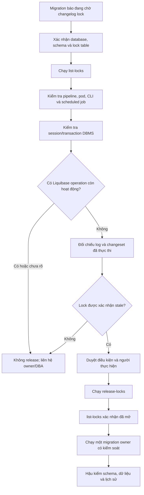

# Điều kiện an toàn trước khi sử dụng release-locks

## 1. Vì sao cần một quy trình an toàn để giải phóng Liquibase lock?

Trong module **DATABASE_SCHEMA_MIGRATION_LIQUIBASE**, người học nắm cách quản lý thay đổi schema và dữ liệu bằng Liquibase qua changelog, changeset, precondition, checksum và lịch sử triển khai; thực hành migration có kiểm chứng, rollback, phối hợp nhiều môi trường và tích hợp Spring Boot hoặc CI/CD. Trong vận hành, nhiều ứng dụng hoặc pipeline có thể cùng khởi chạy Liquibase trên một database. Liquibase dùng bảng khóa để điều phối, tránh nhiều tiến trình đồng thời thay đổi cùng lịch sử changelog.

Khi một tiến trình bị dừng bất thường, mất kết nối hoặc máy chạy bị tắt, trạng thái khóa có thể còn được ghi trong database. Lần chạy tiếp theo có thể báo đang chờ changelog lock. Lệnh `release-locks` được dùng để giải phóng trạng thái khóa còn sót lại trong bảng `DATABASECHANGELOGLOCK`.

Tuy nhiên, **khóa còn tồn tại không tự chứng minh tiến trình sở hữu khóa đã chết**. Một migration có thể chạy lâu vì DDL, lock của DBMS, backfill hoặc transaction lớn. Nếu giải phóng khóa khi tiến trình cũ vẫn đang hoạt động, một tiến trình Liquibase khác có thể bắt đầu cùng lúc. Hậu quả có thể là DDL cạnh tranh, lỗi changeset, cập nhật lịch sử không nhất quán hoặc dữ liệu bị thay đổi ngoài dự kiến.

Vì vậy, điều kiện quan trọng nhất trước khi sử dụng `release-locks` là chứng minh rằng **không còn Liquibase operation nào đang chạy trên đúng database và đúng lock table đó**. Cần xác định chính xác mục tiêu, chủ sở hữu, trạng thái tiến trình, trạng thái database và kế hoạch kiểm chứng sau khi mở khóa.

### Mục tiêu học tập

Sau bài học, bạn có thể:

1. Giải thích vai trò của `DATABASECHANGELOGLOCK` và lý do Liquibase cần khóa.
2. Phân biệt một lock đang được tiến trình hoạt động giữ với một lock bị bỏ lại sau sự cố.
3. Kiểm tra thông tin lock bằng `list-locks` và đối chiếu với tiến trình, pipeline và session của DBMS.
4. Xác minh đúng database, catalog, schema và tên lock table trước khi giải phóng.
5. Xác định các điều kiện bắt buộc phải đạt trước khi chạy `release-locks`.
6. Thực hiện giải phóng khóa theo một quy trình có kiểm soát và xác minh kết quả.
7. Kiểm tra trạng thái changeset và schema sau sự cố, tránh retry mù quáng.
8. Thiết kế runbook, phân quyền và quality gate cho Spring Boot/CI/CD.

**Nguyên tắc:** `release-locks` chỉ giải phóng trạng thái khóa của Liquibase. Nó không dừng tiến trình đang chạy, không rollback SQL đã commit, không sửa changeset lỗi và không khôi phục dữ liệu.

## 2. Liquibase lock bảo vệ điều gì?

Khi Liquibase thực hiện một operation cần điều phối, nó sử dụng bảng `DATABASECHANGELOGLOCK` trong database đích. Bảng mặc định thường có một dòng đại diện cho lock, với các thông tin như:

| Cột | Ý nghĩa |
|---|---|
| `ID` | Định danh dòng lock |
| `LOCKED` | Trạng thái đang bị khóa hay không |
| `LOCKGRANTED` | Thời điểm lock được cấp |
| `LOCKEDBY` | Thông tin máy/tiến trình được ghi nhận là chủ sở hữu |

Tên cột và cấu trúc thực tế cần được xác nhận theo phiên bản/cấu hình Liquibase của dự án. Không chỉnh sửa cấu trúc bảng bằng tay.

### 2.1. Vì sao phải có lock?

Giả sử hai tiến trình cùng chạy `update` trên một database:

- Tiến trình A đọc lịch sử changeset và bắt đầu triển khai.
- Tiến trình B cũng đọc lịch sử gần cùng thời điểm.
- Nếu không có điều phối, cả hai có thể cùng quyết định một changeset chưa chạy và cùng thực thi.
- DDL có thể đụng nhau; một tiến trình có thể thấy object đã tồn tại hoặc ghi lịch sử trong khi tiến trình kia vẫn đang thay đổi schema.

Lock giúp Liquibase tuần tự hóa các operation sử dụng cùng bảng lock. Nó là cơ chế điều phối ở cấp Liquibase/database, không phải khóa nghiệp vụ cho từng hàng và cũng không thay thế transaction/lock của DBMS.

### 2.2. Lock không bảo vệ mọi đường thay đổi database

`DATABASECHANGELOGLOCK` không ngăn:

- DBA chạy SQL thủ công.
- Ứng dụng ghi dữ liệu nghiệp vụ.
- Một công cụ migration khác không dùng cùng lock table.
- Một Liquibase process trỏ tới database hoặc lock table khác.
- Một script bên ngoài thay đổi schema.
- Một hệ thống dùng lock table riêng hoặc cấu hình khác.

Do đó, thấy lock đã được giải phóng không có nghĩa database được bảo vệ khỏi mọi thay đổi đồng thời. Nhóm vẫn cần một migration owner và quy trình release rõ ràng.

## 3. Hiểu đúng lệnh release-locks

Lệnh `release-locks` yêu cầu Liquibase giải phóng trạng thái lock trong bảng changelog lock của database mà cấu hình kết nối đang trỏ tới.

Ví dụ lệnh CLI:

```bash
liquibase \
  --url="jdbc:postgresql://db-host:5432/orders" \
  --username="migration_user" \
  list-locks
```

Sau khi đã xác minh lock thực sự bị bỏ lại:

```bash
liquibase \
  --url="jdbc:postgresql://db-host:5432/orders" \
  --username="migration_user" \
  release-locks
```

Đây là ví dụ PostgreSQL; URL, driver, credential source và tham số cấu hình phải phù hợp môi trường. Không đưa mật khẩu thật vào lịch sử shell, script commit hoặc log CI. Nên dùng secret manager, file cấu hình được bảo vệ hoặc cơ chế credential của nền tảng.

### 3.1. list-locks và release-locks có vai trò khác nhau

| Lệnh | Mục đích | Có thay đổi lock không? |
|---|---|---|
| `list-locks` | Hiển thị thông tin lock đang được ghi nhận | Không, đây là bước kiểm tra |
| `release-locks` | Giải phóng trạng thái lock trong lock table | Có |

Chạy `list-locks` thành công chỉ cho biết Liquibase đọc được trạng thái lock tại thời điểm đó. Nó không chứng minh tiến trình ghi trong `LOCKEDBY` còn hoạt động hay đã chết. Phải đối chiếu với hệ thống triển khai, log và session database.

### 3.2. Lệnh không phải nút kill tiến trình

`release-locks` không gửi tín hiệu dừng đến JVM, container, pod, CLI process hoặc pipeline owner. Nếu tiến trình cũ vẫn chạy, nó có thể tiếp tục thực thi SQL sau khi lock đã bị giải phóng. Tiến trình mới có thể lấy lock và bắt đầu operation khác, tạo ra hai hoạt động cạnh tranh.

Không dùng `release-locks` như cách xử lý timeout chung hoặc để “ép” migration tiếp tục khi chưa hiểu tiến trình đang làm gì.

## 4. Phân biệt lock đang hoạt động và lock bị bỏ lại

Một lock có thể còn hợp lệ dù thời gian giữ dài. Một DDL cần chờ DBMS lock, một changeset xử lý bảng lớn hoặc một network chậm có thể khiến operation kéo dài hơn dự kiến.

### 4.1. Dấu hiệu lock có thể vẫn đang hoạt động

- Pipeline migration đang ở trạng thái running.
- Container/pod sở hữu job vẫn sống.
- Log tiếp tục có tiến triển hoặc heartbeat.
- DBMS còn session tương ứng với user/application Liquibase.
- Session đang chạy SQL, chờ lock hoặc trong transaction.
- Thời gian lock phù hợp với thời gian thực thi đã dự kiến.
- Người vận hành xác nhận một operation có chủ đích vẫn đang diễn ra.

Trong các trường hợp này, **không giải phóng lock**. Điều tra lý do operation kéo dài và để owner xử lý theo runbook.

### 4.2. Dấu hiệu lock có thể đã stale

- Pipeline/job đã kết thúc bất thường hoặc bị hủy.
- Pod/container/host sở hữu operation đã bị terminate.
- Không còn Liquibase process tương ứng.
- DBMS không còn session/transaction của operation đó.
- Log cho thấy process bị kill, host mất điện hoặc kết nối bị đóng.
- Lock vẫn được ghi là đang khóa dù không còn owner hoạt động.
- Nhóm đã xác nhận không có job retry, scheduled task hoặc deployment khác chuẩn bị chạy.

Không một dấu hiệu riêng lẻ nào đủ trong mọi môi trường. Ví dụ pipeline UI có thể báo timeout trong khi process ở worker vẫn chạy; pod có thể đã thay thế nhưng connection pool/session cũ còn tồn tại. Cần kết hợp nhiều nguồn bằng chứng.

### 4.3. Thời gian lock cũ không phải bằng chứng duy nhất

`LOCKGRANTED` là thời điểm lock được cấp. Một timestamp đã cũ có thể đáng nghi nhưng không chứng minh process đã dừng. Không đặt quy tắc “lock trên N phút thì tự động release” nếu chưa có cơ chế chứng minh owner và operation đã kết thúc.

Thời gian cần được so với loại migration, kích thước dữ liệu, thời gian lock DBMS, maintenance window và lịch sử thực thi. Một changeset tạo index hoặc chuyển dữ liệu lớn có thể chạy lâu hơn một thay đổi metadata đơn giản.

## 5. Điều kiện bắt buộc trước khi release-locks

Trước khi chạy lệnh, người vận hành phải hoàn thành các điều kiện sau.

### 5.1. Xác định đúng database đích

Đối chiếu:

- JDBC URL/host/port.
- Database hoặc service name.
- Catalog và schema.
- Môi trường: local, test, staging hay production.
- User Liquibase và quyền kết nối.
- Liquibase configuration file, environment variables và command-line overrides.
- Tên/schema của lock table nếu dự án tùy chỉnh.

Một lệnh release-locks trỏ nhầm database có thể giải phóng lock ở môi trường khác trong khi lock gây sự cố vẫn còn nguyên. Đặc biệt chú ý profile Spring Boot và cấu hình ngoài JAR có thể ghi đè URL.

### 5.2. Xác định đúng lock table

Liquibase mặc định dùng `DATABASECHANGELOGLOCK`, nhưng dự án có thể tùy chỉnh tên hoặc schema của bảng history/lock. Cần xác minh cấu hình runtime đang được dùng bởi tiến trình gặp sự cố.

Nếu `list-locks` không thấy lock nhưng ứng dụng vẫn báo chờ lock, có thể:

- CLI và ứng dụng đang trỏ tới database khác nhau.
- Schema/catalog khác nhau.
- Một tiến trình dùng tên lock table tùy chỉnh.
- Cấu hình profile hoặc property khác nhau.
- Lỗi thực tế không phải lock stale.

Không chạy release trên một cấu hình gần giống chỉ vì tên database trông quen thuộc.

### 5.3. Xác minh không còn Liquibase operation hoạt động

Phải kiểm tra tất cả nguồn có thể chạy migration:

- Spring Boot application replicas.
- Migration job trong Kubernetes/VM/container platform.
- Liquibase CLI trong terminal hoặc runner.
- CI/CD pipeline và retry stage.
- Scheduled task, deployment hook hoặc operator.
- Công cụ DBA được phép chạy Liquibase.
- Job thủ công đang chờ hoặc được tự động restart.

Nếu có nhiều replica, xác minh trạng thái của tất cả instance liên quan, không chỉ một pod. Nếu job được retry tự động, tạm dừng cơ chế retry theo quy trình vận hành trước khi giải phóng.

### 5.4. Kiểm tra session và transaction của DBMS

Đối chiếu lock table với session database. Cần biết session nào thuộc Liquibase, session nào đang chạy DDL/DML, session nào đang chờ lock và transaction có còn mở không.

Nếu không thể xác định session owner, chưa đủ điều kiện release. Hãy nhờ DBA hoặc người trực database hỗ trợ xác minh trước khi thay đổi lock.

### 5.5. Có kế hoạch sau khi mở khóa

Trước khi giải phóng, xác định:

- Ai là người chạy migration tiếp theo?
- Chạy changeset nào và bằng artifact/commit nào?
- Có cần kiểm tra SQL đã commit một phần không?
- Có backup/restore hoặc forward-fix khi cần không?
- Hậu kiểm nào phải đạt trước khi mở traffic?
- Ai theo dõi job và quyết định dừng?

Không nên release lock nếu không có owner tiếp nhận operation kế tiếp.

## 6. Quy trình chẩn đoán trước khi thực hiện

Một quy trình có thể dùng trong runbook:



### 6.1. Thu thập bằng chứng

Lưu lại trước khi thao tác:

- Thời điểm phát hiện lỗi và thông báo đầy đủ.
- Kết quả `list-locks`.
- Lock granted time và owner string.
- Pipeline/job ID, trạng thái và log cuối.
- Danh sách pod/container/host liên quan.
- DBMS session/query/transaction liên quan.
- Database/schema/lock table đã xác nhận.
- Người trực và người phê duyệt.

Không đưa password, access token hoặc dữ liệu cá nhân vào ticket/runbook. Thông tin hostname/IP có thể nhạy cảm và cần được chia sẻ theo quyền nội bộ.

## 7. Kiểm tra session PostgreSQL như thế nào?

Nếu database là PostgreSQL và người vận hành có quyền đọc thống kê hoạt động, có thể xem session qua `pg_stat_activity`. Ví dụ truy vấn kiểm tra session theo user/application:

```sql
SELECT
    pid,
    usename,
    application_name,
    client_addr,
    state,
    wait_event_type,
    wait_event,
    xact_start,
    query_start,
    state_change,
    query
FROM pg_stat_activity
WHERE datname = current_database()
ORDER BY query_start NULLS LAST;
```

Cần diễn giải cẩn thận:

- `active` có thể đang thực thi câu lệnh.
- `idle in transaction` cho biết transaction còn mở dù session không chạy query tại thời điểm quan sát.
- `wait_event_type`/`wait_event` có thể cho thấy session đang chờ lock hoặc tài nguyên.
- `query_start` và `xact_start` giúp hiểu thời gian hoạt động, nhưng không tự xác định tiến trình có thể bị dừng an toàn.
- `application_name` có thể hữu ích nếu client đặt tên, nhưng không phải lúc nào cũng được cấu hình.

Quyền đọc nội dung query có thể bị giới hạn. Không kết luận không có Liquibase chỉ vì không thấy tên application; driver/client có thể dùng tên mặc định.

### 7.1. Kiểm tra lock DBMS

Có thể kết hợp `pg_locks` với `pg_stat_activity` để điều tra quan hệ chờ/giữ lock. Cần có hiểu biết PostgreSQL và tránh chạy truy vấn chẩn đoán nặng trong lúc database đang chịu tải cao.

Một truy vấn rút gọn để tìm session đang chờ lock:

```sql
SELECT
    a.pid,
    a.usename,
    a.application_name,
    a.state,
    a.wait_event_type,
    a.wait_event,
    a.query_start,
    a.query
FROM pg_stat_activity AS a
WHERE a.datname = current_database()
  AND a.wait_event_type = 'Lock'
ORDER BY a.query_start;
```

Truy vấn này chỉ là một góc nhìn. Nó không thay thế kiểm tra tiến trình ở CI/CD hoặc Kubernetes; process có thể đang ở giữa các câu lệnh và không giữ session hoạt động liên tục.

### 7.2. DBMS khác

MySQL, MariaDB, Oracle, SQL Server và các nền tảng managed database có view/command chẩn đoán session khác nhau. Dùng tài liệu và quyền giám sát của đúng DBMS. Không chạy truy vấn PostgreSQL trên DBMS khác hoặc suy diễn từ một truy vấn không trả hàng rằng không còn operation.

## 8. Thực hiện release-locks theo quy trình

Chỉ sau khi tất cả điều kiện ở trên đã đạt, người vận hành mới thực hiện giải phóng.

### 8.1. Bước 1: xác nhận cấu hình

Dùng cùng database URL, schema/catalog, user, Liquibase version và lock table configuration với tiến trình đã giữ lock. Kiểm tra cấu hình hiệu lực, bao gồm profile và environment override.

Không lấy URL từ một terminal cũ hoặc từ tài liệu không xác định môi trường. Đối chiếu với pipeline/job thất bại.

### 8.2. Bước 2: xem trạng thái hiện tại

```bash
liquibase \
  --url="jdbc:postgresql://db-host:5432/orders" \
  --username="migration_user" \
  list-locks
```

Nếu không có lock, dừng thao tác release và điều tra vì sao tiến trình khác báo chờ. Nếu có lock, tiếp tục đối chiếu owner, thời gian và session; không suy luận chỉ từ output.

### 8.3. Bước 3: có xác nhận owner và approval

Trong production, nên có người chịu trách nhiệm migration và người trực database xác nhận không còn process đang chạy. Với hệ thống có quy trình change approval, ghi nhận ticket/incident và lý do release.

Không cần biến mọi môi trường local thành quy trình phê duyệt nặng nề, nhưng phải giữ nguyên các điều kiện kỹ thuật: đúng database, không có process hoạt động và có kiểm tra sau đó.

### 8.4. Bước 4: chạy release-locks một lần

```bash
liquibase \
  --url="jdbc:postgresql://db-host:5432/orders" \
  --username="migration_user" \
  release-locks
```

Không chạy lặp liên tục nếu command lỗi. Đọc lỗi kết nối/quyền/schema, xác nhận trạng thái lock và điều tra nguyên nhân. Nếu tool không thể giải phóng lock, chuyển cho DBA theo runbook; không tự ý UPDATE bảng lock bằng SQL tùy tiện.

### 8.5. Bước 5: xác minh lock đã được mở

```bash
liquibase \
  --url="jdbc:postgresql://db-host:5432/orders" \
  --username="migration_user" \
  list-locks
```

Kết quả phải thể hiện không còn lock được giữ trong lock table mà command đang kiểm tra. Đồng thời xác nhận không có tiến trình cũ tự khởi động lại và không có retry tự động chuẩn bị chạy.

Nếu lock vẫn xuất hiện, không chạy thêm migration. Xác minh cấu hình, quyền, tên lock table và lỗi command; liên hệ DBA nếu cần.

## 9. Những việc release-locks không làm

| Việc | `release-locks` có làm không? | Cần làm gì nếu cần |
|---|---|---|
| Đánh dấu lock không còn được giữ | Có | Xác minh bằng `list-locks` |
| Dừng JVM/container/pod cũ | Không | Dừng owner bằng orchestrator/runbook |
| Hủy query DBMS đang chạy | Không | Điều tra session và quyết định với DBA |
| Rollback DDL/DML đã commit | Không | Dùng rollback/recovery có kiểm soát |
| Sửa changeset lỗi | Không | Phân tích lỗi, tạo changeset bù khi phù hợp |
| Ghi changeset thành đã chạy | Không | Chỉ dùng thao tác history phù hợp sau khi xác minh |
| Khôi phục dữ liệu đã mất | Không | Backup/PITR/archive/audit |
| Kiểm tra checksum | Không | Dùng quy trình kiểm tra lịch sử riêng |
| Giải phóng row lock của ứng dụng | Không | Điều tra lock của DBMS/ứng dụng |

### 9.1. Không nhầm với rollback

Liquibase rollback là operation khác, thực thi logic đảo chiều cho changeset trong phạm vi được yêu cầu. `release-locks` không gọi rollback và không biết dữ liệu nào cần khôi phục.

### 9.2. Không nhầm với clear-checksums

`clear-checksums` làm trống checksum đã lưu theo cơ chế Liquibase để chúng được tính lại ở lần update phù hợp. Nó không giải phóng lock và không sửa một migration đã áp dụng một phần. Không dùng lệnh này để xử lý lỗi lock.

### 9.3. Không nhầm với changelog-sync

`changelog-sync` đánh dấu các changeset được chọn là đã được xử lý mà không thực thi nội dung thay đổi như `update`. Đây là thao tác lịch sử có rủi ro; không dùng để bỏ qua changeset lỗi hoặc “đồng bộ” lock.

## 10. Sau khi giải phóng: kiểm tra trạng thái database

Một lock được mở chỉ cho phép Liquibase operation tiếp theo có thể lấy lock. Nó không chứng minh database đang ở trạng thái nhất quán.

### 10.1. Kiểm tra lịch sử changeset

Xem `DATABASECHANGELOG` trên đúng database/schema. Các cột thường dùng để kiểm tra gồm ID, AUTHOR, FILENAME, DATEEXECUTED, EXECTYPE và MD5SUM; tên/cấu trúc có thể khác theo phiên bản.

Ví dụ PostgreSQL hoặc DBMS hỗ trợ tên cột tương ứng:

```sql
SELECT ID, AUTHOR, FILENAME, DATEEXECUTED, EXECTYPE, MD5SUM
FROM DATABASECHANGELOG
ORDER BY DATEEXECUTED, ORDEREXECUTED;
```

Xác định changeset cuối cùng đã được ghi nhận, changeset gây lỗi và các changeset đứng trước/sau trong release. Không xóa hoặc sửa dòng history chỉ để làm cho lần chạy tiếp theo vượt qua lỗi.

### 10.2. Kiểm tra schema thực tế

Đối chiếu object với mục tiêu của changeset:

- Bảng/cột/index/constraint nào đã được tạo?
- Có object nào tồn tại một phần hoặc sai định nghĩa không?
- DDL đã commit trước khi process dừng chưa?
- Có view/function/trigger phụ thuộc nào chưa được cập nhật?
- Có dữ liệu bị cập nhật hoặc xóa một phần không?

Cách kiểm tra metadata phụ thuộc DBMS. Nếu cần, dùng snapshot/diff hoặc truy vấn catalog, nhưng không suy ra schema đúng chỉ từ history.

### 10.3. Kiểm tra transaction và trạng thái áp dụng một phần

Liquibase thường thực thi changeset trong transaction khi DBMS và loại operation hỗ trợ. Tuy nhiên, không phải mọi DDL đều transactional giống nhau. Changeset dùng `runInTransaction: false` hoặc SQL gồm nhiều câu lệnh có thể để lại một phần tác động khi lỗi.

Ví dụ:

1. Câu đầu tạo index và đã commit.
2. Câu sau thêm constraint nhưng thất bại.
3. Process kết thúc bất thường.
4. Lock còn lại trong bảng.

Sau khi release lock, chạy lại changeset mù quáng có thể lỗi vì index đã tồn tại hoặc tạo trạng thái khác dự kiến. Cần đối chiếu SQL thực tế, object đã tồn tại và history trước khi quyết định retry, repair hoặc forward-fix.

### 10.4. Kiểm tra dữ liệu và invariant

Nếu migration có DML, kiểm tra:

- Số hàng trước/sau theo phạm vi dự kiến.
- Giá trị NULL, duplicate và outlier.
- Mapping theo khóa chính.
- Tổng tiền/số dư hoặc invariant nghiệp vụ.
- Foreign key và quan hệ giữa bảng.
- Những batch đã xử lý và checkpoint.
- Side effect ở CDC, message, cache hoặc báo cáo.

Không chỉ chạy lại câu SQL cũ để “xem có lỗi không”. Một câu UPDATE có thể idempotent về cú pháp nhưng đã làm mất thông tin nguồn.

## 11. Quyết định retry, repair hay forward-fix

Sau khi giải phóng lock và kiểm tra database, chọn hành động dựa trên trạng thái thực tế.

| Tình trạng | Hành động phù hợp |
|---|---|
| Không có SQL nào thực thi, database vẫn ở trạng thái trước | Có thể retry sau khi xác nhận nguyên nhân process dừng đã được xử lý |
| Changeset đã hoàn tất và history đã ghi nhận | Kiểm tra operation tiếp theo; không chạy lại changeset |
| DDL đã commit một phần, history chưa phản ánh đầy đủ | Khoanh vùng object và xử lý theo DBMS/runbook; không retry mù |
| DML đã cập nhật một phần theo batch | Dùng checkpoint, đối soát ID và tiếp tục có kiểm soát |
| Changeset lỗi do dữ liệu không đạt precondition | Sửa dữ liệu/điều kiện theo quyết định nghiệp vụ rồi chạy lại khi an toàn |
| Nội dung changeset đã triển khai cần sửa | Tạo changeset mới hoặc forward-fix; giữ nguyên lịch sử |
| Database không còn phù hợp và cần phục hồi | Dùng backup/PITR/restore plan đã được duyệt |

### 11.1. Retry chỉ khi có bằng chứng

Trước retry, phải xác nhận:

- Process cũ đã dừng hoàn toàn.
- Lock đã được giải phóng.
- Không có retry/job khác đang chạy.
- Database và changeset ở trạng thái đã hiểu rõ.
- Operation có thể tiếp tục an toàn từ trạng thái đó.
- Đúng artifact, changelog, URL và filter được sử dụng.

Nếu một điều kiện chưa rõ, dừng và chuyển cho owner/DBA. Một lần chạy lại thành công không chứng minh dữ liệu không bị bỏ sót hoặc cập nhật trùng.

### 11.2. Không sửa lịch sử để né lỗi

Không xóa dòng `DATABASECHANGELOG`, sửa checksum trực tiếp, dùng `changelog-sync` hoặc `clear-checksums` chỉ để vượt qua lỗi sau sự cố. Những thao tác này thay đổi cách Liquibase diễn giải lịch sử; nếu dùng sai, các môi trường có thể đi theo các nhánh migration khác nhau.

Mọi sửa chữa lịch sử cần có phân tích, kế hoạch cụ thể và approval theo quy trình dự án.

## 12. Rủi ro khi giải phóng lock quá sớm

| Rủi ro | Cơ chế xảy ra | Hậu quả có thể có |
|---|---|---|
| Hai Liquibase process cùng chạy | Process cũ còn sống sau release | DDL/DML cạnh tranh |
| Changeset bị chạy lại | History chưa được ghi nhưng SQL đã commit | Object tồn tại, duplicate hoặc lỗi |
| Dữ liệu bị cập nhật hai lần | Retry và process cũ cùng xử lý | Sai số hoặc side effect lặp |
| Lock bị lấy lại ngay | Job cũ/auto-retry tiếp tục chạy | Không thể xác định owner |
| Schema lệch với history | DDL commit một phần | Changeset tiếp theo thất bại |
| Release nhầm database | URL/profile sai | Mở lock môi trường khác |
| Bỏ sót custom lock table | Cấu hình không khớp | Lock thực tế vẫn còn |
| Mất bằng chứng sự cố | Không lưu log/session trước thao tác | Khó xác định tác động |

Một thao tác release nhanh có thể biến một lỗi chờ khóa có thể điều tra thành sự cố cạnh tranh khó khôi phục. Đừng lấy việc command trả exit code 0 làm bằng chứng đầy đủ về an toàn.

## 13. Tổ chức vận hành với Spring Boot và CI/CD

### 13.1. Một migration owner cho mỗi database release

Khi Spring Boot auto-run Liquibase ở nhiều replica, lock giúp điều phối các tiến trình dùng cùng lock table. Tuy vậy, tổ chức vẫn nên xác định rõ một migration owner cho mỗi release: application startup được chọn, hoặc một job riêng trong CI/CD.

Không để app replicas và migration job độc lập cùng được bật mà không có thiết kế cụ thể. Nếu migration job riêng sở hữu thay đổi, ứng dụng runtime có thể tắt auto-run theo chính sách và chỉ rollout sau khi job hoàn tất.

### 13.2. Không tự động release lock trong startup

Một startup hook thấy lock đang giữ rồi tự gọi `release-locks` là thiết kế nguy hiểm. Nó không biết owner cũ còn hoạt động hay không và có thể mở khóa trong lúc migration thật đang chạy.

Không tự động hóa việc release chỉ dựa trên:

- Lock age vượt ngưỡng cố định.
- Pipeline trước đã timeout.
- Một replica không thấy log tiến triển.
- Liveness probe của app khác đang fail.
- Job có trạng thái unknown.

Tự động hóa nên thu thập bằng chứng, cảnh báo và yêu cầu thao tác có kiểm soát. Nếu muốn auto-recovery, phải có cơ chế lease/owner fencing và xác nhận từ nền tảng; chỉ kiểm tra timestamp của lock table là chưa đủ.

### 13.3. Chặn retry cạnh tranh

Pipeline cần:

- Một concurrency group/serialization key theo database target.
- Retry policy không khởi chạy job mới khi job cũ chưa được xác định trạng thái.
- Timeout phù hợp với loại migration.
- Log có job ID, artifact revision và target database.
- Điều kiện hậu kiểm trước khi rollout ứng dụng.
- Quyền release lock chỉ dành cho nhóm vận hành được phép.

Concurrency group của CI/CD chỉ điều phối job trong phạm vi pipeline đó; nó không tự khóa DBA hoặc một CLI process bên ngoài. Vì vậy cần cả quyền, ownership và giám sát database.

### 13.4. Tách quyền

- User runtime chỉ có quyền ứng dụng cần thiết.
- User migration có quyền DDL/DML được cấp theo chính sách.
- User vận hành có quyền kiểm tra và giải phóng lock khi được ủy quyền.
- Quyền truy cập metadata/session được cấp riêng cho DBA/role giám sát.

Không dùng tài khoản superuser mặc định chỉ để chạy release-locks. Dùng quyền tối thiểu đủ cho operation và ghi lại người thực hiện.

## 14. Runbook mẫu cho sự cố changelog lock

### Giai đoạn A: phát hiện và khoanh vùng

1. Ghi lại lỗi chờ lock và thời điểm xảy ra.
2. Xác định deployment/job/CLI process đã chạy gần nhất.
3. Xác nhận database URL, catalog, schema và lock table.
4. Chạy `list-locks` bằng cấu hình đúng.
5. Lưu owner, lock granted time và output.

### Giai đoạn B: chứng minh owner đã dừng

1. Kiểm tra pipeline và trạng thái retry.
2. Kiểm tra pod/container/host hoặc terminal process.
3. Xác minh không còn Liquibase operation đang chạy.
4. Đối chiếu DBMS session, transaction và query.
5. Nếu chưa rõ, không release; chuyển DBA/owner điều tra.

### Giai đoạn C: đánh giá database

1. Đối chiếu log cuối và changeset đang thực thi.
2. Kiểm tra `DATABASECHANGELOG`.
3. Kiểm tra object schema đã tạo/sửa/xóa.
4. Kiểm tra dữ liệu và invariant nếu có DML.
5. Xác định transaction có thể rollback hay đã commit một phần.
6. Chọn retry, repair, forward-fix hoặc recovery.

### Giai đoạn D: giải phóng và tiếp tục

1. Xác nhận người thực hiện và approval theo chính sách.
2. Chạy `release-locks` đúng target.
3. Chạy lại `list-locks` để xác minh trạng thái mở.
4. Bảo đảm process cũ không tự khởi chạy lại.
5. Chỉ định một migration owner chạy operation tiếp theo.
6. Theo dõi log, history, schema và dữ liệu.
7. Hậu kiểm trước khi mở traffic hoặc tiếp tục rollout.

### Giai đoạn E: đóng sự cố

Ghi lại nguyên nhân gốc, thời gian lock, process owner, changeset bị ảnh hưởng, thao tác release, trạng thái schema/data, quyết định retry/repair và biện pháp ngăn tái diễn. Nếu phát hiện process bị kill do timeout, điều chỉnh timeout/monitoring theo bằng chứng; không chỉ tăng timeout vô hạn.

## 15. Checklist trước khi chạy release-locks

### Nhận diện mục tiêu

- [ ] Đã xác định đúng database, host, catalog và schema.
- [ ] Đã xác nhận đúng Liquibase configuration, profile và property override.
- [ ] Đã xác nhận đúng tên/schema lock table.
- [ ] Đã lưu kết quả `list-locks` và thông tin owner.

### Xác minh không còn operation

- [ ] Pipeline/job cũ đã kết thúc hoặc bị dừng có xác nhận.
- [ ] Không còn pod/container/host Liquibase hoạt động.
- [ ] Không còn CLI process hoặc scheduled job tương ứng.
- [ ] Auto-retry và deployment hook không khởi chạy lại.
- [ ] DBMS session/transaction liên quan đã được kiểm tra.
- [ ] Nếu owner chưa rõ, đã dừng và chuyển DBA/owner.

### Đánh giá database

- [ ] Đã xác định changeset đang chạy khi sự cố xảy ra.
- [ ] Đã đối chiếu `DATABASECHANGELOG`.
- [ ] Đã kiểm tra DDL/DML có thể commit một phần.
- [ ] Đã kiểm tra object schema và dữ liệu bị ảnh hưởng.
- [ ] Đã có quyết định retry/repair/forward-fix/recovery.
- [ ] Đã xác định migration owner tiếp theo.

### Thực hiện và hậu kiểm

- [ ] Người thực hiện có quyền và approval phù hợp.
- [ ] Chạy `release-locks` đúng database.
- [ ] Chạy `list-locks` sau thao tác và xác nhận không còn lock.
- [ ] Không có process cũ tự chạy lại.
- [ ] Chỉ một Liquibase operation tiếp theo được khởi chạy.
- [ ] Hậu kiểm schema, data, history và ứng dụng đạt.
- [ ] Incident/runbook được cập nhật.

## 16. Tình huống thực hành: migration job bị timeout

**Bối cảnh:** Pipeline production chạy một changeset tạo index và thêm constraint. Sau 20 phút, CI báo timeout. Ứng dụng tiếp tục chạy nhưng một job migration mới báo đang chờ changelog lock.

### 16.1. Điều không thể kết luận ngay

- Không thể kết luận lock stale chỉ vì CI timeout.
- Không thể kết luận database chưa thay đổi vì job báo thất bại.
- Không thể kết luận process đã chết vì pipeline UI không còn running.
- Không thể kết luận retry an toàn chỉ vì `list-locks` cho thấy thời gian lock đã cũ.

### 16.2. Các bước điều tra

1. Xác định runner/pod của job đầu tiên còn sống hay không.
2. Kiểm tra log cuối: đang tạo index, chờ lock hay đã chuyển sang changeset kế tiếp?
3. Kiểm tra session PostgreSQL và transaction tương ứng.
4. Kiểm tra `DATABASECHANGELOG` xem changeset đã được ghi nhận chưa.
5. Kiểm tra index có tồn tại, trạng thái hợp lệ và constraint đã được thêm chưa.
6. Xác định SQL nào đã commit và operation có thể tiếp tục an toàn không.

### 16.3. Quyết định

- Nếu process còn chạy hoặc session còn operation: không release. Theo dõi hoặc xử lý với owner/DBA.
- Nếu process đã dừng, không còn session, lock còn stale và database đã được kiểm tra: có thể release theo runbook.
- Nếu index đã tạo nhưng changeset chưa được ghi nhận: không retry mù. Xác minh định nghĩa index và trạng thái DBMS; chọn repair/forward-fix theo quy trình.
- Nếu constraint chưa thêm và dữ liệu đã thay đổi: kiểm tra invariant trước khi chạy bước tiếp theo.

### 16.4. Điều kiện hoàn thành

Chỉ tiếp tục rollout khi lock đã mở, không có process cạnh tranh, history và schema được hiểu rõ, constraint/index đạt trạng thái mong muốn, dữ liệu không vi phạm invariant và một migration owner duy nhất chịu trách nhiệm.

## 17. Các anti-pattern cần tránh

| Anti-pattern | Vì sao nguy hiểm | Cách đúng |
|---|---|---|
| Release chỉ vì lock quá cũ | Migration có thể còn hoạt động | Đối chiếu process, session và log |
| Release ngay sau CI timeout | Runner có thể vẫn chạy | Xác minh owner và retry state |
| Release từ app startup hook | Instance không biết owner cũ còn sống | Dùng runbook có kiểm tra |
| Release trên URL gần giống | Có thể tác động sai môi trường | Xác nhận target từ job/config thực tế |
| Chạy release liên tục | Che lỗi cấu hình hoặc quyền | Dừng và điều tra lỗi command |
| Retry ngay sau release | SQL có thể đã commit một phần | Kiểm tra history/schema/data |
| Xóa dòng lock bằng SQL tùy tiện | Bỏ qua quy trình Liquibase và audit | Dùng command được hỗ trợ |
| Xóa DATABASECHANGELOG | Làm sai lịch sử migration | Giữ history và repair có kiểm soát |
| Dùng clear-checksums để sửa lock | Lệnh không giải quyết lock | Dùng đúng command cho đúng vấn đề |
| Nhiều migration owner cùng chạy | Cạnh tranh ngoài lock table | Serialization và ownership rõ |
| Không kiểm tra job tự retry | Lock có thể bị lấy lại ngay | Tạm dừng retry theo runbook |
| Chỉ kiểm tra API, bỏ qua worker | Consumer cũ vẫn có thể chạy migration | Kiểm kê mọi tiến trình |

## 18. Câu hỏi tự kiểm tra

1. `DATABASECHANGELOGLOCK` có vai trò gì trong Liquibase?
2. Vì sao lock tồn tại lâu không đủ chứng minh nó stale?
3. `list-locks` khác `release-locks` ở tác dụng nào?
4. Vì sao release-locks không dừng process đang giữ lock?
5. Cần xác minh những thành phần nào trước khi giải phóng lock trong Kubernetes/CI?
6. Vì sao phải kiểm tra đúng URL, schema và custom lock table?
7. Nếu DBMS còn session của Liquibase, nên làm gì?
8. Vì sao pipeline timeout không chứng minh SQL chưa commit?
9. Sau release-locks, cần kiểm tra `DATABASECHANGELOG` và schema như thế nào?
10. Vì sao `clear-checksums` không phải cách sửa lock?
11. Khi nào retry changeset có thể gây lỗi hoặc cập nhật trùng?
12. Ai nên sở hữu migration operation tiếp theo?

## 19. Nguyên tắc ghi nhớ

- Liquibase dùng `DATABASECHANGELOGLOCK` để điều phối operation trên cùng lock table.
- `list-locks` là bước quan sát; `release-locks` là thao tác thay đổi trạng thái lock.
- Lock cũ không đồng nghĩa lock stale; timestamp không thay thế xác minh owner.
- Không release khi còn process, session hoặc transaction Liquibase hoạt động.
- Xác nhận đúng database, catalog, schema, profile, URL và custom lock table.
- Kiểm tra cả app replicas, migration job, CLI, pipeline, scheduled task và retry.
- `release-locks` không kill process, rollback SQL, sửa history hay phục hồi dữ liệu.
- Sau sự cố phải kiểm tra changeset, schema, transaction và invariant trước retry.
- Không xóa/sửa `DATABASECHANGELOG` hoặc dùng `clear-checksums` để né lỗi lock.
- Production cần migration owner, quyền tối thiểu, audit và runbook.
- Chỉ chạy một migration operation tiếp theo sau khi lock được mở và trạng thái database đã rõ.
- Đóng incident bằng bằng chứng hậu kiểm và nguyên nhân gốc.

**Kết luận:** `release-locks` là công cụ phục hồi trạng thái điều phối của Liquibase khi lock bị bỏ lại sau một sự cố đã được xác minh. An toàn phụ thuộc vào việc chứng minh tiến trình cũ đã dừng, trỏ đúng database/lock table, hiểu phần SQL có thể đã commit và chỉ định một migration owner tiếp theo. Sau khi giải phóng, nhóm vẫn phải xác minh lịch sử changeset, schema, dữ liệu và ứng dụng; mở khóa không đồng nghĩa database đã được phục hồi.

