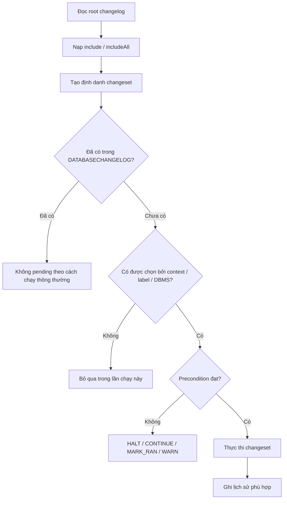

# Changeset không chạy do bộ lọc, lịch sử hoặc định danh

## 1. Hiểu đúng triệu chứng trước khi sửa

Trong module **DATABASE_SCHEMA_MIGRATION_LIQUIBASE**, người học nắm cách quản lý thay đổi schema và dữ liệu bằng Liquibase qua changelog, changeset, precondition, checksum và lịch sử triển khai; thực hành migration có kiểm chứng, rollback, phối hợp nhiều môi trường và tích hợp Spring Boot hoặc CI/CD. Một tình huống thường gặp khi vận hành là changeset đã có trong changelog nhưng lệnh **update** không thực thi nó, hoặc **status** không liệt kê nó là pending như mong đợi.

Triệu chứng có thể xuất hiện dưới nhiều dạng:

- Không thấy changeset trong kết quả status.
- Update kết thúc thành công nhưng không có SQL nào được thực thi.
- Changeset chạy ở local nhưng không chạy ở staging hoặc production.
- Một changeset mới được thêm vào file nhưng Liquibase không nhận ra.
- Changelog được include nhưng changeset cụ thể bị bỏ qua.
- Changeset từng chạy ở môi trường này nhưng lại được xem là pending ở môi trường khác.
- Liquibase báo checksum mismatch hoặc changeset đã được thực thi, dù người phát triển vừa sửa nội dung file.
- Update-sql không hiển thị câu lệnh mà nhóm mong đợi.

Không nên bắt đầu bằng cách xóa bảng lịch sử, sửa ID hoặc chạy changelog-sync. Trước hết phải phân loại nguyên nhân. Một changeset không chạy thường thuộc một trong các nhóm:

1. **Bộ lọc:** context, label, DBMS hoặc cấu hình môi trường khiến changeset không được chọn.
2. **Lịch sử:** Liquibase đã ghi nhận changeset là đã chạy trong DATABASECHANGELOG.
3. **Định danh:** ID, author hoặc đường dẫn changelog mà Liquibase đang đọc không trùng với định danh đã lưu.
4. **Cấu trúc changelog:** file chưa được include, include sai đường dẫn/thứ tự hoặc resource không được đóng gói.
5. **Precondition:** điều kiện làm changeset dừng, bỏ qua hoặc được đánh dấu đã chạy.
6. **Checksum và chế độ chạy lại:** nội dung đã thay đổi nhưng changeset không được thiết kế để chạy lại, hoặc bị dừng do checksum validation.

### Mục tiêu học tập

Sau bài học, bạn có thể:

- Phân biệt changeset bị loại bởi filter với changeset đã được ghi nhận trong lịch sử.
- Đọc đúng vai trò của ID, author, filename và logicalFilePath.
- Kiểm tra context, label, DBMS, precondition và property hiệu lực.
- Dùng status, history, validate, update-sql và truy vấn lịch sử để tìm nguyên nhân.
- Hiểu tác động của checksum, runOnChange, runAlways và các lệnh đồng bộ lịch sử.
- Sửa đúng nguyên nhân mà không làm sai lệch lịch sử triển khai giữa các môi trường.

**Nguyên tắc:** “Không chạy” là kết quả quan sát, chưa phải chẩn đoán. Hãy xác định Liquibase có nạp changeset hay không, có chọn changeset hay không, và lịch sử có xem changeset đó là đã thực thi hay không.

## 2. Cách Liquibase quyết định một changeset có được thực thi không

Có thể hình dung quy trình ở mức khái quát:



Đây là mô hình chẩn đoán, không phải mô tả mọi chi tiết nội bộ của từng phiên bản Liquibase. Điểm quan trọng là một changeset chỉ có thể được xem xét thực thi nếu nó thuộc changelog đang nạp, được nhận diện đúng, chưa bị lịch sử coi là đã chạy và vượt qua các điều kiện chọn/chạy tương ứng.

### 2.1. Ba câu hỏi đầu tiên

Khi changeset không chạy, hãy hỏi theo thứ tự:

1. **Liquibase có nhìn thấy changeset không?** Kiểm tra root changelog, include, path và artifact.
2. **Liquibase có xem changeset là pending không?** Kiểm tra DATABASECHANGELOG, status và định danh.
3. **Nếu pending, changeset có được chọn và vượt precondition không?** Kiểm tra context, label, DBMS, precondition và cấu hình runtime.

Cách phân loại này giúp tránh thay đổi history khi vấn đề thực ra chỉ là một context filter bị truyền sai.

## 3. Bộ lọc context: changeset có thể bị loại khỏi lần chạy

Context dùng để phân nhóm changeset theo mục đích hoặc môi trường, ví dụ dữ liệu mẫu, kiểm thử, demo hay một nhóm triển khai có điều kiện.

Ví dụ:

```yaml
databaseChangeLog:
  - changeSet:
      id: 101-load-demo-data
      author: platform
      context: demo
      changes:
        - insert:
            schemaName: app
            tableName: regions
            columns:
              - column:
                  name: code
                  value: DEMO
              - column:
                  name: name
                  value: Khu vực minh họa
```

Changeset trên được gắn context demo. Khi chạy bằng CLI, filter có thể được truyền qua tham số context tương ứng với phiên bản Liquibase đang dùng:

```bash
liquibase \
  --changelog-file=db/changelog/db.changelog-master.yaml \
  --context-filter=demo \
  update
```

Trong các phiên bản cũ, tên tham số có thể là --contexts; ở các phiên bản mới, --context-filter là cách gọi được tài liệu hóa. Kiểm tra liquibase update --help của đúng binary trong pipeline. Với Spring Boot, property thường dùng là spring.liquibase.contexts.

### 3.1. Không truyền filter và hành vi mặc định

Context có quy tắc mặc định dễ gây bất ngờ: khi không cung cấp context filter, Liquibase thường cho phép chạy các changeset có context; khi đã cung cấp filter, changeset phải phù hợp với filter đó. Vì vậy, chỉ thêm context: demo không nên được xem như một hàng rào bảo mật để bảo đảm changeset không thể chạy ở production.

Nếu cần yêu cầu người vận hành phải chỉ định context rõ ràng, Liquibase hỗ trợ cách khai báo context bắt buộc bằng tiền tố @ trong context của changeset ở các phiên bản hỗ trợ:

```yaml
- changeSet:
    id: 102-load-demo-only
    author: platform
    context: "@demo"
    changes:
      - sql:
          sql: INSERT INTO app.regions(code, name) VALUES ('DEMO', 'Khu vực minh họa');
```

Ý nghĩa và cú pháp context filter có thể thay đổi theo phiên bản; hãy xác minh bằng tài liệu/CLI help của bản đang triển khai. Dù dùng context bắt buộc, không coi nó là cơ chế phân quyền database. Production vẫn cần quyền, approval và pipeline guardrail.

### 3.2. Filter có thể loại changeset mà không báo lỗi

Giả sử pipeline truyền:

```bash
liquibase --context-filter=production update
```

nhưng changeset chỉ khai báo context: demo. Liquibase có thể bỏ qua changeset theo filter. Lệnh update vẫn có thể kết thúc bình thường vì không có changeset phù hợp cần thực thi.

Để chẩn đoán:

- Xem giá trị context trong chính changeset.
- Xem tham số CLI thực tế của job.
- Xem spring.liquibase.contexts nếu chạy qua Spring Boot.
- Kiểm tra environment variable, command-line override và file cấu hình ngoài JAR.
- Chạy status --verbose với cùng target và cùng filter.
- Dùng update-sql với đúng filter để xem SQL được chọn.

Không kiểm tra bằng một lệnh status thiếu filter rồi suy luận cho lệnh update chạy trong production với filter khác.

### 3.3. Nhiều context và biểu thức

Một changeset có thể gắn nhiều context; filter có thể dùng biểu thức logic theo cú pháp phiên bản. Khi dùng nhiều giá trị, hãy kiểm tra rõ ý nghĩa OR/AND, phủ định và nhóm điều kiện. Ví dụ đơn giản:

```yaml
- changeSet:
    id: 103-seed-reference-data
    author: platform
    context: dev,test
    changes:
      - sql:
          sql: INSERT INTO app.reference_codes(code) VALUES ('SAMPLE');
```

Ví dụ này minh họa cách gắn nhiều context, không thay thế việc xác minh cú pháp biểu thức phức tạp. Tránh viết filter dài mà không có test cho từng môi trường.

## 4. Bộ lọc label: phân loại release hoặc nhóm thay đổi

Label tương tự context ở chỗ có thể chọn một tập changeset, nhưng thường được dùng để phân nhóm theo release, tính năng hoặc đợt triển khai.

Ví dụ:

```yaml
- changeSet:
    id: 201-add-reporting-index
    author: analytics
    labels: reporting,release-2026-11
    changes:
      - createIndex:
          schemaName: app
          tableName: orders
          indexName: idx_orders_created_at
          columns:
            - column:
                name: created_at
```

Chạy với label filter:

```bash
liquibase \
  --changelog-file=db/changelog/db.changelog-master.yaml \
  --label-filter=release-2026-11 \
  update
```

Trong Spring Boot, cấu hình tương ứng thường là spring.liquibase.label-filter.

### 4.1. Context và label không thay thế nhau

| Tiêu chí | Context | Label |
|---|---|---|
| Mục đích thường gặp | Nhóm theo môi trường hoặc ngữ cảnh chạy | Nhóm theo release/tính năng/phạm vi |
| Thuộc tính changeset | context | labels |
| CLI hiện hành | --context-filter (tùy phiên bản) | --label-filter |
| Spring Boot | spring.liquibase.contexts | spring.liquibase.label-filter |
| Chẩn đoán | Xem context được gắn và filter thực tế | Xem labels và biểu thức filter thực tế |

Không dùng context cho mọi mục đích chỉ vì tên gọi “môi trường” thuận tiện. Hãy chọn một quy ước nhất quán và ghi rõ filter nào được pipeline truyền.

### 4.2. Label filter sai có thể làm changeset biến mất khỏi kế hoạch

Ví dụ changeset có label release-2026-11, nhưng job truyền --label-filter=release-2026-10. Changeset không phù hợp với filter nên có thể không được chọn.

Hãy kiểm tra:

- Label có đúng chính tả và chữ hoa/thường theo quy ước không?
- File changelog đang chạy có đúng phiên bản chứa label không?
- Pipeline có truyền filter từ biến môi trường cũ không?
- Có dấu ngoặc hoặc toán tử logic làm thay đổi ý nghĩa biểu thức không?
- status và update-sql có được chạy với cùng filter không?

Một lần chạy không có SQL chưa chứng minh changeset đã được áp dụng.

## 5. Bộ lọc DBMS: changeset dành cho database khác

Thuộc tính dbms giới hạn changeset cho loại database được chỉ định. Ví dụ một thay đổi dùng cú pháp PostgreSQL:

```yaml
- changeSet:
    id: 301-create-postgres-extension
    author: platform
    dbms: postgresql
    changes:
      - sql:
          sql: CREATE EXTENSION IF NOT EXISTS pg_trgm;
```

Nếu database hiện tại là MySQL, changeset trên không phù hợp với DBMS và sẽ không được thực thi như một changeset PostgreSQL.

### 5.1. Xác minh Liquibase nhận diện DBMS nào

Đừng suy ra DBMS chỉ từ hostname hoặc tên môi trường. Kiểm tra:

- JDBC URL thực tế.
- JDBC driver và database product name.
- Cấu hình --url/datasource.
- Cấu hình Spring Boot và profile.
- Database proxy hoặc compatibility layer nếu có.
- Giá trị DBMS mà Liquibase nhận diện trong log/diagnostic của phiên bản đang dùng.

Một JDBC URL sai có thể khiến filter DBMS loại changeset hoặc làm lệnh thất bại trước khi đến bước đó.

### 5.2. DBMS filter không tự chuyển đổi SQL

dbms: postgresql không biến SQL PostgreSQL thành SQL portable. Nếu hỗ trợ nhiều DBMS, hãy tạo changeset riêng theo DBMS hoặc dùng change type portable khi phù hợp. Đặt rõ DBMS giúp tránh chạy cú pháp không tương thích, nhưng vẫn cần test từng nền tảng.

### 5.3. Phân biệt DBMS filter với precondition

- dbms chọn changeset dựa trên loại database.
- preConditions kiểm tra trạng thái database trước khi thực thi changeset.

Ví dụ dbms: postgresql chỉ nói changeset dành cho PostgreSQL; nó không xác nhận extension đã cài, quyền đã cấp hoặc bảng cần thiết đã tồn tại. Những giả định đó cần precondition hoặc bước kiểm tra khác.

## 6. Precondition có thể khiến changeset bị bỏ qua

Precondition kiểm tra điều kiện trước khi chạy changeset. Một precondition không đạt có thể dừng update, bỏ qua changeset hoặc đánh dấu changeset đã chạy tùy cấu hình.

Ví dụ:

```yaml
- changeSet:
    id: 401-add-customer-status
    author: customer-team
    preConditions:
      - onFail: HALT
      - not:
          - columnExists:
              schemaName: app
              tableName: customers
              columnName: status
    changes:
      - addColumn:
          schemaName: app
          tableName: customers
          columns:
            - column:
                name: status
                type: varchar(24)
```

Changeset chỉ thêm cột khi cột đó chưa tồn tại. Nếu cột đã có, precondition không đạt và onFail: HALT dừng quá trình update.

### 6.1. Các hành vi onFail thường gặp

| Giá trị | Hành vi khái quát | Hệ quả cần hiểu |
|---|---|---|
| HALT | Dừng update khi precondition fail | Cần điều tra và sửa điều kiện/trạng thái |
| CONTINUE | Bỏ qua changeset trong lần chạy hiện tại | Changeset có thể được xét lại ở lần update sau |
| MARK_RAN | Bỏ qua nội dung nhưng ghi nhận changeset như đã chạy | Lần sau thường không thực thi changeset đó |
| WARN | Ghi cảnh báo và tiếp tục theo hành vi được định nghĩa | Không được coi warning là bằng chứng điều kiện đã đạt |

onError xử lý trường hợp đánh giá precondition gặp lỗi; nó khác onFail, vốn xử lý kết quả điều kiện không đạt. Hãy xác minh cú pháp và hành vi chi tiết theo phiên bản Liquibase.

### 6.2. MARK_RAN có thể tạo cảm giác changeset đã chạy

Nếu precondition dùng onFail: MARK_RAN, Liquibase có thể ghi changeset vào DATABASECHANGELOG dù nội dung thay đổi không được thực thi. Sau đó status không còn liệt kê changeset đó là pending theo định danh đã ghi nhận.

Ví dụ:

```yaml
- changeSet:
    id: 402-add-status-if-missing
    author: customer-team
    preConditions:
      - onFail: MARK_RAN
      - not:
          - columnExists:
              schemaName: app
              tableName: customers
              columnName: status
    changes:
      - addColumn:
          schemaName: app
          tableName: customers
          columns:
            - column:
                name: status
                type: varchar(24)
```

Nếu cột đã tồn tại, changeset có thể được đánh dấu là ran. Điều đó chỉ hợp lý khi object hiện có đã được xác minh tương đương với kết quả mong muốn. Nếu cột tồn tại nhưng sai kiểu, nullable hoặc default, MARK_RAN có thể che giấu drift.

Không dùng MARK_RAN như cách tổng quát để bỏ qua lỗi. Hãy kiểm tra schema thật và lịch sử trước khi chấp nhận trạng thái này.

### 6.3. Precondition không thay thế kiểm tra dependency bên ngoài

Precondition SQL có thể xác minh bảng/cột/dữ liệu, nhưng thường không chứng minh:

- Không còn phiên bản ứng dụng cũ đang chạy.
- Không còn worker hoặc báo cáo sử dụng cột.
- Một job bên ngoài đã hoàn tất.
- Backup đã restore thành công.
- Một approval vận hành đã được cấp.

Những điều kiện này cần quality gate và bằng chứng từ hệ thống triển khai.

## 7. Lịch sử DATABASECHANGELOG: changeset có thể đã chạy rồi

Liquibase ghi nhận các changeset đã xử lý trong bảng DATABASECHANGELOG. Một changeset được nhận diện bằng tổ hợp định danh, chủ yếu gồm:

- ID
- AUTHOR
- FILENAME

FILENAME là đường dẫn logic mà Liquibase sử dụng cho changelog; khi có logicalFilePath, giá trị logic này có thể khác đường dẫn vật lý trong repository.

Nếu Liquibase tìm thấy bản ghi khớp định danh trong lịch sử, changeset thường không còn pending và update không chạy lại nó như một changeset mới.

### 7.1. Truy vấn lịch sử

Ví dụ truy vấn trên database có bảng lịch sử với tên/cột mặc định:

```sql
SELECT
    ID,
    AUTHOR,
    FILENAME,
    DATEEXECUTED,
    ORDEREXECUTED,
    EXECTYPE,
    MD5SUM
FROM DATABASECHANGELOG
ORDER BY DATEEXECUTED, ORDEREXECUTED;
```

Bảng có thể nằm trong schema khác hoặc được cấu hình tên riêng. Cần xác định đúng schema/catalog và cách viết tên có phân biệt chữ hoa/thường của DBMS. Không chạy truy vấn trên một database khác rồi kết luận về target.

### 7.2. So sánh định danh thay vì chỉ nhìn ID

Giả sử file có:

```yaml
- changeSet:
    id: 501-add-index
    author: platform
    changes:
      - createIndex:
          tableName: orders
          indexName: idx_orders_status
          columns:
            - column:
                name: status
```

Nếu lịch sử đã có ID=501-add-index nhưng AUTHOR hoặc FILENAME khác, đó không nhất thiết là cùng một changeset theo cách Liquibase nhận diện. Ngược lại, cùng ID không đủ để khẳng định changeset chưa chạy nếu author và filename khớp.

Hãy so sánh đủ ba thành phần và xác định file path logic.

### 7.3. EXECTYPE giúp hiểu cách changeset được ghi nhận

Cột EXECTYPE cung cấp loại thực thi được Liquibase ghi nhận. Tùy tình huống và phiên bản, bạn có thể gặp các giá trị như EXECUTED, RERAN hoặc MARK_RAN.

- EXECUTED: changeset được thực thi.
- RERAN: changeset được chạy lại theo cơ chế phù hợp, ví dụ runOnChange/runAlways.
- MARK_RAN: changeset được đánh dấu đã chạy mà nội dung changeset không được thực thi theo cách thông thường.

Không chỉ nhìn EXECTYPE; cần xem DATEEXECUTED, ORDEREXECUTED, checksum và trạng thái schema thật.

## 8. Định danh thay đổi khi di chuyển hoặc đổi tên changelog

Một nguyên nhân phổ biến là file changelog đã được đổi tên hoặc chuyển thư mục sau khi changeset từng chạy.

Ví dụ ban đầu:

```text
db/changelog/releases/001-orders.yaml
```

Sau đó file được chuyển thành:

```text
db/changelog/orders/001-orders.yaml
```

Nếu định danh filename logic thay đổi, Liquibase có thể xem changeset trong file mới là một định danh khác và coi nó là pending, dù ID/author giống nhau.

### 8.1. logicalFilePath dùng để ổn định định danh

logicalFilePath cho phép khai báo đường dẫn logic được dùng cho định danh changeset, hữu ích khi cần đổi vị trí vật lý mà vẫn giữ identity lịch sử.

Ví dụ minh họa:

```yaml
databaseChangeLog:
  - logicalFilePath: db/changelog/releases/001-orders.yaml
  - changeSet:
      id: 601-add-order-source
      author: orders-team
      changes:
        - addColumn:
            tableName: orders
            columns:
              - column:
                  name: source
                  type: varchar(32)
```

Cú pháp chính xác và phạm vi áp dụng của logicalFilePath phụ thuộc định dạng changelog và phiên bản Liquibase. Khi di chuyển file đã triển khai, phải kiểm tra tài liệu phiên bản đang dùng và so sánh FILENAME đã lưu trước khi sửa.

### 8.2. Không thêm logicalFilePath một cách tùy tiện

Nếu thay đổi logicalFilePath sau khi nhiều môi trường đã triển khai, bạn có thể tạo ra sự khác biệt identity giữa các database. Cần xác định giá trị filename đã ghi nhận trong DATABASECHANGELOG, sau đó chọn chiến lược tương thích cho tất cả môi trường.

Không sửa đồng loạt history bằng SQL tùy tiện. Thay đổi identity là một migration metadata có tác động lâu dài.

## 9. Changelog không được include hoặc include sai

Một changeset không thể chạy nếu file chứa nó không nằm trong changelog root thực tế đang được Liquibase nạp.

Ví dụ root changelog:

```yaml
databaseChangeLog:
  - include:
      file: releases/001-schema.yaml
  - include:
      file: releases/002-orders.yaml
```

Nếu tác giả tạo releases/003-reporting.yaml nhưng không include nó, changeset trong file mới sẽ không xuất hiện trong kế hoạch.

### 9.1. Kiểm tra include path

Các nguyên nhân thường gặp:

- File mới không được include.
- Path tương đối được tính từ vị trí khác với giả định.
- Chạy root changelog khác giữa CLI và Spring Boot.
- Resource không nằm trong classpath/JAR được deploy.
- Chữ hoa/thường của tên file khác trên Linux.
- includeAll trỏ sai thư mục hoặc không nhận file theo quy ước.
- Build artifact chưa chứa file changelog mới.
- Một profile hoặc property thay đổi spring.liquibase.change-log.

### 9.2. includeAll và thứ tự file

includeAll có thể tự nạp các file trong thư mục theo quy tắc sắp xếp của Liquibase. Vì vậy:

- Dùng tên file có thứ tự ổn định.
- Không để file nháp hoặc file không phải changelog trong thư mục được quét.
- Kiểm tra recursive/include behavior theo phiên bản.
- Không phụ thuộc vào thứ tự file hệ điều hành nếu pipeline cần thứ tự cụ thể.
- Xem output update-sql để xác nhận changeset thực sự được nạp.

Một file tồn tại trong repository không đồng nghĩa nó đã có trong artifact hoặc root changelog.

## 10. Checksum mismatch không giống changeset pending

Liquibase lưu checksum của changeset trong DATABASECHANGELOG. Khi nội dung changeset đã chạy bị sửa, Liquibase có thể phát hiện checksum khác và dừng với lỗi validation.

Đây là một tình huống khác với changeset không chạy do filter:

- **Đã chạy, checksum không khớp:** lịch sử nhận diện changeset nhưng nội dung hiện tại khác nội dung đã ghi nhận.
- **Chưa chạy, filter loại:** changeset chưa được ghi nhận và không được chọn trong lần chạy.
- **Chưa chạy, identity khác:** Liquibase có thể xem đó là changeset mới.
- **Đã MARK_RAN:** history ghi nhận changeset dù phần thay đổi không được thực thi bình thường.

### 10.1. Vì sao không sửa changeset đã triển khai?

Giả sử changeset sau đã chạy ở staging:

```yaml
- changeSet:
    id: 701-normalize-customer-code
    author: customer-team
    changes:
      - sql:
          sql: >
            UPDATE app.customers
            SET customer_code = upper(customer_code)
```

Sau đó tác giả sửa SQL để thêm điều kiện WHERE customer_code IS NOT NULL. Dù thay đổi có vẻ nhỏ, checksum có thể khác. Production chưa chạy changeset có thể thực thi nội dung mới trong khi staging đã thực thi nội dung cũ.

Cách thông thường là giữ nguyên changeset đã triển khai và thêm changeset mới cho phần sửa/bù. Nếu cần điều chỉnh lịch sử vì một tình huống đặc biệt, phải có kế hoạch được phê duyệt và kiểm tra tất cả môi trường.

### 10.2. runOnChange

runOnChange: true cho phép changeset được chạy lại khi checksum thay đổi theo cơ chế Liquibase. Thường phù hợp với định nghĩa view hoặc stored logic có thể thay thế, nếu quy trình đã được thiết kế cho việc cập nhật định nghĩa.

```yaml
- changeSet:
    id: 702-refresh-customer-view
    author: customer-team
    runOnChange: true
    changes:
      - createView:
          schemaName: app
          viewName: v_customer_summary
          replaceIfExists: true
          selectQuery: SELECT customer_id, customer_name FROM app.customers
```

Không dùng runOnChange như cách chung để sửa migration DML đã chạy. Một thay đổi nội dung có thể làm changeset chạy lại và tác động dữ liệu lần nữa.

### 10.3. runAlways

runAlways: true làm changeset được thực thi trong các lần update phù hợp, kể cả khi nội dung không thay đổi, theo hành vi của phiên bản Liquibase.

Chỉ dùng khi thao tác thật sự cần lặp và đã an toàn khi chạy nhiều lần. Ví dụ một thao tác cập nhật trạng thái kiểm soát có thể được thiết kế idempotent; một câu INSERT không có khóa duy nhất hoặc một DML cộng dồn có thể tạo tác dụng phụ lặp.

Cả runOnChange và runAlways vẫn chịu ảnh hưởng của root changelog, filter và cấu hình chạy. Chúng không buộc changeset bị loại bởi DBMS/context/label phải thực thi.

## 11. Phân biệt filter, precondition và history bằng công cụ

Không có một lệnh đơn lẻ giải thích mọi nguyên nhân. Kết hợp các lệnh theo cùng một cấu hình.

### 11.1. validate

```bash
liquibase \
  --changelog-file=db/changelog/db.changelog-master.yaml \
  validate
```

validate giúp phát hiện một số lỗi cấu trúc changelog, tham chiếu file hoặc định nghĩa không hợp lệ theo khả năng phiên bản. Nó không chứng minh changeset sẽ được chọn bởi filter, không chứng minh SQL runtime đúng và không chứng minh dữ liệu đạt điều kiện.

### 11.2. status --verbose

```bash
liquibase \
  --changelog-file=db/changelog/db.changelog-master.yaml \
  --url="jdbc:postgresql://db-host:5432/orders" \
  --username=migration_user \
  --context-filter=production \
  --label-filter=release-2026-11 \
  status --verbose
```

Dùng cùng URL, changelog, contexts, labels, schema và property như lệnh update thực tế. status --verbose giúp xem changeset nào còn pending theo cấu hình hiện tại; nếu changeset không xuất hiện, tiếp tục kiểm tra filter, history và việc nạp changelog.

### 11.3. history

```bash
liquibase \
  --changelog-file=db/changelog/db.changelog-master.yaml \
  --url="jdbc:postgresql://db-host:5432/orders" \
  --username=migration_user \
  history
```

history giúp quan sát những changeset đã được triển khai theo lịch sử Liquibase. Đối chiếu với DATABASECHANGELOG khi cần xác định ID, author, filename, thời điểm và loại thực thi.

### 11.4. update-sql

```bash
liquibase \
  --changelog-file=db/changelog/db.changelog-master.yaml \
  --url="jdbc:postgresql://db-host:5432/orders" \
  --username=migration_user \
  --context-filter=production \
  --label-filter=release-2026-11 \
  update-sql
```

update-sql cho xem SQL dự kiến cho tập changeset được chọn. Nó không thực thi SQL. Nếu SQL mong đợi không xuất hiện, so sánh filter, history và root changelog trước khi chạy update.

### 11.5. update

Chỉ chạy update sau khi đã xác định đúng target, changeset được chọn và SQL dự kiến phù hợp. update thực thi thay đổi; nó không phải lệnh chẩn đoán không tác động.

Các command/parameter có thể khác giữa phiên bản Liquibase. Kiểm tra liquibase <command> --help trên đúng binary của môi trường, đặc biệt khi CLI local khác version trong CI.

## 12. Chẩn đoán property trong Spring Boot

Khi Liquibase chạy qua Spring Boot, filter và changelog thường đến từ application YAML/properties, profile, environment variable hoặc command-line argument.

Ví dụ:

```yaml
spring:
  liquibase:
    enabled: true
    change-log: classpath:db/changelog/db.changelog-master.yaml
    contexts: production
    label-filter: release-2026-11
    default-schema: app
```

Các property quan trọng:

| Property | Vai trò |
|---|---|
| spring.liquibase.enabled | Bật/tắt Liquibase auto-configuration |
| spring.liquibase.change-log | Changelog root |
| spring.liquibase.contexts | Context được truyền cho Liquibase |
| spring.liquibase.label-filter | Label filter |
| spring.liquibase.default-schema | Default schema |
| spring.liquibase.liquibase-schema | Schema chứa bảng quản lý Liquibase nếu cấu hình |
| spring.liquibase.database-change-log-table | Tên bảng history tùy cấu hình |
| spring.liquibase.database-change-log-lock-table | Tên bảng lock tùy cấu hình |

Tên property và khả năng cấu hình cần xác nhận theo Spring Boot version. Không giả định CLI và Spring Boot đang dùng cùng filter chỉ vì chúng đọc cùng file changelog.

### 12.1. Property precedence

Giá trị trong application.yml có thể bị ghi đè bởi:

- application-<profile>.yml.
- Environment variables.
- Java system properties.
- Command-line arguments.
- SPRING_APPLICATION_JSON.
- Config server hoặc file ngoài JAR.
- Test properties hoặc dynamic properties.

Khi local chạy được nhưng production không chạy, hãy thu thập profile đang active và giá trị hiệu lực của context/label/changelog/URL. Nếu dùng Actuator env hoặc configprops, bảo vệ endpoint và che thông tin nhạy cảm.

### 12.2. Ví dụ environment variables

```bash
SPRING_LIQUIBASE_CONTEXTS=production
SPRING_LIQUIBASE_LABEL_FILTER=release-2026-11
SPRING_LIQUIBASE_CHANGE_LOG=classpath:db/changelog/db.changelog-master.yaml
```

Tên biến được ánh xạ từ property theo quy tắc relaxed binding của Spring Boot. Kiểm tra tên thực tế và giá trị hiệu lực thay vì chỉ nhìn manifest mẫu.

## 13. Bảng quyết định: triệu chứng và nguyên nhân

| Triệu chứng | Nguyên nhân có thể | Bước kiểm tra đầu tiên |
|---|---|---|
| Changeset không có trong status | Đã chạy hoặc bị filter loại | So sánh history, filter và identity |
| update thành công nhưng không có SQL | Không có pending phù hợp | status --verbose và update-sql cùng filter |
| Chạy local, không chạy production | Profile/filter/URL/artifact khác | So cấu hình runtime và changelog root |
| Changeset mới không xuất hiện | Chưa include hoặc file không vào artifact | Kiểm tra root changelog và resource path |
| Cùng ID nhưng bị xem là pending | Author/filename/logical path khác | So đủ ID, AUTHOR, FILENAME |
| Báo checksum mismatch | Nội dung changeset đã chạy bị sửa | So lịch sử và source control |
| Precondition làm update dừng | Điều kiện không đạt hoặc lỗi truy vấn | Đọc onFail/onError và kiểm tra dữ liệu |
| Không chạy trên DBMS hiện tại | dbms không khớp | Xác minh JDBC URL/product name |
| Được đánh dấu ran nhưng không có SQL | MARK_RAN hoặc thao tác đồng bộ history | Xem EXECTYPE và precondition |
| runOnChange không chạy lại | Checksum không đổi hoặc changeset bị filter | Kiểm tra checksum và filter |
| runAlways không chạy | Chưa được nạp/chọn hoặc đã lỗi trước đó | Kiểm tra root changelog/filter/log |
| status và update khác nhau | Khác URL, changelog, filter hoặc version | So toàn bộ tham số/runtime |
| CLI chạy, Spring Boot không chạy | Hai tiến trình dùng config khác nhau | So property, profile và datasource |

## 14. Quy trình chẩn đoán theo từng bước

### Bước 1: cố định đúng target

Ghi lại database host/service, database name, schema, user, Liquibase version, root changelog và thời điểm chạy. Không dùng kết quả ở local để kết luận cho production.

### Bước 2: xác nhận changeset có trong changelog root

Kiểm tra include, includeAll, path, classpath và artifact đã deploy. Xác minh file mới có thật trong package/container chạy migration.

### Bước 3: so sánh định danh

Ghi lại id, author, đường dẫn file và logicalFilePath nếu có. Đối chiếu đủ ba thành phần identity với bản ghi DATABASECHANGELOG.

### Bước 4: kiểm tra lịch sử

Dùng history và truy vấn DATABASECHANGELOG. Xem EXECTYPE, DATEEXECUTED, ORDEREXECUTED, MD5SUM. Xác định changeset đã chạy, được đánh dấu ran hay chưa có bản ghi.

### Bước 5: kiểm tra filter

Đối chiếu context, label, DBMS và tham số thực tế của pipeline/Spring Boot. Chạy status --verbose và update-sql với cùng filter.

### Bước 6: kiểm tra precondition

Đọc preConditions, onFail, onError và kiểm tra truy vấn/đối tượng mà precondition dùng. Xác định changeset bị HALT, CONTINUE hay MARK_RAN.

### Bước 7: kiểm tra checksum và chế độ chạy lại

Nếu history đã có changeset, xác minh source hiện tại có bị sửa không. Kiểm tra runOnChange, runAlways và checksum. Không xóa history để buộc chạy lại.

### Bước 8: chọn cách sửa đúng

- Filter sai: sửa cấu hình filter hoặc metadata theo chính sách.
- Chưa include: thêm file vào root changelog và test.
- Identity đổi ngoài ý muốn: khôi phục identity ổn định theo quy trình được review.
- Changeset đã chạy nhưng logic cần thay đổi: tạo changeset mới.
- Precondition không đạt: sửa trạng thái dữ liệu/object hoặc điều kiện sau khi xác minh nghiệp vụ.
- Đã MARK_RAN sai: cần quy trình repair lịch sử có phê duyệt và đối chiếu schema.

### Bước 9: kiểm chứng sau sửa

Chạy validate, status --verbose, update-sql với đúng cấu hình. Chỉ sau khi SQL dự kiến và target đúng mới chạy update. Sau đó kiểm tra DATABASECHANGELOG, schema, dữ liệu và ứng dụng.

## 15. Những lệnh lịch sử không nên dùng để “ép chạy”

### 15.1. changelog-sync

changelog-sync đánh dấu các changeset được chọn là đã chạy mà không thực thi nội dung changeset như update. Nó có thể hữu ích khi database đã được tạo thủ công hoặc đã được đồng bộ theo một quy trình baseline được kiểm chứng, nhưng cũng có thể khiến changeset chưa thực thi bị bỏ qua về sau.

Không dùng changelog-sync để giải quyết việc changeset không xuất hiện trong status. Nếu nguyên nhân là context filter, lệnh này có thể đánh dấu sai tập changeset. Nếu schema chưa có object, history sẽ không phản ánh trạng thái thật.

### 15.2. clear-checksums

clear-checksums xóa checksum đã lưu theo cơ chế Liquibase để checksum được tính lại ở lần update phù hợp. Nó không xóa định danh changeset, không làm changeset đã chạy trở thành pending và không buộc SQL chạy lại.

Không dùng lệnh này để sửa filter, include path hoặc filename identity. Chỉ dùng khi có tình huống checksum được phân tích và kế hoạch xử lý được phê duyệt.

### 15.3. validCheckSum

validCheckSum có thể cho phép Liquibase chấp nhận một checksum cụ thể trong một số trường hợp có kiểm soát. Đây không phải cách chung để che việc sửa changeset đã triển khai. Cần lưu lý do, phạm vi version và bằng chứng rằng nội dung mới không làm lịch sử môi trường trở nên mâu thuẫn.

### 15.4. Không sửa DATABASECHANGELOG bằng SQL thủ công

Xóa dòng hoặc sửa ID/author/filename/checksum trực tiếp có thể làm Liquibase chạy lại DDL/DML hoặc bỏ qua thay đổi chưa được áp dụng. Nếu cần repair history, phải có kế hoạch được review, backup, xác định trạng thái schema/data thật và kiểm tra trên bản sao trước.

## 16. Ví dụ thực hành: changeset seed không chạy ở staging

**Bối cảnh:** Một changeset nạp dữ liệu mã vùng có context: reference-data. Local chạy được nhưng staging không có dữ liệu mới.

```yaml
- changeSet:
    id: 801-load-region-codes
    author: platform
    context: reference-data
    changes:
      - loadData:
          schemaName: app
          tableName: region_codes
          file: data/region-codes.csv
          relativeToChangelogFile: true
          separator: ","
```

Pipeline staging đang chạy:

```bash
liquibase \
  --context-filter=production \
  --changelog-file=db/changelog/db.changelog-master.yaml \
  update
```

### 16.1. Chẩn đoán

- Changeset có context reference-data.
- Pipeline chỉ chọn context production.
- Nếu không có filter nào khác và changelog root đã include file, changeset có thể bị loại khỏi lần chạy này.
- Update có thể kết thúc mà không thực thi changeset đó.

Kiểm tra tiếp status --verbose và update-sql với đúng filter. Nếu changeset chưa có trong DATABASECHANGELOG, đây là dấu hiệu filter có thể là nguyên nhân; vẫn cần kiểm tra root changelog và identity.

### 16.2. Cách sửa

Nếu dữ liệu tham chiếu phải được nạp ở staging và production, nhóm có thể:

- Điều chỉnh context theo quy ước được duyệt.
- Truyền cả context cần thiết trong filter của pipeline.
- Tách seed data khỏi context dành riêng cho môi trường nếu mục đích thực sự là dùng chung.
- Bổ sung test pipeline để chứng minh changeset được chọn.

Không dùng changelog-sync để đánh dấu changeset đã chạy vì điều đó sẽ không nạp dữ liệu.

### 16.3. Kiểm chứng

1. Chạy status --verbose với filter mới.
2. Xác nhận changeset xuất hiện trong danh sách pending.
3. Chạy update-sql và xem câu lệnh insert/load dự kiến.
4. Chạy update trên đúng database staging.
5. Kiểm tra DATABASECHANGELOG.
6. Đối chiếu số hàng và khóa dữ liệu trong region_codes.
7. Chạy lại status để xác nhận changeset không còn pending.

## 17. Ví dụ thực hành: changeset xuất hiện pending sau khi đổi tên file

**Bối cảnh:** Changeset 901-add-order-source đã chạy ở production trong file db/changelog/legacy/orders.yaml. Một PR chuyển file sang db/changelog/orders/orders.yaml, giữ nguyên ID và author. Sau deploy, Liquibase xem changeset là pending.

### 17.1. Chẩn đoán

Trong DATABASECHANGELOG, bản ghi cũ có:

```text
ID       = 901-add-order-source
AUTHOR   = orders-team
FILENAME = db/changelog/legacy/orders.yaml
```

Changelog mới đang dùng filename logic khác. Vì identity gồm cả đường dẫn file, cùng ID/author nhưng filename khác có thể được xem là changeset khác.

### 17.2. Cách xử lý

- Không chạy update trước khi hiểu vì sao changeset bị xem là mới.
- Kiểm tra có thay đổi logicalFilePath hay không.
- Nếu mục tiêu chỉ là di chuyển vật lý, xác định cách giữ logical path ổn định theo cú pháp/version phù hợp.
- Kiểm tra các môi trường có cùng lịch sử filename hay không.
- Thử trên bản sao database với history đại diện.
- Chỉ triển khai sau khi status, history và schema đều cho kết quả như mong đợi.

Không xóa bản ghi cũ hoặc thêm một changeset trùng ID để ép Liquibase nhận diện.

## 18. Checklist ngăn lỗi changeset không chạy

### Changelog và identity

- [ ] Root changelog đúng với tiến trình chạy.
- [ ] File mới đã được include hoặc nằm đúng thư mục includeAll.
- [ ] Resource có trong artifact/classpath.
- [ ] ID và author ổn định, không trùng ngoài chủ đích.
- [ ] Filename logic ổn định; di chuyển file đã triển khai có kế hoạch.
- [ ] logicalFilePath được dùng nhất quán nếu cần.

### Filter và precondition

- [ ] Context của changeset khớp filter runtime.
- [ ] Label và biểu thức label filter đúng.
- [ ] DBMS filter khớp database thực tế.
- [ ] Pipeline và Spring Boot truyền cùng chính sách filter.
- [ ] Precondition có hành vi onFail/onError được hiểu rõ.
- [ ] MARK_RAN chỉ dùng khi trạng thái object đã được xác minh.
- [ ] Không dùng context/label như cơ chế phân quyền.

### Lịch sử và checksum

- [ ] Đã kiểm tra DATABASECHANGELOG trên đúng target.
- [ ] So đủ ID, AUTHOR và FILENAME.
- [ ] Đã xem EXECTYPE, DATEEXECUTED và checksum khi cần.
- [ ] Changeset đã triển khai không bị sửa tùy tiện.
- [ ] runOnChange/runAlways có mục đích và an toàn khi chạy lặp.
- [ ] Không xóa/sửa history hoặc clear-checksums để né chẩn đoán.

### Kiểm chứng

- [ ] validate đạt.
- [ ] status --verbose dùng cùng filter với update.
- [ ] update-sql thể hiện đúng SQL dự kiến.
- [ ] update chạy trên đúng URL/schema và artifact.
- [ ] History, schema, dữ liệu và ứng dụng được hậu kiểm.

## 19. Câu hỏi tự kiểm tra

1. Ba thành phần nào tạo nên định danh changeset mà Liquibase dùng để đối chiếu lịch sử?
2. Vì sao context filter có thể khiến update kết thúc thành công nhưng changeset không chạy?
3. Context và label khác nhau ở mục đích sử dụng nào?
4. dbms khác precondition ở điểm nào?
5. MARK_RAN ảnh hưởng DATABASECHANGELOG và lần chạy sau ra sao?
6. Vì sao đổi tên file changelog có thể làm changeset đã chạy xuất hiện pending?
7. logicalFilePath giúp xử lý tình huống nào?
8. Checksum mismatch khác với changeset pending như thế nào?
9. runOnChange và runAlways có tác động gì?
10. Vì sao clear-checksums không buộc changeset đã chạy thực thi lại?
11. changelog-sync có thể gây rủi ro gì nếu schema chưa được áp dụng?
12. Vì sao phải chạy status và update-sql với cùng filter như update?
13. Nếu CLI chạy được nhưng Spring Boot không chạy, cần so sánh những cấu hình nào?
14. Khi nào nên tạo changeset mới thay vì sửa changeset cũ?

## 20. Nguyên tắc ghi nhớ

- Phân loại nguyên nhân thành filter, history, identity, include, precondition hoặc checksum trước khi sửa.
- Context, label và DBMS có thể loại changeset khỏi lần chạy; kiểm tra filter thực tế của đúng môi trường.
- Precondition CONTINUE có thể bỏ qua trong lần chạy; MARK_RAN có thể ghi nhận changeset dù nội dung không thực thi.
- Liquibase đối chiếu history theo ID, author và filename logic; không chỉ theo ID.
- Di chuyển/đổi tên changelog đã triển khai cần xem xét logicalFilePath.
- DATABASECHANGELOG cho biết lịch sử được ghi nhận, không tự chứng minh schema và dữ liệu hiện tại đúng.
- Checksum mismatch thường báo nội dung đã triển khai bị thay đổi; hãy tạo changeset mới cho hành vi mới.
- runOnChange và runAlways cần được thiết kế cho thao tác chạy lại an toàn.
- validate không thay thế status, update-sql, test DBMS và hậu kiểm dữ liệu.
- changelog-sync đánh dấu changeset đã chạy mà không thực thi nội dung; không dùng để ép changeset chạy.
- clear-checksums không làm changeset đã chạy trở thành pending.
- Luôn dùng cùng URL, changelog, filter, schema và version khi so sánh status, update-sql và update.

**Kết luận:** Khi changeset không chạy, hãy xác định Liquibase có nạp file hay không, identity có khớp history hay không, filter có chọn changeset hay không và precondition xử lý thế nào. DATABASECHANGELOG, status, history, validate và update-sql cung cấp các góc nhìn bổ sung để tìm nguyên nhân. Sửa filter, include hoặc identity theo đúng mục đích; nếu nội dung migration đã được triển khai và cần thay đổi, hãy thêm changeset mới. Cách làm này giữ lịch sử nhất quán và giúp mỗi môi trường triển khai cùng một thay đổi có thể truy vết.

