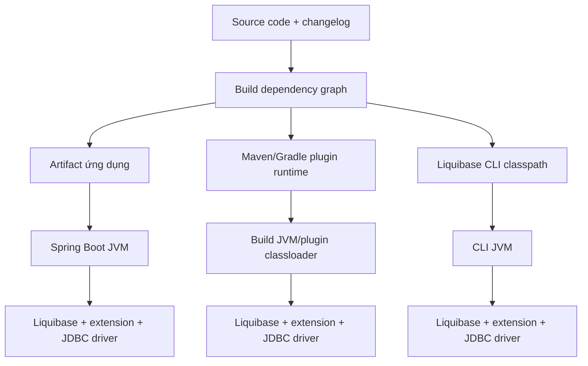

# Đóng gói extension, classpath và quản lý phụ thuộc

## 1. Vì sao extension có thể hoạt động ở máy phát triển nhưng thất bại khi triển khai?

Trong module **DATABASE_SCHEMA_MIGRATION_LIQUIBASE**, người học nắm cách quản lý thay đổi schema và dữ liệu bằng Liquibase với changelog, changeset, precondition, checksum và lịch sử triển khai. Họ thực hành migration có kiểm chứng, rollback, phối hợp nhiều môi trường và tích hợp Spring Boot hoặc CI/CD. Khi dự án sử dụng Liquibase extension, thêm dependency vào source code mới chỉ là một phần của công việc. Extension phải có mặt trong đúng tiến trình thực thi Liquibase, được classloader nhìn thấy, tương thích với Liquibase core/JDK/DBMS và có đủ dependency đi kèm.

Một tình huống phổ biến: lập trình viên chạy migration trên IDE thành công vì extension JAR nằm trong classpath của project. Khi chạy CLI trên máy build, Liquibase báo không tìm thấy change type hoặc service. Trong Spring Boot, ứng dụng có thể khởi động nhưng migration thất bại vì extension bị khai báo ở test-only scope nên không có trong runtime. Một JAR đã được đóng gói bằng công cụ shading có thể làm mất file META-INF/services, khiến Liquibase không phát hiện implementation dù class vẫn nằm trong archive.

Những lỗi này thường không nằm trong nội dung SQL của changeset. Chúng xuất phát từ ranh giới đóng gói và classpath:

- Extension chưa được khai báo trong đúng dependency configuration.
- Extension có trong project compile classpath nhưng không có trong Liquibase CLI/Maven/Gradle plugin classpath.
- Runtime sử dụng một phiên bản Liquibase core khác với phiên bản extension được biên dịch.
- Dependency bắc cầu bị xung đột hoặc bị loại khỏi artifact.
- File service descriptor không được đóng gói hoặc bị ghi đè khi hợp nhất JAR.
- Resource SQL/changelog trong extension JAR không được tìm thấy bởi ResourceAccessor.
- Container hoặc JAR production không giống artifact đã được kiểm thử.
- Extension chạy được trong test vì test classpath rộng hơn runtime classpath.

**Đóng gói extension** là bảo đảm mã extension và tài nguyên cần thiết được phân phối đúng. **Classpath** là tập vị trí mà tiến trình có thể tìm class và resource. **Quản lý phụ thuộc** là kiểm soát phiên bản, phạm vi, nguồn cung cấp và tính tương thích của toàn bộ thư viện được nạp vào tiến trình Liquibase.

### Mục tiêu học tập

Sau bài học, bạn có thể:

1. Phân biệt extension chính thức, custom change được tham chiếu trực tiếp và extension triển khai Liquibase SPI.
2. Xác định tiến trình nào thực sự chạy Liquibase và classpath mà tiến trình đó sử dụng.
3. Đóng gói extension trong Spring Boot, Maven, Gradle và Liquibase CLI.
4. Kiểm tra dependency bắc cầu, phiên bản Liquibase core, JDBC driver và Java runtime.
5. Bảo toàn META-INF/services khi tạo fat JAR/shaded JAR.
6. Đóng gói và đọc resource changelog/SQL từ classpath hoặc extension JAR.
7. Chẩn đoán ClassNotFoundException, NoClassDefFoundError, NoSuchMethodError và service discovery.
8. Thiết lập kiểm thử artifact, bảo mật dependency và quy trình nâng cấp extension.

## 2. Extension trong kiến trúc Liquibase là gì?

Liquibase có một tập chức năng lõi và cơ chế mở rộng để bổ sung khả năng theo nhu cầu dự án. Extension có thể thêm change type, hỗ trợ DBMS, sinh SQL, phân tích schema, parse changelog, thực hiện precondition hoặc tích hợp với công cụ khác.

Một extension thường là một hoặc nhiều JAR chứa:

- Class triển khai API hoặc SPI mà Liquibase hỗ trợ.
- Metadata để Liquibase phát hiện implementation, nếu extension dùng service discovery.
- Dependency mà class extension cần khi chạy.
- Resource đi kèm như SQL template, changelog, schema definition hoặc file cấu hình.
- Metadata phiên bản, license và thông tin build.

Không phải mọi thứ được gọi là “extension” đều được nạp theo cùng một cách. Phải xác định loại tích hợp trước khi chọn cách đóng gói.

### 2.1. Các dạng mở rộng thường gặp

| Dạng | Vai trò | Cách được sử dụng |
|---|---|---|
| Extension chính thức/cộng đồng | Bổ sung hỗ trợ DBMS, change type hoặc tích hợp | Thêm artifact tương ứng vào classpath Liquibase |
| Custom change | Đóng gói logic thay đổi riêng của dự án | Changelog tham chiếu class custom change hoặc cơ chế extension cung cấp |
| Custom precondition | Kiểm tra điều kiện đặc thù trước changeset | Changelog gọi precondition đã đăng ký/được tham chiếu |
| SQL generator/change implementation | Chuyển change model thành SQL theo DBMS | Liquibase phát hiện implementation theo SPI |
| Database/snapshot/parser extension | Bổ sung cách nhận diện DBMS, đọc schema hoặc changelog | Được nạp trong tiến trình Liquibase |
| Integration extension | Kết nối Liquibase với framework hoặc công cụ khác | Phụ thuộc classloader và lifecycle của integration |

### 2.2. Phân biệt custom change với SPI extension

Một custom change có thể được changelog tham chiếu trực tiếp bằng tên lớp đầy đủ. Trong trường hợp đó, class và dependency của nó phải có trong runtime classpath khi Liquibase đọc changelog. Không nhất thiết phải đăng ký lớp đó như một service toàn cục.

Một extension triển khai SPI của Liquibase cần tuân theo cơ chế discovery của đúng API/phiên bản. Liquibase sử dụng hệ thống service locator để tìm các implementation được cung cấp trên classpath. Metadata service thường đặt trong META-INF/services, với tên descriptor và nội dung tuân theo contract của SPI tương ứng.

Trong mã nguồn Liquibase, cơ chế trung tâm này thường được gọi là `ServiceLocator`. Tên interface cần đăng ký và cách implementation được ưu tiên/phát hiện phụ thuộc SPI cụ thể; vì vậy hãy đọc API và ví dụ của đúng phiên bản thay vì tự suy ra descriptor từ tên class implementation.

Hai mô hình này không thể thay thế tùy tiện cho nhau. Nếu changelog tham chiếu class trực tiếp, hãy xác minh class có thể nạp. Nếu extension cần được Liquibase tự phát hiện, hãy xác minh descriptor, interface và quy tắc discovery của phiên bản đang dùng.

### 2.3. Không tự tạo extension khi đã có giải pháp phù hợp

Trước khi viết extension riêng, hãy kiểm tra change type chuẩn, extension chính thức và khả năng dùng SQL có điều kiện theo DBMS. Extension tự phát triển làm tăng trách nhiệm duy trì API compatibility, kiểm thử nhiều DBMS, bảo mật và hỗ trợ nâng cấp. Chỉ mở rộng khi yêu cầu thật sự cần hành vi mà Liquibase hoặc extension hiện có không đáp ứng.

## 3. Classpath: phải đặt extension ở đúng tiến trình

Một hệ thống có thể có nhiều tiến trình liên quan đến migration:

- Liquibase CLI chạy trực tiếp.
- Maven Liquibase plugin.
- Gradle Liquibase plugin.
- Spring Boot application tự chạy Liquibase khi startup.
- Một migration job độc lập trong CI/CD hoặc Kubernetes.
- Integration test khởi tạo Liquibase trong test JVM.

Mỗi tiến trình có classpath riêng. Việc project chính có extension dependency không đảm bảo mọi plugin hoặc CLI process đều nhìn thấy JAR đó.



Cần xác định chính xác node nào đang thực thi migration. Nếu production dùng migration job riêng, extension phải có trong job artifact/runtime; nó không nhất thiết phải có trong application runtime. Nếu Spring Boot auto-run Liquibase, extension phải có trong runtime classpath của ứng dụng.

### 3.1. Compile classpath và runtime classpath

- **Compile classpath:** thư viện cần để biên dịch source code.
- **Runtime classpath:** thư viện thực sự được JVM nạp khi chạy.
- **Test classpath:** có thể chứa dependency chỉ phục vụ kiểm thử.
- **Plugin classpath:** thư viện được plugin hoặc build tool nạp độc lập với ứng dụng.

Một extension có thể biên dịch thành công nhưng không chạy nếu chỉ được khai báo ở compile/test scope. Ngược lại, khai báo runtime dependency có thể đủ nếu source không trực tiếp tham chiếu class extension và chỉ cần Liquibase discovery lúc chạy.

### 3.2. JDBC driver cũng thuộc đúng classpath

Extension có thể phụ thuộc vào driver hoặc thư viện DBMS-specific. Tiến trình Liquibase phải nạp được JDBC driver phù hợp với JDBC URL. Việc ứng dụng có driver trong runtime không đảm bảo CLI hoặc Maven plugin cũng có driver đó.

Khi chẩn đoán, xem riêng ba thành phần: Liquibase core, extension và JDBC driver. Đừng gộp mọi lỗi class loading thành “thiếu extension”.

## 4. Cấu trúc một extension JAR

Một JAR extension điển hình có thể chứa:

```text
liquibase-acme-extension.jar
├── META-INF/
│   ├── MANIFEST.MF
│   ├── services/
│   │   └── <tên SPI interface đầy đủ>
│   └── maven/
│       └── ...
├── com/
│   └── acme/
│       └── liquibase/
│           ├── AcmeChange.class
│           ├── AcmePrecondition.class
│           └── ...
└── liquibase/
    └── acme/
        ├── sql/
        └── templates/
```

Tên service descriptor trong ví dụ là placeholder. Phải lấy đúng tên interface mà extension triển khai từ tài liệu/API của Liquibase tương ứng; không đoán tên file META-INF/services.

### 4.1. Service descriptor

Với SPI dựa trên service discovery, descriptor thường có tên là fully qualified name của interface/service. Nội dung liệt kê một hoặc nhiều implementation class, mỗi class trên một dòng.

Ví dụ minh họa cấu trúc, không phải descriptor của một SPI cụ thể:

```text
META-INF/services/<fully.qualified.spi.Interface>
com.acme.liquibase.AcmeImplementation
```

Các điều cần kiểm tra:

- Tên file descriptor khớp interface chính xác.
- Tên implementation đầy đủ, đúng package.
- Class có thể truy cập và có constructor/contract theo yêu cầu SPI.
- Descriptor nằm đúng đường dẫn, đúng chữ hoa/thường.
- Tất cả implementation cần thiết được giữ lại khi đóng gói.
- Không có descriptor cũ trỏ tới class đã đổi package hoặc bị xóa.

### 4.2. Kiểm tra nội dung JAR

Dùng công cụ JDK để liệt kê archive:

```bash
jar tf liquibase-acme-extension.jar
```

Kiểm tra class và metadata:

```bash
jar tf liquibase-acme-extension.jar | grep -E 'META-INF/services|com/acme/liquibase'
```

Trên Windows có thể dùng PowerShell để lọc output của jar tf; lệnh shell cụ thể phụ thuộc môi trường. Điều quan trọng là kiểm tra **JAR cuối cùng được phân phối**, không chỉ thư mục build/classes.

## 5. Đóng gói extension bằng Maven

Nếu extension được dùng trong một ứng dụng Spring Boot, khai báo dependency ở phạm vi runtime mà ứng dụng cần. Ví dụ tọa độ dưới đây là artifact nội bộ minh họa:

```xml
<properties>
    <liquibase.version>4.x.y</liquibase.version>
    <acme.liquibase.extension.version>1.4.0</acme.liquibase.extension.version>
</properties>

<dependencies>
    <dependency>
        <groupId>com.acme</groupId>
        <artifactId>liquibase-acme-extension</artifactId>
        <version>1.4.0</version>
        <scope>runtime</scope>
    </dependency>
</dependencies>
```

Nếu source code trực tiếp tham chiếu class của extension, dependency cần có mặt trong compile classpath; chọn scope phù hợp với thiết kế. Nếu chỉ Liquibase nạp implementation lúc runtime, runtime scope có thể đủ cho ứng dụng nhưng phải xác nhận với cách build/test cụ thể.

### 5.1. Maven Liquibase plugin có classpath riêng

Khi migration chạy bằng Maven plugin, dependency của ứng dụng và dependency của plugin có thể được nạp bởi classloader khác nhau. Tùy phiên bản plugin, cần khai báo extension trong phần dependencies của chính plugin:

```xml
<build>
    <plugins>
        <plugin>
            <groupId>org.liquibase</groupId>
            <artifactId>liquibase-maven-plugin</artifactId>
            <version>4.x.y</version>
            <dependencies>
                <dependency>
                    <groupId>com.acme</groupId>
                    <artifactId>liquibase-acme-extension</artifactId>
                    <version>1.4.0</version>
                </dependency>
            </dependencies>
        </plugin>
    </plugins>
</build>
```

Kiểm tra tài liệu của đúng Maven plugin version. Không giả định dependency trong project dependencies luôn tự xuất hiện trong plugin classpath. Cũng cần bảo đảm Liquibase core mà plugin nạp tương thích với extension.

### 5.2. Xem dependency tree

```bash
mvn dependency:tree
```

Có thể lọc theo nhóm thư viện khi cần:

```bash
mvn dependency:tree -Dincludes=org.liquibase,com.acme
```

Dependency tree của project không nhất thiết phản ánh đầy đủ plugin realm. Kiểm tra log Maven/plugin resolution và cấu hình plugin khi lỗi chỉ xuất hiện trong goal Liquibase.

## 6. Đóng gói extension bằng Gradle

Với ứng dụng Spring Boot, khai báo extension trong runtime configuration phù hợp:

```kotlin
dependencies {
    runtimeOnly("com.acme:liquibase-acme-extension:1.4.0")
}
```

Nếu source code trực tiếp sử dụng class extension, dùng configuration có mặt trong compile classpath, chẳng hạn implementation.

### 6.1. Gradle Liquibase plugin

Một số Gradle Liquibase plugin dùng configuration riêng như liquibaseRuntime để cung cấp Liquibase core, JDBC driver và extension cho tiến trình plugin:

```kotlin
dependencies {
    liquibaseRuntime("org.liquibase:liquibase-core:4.x.y")
    liquibaseRuntime("org.postgresql:postgresql:42.x.y")
    liquibaseRuntime("com.acme:liquibase-acme-extension:1.4.0")
}
```

Cấu hình chính xác phụ thuộc plugin Gradle và phiên bản đang dùng. Kiểm tra tài liệu plugin, không sao chép configuration của một plugin khác.

### 6.2. Kiểm tra từng configuration

```bash
./gradlew dependencies --configuration runtimeClasspath
./gradlew dependencies --configuration liquibaseRuntime
```

Nếu configuration liquibaseRuntime không tồn tại, có thể dự án dùng plugin khác hoặc chưa khai báo plugin phù hợp. Hãy xem plugin ID và tài liệu của nó trước khi đổi build file.

## 7. Đưa extension vào Liquibase CLI

Liquibase CLI chạy ngoài classpath của ứng dụng. Extension JAR và dependency cần thiết phải được cung cấp cho CLI theo cách mà phiên bản Liquibase hỗ trợ.

Một ví dụ minh họa dùng tham số classpath:

```bash
liquibase \
  --classpath="lib/liquibase-acme-extension.jar;lib/postgresql.jar" \
  --changelog-file=db/changelog/db.changelog-master.yaml \
  --url="jdbc:postgresql://db-host:5432/orders" \
  --username=migration_user \
  validate
```

Dấu phân cách classpath tùy hệ điều hành: Windows thường dùng dấu chấm phẩy; Linux/macOS thường dùng dấu hai chấm. Cách khai báo CLI và vị trí thư viện phụ thuộc phiên bản/cách cài đặt. Kiểm tra liquibase --help, cấu hình cài đặt và log classpath thực tế.

### 7.1. Phân biệt classpath với search path

Classpath giúp JVM tìm class và có thể chứa JAR có resource. Search path của Liquibase giúp tìm changelog hoặc resource theo cơ chế của Liquibase. Hai khái niệm có liên quan nhưng không đồng nhất.

- Extension class không tìm thấy: kiểm tra classpath và service discovery.
- SQL file/changelog không tìm thấy: kiểm tra resource path, relativeToChangelogFile, ResourceAccessor và search path.
- JDBC driver không tìm thấy: kiểm tra driver JAR và classloader của tiến trình.

Không thêm một thư mục changelog vào classpath rồi cho rằng extension JAR đã được nạp.

## 8. Đóng gói extension trong Spring Boot

Khi Spring Boot tự chạy Liquibase, extension cần có mặt trong runtime của ứng dụng. Với Maven/Gradle, dependency runtime được đóng gói vào executable archive theo cấu hình build.

Một Spring Boot executable JAR thường có cấu trúc gần như:

```text
application.jar
├── BOOT-INF/
│   ├── classes/
│   │   └── application.yml
│   └── lib/
│       ├── liquibase-core-<version>.jar
│       ├── liquibase-acme-extension-1.4.0.jar
│       └── postgresql-<version>.jar
└── org/springframework/boot/loader/...
```

Tên và cấu trúc chi tiết phụ thuộc Spring Boot version và loại archive. Các JAR lồng trong BOOT-INF/lib được Spring Boot loader xử lý; không nhất thiết phải giải nén tất cả dependency thành một JAR phẳng.

### 8.1. Kiểm tra executable JAR

```bash
jar tf application.jar
```

Xác nhận extension JAR nằm trong archive và không bị loại bởi scope hoặc cấu hình packaging. Nếu dùng container image layered, kiểm tra layer chứa dependency được copy vào image cuối.

### 8.2. Extension chỉ cần trong migration job

Nếu ứng dụng không tự chạy Liquibase và migration được thực thi bởi một job riêng, có thể giữ extension trong migration artifact/job runtime thay vì mọi service runtime. Cách này giảm dependency và quyền không cần thiết trong ứng dụng phục vụ request.

Dù chọn mô hình nào, application code và changelog phải cùng tương thích với schema được tạo bởi extension. Đừng để migration job dùng extension version mới nhưng application release được build/test theo behavior khác mà không có compatibility review.

## 9. Custom change được tham chiếu trực tiếp

Một custom change có thể được changelog gọi bằng class name. Ví dụ dưới đây minh họa ý tưởng sử dụng một lớp Java triển khai contract custom task của Liquibase; chữ ký API cụ thể cần đối chiếu với phiên bản Liquibase mà dự án đang dùng.

```yaml
databaseChangeLog:
  - changeSet:
      id: 900-rebuild-search-catalog
      author: search-team
      changes:
        - customChange:
            class: com.acme.liquibase.RebuildSearchCatalog
            param:
              - name: schemaName
                value: app
              - name: tableName
                value: products
```

Class com.acme.liquibase.RebuildSearchCatalog và mọi dependency cần thiết phải có trong runtime classpath. Việc changelog tham chiếu class theo tên đầy đủ không tự động thêm JAR vào ứng dụng.

Một custom task trong API Liquibase có thể triển khai contract `CustomTaskChange` (các API custom change liên quan nằm trong package custom-change của Liquibase). Contract này quy định lifecycle chuẩn bị, thực thi, truy cập resource và thông điệp xác nhận. Chữ ký method cụ thể thay đổi theo API/version; hãy biên dịch và kiểm thử extension với đúng Liquibase core mà runtime sẽ nạp. Đừng chỉ kiểm tra source compile với một phiên bản rồi đóng gói cùng core khác.

### 9.1. Những trách nhiệm của custom change

- Validate tham số trong setUp hoặc lifecycle phù hợp.
- Kiểm tra database/DBMS được hỗ trợ.
- Xử lý transaction và exception đúng contract.
- Không lưu credential hoặc secret trong tham số changelog.
- Tôn trọng ResourceAccessor khi đọc file.
- Có confirmation message đủ rõ để log vận hành.
- Cung cấp rollback logic nếu thực sự có thể đảo ngược.
- Kiểm thử trên database thực tế và dữ liệu đại diện.

### 9.2. Khi nào custom change không phù hợp?

Nếu thay đổi chỉ là DDL/DML có thể biểu diễn bằng change type chuẩn hoặc SQL rõ ràng, custom change có thể làm giảm khả năng đọc, review SQL và portability. Custom code còn làm tăng rủi ro classloading, dependency và tương thích API. Chỉ dùng khi lợi ích về logic hoặc tích hợp đủ lớn.

## 10. Resource bên trong extension JAR

Extension có thể đóng gói SQL template, changelog fragment, schema file hoặc resource khác. Resource phải được đọc qua cơ chế phù hợp với classloader/ResourceAccessor; không giả định mọi resource đều tồn tại dưới một đường dẫn file hệ thống.

Ví dụ cấu trúc:

```text
liquibase-acme-extension.jar
├── com/acme/liquibase/AcmeChange.class
└── liquibase/acme/sql/
    ├── rebuild-search-index.sql
    └── normalize-code.sql
```

Các lỗi thường gặp:

- Code dùng đường dẫn tuyệt đối của máy phát triển.
- Resource bị đặt ngoài src/main/resources.
- File có trong source JAR nhưng không có trong JAR đã publish.
- Chữ hoa/thường khác trên Linux.
- Đường dẫn tương đối được tính từ changelog khác với giả định.
- Resource nằm trong JAR lồng nhưng code dùng API chỉ đọc file hệ thống.
- Encoding hoặc line ending làm SQL parse khác dự kiến.

### 10.1. Đọc resource theo abstraction

Khi viết extension, ưu tiên API resource của Liquibase được cung cấp cho extension thay vì tự tạo File từ đường dẫn classpath. Một resource có thể nằm trong directory, JAR, classloader hoặc một ResourceAccessor tùy chỉnh.

Nếu custom change được Liquibase truyền ResourceAccessor, hãy dùng nó để mở resource theo contract. Đóng stream đúng cách, chỉ đọc resource cần thiết và không giả định path là file URL.

### 10.2. Test resource sau khi đóng gói

Test chạy từ IDE có thể đọc file trong build/resources hoặc target/classes, trong khi artifact publish lại thiếu file. Hãy kiểm tra JAR cuối bằng jar tf và chạy một integration test sử dụng chính JAR đã đóng gói.

## 11. Quản lý phiên bản Liquibase core và extension

Extension được biên dịch dựa trên một tập API cụ thể. Khi runtime nạp phiên bản Liquibase core khác, có thể xảy ra:

- NoSuchMethodError: method mà extension gọi không có trong core đang chạy.
- NoClassDefFoundError: class phụ thuộc không có ở runtime.
- ClassNotFoundException: class được yêu cầu không được classloader tìm thấy.
- AbstractMethodError: implementation không tương thích với interface/API runtime.
- ServiceConfigurationError: service descriptor hoặc implementation không hợp lệ.
- Lỗi cast/class identity: cùng tên class nhưng được nạp bởi classloader khác nhau.

### 11.1. Ma trận tương thích

Trước khi chọn extension version, ghi lại:

| Thành phần | Cần xác nhận |
|---|---|
| Liquibase core | Phiên bản API mà extension yêu cầu |
| Extension | Phiên bản tương thích với core |
| Java runtime | Phiên bản Java tối thiểu/tương thích |
| Spring Boot | Phiên bản quản lý Liquibase và lifecycle |
| Maven/Gradle plugin | Phiên bản plugin và classloader |
| JDBC driver | Phiên bản hỗ trợ DBMS/JDK |
| DBMS | Phiên bản database và tính năng SQL |
| Dependency bắc cầu | Phiên bản thư viện dùng chung, tránh xung đột |

Không chỉ xem version khai báo trực tiếp. Dependency management của Spring Boot, Maven BOM, Gradle platform hoặc plugin có thể chọn một phiên bản core khác với phiên bản mà extension kỳ vọng.

### 11.2. Tránh nhiều bản Liquibase core

Nếu một extension kéo theo Liquibase core khác phiên bản, dependency resolver có thể chọn một bản trong project classpath trong khi plugin/CLI lại dùng bản khác. Có thể dẫn đến lỗi chỉ xuất hiện ở một cách chạy.

Dùng dependency management/BOM hoặc khóa phiên bản nhất quán theo ma trận tương thích. Chỉ exclude dependency bắc cầu sau khi xác định chính xác dependency nào được thay thế và đã test lại.

### 11.3. Nâng cấp theo cặp

Khi nâng Liquibase core, kiểm tra release notes và compatibility matrix của extension. Nâng trong nhánh thử nghiệm, chạy validation, update-sql, integration test và migration trên database đại diện. Không nâng core riêng trong production rồi mới phát hiện extension chưa hỗ trợ API mới.

## 12. Dependency bắc cầu và phạm vi dependency

Một extension có thể phụ thuộc vào thư viện JSON, parser, HTTP client, logging, JDBC hoặc SDK của DBMS. Các dependency đó cũng phải có mặt và tương thích.

### 12.1. Dependency scope

| Scope/configuration | Tác động thường gặp | Lưu ý |
|---|---|---|
| Maven compile | Có ở compile và runtime | Dùng khi source cần class extension |
| Maven runtime | Có ở runtime, không dùng để compile source | Phù hợp khi Liquibase chỉ nạp extension lúc chạy |
| Maven test | Chỉ phục vụ test | Không đủ cho production migration |
| Maven provided | Giả định runtime cung cấp | Phải chứng minh runtime thật sự có |
| Gradle implementation | Có trong compile/runtime | Phù hợp khi code tham chiếu trực tiếp |
| Gradle runtimeOnly | Chỉ runtime | Phù hợp cho discovery/runtime loading |
| Gradle testImplementation | Chỉ test | Không đưa extension vào production runtime |
| Gradle liquibaseRuntime | Runtime riêng của plugin trong plugin tương ứng | Không tự thay thế application runtime |

Scope cụ thể phụ thuộc cách Liquibase được khởi chạy. Cùng một extension có thể cần khai báo ở hai nơi nếu dự án vừa chạy Maven plugin trong CI vừa chạy Liquibase trong Spring Boot.

### 12.2. Dependency mediation

Nếu hai thư viện yêu cầu cùng một dependency nhưng khác version, Maven/Gradle sẽ chọn theo quy tắc resolution. Kết quả đó có thể không tương thích với extension.

Kiểm tra dependency tree và constraints. Không thêm một version “mới nhất” chỉ để hết lỗi class; phải xác minh API tương thích với toàn bộ dependency graph.

### 12.3. Dependency optional

Một extension có thể khai báo một số integration dependency optional. Nếu tính năng cụ thể cần thư viện optional đó, runtime phải khai báo thêm. Đọc metadata và tài liệu của extension để biết feature nào yêu cầu artifact bổ sung.

## 13. Fat JAR, shaded JAR và service descriptor

Khi đóng gói nhiều dependency thành một archive, công cụ shading có thể xử lý trùng lặp resource. Đây là điểm đặc biệt quan trọng với SPI.

Hai JAR có thể cùng chứa file:

`META-INF/services/<interface>`

Nếu quá trình đóng gói chỉ giữ một file, descriptor của extension khác có thể bị ghi đè. Class implementation vẫn còn trong archive nhưng Liquibase không tìm thấy service.

### 13.1. Maven Shade Plugin

Khi dùng Maven Shade Plugin, cấu hình transformer để hợp nhất service descriptor thay vì chỉ chọn một file. Ví dụ minh họa:

```xml
<plugin>
    <groupId>org.apache.maven.plugins</groupId>
    <artifactId>maven-shade-plugin</artifactId>
    <version>3.x.y</version>
    <executions>
        <execution>
            <phase>package</phase>
            <goals>
                <goal>shade</goal>
            </goals>
            <configuration>
                <transformers>
                    <transformer implementation=
                      "org.apache.maven.plugins.shade.resource.ServicesResourceTransformer"/>
                </transformers>
            </configuration>
        </execution>
    </executions>
</plugin>
```

Đây là cấu hình minh họa; cần kiểm tra plugin version, các transformer khác và artifact cuối. Không copy cấu hình mà không kiểm tra các service file có thực sự được merge.

### 13.2. Gradle Shadow Plugin

Với Gradle Shadow Plugin, chức năng merge service file thường được bật qua mergeServiceFiles():

```kotlin
tasks.shadowJar {
    mergeServiceFiles()
}
```

Cú pháp phụ thuộc Shadow plugin version. Sau build, mở JAR và kiểm tra descriptor có tất cả implementation cần thiết.

### 13.3. Relocation có thể phá vỡ discovery

Shading relocation thay package của class. Nếu service descriptor vẫn trỏ đến tên cũ, hoặc framework dùng tên class trong reflection/changelog, runtime có thể không nạp được implementation. Nếu bắt buộc relocation, phải cập nhật descriptor và mọi tham chiếu tên class theo đúng quy tắc của tool.

Không shading Liquibase core hoặc extension nếu không có lý do rõ ràng. Spring Boot executable JAR vốn hỗ trợ nested dependency JAR; thường không cần làm phẳng tất cả thư viện thành một JAR duy nhất.

## 14. Phân biệt classloader của ứng dụng, plugin và CLI

Lỗi “có JAR nhưng không thấy class” thường do kiểm tra nhầm classloader.

- Spring Boot loader có thể nạp dependency từ nested JAR.
- Maven plugin realm có thể tách biệt với project classpath.
- Gradle plugin có configuration runtime riêng.
- CLI có thể dùng classpath do cài đặt hoặc tham số command line cung cấp.
- Test runner có thể dùng classloader khác application startup.

### 14.1. Chẩn đoán theo nơi chạy

| Nơi chạy | Cần kiểm tra |
|---|---|
| IDE | Run configuration và dependency của module |
| Maven plugin | Plugin dependencies, plugin version, plugin realm |
| Gradle plugin | liquibaseRuntime, plugin ID/version |
| Liquibase CLI | CLI installation, --classpath, driver và extension JAR |
| Spring Boot | Runtime dependency, executable JAR/image |
| Integration test | Test runtime có vô tình che thiếu dependency production không |
| Kubernetes job | Image digest, layer và command thực tế |

### 14.2. Không dùng classpath của máy cá nhân làm bằng chứng production

Một máy phát triển có thể có JAR trong thư mục cài đặt Liquibase, biến môi trường hoặc IDE. CI runner và container production không nhất thiết có các thành phần đó. Mọi dependency bắt buộc phải được khai báo, version hóa và đóng gói theo quy trình có thể tái lập.

## 15. Kiểm tra artifact và dependency trước khi phát hành

Một quality gate nên kiểm tra artifact thật, không chỉ source tree.

### 15.1. Kiểm tra dependency graph

Maven:

```bash
mvn dependency:tree -Dincludes=org.liquibase,com.acme
```

Gradle:

```bash
./gradlew dependencies --configuration runtimeClasspath
```

Với plugin runtime, kiểm tra configuration/realm riêng theo plugin. Tìm các dấu hiệu:

- Nhiều phiên bản liquibase-core.
- Extension version không tương thích.
- Dependency bị exclude ngoài ý muốn.
- Scope chỉ có trong test.
- JDBC driver không có ở tiến trình chạy migration.
- Thư viện optional cần cho feature nhưng chưa được khai báo.

### 15.2. Kiểm tra nội dung archive

```bash
jar tf liquibase-acme-extension.jar
jar tf application.jar
```

Kiểm tra class, META-INF/services, SQL resource và extension JAR lồng trong executable JAR. Với container, kiểm tra image đã build từ đúng artifact digest.

### 15.3. Chạy kiểm thử bằng runtime tương đương production

Thực hiện:

1. Dùng cùng JDK và Liquibase version.
2. Dùng đúng cách khởi chạy: CLI, plugin hoặc Spring Boot.
3. Dùng cùng extension/JDBC driver version.
4. Chạy validate.
5. Chạy status và update-sql trên database test.
6. Thực thi migration integration test.
7. Kiểm tra schema, dữ liệu và DATABASECHANGELOG.
8. Khởi động lại hoặc chạy update lần hai nếu quy trình yêu cầu.
9. Ghi lại artifact digest và dependency report.

Không chạy thử migration destructive trên production chỉ để xác nhận classpath. Dùng database test/staging có dữ liệu đại diện và phương án phục hồi.

## 16. Tích hợp extension với changelog

Khi extension cung cấp change type hoặc custom change, changelog cần dùng đúng cú pháp mà extension công bố. Cần kiểm tra version extension, namespace/XML schema hoặc YAML/JSON representation mà nó hỗ trợ.

Ví dụ minh họa changelog gọi custom change bằng class:

```yaml
databaseChangeLog:
  - changeSet:
      id: 1000-rebuild-search-index
      author: search-team
      changes:
        - customChange:
            class: com.acme.liquibase.RebuildSearchCatalog
            param:
              - name: schemaName
                value: app
```

Không nhầm cú pháp ví dụ với một change type chuẩn của Liquibase. Extension có thể cung cấp cú pháp riêng hoặc yêu cầu XML namespace/schema. Luôn dùng tài liệu extension version đang được đóng gói.

### 16.1. Changelog và extension phải cùng revision

Nếu changelog gọi class mới nhưng artifact extension cũ, runtime có thể báo class không tồn tại hoặc thiếu method. Nếu extension được nâng nhưng changelog vẫn dùng tham số cũ, validation/setup có thể thất bại.

Gắn changelog revision và extension version vào cùng release manifest. Trong CI, kiểm tra thay đổi changelog có yêu cầu nâng extension hay không.

### 16.2. Tính portable

Một extension có thể chỉ hỗ trợ một DBMS hoặc một phiên bản database. Nếu hệ thống triển khai nhiều DBMS, cần:

- Khai báo rõ DBMS filter nếu phù hợp.
- Kiểm thử riêng trên từng engine.
- Xác định SQL được sinh ra cho từng engine.
- Không giả định một change type có cùng semantics trên mọi DBMS.
- Có fallback hoặc changeset riêng khi extension không hỗ trợ target.

## 17. Bảo mật và nguồn cung cấp extension

Extension chạy bên trong tiến trình có quyền kết nối database migration. Một JAR không đáng tin có thể thực thi mã với quyền của process, đọc environment/secret mà process truy cập được hoặc thay đổi schema/dữ liệu ngoài dự kiến.

Vì vậy:

- Chỉ lấy extension từ repository nội bộ hoặc nguồn phát hành được tin cậy.
- Pin version cụ thể; tránh version động như latest hoặc range không kiểm soát.
- Kiểm tra checksum/signature và provenance theo chính sách tổ chức.
- Quét lỗ hổng và license của dependency bắc cầu.
- Tạo SBOM cho migration artifact.
- Review source/release notes khi extension có quyền thực thi SQL hoặc truy cập file/network.
- Không đưa secret vào changelog, service descriptor hoặc manifest.
- Dùng database migration account có quyền tối thiểu cần thiết.
- Tách quyền runtime application và migration khi kiến trúc cho phép.
- Theo dõi việc nâng cấp extension như một thay đổi có ảnh hưởng production.

Không nạp JAR tùy ý từ thư mục được người dùng ghi vào classpath của migration process. Classpath là ranh giới thực thi mã, không chỉ là nơi chứa thư viện.

## 18. Các lỗi thường gặp và hướng xử lý

| Triệu chứng | Nguyên nhân có thể | Hướng kiểm tra |
|---|---|---|
| Không nhận ra custom change | JAR không có trong runtime classpath hoặc changelog sai class name | Kiểm tra dependency và tên class đầy đủ |
| SPI implementation không được phát hiện | Thiếu/sai META-INF/services | Mở JAR, kiểm tra descriptor và interface |
| ClassNotFoundException | Thiếu extension hoặc dependency | Kiểm tra classpath của đúng tiến trình |
| NoClassDefFoundError | Class có lúc compile nhưng thiếu dependency runtime hoặc init lỗi | Xem root cause và dependency graph |
| NoSuchMethodError | Liquibase core/extension không tương thích | So version runtime và API compile |
| ServiceConfigurationError | Descriptor sai hoặc implementation không hợp lệ | Kiểm tra tên class, constructor và service contract |
| Chạy IDE được, CLI lỗi | IDE có dependency mà CLI không có | Kiểm tra CLI --classpath và installation |
| Maven plugin không thấy extension | Dependency chỉ nằm ở project classpath | Khai báo trong plugin dependencies theo version |
| Gradle task lỗi class loading | Thiếu dependency trong liquibaseRuntime | Kiểm tra configuration của plugin |
| Spring Boot startup lỗi | Extension chỉ nằm trong test/provided scope | Kiểm tra runtimeClasspath và executable JAR |
| Shaded JAR mất extension | Service descriptor bị ghi đè | Merge service files và kiểm tra archive cuối |
| SQL resource không tìm thấy | Resource path/ResourceAccessor sai | Kiểm tra JAR contents và cách mở resource |
| Chỉ production lỗi | Image/artifact/JDK/config khác test | So artifact digest, classpath và runtime |
| Chạy trên một DBMS, lỗi DBMS khác | Extension không hỗ trợ hoặc sinh SQL khác | Kiểm tra DBMS compatibility và generated SQL |

### 18.1. Thứ tự chẩn đoán

1. Xác định process thực sự chạy Liquibase.
2. Ghi lại Liquibase core, extension, JDK, plugin và JDBC driver version.
3. Xác minh extension JAR nằm trong runtime classpath.
4. Kiểm tra dependency bắc cầu và classloader.
5. Kiểm tra META-INF/services nếu extension dùng SPI.
6. Kiểm tra changelog/resource path.
7. Chạy validation và SQL preview trên database test.
8. Kiểm tra log đầy đủ, đặc biệt root cause của lỗi class loading.
9. So sánh artifact đã chạy được với artifact production.
10. Chỉ sửa dependency/packaging sau khi xác định được thành phần thiếu hoặc xung đột.

Không xử lý NoSuchMethodError bằng cách thêm ngẫu nhiên một JAR khác vào thư mục lib. Điều đó có thể tạo thêm một bản core khác và làm classloader khó dự đoán hơn.

## 19. Ví dụ thực hành: extension chạy ở test nhưng thiếu trong migration job

**Bối cảnh:** Một dự án dùng custom change com.acme.liquibase.RebuildSearchCatalog. Integration test chạy thành công vì extension nằm trong test runtime. Pipeline production chạy Liquibase bằng CLI trong một container riêng và báo không tìm thấy class.

### 19.1. Xác định hai runtime

- Test chạy trong JVM của Gradle/Maven test, có dependency test.
- Production chạy trong CLI container, có classpath riêng.
- Source code và changelog giống nhau nhưng môi trường nạp class khác nhau.

Không cần sửa changeset trước khi kiểm tra artifact.

### 19.2. Kiểm tra dependency

Xem dependency tree và xác định extension đang được khai báo ở configuration nào. Nếu chỉ có testImplementation, đó là nguyên nhân hợp lý cho việc test chạy được nhưng CLI không thấy class.

### 19.3. Đóng gói migration runtime

Đưa extension JAR và dependency cần thiết vào image migration, sau đó cấu hình classpath CLI theo đúng Liquibase version. Đảm bảo Liquibase core/JDBC driver tương thích.

Ví dụ lệnh minh họa:

```bash
liquibase \
  --classpath="/opt/migration/lib/liquibase-acme-extension.jar;/opt/migration/lib/postgresql.jar" \
  --changelog-file=/opt/migration/changelog/db.changelog-master.yaml \
  --url="$DATABASE_JDBC_URL" \
  --username=migration_user \
  validate
```

Dấu phân cách classpath phải điều chỉnh theo hệ điều hành. Không ghi password trực tiếp vào lệnh hoặc image layer.

### 19.4. Kiểm chứng

1. Build image mới từ dependency đã pin.
2. Kiểm tra JAR có trong image và service descriptor/resource đầy đủ.
3. Chạy validate trong chính image.
4. Chạy update-sql với database test.
5. Chạy integration migration trên DBMS tương thích production.
6. Kiểm tra object/data và DATABASECHANGELOG.
7. Ghi artifact digest, extension version và Liquibase version vào release record.

Chỉ sau khi migration job runtime được xác minh mới cho phép pipeline production sử dụng image đó.

## 20. Checklist đóng gói và quản lý phụ thuộc

### Thiết kế

- [ ] Đã xác định extension chính thức, custom change hay SPI implementation.
- [ ] Đã xác định process nào thực sự chạy Liquibase.
- [ ] Đã chọn đúng classpath: app runtime, CLI, Maven/Gradle plugin hay migration job.
- [ ] Đã kiểm tra extension có thật sự cần thiết và có phương án chuẩn thay thế không.

### Phiên bản và dependency

- [ ] Liquibase core tương thích extension.
- [ ] Java runtime phù hợp.
- [ ] JDBC driver có trong đúng process.
- [ ] Dependency bắc cầu không xung đột.
- [ ] Scope/configuration có mặt ở runtime production.
- [ ] Version được pin và có nguồn cung cấp đáng tin.
- [ ] Plugin runtime được kiểm tra riêng với project runtime.

### Đóng gói

- [ ] Extension class có trong JAR.
- [ ] META-INF/services đúng nếu dùng SPI.
- [ ] Service descriptor được merge khi shading.
- [ ] Relocation không làm hỏng tên class.
- [ ] SQL/changelog resource có trong archive.
- [ ] Spring Boot executable JAR hoặc container image có đủ dependency.
- [ ] Artifact cuối đã được kiểm tra, không chỉ source/build directory.

### Kiểm thử và vận hành

- [ ] Chạy bằng đúng runtime như production.
- [ ] validate, status và update-sql đạt trên database test.
- [ ] Integration test trên DBMS/version phù hợp.
- [ ] Đã kiểm tra history, schema và dữ liệu sau migration.
- [ ] Có log, dependency report và artifact digest.
- [ ] Extension được quét lỗ hổng/license và có SBOM.
- [ ] Migration user có quyền tối thiểu.
- [ ] Có kế hoạch nâng cấp/rollback/forward-fix khi extension không tương thích.

## 21. Câu hỏi tự kiểm tra

1. Vì sao extension có trong compile classpath nhưng vẫn có thể thiếu lúc chạy Liquibase?
2. Custom change được tham chiếu trực tiếp khác SPI extension ở cách discovery nào?
3. Tiến trình Maven plugin có nhất thiết dùng project dependency classpath không?
4. Gradle Liquibase plugin thường cần configuration runtime riêng nào?
5. Khi Spring Boot tự chạy Liquibase, extension cần nằm ở scope nào?
6. META-INF/services có vai trò gì?
7. Vì sao shaded JAR có thể làm mất extension dù implementation class vẫn tồn tại?
8. Classpath và Liquibase search path khác nhau như thế nào?
9. NoSuchMethodError thường gợi ý vấn đề tương thích nào?
10. Vì sao phải kiểm tra dependency bắc cầu thay vì chỉ version khai báo trực tiếp?
11. Khi nào nên chuyển extension từ application runtime sang migration job riêng?
12. Vì sao extension JAR phải được xem là mã thực thi có quyền database?
13. Cần kiểm tra những gì trong executable JAR hoặc container image?
14. Vì sao test từ IDE không đủ chứng minh migration job production có đủ dependency?

## 22. Nguyên tắc ghi nhớ

- Extension phải có trong classpath của đúng tiến trình thực thi Liquibase.
- Compile, test, application runtime và plugin runtime là các classpath khác nhau.
- Extension chính thức, custom change tham chiếu trực tiếp và SPI implementation có cách discovery khác nhau.
- SPI extension cần service metadata đúng contract; kiểm tra META-INF/services trong JAR cuối.
- Maven/Gradle plugin có thể cần khai báo extension trong plugin-specific runtime.
- Spring Boot auto-run cần extension trong runtime của executable JAR.
- Liquibase CLI cần extension và JDBC driver được cung cấp riêng theo cấu hình CLI.
- Classpath tìm class; search path/resource accessor giúp tìm changelog và SQL resource.
- Giữ tương thích giữa Liquibase core, extension, JDK, plugin, driver và DBMS.
- Shading cần merge service descriptor; relocation có thể phá reflection và discovery.
- Kiểm tra dependency tree, archive contents và image cuối trước release.
- Extension là mã thực thi trong tiến trình migration; pin version, quét bảo mật và dùng quyền tối thiểu.
- Kiểm thử bằng đúng artifact/runtime production, không chỉ IDE hoặc test classpath.
- Ghi nhận extension version, Liquibase version và artifact digest để truy vết.

**Kết luận:** Đóng gói extension thành công không chỉ là đưa JAR vào repository. Extension phải được nạp bởi đúng classloader, có đủ dependency và resource, tương thích với Liquibase/JDK/DBMS, đồng thời giữ nguyên metadata discovery sau quá trình đóng gói. Khi kiểm tra dependency graph, service descriptor, executable artifact và runtime migration như một đơn vị, nhóm có thể phát hiện sớm lỗi chỉ xuất hiện ở CLI, plugin, Spring Boot hoặc container production và duy trì migration nhất quán qua các môi trường.

