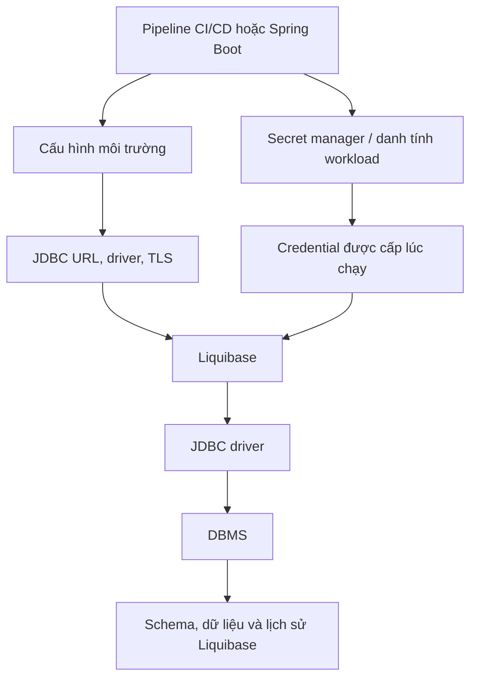

# Cấu hình kết nối bảo mật và tham chiếu thông tin bí mật

Trong module `DATABASE_SCHEMA_MIGRATION_LIQUIBASE`, việc quản lý thay đổi schema và dữ liệu bằng changelog, changeset, precondition, checksum và lịch sử triển khai chỉ an toàn khi Liquibase kết nối đúng database bằng danh tính phù hợp. Cấu hình kết nối vì vậy là một phần của thiết kế migration: phải xác định chính xác đích kết nối, bảo vệ dữ liệu truyền trên mạng, quản lý thông tin xác thực như bí mật, giới hạn quyền của tài khoản và cấp bí mật theo từng môi trường triển khai.

Liquibase cần biết URL, driver và thông tin xác thực để mở kết nối JDBC. Các giá trị này thường thay đổi giữa máy phát triển, môi trường kiểm thử, staging và production. Changelog nên mô tả thay đổi database; cấu hình môi trường cung cấp đích kết nối và bí mật tại thời điểm chạy. Không nên đưa mật khẩu, token hoặc khóa riêng vào changelog hay lưu trực tiếp trong kho mã nguồn.

## 1. Kiến trúc cấu hình kết nối an toàn

Một kết nối migration thường đi qua các thành phần sau:

1. Pipeline CI/CD hoặc tiến trình Spring Boot khởi chạy Liquibase.
2. Cấu hình theo môi trường xác định JDBC URL, driver và các tùy chọn kết nối.
3. Hệ thống quản lý bí mật cấp thông tin xác thực cho tiến trình theo danh tính được phép.
4. Liquibase dùng JDBC driver để thiết lập kết nối và gửi truy vấn hoặc câu lệnh migration.
5. DBMS xác thực danh tính, kiểm tra quyền, thực thi thay đổi và trả kết quả.



Cấu hình kết nối có thể chia thành bốn nhóm:

| Nhóm | Ví dụ | Mục đích |
|---|---|---|
| Định danh đích | JDBC URL, host, port, database, catalog, schema | Xác định nơi migration sẽ tác động |
| Cách giao tiếp | JDBC driver, timeout, TLS, trust certificate | Thiết lập kết nối và bảo vệ đường truyền |
| Danh tính | username, password, token, chứng thư client | Xác thực tiến trình migration |
| Quyền và phạm vi | schema mặc định, schema lưu lịch sử, grants | Giới hạn đối tượng và thao tác được phép |

Cần kiểm tra riêng từng nhóm. Một URL đúng nhưng tài khoản sai quyền vẫn khiến migration thất bại; một tài khoản hợp lệ nhưng URL trỏ nhầm production có thể gây tác động ngoài dự kiến. Kết nối thành công chỉ chứng minh tiến trình đã xác thực và thiết lập được phiên làm việc, không chứng minh đích database hoặc quyền được cấu hình đúng theo mục tiêu triển khai.

## 2. Cấu hình JDBC URL và driver

JDBC URL cho biết driver cần kết nối đến loại DBMS nào và địa chỉ nào. Cấu trúc cụ thể phụ thuộc driver; không có một cú pháp URL chung cho mọi hệ quản trị.

Ví dụ PostgreSQL:

```properties
changeLogFile: db/changelog/db.changelog-master.yaml
driver: org.postgresql.Driver
url: jdbc:postgresql://db.example.internal:5432/orders
defaultSchemaName: app
liquibaseSchemaName: liquibase
```

Trong ví dụ này:

- `changeLogFile` trỏ đến changelog gốc.
- `driver` chỉ định PostgreSQL JDBC driver tương thích với phiên bản Java và DBMS.
- `url` xác định host, port và database đích.
- `defaultSchemaName` xác định schema mặc định cho các thay đổi khi changeset không chỉ rõ schema.
- `liquibaseSchemaName` xác định schema chứa các bảng quản lý lịch sử và khóa Liquibase nếu nhóm muốn tách chúng khỏi schema ứng dụng.

Các thuộc tính schema phải được thống nhất với cách cấp quyền trong DBMS. Nếu bảng nghiệp vụ nằm ở schema `app` còn bảng lịch sử Liquibase ở schema `liquibase`, tài khoản migration cần quyền trên cả hai phạm vi theo đúng thao tác mà Liquibase thực hiện. Tên schema trong cấu hình không tự tạo ra quyền truy cập.

Không nên đưa username và password vào URL, ví dụ dạng query parameter hoặc phần mở rộng của chuỗi kết nối. Một số driver cho phép cách cấu hình đó, nhưng URL có thể bị ghi vào log, thông báo lỗi, telemetry hoặc lịch sử lệnh. Hãy tách URL khỏi thông tin xác thực.

### 2.1. Chọn driver tương thích

JDBC driver phải tương thích với DBMS, phiên bản Java và môi trường triển khai. Khi nâng cấp driver, cần kiểm tra:

- Driver class và dependency thực tế được đóng gói hoặc có trên classpath.
- Phiên bản driver có hỗ trợ phiên bản DBMS đích.
- Cơ chế TLS, xác thực, kiểu dữ liệu và metadata mà Liquibase sử dụng.
- Các khác biệt về xử lý DDL, transaction và lỗi của driver.
- Chính sách cập nhật bảo mật và nguồn phân phối dependency.

Driver không làm cho SQL của một DBMS tự động tương thích với DBMS khác. Liquibase có thể sinh SQL theo loại database được nhận diện, nhưng SQL viết tay và các tính năng riêng vẫn cần được kiểm thử với đúng driver và DBMS.

### 2.2. Phân tách cấu hình theo môi trường

Mỗi môi trường cần có cấu hình đích riêng, nhưng cùng một changelog đã được kiểm soát phiên bản nên có thể dùng xuyên suốt các môi trường tương thích.

Ví dụ về các giá trị không bí mật:

| Môi trường | JDBC URL mẫu | Schema ứng dụng |
|---|---|---|
| Local | `jdbc:postgresql://localhost:5432/orders_dev` | `app` |
| Test | `jdbc:postgresql://db-test.internal:5432/orders` | `app` |
| Staging | `jdbc:postgresql://db-staging.internal:5432/orders` | `app` |
| Production | `jdbc:postgresql://db-prod.internal:5432/orders` | `app` |

Đây chỉ là địa chỉ minh họa. Trong hệ thống thực tế, URL production phải đến từ cấu hình được phê duyệt, DNS và mạng riêng phù hợp. Tránh chỉnh sửa changelog chỉ để thay đổi host, password hoặc schema của một môi trường. Các giá trị kết nối thuộc cấu hình triển khai; nội dung changeset thuộc lịch sử thay đổi database.

## 3. Bảo vệ đường truyền bằng TLS

TLS bảo vệ dữ liệu trao đổi giữa tiến trình Liquibase và DBMS trên mạng. Nếu chỉ dùng xác thực username/password mà không bảo vệ đường truyền, thông tin xác thực hoặc dữ liệu truy vấn có thể bị lộ trên đường truyền khi môi trường mạng không đáng tin cậy.

Một cấu hình TLS đúng cần xem xét cả mã hóa lẫn xác minh danh tính máy chủ:

- **Mã hóa đường truyền:** dữ liệu trao đổi được bảo vệ khỏi việc đọc trực tiếp trên mạng.
- **Xác minh chứng thư máy chủ:** client kiểm tra chứng thư do máy chủ cung cấp có chuỗi tin cậy hợp lệ.
- **Xác minh tên máy chủ:** tên host trong JDBC URL phải khớp với danh tính được chứng thư cấp.
- **Quản lý CA:** chứng thư CA hoặc truststore cần được phân phối, cập nhật và thu hồi theo quy trình bảo mật.
- **Tương thích giao thức:** driver và DBMS cần hỗ trợ phiên bản TLS và bộ mã hóa được chính sách hệ thống chấp nhận.

### 3.1. Ví dụ TLS với PostgreSQL

Với PostgreSQL JDBC driver, có thể cấu hình URL theo chế độ xác minh đầy đủ:

```properties
url: jdbc:postgresql://db.example.internal:5432/orders?sslmode=verify-full&sslrootcert=/run/secrets/db-root-ca.crt
```

`sslmode=verify-full` yêu cầu kết nối TLS và xác minh chứng thư máy chủ cùng hostname theo cơ chế của PostgreSQL JDBC driver. File CA cần được cấp từ nguồn tin cậy, có quyền đọc giới hạn và được cập nhật khi hạ tầng chứng thư thay đổi.

Không nên hạ xuống chế độ chỉ mã hóa nhưng không xác minh danh tính máy chủ để né lỗi chứng thư trong production. Nếu xác minh thất bại, hãy kiểm tra hostname, thời hạn chứng thư, chuỗi CA, đồng hồ hệ thống và cấu hình driver. Tắt xác minh có thể khiến client kết nối tới máy chủ giả mạo dù dữ liệu vẫn được mã hóa.

Các tham số TLS là đặc thù của driver. PostgreSQL, MySQL, Oracle, SQL Server và các hệ quản trị khác có thể dùng tên tham số, định dạng truststore hoặc quy trình xác thực khác nhau. Hãy tham chiếu tài liệu của đúng JDBC driver và kiểm thử cấu hình trên phiên bản được triển khai.

### 3.2. Truststore và client certificate

Truststore lưu các CA hoặc chứng thư mà Java/driver tin cậy khi xác minh máy chủ. Keystore thường chứa danh tính mật mã của client, chẳng hạn private key và chứng thư client, khi hệ thống dùng xác thực hai chiều (mutual TLS). Hai loại kho này có mục đích khác nhau:

- Truststore trả lời câu hỏi: client tin cậy máy chủ nào?
- Keystore trả lời câu hỏi: client chứng minh danh tính của chính nó bằng khóa và chứng thư nào?

Không phải kết nối JDBC nào cũng cần mutual TLS. Nếu DBMS yêu cầu client certificate, phải cấu hình đúng định dạng khóa, chứng thư, mật khẩu bảo vệ kho và tham số riêng của driver. Private key không được đưa vào Git, changelog, image dùng chung hoặc log. Tệp chứng thư công khai và CA cũng cần được quản lý phiên bản và nguồn gốc để tránh thay thế trái phép.

## 4. Tham chiếu và cấp thông tin bí mật

Thông tin bí mật (secret) là dữ liệu mà người không được phép biết có thể dùng để truy cập tài nguyên hoặc giả mạo danh tính. Trong kết nối Liquibase, secret thường gồm password, access token, private key, mật khẩu truststore/keystore hoặc thông tin xác thực tạm thời.

### 4.1. Không lưu secret trong kho mã nguồn

Không viết password trực tiếp trong:

- Changelog XML, YAML, JSON hoặc SQL.
- File `liquibase.properties` được commit.
- `application.yml` hoặc file cấu hình Spring Boot được commit.
- Dockerfile, image layer, script build, file mẫu có giá trị thật.
- Lệnh shell, tham số process, log CI/CD, báo cáo lỗi hoặc ảnh chụp màn hình.

Ví dụ cấu hình nguy hiểm:

```properties
# KHONG DUNG: secret bi luu cung ma nguon
url: jdbc:postgresql://db.internal:5432/orders
username: migration_admin
password: RealPassword123!
```

Khi secret nằm trong lịch sử Git, xóa dòng khỏi commit mới không làm bí mật biến mất khỏi các commit cũ, fork, cache hoặc artifact đã phát hành. Cần thu hồi hoặc xoay vòng secret bị lộ, kiểm tra phạm vi truy cập và làm sạch lịch sử theo quy trình của tổ chức nếu cần.

### 4.2. Lấy secret từ môi trường chạy

Một cách triển khai phổ biến là để hệ thống quản lý bí mật cấp giá trị cho tiến trình khi chạy. Ví dụ, CI/CD lấy password từ secret store rồi cung cấp qua biến môi trường cho Liquibase CLI:

```bash
export LIQUIBASE_COMMAND_URL="jdbc:postgresql://db.example.internal:5432/orders"
export LIQUIBASE_COMMAND_USERNAME="$DB_MIGRATION_USER"
export LIQUIBASE_COMMAND_PASSWORD="$DB_MIGRATION_PASSWORD"

liquibase --changelog-file=db/changelog/db.changelog-master.yaml update
```

Các biến `LIQUIBASE_COMMAND_URL`, `LIQUIBASE_COMMAND_USERNAME` và `LIQUIBASE_COMMAND_PASSWORD` là cách cấu hình command parameter của Liquibase CLI qua môi trường. `DB_MIGRATION_USER` và `DB_MIGRATION_PASSWORD` trong ví dụ là biến được pipeline hoặc secret manager cấp. Tên biến nguồn này do dự án quy định.

File cấu hình không bí mật có thể giữ changelog, driver và các tùy chọn ổn định; URL và thông tin xác thực được cung cấp tại runtime. Cách này tránh ghi password vào file cấu hình đã commit và tránh đưa password trực tiếp vào tham số dòng lệnh như `--password=...`.

Biến môi trường vẫn là dữ liệu nhạy cảm. Tiến trình cùng quyền, công cụ debug hoặc cấu hình log sai có thể làm lộ chúng. Vì vậy, chỉ cấp secret cho job cần dùng, hạn chế quyền đọc môi trường, không in toàn bộ environment, kết thúc phạm vi secret sau job và dùng runner cô lập khi có thể. Nếu nền tảng hỗ trợ secret file được mount với quyền hạn chế, có thể dùng cơ chế đó khi công cụ kết nối hỗ trợ đọc từ file.

### 4.3. Dùng secret manager hoặc workload identity

Trong môi trường doanh nghiệp, secret nên được quản lý tập trung bằng dịch vụ phù hợp, chẳng hạn HashiCorp Vault, AWS Secrets Manager, Azure Key Vault hoặc Google Secret Manager. Tên dịch vụ chỉ là ví dụ; lựa chọn thực tế phụ thuộc hạ tầng và chính sách của tổ chức.

Một quy trình thường gặp:

1. Pipeline hoặc workload xác thực với secret manager bằng danh tính máy được cấp quyền.
2. Secret manager xác minh danh tính và chính sách truy cập.
3. Secret manager trả credential hoặc cấp một credential ngắn hạn nếu DBMS và cơ chế tích hợp hỗ trợ.
4. Tiến trình Liquibase sử dụng credential trong thời gian migration.
5. Secret hết hạn, bị thu hồi hoặc không còn được giữ sau khi job kết thúc.

Ưu tiên workload identity, OIDC hoặc cơ chế xác thực không cần lưu access key dài hạn trong repository khi nền tảng hỗ trợ. Nếu phải dùng password tĩnh, giới hạn thời hạn, quyền đọc và phạm vi sử dụng; xây dựng quy trình xoay vòng có kiểm soát. Không giả định chỉ cần viết `vault://...` hoặc `secret://...` vào JDBC URL là driver tự truy cập secret manager. Cần có integration, plugin, wrapper hoặc bước cấp secret thực sự được hỗ trợ trong môi trường đó.

### 4.4. Tham chiếu property trong Liquibase và secret runtime

Liquibase hỗ trợ property substitution trong changelog, ví dụ `${schemaName}` hoặc `${tablePrefix}`, để dùng một giá trị cấu hình ở nhiều nơi. Có thể khai báo property trong changelog hoặc cung cấp từ cấu hình/đối số theo cơ chế Liquibase. Đây là cơ chế thay thế giá trị khi xử lý changelog.

Cần phân biệt hai loại tham chiếu:

- **Liquibase property** được Liquibase thay thế khi đọc changelog, thích hợp cho các tham số triển khai có chủ đích như schema, tên tablespace hoặc giá trị không bí mật.
- **Secret của kết nối** được cung cấp cho tiến trình thông qua môi trường chạy, secret manager, file bí mật hoặc tích hợp xác thực. Secret không nên được chèn vào changelog như một property thông thường.

Không nên coi placeholder `${...}` là một secret manager. Placeholder chỉ có tác dụng nếu nguồn giá trị đã được cấu hình và Liquibase hoặc framework liên quan có thể phân giải nó. Việc ghi một tham chiếu không tạo ra quyền truy cập tới secret store. Với giá trị nhạy cảm, dùng cơ chế cấp secret chuyên dụng và tránh để giá trị sau phân giải xuất hiện trong log.

## 5. Tách danh tính migration khỏi danh tính ứng dụng

Liquibase thường cần quyền tạo, sửa hoặc xóa đối tượng database. Ứng dụng chạy bình thường thường chỉ cần quyền đọc/ghi dữ liệu nghiệp vụ. Dùng chung một tài khoản quyền cao cho cả hai hoạt động làm tăng phạm vi thiệt hại nếu ứng dụng bị xâm nhập hoặc lộ credential.

Nên cân nhắc ít nhất hai danh tính:

| Danh tính | Nhu cầu điển hình | Quyền nên giới hạn |
|---|---|---|
| Migration user | Tạo/sửa schema, constraint, index và cập nhật bảng lịch sử Liquibase | Chỉ schema và thao tác cần cho migration |
| Application user | Đọc/ghi dữ liệu trong thời gian phục vụ request | DML cần thiết; không cấp DDL nếu không có lý do rõ ràng |

Tài khoản migration có thể cần quyền đọc metadata, tạo bảng lịch sử, ghi vào `DATABASECHANGELOG`, khóa/mở `DATABASECHANGELOGLOCK` và thực hiện DDL/DML do changeset yêu cầu. Quyền cụ thể phụ thuộc DBMS, schema và các change type thực tế. Không nên cấp quyền quản trị toàn database chỉ để tránh lỗi permission.

Nếu ứng dụng Spring Boot tự chạy Liquibase khi khởi động, cần xác định rõ credential nào được dùng cho migration và credential nào được dùng cho DataSource nghiệp vụ. Có thể cấu hình kết nối Liquibase riêng nếu phiên bản Spring Boot và cấu hình ứng dụng hỗ trợ. Khi migration do pipeline chạy trước lúc triển khai ứng dụng, application user có thể hoàn toàn không cần quyền DDL.

Cũng cần xem xét quyền sở hữu đối tượng và quyền truy cập giữa các schema. Một changeset tạo bảng bằng migration user có thể tạo đối tượng thuộc owner đó; application user cần được cấp quyền truy cập sau đó. Tạo thành công không đồng nghĩa ứng dụng đã có quyền sử dụng bảng.

## 6. Tích hợp cấu hình bảo mật với Spring Boot

Spring Boot cung cấp namespace `spring.liquibase` để cấu hình Liquibase khi ứng dụng khởi động. Nếu không cấu hình kết nối riêng, Liquibase thường sử dụng DataSource mà Spring Boot cung cấp. Cách đơn giản này phù hợp khi migration và ứng dụng có cùng danh tính database; với hệ thống cần tách quyền, hãy cấu hình thông tin kết nối Liquibase riêng.

Ví dụ `application.yml` dùng placeholder để Spring phân giải giá trị từ biến môi trường hoặc nguồn cấu hình ngoài:

```yaml
spring:
  datasource:
    url: ${APP_DB_URL}
    username: ${APP_DB_USER}
    password: ${APP_DB_PASSWORD}

  liquibase:
    change-log: classpath:db/changelog/db.changelog-master.yaml
    url: ${DB_MIGRATION_URL}
    user: ${DB_MIGRATION_USER}
    password: ${DB_MIGRATION_PASSWORD}
    default-schema: app
    liquibase-schema: liquibase
```

Trong ví dụ này, `APP_DB_*` là danh tính phục vụ ứng dụng; `DB_MIGRATION_*` là danh tính dùng cho Liquibase. Spring Boot phân giải placeholder khi tạo cấu hình. Giá trị thực phải được cấp từ secret manager hoặc cấu hình runtime được bảo vệ. Không ghi giá trị thật vào file YAML.

Một số điểm cần kiểm tra:

- Tên thuộc tính của Spring Boot là `spring.liquibase.user`, còn cấu hình DataSource dùng `spring.datasource.username`.
- Khi thiết lập URL, user và password riêng cho Liquibase, xác minh Liquibase thực sự dùng kết nối riêng thay vì vô tình kế thừa DataSource ứng dụng.
- Đặt `change-log`, `default-schema` và `liquibase-schema` phù hợp với cấu trúc database.
- Tránh để nhiều replica ứng dụng đồng thời khởi chạy migration trong production nếu kiến trúc triển khai không cần như vậy. Liquibase có lock, nhưng một pipeline migration riêng thường giúp kiểm soát thứ tự và quyền tốt hơn.
- Kiểm tra thứ tự triển khai: schema phải tương thích với phiên bản ứng dụng được đưa lên, đặc biệt khi có nhiều phiên bản ứng dụng cùng chạy trong thời gian rolling deployment.

Với ứng dụng không cần tự động migration khi khởi động, có thể tắt Liquibase auto-run theo cấu hình Spring Boot và để pipeline chuyên trách thực hiện. Quyết định này phải nhất quán với quy trình phát hành, tránh tình trạng vừa có pipeline migration vừa có nhiều instance ứng dụng cùng cố gắng cập nhật database.

## 7. Tích hợp secret trong CI/CD

Pipeline migration là một workload có quyền thay đổi database, do đó cần được bảo vệ như một thành phần triển khai có đặc quyền.

Một pipeline có thể được tổ chức theo trình tự:

1. Lấy source code và xác định commit/artifact sẽ phát hành.
2. Kiểm tra changelog và cấu hình không chứa secret tĩnh.
3. Xác thực workload với secret manager bằng danh tính dành riêng cho môi trường.
4. Lấy credential migration và cấu hình kết nối đúng database đích.
5. Kiểm tra URL, DBMS, schema, quyền và trạng thái lock trước khi chạy.
6. Tạo hoặc xem trước SQL bằng quy trình review phù hợp.
7. Chạy `liquibase update` với đúng changelog và credential.
8. Thu thập log đã được che dữ liệu nhạy cảm, xác minh changeset và kiểm tra ứng dụng.
9. Kết thúc job, hủy credential tạm thời hoặc để credential ngắn hạn hết hiệu lực.

Không nên cấp production secret cho pull request từ nhánh không tin cậy hoặc mã nguồn bên ngoài. Với pipeline nhiều môi trường, mỗi môi trường nên có secret scope, danh tính workload và quyền phê duyệt riêng. Secret của staging không được tái sử dụng cho production chỉ vì cùng một changelog.

Một số nền tảng cho phép chỉ cấp secret sau khi job được phê duyệt hoặc sau khi workflow đạt điều kiện nhất định. Hãy tận dụng cơ chế đó để giảm thời gian secret tồn tại trong runner. Không lưu secret vào artifact, cache, output parameter hoặc file log để chuyển giữa các job; nếu cần chuyển dữ liệu, dùng tham chiếu có quyền truy cập giới hạn tới secret store.

## 8. Bảo vệ log, file cấu hình và môi trường thực thi

Ngay cả khi secret không nằm trong Git, nó vẫn có thể bị lộ qua quá trình chạy.

### 8.1. Log và thông báo lỗi

Không bật mức log quá chi tiết trong production nếu chưa đánh giá nguy cơ lộ thông tin kết nối. Tránh in toàn bộ cấu hình, biến môi trường, JDBC URL có chứa credential hoặc đối tượng cấu hình sau khi đã phân giải placeholder. Khi cần chẩn đoán, ghi lại định danh môi trường, DBMS, changeset, SQLState và mã lỗi cần thiết; che password, token, private key và dữ liệu nhạy cảm.

Cần kiểm tra cả log của Liquibase, Spring Boot, JDBC driver, pipeline runner, secret manager và hệ thống quan sát tập trung. Một lớp có thể che secret trong log của nó nhưng lớp khác vẫn ghi giá trị thô.

### 8.2. File bí mật và quyền hệ thống tệp

Nếu môi trường yêu cầu file cấu hình có secret, hãy:

- Đặt file ngoài repository và ngoài thư mục artifact được phát hành.
- Cấp quyền đọc cho đúng tài khoản dịch vụ.
- Không dùng chung volume hoặc thư mục tạm giữa các job không tin cậy.
- Không sao chép file secret vào image container hoặc cache build.
- Dùng file tạm có vòng đời ngắn và xóa theo cơ chế phù hợp sau khi hoàn tất.
- Kiểm tra backup, snapshot và công cụ thu thập log không vô tình lưu bản sao.

Thêm file vào `.gitignore` chỉ ngăn một số trường hợp commit nhầm; nó không mã hóa file và không kiểm soát quyền truy cập trên máy. File chứa secret vẫn phải được bảo vệ ở cấp hệ điều hành và quy trình vận hành.

### 8.3. Mạng và vùng triển khai

DBMS nên chỉ nhận kết nối từ các workload cần thiết, qua mạng riêng, firewall hoặc cơ chế kiểm soát truy cập tương ứng. Giới hạn outbound của runner và inbound của database theo nguồn đã phê duyệt. Không mở database ra Internet công cộng chỉ để pipeline dễ kết nối.

Nếu dùng DNS, proxy, VPN hoặc private endpoint, kiểm tra hostname mà driver xác minh TLS phải tương thích với chứng thư. Thay đổi network route hoặc endpoint có thể khiến một kết nối từng hoạt động bị lỗi; không giải quyết bằng cách tắt xác minh TLS.

## 9. Xoay vòng và thu hồi secret

Password và token có thể bị lộ, hết hạn hoặc cần thay đổi theo chính sách. Quy trình xoay vòng nên có khả năng chuyển đổi mà không làm migration dở dang.

Một quy trình an toàn thường gồm:

1. Tạo credential mới với cùng phạm vi quyền cần thiết.
2. Cập nhật secret manager hoặc cấu hình runtime để cấp credential mới.
3. Kiểm tra một kết nối thử và xác minh đúng database, schema, TLS và quyền.
4. Chuyển pipeline hoặc workload sang credential mới.
5. Theo dõi lần chạy thực tế và xác nhận không còn workload cần credential cũ.
6. Thu hồi credential cũ và kiểm tra log truy cập để phát hiện sử dụng bất thường.

Nếu DBMS không cho phép hai password cùng hợp lệ cho một user, có thể cần tạo user migration thứ hai, chuyển pipeline, rồi thu hồi user cũ. Trình tự cụ thể phụ thuộc DBMS và cơ chế xác thực. Không xoay vòng bằng cách sửa changelog hoặc commit password mới.

Với sự cố lộ secret, cần thu hồi ngay theo mức độ ảnh hưởng, xác định những database và môi trường có thể bị truy cập, kiểm tra lịch sử đăng nhập/thay đổi, và đánh giá liệu có cần khôi phục dữ liệu hay schema. Xóa secret khỏi file hiện tại không làm credential cũ mất hiệu lực.

## 10. Kiểm tra cấu hình trước khi migration

Trước khi chạy migration ở một môi trường, có thể dùng checklist sau:

| Hạng mục | Câu hỏi cần xác minh |
|---|---|
| Đích kết nối | JDBC URL có trỏ đúng host, port, database và schema của môi trường dự kiến? |
| Driver | Driver đúng loại DBMS, tương thích Java và phiên bản server? |
| TLS | Kết nối có mã hóa và xác minh chứng thư/hostname theo chính sách? |
| Secret | Credential được cấp từ nguồn tin cậy tại runtime và không nằm trong source/artifact/log? |
| Danh tính | Migration user có đúng phạm vi và không dùng chung quyền quản trị không cần thiết? |
| Lịch sử | Liquibase đọc/ghi được `DATABASECHANGELOG` và sử dụng `DATABASECHANGELOGLOCK`? |
| Schema | Default schema và Liquibase schema có khớp quyền sở hữu, quyền truy cập? |
| Pipeline | Chỉ job được phê duyệt mới nhận production secret? |
| Khả năng phục hồi | Có bản sao lưu, kế hoạch rollback và người chịu trách nhiệm khi migration lỗi? |

Có thể chạy các thao tác kiểm tra như `liquibase status` hoặc tạo SQL xem trước bằng `liquibase updateSQL` trước khi thực hiện `update`, tùy quyền và quy trình của nhóm. Các thao tác này vẫn cần kết nối và có thể truy vấn metadata, do đó không phải lúc nào cũng hoàn toàn không tác động. Hãy xác định đúng command, changelog, môi trường và quyền trước khi thực thi.

Không in password để xác minh secret đã được nạp. Thay vào đó, kiểm tra trạng thái có/không của biến hoặc tham chiếu, xác thực kết nối bằng công cụ được phê duyệt và chỉ ghi kết quả không nhạy cảm. Không đưa secret vào câu lệnh debug để “xem có đúng không”.

## 11. Những lỗi cấu hình thường gặp

| Dấu hiệu | Nguyên nhân có thể | Cách xử lý |
|---|---|---|
| Connection refused hoặc timeout | Host/port sai, firewall, DNS, DBMS chưa sẵn sàng | Kiểm tra URL, network route, endpoint và trạng thái server |
| Authentication failed | Secret sai/hết hạn, user bị khóa hoặc sai cơ chế xác thực | Kiểm tra nguồn secret, thời hạn, user và chính sách xác thực; không in password |
| SSL handshake hoặc certificate error | CA không tin cậy, chứng thư hết hạn, hostname không khớp, driver không tương thích | Kiểm tra trust chain, hostname, thời gian hệ thống và cấu hình TLS của đúng driver |
| Permission denied khi chạy changeset | Migration user thiếu quyền trên schema hoặc đối tượng | Cấp quyền tối thiểu cần thiết và kiểm thử lại với đúng user |
| Không tạo/ghi được bảng lịch sử Liquibase | Liquibase schema sai hoặc thiếu quyền | Kiểm tra `liquibaseSchemaName`, owner và grants cho bảng lịch sử/lock |
| Chạy được local nhưng thất bại trên CI | Secret scope, network, driver hoặc biến môi trường khác nhau | So sánh cấu hình không nhạy cảm, danh tính workload, network và dependency |
| Ứng dụng chạy được nhưng Liquibase lỗi | DataSource và kết nối Liquibase dùng user/URL khác nhau | Kiểm tra `spring.datasource.*` và `spring.liquibase.*` |
| Secret bị lộ trong log hoặc artifact | In environment, debug quá chi tiết hoặc lưu file cấu hình | Thu hồi/rotate secret, hạn chế log, kiểm tra artifact và quyền truy cập |

Khi gặp lỗi, hãy phân loại lỗi theo kết nối, TLS, xác thực, quyền DBMS, cấu hình schema hay chính changeset. Không khắc phục lỗi xác minh chứng thư bằng cách tắt TLS verification; không khắc phục lỗi thiếu quyền bằng cách cấp quyền quản trị toàn database; không khắc phục secret hết hạn bằng cách ghi password mới vào source code.

## 12. Nguyên tắc vận hành

- Giữ changelog trong version control nhưng để secret ở secret manager hoặc nguồn cấu hình runtime được bảo vệ.
- Phân tách URL, danh tính, quyền và cấu hình TLS để có thể kiểm tra từng phần.
- Dùng TLS có xác minh chứng thư và hostname theo chính sách của môi trường.
- Dùng migration user riêng, quyền tối thiểu và schema lịch sử được quản lý rõ ràng.
- Ưu tiên workload identity và credential ngắn hạn nếu DBMS cùng nền tảng hỗ trợ.
- Không truyền secret qua dòng lệnh, log, artifact hoặc cache.
- Cấp production secret có điều kiện, giới hạn thời gian và phạm vi job.
- Xoay vòng, thu hồi và kiểm tra việc sử dụng credential theo quy trình.
- Kiểm thử cấu hình trên cùng loại DBMS, driver và cách triển khai như môi trường đích.
- Xác minh database đích trước mỗi lần update, đặc biệt với pipeline có quyền production.

Cấu hình kết nối bảo mật là một phần của độ tin cậy migration. Liquibase điều phối changelog và changeset; JDBC driver thiết lập giao tiếp; DBMS xác thực danh tính và thực thi quyền. Khi URL, TLS, secret, danh tính và quyền được quản lý riêng rẽ, nhóm có thể triển khai cùng một lịch sử migration qua nhiều môi trường mà vẫn kiểm soát được nơi thay đổi, ai được phép thay đổi và bí mật nào được sử dụng trong từng lần chạy.

