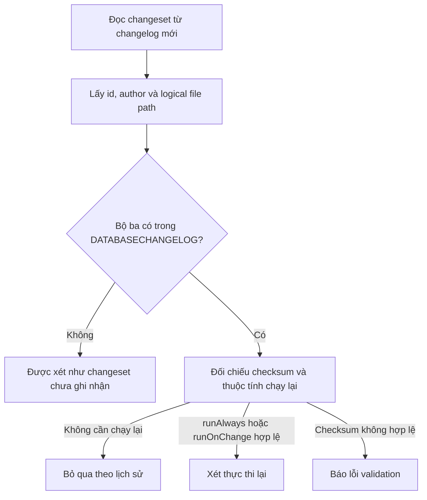

# Quản lý `logicalFilePath` khi di chuyển hoặc đổi tên tệp

Trong Liquibase, việc di chuyển một changelog từ thư mục `changes/` sang `archive/`, đổi tên tệp hoặc sắp xếp lại cây `include` có thể làm thay đổi **định danh changeset** dù nội dung SQL không đổi. Nếu Liquibase không nhận ra một changeset đã được triển khai, nó có thể thử chạy lại thao tác `createTable`, `addColumn` hoặc `insert`, gây lỗi hoặc tạo dữ liệu trùng. Thuộc tính `logicalFilePath` giải quyết vấn đề này bằng cách giữ **đường dẫn định danh ổn định** trong khi đường dẫn vật lý của tệp được phép thay đổi.

Bài học thuộc chương **Changelog** của `DATABASE_SCHEMA_MIGRATION_LIQUIBASE`. Trong mục tiêu quản lý thay đổi schema và dữ liệu bằng changelog, changeset, precondition, checksum và lịch sử triển khai, `logicalFilePath` là một cơ chế duy trì liên tục lịch sử khi tổ chức lại mã nguồn. Đây cũng là kiến thức cần thiết để kiểm chứng migration, thiết kế rollback, phối hợp giữa development, staging, production và vận hành với Spring Boot hoặc CI/CD.

## 1. Vấn đề cốt lõi: đường dẫn cũng là một phần định danh

Liquibase thường xác định một changeset bằng bộ ba:

| Thành phần | Ví dụ | Ý nghĩa |
|---|---|---|
| `id` | `001-create-customer` | Mã changeset do tác giả đặt. |
| `author` | `db-team` | Tên tác giả hoặc nhóm sở hữu. |
| Đường dẫn định danh changelog | `db/changelog/changes/001-customer.xml` | Giá trị Liquibase dùng để phân biệt những changeset trùng `id` và `author` nhưng nằm trong các changelog khác nhau. |

Khi một changeset chạy thành công, Liquibase ghi các giá trị này vào bảng `DATABASECHANGELOG`, thường trong các cột `ID`, `AUTHOR` và `FILENAME`, cùng với `DATEEXECUTED`, `EXECTYPE`, `MD5SUM` và metadata khác. Ở lần `update` tiếp theo, Liquibase dùng bộ ba để đối chiếu với lịch sử. Một changeset đã chạy với định danh cũ sẽ được bỏ qua theo quy tắc thực thi thông thường; một định danh chưa có trong lịch sử có thể được xem là chưa chạy.

Giả sử ban đầu ứng dụng tham chiếu tệp:

```text
db/changelog/changes/001-customer.xml
```

Trong một database đã triển khai, lịch sử chứa bản ghi minh họa:

| ID | AUTHOR | FILENAME | EXECTYPE |
|---|---|---|---|
| `001-create-customer` | `db-team` | `db/changelog/changes/001-customer.xml` | `EXECUTED` |

Sau đó nhóm chuyển tệp sang:

```text
db/changelog/archive/001-customer.xml
```

Nếu Liquibase sử dụng đường dẫn mới làm định danh, nó tìm bộ ba `001-create-customer`, `db-team`, `db/changelog/archive/001-customer.xml` và **không thấy** bản ghi tương ứng. Tệp có thể bị coi là changeset mới. Ví dụ, thao tác `createTable customer` có thể chạy lại và thất bại vì bảng đã tồn tại. Nghiêm trọng hơn, một thao tác thêm dữ liệu không có ràng buộc duy nhất có thể chèn lại dữ liệu mà không báo lỗi.

`logicalFilePath` cho phép khai báo rằng tệp nằm ở đường dẫn mới nhưng vẫn mang tên định danh cũ:

```text
Đường dẫn vật lý hiện tại: db/changelog/archive/001-customer.xml
Đường dẫn định danh:       db/changelog/changes/001-customer.xml
```

Vì `id`, `author` và đường dẫn định danh vẫn khớp với lịch sử, Liquibase nhận ra changeset đã triển khai.

> **Phân biệt quan trọng:** `logicalFilePath` chỉ thay đổi **định danh logic** mà Liquibase dùng cho changeset. Nó không tự chuyển tệp trên ổ đĩa, không thay đường dẫn cần dùng trong `include`, không sửa câu lệnh SQL và không tự di chuyển các bản ghi trong `DATABASECHANGELOG`.

## 2. Hai loại đường dẫn cần quản lý độc lập

| Khái niệm | Dùng để làm gì? | Điều gì xảy ra khi đổi? |
|---|---|---|
| **Physical path** (đường dẫn vật lý) | Tìm và đọc tệp XML, YAML, JSON hoặc formatted SQL trong repository/classpath. | Cần cập nhật `include`, `includeAll`, classpath hoặc đường dẫn changelog gốc cho phù hợp. |
| **Logical file path** (đường dẫn định danh) | Tạo thành phần `FILENAME` trong bộ ba định danh changeset. | Nếu khác lịch sử cũ, Liquibase có thể nhận diện changeset thành một đối tượng chưa được triển khai. |

Hai đường dẫn có thể giống nhau khi tạo mới changelog. Chúng có thể khác nhau sau khi di chuyển hoặc đổi tên tệp. Trong một dự án ổn định, đường dẫn logic nên được coi là **danh tính bền vững**, còn vị trí vật lý có thể thay đổi theo tổ chức mã nguồn.

### 2.1. Vì sao không chỉ dựa vào `id` và `author`?

Nhiều nhóm sử dụng các mã như `001`, `002`, `create-table` trong các file khác nhau. Nếu Liquibase chỉ xét `id` và `author`, hai changeset ở hai changelog khác nhau có thể xung đột. Bổ sung đường dẫn định danh cho phép Liquibase phân biệt chúng. Vì vậy, đổi đường dẫn định danh có ảnh hưởng thực sự đến lịch sử triển khai.

### 2.2. Vì sao checksum không giải quyết được việc đổi đường dẫn?

Checksum dùng để kiểm tra nội dung changeset đã được ghi nhận; còn bộ ba định danh dùng để tìm xem changeset nào đã được ghi nhận. Nếu bộ ba không khớp, giữ nguyên SQL hoặc checksum không có nghĩa là Liquibase tự hiểu đây là changeset cũ. Các lệnh như `clearCheckSums` và cấu hình `validCheckSum` xử lý checksum theo mục đích riêng, **không phải giải pháp thay thế `logicalFilePath` khi đổi định danh tệp**.

Một cách hiểu trực quan:



Sơ đồ mô tả quyết định liên quan đến định danh; Liquibase còn áp dụng context, label, DBMS, precondition và các quy tắc khác. Những changeset cố ý dùng `runAlways` hoặc `runOnChange` cần được kiểm tra riêng vì chúng có thể chạy lại ngay cả khi định danh không đổi.

## 3. Quy trình an toàn khi di chuyển một changelog đã triển khai

Ví dụ xuyên suốt dùng một tệp XML trước đây nằm tại `db/changelog/changes/001-customer.xml`, sau đó được chuyển tới `db/changelog/archive/001-customer.xml`. Giả định đã xác minh `FILENAME` lưu trong các database đang vận hành chính xác là đường dẫn cũ.

### Bước 1: Xác nhận định danh đã ghi trong database

Đọc lịch sử hiện có bằng truy vấn chỉ đọc:

```sql
SELECT ID, AUTHOR, FILENAME, EXECTYPE, DATEEXECUTED, MD5SUM
FROM DATABASECHANGELOG
WHERE ID = '001-create-customer'
  AND AUTHOR = 'db-team';
```

Ghi lại **nguyên văn** giá trị `FILENAME`. Đây mới là giá trị cần bảo toàn. Không suy đoán nó bằng cách nhìn vào vị trí tệp trong IDE, vì cách nạp qua classpath, thư mục làm việc hoặc `relativeToChangelogFile` có thể ảnh hưởng đường dẫn Liquibase đã lưu. Kiểm tra trên từng database cần duy trì tính tương thích; tên đường dẫn trên filesystem không nhất thiết trùng với `FILENAME` trong lịch sử.

### Bước 2: Di chuyển tệp và chỉnh đường dẫn include

Giả sử changelog gốc là `db/changelog/master.xml` và có include tương đối. Trước khi di chuyển:

```xml
<include file="changes/001-customer.xml" relativeToChangelogFile="true"/>
```

Sau khi di chuyển tệp vào `archive/`, sửa **đường dẫn để nạp tệp** thành:

```xml
<include file="archive/001-customer.xml" relativeToChangelogFile="true"/>
```

`relativeToChangelogFile="true"` cho biết đường dẫn include được giải quyết tương đối với changelog chứa phần khai báo. Dù đã đổi include, vẫn cần giữ đường dẫn định danh cũ bằng `logicalFilePath` trong tệp được di chuyển.

### Bước 3: Khai báo logicalFilePath bằng đường dẫn lịch sử cũ

Trong tệp XML **ở vị trí mới** `db/changelog/archive/001-customer.xml`:

```xml
<?xml version="1.0" encoding="UTF-8"?>
<databaseChangeLog
    xmlns="http://www.liquibase.org/xml/ns/dbchangelog"
    xmlns:xsi="http://www.w3.org/2001/XMLSchema-instance"
    xsi:schemaLocation="http://www.liquibase.org/xml/ns/dbchangelog
                        https://www.liquibase.org/xml/ns/dbchangelog/dbchangelog-latest.xsd"
    logicalFilePath="db/changelog/changes/001-customer.xml">

    <changeSet id="001-create-customer" author="db-team">
        <createTable tableName="customer_record">
            <column name="id" type="BIGINT">
                <constraints primaryKey="true" nullable="false"/>
            </column>
            <column name="display_name" type="VARCHAR(120)"/>
        </createTable>
    </changeSet>

</databaseChangeLog>
```

Trong ví dụ:

- `archive/001-customer.xml` là nơi Liquibase **đọc tệp** thông qua `include`.
- `logicalFilePath="db/changelog/changes/001-customer.xml"` là giá trị Liquibase dùng làm **đường dẫn định danh** cho changeset.
- `id="001-create-customer"` và `author="db-team"` được giữ nguyên.
- Các change đã chạy giữ nguyên nội dung; không sửa chúng chỉ vì đổi thư mục.

Nếu dự án sử dụng YAML, JSON hoặc formatted SQL, ý tưởng vẫn giống nhau nhưng cách đặt thuộc tính phải theo cú pháp và phiên bản Liquibase tương ứng. Ví dụ dưới đây minh họa cách khai báo `logicalFilePath` trong một changelog YAML ở cấp changeset khi phiên bản đang dùng hỗ trợ cú pháp này:

```yaml
databaseChangeLog:
  - changeSet:
      id: 002-add-customer-email
      author: db-team
      logicalFilePath: db/changelog/changes/002-customer.yaml
      changes:
        - addColumn:
            tableName: customer_record
            columns:
              - column:
                  name: email
                  type: VARCHAR(255)
```

Giá trị `logicalFilePath` trong ví dụ YAML chỉ đúng khi nó phản ánh đường dẫn đã được Liquibase ghi nhận cho chính changeset đó. Ví dụ dùng các ID khác nhau để minh họa cú pháp, không tạo thành một chuỗi migration cần chạy trực tiếp. Hãy chạy `validate` với bản Liquibase được khóa trong dự án để xác nhận thuộc tính được hỗ trợ đúng vị trí.

### Bước 4: Kiểm tra trước khi triển khai

Sau khi di chuyển, dùng đúng bản Liquibase, JDBC driver và các extension của môi trường mục tiêu để chạy:

```bash
liquibase --changelog-file=db/changelog/master.xml validate
liquibase --changelog-file=db/changelog/master.xml status --verbose
liquibase --changelog-file=db/changelog/master.xml update-sql
```

Đây là cú pháp minh họa theo kiểu CLI hiện đại; một số bản Liquibase có cách viết tên lệnh hoặc tham số khác. Cần truyền thêm kết nối và thông tin xác thực từ cấu hình/secret hiện hành. Với database đã triển khai đầy đủ và không có changeset mới thực sự, `status` không nên bất ngờ liệt kê các changeset chỉ vì chúng đổi chỗ. Đầu ra SQL review cũng không nên chứa lại thao tác tạo bảng, thêm cột hoặc thay dữ liệu từ các changeset cũ.

Nếu phát hiện một changeset cũ xuất hiện như chưa chạy, **dừng lại**, kiểm tra `ID`, `AUTHOR`, `FILENAME` và cách áp dụng `logicalFilePath` trước khi chạy `update`. Không chạy thử `update` trên production để xem có lỗi hay không.

### Bước 5: Kiểm thử với hai trạng thái database

Cần kiểm thử cả database đã có lịch sử và database mới:

| Database thử nghiệm | Kỳ vọng |
|---|---|
| **Database đã chạy migration cũ** | Liquibase nhận ra changeset trong `DATABASECHANGELOG` và không thực thi lại change thông thường. |
| **Database mới, lịch sử trống** | Liquibase có thể chạy changeset theo thứ tự hợp lệ; bản ghi mới dùng định danh logic đã khai báo. |
| **Database đang có một phần migration** | Changeset đã chạy được bỏ qua, changeset thực sự chưa chạy vẫn được chọn đúng theo changelog. |

Sau khi chạy thử, kiểm tra lại lịch sử. Việc đổi tên hoặc di chuyển file đúng cách không tự sinh ra một bản ghi `EXECUTED` thứ hai cho changeset đã hoàn tất. Với changeset chủ đích chạy lại (`runAlways`, `runOnChange`), kết quả phải được đánh giá theo chính sách thực thi riêng.

## 4. Chọn phạm vi khai báo `logicalFilePath`

Khả năng đặt `logicalFilePath` có thể phụ thuộc phiên bản Liquibase và định dạng changelog. Thông thường có hai hướng tư duy: **một định danh cho cả file changelog**, hoặc **định danh riêng cho từng changeset**. Các cấu hình trên `include`/`includeAll` cũng cần đối chiếu tài liệu đúng phiên bản, vì khả năng truyền hoặc kế thừa đường dẫn logic đã phát triển qua các bản phát hành.

### 4.1. Cấp changelog: phù hợp khi chuyển nguyên tệp

Khi chỉ di chuyển `001-customer.xml` và giữ nguyên toàn bộ changeset bên trong, đặt `logicalFilePath` ở phần khai báo `databaseChangeLog` thường đơn giản nhất. Các changeset trong file tiếp tục mang cùng đường dẫn định danh cũ. Cần bảo đảm file này trước đây thực sự có một đường dẫn định danh thống nhất.

Ví dụ tình huống phù hợp:

```text
Trước: db/changelog/changes/001-customer.xml
Sau:   db/changelog/archive/001-customer.xml
Logic: db/changelog/changes/001-customer.xml
```

### 4.2. Cấp changeset: hữu ích khi tách hoặc gộp file

Khi chuyển nhiều changeset từ các file khác nhau vào một file chung, mỗi changeset có thể cần giữ một giá trị `FILENAME` khác nhau. Nếu bản Liquibase hỗ trợ `logicalFilePath` ở cấp changeset, có thể đặt giá trị riêng cho từng changeset theo lịch sử cũ. Nếu phiên bản không hỗ trợ hoặc cấu hình trở nên khó kiểm soát, giữ các file changelog nhỏ với `logicalFilePath` riêng rồi include chúng thường dễ kiểm chứng hơn.

Ví dụ hai changeset từ hai file cũ:

| Changeset | Đường dẫn logic cần giữ |
|---|---|
| `create-customer` trong `changes/customer.xml` | `db/changelog/changes/customer.xml` |
| `create-order` trong `changes/order.xml` | `db/changelog/changes/order.xml` |

Không đặt cùng một `logicalFilePath` mới cho cả hai nếu điều đó làm thay đổi định danh đã ghi trước đây. Ngược lại, cũng không nên đặt bừa một đường dẫn logic dùng chung cho nhiều file nếu chúng có cặp `id`/`author` trùng nhau, vì có nguy cơ tạo xung đột định danh.

### 4.3. Tránh đặt phạm vi quá rộng

Một changelog master có thể chứa hàng chục lệnh `include` và `includeAll`. Đặt `logicalFilePath` ở phạm vi quá cao hoặc cấu hình kế thừa mà chưa hiểu phiên bản có thể khiến nhiều changeset đổi định danh ngoài ý muốn. Chỉ dùng phạm vi rộng khi đã xác minh đầy đủ cách Liquibase áp dụng thuộc tính xuống các changelog con.

Với `includeAll`, việc thêm, bớt hoặc đổi tên file còn có thể ảnh hưởng thứ tự nạp. Cần xác minh cả **thứ tự thực thi** lẫn **đường dẫn định danh**. `logicalFilePath` không đảm bảo giữ thứ tự khi tên file hoặc cấu trúc include thay đổi; đây là hai trách nhiệm riêng.

## 5. Các trường hợp đổi tên, di chuyển và tái tổ chức repository

| Tình huống | Hành động cần kiểm soát |
|---|---|
| Đổi tên một changelog đã chạy | Cập nhật include hoặc điểm vào; giữ `logicalFilePath` bằng `FILENAME` cũ. |
| Chuyển file sang thư mục khác | Cập nhật đường dẫn nạp file; giữ nguyên định danh logic cũ. |
| Di chuyển cả thư mục changelog | Kiểm tra mọi `FILENAME` bị ảnh hưởng; giữ định danh riêng cho các file đã triển khai. |
| Tách một file thành nhiều file | Bảo toàn định danh từng changeset, cân nhắc thuộc tính cấp changeset hoặc giữ wrapper include. |
| Gộp nhiều file cũ | Tránh gán một logical path cho toàn bộ changeset nếu lịch sử cũ có nhiều `FILENAME`. |
| Chuyển từ filesystem sang classpath/JAR | Xác minh đường dẫn resource mới và giữ logical path trùng lịch sử cũ. |
| Chuyển từ `include` sang `includeAll` | Kiểm tra thứ tự, điều kiện lọc và định danh của từng changeset. |
| Đổi tên hoặc chuyển *changelog chưa từng chạy* | Có thể chọn logical path mới trước lần triển khai đầu tiên, miễn nhất quán giữa các môi trường. |

Một nguyên tắc hữu ích là **chọn định danh logic trước lần chạy đầu tiên và giữ ổn định từ đó**. Nếu biết trước tệp sẽ thường xuyên chuyển chỗ, nhóm có thể gán một logical path cố định ngay khi tạo changelog. Giá trị này là đường dẫn định danh quy ước, không nhất thiết phải trỏ đến một file đang tồn tại.

## 6. Giữ nhất quán giữa các môi trường

Một commit có thể được phát hành tới development trước, staging sau và production cuối. Trong khoảng thời gian đó, có thể đã có môi trường chạy changeset từ vị trí cũ, môi trường khác mới triển khai lần đầu tại vị trí mới. Mọi môi trường cần nhìn thấy **cùng một định danh logic** cho cùng một changeset.

### 6.1. Ma trận kiểm tra trước khi di chuyển

| Kiểm tra | Development | Staging | Production |
|---|---|---|---|
| Bản ghi `ID`/`AUTHOR` đã tồn tại? | Kiểm tra | Kiểm tra | Kiểm tra |
| `FILENAME` cũ là gì? | Ghi nguyên văn | Ghi nguyên văn | Ghi nguyên văn |
| Changelog mới được nạp thành công? | `validate` | `validate` | `validate` trước update |
| Có changeset cũ bị nhận là mới? | `status`/SQL review | `status`/SQL review | `status`/SQL review |
| Metadata sau cập nhật có đúng? | Truy vấn lịch sử | Truy vấn lịch sử | Truy vấn lịch sử |

Nếu cả ba môi trường đều ghi `FILENAME` cũ giống nhau, một `logicalFilePath` giữ đúng giá trị đó có thể phục vụ toàn bộ quy trình. Với database trống, Liquibase sẽ ghi định danh logic này khi changeset được thực thi lần đầu.

### 6.2. Khi lịch sử giữa các môi trường đã khác nhau

Có thể xảy ra tình huống cùng changeset đã được ghi dưới các `FILENAME` khác nhau do các lần đổi đường dẫn trước đây. Một giá trị `logicalFilePath` duy nhất thường không thể đồng thời khớp tất cả bản ghi khác nhau. Khi đó cần điều tra lịch sử từng môi trường, xác minh schema thực tế và lập kế hoạch thống nhất định danh có kiểm chứng.

Không tùy tiện sửa trực tiếp `DATABASECHANGELOG` hoặc thêm hàng loạt `MARK_RAN`/`changelogSync` để ép tất cả môi trường giống nhau. Những thao tác trên thay đổi bằng chứng triển khai và có thể che khuất schema chưa đồng bộ. Nếu tổ chức quyết định thực hiện can thiệp metadata, cần có bản sao lưu, phê duyệt, kế hoạch khôi phục và cách đối chiếu từng changeset với trạng thái database.

## 7. Tương tác với precondition, checksum, `runOnChange` và rollback

`logicalFilePath` giải quyết vấn đề **định danh**; các thuộc tính khác của changeset vẫn giữ trách nhiệm riêng:

| Cơ chế | Liên hệ với `logicalFilePath` |
|---|---|
| `preConditions` | Kiểm tra điều kiện trước thực thi; không chứng minh một changeset đã từng chạy dưới tên file cũ. |
| `MD5SUM`/checksum | Phát hiện khác biệt định nghĩa changeset đã ghi nhận; không thay bộ ba định danh. |
| `runOnChange` | Có thể chạy lại khi nội dung thay đổi theo quy tắc Liquibase; giữ logical path giúp lần chạy lại gắn với changeset cũ. |
| `runAlways` | Có thể chạy ở mỗi lần update đủ điều kiện; việc không xuất hiện trong danh sách changeset mới không bảo đảm nó sẽ không chạy. |
| `rollback` | Cần tìm đúng changeset đã chạy và định nghĩa rollback phù hợp; giữ định danh giúp việc liên hệ changelog với lịch sử nhất quán. |
| `clearCheckSums` | Xử lý checksum đã lưu; không thay đổi `FILENAME` trong lịch sử. |
| `changelogSync` | Ghi nhận changeset mà không thực thi change; cần kiểm chứng schema, không dùng để sửa lỗi đường dẫn thông thường. |

Đặc biệt, **precondition kiểm tra bảng tồn tại không phải phương án dự phòng thay cho logical path**. Ví dụ, nếu Liquibase xem changeset cũ là mới nhưng precondition chọn `MARK_RAN` khi thấy bảng đã tồn tại, lịch sử có thể sinh thêm một định danh khác cho cùng thao tác. Schema có vẻ ổn tại thời điểm đó nhưng việc kiểm toán và rollback về sau trở nên phức tạp.

Tương tự, rollback không đơn thuần tìm một câu SQL có thể đảo ngược. Liquibase dựa trên lịch sử và changelog hiện hành để xác định changeset cần rollback. Nếu định danh thay đổi do chuyển file, quá trình đối chiếu có thể bị ảnh hưởng. Trước khi chuyển tệp có rollback quan trọng, cần kiểm thử cả đường đi update và đường đi rollback trên database thử nghiệm.

## 8. Tích hợp với Spring Boot, CLI và CI/CD

Trong Spring Boot, changelog thường được nạp qua classpath, ví dụ:

```yaml
spring:
  liquibase:
    change-log: classpath:/db/changelog/master.xml
    enabled: true
```

Khi chuyển changelog con, cần cập nhật đường dẫn include trong master và bảo đảm tệp mới nằm trong artifact đã đóng gói. `logicalFilePath` giữ định danh lịch sử, nhưng **không giúp Liquibase tìm được tệp bị thiếu trong JAR**. Nếu di chuyển changelog gốc, cũng phải chỉnh `spring.liquibase.change-log` để trỏ đến vị trí vật lý mới.

Với CLI hoặc Maven/Gradle plugin, lưu ý thư mục làm việc, resource path và classpath có thể khác môi trường ứng dụng. Khi dùng cùng một changelog ở hai cách chạy, kiểm tra giá trị `FILENAME` thực tế để tránh trường hợp ứng dụng và pipeline nhận cùng changeset bằng hai đường dẫn khác nhau.

Quy trình CI/CD khi thay đổi cấu trúc file nên:

1. Sử dụng đúng phiên bản Liquibase, driver JDBC và extension đã được khóa.
2. Đọc `DATABASECHANGELOG` của môi trường thử nghiệm để lập danh sách `FILENAME` cũ cần giữ.
3. Di chuyển file và cập nhật đường dẫn nạp tài nguyên.
4. Thêm `logicalFilePath` tại phạm vi phù hợp, không sửa nội dung changeset đã triển khai.
5. Chạy `validate`, `status` và SQL preview để tìm changeset bất ngờ.
6. Kiểm thử nâng cấp trên bản sao database có lịch sử thật, rồi kiểm thử tạo database mới.
7. Đối chiếu `DATABASECHANGELOG` trước và sau, đặc biệt `ID`, `AUTHOR`, `FILENAME`, `EXECTYPE`, `MD5SUM`.
8. Phát hành đúng commit và artifact đã kiểm chứng; giám sát log lần `update` tiếp theo.

Nếu có nhiều instance Spring Boot đồng thời khởi động, `DATABASECHANGELOGLOCK` ngăn các lần migration đồng thời trong cùng database nhưng không sửa lỗi định danh. Vì vậy, thay đổi đường dẫn logic phải được kiểm chứng trước khi cho nhiều instance triển khai.

## 9. Chẩn đoán lỗi thường gặp

| Hiện tượng | Nguyên nhân có thể | Hướng xử lý |
|---|---|---|
| `status` liệt kê lại changeset đã chạy | Bộ ba định danh không khớp, nhất là `FILENAME`. | Đối chiếu lịch sử và giá trị `logicalFilePath`. |
| `update` thử tạo bảng đã tồn tại | Changeset cũ bị nhận là mới sau khi đổi đường dẫn. | Dừng triển khai, sửa định danh rồi review SQL lại. |
| Báo không tìm thấy changelog | `include`/classpath vẫn chỉ vào đường dẫn vật lý cũ. | Cập nhật đường dẫn nạp file; `logicalFilePath` không sửa lỗi này. |
| Chỉ một môi trường nhận changeset là mới | Các môi trường có `FILENAME` lịch sử khác nhau. | Kiểm tra từng database và lập kế hoạch đồng bộ phù hợp. |
| `validate` báo checksum thay đổi | Nội dung changeset đã đổi hoặc có khác biệt cần điều tra. | So sánh định nghĩa và lịch sử; không dùng `clearCheckSums` như cách chữa nhanh. |
| Hai changeset bị xung đột định danh | Đặt logical path chung không phù hợp với `id`/`author`. | Khôi phục định danh riêng theo lịch sử từng changeset. |
| Sau khi đổi sang `includeAll`, thứ tự migration khác | Thứ tự nạp file thay đổi; logical path không kiểm soát thứ tự. | Kiểm tra lại tổ chức include và quy tắc sắp xếp. |
| Rollback không tìm đúng changeset | Đường dẫn logic hiện tại không khớp lịch sử hoặc cấu trúc changelog không còn định nghĩa cũ. | Khôi phục khả năng nhận diện changeset và kiểm thử rollback an toàn. |

Một dấu hiệu kiểm tra rất hữu ích là **sự khác biệt giữa đường dẫn hiện tại và `DATABASECHANGELOG.FILENAME`**. Khác biệt này không tự động là lỗi nếu `logicalFilePath` được cấu hình đúng. Ngược lại, đường dẫn hiện tại giống nhau trên các máy cũng không bảo đảm lịch sử các môi trường giống nhau.

## 10. Bài thực hành có kiểm chứng

Mục tiêu là chứng minh việc đổi tên hoặc di chuyển changelog **không làm Liquibase chạy lại changeset đã triển khai**.

### Giai đoạn A: Lập lịch sử ban đầu

1. Tạo một database thử nghiệm trống.
2. Tạo changelog `db/changelog/changes/001-customer.xml` với changeset `001-create-customer`, author `db-team`, thực hiện `createTable`.
3. Include changelog này vào `master.xml`, chạy `validate` và `update`.
4. Truy vấn `DATABASECHANGELOG` để ghi lại chính xác `ID`, `AUTHOR`, `FILENAME`, `MD5SUM` và `EXECTYPE`.
5. Xác minh bảng `customer_record` đã được tạo đúng.

### Giai đoạn B: Di chuyển tệp

1. Chuyển `001-customer.xml` vào `db/changelog/archive/`.
2. Sửa include trong `master.xml` để Liquibase đọc được vị trí mới.
3. Khai báo `logicalFilePath` bằng đúng giá trị `FILENAME` đã ghi ở giai đoạn A.
4. Giữ nguyên `id`, `author` và phần changes của changeset.
5. Chạy `validate`, `status` và `update-sql` trên database ở giai đoạn A.

**Kết quả mong đợi:** không có lệnh tạo lại `customer_record` từ changeset cũ; changeset không bị xem là một migration mới. Nếu câu lệnh SQL tạo bảng xuất hiện, kiểm tra lại định danh trước khi tiếp tục.

### Giai đoạn C: Xác minh khả năng tái triển khai

1. Trên database đã chạy ở giai đoạn A, chạy lại `update` chỉ sau khi SQL review cho thấy không có thao tác ngoài dự kiến.
2. Truy vấn `DATABASECHANGELOG` và xác minh không xuất hiện định danh mới cho changeset cũ.
3. Tạo một database thử nghiệm thứ hai, áp dụng changelog ở vị trí mới từ trạng thái trống.
4. So sánh `ID`, `AUTHOR`, `FILENAME` của cùng changeset giữa hai database; chúng phải thống nhất theo logical path.
5. Kiểm tra rollback trên môi trường thử nghiệm nếu có khai báo rollback phù hợp, đồng thời xác minh dữ liệu không bị mất ngoài dự kiến.

### Tiêu chí đạt

- Changelog mới được tìm thấy và phân tích thành công.
- Changeset đã chạy không bị xem là changeset mới khi chỉ di chuyển hoặc đổi tên file.
- `DATABASECHANGELOG.FILENAME` tiếp tục thể hiện định danh logic cũ trên database đã triển khai.
- Database mới có thể chạy migration từ đầu và ghi cùng định danh logic.
- Không cần chỉnh sửa thủ công bảng lịch sử hoặc dùng `clearCheckSums` để che giấu khác biệt đường dẫn.
- Có bằng chứng từ `validate`, `status`, SQL preview và truy vấn lịch sử trên database thử nghiệm.

## 11. Câu hỏi tự kiểm tra

1. Vì sao Liquibase không thể chỉ dựa vào `id` và `author` để nhận diện changeset?
2. Giá trị nào trong `DATABASECHANGELOG` cần được đọc trước khi chọn `logicalFilePath` cho tệp đã triển khai?
3. Sau khi chuyển tệp, vì sao vẫn phải sửa `include` dù đã khai báo `logicalFilePath`?
4. `logicalFilePath` khác `clearCheckSums` ở mục đích và tác động như thế nào?
5. Khi gộp hai file có `FILENAME` lịch sử khác nhau, rủi ro nào xuất hiện nếu chỉ dùng một logical path ở cấp file mới?
6. Làm gì nếu staging và production đã lưu hai `FILENAME` khác nhau cho cùng changeset?
7. Vì sao cần kiểm thử cả database đã chạy migration và database trống sau khi di chuyển changelog?
8. Những trường hợp `runAlways` hoặc `runOnChange` nào khiến changeset có thể chạy lại dù logical path vẫn giữ nguyên?
9. Vì sao `logicalFilePath` không bảo đảm thứ tự chạy khi chuyển sang `includeAll`?
10. Trong Spring Boot, bước nào cần làm nếu changelog gốc cũng được chuyển sang một thư mục khác trong classpath?

Giữ ổn định `logicalFilePath` là giữ ổn định định danh của changeset qua những lần tổ chức lại repository. Khi biết cách đối chiếu với `DATABASECHANGELOG`, cập nhật đường dẫn include và kiểm chứng trên cả database cũ lẫn database mới, nhóm có thể thay đổi bố cục changelog mà vẫn duy trì lịch sử triển khai đáng tin cậy cho Liquibase.
