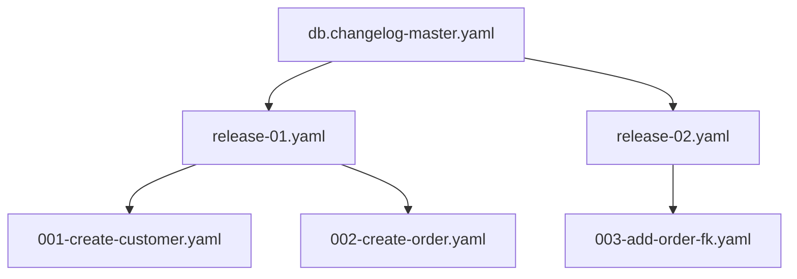
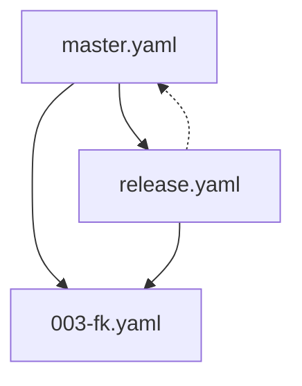

# Tránh tham chiếu vòng, nạp trùng và phụ thuộc ngầm trong Liquibase changelog

## 1. Vì sao cấu trúc changelog ảnh hưởng đến an toàn migration?

Trong module `DATABASE_SCHEMA_MIGRATION_LIQUIBASE`, người học quản lý thay đổi schema và dữ liệu bằng Liquibase thông qua **changelog, changeset, precondition, checksum và lịch sử triển khai**; đồng thời thực hành kiểm chứng migration, rollback, phối hợp nhiều môi trường và tích hợp với Spring Boot hoặc CI/CD. Một changeset viết đúng SQL vẫn có thể gây sự cố nếu **cách tổ chức các file changelog** khiến nó được nạp sai thứ tự, bị nạp nhiều lần hoặc phụ thuộc vào điều kiện chưa được khai báo rõ.

Liquibase cho phép một changelog gốc nạp các file con qua `include` hoặc `includeAll`. Khi số lượng file tăng, đây không còn đơn thuần là cách chia nhỏ tài liệu: các mối quan hệ nạp file tạo thành một **đồ thị tham chiếu**, và trình tự mở rộng đồ thị ảnh hưởng đến thứ tự Liquibase xem xét các changeset. Ba nhóm lỗi quan trọng là:

| Nhóm lỗi | Đặc điểm | Hậu quả thường gặp |
|---|---|---|
| Tham chiếu vòng | A nạp B, B nạp C rồi C nạp lại A, trực tiếp hoặc gián tiếp | Không thể mở rộng changelog bình thường, lỗi phân tích/nạp file hoặc đệ quy không kết thúc tùy phiên bản và cách include |
| Nạp trùng | Một file hoặc một thay đổi nghiệp vụ được đưa vào luồng nạp qua nhiều đường | Trùng định danh changeset, thay đổi bị nhận diện như changeset mới do khác đường dẫn, hoặc lỗi DDL/DML khi thực thi |
| Phụ thuộc ngầm | Changeset B cần kết quả của A nhưng quan hệ này chỉ được bảo đảm bằng tên file, trạng thái môi trường hoặc may rủi | B chạy trước A, migration không chạy được trên database mới, hoặc staging thành công trong khi production thất bại |

**Mục tiêu thiết kế:** một changelog có điểm vào rõ ràng; mọi file được nạp qua một lộ trình có chủ đích; changeset có danh tính ổn định; thứ tự phụ thuộc được biểu diễn và kiểm chứng; kết quả có thể tái lập ở database sạch và ở database đã có lịch sử triển khai.

## 2. Hiểu đúng `include`, `includeAll` và đồ thị tham chiếu

### 2.1. `include`: khai báo đường đi tường minh

Trong changelog YAML, `include` nạp một file changelog cụ thể. Ví dụ:

```yaml
# db/changelog/db.changelog-master.yaml
databaseChangeLog:
  - include:
      file: changes/001-create-customer.yaml
      relativeToChangelogFile: true
  - include:
      file: changes/002-create-order.yaml
      relativeToChangelogFile: true
  - include:
      file: changes/003-add-order-fk.yaml
      relativeToChangelogFile: true
```

Thứ tự khai báo của các mục `include` là thứ tự Liquibase mở rộng các file và xem xét changeset tương ứng. Trong ví dụ, thay đổi tạo bảng được đặt trước thay đổi thêm khóa ngoại. `relativeToChangelogFile: true` yêu cầu đường dẫn file con được phân giải tương đối theo file changelog chứa mục `include`, giúp hạn chế phụ thuộc vào thư mục chạy CLI.

`include` phù hợp khi thứ tự là yêu cầu nghiệp vụ, chẳng hạn tạo bảng trước khi thêm ràng buộc hoặc tạo cột mới trước khi backfill dữ liệu. Chi phí đi kèm là phải cập nhật changelog gốc khi thêm file mới; đó cũng là cơ hội để review thứ tự một cách tường minh.

### 2.2. `includeAll`: nạp theo thư mục

`includeAll` nạp các tài nguyên trong một thư mục được chỉ định. Chẳng hạn:

```yaml
# db/changelog/db.changelog-master.yaml
databaseChangeLog:
  - includeAll:
      path: changes/release-01
      relativeToChangelogFile: true
```

Liquibase thường sắp xếp tài nguyên được `includeAll` tìm thấy theo thứ tự tên, mặc định tăng dần, trước khi xử lý. Các tùy chọn lọc và thứ tự cụ thể có thể khác theo phiên bản. Nếu dùng `includeAll` cho migration cần thứ tự, hãy xác minh **đúng danh sách và thứ tự nạp** trong phiên bản đang sử dụng thay vì coi thứ tự trên filesystem là cơ sở duy nhất.

Rủi ro lớn của `includeAll` là một file mới vô tình xuất hiện trong thư mục cũng có thể tham gia luồng migration. Một file tổng hợp khác, một changelog đã được nạp từ trước, hoặc một file có tên sắp xếp ngoài dự kiến có thể thay đổi đồ thị nạp. `includeAll` hữu ích cho các nhóm changeset độc lập, được kiểm soát cấu trúc thư mục; còn dependency phức tạp nên dùng `include` theo thứ tự rõ ràng.

### 2.3. Minh họa đồ thị nạp tốt và xấu

Một đồ thị dễ quản lý thường có **một changelog gốc** và mỗi file changeset xuất hiện **một lần trong luồng nạp**:



Ngược lại, đồ thị sau chứa cả nhánh nạp trùng và khả năng tạo vòng nếu file con tham chiếu trở lại file cha:



Hai đường `master → 003-fk` và `master → release → 003-fk` làm một file xuất hiện hai lần. Cạnh `release → master` (nét đứt) sẽ khép chu trình nếu được thêm vào. **Đồ thị không có chu trình vẫn chưa đủ:** nếu hai nhánh cùng trỏ đến một file lá, hiện tượng nạp trùng vẫn tồn tại. Quy tắc thực hành tốt là xác định *một nơi duy nhất chịu trách nhiệm nạp mỗi file thay đổi*.

## 3. Tham chiếu vòng: nhận diện, nguyên nhân và cách tránh

### 3.1. Vòng trực tiếp và vòng gián tiếp

Một vòng trực tiếp xảy ra khi file A nạp chính nó. Một vòng gián tiếp xảy ra khi A nạp B, B nạp C và C lại nạp A. Ví dụ lỗi:

```yaml
# db.changelog-master.yaml
databaseChangeLog:
  - include:
      file: releases/release-01.yaml
      relativeToChangelogFile: true
```

```yaml
# releases/release-01.yaml -- SAI
databaseChangeLog:
  - include:
      file: ../db.changelog-master.yaml
      relativeToChangelogFile: true
```

Khi mở rộng từ master, trình nạp quay lại chính master thay vì đi đến một file lá. Một ví dụ khó phát hiện hơn là khi `includeAll` quét thư mục chứa chính file cha hoặc quét vào một thư mục con có mục `include` trỏ ngược lên trên.

Hành vi kiểm tra vòng phụ thuộc cơ chế `include` hay `includeAll` và phiên bản Liquibase. Với `includeAll`, một số phiên bản có cơ chế phát hiện vòng và tùy chọn liên quan đến việc báo lỗi; không nên mặc định cơ chế đó sẽ phát hiện mọi vòng do `include` tạo ra. Một vòng có thể dẫn đến lỗi đệ quy sâu hoặc thông báo nạp file không thành công. Do vậy, kiểm tra cấu trúc tham chiếu ở bước review vẫn cần thiết.

### 3.2. Thiết kế cấu trúc chỉ đi một chiều

Đặt vai trò rõ ràng cho các tầng file:

```text
db/changelog/
  db.changelog-master.yaml       # Điểm vào duy nhất
  releases/
    release-01.yaml              # Chỉ nạp các file con của release-01
    release-02.yaml
  changes/
    001-create-customer.yaml     # Changelog lá chứa changeset
    002-create-order.yaml
    003-add-order-fk.yaml
```

Quy ước quan trọng là **changelog ở tầng dưới không tham chiếu lên changelog ở tầng trên**. Master nạp release; release nạp file changeset; file lá định nghĩa changeset và không nạp ngược master hoặc release cha. Nếu cần dùng một thay đổi ở nhiều release, đừng để nhiều release cùng `include` file đó. Hãy quyết định release sở hữu changeset và chỉ đưa nó vào một lần.

Khi bổ sung một `include`, có thể rà soát bằng câu hỏi: “Từ file đích có đường đi nào quay về file đang chứa dòng `include` này không?”. Nếu có, cạnh mới tạo vòng. Đồng thời hỏi: “File đích đã xuất hiện trên một nhánh khác tính từ master chưa?”. Nếu có, cần sửa cấu trúc để tránh nạp trùng.

### 3.3. Tránh để `includeAll` tự quét điểm vào

Không đặt master changelog trong thư mục sẽ được chính master quét bằng `includeAll`. Nếu cần tự động nạp nhiều file, tạo thư mục **chỉ chứa các file con dự kiến**, tách khỏi master và các changelog tổng hợp cấp trên. Cấu hình lọc theo phần mở rộng, độ sâu hoặc thứ tự có thể giúp giới hạn tài nguyên; nhưng cách ly thư mục và một điểm vào duy nhất vẫn dễ kiểm chứng hơn.

Nếu đổi cấu trúc thư mục sau khi đã triển khai, hãy xét thêm tính ổn định của danh tính changeset: chuyển file có thể thay đổi `FILENAME` ghi trong `DATABASECHANGELOG`. Tránh xem việc “dọn thư mục” là thay đổi hoàn toàn vô hại.

## 4. Nạp trùng: file được nạp hai lần và thay đổi được thực thi hai lần

### 4.1. Những tình huống gây nạp trùng

Các trường hợp phổ biến gồm:

1. Master `include` file A trực tiếp, đồng thời `include` một file tổng hợp cũng `include` A.
2. Master có `includeAll` quét thư mục `changes/`, nhưng một mục `include` riêng cũng trỏ đến file nằm trong thư mục đó.
3. Hai changelog của các nhóm khác nhau cùng nạp một file thay đổi dùng chung.
4. Một file được tham chiếu qua hai đường dẫn hoặc tên logic không nhất quán; cùng nội dung có thể bị Liquibase nhận diện dưới danh tính changeset khác.
5. Một changeset được sao chép vào file mới với `id` và `author` giống hệt hoặc khác đi, nhưng vẫn thực hiện cùng thay đổi nghiệp vụ.

Ví dụ **không nên dùng**:

```yaml
databaseChangeLog:
  - includeAll:
      path: changes
      relativeToChangelogFile: true
  - include:
      file: changes/003-add-order-fk.yaml
      relativeToChangelogFile: true
```

File `003-add-order-fk.yaml` đã nằm trong phạm vi `includeAll`; mục `include` phía dưới làm nó xuất hiện thêm lần nữa trong đồ thị nạp.

### 4.2. Định danh changeset: `id` + `author` + đường dẫn file

Liquibase theo dõi changeset đã chạy trong bảng `DATABASECHANGELOG`. Danh tính thông thường của một changeset được xác định từ **`id`, `author` và `filename`/đường dẫn file changelog**, có xét đến `logicalFilePath` nếu được cấu hình. Một cách hiểu an toàn là:

```text
changeset identity = (id, author, changelog file identity)
```

Ví dụ hai file sau có thể được coi là **hai changeset khác nhau** dù cùng `id` và `author` vì danh tính file khác nhau:

```text
db/changelog/release-01/001-create-customer.yaml
db/changelog/release-02/001-create-customer.yaml
```

Nếu nội dung của cả hai cùng tạo bảng `customer`, lần thực thi sau có thể báo bảng đã tồn tại. Ngược lại, nếu một file được nạp hai lần dưới cùng danh tính, quá trình validate có thể phát hiện định danh trùng. Không nên dựa vào giả định “Liquibase thấy đã chạy thì chắc chắn bỏ qua mọi bản sao” vì kết quả phụ thuộc cách file được tham chiếu, định danh logic và hành vi kiểm tra trùng của phiên bản hiện tại.

`runAlways` và `runOnChange` điều chỉnh điều kiện chạy lại một changeset đã có lịch sử; chúng **không phải** công cụ xử lý việc một file bị nạp từ hai nhánh. Tương tự, precondition có thể kiểm tra trạng thái cơ sở dữ liệu trước khi thực thi nhưng không sửa được cấu trúc changelog có đường nạp trùng.

### 4.3. `logicalFilePath` giúp giữ danh tính ổn định, nhưng cần dùng có chủ đích

Khi di chuyển hoặc đổi tên file changelog sau một lần triển khai, đường dẫn mới có thể khiến Liquibase xem changeset cũ như changeset mới. `logicalFilePath` cho phép định danh logic ổn định độc lập với vị trí vật lý. Ví dụ ở changelog hỗ trợ thuộc tính này:

```yaml
databaseChangeLog:
  - changeSet:
      id: create-customer
      author: database-team
      logicalFilePath: db/changelog/legacy/001-create-customer.yaml
      changes:
        - createTable:
            tableName: customer
            columns:
              - column:
                  name: id
                  type: BIGINT
                  constraints:
                    primaryKey: true
                    nullable: false
```

Đường dẫn logic trong ví dụ phải khớp với danh tính mà Liquibase đã ghi nhận trước đây nếu mục tiêu là giữ nguyên lịch sử; không tự đặt lại một giá trị tùy ý rồi cho rằng lịch sử vẫn liên tục. Vị trí khai báo và khả năng kế thừa `logicalFilePath` của `include`/`includeAll` có thể khác theo phiên bản Liquibase, vì vậy cần đối chiếu tài liệu của phiên bản thực tế.

Không gán cùng một `logicalFilePath` cho các tập changeset khác nhau chỉ để né lỗi đường dẫn. Việc này có thể gây va chạm danh tính, làm khó phân tích checksum hoặc khiến thay đổi cũ bị hiểu sai. `logicalFilePath` là biện pháp quản lý danh tính có kiểm soát, không phải công cụ “xóa trùng”.

### 4.4. Một nguồn sở hữu thay đổi nghiệp vụ

Mỗi thay đổi schema hoặc dữ liệu cần có một changeset chịu trách nhiệm, một định danh nhất quán và một lộ trình nạp từ master. Nếu hai nhóm đều cần dùng bảng `customer`, không sao chép hai changeset `createTable` giống nhau vào hai module. Đặt changeset tạo bảng trong nhánh sở hữu schema, rồi bảo đảm changeset của nhóm còn lại chạy sau nó.

Khi phát hiện nạp trùng, sửa đường tham chiếu trong changelog trước; tránh chỉnh lịch sử `DATABASECHANGELOG` hoặc dùng precondition `onFail: MARK_RAN` để che lỗi cấu trúc. Các cách đó có thể khiến migration vượt qua một lỗi trước mắt nhưng khó đảm bảo đúng trên môi trường mới.

## 5. Phụ thuộc ngầm: lỗi không nằm ở cú pháp YAML

Phụ thuộc ngầm là yêu cầu về trạng thái schema hoặc dữ liệu mà changelog không biểu đạt rõ và không kiểm chứng nhất quán. Một số ví dụ:

- Changeset thêm khóa ngoại chỉ chạy được nếu cả bảng cha, bảng con và cột liên quan đã tồn tại.
- Changeset cập nhật dữ liệu chỉ chạy được sau khi cột mới được tạo và dữ liệu cũ còn ở dạng dự kiến.
- Changeset tạo index phụ thuộc vào cột, kiểu dữ liệu hoặc đặc điểm của DBMS.
- Changeset xóa cột cũ phụ thuộc vào việc ứng dụng đã ngừng sử dụng cột đó.
- Changeset được gắn context `production` nhưng tiền đề của nó chỉ được tạo bởi changeset mang context `development`.
- Changeset ở file `20-add-constraint.yaml` phụ thuộc vào thay đổi ở `10-create-table.yaml`, trong khi hai file lại được nạp từ những nhánh `includeAll` không được review thứ tự.

Liquibase thực thi changeset theo luồng changelog và các điều kiện áp dụng; nó không tự suy luận một đồ thị phụ thuộc nghiệp vụ giữa mọi changeset. Đặc biệt, chạy thành công trên một database đã có sẵn đối tượng **không chứng minh** changelog có thể bootstrap trên database sạch.

### 5.1. Ví dụ sắp xếp sai thứ tự

```yaml
# Ví dụ SAI: khóa ngoại xuất hiện trước khi tạo bảng
databaseChangeLog:
  - include:
      file: changes/030-add-order-customer-fk.yaml
      relativeToChangelogFile: true
  - include:
      file: changes/010-create-customer.yaml
      relativeToChangelogFile: true
  - include:
      file: changes/020-create-order.yaml
      relativeToChangelogFile: true
```

Dù tên file mang số thứ tự, `include` tường minh ở trên vẫn đưa khóa ngoại vào trước. Liquibase không tự sắp xếp lại danh sách `include` theo số tiền tố. Sửa bằng cách đặt quan hệ phụ thuộc đúng trong luồng nạp:

```yaml
# ĐÚNG: tạo các bảng trước khi thêm khóa ngoại
databaseChangeLog:
  - include:
      file: changes/010-create-customer.yaml
      relativeToChangelogFile: true
  - include:
      file: changes/020-create-order.yaml
      relativeToChangelogFile: true
  - include:
      file: changes/030-add-order-customer-fk.yaml
      relativeToChangelogFile: true
```

Với `includeAll`, tên có tiền tố `010`, `020`, `030` hỗ trợ sắp xếp theo tên; tuy nhiên, nếu phụ thuộc phức tạp hoặc cần kiểm soát qua nhiều thư mục, nên dùng `include` tường minh.

### 5.2. Cấu trúc changeset cho phụ thuộc DDL

Một ví dụ changeset tạo bảng cha:

```yaml
# changes/010-create-customer.yaml
databaseChangeLog:
  - changeSet:
      id: create-customer
      author: database-team
      changes:
        - createTable:
            tableName: customer
            columns:
              - column:
                  name: id
                  type: BIGINT
                  constraints:
                    primaryKey: true
                    nullable: false
      rollback:
        - dropTable:
            tableName: customer
```

Giả sử changeset tạo bảng `purchase_order` cũng đã chạy, changeset thêm khóa ngoại mới có đủ tiền đề để thực thi:

```yaml
# changes/030-add-order-customer-fk.yaml
databaseChangeLog:
  - changeSet:
      id: add-order-customer-fk
      author: database-team
      changes:
        - addForeignKeyConstraint:
            baseTableName: purchase_order
            baseColumnNames: customer_id
            referencedTableName: customer
            referencedColumnNames: id
            constraintName: fk_order_customer
      rollback:
        - dropForeignKeyConstraint:
            baseTableName: purchase_order
            constraintName: fk_order_customer
```

Điều kiện về tồn tại bảng/cột được bảo đảm chủ yếu bằng **trình tự changeset** và việc changelog tạo schema một cách đầy đủ. Chú ý thứ tự rollback thường đảo ngược thứ tự triển khai: phải tháo khóa ngoại trước khi xóa bảng được tham chiếu. Rollback thực tế vẫn phụ thuộc DBMS, dữ liệu và loại thao tác, nên cần chạy thử trên bản sao database phù hợp.

### 5.3. `preConditions` để bảo vệ, không để che giấu sai thứ tự

Precondition có thể chặn một changeset khi database không thỏa điều kiện. Ví dụ kiểm tra bảng cha và bảng con trước khi thêm khóa ngoại:

```yaml
databaseChangeLog:
  - changeSet:
      id: add-order-customer-fk
      author: database-team
      preConditions:
        - onFail: HALT
        - tableExists:
            tableName: customer
        - tableExists:
            tableName: purchase_order
      changes:
        - addForeignKeyConstraint:
            baseTableName: purchase_order
            baseColumnNames: customer_id
            referencedTableName: customer
            referencedColumnNames: id
            constraintName: fk_order_customer
```

Điều kiện này giúp dừng với tín hiệu dễ hiểu khi thiếu bảng, nhưng chưa kiểm tra cột `customer_id`, tính tương thích kiểu dữ liệu hoặc dữ liệu hiện có; muốn bảo vệ sâu hơn cần bổ sung kiểm tra tương ứng. Quan trọng hơn, **không dùng precondition để thay thế bước tạo bảng bị bỏ sót**. Nếu A phải chạy trước B, hãy tổ chức changelog để A xuất hiện trước B. Khi không thỏa tiền đề, `HALT` thường an toàn hơn âm thầm `MARK_RAN` trong các migration bắt buộc; chính sách `onFail` cần được lựa chọn có chủ đích.

### 5.4. Context và label có thể tạo phụ thuộc không đồng nhất giữa môi trường

Context và label giúp chọn changeset cho từng môi trường hoặc mục đích. Nhưng lọc một thay đổi tiền đề trong khi vẫn cho phép thay đổi phụ thuộc chạy sẽ làm đồ thị thực thi mất tính đầy đủ.

Ví dụ một changeset `createTable` chỉ chạy khi context `development`, còn changeset thêm cột hoặc khóa ngoại không có context. Trên database phát triển đã có bảng, hệ thống có thể chạy tốt; trên staging/prod sạch, bảng không xuất hiện và changeset sau thất bại. Vì vậy, những thay đổi schema nền tảng nên được áp dụng nhất quán hoặc có nhánh thay thế hợp lệ cho từng môi trường. Context/label phù hợp hơn với dữ liệu mẫu, cấu hình môi trường và các thay đổi có chủ đích rõ ràng.

Trước khi merge, cần kiểm tra mọi tổ hợp context/label thực sự dùng trong CI/CD, không chỉ cấu hình trên máy cá nhân.

## 6. Quy ước tổ chức changelog để hạn chế ba nhóm lỗi

### 6.1. Một điểm vào, một nơi sở hữu mỗi file

Có thể chọn cấu trúc sau:

```text
db/changelog/
  db.changelog-master.yaml
  releases/
    2026-01.yaml
    2026-02.yaml
  changes/
    2026-01/
      001-create-customer.yaml
      002-create-order.yaml
    2026-02/
      001-add-order-customer-fk.yaml
      002-backfill-customer-ref.yaml
```

Master nạp các release theo thứ tự; mỗi release nạp đúng các file `changes/` thuộc release đó; mỗi file lá chỉ chứa một hoặc một nhóm changeset liên quan, không nạp lại master. Nếu nhóm chọn `includeAll`, thư mục quét chỉ chứa file lá thuộc phạm vi đó và không đồng thời được nạp từ nhánh khác.

Đây là quy ước tổ chức, không phải một cấu trúc thư mục bắt buộc của Liquibase. Chọn cách ít bất ngờ nhất với nhóm và duy trì nhất quán để reviewer có thể nhìn vào master và hiểu toàn bộ đường thực thi.

### 6.2. Tách phụ thuộc thành các bước dễ chứng minh

Đối với thay đổi có nhiều pha, chia thành các changeset rõ ràng:

1. **Expand:** tạo bảng/cột mới theo dạng tương thích ngược với ứng dụng đang chạy.
2. **Backfill:** chuyển dữ liệu hiện có, có chiến lược xử lý dữ liệu lớn và retry.
3. **Validate:** kiểm tra tính đầy đủ của dữ liệu bằng câu SQL, precondition hoặc bước kiểm tra ngoài Liquibase thích hợp.
4. **Switch:** triển khai phiên bản ứng dụng chuyển sang đọc/ghi cấu trúc mới.
5. **Contract:** chỉ xóa cột/bảng cũ khi đã xác minh không còn phụ thuộc của ứng dụng và đã chuẩn bị rollback hoặc phương án forward-fix.

Các bước này không nhất thiết nằm trong một lượt `update`: phụ thuộc vào phiên bản ứng dụng, thời điểm cutover và độ lớn dữ liệu. Không dùng tên file để giả định một bước đã hoàn thành; cần điều kiện, trạng thái triển khai và lịch sử rõ ràng trước khi bước sau chạy.

### 6.3. Cẩn thận khi đổi tên, di chuyển hoặc gom file

Sau khi changeset đã được triển khai, Liquibase dùng lịch sử và checksum để xác định việc đã chạy. Thay đường dẫn file có thể làm thay đổi danh tính changeset; chỉnh nội dung changeset đã chạy có thể gây checksum mismatch hoặc tái thực thi ngoài ý định nếu dùng cấu hình đặc biệt. Do đó:

- Ưu tiên thêm changeset mới để sửa schema thay vì sửa changeset đã triển khai.
- Nếu buộc phải chuyển file, lập kế hoạch giữ `logicalFilePath` phù hợp với lịch sử cũ và kiểm chứng trên bản sao database có lịch sử triển khai.
- Không thay `id`/`author` chỉ để vượt qua báo lỗi nạp trùng hoặc checksum.
- Không dùng `clear-checksums`, sửa `DATABASECHANGELOG`, hay xóa metadata như một cách khắc phục thông thường cho vấn đề cấu trúc tham chiếu.

Việc chạy tốt trên database sạch chỉ chứng minh đường khởi tạo hoạt động; việc chạy tốt trên database đã có lịch sử mới kiểm tra được tính tương thích với các migration đã triển khai trước đó. Cần cả hai kịch bản.

## 7. Kiểm chứng đồ thị nạp và thứ tự trước khi triển khai

### 7.1. Review tĩnh từ changelog gốc

Trước khi chạy Liquibase, lập danh sách các cạnh tham chiếu `file A → file B` từ mọi `include` và `includeAll` của changelog gốc. Với `includeAll`, cần xét tập file thật sự được quét theo phiên bản và cấu hình hiện tại. Rà soát:

1. Có file nào trỏ về chính nó hoặc một file tổ tiên trong chuỗi tham chiếu không?
2. Có file lá nào đến được từ master qua hai nhánh khác nhau không?
3. Master hoặc changelog tổng hợp có vô tình nằm trong thư mục `includeAll` không?
4. Có nhiều file cùng định nghĩa một thay đổi nghiệp vụ, dù `id`/`author` hoặc đường dẫn khác nhau không?
5. Mọi changeset phụ thuộc bảng/cột/dữ liệu đều xuất hiện sau tiền đề của nó trong từng cấu hình context/label được phép không?
6. Có thay đổi `logicalFilePath` hoặc đường dẫn làm danh tính đã triển khai không còn khớp với lịch sử cũ không?

Có thể ghi kết quả review bằng bảng nhỏ ngay trong mô tả PR:

| Thay đổi | Tiền đề | File sở hữu | Cách xác minh |
|---|---|---|---|
| Thêm `purchase_order.customer_id` | Bảng `purchase_order` tồn tại | `020-add-customer-id.yaml` | `update-sql`, kiểm tra cột |
| Tạo `fk_order_customer` | Bảng `customer`, cột `customer_id` tồn tại, dữ liệu hợp lệ | `030-add-order-customer-fk.yaml` | `validate`, kiểm tra dữ liệu khóa ngoại |
| Xóa cột cũ | Ứng dụng đã chuyển sang dùng cột mới | `040-drop-legacy-column.yaml` | Kiểm thử tương thích ứng dụng, kế hoạch rollback |

### 7.2. Dùng CLI kiểm tra theo đúng môi trường

Với cấu hình kết nối và changelog gốc đã chọn, có thể thực hiện chuỗi lệnh kiểm tra sau trên database thử nghiệm:

```bash
liquibase --defaults-file=config/liquibase-test.properties validate
liquibase --defaults-file=config/liquibase-test.properties status --verbose
liquibase --defaults-file=config/liquibase-test.properties update-sql
```

`validate` giúp phát hiện một số lỗi trong cấu trúc changelog và định danh changeset; lỗi tham chiếu vòng có thể bộc lộ tại bước nạp/parse, nhưng **không nên dựa duy nhất vào validate để chứng minh mọi phụ thuộc nghiệp vụ đều đúng**. `status --verbose` cho biết các changeset đang chờ chạy trên database được kết nối; `update-sql` hỗ trợ review SQL dự kiến và thứ tự lệnh. Một số command và cách truyền tùy chọn phụ thuộc phiên bản Liquibase, hãy đối chiếu `liquibase --help` khi cần.

Việc `update-sql` sinh SQL thành công không bảo đảm migration chạy thành công trên DBMS thật, vì quyền truy cập, dữ liệu hiện có, locking, khả năng transaction DDL và điều kiện runtime vẫn có thể khác. Sau bước kiểm tra tĩnh, hãy thực thi thử trên **database mới** và trên **bản sao database đã có lịch sử**, nếu phạm vi thay đổi yêu cầu.

### 7.3. Kiểm tra lịch sử sau khi chạy

Khi migration đã chạy trên môi trường thử nghiệm, có thể đối chiếu các thay đổi với `DATABASECHANGELOG`. Trên những DBMS hỗ trợ cú pháp tương ứng, truy vấn tham khảo:

```sql
SELECT ID, AUTHOR, FILENAME, DATEEXECUTED,
       ORDEREXECUTED, MD5SUM, EXECTYPE
FROM DATABASECHANGELOG
ORDER BY ORDEREXECUTED;
```

Kiểm tra `FILENAME` để biết danh tính file đã được lưu; kiểm tra `ID`, `AUTHOR` để nhận diện changeset; và `EXECTYPE`, `MD5SUM` để hỗ trợ đối chiếu kiểu thực thi và checksum. Tên schema/bảng thực tế có thể đã được cấu hình khác, cần sửa truy vấn theo DBMS và schema metadata. Các dòng lịch sử phải được đối chiếu với trạng thái đối tượng thật trong database, đặc biệt khi một changeset có DDL không transaction hoặc migration dữ liệu lớn.

### 7.4. Tính đến `DATABASECHANGELOGLOCK` khi CI/CD chạy song song

Lock của Liquibase giúp tuần tự hóa các runner dùng chung bảng `DATABASECHANGELOGLOCK`, tránh hai runner thực thi migration đồng thời trên cùng bộ metadata. Tuy nhiên lock **không sửa** vòng tham chiếu, không loại bỏ file nạp trùng và không tạo phụ thuộc nghiệp vụ còn thiếu. Nếu hai pipeline dùng hai changelog artifact khác nhau, runner chạy sau vẫn có thể áp dụng thứ tự hoặc tập changeset không mong muốn. Vì vậy, cần kiểm soát artifact được phát hành, config môi trường, lộ trình nạp và lock như các trách nhiệm bổ sung cho nhau.

## 8. Chẩn đoán lỗi thường gặp

| Dấu hiệu | Khả năng cần kiểm tra | Cách xử lý ưu tiên |
|---|---|---|
| Parse changelog bị lặp/đệ quy sâu | A nạp B và B trỏ ngược A; `includeAll` quét cả master | Lập lại đồ thị tham chiếu, bỏ cạnh vòng và tách thư mục file lá |
| Validate báo changeset có định danh trùng | File bị nạp hai lần theo cùng danh tính hoặc nội dung bị lặp | Loại bỏ đường nạp dư và tìm nơi sở hữu duy nhất; không đổi `id` ngẫu nhiên |
| Lỗi “table already exists” dù một migration đã chạy trước | Bản sao changeset có đường dẫn/định danh khác; hoặc bảng được tạo thủ công | So sánh `DATABASECHANGELOG` với schema thực tế và kiểm tra các nhánh include |
| Lỗi “relation/column does not exist” | Thứ tự tiền đề sai, context lọc mất thay đổi nền tảng, DB sạch chưa được bootstrap | Sửa thứ tự include, bổ sung changeset tiền đề và kiểm chứng mọi context/label |
| Chạy local tốt, production lỗi | Khác danh sách file, artifact, search path, context/label hoặc lịch sử DB | So sánh chính xác changelog artifact và cấu hình có hiệu lực giữa môi trường |
| Đổi cấu trúc thư mục xong thấy changeset pending trở lại | `FILENAME` thay đổi, thiếu kế hoạch `logicalFilePath` | Kiểm tra danh tính đã lưu; lập kế hoạch giữ lịch sử trước khi triển khai |
| Rollback thất bại khi xóa bảng/cột | Phụ thuộc khóa ngoại hoặc dữ liệu không được đảo ngược theo thứ tự | Review đường rollback và kiểm thử trên database có dữ liệu thật đại diện |

Khi xử lý sự cố, hãy giữ nguyên bản ghi lịch sử để phân tích. Việc sửa trực tiếp `DATABASECHANGELOG` hoặc đánh dấu changeset như đã chạy có thể làm mất chứng cứ và khiến các môi trường phân kỳ. Chỉ dùng các thao tác can thiệp metadata khi đã đánh giá ảnh hưởng và có kế hoạch khôi phục được kiểm soát.

## 9. Tình huống thực tế: thêm khóa ngoại qua nhiều release

Một nhóm có ba changeset: `A` tạo bảng `customer`, `B` tạo bảng `purchase_order`, `C` thêm khóa ngoại từ `purchase_order.customer_id` sang `customer.id`. Ban đầu A và B nằm trong `release-01.yaml`; C nằm trong `release-02.yaml`. Khi một thành viên đưa C vào master bằng `include` và vẫn để `includeAll` nạp toàn bộ file trong `releases/`, C có thể được đưa vào hai lần nếu `release-02.yaml` cũng đang nạp nó. Nếu lại chuyển C sang file mới mà không giữ danh tính lịch sử, Liquibase có thể coi C là changeset mới dù database đã có khóa ngoại.

Quy trình xử lý đúng cần phân tích **hai chiều**:

1. **Đồ thị nạp:** master chỉ nạp `release-01.yaml` rồi `release-02.yaml`; C chỉ thuộc `release-02.yaml`; A và B chỉ thuộc `release-01.yaml`.
2. **Đồ thị phụ thuộc:** C phụ thuộc vào A, B và cột `customer_id`; release chứa C phải đứng sau các changeset cung cấp tiền đề đó.
3. **Danh tính lịch sử:** nếu đã triển khai A/B/C, giữ nguyên `id`, `author` và định danh file logic; mọi chuyển file được kiểm chứng trên database có lịch sử thật.
4. **Cấu hình môi trường:** bảo đảm context/label không loại A hoặc B mà vẫn để C chạy.
5. **Kiểm chứng:** chạy `validate`, `status`, `update-sql` với đúng config, kiểm tra SQL theo thứ tự và thực thi thử trên database sạch lẫn bản sao database đã nâng cấp.

Nhờ đó, nhóm xử lý đồng thời nguy cơ nạp trùng, thứ tự thực thi và tính liên tục của lịch sử migration. Đặt một precondition `foreignKeyConstraintExists` để bỏ qua C không giải quyết được việc C bị khai báo hai lần hoặc A/B bị thiếu trên môi trường mới.

## 10. Checklist trước khi merge changelog

- [ ] Master changelog là điểm vào đã được thống nhất; file cấp dưới không nạp ngược master hoặc tổ tiên.
- [ ] Không có chu trình trực tiếp/gián tiếp trong các nhánh `include` và `includeAll`.
- [ ] Mỗi file lá thuộc đúng một lộ trình nạp từ master; không vừa `includeAll` vừa `include` riêng cùng một file.
- [ ] Mỗi thay đổi nghiệp vụ có một changeset sở hữu rõ ràng; không sao chép DDL/DML tương đương để dùng lại.
- [ ] `id`/`author`/định danh file ổn định với các changeset đã triển khai; mọi di chuyển file có kế hoạch `logicalFilePath` khi cần.
- [ ] Thứ tự khai báo `include` hoặc thứ tự `includeAll` được kiểm chứng cho DBMS và phiên bản Liquibase đang dùng.
- [ ] Tiền đề về bảng, cột, dữ liệu và phiên bản ứng dụng được diễn giải và kiểm soát rõ ràng.
- [ ] Các tổ hợp context/label sử dụng ở development, staging và production không làm mất changeset tiền đề.
- [ ] Precondition dùng để bảo vệ thực thi đúng mục đích, không để che giấu lộ trình nạp trùng hay migration còn thiếu.
- [ ] `validate`, `status --verbose`, `update-sql` đã được review cùng cấu hình đích và artifact thực tế.
- [ ] Đã kiểm thử trên database sạch và trên bản sao database có lịch sử khi thay đổi ảnh hưởng đến các migration cũ.
- [ ] Đã kiểm chứng đường rollback, thứ tự đảo ngược ràng buộc và phương án forward-fix cho thay đổi không thể hoàn tác an toàn.

Thiết kế changelog tốt giúp Liquibase xử lý changeset **một cách dự đoán được**: không có cạnh tham chiếu quay vòng, không có nhiều đường nạp đến cùng một thay đổi và không có tiền đề quan trọng chỉ tồn tại trong trí nhớ của người viết. Trong quy trình `DATABASE_SCHEMA_MIGRATION_LIQUIBASE`, những quy ước này kết hợp với checksum, lịch sử `DATABASECHANGELOG`, precondition, kiểm tra SQL và quy trình CI/CD để migration có thể được giải thích, kiểm chứng, chạy lại trong môi trường phù hợp và khôi phục khi xảy ra lỗi.
