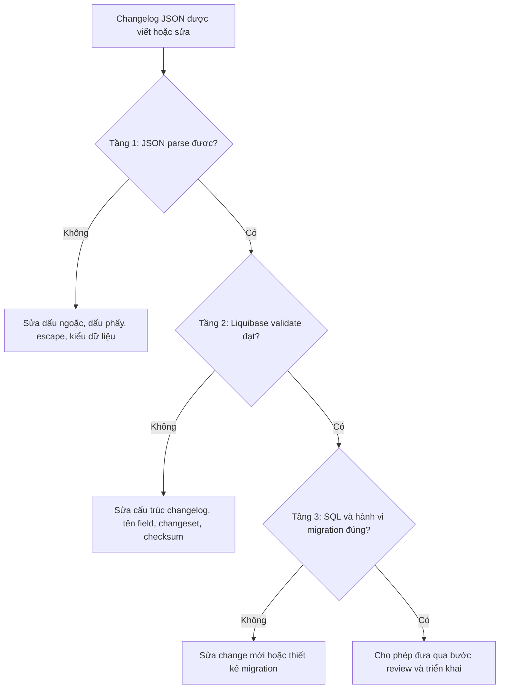

# Viết changelog JSON và kiểm tra cấu trúc

**Changelog JSON** là một cách khai báo migration cho Liquibase bằng cú pháp JSON thay cho XML, YAML hoặc formatted SQL. Liquibase đọc tài liệu JSON, chuyển các đối tượng thành changeset và change, đối chiếu chúng với lịch sử triển khai trong `DATABASECHANGELOG`, sau đó áp dụng những changeset đủ điều kiện. Vì vậy, viết JSON đúng cú pháp mới chỉ là bước đầu: changelog còn phải **đúng cấu trúc mà Liquibase hiểu** và **đúng ý nghĩa đối với database đích**.

Bài học thuộc chương **Định dạng** của `DATABASE_SCHEMA_MIGRATION_LIQUIBASE`. Mục tiêu của module là nắm cách quản lý thay đổi schema và dữ liệu bằng changelog, changeset, precondition, checksum và lịch sử triển khai; thực hành migration có kiểm chứng, rollback, phối hợp nhiều môi trường và tích hợp với Spring Boot hoặc CI/CD. Trong phạm vi đó, bài này tập trung vào cách tạo một changelog JSON có thể đọc, kiểm tra và bảo trì, cùng quy trình phát hiện lỗi trước khi thực thi migration.

## 1. Mô hình một changelog JSON

Ở cấp cao nhất, một changelog JSON thông thường chứa thuộc tính `databaseChangeLog`, giá trị là **một mảng các phần tử**. Các phần tử trong mảng có thể là `changeSet`, `include`, `includeAll`, khai báo `property` hoặc những cấu hình mà phiên bản Liquibase đang dùng hỗ trợ.

```json
{
  "databaseChangeLog": [
    {
      "changeSet": {
        "id": "001-create-customer",
        "author": "db-team",
        "changes": []
      }
    }
  ]
}
```

Đây là **mẫu hình dạng**, chưa phải migration hữu ích vì `changes` đang trống. Nó giúp nhìn thấy ba lớp:

```text
JSON document
└── databaseChangeLog                        (array)
    ├── changeSet                           (object)
    │   ├── id                              (string)
    │   ├── author                          (string)
    │   ├── preConditions (nếu có)           (array)
    │   ├── changes                         (array)
    │   │   ├── createTable                 (object)
    │   │   └── addColumn / insert / sql...  (object)
    │   └── rollback (nếu có)                (array)
    ├── include (nếu có)                     (object)
    └── changeSet tiếp theo...
```

| Thành phần | Kiểu dữ liệu JSON thường dùng | Ý nghĩa |
|---|---|---|
| `databaseChangeLog` | Array | Danh sách mục trong changelog theo thứ tự khai báo. |
| `changeSet` | Object | Đơn vị migration Liquibase nhận diện và ghi lịch sử. |
| `id` | String hoặc giá trị có thể được parser đọc thành định danh | Mã định danh; nên viết dạng chuỗi để rõ ràng và ổn định. |
| `author` | String | Tác giả hoặc nhóm sở hữu changeset. |
| `changes` | Array | Các thao tác Liquibase thực hiện theo thứ tự. |
| `createTable`, `addColumn`, `insert`… | Object | Một loại change cụ thể với các tham số riêng. |
| `columns` | Array | Danh sách cột cho change hỗ trợ cấu trúc cột. |
| `column` | Object | Định nghĩa một cột hoặc một giá trị cột. |
| `constraints` | Object | Ràng buộc như `nullable`, `primaryKey`, `unique`. |
| `preConditions` | Array | Điều kiện được đánh giá trước khi chạy changeset. |
| `rollback` | Array | Các change để hoàn tác, khi được hỗ trợ. |

JSON là cú pháp lưu trữ dữ liệu; tên trường như `databaseChangeLog` hoặc `createTable` là quy ước của Liquibase. Một tài liệu JSON có thể parse được nhưng vẫn sai changelog do viết nhầm tên trường hoặc thiếu cấu trúc mà Liquibase yêu cầu.

## 2. Quy tắc JSON phải nắm trước khi viết migration

Trong JSON chuẩn:

- Khóa object và chuỗi phải được bao bằng **dấu ngoặc kép** (`"`), không dùng dấu nháy đơn.
- Object dùng cặp `{ }`, các thuộc tính cách nhau bởi dấu phẩy.
- Array dùng `[ ]`, chứa những phần tử theo thứ tự.
- Giá trị boolean viết `true` hoặc `false`, không đặt trong dấu nháy kép khi cần kiểu boolean.
- `null` là giá trị null; thiếu trường và trường mang `null` không phải lúc nào cũng tương đương đối với parser.
- **Không** đặt dấu phẩy sau phần tử cuối của object hoặc array.
- **Không** dùng chú thích kiểu `//` hay `/* ... */` trong JSON chuẩn.
- Dấu gạch chéo ngược trong chuỗi phải được escape hợp lệ, ví dụ `\\` để biểu diễn một ký tự `\`.
- Nội dung đa dòng bên trong một chuỗi phải mã hóa thành `\n`, không xuống dòng trực tiếp giữa hai dấu ngoặc kép.

Ví dụ một đoạn JSON hợp lệ:

```json
{
  "id": "002-add-status",
  "author": "db-team",
  "runInTransaction": true,
  "labels": "release-1",
  "changes": [
    {
      "sql": {
        "sql": "UPDATE customer_record SET status = 'ACTIVE' WHERE status IS NULL"
      }
    }
  ]
}
```

Đây chỉ là **đối tượng changeset minh họa**, cần đặt trong `databaseChangeLog` và phải bảo đảm bảng/cột đã tồn tại trước khi chạy. Chuỗi SQL có thể chứa dấu nháy đơn bên trong chuỗi JSON được bao bởi nháy kép.

Một số lỗi phổ biến:

```text
Sai: { 'databaseChangeLog': [] }             # Dùng nháy đơn
Sai: { "databaseChangeLog": [], }             # Dấu phẩy cuối
Sai: { "runInTransaction": True }             # Boolean không chuẩn JSON
Sai: { "databaseChangeLog": [ // comment ] }  # Chú thích không hợp lệ
Đúng: { "databaseChangeLog": [] }
```

Các dòng có dấu `#` ở trên chỉ là **minh họa lỗi**, không phải file JSON có thể chạy.

## 3. Ví dụ hoàn chỉnh: tạo bảng và khai báo rollback

Giả sử cần tạo bảng `customer_record` có khóa chính `id` và email bắt buộc. Một changelog JSON tối giản, có thay đổi thực sự và rollback tường minh, có thể viết như sau:

```json
{
  "databaseChangeLog": [
    {
      "changeSet": {
        "id": "001-create-customer-record",
        "author": "db-team",
        "changes": [
          {
            "createTable": {
              "tableName": "customer_record",
              "columns": [
                {
                  "column": {
                    "name": "id",
                    "type": "BIGINT",
                    "constraints": {
                      "primaryKey": true,
                      "nullable": false
                    }
                  }
                },
                {
                  "column": {
                    "name": "email",
                    "type": "VARCHAR(255)",
                    "constraints": {
                      "nullable": false
                    }
                  }
                }
              ]
            }
          }
        ],
        "rollback": [
          {
            "dropTable": {
              "tableName": "customer_record"
            }
          }
        ]
      }
    }
  ]
}
```

Lưu ví dụ thành `db/changelog/001-create-customer.json` hoặc đường dẫn theo quy ước dự án. Khi đã khai báo file trong changelog gốc hoặc chạy trực tiếp file này, Liquibase sẽ đọc change `createTable`, sinh SQL phù hợp với database đích và ghi nhận changeset sau khi áp dụng thành công.

Giải thích những điểm quan trọng:

1. `databaseChangeLog` là mảng; mỗi phần tử chứa một cấu trúc Liquibase nhận diện.
2. `changeSet.id` và `changeSet.author` định danh migration cùng với đường dẫn changelog.
3. `changes` là mảng, vì một changeset có thể chứa một hoặc nhiều change.
4. `createTable` nhận tham số `tableName` và một mảng `columns`.
5. Mỗi phần tử của `columns` là object chứa khóa `column`, bên trong khai báo `name`, `type` và `constraints`.
6. `primaryKey` và `nullable` là giá trị boolean JSON thực sự.
7. `rollback` cho biết cách hoàn tác bảng khi chạy một lệnh rollback tương ứng.

**Cảnh báo về dữ liệu:** rollback bằng `dropTable` sẽ xóa bảng và dữ liệu trong bảng. Trên hệ thống thật, chỉ dùng khi đã kiểm tra hậu quả, có backup và phương án phục hồi phù hợp. Một rollback có cú pháp hợp lệ không đồng nghĩa việc khôi phục dữ liệu là an toàn.

## 4. Thêm changeset theo thứ tự

Khi bảng đã tồn tại, nhóm muốn thêm cột `status` với giá trị mặc định và ràng buộc không null. Có thể thêm **một phần tử `changeSet` mới** vào cuối mảng `databaseChangeLog`; không sửa changeset `001` đã triển khai.

Ví dụ một phần tử có thể đặt sau changeset tạo bảng:

```json
{
  "changeSet": {
    "id": "002-add-customer-status",
    "author": "db-team",
    "preConditions": [
      {
        "onFail": "HALT"
      },
      {
        "tableExists": {
          "tableName": "customer_record"
        }
      },
      {
        "not": {
          "columnExists": {
            "tableName": "customer_record",
            "columnName": "status"
          }
        }
      }
    ],
    "changes": [
      {
        "addColumn": {
          "tableName": "customer_record",
          "columns": [
            {
              "column": {
                "name": "status",
                "type": "VARCHAR(16)",
                "defaultValue": "ACTIVE",
                "constraints": {
                  "nullable": false
                }
              }
            }
          ]
        }
      }
    ],
    "rollback": [
      {
        "dropColumn": {
          "tableName": "customer_record",
          "columnName": "status"
        }
      }
    ]
  }
}
```

Đoạn trên là **một phần tử mảng**, không phải changelog độc lập. Trong file thực tế, nối các phần tử bằng dấu phẩy:

```json
{
  "databaseChangeLog": [
    { "changeSet": { "id": "001", "author": "db-team", "changes": [] } },
    { "changeSet": { "id": "002", "author": "db-team", "changes": [] } }
  ]
}
```

Ví dụ thứ hai chỉ minh họa cách ngăn cách phần tử; các mảng `changes` trống chưa có giá trị sử dụng. Khi viết thật, thay chúng bằng các change đầy đủ như hai ví dụ trước.

Ở changeset `002`:

- `tableExists` yêu cầu bảng phải tồn tại; `not` + `columnExists` yêu cầu cột chưa tồn tại.
- `onFail: HALT` dừng triển khai khi điều kiện kiểm tra không đạt. Đây là lựa chọn bảo thủ để không đánh dấu changeset đã chạy khi schema chưa như kỳ vọng.
- `defaultValue` đi với `constraints.nullable` giúp xác định giá trị và tính bắt buộc của cột; hành vi khi thêm cột vào bảng đang có dữ liệu còn phụ thuộc database và lượng dữ liệu.
- `rollback` chỉ định xóa cột. Nếu đã có dữ liệu trong cột, rollback này làm mất dữ liệu đó.

Precondition không thay thế việc đối chiếu lịch sử `DATABASECHANGELOG`. Liquibase cần nhận diện changeset đã chạy bằng định danh và kiểm tra checksum; precondition bảo vệ giả định về trạng thái database trước một lần thực thi.

## 5. Tổ chức changelog JSON với `include`

Khi số lượng changeset tăng, không nên đặt hàng trăm thay đổi trong một file lớn. Một changelog gốc có thể khai báo các file con theo thứ tự:

```text
db/
└── changelog/
    ├── root.json
    └── changes/
        ├── 001-create-customer.json
        └── 002-add-customer-status.json
```

Nội dung `root.json`:

```json
{
  "databaseChangeLog": [
    {
      "include": {
        "file": "changes/001-create-customer.json",
        "relativeToChangelogFile": true
      }
    },
    {
      "include": {
        "file": "changes/002-add-customer-status.json",
        "relativeToChangelogFile": true
      }
    }
  ]
}
```

Mỗi file con chứa một `databaseChangeLog` riêng, với một hay nhiều `changeSet`. `relativeToChangelogFile: true` giúp giải quyết đường dẫn include theo vị trí của file gốc đang chứa phần khai báo. Điều này hạn chế phụ thuộc vào thư mục hiện hành của terminal.

`includeAll` có thể dùng để nạp nhiều file trong một thư mục, nhưng cần hiểu quy tắc sắp xếp của phiên bản Liquibase đang dùng. Đối với migration phụ thuộc nhau, `include` tường minh thường dễ review thứ tự hơn. Dù dùng cách nào, **thứ tự nạp changeset là một phần của thiết kế migration**.

### 5.1. Không đổi định danh khi đổi tên file đã chạy

Liquibase xác định một changeset chủ yếu qua bộ ba `id`, `author` và đường dẫn định danh changelog. Khi chuyển file `001-create-customer.json` sang một thư mục khác, chỉ sửa `include.file` có thể khiến đường dẫn định danh đổi. Cần kiểm tra cột `FILENAME` trong `DATABASECHANGELOG` trước khi quyết định cấu hình `logicalFilePath` để giữ định danh cũ.

`logicalFilePath` và `include.file` có hai nhiệm vụ khác nhau: một bên giữ **danh tính lịch sử**, một bên giúp Liquibase **tìm được file vật lý**. Thay đổi cách tổ chức thư mục cần kiểm chứng trên database đã triển khai, không chỉ trên database mới.

## 6. Ba tầng kiểm tra changelog JSON

Một file đủ điều kiện đưa vào pipeline nên vượt qua ba tầng độc lập:



| Tầng | Cách kiểm tra | Có thể phát hiện | Chưa bảo đảm |
|---|---|---|---|
| **1. Cú pháp JSON** | JSON parser, `jq`, IDE | Sai ngoặc, nháy kép, dấu phẩy, escape, JSON không hợp lệ. | Tên thuộc tính Liquibase đúng; SQL thực thi được. |
| **2. Cấu trúc Liquibase** | `liquibase validate` | Changelog và changeset không hợp lệ, trùng định danh hoặc vấn đề checksum theo cơ chế validation. | Mọi precondition sẽ đạt; mọi lệnh SQL an toàn cho dữ liệu thật. |
| **3. Hành vi database** | `status`, SQL preview, chạy thử trên database đại diện | Changeset dự kiến chạy, câu SQL được sinh, quyền và đặc điểm database, tác động dữ liệu. | Một lần chạy production chắc chắn không gặp lock, dữ liệu phát sinh hoặc khác biệt môi trường. |

Vì ba tầng kiểm tra giải quyết các câu hỏi khác nhau, không nên dừng ở thông báo “Valid JSON” của editor rồi kết luận migration sẵn sàng.

### 6.1. Tầng 1: kiểm tra bằng JSON parser

Nếu máy có `jq`, có thể dùng:

```bash
jq empty db/changelog/root.json
```

Lệnh trên trả lỗi khi cú pháp JSON không hợp lệ. Nếu không có `jq`, có thể mở file bằng IDE hỗ trợ JSON hoặc dùng PowerShell:

```powershell
Get-Content -LiteralPath 'db/changelog/root.json' -Raw -Encoding UTF8 | ConvertFrom-Json | Out-Null
```

`ConvertFrom-Json` kiểm tra file có thể parse thành JSON hay không; khả năng kiểm tra trùng khóa có thể khác nhau theo phiên bản parser. Tự động hóa nên dùng parser và chính sách kiểm tra khóa trùng phù hợp với môi trường đang chạy.

Các lỗi thường gặp ở tầng này gồm:

- Một `}` hoặc `]` bị thiếu.
- Dấu phẩy sau phần tử cuối của array.
- Sao chép cú pháp YAML vào JSON, chẳng hạn `id: 001` mà không có dấu nháy kép.
- Dán câu SQL nhiều dòng trực tiếp vào chuỗi JSON.
- Đường dẫn Windows chưa escape ký tự `\`.
- Dùng `True`, `False` hoặc `None` thay cho `true`, `false`, `null`.

### 6.2. Tầng 2: kiểm tra cấu trúc Liquibase

Khi JSON đã parse được, chạy `validate` bằng **đúng phiên bản Liquibase** sẽ dùng để triển khai:

```bash
liquibase --changelog-file=db/changelog/root.json validate
```

CLI có thể cần cấu hình kết nối hoặc các tham số khác để đối chiếu với trạng thái database. Ví dụ cấu hình URL JDBC, user, secret, default schema, context/label sẽ phụ thuộc môi trường. Không viết credential thật vào file changelog hoặc log pipeline.

`validate` giúp phát hiện nhiều lỗi changelog như cấu trúc thuộc tính không hợp lệ, thay đổi metadata không nhất quán, định danh trùng hoặc checksum của changeset đã triển khai không khớp. Phạm vi kiểm tra chính xác phụ thuộc phiên bản Liquibase, plugin/extension được nạp và loại change. Nó **không chứng minh** mọi SQL sẽ chạy thành công.

Nếu validation thất bại:

1. Đọc lỗi để xác định tên file, changeset `id` và `author` liên quan.
2. Kiểm tra tên khóa có đúng chữ hoa/thường và đúng loại change hay không.
3. Kiểm tra giá trị object/array/boolean có phù hợp schema Liquibase không.
4. Kiểm tra `include` có tìm được file con và có cùng bộ định danh dự kiến không.
5. Nếu liên quan `MD5SUM`, so sánh changeset đã triển khai với lịch sử; không vội dùng `clearCheckSums`.

### 6.3. Tầng 3: xem changeset dự kiến và SQL sinh ra

Sau validation, nên kiểm tra lệnh triển khai mà Liquibase dự kiến thực hiện:

```bash
liquibase --changelog-file=db/changelog/root.json status --verbose
liquibase --changelog-file=db/changelog/root.json update-sql
```

Tên lệnh hoặc cách đặt tùy chọn có thể khác giữa các phiên bản CLI; một số bản/tài liệu cũ dùng tên kiểu `updateSQL`. Hãy dùng cú pháp phù hợp với phiên bản đã khóa trong dự án.

Kiểm tra `status` xem changeset nào chưa được ghi nhận. Kiểm tra SQL preview để đánh giá tên bảng/cột, kiểu dữ liệu, constraint, index, trình tự thao tác và nguy cơ khóa bảng. SQL preview chỉ là mô phỏng theo trạng thái và cấu hình tại thời điểm tạo; nó không thay thế thử nghiệm trên database đại diện.

Cuối cùng, chạy migration trên database thử nghiệm có schema và dữ liệu tương tự production. Sau khi chạy, đối chiếu cấu trúc thực tế và các bản ghi trong `DATABASECHANGELOG`. Nếu cần rollback, thử riêng kịch bản rollback và kiểm tra ảnh hưởng dữ liệu.

## 7. Kiểm tra cấu trúc bằng checklist

Trước khi review, người viết changelog JSON có thể kiểm tra từng nhóm:

**Cấu trúc file**

- Có đúng một object JSON ở gốc.
- Có khóa `databaseChangeLog` với giá trị array.
- Không có comment, dấu phẩy thừa, chuỗi chưa escape hoặc khóa không được bao nháy kép.
- File được lưu UTF-8 và nằm đúng vị trí mà `include` hoặc cấu hình Liquibase tìm đến.

**Định danh và lịch sử**

- Mỗi changeset có `id` và `author` rõ ràng, không vô tình trùng bộ ba định danh với changeset khác.
- Changeset đã phát hành được giữ nguyên; khi thay đổi schema, tạo changeset mới.
- Nếu di chuyển file, kiểm tra `logicalFilePath` và giá trị `FILENAME` lịch sử.
- Không dùng đổi `id`, `author` hoặc đường dẫn để ép Liquibase chạy lại changeset.

**Nội dung migration**

- Mỗi change có đúng tên, đúng đối tượng và đúng kiểu thuộc tính theo phiên bản Liquibase.
- Thứ tự changeset đáp ứng phụ thuộc: tạo bảng trước khi thêm cột/constraint/index liên quan.
- Preconditions phản ánh giả định cần bảo vệ; `onFail`/`onError` được chọn có chủ đích.
- Có rollback phù hợp nếu yêu cầu nghiệp vụ; hiểu rõ khả năng mất dữ liệu.
- Changeset chạy trên loại database, schema, context và label dự kiến.

**Xác minh triển khai**

- JSON parser đọc được file.
- Liquibase `validate` đạt với đúng bộ Core/driver/extension.
- `status` và `update-sql` không xuất hiện migration cũ bất ngờ.
- Migration đã thử trên database đại diện; lịch sử và schema sau chạy được đối chiếu.
- CI và ứng dụng Spring Boot dùng đúng changelog cùng bộ phiên bản đã kiểm chứng.

## 8. Các lỗi thường gặp và cách khắc phục

| Triệu chứng | Nguyên nhân điển hình | Cách kiểm tra và sửa |
|---|---|---|
| JSON parser báo `Unexpected token` hoặc `Expected ','` | Sai ngoặc, dấu phẩy hoặc chuỗi chưa đóng. | Format JSON và kiểm tra vị trí lỗi; chạy `jq empty` hoặc parser tương đương. |
| Liquibase báo không đọc được changelog | File không có trong classpath, include sai đường dẫn hoặc thiếu dependency. | Kiểm tra vị trí file, `relativeToChangelogFile` và cấu hình chạy. |
| JSON hợp lệ nhưng Liquibase không nhận change | Sai tên trường, sai vị trí object hoặc array, loại change không được hỗ trợ. | Đối chiếu cú pháp của loại change với phiên bản Liquibase hiện hành. |
| Báo trùng changeset | Trùng `id`, `author` và logical file path trong cùng tập changelog. | Đổi định danh của changeset **mới chưa triển khai**, hoặc sửa tổ chức include bị lặp. |
| Changeset cũ xuất hiện như chưa chạy | Đường dẫn định danh thay đổi khi di chuyển/đổi tên file. | Đối chiếu `DATABASECHANGELOG.FILENAME` và `logicalFilePath`. |
| `validate` báo checksum khác | Một changeset đã chạy bị sửa hoặc định nghĩa được hiểu khác cần điều tra. | So sánh nội dung và lịch sử; thêm changeset mới thay vì sửa migration cũ. |
| `update` báo bảng/cột đã tồn tại | Changeset bị nhận là mới, precondition thiếu hoặc database bị sửa ngoài Liquibase. | Dừng để so sánh lịch sử, schema và SQL preview trước khi sửa. |
| SQL hợp lệ nhưng thất bại khi thực thi | Thiếu quyền, dữ liệu vi phạm constraint, DBMS khác hoặc lock. | Chạy thử trên database đại diện và đọc lỗi SQL cụ thể. |
| Rollback xóa dữ liệu ngoài ý muốn | Định nghĩa rollback phá hủy hoặc giả định dữ liệu sai. | Kiểm thử rollback, backup và chiến lược phục hồi. |
| Chạy được local nhưng không được trong Spring Boot/CI | Đường dẫn tài nguyên, driver, version, credential hoặc cấu hình context khác nhau. | So sánh artifact, classpath, changelog path, DB target và cấu hình. |

Trường hợp ít được chú ý là **trùng khóa JSON**: một object có hai khóa cùng tên có thể được một số JSON parser chấp nhận theo cách ghi đè giá trị. Ví dụ hai trường `"changes"` trong cùng một `changeSet` có thể khiến một nhóm change bị mất khi parse. Hãy dùng linter có chính sách phát hiện duplicate keys và quy ước review để tránh lỗi này.

## 9. Thực hành: kiểm chứng một changelog JSON từ đầu đến cuối

**Bối cảnh:** nhóm xây một service quản lý khách hàng trên PostgreSQL. Cần tạo bảng `customer_record`, thêm cột `status`, rồi bảo đảm lần chạy thứ hai không thực thi lại migration đã hoàn tất.

### Giai đoạn A: Viết changelog

1. Viết file `001-create-customer.json` từ ví dụ ở mục 3.
2. Viết file `002-add-customer-status.json` với một `databaseChangeLog` chứa phần tử `changeSet` ở mục 4.
3. Viết `root.json` theo ví dụ `include` ở mục 5.
4. Xem lại tên table/column, kiểu dữ liệu, `constraints` và thứ tự include.
5. Đảm bảo `id` và `author` ổn định, file con đều có JSON gốc hợp lệ.

### Giai đoạn B: Kiểm tra không thực thi

1. Dùng JSON parser hoặc `jq empty` kiểm tra cả ba file.
2. Chạy `liquibase validate` với cấu hình kết nối database thử.
3. Chạy `status --verbose` xem hai changeset chưa được triển khai.
4. Chạy `update-sql` kiểm tra SQL tạo bảng và thêm cột theo thứ tự.
5. Xử lý các lỗi nếu có rồi kiểm tra lại.

### Giai đoạn C: Thực thi có kiểm chứng

1. Chạy `update` trên database thử nghiệm.
2. Kiểm tra bảng `customer_record` có các cột `id`, `email`, `status`; dữ liệu mặc định phù hợp.
3. Truy vấn lịch sử:

```sql
SELECT ID, AUTHOR, FILENAME, DATEEXECUTED, EXECTYPE, MD5SUM
FROM DATABASECHANGELOG
ORDER BY ORDEREXECUTED;
```

4. Chạy lại `status` hoặc `update-sql`. Hai changeset thông thường đã chạy phải không còn được đề xuất chạy lần nữa.
5. Thử rollback trong môi trường thử nghiệm riêng và kiểm tra dữ liệu bị ảnh hưởng.

**Tiêu chí đạt:** JSON parse thành công; Liquibase nhận đúng hai changeset theo thứ tự; không sinh migration trùng khi chạy lại; `DATABASECHANGELOG` lưu định danh và checksum; rollback được đánh giá dựa trên dữ liệu thật.

## 10. Tích hợp vào Spring Boot hoặc CI/CD

Với Spring Boot, changelog JSON có thể được đặt trên classpath và tham chiếu trong cấu hình:

```yaml
spring:
  liquibase:
    enabled: true
    change-log: classpath:/db/changelog/root.json
```

Ứng dụng cần có dependency Liquibase Core và JDBC driver phù hợp. Nếu changelog không được đóng gói vào artifact hoặc đường dẫn `change-log` sai, việc JSON parse đúng ở máy phát triển vẫn không giúp ứng dụng khởi động migration thành công.

Trong CI/CD, nên tổ chức các cổng kiểm soát theo thứ tự: kiểm tra cú pháp JSON, `validate`, xem `status`/SQL preview, thử migration trên database đại diện, review thay đổi và mới chạy `update` theo quy trình phát hành. Dùng cùng commit changelog và bộ phiên bản Liquibase/driver/extension đã kiểm thử trên staging rồi production.

Mỗi môi trường có database và lịch sử `DATABASECHANGELOG` riêng; changelog JSON phải được quản lý trong version control. Không sửa trực tiếp file đã triển khai chỉ để xử lý sự cố production. Khi cần điều chỉnh schema hoặc dữ liệu, tạo changeset mới và kiểm tra trên dữ liệu đại diện. Nếu một lần triển khai thất bại giữa chừng, cần xem transaction của database, trạng thái schema và bản ghi lịch sử trước khi chạy lại.

## 11. Câu hỏi tự kiểm tra

1. Vì sao một file parse JSON thành công vẫn có thể không phải changelog Liquibase hợp lệ?
2. Vai trò của `databaseChangeLog`, `changeSet`, `changes` và `column` khác nhau như thế nào?
3. Tại sao `"nullable": false` khác `"nullable": "false"` về kiểu dữ liệu JSON?
4. JSON chuẩn có cho phép comment và dấu phẩy cuối array không?
5. Khi muốn thêm cột vào bảng đã được tạo bởi changeset cũ, nên sửa changeset cũ hay tạo changeset mới? Vì sao?
6. `preConditions` với `onFail: HALT` giúp bảo vệ điều gì khi chạy migration?
7. `include.file` khác `logicalFilePath` ở nhiệm vụ nào?
8. `validate` khác `status` và `update-sql` ở mục tiêu kiểm tra ra sao?
9. Vì sao cần chạy thử changelog trên cả database mới và database đã có lịch sử?
10. Điều gì phải được kiểm chứng trước khi dùng rollback kiểu `dropTable` hoặc `dropColumn`?

Viết changelog JSON tốt là phối hợp **cú pháp JSON chính xác**, **cấu trúc Liquibase được hỗ trợ** và **hành vi migration đã kiểm chứng**. Khi ba tầng này được kiểm tra trước triển khai, nhóm có thể theo dõi changeset rõ ràng, giữ lịch sử nhất quán và đưa migration qua các môi trường với rủi ro thấp hơn.
