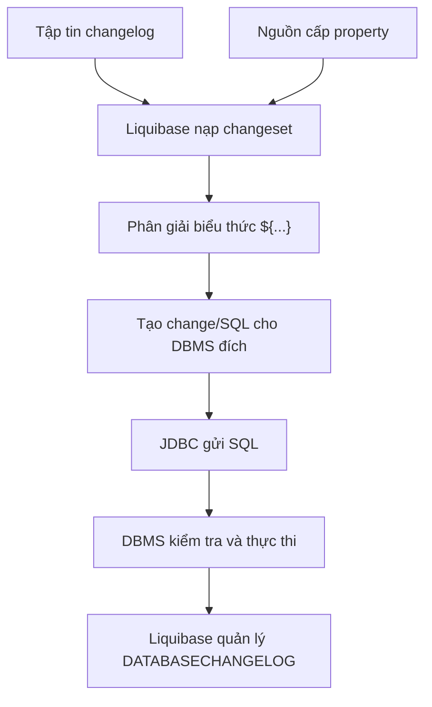

# Thay thế thuộc tính trong tên đối tượng và giá trị cấu hình

## 1. Vì sao cần tham số hóa changelog?

Trong module **DATABASE_SCHEMA_MIGRATION_LIQUIBASE**, người học cần quản lý thay đổi schema và dữ liệu qua changelog, changeset, precondition, checksum và lịch sử triển khai; thực hành migration có kiểm chứng, rollback, triển khai qua nhiều môi trường và tích hợp Spring Boot hoặc CI/CD. Một vấn đề thực tế là **cùng một ý định migration** có thể cần những tên schema, bảng, index hoặc giá trị cấu hình khác nhau theo môi trường.

Ví dụ, nhóm triển khai bảng hóa đơn vào schema `billing_dev` khi thử nghiệm, nhưng vào schema `billing` trên production. Nếu ghi cứng mọi tên trong nhiều bản sao changelog, các bản dễ lệch nội dung và khó kiểm soát lịch sử. Liquibase cung cấp **changelog properties** (thuộc tính/tham số changelog) để viết placeholder dạng `${propertyName}` trong các giá trị mà Liquibase hỗ trợ thay thế.

Ý tưởng cốt lõi:

- **Changelog** mô tả thay đổi cần thực hiện.
- **Property** là một cặp tên và giá trị, được khai báo trong changelog hoặc truyền vào từ quá trình triển khai theo cách phiên bản Liquibase hỗ trợ.
- **Placeholder** `${tenThuocTinh}` là vị trí cần thay bằng giá trị property.
- **Liquibase** phân giải các giá trị thích hợp trước khi tạo/gửi SQL cho DBMS.
- **DBMS** vẫn kiểm tra cú pháp SQL cuối cùng, tên đối tượng, quyền và dữ liệu thực tế.

Ví dụ trực quan:

```text
Changelog: schemaName = ${targetSchema}
           tableName  = ${tablePrefix}invoice

Property:  targetSchema = billing
           tablePrefix  = acct_

Kết quả:   schemaName = billing
           tableName  = acct_invoice
```

Tính năng này gọi là **property substitution**. Nó có ích khi thay thế thuộc tính trong *giá trị* của các change type, chẳng hạn `schemaName`, `tableName`, `indexName`, `constraintName` hoặc `defaultValue`. Nó không tự làm cho mọi tham số đều an toàn, không tự tạo schema còn thiếu và không biến SQL viết tay thành SQL dùng được trên mọi DBMS.

### Mục tiêu học tập

Sau bài học, bạn có thể:

1. Tạo và sử dụng property trong changelog YAML.
2. Thay thế property vào tên đối tượng và giá trị cấu hình mà Liquibase hỗ trợ.
3. Phân biệt property của Liquibase với biến môi trường, cấu hình Spring Boot và bind parameter của JDBC.
4. Chọn nguồn cấp giá trị, giải quyết rủi ro trùng tên, kiểm tra kết quả thay thế.
5. Dùng cùng một mẫu changelog qua môi trường mà không vô tình sửa schema khác hoặc làm sai lịch sử changeset.
6. Kiểm chứng SQL, precondition và phương án rollback trước khi chạy migration thực tế.

## 2. Cú pháp và vòng đời phân giải thuộc tính

Dạng tham chiếu thông dụng trong Liquibase là:

```text
${propertyName}
```

Tên property được dùng trong dấu ngoặc nhọn và tham chiếu này nằm bên trong **giá trị** của thuộc tính mà Liquibase có thể xử lý. Chẳng hạn:

```yaml
tableName: ${customerTable}
schemaName: ${targetSchema}
indexName: idx_${customerTable}_status
```

Giá trị thu được là chuỗi văn bản tại vị trí tương ứng. Nếu `customerTable = customer`, `idx_${customerTable}_status` trở thành `idx_customer_status`. Placeholder cũng có thể nằm giữa các thành phần tên; không nhất thiết phải thay toàn bộ trường.

Về mặt khái niệm, quá trình diễn ra như sau:



Đây là sơ đồ logic, không phải lời hứa rằng mọi trường, mọi SQL file và mọi định dạng changelog được xử lý giống hệt nhau. Phạm vi substitution, cách nạp property và thứ tự nguồn phụ thuộc phiên bản Liquibase, loại change và cơ chế tích hợp. Với migration quan trọng, **SQL được tạo ra mới là bằng chứng thực tế về giá trị đã được thay**.

### 2.1. Property là dữ liệu cấu hình, không phải cấu trúc YAML

Ví dụ hợp lệ và có mục đích:

```yaml
- createTable:
    schemaName: ${targetSchema}
    tableName: ${invoiceTable}
```

Ngược lại, đừng giả định Liquibase cho phép dùng property để dựng tùy ý khóa YAML hay thay toàn bộ cấu trúc changeset:

```yaml
# Khong dung kieu thay the cau truc nhu sau:
- ${operationName}:
    tableName: invoices
```

Các key như `createTable`, `addColumn`, `columns` và `changes` là thành phần cú pháp changelog. Property substitution được dùng cho các **giá trị có hỗ trợ**, còn việc lựa chọn loại change cần được thể hiện rõ ràng bằng changelog, precondition hoặc các nhánh/changeset phù hợp.

### 2.2. Chú ý kiểu dữ liệu

Khi viết `defaultValue: ${initialStatus}`, giá trị được hiểu trong ngữ cảnh của trường `defaultValue`. Liquibase không biến mọi chuỗi thành đúng kiểu SQL mong muốn một cách thần kỳ. Hãy chọn thuộc tính đúng cho trường dữ liệu:

| Ý định | Thuộc tính Liquibase thường dùng | Ví dụ |
|---|---|---|
| Giá trị mặc định chuỗi | `defaultValue` | `${initialStatus}` |
| Giá trị mặc định số | `defaultValueNumeric` | `${initialRetryCount}` |
| Giá trị mặc định boolean | `defaultValueBoolean` | `${enabledByDefault}` |
| Biểu thức do database tính | `defaultValueComputed` | `CURRENT_TIMESTAMP` |
| Tên schema | `schemaName` | `${targetSchema}` |
| Tên bảng | `tableName` | `${tablePrefix}invoice` |

Cần kiểm tra cách change type và DBMS cụ thể diễn giải các giá trị này. Ví dụ, `CURRENT_TIMESTAMP` là một biểu thức SQL; nếu đưa nó vào trường mặc định chuỗi trong một thay đổi không phù hợp, database có thể lưu văn bản thay vì giá trị thời gian.

## 3. Khai báo property ngay trong YAML changelog

Khi giá trị ổn định và thuộc về thiết kế changelog, có thể khai báo mục `property` bên trong `databaseChangeLog`:

```yaml
databaseChangeLog:
  - property:
      name: targetSchema
      value: billing

  - property:
      name: tablePrefix
      value: acct_

  - property:
      name: initialStatus
      value: PENDING

  - changeSet:
      id: 001-create-invoice
      author: schema-team
      changes:
        - createTable:
            schemaName: ${targetSchema}
            tableName: ${tablePrefix}invoice
            columns:
              - column:
                  name: invoice_id
                  type: bigint
                  constraints:
                    primaryKey: true
                    nullable: false
              - column:
                  name: status
                  type: varchar(24)
                  defaultValue: ${initialStatus}
                  constraints:
                    nullable: false
```

Trong ví dụ này, nếu các giá trị property được áp dụng như khai báo, Liquibase hướng thao tác tạo bảng đến `billing.acct_invoice` và định nghĩa giá trị mặc định `PENDING` cho cột `status`. Đây là ví dụ minh họa cú pháp; việc có thực thi thành công hay không vẫn phụ thuộc schema `billing` đã tồn tại, quyền của user kết nối, cú pháp được hỗ trợ bởi DBMS và các điều kiện khác.

Điểm quan trọng về tính tự chứa: property trong cùng changelog giúp người đọc hiểu ý nghĩa của placeholder mà không phải suy đoán giá trị từ một pipeline bên ngoài. Tuy nhiên, **giá trị riêng theo môi trường** thường cần được cấp từ quy trình triển khai thay vì cố định vào chung một file. Không định nghĩa trùng tên ở nhiều nguồn mà không kiểm chứng quy tắc ưu tiên của phiên bản Liquibase đang dùng.

### 3.1. Thay thế đồng bộ nhiều tên đối tượng

Khi tạo bảng, index hoặc constraint liên quan, cần dùng một tập property nhất quán. Ví dụ tiếp nối bảng `acct_invoice`:

```yaml
  - changeSet:
      id: 002-add-invoice-status-index
      author: schema-team
      changes:
        - createIndex:
            schemaName: ${targetSchema}
            tableName: ${tablePrefix}invoice
            indexName: idx_${tablePrefix}invoice_status
            columns:
              - column:
                  name: status
      rollback:
        - dropIndex:
            schemaName: ${targetSchema}
            tableName: ${tablePrefix}invoice
            indexName: idx_${tablePrefix}invoice_status
```

Đoạn YAML này là phần **nối tiếp bên trong `databaseChangeLog`** của ví dụ trước; không phải một tập tin changelog hoàn chỉnh độc lập. Hãy chú ý giá trị `tablePrefix` xuất hiện trong cả `tableName` và `indexName`: nếu thay prefix tại một vị trí nhưng bỏ sót nơi khác, Liquibase có thể tạo index hoặc rollback không đúng đối tượng.

Việc thay tên constraint, sequence hay index bằng property đặc biệt hữu ích khi tổ chức có quy tắc đặt tên đồng nhất. Tuy vậy, hãy kiểm tra giới hạn độ dài identifier của từng DBMS, danh sách từ khóa dành riêng và quy tắc chữ hoa/chữ thường. Ghép chuỗi có thể tạo tên quá dài hoặc không hợp lệ nếu giá trị prefix không được kiểm soát.

## 4. Thay thế trong giá trị cấu hình và dữ liệu

Bên cạnh tên đối tượng, property có thể biểu diễn giá trị của change type, ví dụ trạng thái khởi tạo, độ dài cột, tùy chọn schema hoặc loại dữ liệu. Cần phân biệt:

- **Giá trị dùng để xây dựng SQL/DDL:** ví dụ `columnType`, `defaultValue` hoặc tên tablespace.
- **Giá trị dữ liệu nghiệp vụ:** ví dụ trạng thái `PENDING` hoặc mã cấu hình `invoice_enabled`.
- **Cấu hình chạy Liquibase:** ví dụ JDBC URL, credential, changelog file, context/label filter hoặc schema mặc định.

Hai nhóm đầu có thể xuất hiện trong changeset khi thay đổi thực sự yêu cầu; nhóm cuối thuộc về cách chạy công cụ và nên được quản lý bởi nguồn cấu hình của CLI, Spring Boot hoặc CI/CD. Không mặc định mọi trường cấu hình công cụ đều có thể được thay qua placeholder trong changelog.

### 4.1. Ví dụ dữ liệu khởi tạo

```yaml
databaseChangeLog:
  - property:
      name: featureCode
      value: invoice_auto_validation

  - property:
      name: enabledInitially
      value: "false"

  - changeSet:
      id: 010-add-feature-flag
      author: schema-team
      changes:
        - insert:
            tableName: feature_flag
            columns:
              - column:
                  name: code
                  value: ${featureCode}
              - column:
                  name: enabled
                  valueBoolean: ${enabledInitially}
```

Ví dụ giả định bảng `feature_flag` đã có hai cột phù hợp và mã cấu hình chưa tồn tại. Nếu chạy changeset này trong một database có bản ghi trùng khóa, câu lệnh `INSERT` có thể thất bại. Property substitution **không** cung cấp cơ chế chống ghi trùng hay tự động chuyển `INSERT` thành upsert.

### 4.2. Thay thế trong SQL tự viết

Có thể cần property trong một câu SQL được Liquibase xử lý, ví dụ:

```yaml
- changeSet:
    id: 020-normalize-status
    author: schema-team
    changes:
      - sql:
          sql: >
            UPDATE ${targetSchema}.${tablePrefix}invoice
            SET status = 'PENDING'
            WHERE status IS NULL
```

Ví dụ này minh họa vị trí property trong câu SQL. Khả năng mở rộng biểu thức ở các dạng `sql`/`sqlFile`, cách xử lý dấu phân cách và ký tự escape cần được kiểm tra theo loại change và phiên bản Liquibase. Đặc biệt, property trong SQL viết tay là **thay thế văn bản trước thực thi**, không phải tham số bind của JDBC `PreparedStatement`.

Nếu giá trị property có thể do người dùng bên ngoài kiểm soát, việc chèn trực tiếp có thể làm sai câu SQL hoặc mở cửa cho SQL injection. Không đưa input từ request, từ tên tenant không được kiểm duyệt hoặc từ dữ liệu khách hàng vào placeholder dùng để xây SQL.

## 5. Các nguồn cung cấp property

Một property có thể đến từ khai báo changelog hoặc cơ chế truyền tham số tương ứng của môi trường chạy Liquibase. Các nguồn thường gặp về mặt kiến trúc:

| Nguồn | Phạm vi sử dụng | Điểm cần kiểm tra |
|---|---|---|
| Khai báo `property` trong changelog | Giá trị cố định, dễ đọc cùng migration | Không đưa bí mật và giá trị đặc thù production vào Git |
| Tham số changelog qua Liquibase CLI, chẳng hạn dạng `-Dname=value` | Pipeline hoặc thao tác triển khai | Cú pháp và vị trí tùy phiên bản; không để giá trị nhạy cảm lộ qua command history |
| Cấu hình do ứng dụng Java cấp cho Liquibase | Tích hợp chương trình hoặc Spring Boot | Phải chắc chắn tham số được chuyển tới **changelog parameters** |
| Script/CI/CD lấy giá trị từ cấu hình môi trường | Phân tách dev/test/prod | Biến môi trường cần được **ánh xạ** sang cơ chế tham số Liquibase phù hợp |
| Secret manager | Cấp credential kết nối | Không xem placeholder changelog là công cụ giải mã secret |

Điều cần tránh là tưởng rằng cứ khai báo biến `TARGET_SCHEMA` trong môi trường hệ điều hành thì tham chiếu `${targetSchema}` trong changelog đương nhiên nhận giá trị tương ứng. Biến môi trường, hệ thống cấu hình của Spring Boot và property của changelog là các không gian cấu hình có thể **liên kết bằng cấu hình thích hợp**, nhưng không phải lúc nào cũng tự liên kết theo cùng quy tắc.

### 5.1. Ví dụ truyền tham số ngoài changelog

Khi muốn thay đổi schema ở từng môi trường, có thể **bỏ ba khai báo `property` cố định** trong ví dụ ở phần 3 và để pipeline cung cấp đủ property. Minh họa dòng lệnh với cơ chế định nghĩa tham số `-D` của các phiên bản Liquibase hỗ trợ:

```bash
liquibase --changelog-file=db/changelog.yaml   -DtargetSchema=billing_dev   -DtablePrefix=dev_   -DinitialStatus=PENDING   update-sql
```

Đây là cú pháp minh họa cho một CLI hỗ trợ `-D` và lệnh tạo SQL `update-sql`. Cần xác nhận tùy chọn hiện hành bằng hướng dẫn của **đúng phiên bản Liquibase**; trên một số phiên bản hoặc wrapper, cú pháp và cách sắp xếp option có thể khác. Lệnh trên chỉ **xem trước SQL**, chưa đồng nghĩa đã chạy `update`.

Sau khi xác minh database, schema, quyền và SQL dự kiến, mới dùng command thực thi phù hợp:

```bash
liquibase --changelog-file=db/changelog.yaml   -DtargetSchema=billing_dev   -DtablePrefix=dev_   -DinitialStatus=PENDING   update
```

Lệnh có thể được tổ chức trên một dòng nếu môi trường shell không hỗ trợ ký tự nối dòng `\` như ví dụ Bash. Không cần đưa thông tin xác thực vào command; hãy sử dụng cấu hình kết nối và secret runtime được bảo vệ.

**Không trộn hai cách cấp cùng tên property trong ví dụ trên** nếu chưa xác nhận quy tắc ưu tiên của cấu hình đang dùng. Liquibase có những quy tắc về phạm vi, thứ tự định nghĩa và xử lý property; kết luận “giá trị nào chắc chắn ghi đè giá trị nào” không nên suy ra chỉ bằng trực giác về biến môi trường. Cách an toàn là có một nguồn có thẩm quyền cho mỗi property theo từng môi trường, rồi xem SQL thực tế.

### 5.2. Dùng Spring Boot

Spring Boot có cơ chế phân giải placeholder cấu hình của riêng mình, ví dụ `${DB_URL}` trong `application.yml` được Spring diễn giải khi đọc cấu hình; đó **không mặc nhiên là changelog parameter** của Liquibase. Bên cạnh đó, `spring.liquibase.change-log` chỉ định tập tin changelog cần chạy, còn các cấu hình datasource, username, password, default schema hoặc label/context filter thuộc cấu hình khởi chạy.

Nếu ứng dụng cần truyền property `targetSchema` vào changelog, hãy dùng cơ chế hỗ trợ của phiên bản Spring Boot/Liquibase được tích hợp hoặc cấu hình Liquibase programmatically. Cần xác minh cuối cùng rằng Liquibase nhận đúng tham số và SQL sau thay thế trỏ tới schema mong muốn. Đừng giả định đặt một property bất kỳ dưới `spring.liquibase` sẽ tự xuất hiện trong mọi `${...}` của changelog.

### 5.3. Cấu hình theo môi trường

Thiết kế tốt nên có một bản đồ cấu hình rõ ràng:

| Môi trường | targetSchema | tablePrefix | Lý do |
|---|---|---|---|
| Dev | `billing_dev` | `dev_` | Thử nghiệm riêng |
| Test | `billing_test` | `test_` | Kiểm thử tích hợp |
| Staging | `billing_stage` | `stage_` | Kiểm tra trước triển khai |
| Production | `billing` | `acct_` | Tên đã được phê duyệt |

Đây chỉ là bảng giá trị mẫu, không phải quy ước đặt tên bắt buộc. Nếu ở mỗi môi trường đã có database hoặc schema tách biệt, có thể **không cần** thêm prefix. Không đưa yếu tố khác biệt vào tên đối tượng chỉ vì công cụ hỗ trợ tham số hóa; điều đó có thể khiến truy vấn ứng dụng và lịch sử migration phức tạp hơn.

## 6. Tên đối tượng là identifier, không phải chuỗi SQL thông thường

Sử dụng property cho `schemaName`, `tableName`, `indexName`, `columnName` hoặc `constraintName` cần hiểu cách DBMS xử lý **identifier**.

### 6.1. Quy tắc đặt tên và quoting

Các hệ quản trị có giới hạn khác nhau về độ dài và ký tự hợp lệ; có hệ quản trị chuẩn hóa chữ hoa/thường đối với tên không đặt trong dấu quote, có hệ hỗ trợ tên chứa dấu cách khi quote phù hợp. Ví dụ:

- Prefix `acct_` kết hợp với `invoice` thường cho tên dễ đoán: `acct_invoice`.
- Prefix `dev-` có thể sinh `dev-invoice`, dễ gây lỗi SQL nếu không được quote hoặc không được DBMS hỗ trợ.
- Tên `Order`/`order` có thể đụng từ khóa dự trữ hay dẫn đến khác biệt chữ hoa/thường theo cách quoting.
- Tên quá dài có thể vượt giới hạn của index hoặc constraint ở một DBMS.

Có thể quy định một tập tên hợp lệ theo chuẩn nhóm: bắt đầu bằng chữ cái hoặc dấu gạch dưới, chỉ gồm chữ cái Latin, chữ số và dấu gạch dưới, độ dài được giới hạn theo DBMS. Hạn chế này là **quy tắc kiểm tra đầu vào do nhóm thiết kế**, không phải khẳng định mọi DBMS đều dùng cùng một biểu thức tên.

Liquibase có cơ chế xử lý identifier và cấu hình quoting, nhưng một tên hợp lệ ở PostgreSQL không bảo đảm hợp lệ tại Oracle, MySQL hay SQL Server. Với tên cần quote đặc biệt, hãy kiểm thử SQL được sinh trên DBMS đích. Tránh tự nối dấu quote vào property nếu change type đã có cơ chế quote phù hợp, vì dễ dẫn đến quote kép hoặc không portable.

### 6.2. Kiểm soát độ dài tên sinh động

Giả sử một index được đặt tên `idx_${tablePrefix}invoice_status`. Nếu prefix rất dài, tên index có thể vượt giới hạn DBMS. Nên xây quy ước đặt tên ngắn, ổn định và không phụ thuộc vào giá trị ngoài kiểm soát. Việc tự cắt chuỗi tên ở một môi trường có thể tạo va chạm hoặc khiến rollback không khớp tên đã tạo.

Khi thay đổi prefix, cần kiểm tra **mọi tham chiếu**: tên bảng trong `createTable`, `addColumn`, `createIndex`, `addForeignKeyConstraint`, precondition, câu SQL viết tay và rollback. Nếu một nơi vẫn giữ tên cũ, migration có thể chạy một phần hoặc hoàn nguyên sai đối tượng.

## 7. Property substitution khác JDBC bind parameter

Đây là ranh giới quan trọng đối với cả tính đúng đắn và an toàn.

**Liquibase changelog property substitution**: thế giá trị vào mô tả thay đổi hoặc câu SQL được công cụ tạo trước khi gửi tới DBMS.

**JDBC bind parameter**: ứng dụng gửi SQL có dấu tham số rồi cung cấp giá trị theo kiểu thông qua `PreparedStatement`. Driver và DBMS xử lý các giá trị ở vị trí biểu thức dữ liệu, theo cơ chế của prepared statement; bind parameter không thường dùng để thay tên bảng hoặc tên schema.

Ví dụ Java JDBC an toàn cho **giá trị dữ liệu**:

```java
String sql = "UPDATE invoice SET status = ? WHERE invoice_id = ?";
try (PreparedStatement statement = connection.prepareStatement(sql)) {
    statement.setString(1, "PAID");
    statement.setLong(2, 42L);
    statement.executeUpdate();
}
```

Ngược lại, khi bạn viết SQL trong changelog:

```sql
UPDATE ${targetSchema}.${invoiceTable}
SET status = '${newStatus}'
WHERE invoice_id = 42;
```

Thao tác thay thế thuộc tính không tương đương `setString`. Nếu `newStatus` chứa dấu nháy, nội dung SQL có thể sai; nếu nguồn dữ liệu thiếu tin cậy, nó có thể gây injection. Vì vậy, **chỉ đưa giá trị đã được phê duyệt, kiểm tra và kiểm soát nguồn vào changelog parameters**, đặc biệt khi property được lồng vào SQL viết tay. Không dùng property substitution như bộ máy tạo SQL từ request người dùng.

## 8. Tương tác với changeset identity, checksum và lịch sử triển khai

Liquibase quản lý lịch sử changeset bằng `DATABASECHANGELOG`; danh tính changeset chủ yếu gồm `id`, `author` và định danh file changelog. **Thay giá trị property không tự tạo một changeset mới với ID mới.**

Đây là tình huống dễ gây nhầm:

1. Cùng một database đã chạy changeset `001-create-invoice` với `targetSchema=billing_dev`.
2. Nhóm giữ nguyên `id`, `author` và đường dẫn changelog rồi đổi `targetSchema=billing_prod`.
3. Nhóm chạy `update` và chờ Liquibase tạo bảng ở schema mới.

Kỳ vọng ấy nguy hiểm. Với changeset chạy một lần, Liquibase đã có bản ghi lịch sử và thường không xem thay đổi tham số đơn thuần là yêu cầu chạy migration sang một đối tượng khác. Tùy change type, checksum sau phân giải và phiên bản, có thể xuất hiện kiểm tra checksum hoặc trạng thái khác; **không thể dùng việc đổi property như một cơ chế triển khai đáng tin cậy cho nhiều schema trên cùng database**.

Cần phân biệt:

- **Hai database khác nhau**: mỗi database có lịch sử `DATABASECHANGELOG` riêng, nên cùng changelog với property môi trường thích hợp có thể được áp dụng độc lập.
- **Hai schema trong cùng một database dùng chung bảng lịch sử Liquibase**: thay `targetSchema` với cùng changeset identity không bảo đảm tạo hai lần. Phải thiết kế rõ các đơn vị triển khai, lịch sử hoặc changeset thích hợp.
- **Một database đã triển khai cần đổi tên đối tượng**: tạo changeset migration mới như `renameTable`, `renameColumn` hoặc thay đổi phù hợp, kèm kế hoạch tương thích ứng dụng và rollback.

Checksum dùng để theo dõi tính toàn vẹn của định nghĩa changeset; nó không phải bản kiểm tra toàn bộ schema. Cách một thay đổi property ảnh hưởng checksum phụ thuộc cơ chế Liquibase và loại change. Bởi vậy, thay đổi tham số cần được kiểm tra trên một database đã có lịch sử và một database sạch, không chỉ chạy trên database mới.

### 8.1. Property và `runAlways`/`runOnChange`

`runAlways` và `runOnChange` là các thuộc tính điều khiển thực thi changeset:

- `runAlways: true` khiến changeset được xem xét thực thi lại mỗi lần Liquibase cập nhật có chọn nó.
- `runOnChange: true` cho phép chạy lại theo cơ chế phát hiện thay đổi nội dung được hỗ trợ.
- Thay property **không đồng nghĩa** với việc có thể tự động dự đoán cờ nào sẽ chạy, checksum nào sẽ đổi và SQL nào được thực thi ở mọi phiên bản.

Không bật `runAlways` cho `createTable` chỉ nhằm tạo bảng ở schema thứ hai: lần chạy lại đầu tiên trên schema cũ có thể gây lỗi “table already exists”, còn việc đổi schema sau khi đã triển khai có thể làm lịch sử khó kiểm soát. Hãy thiết kế phạm vi migration có chủ đích.

## 9. Kết hợp precondition và rollback khi dùng tên động

Khi tên đối tượng được thay bằng property, precondition và rollback cần tham chiếu **cùng giá trị đã phân giải**.

Ví dụ changeset tạo bảng chỉ khi bảng chưa tồn tại:

```yaml
databaseChangeLog:
  - property:
      name: targetSchema
      value: billing

  - property:
      name: invoiceTable
      value: acct_invoice

  - changeSet:
      id: 101-create-invoice
      author: schema-team
      preConditions:
        - onFail: HALT
        - not:
            - tableExists:
                schemaName: ${targetSchema}
                tableName: ${invoiceTable}
      changes:
        - createTable:
            schemaName: ${targetSchema}
            tableName: ${invoiceTable}
            columns:
              - column:
                  name: invoice_id
                  type: bigint
                  constraints:
                    primaryKey: true
                    nullable: false
      rollback:
        - dropTable:
            schemaName: ${targetSchema}
            tableName: ${invoiceTable}
```

Các lưu ý:

1. Ví dụ giả định schema đã tồn tại và tài khoản migration có quyền. Property không tự tạo schema.
2. `onFail: HALT` khiến một database không đáp ứng điều kiện không bị âm thầm đánh dấu là đã triển khai.
3. Precondition không thay thế transaction và kiểm tra cạnh tranh đồng thời của DBMS; đối tượng có thể thay đổi giữa khi kiểm tra và thực thi.
4. Rollback dùng placeholder tương tự để nhắm cùng đối tượng. **Nếu thay giá trị property giữa lúc update và rollback, câu lệnh hoàn nguyên có thể trỏ sang đối tượng khác.**
5. Xóa bảng khi rollback làm mất dữ liệu; cần đánh giá phương án backup/khôi phục trước khi cho phép chạy ở production.

Muốn rollback an toàn, hệ thống triển khai nên lưu lại bộ giá trị property đã dùng cho phiên bản và môi trường cụ thể, đồng thời bảo đảm lần rollback dùng đúng configuration snapshot. Giữ bí mật truy cập ngoài bản ghi audit; chỉ lưu tham chiếu hoặc fingerprint nếu cần.

## 10. Tham số hóa trong nhiều môi trường với CI/CD và Spring Boot

### 10.1. CI/CD: tách cấu hình triển khai khỏi changelog

Một pipeline có thể nhận các giá trị đã được kiểm soát:

```text
DEPLOY_ENV = staging
TARGET_SCHEMA = billing_stage
TABLE_PREFIX = stage_
CHANGELOG_FILE = db/changelog.yaml
```

Sau đó bước chạy Liquibase chuyển các giá trị thích hợp thành changelog parameters theo cơ chế được hỗ trợ. Những giá trị dùng làm tên SQL cần được **validate theo danh sách môi trường cho phép** hoặc quy tắc đặt tên rõ ràng; không trực tiếp sử dụng chuỗi tùy ý lấy từ tên nhánh hoặc input không tin cậy.

Quy trình gợi ý:

1. Chọn đúng database đích, schema và phiên bản changelog.
2. Xác nhận giá trị property bắt buộc đều đã được cấp.
3. Kiểm tra tên đối tượng sau ghép chuỗi không vượt giới hạn hoặc xung đột.
4. Tạo SQL xem trước (`update-sql` hoặc lệnh tương đương của phiên bản Liquibase).
5. Review các câu DDL/DML quan trọng và quyền tài khoản migration.
6. Chạy `update` theo thứ tự phát hành được phê duyệt.
7. Kiểm tra bảng lịch sử, schema thực tế và ứng dụng.
8. Lưu bộ giá trị property không nhạy cảm đã sử dụng để đối chiếu khi điều tra hoặc rollback.

Nếu cần gửi password hoặc token tới Liquibase, cấp qua secret manager, connection configuration hoặc cơ chế bí mật riêng của platform. **Không dùng property trong changelog làm nơi lưu secret** và không đưa mật khẩu vào mã nguồn hay command history.

### 10.2. Spring Boot: phân biệt ba loại cấu hình

Khi dùng Spring Boot cùng Liquibase, thường có ít nhất ba lớp:

| Lớp | Ví dụ | Vai trò |
|---|---|---|
| Spring Boot configuration | `spring.datasource.url`, `spring.liquibase.change-log` | Cấu hình ứng dụng và khởi chạy Liquibase |
| Liquibase changelog parameters | `targetSchema`, `invoiceTable` | Thay placeholder trong changelog |
| Database configuration | schema, quyền user, session settings | DBMS kiểm soát cách SQL được xử lý |

Ví dụ giá trị trong `application.yml` của Spring Boot:

```yaml
spring:
  liquibase:
    change-log: classpath:db/changelog/db.changelog-master.yaml
    default-schema: billing
```

Cấu hình trên chỉ minh họa việc chọn changelog và default schema cho Liquibase. Nó **không bảo đảm** placeholder `${targetSchema}` trong file changelog tự nhận giá trị `billing`. Muốn dùng changelog parameter, phải cấu hình nguồn truyền tham số tương ứng được Liquibase/Spring Boot phiên bản của dự án hỗ trợ. Luôn kiểm tra SQL thực tế hoặc integration test để xác minh.

Trong môi trường nhiều instance, nếu mỗi replica ứng dụng tự kích hoạt Liquibase khi khởi động, cần kiểm soát concurrency, database đích và trình tự triển khai. Khóa Liquibase điều phối các tiến trình cùng phạm vi lịch sử, nhưng không tự sửa cấu hình property sai của từng replica.

## 11. Kiểm thử việc thay thế thuộc tính

Không dừng ở bước kiểm tra cú pháp YAML. Một property có thể được phân giải đúng về mặt văn bản nhưng làm SQL trỏ sai schema hoặc sai kiểu cột.

### 11.1. Kiểm chứng có cấu trúc

| Kiểm tra | Câu hỏi cần trả lời |
|---|---|
| Nguồn property | Mỗi tên có một nguồn giá trị rõ ràng chưa? |
| Thiếu giá trị | Nếu thiếu property, công cụ có báo lỗi hoặc để nguyên placeholder không? |
| Tên đối tượng | SQL sau thay thế có đúng schema, bảng, index, constraint không? |
| Kiểu dữ liệu | Giá trị mặc định có đúng kiểu và có quote đúng không? |
| Quyền | Migration user có quyền trên schema thật sự được chọn không? |
| Tính di động | DBMS đích có hỗ trợ các identifier và kiểu dữ liệu này không? |
| Chạy lại | Cùng database đã có `DATABASECHANGELOG` sẽ phản ứng ra sao? |
| Hoàn nguyên | Rollback có dùng đúng bộ property của lần triển khai không? |
| Tính bảo mật | Có giá trị nào đến từ nguồn không tin cậy hoặc bị lộ trong log không? |
| Chênh lệch môi trường | Config của test có đại diện đúng quy tắc production không? |

### 11.2. Kịch bản thử nghiệm nên làm

Với database thử nghiệm được cấp quyền:

1. Chuẩn bị schema `billing_dev` và cấu hình property `targetSchema=billing_dev`, `tablePrefix=dev_`.
2. Kiểm tra changelog và sinh SQL xem trước; ghi nhận tên bảng/index thực tế.
3. Thực thi `update`, kiểm tra bảng được tạo đúng nơi, cấu trúc cột và dữ liệu mặc định.
4. Chạy `update` lần hai cùng tham số; changeset tạo bảng một lần phải được xử lý theo lịch sử, không tạo bảng trùng.
5. Với database thử nghiệm **khác**, cấp `targetSchema=billing_test` và `tablePrefix=test_`; chạy lại từ đầu để xác minh tính tách biệt môi trường.
6. Kiểm tra lỗi khi property thiếu hoặc tên không hợp lệ, và xem công cụ phản hồi trước hay trong bước SQL.
7. Kiểm thử rollback với **đúng bộ giá trị** đã dùng trong lần update.
8. Trên database đã triển khai, thử đổi giá trị property với cùng changeset identity để quan sát hành vi checksum/historical state; **không áp dụng cách này làm chiến lược triển khai nhiều schema**.
9. Đối chiếu log, `DATABASECHANGELOG` và danh sách object thực tế. Cần kiểm tra cả trường hợp không chạy hoặc dừng trước khi thay đổi để bảo đảm phần xử lý lỗi dễ dự đoán.

Các bước trên là hướng dẫn thực hành. Bài viết không khẳng định đã chạy Liquibase trên database thật.

## 12. Sự cố thường gặp và cách chẩn đoán

| Triệu chứng | Nguyên nhân có thể | Cách xử lý |
|---|---|---|
| SQL vẫn chứa `${targetSchema}` | Property không được cấp, sai tên/cú pháp, trường không được hỗ trợ thay | Kiểm tra nguồn parameter và SQL sau phân giải |
| Tạo object ở schema không mong muốn | Property trùng tên, cấu hình môi trường sai hoặc default schema lấn át kỳ vọng | Kiểm tra SQL, URL, schema và quyền user kết nối |
| Identifier không hợp lệ | Prefix chứa ký tự không được phép, tên quá dài, quote sai | Validate tên và xem SQL theo DBMS đích |
| Kiểu default value sai | Dùng `defaultValue` thay vì trường numeric/boolean/computed phù hợp | Chọn change attribute đúng kiểu và kiểm thử |
| Cùng changeset không chạy ở schema mới | Changeset đã có trong lịch sử cùng database | Thiết kế đơn vị triển khai/changeset mới phù hợp |
| Changelog báo checksum mismatch | Định nghĩa changeset đã thay đổi, hoặc khác biệt cần xem xét theo cơ chế checksum | So sánh nội dung và property theo phiên bản; không sửa lịch sử tùy tiện |
| Rollback chạm bảng sai | Property được đổi sau lần update | Dùng cấu hình snapshot của lần triển khai, kiểm tra SQL rollback |
| SQL lỗi do dấu nháy hoặc ký tự lạ | Thay văn bản trực tiếp trong SQL viết tay | Không dùng input tùy ý; kiểm soát allowlist và quote đúng ngữ cảnh |
| Local chạy được, CI/CD lỗi | Pipeline chưa ánh xạ property hoặc chọn nhầm environment | Kiểm tra command, secret scope, target schema và generated SQL |
| Secret xuất hiện trong log | Nhầm changelog property với cơ chế quản lý secret | Thu hồi/rotate credential, chuyển sang nguồn secret runtime bảo vệ |

Khi debug, ưu tiên tìm **giá trị sau phân giải** và đối tượng database thực tế được chỉ đến. Trong production, không in thông tin xác thực; chỉ ghi tham số không nhạy cảm hoặc giá trị đã che theo chính sách.

## 13. Bài thực hành tự kiểm tra

**Đề bài:** Nhóm cần dùng một changelog tạo bảng `sales_order` trong schema `app_dev` ở dev và `app` trên production. Giá trị khởi tạo của cột `state` là `NEW` ở cả hai môi trường. Hãy xác định property cần có và cách kiểm soát triển khai.

Gợi ý lựa chọn:

- `targetSchema`: `app_dev` hoặc `app` theo môi trường.
- `orderTable`: `sales_order`, có thể ổn định ở cả hai môi trường.
- `initialState`: `NEW`, là giá trị nghiệp vụ ổn định.

Một đoạn changeset minh họa (cần truyền property trước khi chạy):

```yaml
databaseChangeLog:
  - changeSet:
      id: 201-create-sales-order
      author: schema-team
      changes:
        - createTable:
            schemaName: ${targetSchema}
            tableName: ${orderTable}
            columns:
              - column:
                  name: order_id
                  type: bigint
                  constraints:
                    primaryKey: true
                    nullable: false
              - column:
                  name: state
                  type: varchar(24)
                  defaultValue: ${initialState}
```

**Đáp án kỳ vọng:** Cung cấp ba property từ cấu hình được kiểm soát (hoặc đặt giá trị không biến đổi trong changelog), xem trước SQL, xác minh database và schema đích, rồi chạy migration riêng trên từng môi trường có lịch sử Liquibase độc lập. Khi production và dev là hai database riêng, cùng changeset identity có thể xuất hiện trong lịch sử của **mỗi database**. Nếu chúng chỉ là hai schema trong cùng một database dùng chung một bảng lịch sử, cần thiết kế lại cách tổ chức migration thay vì chỉ thay `targetSchema`.

### Câu hỏi suy ngẫm

1. Vì sao `${tablePrefix}invoice` có thể hợp lệ về mặt YAML nhưng không hợp lệ trong DBMS?
2. Tại sao `${initialState}` trong `defaultValue` khác với biến bind của JDBC?
3. Nếu CI đổi `targetSchema` trên một database đã chạy changeset, điều gì cần kiểm tra trước khi mong Liquibase chạy lại?
4. Vì sao không nên đưa password database vào property nằm trong changelog?
5. Lý do gì khiến lần rollback phải dùng lại đúng bộ giá trị property của lần update?

## 14. Nguyên tắc áp dụng

- Dùng `${propertyName}` để thay thế **giá trị được Liquibase hỗ trợ**, không dùng để tự tạo cấu trúc YAML.
- Khai báo property ổn định trong changelog; cấp property theo môi trường từ một nguồn có thẩm quyền được kiểm soát.
- Không dựa vào việc biến môi trường hay cấu hình Spring Boot tự động trở thành changelog property nếu chưa xác minh kết nối giữa chúng.
- Thiết kế tên schema/bảng/index theo allowlist hoặc quy tắc identifier hợp lệ; tránh prefix không đáng tin cậy.
- Chọn trường phù hợp với kiểu dữ liệu, nhất là default value numeric, boolean và computed.
- Kiểm tra SQL sau substitution; không coi cơ chế này tương đương bind parameter chống SQL injection.
- Ghi lại bộ cấu hình không nhạy cảm của mỗi lần triển khai để hỗ trợ chẩn đoán và rollback.
- Không dùng việc đổi property để ép chạy lại một changeset đã ghi lịch sử; thiết kế migration mới hoặc phạm vi triển khai rõ ràng khi cần.
- Kiểm thử trên đúng DBMS, driver, quyền và lịch sử thay đổi của môi trường đích.
- Giữ thông tin bí mật trong secret manager hoặc nguồn runtime bảo vệ; changelog chỉ lưu ý định migration.

**Kết luận:** Tham số hóa giúp changelog của Liquibase diễn đạt một ý định thay đổi nhất quán mà vẫn linh hoạt về tên đối tượng và một số giá trị cấu hình. Hiệu quả của nó phụ thuộc vào nguồn property rõ ràng, cách thay thế có kiểm chứng, tên đối tượng hợp lệ và quản lý đúng lịch sử `DATABASECHANGELOG`. Đặc biệt, cần nhớ substitution là cơ chế xây dựng thay đổi tại thời điểm triển khai, chứ không phải cách tự động tái chạy changeset hoặc một lớp bảo mật cho SQL và secret.

