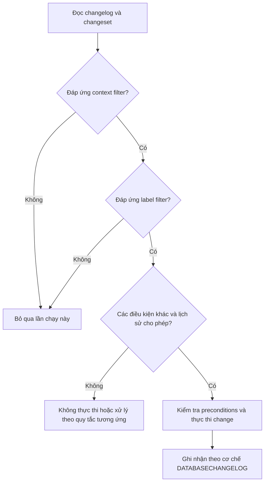

# Biểu thức lọc contexts và labels trong Liquibase

## 1. Vai trò của bộ lọc trong một lần migration

Module `DATABASE_SCHEMA_MIGRATION_LIQUIBASE` tập trung quản lý thay đổi schema và dữ liệu bằng **changelog, changeset, precondition, checksum và lịch sử triển khai**; thực hành migration có kiểm chứng, rollback, phối hợp nhiều môi trường và tích hợp Spring Boot hoặc CI/CD. Trong mô hình đó, **contexts** và **labels** cho phép điều khiển *changeset nào được chọn để xem xét thực thi* trong một lượt Liquibase `update` hay thao tác có liên quan.

Ví dụ, một changelog có cả thay đổi schema chung, dữ liệu mẫu cho development, dữ liệu kiểm thử cho QA và thay đổi dành cho một đợt phát hành. Không cần tạo bốn bản changelog giống nhau: có thể gắn metadata lên changeset và truyền bộ lọc khi chạy. Nhưng một điều kiện viết sai hoặc một lần chạy quên bộ lọc có thể chọn nhiều changeset hơn dự kiến. Hiểu **biểu thức Boolean**, vị trí khai báo và cách Liquibase xử lý khi **không truyền bộ lọc** là yêu cầu quan trọng trước khi đưa cách làm này vào production.

Hai loại bộ lọc có điểm chung là đều kết hợp metadata trong changelog với tham số tại thời điểm chạy, nhưng cách biểu đạt có khác biệt:

| Tiêu chí | Contexts | Labels |
|---|---|---|
| Mục đích thường dùng | Chọn môi trường/ngữ cảnh thực thi: `development`, `qa`, `production`, `seed` | Đánh dấu nhóm thay đổi: `release-2026-11`, `compliance`, `hotfix`, `seed` |
| Khai báo trên changeset | `contextFilter` ở các phiên bản hiện đại; bản cũ có thể dùng `context` | `labels` |
| Chọn khi chạy CLI | `--context-filter` ở các phiên bản hỗ trợ; bản cũ có thể dùng `--contexts` | `--label-filter` |
| Biểu thức | Có thể khai báo điều kiện `AND`, `OR`, `NOT`, `()` trong context filter của changeset | Thường gắn danh sách nhãn lên changeset và viết biểu thức chọn nhãn ở **runtime** |
| Khi không truyền bộ lọc runtime | Changeset có context thông thường vẫn có thể chạy; riêng context bắt buộc với tiền tố `@` cần chỉ định rõ | Changeset có labels vẫn có thể chạy nếu không truyền label filter |

**Nguyên tắc:** context/label là điều kiện chọn changeset theo cấu hình, **không phải cơ chế phân quyền** và cũng không thay thế precondition. Chúng không tự xác minh database đang là staging hay production, không kiểm tra dữ liệu thực tế và không bảo đảm rollback khả thi.

## 2. Mô hình chọn changeset: từ metadata đến kết quả

Một changeset có thể mang nhiều điều kiện: context, labels, phạm vi DBMS, precondition, trạng thái đã chạy và checksum. Có thể hình dung quá trình chọn và thực thi như sau:



Sơ đồ nhằm giải thích quan hệ logic, không mô phỏng chính xác mọi nhánh nội bộ của Liquibase. Trong thực tế, Liquibase còn xử lý `dbms`, `runAlways`, `runOnChange`, precondition và lịch sử `DATABASECHANGELOG` theo các quy tắc của từng command. Một changeset phải thỏa **đồng thời** những bộ lọc đang được áp dụng mới có cơ hội thực thi; được chọn bởi context không có nghĩa sẽ vượt qua label filter hoặc precondition.

Điểm dễ nhầm nhất: **việc gắn context/label vào changeset không tự động buộc người chạy phải chỉ định filter**. Hành vi khi thiếu filter cần được thiết kế rõ ràng, đặc biệt với dữ liệu thử nghiệm hoặc thao tác nhạy cảm.

## 3. Ngữ pháp biểu thức Boolean

Liquibase hỗ trợ các toán tử biểu thức cho việc lọc contexts và labels theo vai trò tương ứng:

| Ký hiệu | Ý nghĩa | Ví dụ | Diễn giải |
|---|---|---|---|
| `AND` hoặc `and` | Đồng thời thỏa các điều kiện | `qa AND smoke` | Có cả `qa` và `smoke` |
| `OR` hoặc `or` | Ít nhất một điều kiện đúng | `qa OR staging` | Có `qa` hoặc `staging` |
| `!` | Phủ định | `!production` | Không có `production` trong tập được xét |
| `(...)` | Nhóm điều kiện | `qa AND (smoke OR regression)` | Có `qa` và một trong hai nhãn còn lại |
| `,` | Thường biểu đạt lựa chọn OR | `qa,staging` | Chọn `qa` hoặc `staging` |

**Thứ tự ưu tiên:** thông thường phủ định (`!`) được xét trước `AND`, rồi `OR`. Để tài liệu dễ review và giảm lệ thuộc vào suy đoán, hãy **đặt dấu ngoặc** khi trộn toán tử. Viết `qa AND (smoke OR regression)` rõ nghĩa hơn `qa AND smoke OR regression`.

Ví dụ:

```text
qa AND (smoke OR regression)
```

| Tập giá trị được xét | Biểu thức có đúng không? | Lý do |
|---|---|---|
| `qa,smoke` | Có | Có `qa` và `smoke` |
| `qa,regression` | Có | Có `qa` và `regression` |
| `qa` | Không | Thiếu cả `smoke` lẫn `regression` |
| `smoke,regression` | Không | Thiếu `qa` |
| `production,smoke` | Không | Không có `qa` |

Bảng trên mô tả **logic Boolean khi một biểu thức được đánh giá trên tập giá trị**; nó không có nghĩa cùng một biểu thức được viết ở cùng vị trí cho cả contexts và labels. Với contexts, biểu thức thường nằm trên changeset; với labels, biểu thức chọn nhãn thường nằm ở `--label-filter` lúc chạy. Đây là khác biệt quan trọng trong phần tiếp theo.

## 4. Context expression: khai báo điều kiện trên changeset

### 4.1. `contextFilter` có thể chứa biểu thức

Ví dụ changelog YAML:

```yaml
databaseChangeLog:
  - changeSet:
      id: seed-customer-qa
      author: database-team
      contextFilter: "qa or staging"
      changes:
        - insert:
            tableName: customer
            columns:
              - column:
                  name: id
                  valueNumeric: 1001
              - column:
                  name: full_name
                  value: "Quality Assurance Customer"
      rollback:
        - delete:
            tableName: customer
            where: "id = 1001"
```

Changeset được đánh dấu `qa or staging`. Khi chạy với context `qa`, nó phù hợp; khi chạy với `staging`, cũng phù hợp; với context `production`, nó không phù hợp. `rollback` được khai báo để minh họa cách đảo ngược dữ liệu mẫu. Trên database thực, phải chắc chắn ID mẫu không va chạm với dữ liệu nghiệp vụ và việc xóa hàng không làm mất dữ liệu được tạo sau đó.

Ví dụ thêm về biểu thức context:

```yaml
contextFilter: "development and !expensive"
```

Biểu thức này phù hợp khi runtime chỉ định `development` nhưng không bao gồm `expensive`. Nếu cần chạy riêng migration tốn thời gian, người vận hành có thể sử dụng quy trình và nhóm context có chủ đích. Tuy nhiên, `!expensive` không phải hàng rào bảo vệ khi không cung cấp context filter; xem mục 4.3.

### 4.2. Truyền context filter ở CLI

Ví dụ các lời gọi thường gặp với phiên bản CLI hỗ trợ `--context-filter`:

```bash
liquibase --defaults-file=config/liquibase-qa.properties --context-filter=qa status --verbose
liquibase --defaults-file=config/liquibase-qa.properties --context-filter=qa update-sql
liquibase --defaults-file=config/liquibase-qa.properties --context-filter=qa update
```

Tham số runtime `qa` cung cấp context để so khớp với các biểu thức được gắn trên changeset. Có thể truyền nhiều context, ví dụ `--context-filter=qa,staging` để cung cấp nhiều giá trị theo cú pháp phiên bản hỗ trợ. Nếu muốn mô tả một quan hệ chặt chẽ như `qa AND smoke`, hãy hiểu rõ sự khác nhau giữa **tập context do runner cung cấp** và **biểu thức điều kiện đặt trên changeset**. Không nên tự giả định mọi vị trí đều diễn giải biểu thức y hệt nhau mà chưa kiểm tra ở phiên bản đang dùng.

Tên thuộc tính ở changeset có thể là `context` trong changelog cũ và `contextFilter` trong changelog mới; tùy phiên bản, tên CLI có thể là `--contexts` hoặc `--context-filter`. Khi dùng tài liệu hoặc lệnh từ dự án cũ, phải đối chiếu `liquibase --help` và cú pháp changelog của phiên bản thực tế.

### 4.3. Khi không truyền runtime context: nguy cơ chạy rộng hơn dự kiến

Giả sử một changeset có:

```yaml
contextFilter: "development"
```

Nếu chạy `liquibase update` **mà không cung cấp context filter**, Liquibase thường **không dùng context để loại changeset đó**; một changeset có context thông thường vẫn có thể chạy. Đây là tình huống nguy hiểm khi người viết nghĩ rằng gắn `development` là đủ để dữ liệu mẫu không bao giờ vào production.

Với những changeset chỉ được phép chạy khi người vận hành **chủ động** chọn context, Liquibase hỗ trợ tiền tố `@` trong biểu thức context, chẳng hạn:

```yaml
contextFilter: "@development"
```

Khi dùng `@development`, changeset yêu cầu context được chỉ định rõ trong lệnh chạy và phải khớp điều kiện; nếu không truyền context runtime, changeset đó sẽ không được chọn chỉ vì thiếu filter. Tiền tố `@` đặc biệt hữu ích cho seed data, thao tác thử nghiệm hoặc thay đổi chỉ nên được kích hoạt trong một workflow đã kiểm soát.

So sánh hành vi cơ bản:

| Metadata changeset | Runtime không có context filter | Runtime `development` | Runtime `production` |
|---|---|---|---|
| Không có context | Có thể được chọn | Có thể được chọn | Có thể được chọn |
| `contextFilter: "development"` | Có thể được chọn | Phù hợp | Không phù hợp |
| `contextFilter: "@development"` | Không phù hợp | Phù hợp | Không phù hợp |
| `contextFilter: "qa or staging"` | Có thể được chọn | Không phù hợp | Không phù hợp |

“Có thể được chọn” trong bảng chỉ nói đến **điều kiện context**; changeset còn chịu labels, DBMS, preconditions và trạng thái lịch sử. `@` là công cụ giảm rủi ro quên context nhưng không chứng minh môi trường thực sự là development. Nếu ai đó chạy `--context-filter=development` trong lúc trỏ URL vào production, Liquibase không tự sửa sự nhầm lẫn đó.

## 5. Label expression: gắn nhãn trên changeset, lọc Boolean khi chạy

### 5.1. `labels` là metadata để phân nhóm

Ví dụ YAML:

```yaml
databaseChangeLog:
  - changeSet:
      id: create-audit-index
      author: database-team
      labels: "release-2026-11,compliance"
      changes:
        - createIndex:
            indexName: idx_audit_event_created_at
            tableName: audit_event
            columns:
              - column:
                  name: created_at
      rollback:
        - dropIndex:
            indexName: idx_audit_event_created_at
            tableName: audit_event
```

Changeset mang hai nhãn `release-2026-11` và `compliance`. Labels giúp phân nhóm theo release, loại công việc, chủ sở hữu hoặc chính sách nghiệp vụ. **Không nên dùng nhãn làm thay đổi thứ tự migration**: nếu bảng `audit_event` chưa được tạo, một label phù hợp cũng không giúp lệnh `createIndex` thành công.

Không nên coi chuỗi `labels` trên changeset là nơi mặc định viết các phép logic như `compliance AND hotfix` để chỉ định lúc nào thay đổi được chọn. Cách dùng phổ biến và dễ kiểm soát là khai báo **một hoặc nhiều nhãn** trên changeset, rồi dùng **biểu thức Boolean ở runtime** để chọn từ các nhãn đó.

### 5.2. Lọc bằng `--label-filter`

Các câu lệnh sau minh họa phép toán ở phía runner:

```bash
# Chọn changeset có nhãn compliance
liquibase --defaults-file=config/liquibase-prod.properties --label-filter=compliance status --verbose

# Chọn changeset có cả hai nhãn
liquibase --defaults-file=config/liquibase-prod.properties --label-filter="release-2026-11 AND compliance" update-sql

# Chọn một trong hai nhóm, nhưng loại trừ experimental
liquibase --defaults-file=config/liquibase-prod.properties --label-filter="(release-2026-11 OR hotfix) AND !experimental" update-sql
```

Ví dụ `release-2026-11 AND compliance` phù hợp với changeset mang cả hai nhãn. `release-2026-11 OR hotfix` phù hợp nếu có ít nhất một nhãn. `!experimental` loại changeset có nhãn `experimental` trong phạm vi biểu thức. Khi kết hợp nhiều toán tử, nên dùng ngoặc để người review đọc một lần là hiểu điều kiện.

Trong shell, dấu ngoặc, khoảng trắng, dấu `!`, `&` và các ký tự đặc biệt có thể bị shell xử lý trước khi đến Liquibase. Hãy đặt biểu thức trong dấu nháy phù hợp với PowerShell, Bash hoặc trình chạy CI và kiểm tra câu lệnh thực tế; ví dụ trên dùng dấu nháy kép phù hợp cho phần lớn trường hợp đơn giản, nhưng quy tắc escape có thể khác ở script cụ thể.

### 5.3. Không có `--label-filter` không có nghĩa là không chạy changeset có nhãn

Nếu một changeset có `labels: "compliance"` và runner không truyền label filter, changeset đó **vẫn có thể được chọn**. Labels không hoạt động như cơ chế khóa yêu cầu chỉ định nhãn trong mọi lần chạy. Ngược lại, khi truyền một label filter, changeset **không có labels** thường vẫn được coi là changeset dùng chung và được chọn, nếu các điều kiện khác cho phép.

| Labels trên changeset | Không có `--label-filter` | Filter `compliance` | Filter `release AND compliance` |
|---|---|---|---|
| Không có labels | Có thể được chọn | Có thể được chọn | Có thể được chọn |
| `compliance` | Có thể được chọn | Phù hợp | Không phù hợp |
| `release,compliance` | Có thể được chọn | Phù hợp | Phù hợp |
| `release,experimental` | Có thể được chọn | Không phù hợp | Không phù hợp |

Điều này quan trọng trong CI/CD: một job chỉ truyền `--label-filter=compliance` vẫn chạy những changeset **không gắn nhãn**, chẳng hạn các migration schema chung. Nếu yêu cầu của job là “chỉ chạy một thay đổi đặc biệt, không chạy bất kỳ changeset nào khác”, label filter đơn lẻ chưa đủ để bảo đảm điều đó; cần thiết kế changelog/job riêng hoặc quy trình chọn command thích hợp và kiểm tra toàn bộ changeset pending.

## 6. Kết hợp contexts và labels: hai cổng lọc cùng lúc

Khi changeset khai báo cả `contextFilter` và `labels`, hai điều kiện cùng tham gia quyết định. Ví dụ:

```yaml
databaseChangeLog:
  - changeSet:
      id: qa-smoke-seed
      author: database-team
      contextFilter: "@qa"
      labels: "seed,smoke"
      changes:
        - insert:
            tableName: test_fixture
            columns:
              - column:
                  name: fixture_id
                  valueNumeric: 100
              - column:
                  name: fixture_name
                  value: "quick-smoke"
      rollback:
        - delete:
            tableName: test_fixture
            where: "fixture_id = 100"
```

Changeset trên là một thay đổi dữ liệu thử nghiệm, giả định bảng `test_fixture` đã tồn tại. `@qa` yêu cầu runner phải cung cấp context phù hợp; `seed,smoke` cho phép nhóm lọc theo mục đích. Xem bảng kết quả theo **hai bộ lọc**:

| Lệnh chạy: context | Lệnh chạy: label | Có phù hợp với changeset trên không? | Diễn giải |
|---|---|---|---|
| Không truyền | Không truyền | Không | `@qa` yêu cầu context tường minh |
| `qa` | Không truyền | Có | Context phù hợp; không có label filter thì labels không loại changeset |
| `qa` | `smoke` | Có | Cả hai điều kiện đều phù hợp |
| `qa` | `seed AND smoke` | Có | Changeset mang cả hai nhãn |
| `qa` | `compliance` | Không | Label filter không phù hợp |
| `production` | `smoke` | Không | Context không phù hợp |

Ví dụ CLI để **xem trước** SQL trong QA:

```bash
liquibase --defaults-file=config/liquibase-qa.properties \
  --context-filter=qa \
  --label-filter="seed AND smoke" \
  update-sql
```

Dấu `\` ở cuối dòng trong ví dụ là cách nối dòng của shell Bash. Nếu chạy trong PowerShell, dùng một dòng lệnh hoặc cú pháp nối dòng của PowerShell; đừng sao chép dấu `\` rồi kỳ vọng mọi terminal hiểu giống nhau.

Quan hệ cần nhớ là **context phù hợp AND label phù hợp AND các điều kiện khác phù hợp**. Không nên suy diễn rằng `qa OR smoke` trên hai hệ bộ lọc có nghĩa là được chạy khi chỉ một hệ phù hợp; đó là hai cổng đánh giá khác nhau.

## 7. Ví dụ changelog tự chứa với thay đổi chung và dữ liệu theo môi trường

Changelog dưới đây minh họa thay đổi schema chung và hai nhóm dữ liệu seed có thể chủ động kích hoạt. Giả định DBMS hỗ trợ các change type được dùng:

```yaml
databaseChangeLog:
  # 1. Schema chung: không gắn context/label để mọi môi trường nhận được
  - changeSet:
      id: create-app-setting
      author: database-team
      changes:
        - createTable:
            tableName: app_setting
            columns:
              - column:
                  name: id
                  type: BIGINT
                  constraints:
                    primaryKey: true
                    nullable: false
              - column:
                  name: setting_key
                  type: VARCHAR(100)
                  constraints:
                    nullable: false
              - column:
                  name: setting_value
                  type: VARCHAR(255)
      rollback:
        - dropTable:
            tableName: app_setting

  # 2. Dữ liệu mẫu cho môi trường development
  - changeSet:
      id: seed-app-setting-development
      author: database-team
      contextFilter: "@development"
      labels: "seed,nonprod"
      changes:
        - insert:
            tableName: app_setting
            columns:
              - column:
                  name: id
                  valueNumeric: 101
              - column:
                  name: setting_key
                  value: "demo_mode"
              - column:
                  name: setting_value
                  value: "enabled"
      rollback:
        - delete:
            tableName: app_setting
            where: "id = 101"

  # 3. Dữ liệu phục vụ smoke test trên QA
  - changeSet:
      id: seed-app-setting-qa
      author: database-team
      contextFilter: "@qa"
      labels: "seed,smoke"
      changes:
        - insert:
            tableName: app_setting
            columns:
              - column:
                  name: id
                  valueNumeric: 201
              - column:
                  name: setting_key
                  value: "smoke_mode"
              - column:
                  name: setting_value
                  value: "enabled"
      rollback:
        - delete:
            tableName: app_setting
            where: "id = 201"
```

Trong ví dụ này, changeset tạo bảng chung không mang filter và vẫn có thể được chạy trước seed data. Hai changeset seed có `@` để hạn chế việc chạy khi quên truyền context. Các ID giả định là duy nhất trong dữ liệu thử nghiệm; nếu thay đổi hoặc xóa dữ liệu có khóa ngoại, rollback cần được thiết kế lại cho phù hợp.

**Bảng dự kiến trên database sạch:**

| Cấu hình runner | Changeset dự kiến được chọn theo context + label |
|---|---|
| Không truyền context hoặc label filter | `create-app-setting` |
| Context `development`, không truyền label filter | `create-app-setting`, `seed-app-setting-development` |
| Context `qa`, label `smoke` | `create-app-setting`, `seed-app-setting-qa` |
| Context `qa`, label `nonprod` | Chỉ `create-app-setting` |
| Context `production`, label `seed` | Chỉ `create-app-setting` |
| Context `development,qa`, label `seed` | `create-app-setting` và cả hai changeset seed |

Bảng này giả định cả ba changeset **chưa từng chạy**, không có precondition khác và database cho phép thực thi SQL. Trong database đã có lịch sử, changeset đã được ghi nhận trong `DATABASECHANGELOG` thường không chạy lại nếu không có cấu hình như `runAlways`/`runOnChange`. Bộ lọc không thay thế việc kiểm tra lịch sử.

## 8. Tổ chức expression theo môi trường và mục đích triển khai

Một quy ước giúp giảm nhầm lẫn là phân biệt rõ trục phân loại:

| Trục | Giá trị tham khảo | Dùng trong |
|---|---|---|
| Môi trường | `development`, `qa`, `staging`, `production` | Contexts |
| Loại công việc | `seed`, `schema`, `backfill`, `hotfix` | Labels |
| Đợt phát hành | `release-2026-11`, `release-2026-12` | Labels |
| Rà soát đặc biệt | `compliance`, `manual-review`, `experimental` | Labels |

Đây là quy ước của nhóm, không phải những từ khóa bắt buộc của Liquibase. Có thể dùng context cho chức năng hoặc label cho môi trường nếu có lý do rõ ràng, nhưng một dự án nên duy trì một quy tắc ổn định để biểu thức không trở nên khó hiểu.

**Khuyến nghị cho thay đổi schema cốt lõi:** thường không nên gắn context để loại migration bắt buộc khỏi production chỉ vì môi trường. Nếu tất cả môi trường đều cần bảng/cột, hãy để changeset đó áp dụng nhất quán. Ngược lại, dữ liệu mẫu hoặc thao tác thử nghiệm có thể dùng `@development` hay `@qa`. Các labels như `release`/`hotfix` chủ yếu hỗ trợ phân nhóm và quy trình phê duyệt; khi dùng label filter theo release, hãy kiểm tra liệu có changeset chung không có nhãn vẫn được chạy hay không.

### 8.1. Trong CI/CD: ghi nhận đầy đủ bộ lọc của từng job

Ví dụ một job QA có thể sử dụng:

```bash
liquibase --defaults-file=config/liquibase-qa.properties --context-filter=qa --label-filter=smoke validate
liquibase --defaults-file=config/liquibase-qa.properties --context-filter=qa --label-filter=smoke status --verbose
liquibase --defaults-file=config/liquibase-qa.properties --context-filter=qa --label-filter=smoke update-sql
```

Sau khi review SQL dự kiến, bước `update` dùng **cùng database, changelog artifact, context filter và label filter** đã được kiểm tra. Thay đổi một filter giữa `update-sql` và `update` có thể tạo tập changeset thực thi khác hẳn. Job nên ghi nhận giá trị filter không bí mật, phiên bản Liquibase và changelog artifact, đồng thời xác nhận URL/database đích một cách độc lập.

Không coi lệnh `--context-filter=production` là biện pháp ngăn chạy nhầm database: nếu URL trỏ sang QA, Liquibase vẫn có thể thực thi changeset mang context production trên QA. Điều phối credentials, xác nhận môi trường, bảo vệ pipeline và yêu cầu phê duyệt phải được xây dựng riêng.

### 8.2. Trong Spring Boot: ánh xạ thành thuộc tính ứng dụng

Khi Liquibase chạy lúc ứng dụng khởi động qua Spring Boot, cấu hình thường dùng tiền tố `spring.liquibase`:

```yaml
spring:
  liquibase:
    enabled: true
    change-log: classpath:/db/changelog/db.changelog-master.yaml
    contexts: "qa"
    label-filter: "smoke"
```

Ví dụ chỉ minh họa các thuộc tính được Spring Boot hỗ trợ trong những phiên bản phù hợp. Cần kiểm tra phiên bản Spring Boot đang dùng: một số phiên bản hoặc tích hợp có tên thuộc tính label/context khác nhau, và cú pháp runtime của Spring Boot không nhất thiết giống nguyên dạng flag CLI. Nếu đồng thời chạy migration bằng pipeline CLI và bằng ứng dụng lúc startup, phải bảo đảm hai cơ chế dùng cùng changelog, metadata schema và bộ lọc dự kiến.

Đặc biệt với nhiều replica, các instance có thể cạnh tranh quyền chạy migration và sẽ được điều phối bởi `DATABASECHANGELOGLOCK` khi dùng chung bảng lock. Lock chỉ tuần tự hóa lượt chạy; nó **không sửa cấu hình context/label sai**. Một replica bật `qa` và replica khác bật `production` nhưng cùng kết nối một database vẫn có thể chọn hai tập changeset khác nhau theo lượt chạy.

## 9. Kết hợp filter với `dbms`, precondition và lịch sử triển khai

### 9.1. `dbms` không phải context hoặc label

`dbms` giới hạn changeset theo loại hệ quản trị cơ sở dữ liệu. Ví dụ một changeset dùng cú pháp PostgreSQL có thể khai báo `dbms: postgresql`. Điều này bổ sung điều kiện tương thích, không thay thế nhãn môi trường. Nếu changeset ghi `dbms: postgresql`, `contextFilter: "@qa"`, `labels: "smoke"`, nó chỉ có cơ hội chạy khi đúng DBMS **và** thỏa các bộ lọc khác.

### 9.2. Precondition kiểm tra trạng thái, filter chọn phạm vi

Precondition như `tableExists`, `columnExists` hoặc `sqlCheck` kiểm tra trạng thái database tại thời điểm thực thi. Context/label không xác minh bảng có tồn tại hay dữ liệu đã được backfill. Ví dụ, một changeset được chọn với label `compliance` vẫn cần điều kiện phù hợp nếu SQL giả định một bảng được tạo ở bước trước.

Không nên dùng `onFail: MARK_RAN` để lặng lẽ đánh dấu một thay đổi schema bắt buộc khi filter khiến tiền đề bị bỏ qua. Điều đó có thể tạo lịch sử có vẻ hoàn tất nhưng schema thực tế thiếu đối tượng. Với migration bắt buộc, thường nên `HALT` và sửa cấu hình hoặc thứ tự changelog.

### 9.3. Filter không chạy lại changeset đã được ghi nhận

Khi changeset đã thực thi, Liquibase theo dõi danh tính (`id`, `author`, danh tính file) và checksum trong `DATABASECHANGELOG`. Việc thay filter ở lần triển khai sau không tự khiến một changeset đã chạy thực thi lại. Ngược lại, changeset **chưa chạy** do không phù hợp filter có thể trở thành pending ở lần sau khi runner đổi filter.

Thay `contextFilter` hoặc `labels` trên changeset đã triển khai cũng là thay đổi cần được kiểm tra tác động đến lịch sử và checksum theo phiên bản Liquibase đang dùng. Đừng sửa định danh, `logicalFilePath` hoặc xóa lịch sử chỉ để ép changeset chạy lại. Nếu cần thay đổi schema mới, thường nên thêm changeset mới rõ ràng và quản lý vòng đời deploy/rollback riêng.

## 10. Kiểm chứng expression bằng các kịch bản cụ thể

Trước khi áp dụng vào CI/CD, kiểm chứng ít nhất các trường hợp sau trên database thử nghiệm:

1. **Không truyền filter:** xác định changeset nào vẫn chạy khi runner quên cả context và label filter; xác minh hiệu lực của `@`.
2. **Truyền một context:** so sánh `qa`, `production`, `development` trên cùng changelog; bảo đảm seed test không lọt sang production.
3. **Truyền nhiều context:** kiểm tra các biểu thức `AND`, `OR`, `!` và `()` nếu dự án sử dụng; review đầy đủ truth table.
4. **Truyền một hoặc nhiều labels:** kiểm tra `--label-filter=seed`, `--label-filter="release AND compliance"` và nhãn phủ định; xem các changeset không gắn nhãn có được chọn không.
5. **Kết hợp contexts và labels:** xác nhận hai bộ lọc đều có hiệu lực, không có suy luận OR giữa hai trục.
6. **Database mới và database đã có lịch sử:** một changeset bị lọc không giống changeset đã chạy; xác nhận bằng `status --verbose` và `DATABASECHANGELOG`.
7. **Review SQL:** dùng `update-sql` với chính xác filter sẽ dùng cho `update`, đối chiếu số lượng và thứ tự changeset trong log.
8. **Rollback:** kiểm tra kế hoạch rollback phù hợp với các changeset thực tế đã chạy; không giả định đảo filter đơn giản là rollback được migration.

Ví dụ kiểm tra không thực thi DDL/DML trên môi trường test:

```bash
liquibase --defaults-file=config/liquibase-test.properties --context-filter=qa --label-filter="seed AND smoke" validate
liquibase --defaults-file=config/liquibase-test.properties --context-filter=qa --label-filter="seed AND smoke" status --verbose
liquibase --defaults-file=config/liquibase-test.properties --context-filter=qa --label-filter="seed AND smoke" update-sql
```

Lệnh `validate` xác minh nhiều quy tắc cấu trúc của changelog nhưng không chứng minh logic lọc đáp ứng yêu cầu nghiệp vụ. `status` và `update-sql` giúp xem tập changeset pending và SQL dự kiến theo cấu hình hiện tại, song vẫn phải thử thực thi trên database đại diện để phát hiện lỗi dữ liệu, quyền, transaction hoặc khả năng DBMS. Trước production, nên so sánh kết quả với bảng quyết định đã được review.

## 11. Lỗi thường gặp và cách chẩn đoán

| Hiện tượng | Nguyên nhân có thể | Hướng điều tra |
|---|---|---|
| Dữ liệu seed `development` xuất hiện trong production | Lần `update` không truyền context filter; metadata chỉ ghi `development` mà không có `@` | Kiểm tra log command, URL, lịch sử `DATABASECHANGELOG`; dùng `@` khi cần chỉ định rõ context |
| Chạy filter `smoke` nhưng schema chung vẫn được cập nhật | Changeset schema không có label và vẫn được chọn | Xem thiết kế changelog; hiểu rằng label filter không đương nhiên loại changeset không gắn nhãn |
| Không thấy changeset `qa` chạy | Changeset có `@qa` nhưng runner không truyền context; hoặc context thực tế khác | Xác nhận `--context-filter`, cấu hình Spring Boot và bản ghi đã thực thi |
| `qa AND smoke` cho kết quả không như dự kiến | Dùng biểu thức sai vị trí (contexts trên changeset vs labels ở runtime), thiếu ngoặc hoặc thiếu giá trị | Tách hai trục, viết truth table và kiểm tra từng điều kiện |
| Lệnh đúng ở máy local nhưng sai trong CI | Đường dẫn defaults, shell quoting, tên flag hoặc version Liquibase khác | Kiểm tra command cuối cùng, bản CLI, thư mục làm việc và các tham số có hiệu lực |
| Changeset đã chạy không chạy lại dù filter đã đổi | `DATABASECHANGELOG` ghi nhận changeset đã thực thi | Kiểm tra lịch sử; dùng changeset mới cho thay đổi mới thay vì chỉnh metadata để ép chạy |
| Prod chỉ định context đúng nhưng vẫn chạy nhầm database | Context không xác minh môi trường kết nối | Đối chiếu JDBC URL, credentials, database/schema và khóa cấp quyền trong pipeline |
| Hai runner chạy những nhóm migration khác nhau | Filter, artifact hoặc schema metadata không đồng nhất | So sánh cấu hình và `DATABASECHANGELOGLOCK`; chuẩn hóa pipeline trước rollout |

Trong lúc điều tra, nên ghi log những tham số không bí mật (changelog, context filter, label filter, phiên bản Liquibase) và không in password/token. Không chỉnh tay `DATABASECHANGELOG` để làm bộ lọc “đúng” trong một môi trường; hãy sửa cấu hình hoặc thêm changeset khắc phục có kiểm chứng.

## 12. Checklist thiết kế bộ lọc cho Liquibase

- [ ] Có quy ước thống nhất: contexts biểu đạt phạm vi thực thi; labels biểu đạt nhóm thay đổi hoặc release.
- [ ] Changeset schema bắt buộc được áp dụng nhất quán cho các môi trường cần nó, không bị filter loại ngoài ý muốn.
- [ ] Seed data và thao tác phải chọn chủ động dùng `@context` khi phù hợp.
- [ ] Nhóm biết rằng **không truyền context/label filter** có thể làm nhiều changeset được chọn hơn dự kiến.
- [ ] Biểu thức Boolean dùng `AND`, `OR`, `!`, ngoặc và danh sách ngăn cách rõ ràng; có truth table cho các biểu thức phức tạp.
- [ ] Biểu thức labels được đặt ở runtime khi lọc các nhãn đã gắn; không nhầm `labels` metadata với `--label-filter`.
- [ ] Bộ lọc context và label được xem là hai điều kiện kết hợp, không tự suy luận OR giữa chúng.
- [ ] Có kiểm tra độc lập database URL, schema và quyền truy cập; filter không được coi là cơ chế bảo mật.
- [ ] CLI, Spring Boot và CI/CD cùng hiểu quy ước đặt tên và dùng đúng tùy chọn của phiên bản đang chạy.
- [ ] `validate`, `status --verbose`, `update-sql` và `update` dùng cùng changelog, context, label và cấu hình database đã review.
- [ ] Đã kiểm chứng các kịch bản không filter, một filter, nhiều filter, dữ liệu mẫu và môi trường production.
- [ ] Rollback, preconditions, lịch sử `DATABASECHANGELOG` và `DATABASECHANGELOGLOCK` được xem xét riêng bên cạnh điều kiện chọn changeset.

Biểu thức lọc contexts và labels giúp một changelog Liquibase phục vụ nhiều kịch bản, nhưng cần hiểu rõ **ai gắn metadata, ai truyền filter, biểu thức được đánh giá ở đâu và chuyện gì xảy ra khi thiếu filter**. Dùng context expression để mô tả điều kiện ngữ cảnh trên changeset, dùng label expression ở runtime để chọn nhóm nhãn, và kiểm chứng tập changeset bằng SQL dự kiến cùng lịch sử database trước khi triển khai. Đây là một phần quan trọng của quy trình migration có kiểm chứng trong `DATABASE_SCHEMA_MIGRATION_LIQUIBASE`.
