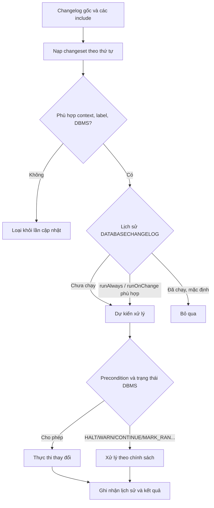
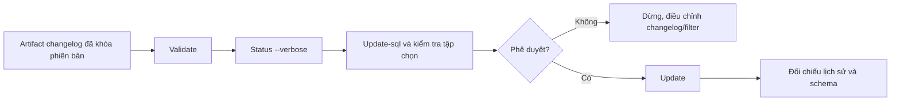

# Kiểm tra tập changeset được chọn trước khi cập nhật

## 1. Mục tiêu: biết chính xác Liquibase sắp thay đổi điều gì

Trong module **DATABASE_SCHEMA_MIGRATION_LIQUIBASE**, người học quản lý thay đổi schema và dữ liệu bằng changelog, changeset, precondition, checksum và lịch sử triển khai; thực hành migration có kiểm chứng, rollback, phối hợp nhiều môi trường và tích hợp Spring Boot hoặc CI/CD. Một yêu cầu thiết yếu trước khi chạy migration là **xác định tập changeset mà Liquibase dự kiến xử lý trên đúng database, đúng cấu hình lọc và đúng phiên bản changelog**.

Câu hỏi “Có bao nhiêu changeset trong file?” chưa đủ. Changelog có thể chứa hàng trăm changeset nhưng một lần cập nhật chỉ thực thi một phần vì:

- Một số changeset đã được ghi nhận trong `DATABASECHANGELOG`.
- Một số changeset chỉ phù hợp với context, label hoặc DBMS nhất định.
- `runAlways` có thể khiến changeset đã chạy được thực thi lại.
- `runOnChange` có thể khiến changeset cần chạy lại khi định nghĩa của nó thay đổi theo cơ chế checksum.
- Precondition có thể dừng, bỏ qua hoặc đánh dấu changeset theo chính sách của nó.
- Một số thay đổi được đưa vào qua `include` hoặc `includeAll`; đường dẫn changelog gốc quyết định những file thực sự được nạp.

**Kết quả cần đạt trước khi triển khai:** danh sách changeset dự kiến chạy, lý do được chọn, thứ tự, SQL dự kiến, đối tượng bị tác động và các điểm chưa chắc chắn. Việc xác minh này làm giảm nguy cơ cập nhật nhầm môi trường, bỏ sót migration hoặc chạy dữ liệu thử nghiệm trong production.

### 1.1. Phân biệt ba khái niệm

| Khái niệm | Ý nghĩa | Kiểm tra bằng gì? |
|---|---|---|
| Changeset **được nạp** | Được Liquibase tìm thấy khi đọc changelog gốc và các file include | Kiểm tra changelog, include/includeAll và đường dẫn thực tế |
| Changeset **được lựa chọn / dự kiến chạy** | Thỏa điều kiện lọc và quy tắc lịch sử, nên được xét để xử lý trong lượt update | `status --verbose`, `update-sql`, log và phân tích cấu hình |
| Changeset **thực sự thực thi thành công** | Câu lệnh đã được DBMS xử lý theo kết quả của lần chạy | Log thực thi, `DATABASECHANGELOG` và kiểm tra trạng thái database |

Danh sách dự kiến chạy **không phải** bằng chứng SQL đã chạy. Ngay trước hoặc trong khi cập nhật, precondition, quyền truy cập, lock, dữ liệu và tình trạng DBMS vẫn có thể dẫn đến kết quả khác dự kiến. Vì vậy, khâu xem trước và khâu xác minh sau cập nhật là hai bước riêng.

## 2. Mô hình quyết định tập changeset

Có thể hình dung bộ lọc thực thi qua các bước logic:



Sơ đồ là mô hình học tập: thứ tự kiểm tra nội bộ và thời điểm tính checksum có thể khác nhau tùy phiên bản Liquibase và loại changeset. Điều quan trọng là **định nghĩa, bộ lọc, lịch sử và điều kiện runtime cùng ảnh hưởng đến tập thay đổi thực tế**.

### 2.1. Những đầu vào phải cố định trước khi xem trước

Một kết quả kiểm tra chỉ có ý nghĩa khi biết đầy đủ:

1. **Changelog gốc**: file nào được truyền qua `--changelog-file` hoặc cấu hình `spring.liquibase.change-log`.
2. **Phiên bản artifact**: commit hoặc bản phát hành nào chứa changelog và các file include.
3. **Database đích**: JDBC URL, database/catalog/schema, phiên bản DBMS và tài khoản sử dụng.
4. **Bộ lọc**: context filter, label filter, lựa chọn DBMS và các tùy chọn giới hạn thực thi nếu được dùng.
5. **Trạng thái đã triển khai**: các bản ghi tương ứng trong `DATABASECHANGELOG` và tình trạng lock.
6. **Giá trị tham số**: property substitution dùng cho tên schema, bảng, câu SQL hoặc dữ liệu.
7. **Phiên bản Liquibase**: tên option và hành vi chi tiết có thể thay đổi theo phiên bản CLI hoặc tích hợp.

Nếu thay bất kỳ đầu vào quan trọng nào giữa lúc xem trước và lúc update, **phải đánh giá lại tập changeset**. Một file SQL xem trước từ staging không chứng minh production sẽ nhận đúng cùng changeset, vì lịch sử và DBMS đích có thể khác.

## 3. Hiểu đúng các bộ lọc context, label và DBMS

### 3.1. Context filter

Context dùng để nhóm changeset theo ngữ cảnh chạy, chẳng hạn `dev`, `test`, `prod` hoặc `backfill`. Trong các phiên bản Liquibase hiện đại, changeset YAML có thể khai báo `contextFilter`; CLI truyền context qua tùy chọn tương ứng với phiên bản đang dùng (ví dụ `--context-filter`). Một số phiên bản cũ sử dụng tên `contexts` cho tham số CLI và thuộc tính changelog.

Ví dụ:

```yaml
- changeSet:
    id: insert-dev-sample-data
    author: training-team
    contextFilter: "@dev"
    changes:
      - insert:
          tableName: orders
          columns:
            - column:
                name: order_id
                valueNumeric: 9001
            - column:
                name: status
                value: TEST
```

Dấu `@` trong biểu thức context có ý nghĩa quan trọng: nó yêu cầu context tương ứng được cung cấp tường minh khi chạy. Ngược lại, với các biểu thức context thông thường, **việc không truyền context filter có thể khiến changeset vẫn được xét chạy**. Do đó, đừng dựa vào suy nghĩ “không đặt `--context-filter=dev` thì seed data chắc chắn không chạy”.

Context hỗ trợ các biểu thức logic như `and`, `or`, `!` và dấu ngoặc theo cú pháp Liquibase; cần kiểm tra phiên bản khi phối hợp nhiều điều kiện. Với thay đổi nhạy cảm, ngoài filter phải có cả phân quyền DBMS, môi trường chạy và quy trình phê duyệt.

### 3.2. Label filter

Label thường diễn đạt mục đích hoặc nhóm tính năng, chẳng hạn `performance`, `seed` hoặc `operations`. Ví dụ:

```yaml
- changeSet:
    id: add-orders-status-index
    author: training-team
    labels: performance
    changes:
      - createIndex:
          tableName: orders
          indexName: idx_orders_status
          columns:
            - column:
                name: status
```

Pipeline có thể chọn label `performance` khi cần triển khai nhóm tối ưu hiệu năng. Label filter là một biểu thức chọn changeset; cách kết hợp `and`, `or`, dấu phẩy hoặc phủ định phải dựa trên cú pháp Liquibase. Không coi một chuỗi phân tách bằng dấu phẩy là “phải có tất cả label” nếu chưa kiểm chứng ngữ nghĩa.

**Điểm dễ nhầm:** khi không truyền label filter, changeset có label không nhất thiết bị loại. Tùy trường hợp, chúng có thể được xét chạy như changeset thông thường. Muốn ràng buộc chặt chẽ việc chỉ chạy sau khi chọn tường minh, cần dùng cơ chế filter và quy trình tương ứng (bao gồm cách diễn đạt bắt buộc khi phiên bản hỗ trợ), đồng thời kiểm chứng bằng xem trước.

### 3.3. DBMS filter

Thuộc tính `dbms` trong changeset giới hạn loại hệ quản trị được hỗ trợ:

```yaml
- changeSet:
    id: add-postgresql-special-index
    author: training-team
    dbms: postgresql
    changes:
      - sql:
          sql: >
            CREATE INDEX idx_orders_status_lower
            ON orders (lower(status))
```

Trên PostgreSQL, changeset này có thể phù hợp; trên DBMS khác, bộ lọc DBMS loại nó khỏi tập thực thi. Ví dụ chỉ minh họa cú pháp PostgreSQL, không dùng nguyên xi cho Oracle hoặc MySQL. Cần lưu ý `dbms` không phải phép chuyển đổi SQL đa nền tảng và không thay thế kiểm thử với đúng driver/database.

### 3.4. Các điều kiện được kết hợp với nhau

Một changeset có thể chứa cả ba loại giới hạn:

```yaml
- changeSet:
    id: optimize-orders-production
    author: training-team
    contextFilter: "@prod"
    labels: performance
    dbms: postgresql
    changes:
      - createIndex:
          tableName: orders
          indexName: idx_orders_status
          columns:
            - column:
                name: status
```

Để được chọn ở một lần cập nhật thông thường, changeset cần thỏa các giới hạn liên quan: context phù hợp, label filter phù hợp nếu được dùng, và DBMS là PostgreSQL. Sau đó Liquibase còn đối chiếu với lịch sử changeset. Đối với changeset đã chạy hợp lệ theo mặc định, thỏa bộ lọc **không có nghĩa sẽ chạy lại**.

## 4. Ví dụ tự chứa: dự đoán tập changeset được chọn

Giả sử một hệ thống quản lý đơn hàng có changelog YAML như sau. Ví dụ được xây để minh họa cả changeset luôn được xét, changeset dành cho dev, changeset chỉ dùng PostgreSQL production và changeset chạy lặp:

```yaml
databaseChangeLog:
  - changeSet:
      id: 001-create-orders
      author: schema-team
      changes:
        - createTable:
            tableName: orders
            columns:
              - column:
                  name: order_id
                  type: bigint
                  constraints:
                    primaryKey: true
                    nullable: false
              - column:
                  name: status
                  type: varchar(20)
                  constraints:
                    nullable: false

  - changeSet:
      id: 002-create-marker
      author: schema-team
      changes:
        - createTable:
            tableName: deployment_marker
            columns:
              - column:
                  name: marker_key
                  type: varchar(64)
                  constraints:
                    primaryKey: true
                    nullable: false
              - column:
                  name: last_run_at
                  type: timestamp
        - insert:
            tableName: deployment_marker
            columns:
              - column:
                  name: marker_key
                  value: schema-check

  - changeSet:
      id: 003-seed-dev-orders
      author: schema-team
      contextFilter: "@dev"
      labels: sample-data
      changes:
        - insert:
            tableName: orders
            columns:
              - column:
                  name: order_id
                  valueNumeric: 9001
              - column:
                  name: status
                  value: TEST

  - changeSet:
      id: 004-add-prod-status-index
      author: schema-team
      contextFilter: "@prod"
      labels: performance
      dbms: postgresql
      changes:
        - createIndex:
            tableName: orders
            indexName: idx_orders_status
            columns:
              - column:
                  name: status

  - changeSet:
      id: 005-refresh-deployment-marker
      author: schema-team
      contextFilter: "@prod"
      labels: operations
      runAlways: true
      preConditions:
        - onFail: HALT
        - tableExists:
            tableName: deployment_marker
      changes:
        - sql:
            sql: >
              UPDATE deployment_marker
              SET last_run_at = CURRENT_TIMESTAMP
              WHERE marker_key = 'schema-check'
```

### 4.1. Giải thích cấu trúc

- `001` tạo bảng nghiệp vụ `orders`; không có context, label hay DBMS giới hạn.
- `002` tạo bảng điều hành `deployment_marker` và thêm hàng `schema-check`. Changeset này cũng không có bộ lọc.
- `003` thêm dữ liệu mẫu, nhưng yêu cầu context `dev` được chọn tường minh và có label `sample-data`.
- `004` tạo index ở production PostgreSQL khi được chọn context `prod` và label phù hợp.
- `005` cập nhật timestamp của hàng marker mỗi lần `update` chọn nó; có `runAlways: true` và precondition kiểm tra bảng tồn tại.

Đây là **ví dụ giảng dạy**, không phải thiết kế khuyến nghị cho audit đầy đủ: một timestamp duy nhất không lưu lại toàn bộ lịch sử deployment. Trong hệ thống thật, cần kiểm tra quyền, transaction, bộ lọc, dữ liệu đã có và cách tiếp nhận rollback.

### 4.2. Dự đoán trên database mới

Giả sử mỗi dòng dưới đây áp dụng trên **một database sạch độc lập**; mọi precondition đều thỏa và không có lỗi:

| Kịch bản | Context filter | Label filter | DBMS | Changeset dự kiến được chọn |
|---|---|---|---|---|
| Dev | `dev` | `sample-data` | PostgreSQL | `001`, `002`, `003` |
| Prod | `prod` | `performance or operations` | PostgreSQL | `001`, `002`, `004`, `005` |
| Prod DBMS khác | `prod` | `performance or operations` | MySQL | `001`, `002`, `005` |
| Test | `test` | `sample-data` | PostgreSQL | `001`, `002` |

Bảng là **dự đoán logic** dựa trên changelog giả định và filter được chọn; khi thực hành phải dùng `status` và `update-sql` để xác minh bằng Liquibase thật trên kết nối đích. Mục `003` sử dụng `@dev` nên không được chọn khi chỉ chọn context `test`; mục `004` yêu cầu PostgreSQL. Mục `005` được chọn cho production và sẽ chạy lại ở những lượt cập nhật tiếp theo nếu tiếp tục thỏa điều kiện.

### 4.3. Dự đoán trên database đã triển khai

Giả sử production PostgreSQL đã chạy thành công `001`, `002`, `004` và `005`. Lần kế tiếp dùng cùng changelog và cùng filter:

- `001`, `002` và `004` đã được ghi nhận thành công nên thường không chạy lại.
- `003` không thỏa context `prod`.
- `005` được chọn lại do `runAlways: true`, dù đã có bản ghi lịch sử.

Vì vậy, **tập changeset có thể thực thi khác nhau dù file changelog và bộ lọc giữ nguyên**, chỉ bởi trạng thái lịch sử `DATABASECHANGELOG` thay đổi. Đây là lý do không thể kiểm tra tập chọn chỉ bằng cách đọc YAML.

## 5. Quy trình kiểm tra trước khi chạy `update`

Thực hành với Liquibase CLI có thể tổ chức thành các bước: **kiểm tra cú pháp và định danh → xem pending changeset → xem SQL dự kiến → đối chiếu lịch sử và môi trường → phê duyệt → cập nhật**.

### 5.1. Cố định kết nối và filter

Ví dụ lệnh cho một môi trường production PostgreSQL, sử dụng các tham số CLI hiện đại thường gặp:

```bash
liquibase   --changelog-file=db/changelog.yaml   --url=jdbc:postgresql://db-prod.example.internal:5432/orders   --context-filter=prod   --label-filter="performance or operations"   validate
```

Kết nối ví dụ chỉ là địa chỉ giả định. Thông tin xác thực cần được cấp qua nguồn an toàn của môi trường triển khai, không chèn password vào lệnh hoặc Git. Tên option, vị trí của option và lệnh xem SQL có thể khác nhau giữa các phiên bản; hãy xác nhận với Liquibase CLI đang dùng.

`validate` kiểm tra các khía cạnh về cấu trúc và tính hợp lệ của changelog theo khả năng của Liquibase, bao gồm các trường hợp định danh changeset trùng hoặc kiểm tra liên quan. **Validate thành công không bảo đảm** SQL có thể chạy, quyền đủ, precondition chắc chắn đạt hoặc tập được chọn là tập đúng theo nghiệp vụ. Vì vậy còn cần kiểm tra trạng thái và SQL.

### 5.2. Xem changeset chưa được triển khai

Sau khi cố định cùng URL và filter, dùng `status --verbose`:

```bash
liquibase   --changelog-file=db/changelog.yaml   --url=jdbc:postgresql://db-prod.example.internal:5432/orders   --context-filter=prod   --label-filter="performance or operations"   status --verbose
```

Mục đích của `status` là cung cấp thông tin changeset cần xử lý trên database đang kết nối. `--verbose` giúp xem danh tính và thông tin chi tiết hơn, tùy phiên bản. Đầu ra thực tế phụ thuộc lịch sử `DATABASECHANGELOG`, filter và đặc tính changeset (như `runAlways`/`runOnChange`). Không giả định `status` luôn liệt kê chính xác mọi thao tác phụ hoặc DML mà một changeset có thể tạo.

Khi đọc kết quả, cần đối chiếu ít nhất:

- `id` và `author` của từng changeset.
- File changelog chứa changeset, đặc biệt nếu dùng `includeAll`.
- Số lượng và thứ tự thay đổi dự kiến.
- Các changeset đáng lẽ phải có nhưng không xuất hiện.
- Các changeset đáng lẽ bị loại nhưng lại xuất hiện.
- Những changeset có khả năng chạy lại mặc dù đã có lịch sử.

Nếu `status` trả về “không có pending changeset”, không nên kết luận mọi thứ an toàn: có thể đã kết nối nhầm database, changelog gốc sai, context/label filter đã loại bỏ phần quan trọng, hoặc ứng dụng dự kiến một migration mới nhưng file chưa được đưa vào bản phát hành.

### 5.3. Sinh SQL xem trước

Dùng `update-sql` (còn được gọi `updateSQL` trong tài liệu hoặc cú pháp đời cũ) với **chính cùng URL, changelog và filter**:

```bash
liquibase   --changelog-file=db/changelog.yaml   --url=jdbc:postgresql://db-prod.example.internal:5432/orders   --context-filter=prod   --label-filter="performance or operations"   update-sql
```

Kết quả là SQL mà Liquibase dự kiến dùng để cập nhật trong bối cảnh hiện tại. Hãy xem kỹ câu `CREATE`, `ALTER`, `DROP`, `UPDATE`, `INSERT` và các câu thao tác lịch sử Liquibase. Nếu output lớn, dùng cơ chế ghi output của đúng phiên bản CLI vào vị trí được phép kiểm soát, rồi review bằng công cụ phù hợp. Đừng in secret trong SQL hoặc log.

`update-sql` là **bản xem trước**, không phải lần update thật. Một số logic dùng snapshot/metadata, precondition hoặc SQL phụ thuộc trạng thái hiện tại có thể làm kết quả thay đổi giữa lúc xem trước và lúc chạy. Sự khác biệt về transaction, lock, quyền hoặc DDL không nguyên tử vẫn có thể gây lỗi runtime. Dù không thực thi migration ứng dụng, lệnh kiểm tra có thể truy cập database và metadata, nên cần dùng tài khoản và môi trường phù hợp.

### 5.4. So khớp tập được chọn với kế hoạch phát hành

Không chỉ đếm số changeset. Cần so từng changeset với yêu cầu phát hành:

| Câu hỏi | Cách xác minh |
|---|---|
| Có đúng changelog root và commit? | Đối chiếu artifact phát hành, đường dẫn include và danh tính changeset |
| Có đủ thay đổi dự kiến? | So danh sách change ID với kế hoạch release |
| Có thay đổi ngoài phạm vi? | Kiểm tra context/label/dbms, SQL và đặc biệt các thao tác DML |
| Thứ tự có đúng? | Đối chiếu thứ tự changelog, include và phụ thuộc giữa các bảng |
| Có changeset chạy lại? | Kiểm tra `runAlways`, `runOnChange` và lịch sử |
| Có DDL/DML phá hủy dữ liệu? | Review `DROP`, thay đổi kiểu, `UPDATE` diện rộng, xóa cột/bảng |
| Có khả năng rollback? | Xem định nghĩa rollback và kiểm thử hoàn nguyên trên DBMS phù hợp |
| Có đúng đích và quyền? | Kiểm tra JDBC URL, database/schema, user, TLS, quyền và bản ghi lịch sử |

Sau bước này mới quyết định có chạy `update` hay cần chỉnh changelog, filter, dữ liệu hoặc lịch triển khai.

## 6. Đối chiếu `DATABASECHANGELOG` và checksum

Liquibase ghi lịch sử changeset trong bảng `DATABASECHANGELOG` ở database. Trước khi cập nhật, bảng này giúp biết changeset nào đã được ghi nhận, với danh tính, thời điểm, kiểu thực thi và checksum.

Ví dụ truy vấn minh họa trên hệ quản trị hỗ trợ cách viết này:

```sql
SELECT ID, AUTHOR, FILENAME, DATEEXECUTED, EXECTYPE, MD5SUM
FROM DATABASECHANGELOG
ORDER BY DATEEXECUTED, ORDEREXECUTED;
```

Tên bảng/schema có thể được cấu hình khác mặc định; ở một số DBMS cần đặt tên object hoặc quote phù hợp. Các trường cần hiểu:

- `ID` + `AUTHOR` + `FILENAME`: thành phần nhận diện changeset.
- `DATEEXECUTED` và `ORDEREXECUTED`: dữ liệu hỗ trợ xem thời điểm/thứ tự thực thi đã ghi nhận.
- `EXECTYPE`: trạng thái kiểu thực thi, ví dụ trường hợp được chạy lại.
- `MD5SUM`: checksum dùng để kiểm soát định nghĩa changeset đã được ghi nhận.

### 6.1. Vì sao đã chạy vẫn có thể lại được chọn?

- `runAlways: true`: được thực thi lại khi update xét đến changeset và thỏa filter.
- `runOnChange: true`: có thể chạy lại khi phần định nghĩa liên quan thay đổi theo cơ chế phát hiện của Liquibase.
- Một changeset chưa từng được ghi trong `DATABASECHANGELOG` của **database đích hiện tại** sẽ được xem là chưa triển khai, dù trên database khác đã chạy thành công.
- Thay `id`, `author` hoặc file path có thể làm Liquibase coi đó là changeset khác; không nên dùng cách này để “ép” chạy lại ngoài quy trình.

### 6.2. Checksum mismatch không phải lời mời chạy tiếp

Nếu nội dung changeset đã triển khai bị sửa ngoài các trường hợp Liquibase cho phép, Liquibase có thể báo lỗi checksum mismatch. Đây là tín hiệu cần điều tra. Không xóa dòng lịch sử, thay checksum, đổi ID hoặc bật `runAlways` một cách tùy tiện để bỏ qua kiểm soát.

Checksum **không phải** snapshot schema hoặc dữ liệu thực tế. Một database bị thay đổi thủ công vẫn có thể có checksum hợp lệ. Vì vậy, bên cạnh lịch sử, khi rủi ro cao cần kiểm tra trực tiếp object, constraint, index và dữ liệu trên DBMS.

### 6.3. Về khóa lịch sử

Liquibase dùng `DATABASECHANGELOGLOCK` để phối hợp các phiên cập nhật changelog. Tình trạng lock cần được kiểm tra khi lên kế hoạch deploy song song hoặc khi một lần triển khai trước thất bại. Khóa này không đồng nghĩa khóa mọi truy vấn từ ứng dụng và không ngăn mọi thay đổi thủ công ngoài Liquibase. Không tự giải phóng lock khi chưa xác minh không còn tiến trình migration đang chạy.

## 7. Precondition: ranh giới giữa “được chọn” và “thực sự thay đổi”

Một changeset có thể xuất hiện trong tập dự kiến nhưng không thực thi các change bên trong nếu precondition không thỏa. Ví dụ:

```yaml
- changeSet:
    id: 030-add-customer-email-index
    author: schema-team
    preConditions:
      - onFail: HALT
      - tableExists:
          tableName: customers
      - columnExists:
          tableName: customers
          columnName: email
    changes:
      - createIndex:
          tableName: customers
          indexName: idx_customers_email
          columns:
            - column:
                name: email
```

Giả sử changeset chưa chạy và thỏa context/label/dbms. Khi `update` tới changeset, Liquibase kiểm tra `customers` và cột `email`. Nếu điều kiện thất bại, `onFail: HALT` dừng quá trình; changeset không trở thành migration thành công.

Các chính sách phổ biến:

| Cách xử lý | Hệ quả tổng quát cần hiểu |
|---|---|
| `HALT` | Dừng cập nhật khi precondition thất bại |
| `WARN` | Cảnh báo và tiếp tục theo cơ chế của Liquibase |
| `CONTINUE` | Bỏ qua changeset trong lần xử lý tương ứng, có thể xét ở lượt sau |
| `MARK_RAN` | Ghi nhận changeset là đã xử lý dù các thay đổi bên trong không chạy |

Tính hợp lệ của các giá trị này phụ thuộc phạm vi khai báo precondition (changelog-level hay changeset-level) và phiên bản; không được cho rằng mọi chính sách áp dụng ở mọi vị trí. Với migration quan trọng, cần kiểm thử phản ứng khi precondition thất bại.

Precondition kiểm tra trạng thái tại thời điểm thực thi; giá trị có thể thay đổi sau bước xem trước. Đồng thời, precondition không thay thế constraint của DBMS, quyền tài khoản hay cơ chế tránh thay đổi song song.

## 8. Các trường hợp khiến bản xem trước khác kết quả thực tế

### 8.1. Lịch sử thay đổi giữa hai lần gọi

Pipeline A sinh `update-sql` lúc 10:00. Pipeline B thực hiện `update` lúc 10:01. Pipeline A chạy `update` lúc 10:02 thì tập pending có thể đã khác. Khóa Liquibase điều phối khi cập nhật nhưng không làm bản xem trước trở thành một snapshot bất biến. Vì vậy, quy trình production nên giới hạn nguồn chạy migration và xem lại trạng thái sát thời điểm triển khai.

### 8.2. Changelog hoặc tham số thay đổi

Một commit mới, thứ tự `includeAll` thay đổi, context filter khác, hoặc property substitution trỏ sang schema khác đều có thể làm tập chạy/SQL khác. Không chấp thuận một file SQL xem trước nếu bản release sẽ chạy changelog khác hoặc dùng bộ tham số khác.

### 8.3. Trạng thái database và dữ liệu thay đổi

Ví dụ một precondition `sqlCheck` phụ thuộc số lượng bản ghi. Khi dữ liệu thay đổi giữa lúc xem trước và lúc update, kết quả điều kiện có thể khác. Tương tự, một index được DBA tạo thủ công trước lúc update có thể khiến changeset tạo index thất bại dù vẫn chưa được ghi nhận trong `DATABASECHANGELOG`.

### 8.4. Tính không nguyên tử của một số thay đổi

DBMS khác nhau xử lý transaction với DDL khác nhau. Nếu một changeset có nhiều câu SQL nhưng không thể chạy nguyên tử, lỗi giữa chừng có thể để lại thay đổi một phần. Sau đó, lịch sử Liquibase và schema thực tế cần được đối chiếu trước khi thử lại. `update-sql` không chứng minh được khả năng rollback của mọi câu lệnh.

### 8.5. Tác dụng phụ và dữ liệu ngoài database

SQL preview không thể tự chứng minh rằng việc phát thông báo, gọi hệ thống ngoài, trigger của DBMS hoặc cập nhật dữ liệu nghiệp vụ sẽ an toàn. Với thay đổi dữ liệu lớn, phải xem xét idempotency, transaction, deadlock, thời lượng lock và kế hoạch khôi phục.

## 9. Kết hợp `include`, `includeAll` và nhận diện changeset

Một changelog root có thể bao gồm nhiều file:

```yaml
databaseChangeLog:
  - include:
      file: db/changelog/001-schema.yaml
  - include:
      file: db/changelog/002-data.yaml
  - includeAll:
      path: db/changelog/releases
```

Các file trên chỉ là đường dẫn minh họa. Khi kiểm tra tập được chọn, cần biết:

1. Changelog root có được trỏ đúng từ CLI/Spring Boot không?
2. Các file được include có nằm trong artifact hiện tại không?
3. Thứ tự include có phù hợp với phụ thuộc dữ liệu và schema không?
4. `includeAll` có vô tình nạp file chưa phê duyệt không?
5. Đường dẫn file hoặc `logicalFilePath` có thay đổi khiến danh tính changeset khác trước không?

Liquibase nhận diện changeset dựa vào ID, author và tên/định danh đường dẫn file. Di chuyển file changelog mà không cân nhắc danh tính có thể khiến Liquibase xem changeset là mới. Với `includeAll`, không nên dựa vào trật tự quan sát tình cờ của filesystem; cần hiểu cơ chế sắp xếp do Liquibase sử dụng và thiết kế tên file có thứ tự rõ ràng khi các migration phụ thuộc nhau.

Một bộ lọc context/label hợp lệ cũng không thể sửa lỗi root changelog sai. Vì thế, kiểm tra danh sách đầu ra và `FILENAME` trong lịch sử là bước quan trọng trước khi cập nhật.

## 10. Spring Boot và CI/CD: làm sao giữ nhất quán giữa preview và update

### 10.1. Spring Boot

Khi ứng dụng Spring Boot tích hợp Liquibase, các cấu hình như `spring.liquibase.change-log`, context và label quyết định các changeset mà quá trình khởi động có thể chọn. Cấu hình qua profile và biến môi trường có thể khác nhau giữa local, staging và production.

Điểm cần nhớ:

- Kết nối Liquibase có thể dùng DataSource ứng dụng hoặc cấu hình riêng, tùy cấu hình Spring Boot.
- `change-log` xác định root changelog; `contexts`/`label-filter` tương ứng của Spring Boot cần được kiểm tra theo phiên bản framework.
- Nếu nhiều replica cùng khởi động, mỗi replica có thể khởi chạy Liquibase. Khóa Liquibase hỗ trợ điều phối, nhưng changeset `runAlways` có thể chạy nhiều lần tuần tự.
- Một lần khởi động ứng dụng thành công không thay thế báo cáo kế hoạch migration và bằng chứng lịch sử ở môi trường production.

Nếu yêu cầu kiểm soát release nghiêm ngặt, có thể chạy Liquibase trong một job CI/CD chuyên trách trước khi triển khai ứng dụng. Khi đó tài khoản migration có quyền DDL riêng; ứng dụng dùng tài khoản hạn chế hơn. Quy trình phải bảo đảm changelog và filter ở job migration là bản mà ứng dụng cần.

### 10.2. CI/CD: cùng một bộ tham số cho tất cả bước

Một pipeline nên dùng cùng các giá trị đã được chuẩn hóa cho:

- URL, database/schema, driver và danh tính migration.
- Changelog root cùng commit/artifact.
- Context filter, label filter, tham số changelog.
- Phiên bản Liquibase và các extension liên quan.

Ví dụ luồng triển khai:



Giữa bước xem trước và bước update, hạn chế thay đổi dữ liệu/changelog và chạy migration song song. Với production, có thể yêu cầu phê duyệt một bản manifest không nhạy cảm gồm commit, môi trường, danh sách changeset, hash artifact và bộ lọc. Không đưa password hoặc token vào manifest.

### 10.3. Manifest tập thay đổi dự kiến

Ví dụ một bản ghi chuẩn bị triển khai có thể có các thông tin sau (đây là tài liệu minh họa, không phải định dạng Liquibase bắt buộc):

```yaml
release: 2026-11-19-orders
changelog: db/changelog.yaml
database_environment: production
dbms: postgresql
context_filter: prod
label_filter: performance or operations
expected_changesets:
  - 004-add-prod-status-index
  - 005-refresh-deployment-marker
reviewed: true
```

Danh sách ví dụ giả định `001` và `002` đã triển khai từ trước. Trong thực tế, manifest phải được tạo/đối chiếu dựa trên `status`, `update-sql` và lịch sử database đích. Đừng coi trường `reviewed: true` tự thân là bằng chứng phê duyệt hay chữ ký số; đó chỉ là dữ liệu mô tả.

## 11. Kiểm chứng sau khi cập nhật

Sau khi `update` hoàn tất, quay lại đúng database và cùng filter để xác minh:

1. Log Liquibase xác định những changeset được thực thi và kết quả của từng changeset.
2. `DATABASECHANGELOG` ghi nhận đúng ID, author, filename, checksum và thời điểm dự kiến.
3. Những changeset chưa được chọn vẫn chưa xuất hiện trong lịch sử nếu chưa từng chạy.
4. Schema thực tế có đúng bảng, cột, index, constraint như yêu cầu.
5. Các thay đổi dữ liệu có đúng số hàng, điều kiện và giá trị kỳ vọng.
6. Ứng dụng tương thích với schema mới; kiểm thử quan trọng vượt qua.
7. Nếu có `runAlways`, quan sát bản ghi chạy lại theo đúng tần suất, không suy ra số lần chạy bằng số dòng lịch sử.

Một lần `status` trả về không còn changeset pending **không đủ** để kết luận triển khai hoàn tất đúng nghiệp vụ. Bản ghi `MARK_RAN`, thay đổi ngoài Liquibase, sự cố một phần hoặc mismatch giữa dữ liệu kỳ vọng và dữ liệu thực tế đều đòi hỏi xác minh bổ sung.

Nếu migration thất bại, đừng lập tức xóa dòng `DATABASECHANGELOG` hoặc giải phóng `DATABASECHANGELOGLOCK`. Trước hết xác nhận trạng thái transaction, câu SQL nào đã commit, liệu DBMS có implicit commit với DDL không và có tiến trình Liquibase còn hoạt động không. Kế hoạch khôi phục phải phù hợp trạng thái thực tế, không chỉ dựa vào kết quả preview trước đó.

## 12. Phân tích lỗi chọn changeset thường gặp

| Triệu chứng | Nguyên nhân cần kiểm tra | Hướng xử lý |
|---|---|---|
| `status` báo 0 pending dù mong có thay đổi | Nhầm database, root changelog sai, changeset đã được đánh dấu hoặc bị lọc | Kiểm tra URL, schema, include, history và filter |
| Dữ liệu dev xuất hiện trong production | Context/label không bắt buộc, filter CLI không được truyền hoặc job cấu hình sai | Kiểm tra biểu thức `@dev`, logic filter, quyền DBMS và phê duyệt pipeline |
| Changeset PostgreSQL không xuất hiện | `dbms` không khớp DBMS đang kết nối | Xác minh loại/phiên bản DBMS và nhánh SQL phù hợp |
| `status` có thay đổi nhưng `update` dừng | Precondition, quyền, lock, checksum hoặc dữ liệu không phù hợp | Kiểm tra log và trạng thái database tại thời điểm chạy |
| Preview và update chọn khác nhau | Có deployment khác ở giữa; changelog, filter hoặc dữ liệu đã đổi | Cố định artifact, giảm chạy song song, xem lại trạng thái sát lúc update |
| Changeset chạy lại dù đã có lịch sử | `runAlways` hoặc `runOnChange` phù hợp | Xác minh đây là chủ đích và thao tác lặp an toàn |
| Một migration cũ bị coi là mới | `id`, `author` hoặc `FILENAME` thay đổi | Kiểm tra đường dẫn, `logicalFilePath` và lịch sử trước khi tiếp tục |
| Checksum mismatch | Sửa changeset đã triển khai | Điều tra khác biệt, dùng changeset mới hoặc quy trình chính thức phù hợp |
| Index tạo đúng SQL nhưng thất bại | Index đã tồn tại, thiếu quyền, lock hoặc giới hạn DBMS | Kiểm tra schema thực tế, quyền, precondition và tài nguyên |
| Rollback preview không đúng đối tượng | Tham số, schema hoặc changelog khác lần update | Dùng đúng cấu hình snapshot của lần triển khai, kiểm tra SQL rollback |

Việc chẩn đoán phải chỉ rõ **thành phần gây sai khác**: cấu hình kết nối, biểu thức lọc, lịch sử Liquibase, định nghĩa changelog, precondition hay DBMS. Không sửa bừa nhiều yếu tố cùng lúc khi chưa xác định nguyên nhân.

## 13. Bài thực hành tự kiểm tra

Giả sử changelog ở phần 4 được dùng với database PostgreSQL đã triển khai thành công `001` và `002`, nhưng chưa chạy `003`, `004` hay `005`.

**Tình huống A:** Chạy `update` với context `dev` và label filter `sample-data`. Theo định nghĩa, changeset nào được chọn để chạy?

- `001` và `002` đã có lịch sử nên được bỏ qua theo cơ chế mặc định.
- `003` được chọn vì context `@dev` và label `sample-data` phù hợp.
- `004` và `005` bị loại do yêu cầu context `@prod`.

**Tình huống B:** Trên database PostgreSQL đã có `001`, `002`, `004`, `005`, tiếp tục chạy `update` với context `prod` và label filter `performance or operations`.

- `001`, `002`, `004` thường bị bỏ qua vì đã chạy.
- `003` bị loại vì context `@dev` không phù hợp.
- `005` được thực thi lại do `runAlways: true`, miễn là precondition và điều kiện runtime cho phép.

**Tình huống C:** Trên database mới chạy context `prod` với label filter chỉ là `performance`.

- `001` và `002` không bị giới hạn bằng label nên vẫn thuộc tập được xét.
- `004` phù hợp với context, label và PostgreSQL nên được chọn.
- `005` có label `operations`, không khớp filter, nên không được chọn.
- `003` yêu cầu `@dev` nên không được chọn.

**Câu hỏi thảo luận:**

1. Vì sao `validate` thành công chưa đủ chứng minh tập changeset là đúng?
2. Tại sao SQL preview tạo ở staging không phải bằng chứng production sẽ chạy giống hệt?
3. Không truyền context filter có bảo đảm changeset gắn context `dev` bị loại không?
4. Khi thay đổi ID hoặc đường dẫn file, danh tính changeset chịu tác động thế nào?
5. Vì sao phải đối chiếu cả `DATABASECHANGELOG` lẫn schema thực tế sau khi chạy?
6. Nếu một changeset đã chọn có precondition `MARK_RAN`, có thể xảy ra điều gì với lịch sử và dữ liệu?

Bài thực hành chỉ đưa ra các kịch bản để dự đoán và kiểm chứng. Không có lệnh migration nào được thực thi trên database trong phạm vi tài liệu này.

## 14. Quy tắc vận hành trước khi nhấn cập nhật

Để kiểm tra tập changeset trước khi `update` một cách nhất quán, nhóm nên thực hiện các nguyên tắc sau:

- Xác nhận **đúng database, đúng changelog, đúng commit, đúng phiên bản Liquibase và đúng filter**.
- Phân biệt changeset đã nạp, changeset dự kiến xử lý và changeset thực sự đã chạy.
- Dùng `validate` để kiểm tra changelog; dùng `status --verbose` để xem phần chưa triển khai; dùng `update-sql` để review SQL.
- Không mặc định context/label là cơ chế an toàn tuyệt đối; hiểu cả hành vi khi không truyền filter.
- Kiểm tra `dbms`, `includeAll`, đường dẫn, `logicalFilePath` và các cờ `runAlways`/`runOnChange`.
- Đối chiếu danh sách changeset với lịch sử `DATABASECHANGELOG`, precondition, phụ thuộc dữ liệu và kế hoạch rollback.
- Không sửa changeset đã triển khai, xóa lịch sử hoặc làm mới checksum để che lỗi mà chưa điều tra.
- Với CI/CD, cố định artifact và bộ tham số giữa preview và update; hạn chế triển khai song song.
- Ghi lại danh sách và SQL đã review dưới dạng không chứa bí mật, rồi kiểm tra lại kết quả sau update.
- Nếu output bất thường, dừng trước khi thay đổi database và xác định rõ nguyên nhân từ cấu hình hay dữ liệu.

**Kết luận:** Kiểm tra tập changeset được chọn trước khi cập nhật là bước kết nối giữa thiết kế changelog và vận hành migration có kiểm soát. Bộ lọc context, label và DBMS quyết định phạm vi; `DATABASECHANGELOG` và checksum phản ánh lịch sử; precondition quyết định hành vi ở thời điểm chạy; còn `status` và `update-sql` cung cấp bằng chứng quan sát trước khi triển khai. Chỉ khi các đầu vào và kết quả xem trước khớp kế hoạch phát hành, nhóm mới có cơ sở thực hiện `update` và kiểm chứng kết quả sau đó.

