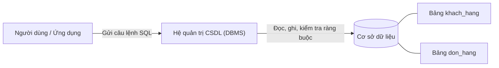
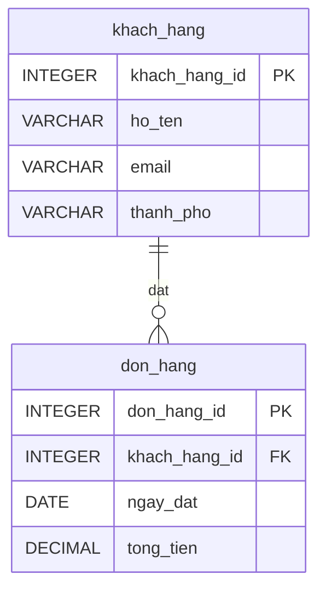

# Cơ sở dữ liệu, hệ quản trị, bảng, hàng và cột

Khi một ứng dụng bán hàng cần lưu khách hàng, đơn hàng và số tiền thanh toán, dữ liệu phải tồn tại sau khi ứng dụng tắt, có thể tìm kiếm lại và được nhiều người sử dụng một cách nhất quán. **Cơ sở dữ liệu (database)** giúp tổ chức dữ liệu đó; **hệ quản trị cơ sở dữ liệu (DBMS)** cung cấp cơ chế lưu trữ, truy cập và bảo vệ dữ liệu. Trong cơ sở dữ liệu quan hệ, dữ liệu chủ yếu được biểu diễn dưới dạng **bảng (table)**, gồm **hàng (row)** và **cột (column)**.

Đây là các khái niệm nền tảng để đọc, viết và hiểu câu lệnh SQL. Bài học dùng ví dụ một hệ thống quản lý khách hàng và đơn hàng; các câu lệnh SQL phía dưới minh họa cách biến cấu trúc dữ liệu thành những thao tác cụ thể.

## 1. Bức tranh tổng thể: dữ liệu nằm ở đâu?

Xem luồng xử lý đơn giản:



| Thành phần | Trả lời câu hỏi | Vai trò chính |
| --- | --- | --- |
| **Cơ sở dữ liệu (database)** | Dữ liệu được tổ chức ở đâu? | Tập hợp dữ liệu có cấu trúc, liên quan với nhau và được quản lý lâu dài. |
| **Hệ quản trị CSDL (DBMS)** | Ai quản lý và cho phép truy cập dữ liệu? | Phần mềm xử lý truy vấn, ghi/đọc, kiểm soát quyền, ràng buộc, giao dịch và nhiều chức năng quản trị. |
| **SQL** | Ứng dụng giao tiếp với CSDL quan hệ bằng cách nào? | Ngôn ngữ dùng để định nghĩa, truy vấn và thay đổi dữ liệu cũng như một số đối tượng trong CSDL. |
| **Bảng (table)** | Một loại dữ liệu được biểu diễn như thế nào? | Cấu trúc gồm các cột và các hàng, thường mô tả một nhóm thực thể hoặc sự kiện. |
| **Hàng (row)** | Một bản ghi cụ thể là gì? | Một tập giá trị của các cột, ví dụ thông tin của một khách hàng. |
| **Cột (column)** | Mỗi bản ghi có những thuộc tính nào? | Một trường dữ liệu có tên, kiểu dữ liệu và có thể có ràng buộc. |

**Ví dụ:** Một cửa hàng sử dụng PostgreSQL để quản lý dữ liệu. PostgreSQL là **DBMS**; cơ sở dữ liệu tên `shop` là một **database**; `khach_hang` là một **table** trong database; bản ghi của khách hàng An là một **row**; `ho_ten` là một **column**. Câu lệnh `SELECT ho_ten FROM khach_hang;` là **SQL** dùng để yêu cầu DBMS đọc dữ liệu.

Một hệ quản trị có thể quản lý nhiều cơ sở dữ liệu. Mỗi cơ sở dữ liệu lại có thể chứa nhiều bảng và các đối tượng khác như chỉ mục (index), khung nhìn (view) hoặc ràng buộc (constraint). Cách phân chia database/schema và phạm vi truy cập giữa chúng phụ thuộc từng hệ quản trị.

## 2. Cơ sở dữ liệu là gì?

**Cơ sở dữ liệu** là tập hợp dữ liệu được tổ chức theo một mô hình xác định để hỗ trợ lưu trữ, tra cứu, cập nhật và duy trì tính nhất quán. Dữ liệu không chỉ là các dòng chữ: cấu trúc và quan hệ giữa dữ liệu cũng rất quan trọng.

Ví dụ, một cửa hàng cần lưu:

- **Khách hàng:** mã khách hàng, họ tên, email, thành phố.
- **Đơn hàng:** mã đơn hàng, khách hàng đặt, ngày đặt, tổng tiền.
- **Sản phẩm:** mã sản phẩm, tên, giá, trạng thái bán.

Nếu lưu tất cả bằng các tệp văn bản rời, chương trình phải tự giải quyết nhiều vấn đề: hai người sửa cùng lúc, tìm dữ liệu theo điều kiện, tránh mã khách hàng trùng nhau, hoặc xử lý khi một thao tác ghi bị lỗi giữa chừng. Cơ sở dữ liệu cùng DBMS cung cấp nền tảng để quản lý những tình huống này.

### 2.1. Cơ sở dữ liệu quan hệ

Trong **cơ sở dữ liệu quan hệ (relational database)**, dữ liệu được mô hình hóa thành các quan hệ, thường được trình bày dưới dạng bảng. Mỗi bảng có những cột xác định; các hàng chứa giá trị tương ứng. Các bảng có thể liên hệ với nhau thông qua khóa.

Chẳng hạn, thay vì ghi lại toàn bộ tên và email khách hàng trên từng đơn, bảng đơn hàng lưu `khach_hang_id` để liên kết tới khách hàng tương ứng. Điều này giúp giảm dữ liệu lặp và xác định rõ đơn hàng thuộc về ai.

Ngoài mô hình quan hệ còn có các mô hình khác như tài liệu (document), khóa–giá trị (key–value) hoặc đồ thị (graph). **SQL** được dùng phổ biến với hệ quản trị cơ sở dữ liệu quan hệ; chi tiết bài học này tập trung vào mô hình ấy.

### 2.2. Dữ liệu khác với cấu trúc dữ liệu

Hãy phân biệt hai lớp:

- **Cấu trúc (schema/định nghĩa):** có bảng nào, cột tên gì, kiểu dữ liệu nào, cột nào không được để trống, các bảng liên kết ra sao.
- **Dữ liệu thực tế:** những hàng hiện đang lưu, chẳng hạn khách hàng `1 - An` hay đơn hàng `101`.

Khi có thêm một khách hàng, thông thường ta **thêm một hàng** vào bảng đã có; không cần tạo một bảng mới. Khi nghiệp vụ cần lưu ngày sinh mà trước đây chưa có, ta mới cần cân nhắc **thay đổi cấu trúc bảng** để thêm cột.

Trong một số DBMS, từ `schema` còn chỉ **không gian tên** chứa bảng và đối tượng (ví dụ `public.khach_hang` của PostgreSQL). Ngữ cảnh sẽ cho biết người nói đang đề cập tới mô tả cấu trúc nói chung hay một schema cụ thể của DBMS.

## 3. Hệ quản trị cơ sở dữ liệu (DBMS) làm gì?

**DBMS (Database Management System)** là phần mềm làm trung gian giữa ứng dụng/người dùng và dữ liệu được quản lý. Ứng dụng gửi yêu cầu, DBMS phân tích và thực hiện yêu cầu theo quyền hạn và quy tắc đã thiết lập.

Các trách nhiệm thường gặp gồm:

1. **Lưu trữ và truy xuất:** ghi dữ liệu xuống bộ nhớ bền vững, đọc lại theo truy vấn.
2. **Xử lý SQL:** phân tích câu lệnh và chọn cách thực hiện phù hợp.
3. **Bảo đảm toàn vẹn:** kiểm tra các ràng buộc như khóa chính không trùng hoặc khóa ngoại phải trỏ đến bản ghi hợp lệ.
4. **Điều phối truy cập đồng thời:** hỗ trợ nhiều phiên làm việc và kiểm soát ảnh hưởng của các thao tác cùng lúc.
5. **Quản lý giao dịch:** hỗ trợ nhóm thay đổi cùng thành công hoặc được hoàn tác khi cần, theo cơ chế giao dịch và mức cô lập của hệ quản trị.
6. **Bảo mật và vận hành:** hỗ trợ tài khoản, phân quyền, ghi log và cơ chế phục hồi/sao lưu tùy sản phẩm và cấu hình.

Một số DBMS quan hệ phổ biến là **PostgreSQL, MySQL, MariaDB, Microsoft SQL Server, Oracle Database và SQLite**. PostgreSQL/MySQL/SQL Server thường vận hành dưới dạng dịch vụ có thể phục vụ nhiều kết nối; SQLite là thư viện cơ sở dữ liệu nhúng, thường lưu một database trong một tệp. Chúng đều có thể dùng SQL, nhưng không hỗ trợ mọi cú pháp và tính năng hoàn toàn giống nhau.

**Phân biệt quan trọng:** DBMS là *phần mềm quản lý*; database là *tập hợp dữ liệu và đối tượng được phần mềm đó quản lý*. SQL là *ngôn ngữ yêu cầu thao tác*, không phải tên gọi thay thế cho DBMS hoặc database.

## 4. Bảng, hàng, cột và ô dữ liệu

Hình dung bảng `khach_hang` có dữ liệu:

| khach_hang_id | ho_ten | email | thanh_pho |
| ---: | --- | --- | --- |
| 1 | An | an@example.com | Hà Nội |
| 2 | Bình | binh@example.com | Đà Nẵng |
| 3 | Chi | `NULL` | `NULL` |

Ở đây:

- **Bảng `khach_hang`** chứa thông tin các khách hàng.
- **Cột `khach_hang_id`** biểu diễn mã khách hàng; **`ho_ten`**, **`email`**, **`thanh_pho`** biểu diễn các thuộc tính khác.
- **Hàng thứ nhất** là một bản ghi đầy đủ về khách hàng An: mã `1`, email `an@example.com`, thành phố `Hà Nội`.
- **Ô dữ liệu (cell)** là vị trí giao giữa một hàng và một cột; ô `thanh_pho` của khách hàng Bình chứa giá trị `Đà Nẵng`.

Trong thuật ngữ quan hệ, hàng còn được gọi là **tuple**, cột còn được gọi là **attribute**. Trong SQL thực tế, các từ *row* và *column* thông dụng hơn.

### 4.1. Cột định nghĩa những giá trị có thể lưu

Mỗi cột thường có:

| Thành phần | Ví dụ | Ý nghĩa |
| --- | --- | --- |
| **Tên cột** | `ho_ten` | Xác định thuộc tính để truy vấn. |
| **Kiểu dữ liệu** | `VARCHAR(100)` | Dành cho chuỗi ký tự có độ dài tối đa được khai báo. |
| **Khả năng để trống** | `NOT NULL` | Không cho phép giá trị `NULL` ở cột đó. |
| **Ràng buộc** | `UNIQUE` | Không cho phép trùng các giá trị thuộc phạm vi ràng buộc theo quy tắc DBMS. |
| **Giá trị mặc định** | `DEFAULT ...` | Giá trị DBMS có thể điền khi lệnh chèn bỏ qua cột. |

Một số kiểu dữ liệu thường dùng:

- `INTEGER` / `INT`: số nguyên, chẳng hạn mã khách hàng.
- `VARCHAR(n)`: chuỗi ký tự có độ dài tối đa khai báo.
- `DATE`: ngày theo lịch.
- `DECIMAL(p, s)`: số thập phân với độ chính xác và số chữ số phần thập phân được chỉ định; phù hợp hơn số thực dấu phẩy động khi cần lưu các giá trị tiền tệ có quy tắc làm tròn rõ ràng.
- `BOOLEAN`: giá trị đúng/sai, với cách hỗ trợ khác nhau giữa các DBMS.

Kiểu dữ liệu giúp hạn chế lưu sai dạng giá trị. Ví dụ, một cột ngày có kiểu `DATE` giúp hệ quản trị xử lý ngày như ngày thay vì một chuỗi bất kỳ.

### 4.2. Hàng lưu một bản ghi

Một **hàng** chứa các giá trị ứng với các cột của bảng. Với bảng khách hàng, mỗi hàng biểu diễn một khách hàng. Khi chèn thêm một khách hàng, số hàng tăng lên; số cột không đổi.

Có ba điểm cần nhớ:

- **Thứ tự hàng không được bảo đảm.** SQL không mặc định xem “hàng đầu tiên” hay “hàng cuối cùng” là cố định. Muốn kết quả sắp xếp xác định, dùng `ORDER BY`.
- **Bảng không tự bảo đảm mỗi hàng là duy nhất nếu không có ràng buộc thích hợp.** Khi cần một cách định danh ổn định, hãy thiết kế khóa chính.
- **`NULL` không giống `0`, chuỗi rỗng `''` hay chữ `'NULL'`.** Nó biểu thị giá trị chưa biết, thiếu hoặc không áp dụng, tùy ý nghĩa của cột.

Ví dụ với khách hàng Chi, `email = NULL` có nghĩa thông tin email chưa được lưu. Để tìm các hàng có giá trị thiếu, dùng `IS NULL`, không dùng phép so sánh `= NULL`:

```sql
SELECT khach_hang_id, ho_ten
FROM khach_hang
WHERE email IS NULL;
```

Kết quả trong dữ liệu ví dụ là khách hàng `3 - Chi`.

### 4.3. Một bảng nên biểu diễn điều gì?

Thông thường, một bảng biểu diễn **một loại thực thể hoặc sự kiện**: khách hàng, đơn hàng, sản phẩm, lượt thanh toán. Tên bảng giúp người đọc hiểu loại dữ liệu; cột mô tả thuộc tính của loại đó; mỗi hàng là một trường hợp cụ thể.

Không nên hiểu “mỗi bảng là một tệp Excel”: giao diện có thể giống bảng tính, nhưng DBMS kiểm soát kiểu dữ liệu, ràng buộc, khóa, giao dịch và quan hệ giữa nhiều bảng. Bảng cũng không có ngữ nghĩa địa chỉ ô kiểu `A1`; truy vấn xác định dữ liệu bằng tên cột, điều kiện và khóa.

## 5. Khóa chính và khóa ngoại liên kết các bảng

Trong một hệ thống có nhiều bảng, cách xác định duy nhất một bản ghi và cách nối các bản ghi với nhau là thiết yếu.

### 5.1. Khóa chính (primary key)

**Khóa chính (PRIMARY KEY)** là cột hoặc nhóm cột dùng để định danh duy nhất từng hàng trong một bảng. Giá trị khóa chính không được `NULL` và không được trùng.

Với `khach_hang`, chọn `khach_hang_id` làm khóa chính:

| khach_hang_id | ho_ten |
| ---: | --- |
| 1 | An |
| 2 | Bình |
| 3 | Chi |

Không thể chèn thêm khách hàng khác cùng `khach_hang_id = 1` nếu ràng buộc khóa chính đang được DBMS thực thi. Họ tên không phù hợp làm khóa chính vì nhiều người có thể trùng tên và tên có thể thay đổi.

Khóa chính có thể gồm nhiều cột (khóa chính tổng hợp), nhưng với ví dụ nhập môn, một mã định danh đơn giản dễ sử dụng hơn.

### 5.2. Khóa ngoại (foreign key)

**Khóa ngoại (FOREIGN KEY)** là cột hoặc nhóm cột tham chiếu đến khóa của bảng khác (hoặc chính bảng đó), tạo ràng buộc toàn vẹn tham chiếu. Trong ví dụ:

**Bảng `khach_hang`**

| khach_hang_id (PK) | ho_ten |
| ---: | --- |
| 1 | An |
| 2 | Bình |
| 3 | Chi |

**Bảng `don_hang`**

| don_hang_id (PK) | khach_hang_id (FK) | ngay_dat | tong_tien |
| ---: | ---: | --- | ---: |
| 101 | 1 | 2026-11-01 | 250000.00 |
| 102 | 1 | 2026-11-03 | 120000.00 |
| 103 | 2 | 2026-11-03 | 300000.00 |

Cột `don_hang.khach_hang_id` tham chiếu đến `khach_hang.khach_hang_id`:

- Đơn hàng `101` và `102` đều thuộc khách hàng **An**.
- Đơn hàng `103` thuộc khách hàng **Bình**.
- Khách hàng **Chi** hiện chưa có đơn hàng.

Đây là quan hệ **một–nhiều (one-to-many)**: một khách hàng có thể có nhiều đơn hàng; theo cấu trúc ví dụ, mỗi đơn hàng thuộc đúng một khách hàng.



Nếu cố thêm đơn hàng với `khach_hang_id = 999` trong khi không có khách hàng `999`, DBMS thực thi khóa ngoại sẽ từ chối thao tác. Cột khóa ngoại **có thể lặp** giữa nhiều hàng con: điều đó cần thiết vì một khách hàng có thể đặt nhiều đơn hàng.

Một khóa ngoại không mặc nhiên là `NOT NULL`; tùy thiết kế, có thể cho phép giá trị thiếu. Ví dụ này dùng `NOT NULL` để yêu cầu mọi đơn hàng đều có khách hàng.

## 6. Từ mô hình dữ liệu đến lệnh SQL

Ta sẽ tạo hai bảng, thêm dữ liệu rồi truy vấn. Những ví dụ dưới đây sử dụng các cấu trúc SQL quan hệ phổ biến. Mỗi DBMS có thể có khác biệt về cú pháp, kiểu dữ liệu, cách sinh mã tự động và cách bật một số ràng buộc.

### 6.1. Tạo bảng: cấu trúc và ràng buộc

```sql
CREATE TABLE khach_hang (
    khach_hang_id INTEGER PRIMARY KEY,
    ho_ten VARCHAR(100) NOT NULL,
    email VARCHAR(255) UNIQUE,
    thanh_pho VARCHAR(100)
);

CREATE TABLE don_hang (
    don_hang_id INTEGER PRIMARY KEY,
    khach_hang_id INTEGER NOT NULL,
    ngay_dat DATE NOT NULL,
    tong_tien DECIMAL(12, 2) NOT NULL CHECK (tong_tien >= 0),
    FOREIGN KEY (khach_hang_id)
        REFERENCES khach_hang (khach_hang_id)
);
```

Đọc câu lệnh từ ngoài vào trong:

1. `CREATE TABLE khach_hang`: khai báo một bảng tên `khach_hang`.
2. Mỗi dòng bên trong mô tả một cột với tên và kiểu dữ liệu, ví dụ `ho_ten VARCHAR(100)`.
3. `NOT NULL` buộc giá trị cột phải được cung cấp; `UNIQUE` quy định tính duy nhất trong phạm vi phù hợp.
4. `PRIMARY KEY` xác lập khóa chính.
5. `CHECK (tong_tien >= 0)` biểu diễn quy tắc tổng tiền không được âm.
6. `FOREIGN KEY ... REFERENCES ...` ràng buộc mã khách hàng ở bảng đơn hàng phải tham chiếu đúng khóa bên bảng khách hàng.

Lệnh `CREATE TABLE` định nghĩa **cấu trúc**. Chạy xong lệnh, bảng có thể vẫn **chưa có hàng dữ liệu nào**.

### 6.2. Chèn các hàng: `INSERT`

```sql
INSERT INTO khach_hang
    (khach_hang_id, ho_ten, email, thanh_pho)
VALUES
    (1, 'An', 'an@example.com', 'Hà Nội'),
    (2, 'Bình', 'binh@example.com', 'Đà Nẵng'),
    (3, 'Chi', NULL, NULL);

INSERT INTO don_hang
    (don_hang_id, khach_hang_id, ngay_dat, tong_tien)
VALUES
    (101, 1, '2026-11-01', 250000.00),
    (102, 1, '2026-11-03', 120000.00),
    (103, 2, '2026-11-03', 300000.00);
```

Tên cột trong ngoặc đầu là các **cột sẽ nhận dữ liệu**; từng bộ giá trị trong `VALUES` tạo **một hàng**. Thứ tự giá trị phải khớp thứ tự cột đã nêu. Ví dụ, số `101` là mã đơn hàng; số `1` kế tiếp là mã khách hàng đặt đơn.

Các giá trị khóa ngoại phải tham chiếu tới khách hàng có sẵn, vì vậy ở ví dụ này ta chèn khách hàng **trước**, sau đó mới chèn đơn hàng. Dấu nháy đơn bao quanh chuỗi và giá trị ngày dạng chuỗi trong các lệnh minh họa; `NULL` là từ khóa SQL, không có nháy.

### 6.3. Đọc cột và lọc hàng: `SELECT`

```sql
SELECT khach_hang_id, ho_ten, thanh_pho
FROM khach_hang
WHERE thanh_pho = 'Đà Nẵng'
ORDER BY khach_hang_id;
```

Ý nghĩa:

- `SELECT khach_hang_id, ho_ten, thanh_pho`: chọn **các cột cần trả về**.
- `FROM khach_hang`: lấy dữ liệu từ **bảng** khách hàng.
- `WHERE thanh_pho = 'Đà Nẵng'`: chỉ giữ **các hàng** thỏa điều kiện.
- `ORDER BY khach_hang_id`: sắp xếp kết quả theo mã khách hàng.

Kết quả:

| khach_hang_id | ho_ten | thanh_pho |
| ---: | --- | --- |
| 2 | Bình | Đà Nẵng |

Một câu lệnh `SELECT` có thể trả về 0, 1 hoặc nhiều hàng tùy dữ liệu và điều kiện lọc. Nếu viết `SELECT * FROM khach_hang;`, dấu `*` yêu cầu tất cả các cột đang được chọn từ bảng đó. Trong ứng dụng thực tế, liệt kê rõ các cột thường giúp xác định kết quả và giảm việc lấy dữ liệu không cần thiết.

### 6.4. Nối các bảng: `JOIN`

Vì bảng đơn hàng chỉ lưu mã khách hàng, cần **JOIN** nếu muốn hiển thị họ tên bên cạnh thông tin đơn:

```sql
SELECT
    k.ho_ten,
    d.don_hang_id,
    d.tong_tien
FROM khach_hang AS k
JOIN don_hang AS d
    ON d.khach_hang_id = k.khach_hang_id
ORDER BY d.don_hang_id;
```

Kết quả:

| ho_ten | don_hang_id | tong_tien |
| --- | ---: | ---: |
| An | 101 | 250000.00 |
| An | 102 | 120000.00 |
| Bình | 103 | 300000.00 |

`k` và `d` là bí danh (alias) của bảng, giúp viết gọn tên cột và chỉ rõ cột thuộc bảng nào. Điều kiện `ON` xác định cách các hàng tương ứng với nhau qua khóa. Đây là `INNER JOIN` (từ khóa `INNER` có thể lược bỏ), nên khách hàng Chi **không xuất hiện** vì chưa có đơn hàng khớp. Nếu muốn lấy cả khách hàng chưa có đơn, có thể tìm hiểu `LEFT JOIN` ở bài truy vấn nâng cao.

### 6.5. Thay đổi hoặc xóa hàng

`UPDATE` sửa giá trị ở những hàng thỏa điều kiện:

```sql
UPDATE khach_hang
SET thanh_pho = 'Huế'
WHERE khach_hang_id = 3;
```

Lệnh này đổi thành phố của khách hàng Chi; **không thêm cột, không tạo hàng mới**.

`DELETE` xóa những hàng thỏa điều kiện:

```sql
DELETE FROM don_hang
WHERE don_hang_id = 103;
```

Lệnh xóa làm số hàng trong `don_hang` giảm đi, nhưng định nghĩa các cột của bảng vẫn còn. Các câu lệnh `UPDATE` và `DELETE` có thể tác động đến nhiều hàng nếu điều kiện chọn nhiều bản ghi; khi bỏ `WHERE`, chúng có thể ảnh hưởng đến toàn bộ bảng. Hãy thực hành các lệnh thay đổi dữ liệu trên cơ sở dữ liệu thử nghiệm.

### 6.6. Nhóm câu lệnh SQL theo mục đích

| Nhóm | Lệnh ví dụ | Công việc |
| --- | --- | --- |
| **DDL** — Data Definition Language | `CREATE TABLE`, `ALTER TABLE`, `DROP TABLE` | Tạo và thay đổi định nghĩa các đối tượng dữ liệu. |
| **DML** — Data Manipulation Language | `INSERT`, `UPDATE`, `DELETE` | Thêm, sửa, xóa dữ liệu ở các hàng. |
| **Truy vấn dữ liệu** — thường gọi DQL | `SELECT` | Đọc và kết hợp dữ liệu theo yêu cầu; một số cách phân loại gộp `SELECT` vào DML. |

Ngoài các lệnh này, SQL còn có các lệnh cho quản lý quyền và giao dịch, tùy hệ quản trị. Người mới bắt đầu nên nắm trước sự khác biệt giữa **thay đổi cấu trúc** và **thay đổi dữ liệu**.

## 7. Những nhầm lẫn thường gặp

| Nhầm lẫn | Cách hiểu đúng |
| --- | --- |
| “SQL chính là cơ sở dữ liệu.” | SQL là ngôn ngữ; cơ sở dữ liệu là nơi tổ chức dữ liệu; DBMS xử lý lệnh và quản lý dữ liệu. |
| “Tạo bảng tức là đã có dữ liệu.” | `CREATE TABLE` tạo định nghĩa bảng; `INSERT` mới thêm các hàng cụ thể. |
| “Cột và hàng đều là trường dữ liệu.” | Cột định nghĩa thuộc tính; hàng là một bản ghi có các giá trị tương ứng. |
| “Mã khách hàng giống nhau trong mọi bảng đều bị cấm.” | Khóa chính phải duy nhất trong bảng của nó; khóa ngoại có thể lặp để biểu diễn quan hệ một–nhiều. |
| “Không có email thì lưu chuỗi 'NULL'.” | `NULL` là dấu hiệu thiếu giá trị trong SQL, khác chuỗi ký tự `'NULL'`. |
| “`SELECT` luôn trả dữ liệu theo thứ tự chèn.” | Không được dựa vào thứ tự hàng nếu không dùng `ORDER BY`. |
| “`WHERE email = NULL` tìm email trống.” | Dùng `WHERE email IS NULL` để kiểm tra giá trị `NULL`. |
| “Mỗi đơn hàng phải lặp lại tất cả thông tin khách hàng.” | Có thể lưu khóa ngoại `khach_hang_id` rồi nối bảng khi cần. |

### Cách tư duy khi thiết kế một bảng mới

Trước khi viết SQL, hãy tự trả lời:

1. **Bảng lưu loại sự vật/sự kiện nào?** Ví dụ: khách hàng hay đơn hàng.
2. **Một hàng đại diện cho cái gì?** Một khách hàng duy nhất, một lần đặt hàng, hay một dòng sản phẩm trong đơn?
3. **Những thuộc tính nào cần lưu thành cột?** Tên, ngày, mã, số tiền… và kiểu dữ liệu nào phù hợp?
4. **Làm sao nhận diện duy nhất từng hàng?** Chọn khóa chính nào?
5. **Bảng này liên hệ với bảng nào khác?** Khóa ngoại nào biểu diễn quan hệ đó?
6. **Quy tắc nào phải luôn đúng?** Không trùng mã, không thiếu tên bắt buộc, số tiền không âm, mã khách hàng tham chiếu hợp lệ…

Trả lời các câu hỏi này sẽ giúp cấu trúc dữ liệu rõ ràng trước khi viết câu lệnh SQL.

## 8. Tự thực hành với ví dụ khách hàng – đơn hàng

Hãy thực hiện lại hai lệnh `CREATE TABLE` rồi hai lệnh `INSERT` ở mục 6 trong một database thử nghiệm mới, sau đó thử trả lời:

**Bài 1.** Chỉ lấy mã và họ tên của các khách hàng có email.

```sql
SELECT khach_hang_id, ho_ten
FROM khach_hang
WHERE email IS NOT NULL
ORDER BY khach_hang_id;
```

**Kết quả dự kiến:** An và Bình. Chi không có email nên không thỏa `IS NOT NULL`.

**Bài 2.** Đếm số bản ghi của bảng `don_hang` trước khi thực hiện lệnh `DELETE` ở mục 6.5.

```sql
SELECT COUNT(*) AS so_don_hang
FROM don_hang;
```

**Kết quả dự kiến:** `3`. Hàm `COUNT(*)` đếm số hàng trong kết quả, không phải số cột.

**Bài 3.** Xem tất cả đơn hàng của khách hàng An (mã `1`), sắp xếp theo mã đơn.

```sql
SELECT don_hang_id, ngay_dat, tong_tien
FROM don_hang
WHERE khach_hang_id = 1
ORDER BY don_hang_id;
```

**Kết quả dự kiến:** Các đơn `101` và `102`. Điều kiện lọc dựa trên giá trị **khóa ngoại**, còn dữ liệu được hiển thị theo những **cột** nêu trong `SELECT`.

**Bài 4.** Giả sử định chèn một đơn hàng với `khach_hang_id = 999` nhưng bảng `khach_hang` không có mã `999`. Hãy dự đoán kết quả.

**Giải thích:** DBMS đang thực thi ràng buộc khóa ngoại sẽ báo lỗi toàn vẹn tham chiếu. Muốn lưu đơn hàng, cần tham chiếu khách hàng hợp lệ (hoặc thay đổi thiết kế dữ liệu theo yêu cầu nghiệp vụ, không bỏ ràng buộc chỉ để lệnh chạy qua).

> **Điểm cần ghi nhớ:** Database chứa dữ liệu được tổ chức; DBMS quản lý dữ liệu; SQL là ngôn ngữ gửi yêu cầu. Trong mô hình quan hệ, bảng có **cột** mô tả thuộc tính và **hàng** chứa từng bản ghi. Khóa chính định danh hàng, khóa ngoại liên kết các bảng, còn các câu lệnh SQL thao tác trên cấu trúc hoặc dữ liệu theo quy tắc đã khai báo.
