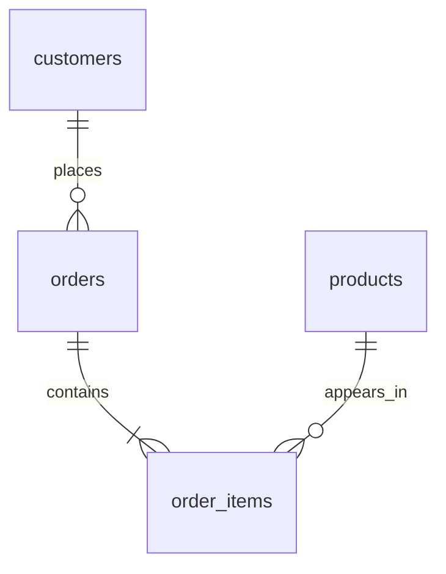

# Lộ trình từ truy vấn cơ bản đến xử lý dữ liệu nâng cao

SQL (*Structured Query Language*) là ngôn ngữ dùng để mô tả dữ liệu cần lấy, cách kết hợp dữ liệu và cách thay đổi dữ liệu trong cơ sở dữ liệu quan hệ. Khi học SQL, mục tiêu không chỉ là nhớ cú pháp `SELECT`, `JOIN` hay `GROUP BY`, mà là chuyển được một câu hỏi nghiệp vụ thành truy vấn **đúng ý nghĩa, đúng số liệu, dễ đọc và đủ hiệu quả**.

Bài học này xây dựng một lộ trình liên tục: đọc bảng đơn → kết hợp nhiều bảng → tổng hợp số liệu → phân tích theo nhóm và thời gian → xử lý tình huống phức tạp → cập nhật dữ liệu an toàn và tối ưu truy vấn. Các ví dụ sử dụng **PostgreSQL**; các khái niệm như `SELECT`, `JOIN`, `GROUP BY`, `HAVING`, subquery và window function cũng có trong nhiều hệ quản trị khác, nhưng cú pháp ngày giờ, phân trang, chuyển kiểu và công cụ xem kế hoạch thực thi có thể khác nhau.

## 1. Đích đến của lộ trình

Hãy hình dung một hệ thống bán hàng có khách hàng, đơn hàng, sản phẩm và chi tiết đơn hàng. Những câu hỏi tăng dần độ khó sẽ là:

1. Những đơn hàng nào đã được thanh toán trong tháng 1?
2. Ai đặt các đơn hàng đó, mỗi đơn chứa sản phẩm gì?
3. Doanh thu theo khách hàng hoặc theo tháng là bao nhiêu?
4. Đơn hàng nào có giá trị cao hơn mức trung bình?
5. Đơn thanh toán mới nhất của từng khách hàng là đơn nào? Doanh thu cộng dồn biến đổi ra sao?
6. Làm thế nào giữ kết quả đúng khi có `NULL`, khách chưa mua hàng, đơn bị hủy, dữ liệu trùng hoặc khối lượng bản ghi lớn?

Mỗi câu hỏi yêu cầu một lớp kỹ năng mới. Vì vậy nên học theo thứ tự phụ thuộc, thay vì bắt đầu ngay với một truy vấn dài chứa nhiều `JOIN` và CTE.

| Chặng | Kỹ năng trọng tâm | Khả năng cần đạt |
| --- | --- | --- |
| 1. Đọc dữ liệu | `SELECT`, `WHERE`, `ORDER BY`, `LIMIT`, `NULL` | Tìm đúng những hàng và cột cần thiết trong một bảng |
| 2. Hiểu quan hệ | Khóa chính, khóa ngoại, `INNER JOIN`, `LEFT JOIN` | Ghép bảng mà không vô tình làm mất hay nhân bản kết quả |
| 3. Tổng hợp | `COUNT`, `SUM`, `AVG`, `GROUP BY`, `HAVING` | Trả lời câu hỏi về số lượng, doanh thu, giá trị trung bình |
| 4. Chia bài toán | Subquery, `EXISTS`, CTE (`WITH`) | Viết truy vấn nhiều bước dễ giải thích và bảo trì |
| 5. Phân tích nâng cao | Window function, xử lý thời gian, `CASE` | Xếp hạng, tìm bản ghi mới nhất, tính lũy kế và xu hướng |
| 6. Vận hành an toàn | Transaction, ràng buộc, index, `EXPLAIN` | Thay đổi dữ liệu có kiểm soát và chẩn đoán truy vấn chậm |

## 2. Dữ liệu mẫu và cách tư duy về từng bảng

Trước khi viết truy vấn, phải biết **mỗi hàng đại diện cho điều gì** (*grain*): một hàng trong `customers` là một khách hàng; một hàng trong `orders` là một đơn; một hàng trong `order_items` là một sản phẩm xuất hiện trong một đơn. Nhầm *grain* là nguyên nhân phổ biến khiến số lượng hoặc doanh thu bị tính nhiều lần sau khi nối bảng.

Quan hệ của ví dụ:



- `customers.customer_id`, `products.product_id` và `orders.order_id` là **khóa chính** (*primary key*), xác định duy nhất một bản ghi.
- `orders.customer_id`, `order_items.order_id` và `order_items.product_id` là **khóa ngoại** (*foreign key*), liên kết các bảng.
- `order_items` có khóa chính ghép `(order_id, product_id)`: trong mô hình minh họa, một sản phẩm xuất hiện tối đa một dòng trong mỗi đơn.
- `products.list_price` là giá hiện hành; `order_items.unit_price` là **giá tại thời điểm mua**. Tính doanh thu từ `unit_price` để lịch sử giao dịch không thay đổi khi bảng giá được cập nhật.

Có thể chạy các câu lệnh sau trong một cơ sở dữ liệu PostgreSQL dùng để thực hành. Nên dùng cơ sở dữ liệu thử nghiệm riêng, không dùng cơ sở dữ liệu vận hành thật.

```sql
CREATE TABLE customers (
    customer_id INTEGER PRIMARY KEY,
    full_name VARCHAR(100) NOT NULL,
    email VARCHAR(200) UNIQUE NOT NULL
);

CREATE TABLE products (
    product_id INTEGER PRIMARY KEY,
    product_name VARCHAR(100) NOT NULL,
    list_price NUMERIC(12, 2) NOT NULL CHECK (list_price >= 0)
);

CREATE TABLE orders (
    order_id INTEGER PRIMARY KEY,
    customer_id INTEGER NOT NULL REFERENCES customers(customer_id),
    placed_at TIMESTAMP NOT NULL,
    status VARCHAR(20) NOT NULL
        CHECK (status IN ('pending', 'paid', 'cancelled'))
);

CREATE TABLE order_items (
    order_id INTEGER NOT NULL REFERENCES orders(order_id),
    product_id INTEGER NOT NULL REFERENCES products(product_id),
    quantity INTEGER NOT NULL CHECK (quantity > 0),
    unit_price NUMERIC(12, 2) NOT NULL CHECK (unit_price >= 0),
    PRIMARY KEY (order_id, product_id)
);

INSERT INTO customers (customer_id, full_name, email) VALUES
    (1, 'An',   'an@example.test'),
    (2, 'Binh', 'binh@example.test'),
    (3, 'Chi',  'chi@example.test'),
    (4, 'Dung', 'dung@example.test');

INSERT INTO products (product_id, product_name, list_price) VALUES
    (10, 'Sach SQL', 50.00),
    (11, 'Khoa hoc SQL', 100.00),
    (12, 'So tay', 40.00);

INSERT INTO orders (order_id, customer_id, placed_at, status) VALUES
    (101, 1, TIMESTAMP '2025-01-03 10:00:00', 'paid'),
    (102, 1, TIMESTAMP '2025-01-07 11:00:00', 'cancelled'),
    (103, 2, TIMESTAMP '2025-01-08 09:00:00', 'paid'),
    (104, 3, TIMESTAMP '2025-02-02 14:00:00', 'paid'),
    (105, 1, TIMESTAMP '2025-02-10 08:00:00', 'paid'),
    (106, 2, TIMESTAMP '2025-02-11 16:00:00', 'paid');

INSERT INTO order_items (order_id, product_id, quantity, unit_price) VALUES
    (101, 10, 2, 50.00), (101, 11, 1, 100.00),
    (102, 12, 1, 40.00),
    (103, 10, 1, 50.00), (103, 12, 3, 40.00),
    (104, 11, 1, 100.00),
    (105, 12, 2, 40.00),
    (106, 11, 1, 100.00);
```

Để thống nhất ý nghĩa báo cáo, giả sử **chỉ đơn `status = 'paid'` được tính vào doanh thu**; đơn bị hủy không tạo doanh thu. Tổng tiền của một đơn bằng `SUM(quantity * unit_price)` trên các dòng chi tiết của đơn đó. Ví dụ, đơn `101` có giá trị `2 × 50 + 1 × 100 = 200`.

## 3. Chặng 1 — Truy vấn cơ bản: chọn, lọc, sắp xếp

### 3.1. Lấy cột cần thiết và đặt tên rõ ràng

```sql
SELECT order_id, customer_id, placed_at, status
FROM orders;
```

`SELECT` khai báo những cột muốn nhận; `FROM` chỉ định nguồn. Trong truy vấn dùng cho báo cáo hoặc ứng dụng, nên liệt kê cột thực sự cần thay vì mặc định `SELECT *`: dữ liệu trả về rõ ràng hơn và tránh phụ thuộc vào các cột mới được thêm sau này.

Có thể tính biểu thức và đặt bí danh (*alias*):

```sql
SELECT product_name, list_price, list_price * 1.10 AS estimated_price
FROM products;
```

Biểu thức trên chỉ tính một giá trị hiển thị; nó **không cập nhật** bảng `products`.

### 3.2. Lọc điều kiện đúng kiểu dữ liệu

```sql
SELECT order_id, placed_at
FROM orders
WHERE status = 'paid'
  AND placed_at >= TIMESTAMP '2025-01-01 00:00:00'
  AND placed_at <  TIMESTAMP '2025-02-01 00:00:00'
ORDER BY placed_at ASC, order_id ASC;
```

Đây là cách lấy đơn đã thanh toán trong tháng 1/2025. Dùng khoảng thời gian **đóng bên trái, mở bên phải** (`>=` đầu kỳ, `<` đầu kỳ kế tiếp) để bao phủ toàn bộ thời điểm trong tháng mà không phải đoán phần cuối của một ngày (`23:59:59.999...`). Hai đơn phù hợp là `101` và `103`.

Các toán tử thường gặp:

| Cú pháp | Ý nghĩa | Ví dụ |
| --- | --- | --- |
| `=`, `<>`, `>`, `>=`, `<`, `<=` | So sánh | `quantity >= 2` |
| `AND`, `OR`, `NOT` | Kết hợp điều kiện | `status = 'paid' AND customer_id = 1` |
| `IN (...)` | Thuộc một tập giá trị | `status IN ('paid', 'pending')` |
| `LIKE` | Khớp mẫu chuỗi (`%`: nhiều ký tự; `_`: một ký tự) | `full_name LIKE 'A%'` |
| `IS NULL`, `IS NOT NULL` | Kiểm tra giá trị thiếu | `email IS NOT NULL` |
| `BETWEEN a AND b` | Khoảng **bao gồm cả hai đầu** | `quantity BETWEEN 1 AND 3` |

Với giá trị `NULL`, `column = NULL` không hoạt động như phép so sánh thông thường: kết quả logic là *unknown*. Hãy dùng `IS NULL` hoặc `IS NOT NULL`. Cũng cần nhớ `WHERE` chỉ giữ những hàng có điều kiện là **true**; cả **false** lẫn **unknown** đều bị loại.

### 3.3. Sắp xếp, giới hạn và loại trùng

```sql
SELECT order_id, placed_at
FROM orders
WHERE status = 'paid'
ORDER BY placed_at DESC, order_id DESC
LIMIT 3;
```

`ORDER BY` quyết định thứ tự; `DESC` là giảm dần, `ASC` là tăng dần. `LIMIT 3` lấy ba hàng đầu tiên của **thứ tự đã chỉ định**. Khi nhiều hàng có cùng thời điểm, thêm `order_id` làm tiêu chí phân định để kết quả ổn định.

```sql
SELECT DISTINCT customer_id
FROM orders
WHERE status = 'paid';
```

`DISTINCT` loại các dòng trùng trong kết quả chiếu ra. Nó không sửa dữ liệu gốc và không nên được dùng để che một lỗi `JOIN` khiến số dòng tăng sai.

### 3.4. Hiểu thứ tự xử lý logic của truy vấn

Trong mô hình tư duy SQL, các phần được xử lý về mặt logic gần theo thứ tự:

```text
FROM / JOIN
    ↓
WHERE
    ↓
GROUP BY
    ↓
HAVING
    ↓
SELECT (và các biểu thức cửa sổ thích hợp)
    ↓
DISTINCT
    ↓
ORDER BY
    ↓
LIMIT / OFFSET
```

Đây là **thứ tự logic để hiểu kết quả**, không phải cam kết về thứ tự vật lý mà bộ tối ưu hóa thực thi. Nó giúp giải thích vì sao `WHERE` lọc bản ghi **trước khi** nhóm, còn `HAVING` lọc **sau khi** nhóm, và vì sao thường không thể dùng trực tiếp alias của `SELECT` trong `WHERE` cùng cấp.

**Mốc hoàn thành chặng 1:** Tự viết được truy vấn tìm đơn đã thanh toán trong một khoảng ngày, sắp xếp nhất quán và giải thích khác biệt giữa `NULL`, chuỗi rỗng và giá trị số `0`.

## 4. Chặng 2 — Kết hợp dữ liệu: `JOIN` và số dòng sau nối

### 4.1. `INNER JOIN`: lấy những cặp có quan hệ khớp

```sql
SELECT o.order_id, c.full_name, o.placed_at
FROM orders AS o
INNER JOIN customers AS c
    ON c.customer_id = o.customer_id
WHERE o.status = 'paid'
ORDER BY o.order_id;
```

`INNER JOIN` chỉ giữ các đơn có bản ghi khách hàng tương ứng. Khóa ngoại đã giúp đảm bảo điều này đối với bộ dữ liệu ví dụ. Alias `o` và `c` khiến các cột trùng tên như `customer_id` dễ phân biệt.

### 4.2. Nối quan hệ một-nhiều làm tăng số hàng

```sql
SELECT o.order_id, p.product_name, oi.quantity, oi.unit_price,
       oi.quantity * oi.unit_price AS line_amount
FROM orders AS o
JOIN order_items AS oi ON oi.order_id = o.order_id
JOIN products AS p ON p.product_id = oi.product_id
WHERE o.order_id = 101;
```

Đơn `101` sinh **hai dòng kết quả**, bởi nó có hai dòng trong `order_items`. Vì vậy `COUNT(*)` sau khi nối đơn hàng với chi tiết sẽ đếm **dòng sản phẩm**, không còn đếm **đơn hàng**. Nếu cần đếm đơn trong kết quả đã nối, hãy dùng cách phù hợp như `COUNT(DISTINCT o.order_id)` hoặc nhóm trước theo `order_id`.

### 4.3. `LEFT JOIN`: giữ cả những khách chưa có giao dịch

```sql
SELECT c.customer_id, c.full_name,
       COUNT(o.order_id) AS paid_order_count
FROM customers AS c
LEFT JOIN orders AS o
    ON o.customer_id = c.customer_id
   AND o.status = 'paid'
GROUP BY c.customer_id, c.full_name
ORDER BY c.customer_id;
```

Kết quả gồm cả khách `Dung` với `paid_order_count = 0`. Điều kiện `o.status = 'paid'` nằm trong `ON` để **giữ tất cả khách** ở phía trái; nếu chuyển nó xuống `WHERE`, những khách không có đơn khớp sẽ bị loại vì cột phía phải là `NULL`.

Ở đây `COUNT(o.order_id)` đếm các giá trị khóa đơn **khác `NULL`**. Nếu dùng `COUNT(*)`, khách không có đơn vẫn tạo một hàng sau `LEFT JOIN`, làm số đếm trở thành `1`.

Muốn tính doanh thu theo khách, phải nối tiếp chi tiết đơn và kiểm soát cấp độ tổng hợp:

```sql
SELECT c.customer_id, c.full_name,
       COALESCE(SUM(oi.quantity * oi.unit_price), 0) AS revenue
FROM customers AS c
LEFT JOIN orders AS o
    ON o.customer_id = c.customer_id
   AND o.status = 'paid'
LEFT JOIN order_items AS oi
    ON oi.order_id = o.order_id
GROUP BY c.customer_id, c.full_name
ORDER BY revenue DESC, c.customer_id;
```

`SUM` trên tập giá trị không có dòng chi tiết hữu ích trả `NULL`, nên `COALESCE(..., 0)` chuyển thành `0` phục vụ báo cáo. Theo dữ liệu mẫu, doanh thu của `An`, `Binh`, `Chi`, `Dung` lần lượt là `280`, `270`, `100`, `0`.

**Mốc hoàn thành chặng 2:** Với từng quan hệ, nói được đây là một-một hay một-nhiều; biết khi nào dùng `INNER JOIN`/`LEFT JOIN`; dự đoán số hàng và không đếm nhầm dòng chi tiết thành số đơn.

## 5. Chặng 3 — Tổng hợp số liệu: `GROUP BY` và `HAVING`

Hàm tổng hợp làm việc trên một tập hàng: `COUNT` đếm, `SUM` cộng, `AVG` tính trung bình, `MIN`/`MAX` tìm giá trị nhỏ nhất/lớn nhất.

```sql
SELECT o.order_id,
       SUM(oi.quantity * oi.unit_price) AS order_total
FROM orders AS o
JOIN order_items AS oi ON oi.order_id = o.order_id
WHERE o.status = 'paid'
GROUP BY o.order_id
ORDER BY o.order_id;
```

Mỗi nhóm `order_id` trở thành một hàng kết quả. Tiền đơn `101`, `103`, `104`, `105`, `106` lần lượt là `200`, `170`, `100`, `80`, `100`. Không được chọn tùy ý một cột chưa được nhóm hay tổng hợp: chẳng hạn, một đơn có thể chứa nhiều `product_id`, nên `product_id` riêng lẻ không xác định duy nhất cho nhóm theo `order_id`.

### `WHERE` khác `HAVING` ở đâu?

```sql
SELECT c.customer_id, c.full_name,
       SUM(oi.quantity * oi.unit_price) AS revenue
FROM customers AS c
JOIN orders AS o ON o.customer_id = c.customer_id
JOIN order_items AS oi ON oi.order_id = o.order_id
WHERE o.status = 'paid'
GROUP BY c.customer_id, c.full_name
HAVING SUM(oi.quantity * oi.unit_price) > 200
ORDER BY revenue DESC;
```

`WHERE` loại đơn chưa thanh toán **trước khi** cộng; `HAVING` giữ những **nhóm khách hàng** có doanh thu trên `200` **sau khi** cộng. Kết quả có `An` và `Binh`. Không thể thay trực tiếp điều kiện `HAVING SUM(...) > 200` bằng `WHERE SUM(...) > 200` ở cùng cấp truy vấn.

### Tổng hợp theo tháng

```sql
SELECT DATE_TRUNC('month', o.placed_at)::date AS month_start,
       COUNT(DISTINCT o.order_id) AS paid_orders,
       SUM(oi.quantity * oi.unit_price) AS revenue
FROM orders AS o
JOIN order_items AS oi ON oi.order_id = o.order_id
WHERE o.status = 'paid'
GROUP BY DATE_TRUNC('month', o.placed_at)::date
ORDER BY month_start;
```

`DATE_TRUNC` và toán tử `::date` ở đây là cú pháp PostgreSQL. Kết quả mẫu:

| Tháng | Số đơn thanh toán | Doanh thu |
| --- | ---: | ---: |
| 2025-01-01 | 2 | 370.00 |
| 2025-02-01 | 3 | 280.00 |

Tổng doanh thu là `650.00`. Cột số đơn dùng `COUNT(DISTINCT o.order_id)` vì một đơn có thể có nhiều sản phẩm. Nếu muốn tính **giá trị đơn hàng trung bình**, nên tính tổng cho *từng đơn* trước, rồi mới áp dụng `AVG` trên tập tổng tiền đơn; `AVG(oi.quantity * oi.unit_price)` chỉ cho giá trị trung bình của **dòng chi tiết**.

Phân biệt thêm: `COUNT(*)` đếm hàng; `COUNT(column)` bỏ các giá trị `NULL`; `COUNT(DISTINCT column)` đếm số giá trị không `NULL` khác nhau. `SUM` và `AVG` cũng bỏ qua giá trị `NULL`, vì vậy cần làm rõ quy ước dữ liệu thiếu trước khi lập báo cáo.

**Mốc hoàn thành chặng 3:** Tự lập được báo cáo doanh thu theo đơn, khách và tháng; giải thích được từng kết quả đang được tính theo **dòng sản phẩm**, **đơn hàng** hay **khách hàng**.

## 6. Chặng 4 — Bài toán nhiều bước: subquery, `EXISTS`, CTE

Một câu hỏi khó thường có nhiều phép biến đổi nối tiếp. Thay vì nhồi toàn bộ vào một truy vấn, hãy chia thành các tập dữ liệu trung gian có tên và mục đích rõ ràng.

### 6.1. Tìm đơn hàng có giá trị lớn hơn trung bình

```sql
WITH paid_order_totals AS (
    SELECT o.order_id, o.customer_id,
           SUM(oi.quantity * oi.unit_price) AS order_total
    FROM orders AS o
    JOIN order_items AS oi ON oi.order_id = o.order_id
    WHERE o.status = 'paid'
    GROUP BY o.order_id, o.customer_id
)
SELECT order_id, customer_id, order_total
FROM paid_order_totals
WHERE order_total > (
    SELECT AVG(order_total)
    FROM paid_order_totals
)
ORDER BY order_total DESC, order_id;
```

`paid_order_totals` là **common table expression** (CTE), một tập kết quả có tên dùng trong phạm vi câu truy vấn. Nó tạo ra đúng **một hàng trên mỗi đơn thanh toán**. Subquery `(SELECT AVG(...))` tính ngưỡng trung bình của các đơn này; truy vấn ngoài so sánh từng đơn với ngưỡng đó. Trung bình là `650 / 5 = 130`, vì vậy đơn `101` và `103` cao hơn trung bình.

CTE giúp diễn đạt các bước xử lý và tái sử dụng tập kết quả trong một câu truy vấn. Tuy nhiên, CTE không tự động làm SQL chạy nhanh hơn; hiệu năng còn phụ thuộc hệ quản trị, thống kê và kế hoạch thực thi.

### 6.2. Tìm khách chưa từng có đơn được thanh toán

```sql
SELECT c.customer_id, c.full_name
FROM customers AS c
WHERE NOT EXISTS (
    SELECT 1
    FROM orders AS o
    WHERE o.customer_id = c.customer_id
      AND o.status = 'paid'
)
ORDER BY c.customer_id;
```

`EXISTS` chỉ kiểm tra có ít nhất một dòng phù hợp hay không. `NOT EXISTS` phù hợp với các câu hỏi kiểu **“chưa từng có”**. Với dữ liệu mẫu, `Dung` là khách chưa có đơn thanh toán. `NOT EXISTS` cũng thường dễ suy luận hơn `NOT IN (subquery)` khi tập con có thể chứa `NULL`.

### 6.3. Khi nào chọn cách nào?

- **Subquery vô hướng:** cần một giá trị làm ngưỡng so sánh, chẳng hạn mức doanh thu trung bình.
- **`EXISTS` / `NOT EXISTS`:** chỉ quan tâm có hay không có bản ghi liên quan, tránh nhân dòng không cần thiết.
- **CTE (`WITH`):** muốn đặt tên rõ cho mỗi bước như `paid_order_totals`, `customer_monthly_revenue`.
- **Bảng tạm hoặc bảng tổng hợp lưu sẵn:** khi quy trình dữ liệu thực tế cần dùng lại kết quả qua nhiều câu lệnh hoặc nhiều lần chạy; cần quản lý vòng đời và tính mới của dữ liệu.

**Mốc hoàn thành chặng 4:** Tách được bài toán thành các bước, xác định rõ đầu vào/đầu ra của mỗi CTE và tránh lấy trung bình trên sai cấp độ dữ liệu.

## 7. Chặng 5 — Window function: xếp hạng, lấy bản ghi mới nhất, tính lũy kế

`GROUP BY` **gộp nhiều hàng** thành một hàng cho mỗi nhóm. *Window function* tính toán trên một “cửa sổ” hàng liên quan **nhưng vẫn giữ mỗi hàng đầu vào**. Cú pháp đặc trưng là `OVER (PARTITION BY ... ORDER BY ...)`.

### 7.1. Đơn thanh toán mới nhất của mỗi khách hàng

```sql
WITH ranked_orders AS (
    SELECT o.order_id, o.customer_id, o.placed_at,
           ROW_NUMBER() OVER (
               PARTITION BY o.customer_id
               ORDER BY o.placed_at DESC, o.order_id DESC
           ) AS row_num
    FROM orders AS o
    WHERE o.status = 'paid'
)
SELECT customer_id, order_id, placed_at
FROM ranked_orders
WHERE row_num = 1
ORDER BY customer_id;
```

`PARTITION BY customer_id` chia tập hàng theo khách, còn `ORDER BY` quyết định đơn mới nhất trong từng nhóm. `ROW_NUMBER()` đánh số `1, 2, 3, ...`. Với dữ liệu mẫu, đơn mới nhất theo khách lần lượt là `105` (An), `106` (Binh), `104` (Chi). Khách chưa có đơn thanh toán không xuất hiện, vì truy vấn bắt đầu từ bảng `orders`.

Nếu cần xử lý đồng hạng, phân biệt:

| Hàm | Khi hai hàng bằng nhau theo tiêu chí xếp hạng |
| --- | --- |
| `ROW_NUMBER()` | Vẫn cho số thứ tự khác nhau; cần tiêu chí phụ để quyết định ổn định |
| `RANK()` | Cùng hạng và **bỏ số** sau nhóm đồng hạng (ví dụ `1, 1, 3`) |
| `DENSE_RANK()` | Cùng hạng và **không bỏ số** (ví dụ `1, 1, 2`) |

### 7.2. Doanh thu cộng dồn theo khách

```sql
WITH paid_order_totals AS (
    SELECT o.order_id, o.customer_id, o.placed_at,
           SUM(oi.quantity * oi.unit_price) AS order_total
    FROM orders AS o
    JOIN order_items AS oi ON oi.order_id = o.order_id
    WHERE o.status = 'paid'
    GROUP BY o.order_id, o.customer_id, o.placed_at
)
SELECT customer_id, order_id, placed_at, order_total,
       SUM(order_total) OVER (
           PARTITION BY customer_id
           ORDER BY placed_at, order_id
           ROWS BETWEEN UNBOUNDED PRECEDING AND CURRENT ROW
       ) AS running_revenue
FROM paid_order_totals
ORDER BY customer_id, placed_at, order_id;
```

Đối với `An`, doanh thu cộng dồn đi từ `200` (đơn `101`) lên `280` (đơn `105`). Mệnh đề `ROWS BETWEEN UNBOUNDED PRECEDING AND CURRENT ROW` nói rõ cửa sổ gồm tất cả các dòng từ đầu nhóm đến dòng hiện tại. Ghi rõ `ROWS` giúp tránh nhầm với cách xét các dòng đồng giá trị ở một số khung mặc định dựa trên `RANGE`.

Các hàm nâng cao khác nên học sau khi chắc `ROW_NUMBER` và `SUM OVER`: `LAG`/`LEAD` để so sánh với kỳ trước/sau, `FIRST_VALUE`, tỷ trọng của một dòng trong tổng nhóm, trung bình trượt và phân vị. Với mọi phép tính theo thời gian, cần định nghĩa rõ thứ tự khi hai sự kiện có cùng dấu thời gian.

**Mốc hoàn thành chặng 5:** Có thể chọn đơn mới nhất cho từng khách và dựng cột doanh thu lũy kế mà không làm mất chi tiết từng đơn.

## 8. Chặng 5 mở rộng — Làm sạch và biến đổi dữ liệu có chủ đích

Trong hệ thống thực, dữ liệu thường không sạch như bảng mẫu. Cần nhận diện và xử lý đúng quy tắc nghiệp vụ trước khi phân tích.

### 8.1. Phân loại bằng `CASE` và xử lý giá trị khuyết bằng `COALESCE`

```sql
SELECT order_id, status,
       CASE status
           WHEN 'paid' THEN 'Da thanh toan'
           WHEN 'cancelled' THEN 'Da huy'
           ELSE 'Chua thanh toan'
       END AS status_label
FROM orders
ORDER BY order_id;
```

`CASE` tạo cột phân loại theo điều kiện mà không làm đổi dữ liệu gốc. `COALESCE(a, b, ...)` trả về giá trị đầu tiên khác `NULL`. Chỉ nên thay `NULL` bằng `0` khi có lý do nghiệp vụ: **chưa biết doanh thu** và **doanh thu thực sự bằng 0** không luôn đồng nghĩa.

### 8.2. Kiểu dữ liệu và thời gian

`CAST(value AS type)` chuyển kiểu có chủ đích; `TRIM(text)` loại khoảng trắng đầu/cuối; các hàm chuỗi khác tùy hệ quản trị. Với tiền, chọn kiểu thập phân chính xác như `NUMERIC(12, 2)` thay vì số chấm động nhị phân khi cần cộng tiền chính xác.

Nếu dữ liệu lưu dấu thời gian có múi giờ, phải thống nhất cách ghi và cách hiển thị. PostgreSQL có `TIMESTAMP WITH TIME ZONE` (`timestamptz`); cách phân nhóm theo “ngày tại Việt Nam” hoặc “ngày UTC” có thể dẫn đến báo cáo khác nhau gần ranh giới ngày. Bảng minh họa dùng `TIMESTAMP` không kèm múi giờ để giữ ví dụ đơn giản, nhưng hệ thống thật phải quy định rõ múi giờ lưu trữ và múi giờ báo cáo.

### 8.3. Trùng lặp và chất lượng đầu vào

Với dữ liệu nhận từ file hoặc hệ thống bên ngoài, hãy kiểm tra khóa nghiệp vụ, dữ liệu thiếu, dòng trùng và giá trị bất hợp lệ. Có thể dùng `ROW_NUMBER() OVER (PARTITION BY business_key ORDER BY updated_at DESC, id DESC)` để **đánh dấu** bản ghi ưu tiên khi một khóa xuất hiện nhiều lần. Việc xóa trùng cần quy tắc đã được xác nhận, nguồn dữ liệu gốc và khả năng khôi phục; đừng tùy tiện `DELETE` chỉ vì hai dòng nhìn giống nhau.

Một pipeline phân tích thường theo chuỗi:

```text
Dữ liệu nguồn → kiểm tra kiểu/khóa/trạng thái → lọc phạm vi
              → JOIN theo khóa đúng → tổng hợp ở grain mong muốn
              → phân tích xu hướng/xếp hạng → đối chiếu và công bố kết quả
```

**Mốc hoàn thành chặng này:** Phát hiện được sự khác nhau giữa dữ liệu thiếu và số 0, quy định được múi giờ của báo cáo và mô tả rõ quy tắc xử lý bản ghi trùng.

## 9. Chặng 6 — Thay đổi dữ liệu an toàn và hiểu transaction

`SELECT` đọc dữ liệu; `INSERT`, `UPDATE`, `DELETE` có thể thay đổi dữ liệu lưu trữ. Câu lệnh sửa hoặc xóa không có `WHERE` có thể tác động tới **toàn bộ bảng**.

```sql
-- Đọc và xác nhận đúng bản ghi cần sửa trước.
SELECT order_id, status
FROM orders
WHERE order_id = 102;

-- Ví dụ thử thay đổi trong transaction, cuối cùng hủy thử nghiệm.
BEGIN;

UPDATE orders
SET status = 'pending'
WHERE order_id = 102 AND status = 'cancelled';

SELECT order_id, status
FROM orders
WHERE order_id = 102;

ROLLBACK;
```

`BEGIN` bắt đầu một transaction; `COMMIT` xác nhận các thay đổi; `ROLLBACK` hủy các thay đổi chưa xác nhận trong transaction. Ví dụ dùng `ROLLBACK` để dữ liệu mẫu quay lại trạng thái ban đầu. Trong hệ thống thật, ứng dụng nên kiểm tra số hàng được cập nhật, điều kiện chuyển trạng thái hợp lệ, quyền truy cập và lỗi phát sinh trước khi `COMMIT`.

Transaction liên quan tới các thuộc tính **ACID**:

- **Atomicity:** các thao tác trong một transaction thành công hoặc bị hủy như một đơn vị.
- **Consistency:** các ràng buộc dữ liệu phải được duy trì khi transaction hoàn tất.
- **Isolation:** quy định mức độ các transaction đồng thời nhìn thấy và ảnh hưởng lẫn nhau.
- **Durability:** thay đổi đã `COMMIT` phải được hệ quản trị duy trì theo cam kết lưu trữ của nó.

Ràng buộc `PRIMARY KEY`, `FOREIGN KEY`, `NOT NULL`, `UNIQUE` và `CHECK` ngăn nhiều lỗi ngay tại cơ sở dữ liệu. Khi xử lý đồng thời, cần hiểu *isolation level*, khóa, khả năng chờ nhau và deadlock; tính đúng đắn không thể chỉ dựa vào việc truy vấn chạy nhanh.

Trong ứng dụng, giá trị người dùng cung cấp phải được truyền bằng **câu lệnh có tham số** (*prepared/parameterized statement*), không nối trực tiếp chuỗi nhập vào SQL. Ký hiệu tham số như `$1`, `?` hay `:name` tùy thư viện và hệ quản trị. Đây là biện pháp thiết yếu để hạn chế SQL injection và giúp tách dữ liệu khỏi cấu trúc câu lệnh.

**Mốc hoàn thành chặng 6 (phần an toàn):** Biết giới hạn phạm vi `UPDATE`/`DELETE`, dùng transaction cho thao tác nhiều bước và giải thích vì sao khóa, ràng buộc cùng tham số truy vấn quan trọng.

## 10. Chặng 6 mở rộng — Tối ưu truy vấn dựa trên bằng chứng

Khi số hàng tăng, một câu SQL cho kết quả đúng vẫn có thể chậm. Tối ưu bắt đầu từ việc xem số hàng được đọc, cách nối bảng, bộ lọc và chỉ mục (*index*), không phải viết cú pháp ngắn nhất.

### 10.1. Viết bộ lọc có thể tận dụng chỉ mục

Thay vì áp dụng hàm lên từng hàng để lọc năm:

```sql
-- Dễ hiểu nhưng có thể cản trở cách dùng index thông thường trên placed_at.
SELECT order_id
FROM orders
WHERE EXTRACT(YEAR FROM placed_at) = 2025;
```

Có thể biểu diễn phạm vi rõ ràng:

```sql
SELECT order_id
FROM orders
WHERE placed_at >= TIMESTAMP '2025-01-01 00:00:00'
  AND placed_at <  TIMESTAMP '2026-01-01 00:00:00';
```

Cách thứ hai thường thuận lợi hơn cho index trên `placed_at`, đồng thời phù hợp với nguyên tắc khoảng thời gian đóng-mở. Hiệu quả thực tế còn phụ thuộc thống kê, độ chọn lọc và kế hoạch thực thi.

### 10.2. Xem kế hoạch thực thi rồi mới quyết định tạo index

```sql
EXPLAIN (ANALYZE, BUFFERS)
SELECT order_id, customer_id, placed_at
FROM orders
WHERE status = 'paid'
  AND placed_at >= TIMESTAMP '2025-01-01 00:00:00'
  AND placed_at <  TIMESTAMP '2025-02-01 00:00:00';
```

Trong PostgreSQL, `EXPLAIN` mô tả kế hoạch dự kiến; `EXPLAIN ANALYZE` **thực sự chạy** câu lệnh để ghi nhận thời gian và số hàng thực tế, còn `BUFFERS` bổ sung thông tin truy cập bộ đệm. Với bảng nhỏ, `Seq Scan` (quét tuần tự) có thể hoàn toàn hợp lý. Với bảng lớn và kiểu truy vấn lặp lại thường xuyên, có thể cân nhắc index:

```sql
CREATE INDEX idx_orders_status_placed_at
    ON orders (status, placed_at);
```

Index giúp một số truy vấn đọc ít dữ liệu hơn nhưng tốn không gian và công duy trì khi ghi. Không nên tạo index cho mọi cột. Hãy dựa trên mẫu truy vấn thực tế, thứ tự cột trong index, độ chọn lọc và kết quả đo lường trước/sau.

Các câu hỏi nên kiểm tra khi truy vấn chậm: điều kiện lọc có bỏ sớm được nhiều hàng không; khóa nối bảng có phù hợp không; một `JOIN` có nhân số dòng quá lớn không; `ORDER BY`/`GROUP BY` có phải xử lý tập dữ liệu khổng lồ không; có phân trang hoặc chia lô hợp lý không; thống kê có phản ánh dữ liệu hiện tại không.

**Mốc hoàn thành chặng tối ưu:** Biết đọc dấu hiệu cơ bản trong `EXPLAIN`, phân biệt kết quả đúng với chi phí thực thi, và chỉ đề xuất index sau khi biết truy vấn nào đang cần tối ưu.

## 11. Bài toán tổng hợp: báo cáo doanh thu theo tháng và xếp hạng khách hàng

Yêu cầu: Với các **đơn đã thanh toán** trong khoảng tháng 1 đến hết tháng 2/2025, hiển thị mỗi tháng và khách hàng gồm số đơn thanh toán, doanh thu, giá trị đơn trung bình và thứ hạng doanh thu trong tháng. Hai khách có cùng doanh thu cùng hạng. Báo cáo chỉ liệt kê khách **phát sinh doanh thu** trong tháng.

Đây là lúc kết hợp các chặng: lọc theo khoảng ngày, nối bảng, tổng hợp theo **đơn trước**, tiếp tục tổng hợp theo **khách/tháng**, cuối cùng dùng window function để xếp hạng.

```sql
WITH paid_order_totals AS (
    SELECT o.order_id, o.customer_id, o.placed_at,
           SUM(oi.quantity * oi.unit_price) AS order_total
    FROM orders AS o
    JOIN order_items AS oi ON oi.order_id = o.order_id
    WHERE o.status = 'paid'
      AND o.placed_at >= TIMESTAMP '2025-01-01 00:00:00'
      AND o.placed_at <  TIMESTAMP '2025-03-01 00:00:00'
    GROUP BY o.order_id, o.customer_id, o.placed_at
),
customer_monthly AS (
    SELECT customer_id,
           DATE_TRUNC('month', placed_at)::date AS month_start,
           COUNT(*) AS paid_order_count,
           SUM(order_total) AS revenue,
           ROUND(AVG(order_total), 2) AS average_order_value
    FROM paid_order_totals
    GROUP BY customer_id, DATE_TRUNC('month', placed_at)::date
)
SELECT cm.month_start, c.full_name,
       cm.paid_order_count, cm.revenue, cm.average_order_value,
       DENSE_RANK() OVER (
           PARTITION BY cm.month_start
           ORDER BY cm.revenue DESC
       ) AS revenue_rank
FROM customer_monthly AS cm
JOIN customers AS c ON c.customer_id = cm.customer_id
ORDER BY cm.month_start, revenue_rank, cm.customer_id;
```

Cách đọc truy vấn từ trong ra ngoài:

1. `paid_order_totals`: tạo **một dòng cho một đơn thanh toán**, loại đơn hủy và giới hạn thời gian.
2. `customer_monthly`: tạo **một dòng cho một khách trong một tháng**. Vì dữ liệu đầu vào đã là mỗi đơn một dòng, `COUNT(*)` lúc này chính là số đơn và `AVG(order_total)` là trung bình **giá trị đơn**, không phải trung bình dòng sản phẩm.
3. Truy vấn cuối: nối tên khách và dùng `DENSE_RANK()` để xếp hạng trong từng tháng. Tháng 2, `Binh` và `Chi` đều có doanh thu `100` nên cùng hạng `1`; `An` doanh thu `80` đứng hạng `2`.

Kết quả suy ra từ dữ liệu mẫu:

| Tháng | Khách | Đơn thanh toán | Doanh thu | Trung bình/đơn | Hạng trong tháng |
| --- | --- | ---: | ---: | ---: | ---: |
| 2025-01-01 | An | 1 | 200.00 | 200.00 | 1 |
| 2025-01-01 | Binh | 1 | 170.00 | 170.00 | 2 |
| 2025-02-01 | Binh | 1 | 100.00 | 100.00 | 1 |
| 2025-02-01 | Chi | 1 | 100.00 | 100.00 | 1 |
| 2025-02-01 | An | 1 | 80.00 | 80.00 | 2 |

Nếu báo cáo phải hiển thị **mọi khách trong mọi tháng kể cả doanh thu 0**, bài toán sẽ khác: cần dựng tập tháng, tạo mọi cặp tháng-khách (ví dụ bằng `CROSS JOIN`), rồi `LEFT JOIN` kết quả doanh thu đã tổng hợp vào và `COALESCE` theo quy tắc báo cáo. Không thể chỉ thêm `LEFT JOIN customers` vào truy vấn trên rồi kỳ vọng các cặp không có đơn tự xuất hiện.

## 12. Bài luyện theo cấp độ

Thực hiện lần lượt trên dữ liệu mẫu; cố gắng mô tả *grain* của kết quả trước khi viết SQL.

| Mức | Bài tập | Gợi ý |
| --- | --- | --- |
| Cơ bản | Lấy ba đơn thanh toán mới nhất, khi trùng thời gian vẫn có thứ tự ổn định | `WHERE`, `ORDER BY placed_at DESC, order_id DESC`, `LIMIT` |
| Kết hợp bảng | Liệt kê khách và số đơn đã thanh toán, kể cả khách có số đơn bằng 0 | `LEFT JOIN`, đặt điều kiện trạng thái trong `ON`, `COUNT(o.order_id)` |
| Tổng hợp | Tính doanh thu theo từng sản phẩm từ các đơn đã thanh toán | `orders` → `order_items` → `products`; nhóm theo `product_id` |
| Truy vấn nhiều bước | Tìm đơn có tổng tiền lớn hơn trung bình các đơn thanh toán | CTE tổng tiền từng đơn rồi so sánh `AVG` |
| Phân tích | Chọn đơn thanh toán mới nhất của từng khách và doanh thu lũy kế | `ROW_NUMBER`, `SUM(...) OVER` |
| Nâng cao | Dựng báo cáo khách/tháng với số đơn, doanh thu, trung bình và hạng; tính cả khách không phát sinh đơn theo yêu cầu mới | Hai cấp `GROUP BY`, `DENSE_RANK`, bổ sung lưới khách-tháng khi cần |

Tự đối chiếu một vài giá trị đặc trưng: đơn `102` bị hủy không được cộng doanh thu; `Dung` phải có số đơn thanh toán bằng `0` trong bài đếm khách; doanh thu từ các đơn thanh toán của sản phẩm `10`, `11`, `12` lần lượt là `150`, `300`, `200`. Việc đối chiếu một vài trường hợp bằng tay giúp phát hiện sai *grain*, sai điều kiện lọc hoặc nhân dòng do `JOIN`.

## 13. Phương pháp học để đi từ cú pháp đến tư duy xử lý dữ liệu

Với bất kỳ bài toán SQL nào, hãy trả lời năm câu trước khi viết truy vấn: **(1)** Mỗi dòng kết quả đại diện cho điều gì? **(2)** Những bảng và khóa nào tạo ra nó? **(3)** Dòng nào được tính và dòng nào phải loại? **(4)** Có cần gộp theo đơn, khách hay thời gian trước khi tính tiếp không? **(5)** Cách nào kiểm chứng kết quả với một mẫu dữ liệu nhỏ?

Nên thực hành cùng một bộ dữ liệu theo thứ tự tăng dần: trước tiên viết từng `SELECT` ngắn; sau đó thêm `JOIN` và quan sát số hàng; tiếp theo kiểm tra tổng hợp ở từng cấp; rồi tách truy vấn bằng CTE; cuối cùng thêm phân tích theo thời gian, transaction và đo kế hoạch thực thi. Khi gặp kết quả sai, hãy quay về truy vấn trung gian và kiểm tra từng bước thay vì thêm `DISTINCT` một cách cảm tính.

Khi đã làm chủ lộ trình này, người học có thể tiến tới thiết kế lược đồ chuẩn hóa, phân tích chỉ mục sâu hơn, transaction đồng thời, materialized view, partitioning, quy trình ETL/ELT và mô hình dữ liệu phân tích. Những chủ đề đó đều phát triển từ cùng một nền tảng: **hiểu đúng từng hàng dữ liệu, quan hệ giữa các bảng và ý nghĩa nghiệp vụ của phép tính**.
