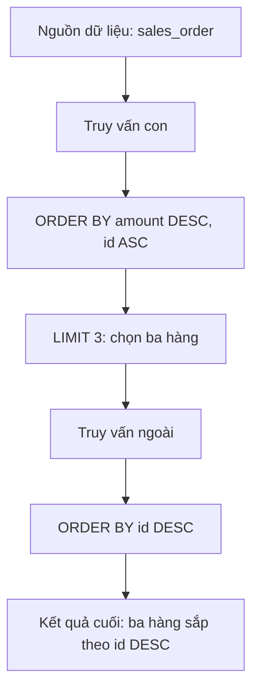

# Thứ tự trong truy vấn con, truy vấn ngoài và kết quả cuối cùng

Xét một truy vấn SQL được lồng thành hai cấp:

```sql
SELECT order_id, total_amount
FROM (
    SELECT order_id, total_amount
    FROM sales_order
    ORDER BY total_amount DESC
) AS ranked_orders;
```

Nhiều người kỳ vọng kết quả **chắc chắn** được hiển thị theo `total_amount` giảm dần, vì bên trong đã có `ORDER BY`. Kỳ vọng đó không phải một quy tắc có thể áp dụng an toàn cho mọi hệ quản trị cơ sở dữ liệu (DBMS): **`ORDER BY` trong một truy vấn con không tự bảo đảm thứ tự các hàng mà truy vấn ngoài cùng trả về**.

Khi cần kết quả cuối cùng được sắp xếp, phải đặt `ORDER BY` ở **cấp truy vấn tạo ra kết quả cuối cùng**. Ngược lại, `ORDER BY` ở truy vấn con vẫn có vai trò rất quan trọng khi đi cùng `LIMIT`, `FETCH FIRST` hoặc `TOP` để **chọn đúng những hàng** trước khi truy vấn ngoài tiếp tục xử lý.

Bài học đi sâu vào thứ tự ở ba phạm vi: **truy vấn con**, **truy vấn ngoài**, **kết quả cuối cùng**; đồng thời chỉ ra ảnh hưởng tới phân trang, `JOIN`, `GROUP BY`, `DISTINCT`, `UNION`, CTE và hàm cửa sổ. Các ví dụ chính sử dụng PostgreSQL; sự khác biệt quan trọng ở MySQL, SQLite, SQL Server và Oracle được ghi rõ.

## 1. Nguyên tắc nền tảng: hàng trong kết quả SQL không tự có thứ tự

Một bảng SQL biểu diễn dữ liệu theo quan hệ, trong đó **thứ tự vật lý hoặc thứ tự chèn không phải thuộc tính ngữ nghĩa được bảo đảm cho kết quả truy vấn**. Nếu không có `ORDER BY` phù hợp ở câu truy vấn ngoài cùng, DBMS có thể trả hàng theo nhiều thứ tự khác nhau, kể cả giữa hai lần chạy cùng một câu lệnh.

Ví dụ:

```sql
SELECT order_id, total_amount
FROM sales_order;
```

Không thể kết luận các hàng sẽ được trả theo `order_id`, theo thời gian chèn hay theo thứ tự index. Trong quá trình xử lý, DBMS có thể chọn cách quét bảng, dùng chỉ mục, chia việc xử lý song song hoặc thay đổi kế hoạch thực thi.

Muốn quy định thứ tự:

```sql
SELECT order_id, total_amount
FROM sales_order
ORDER BY total_amount DESC, order_id ASC;
```

Ở đây:

- `total_amount DESC`: sắp xếp tổng tiền giảm dần.
- `order_id ASC`: khi tổng tiền bằng nhau, sắp theo mã đơn tăng dần.

Việc có thêm `order_id` — giả sử là khóa chính — giúp quy tắc thứ tự **xác định đầy đủ** giữa các hàng.

### 1.1. Hai vai trò khác nhau của ORDER BY

| Vị trí `ORDER BY` | Công việc chính | Có bảo đảm thứ tự hiển thị cuối cùng không? |
| --- | --- | --- |
| Truy vấn `SELECT` ngoài cùng | Sắp xếp hàng của kết quả trả về | **Có**, theo các khóa đã khai báo; nếu khóa trùng nhau, thứ tự giữa các hàng đồng hạng vẫn chưa được xác định |
| Truy vấn con cùng `LIMIT`/`FETCH`/`TOP` | Quyết định tập hàng nào được giữ lại trong bước chọn top N | **Không**, nếu truy vấn ngoài tiếp tục xử lý mà không có `ORDER BY` riêng |
| Truy vấn con chỉ có `ORDER BY`, không có phép giới hạn hoặc toán tử cần thứ tự | Có thể được DBMS chấp nhận hoặc từ chối; không nên dựa vào đó để sắp kết quả ngoài | **Không** |
| Trong `OVER (ORDER BY ...)` của hàm cửa sổ | Xác định thứ tự logic để tính số thứ tự, xếp hạng, giá trị cửa sổ | **Không** |
| Trong hàm tổng hợp có thứ tự, chẳng hạn `STRING_AGG(... ORDER BY ...)` | Quy định thứ tự các giá trị được kết hợp vào hàm tổng hợp | **Không** |
| `ORDER BY` sau `UNION`/`UNION ALL` | Sắp xếp kết quả của toàn bộ phép tập hợp | **Có**, nếu là `ORDER BY` của câu truy vấn tổng thể |

Sự khác biệt quan trọng là **chọn hàng dựa trên thứ tự** và **trả hàng theo thứ tự** không phải cùng một yêu cầu.

### 1.2. Sơ đồ về phạm vi sắp xếp



Trong sơ đồ, thứ tự ở `C` dùng để quyết định **ba đơn hàng nào** được chọn. Thứ tự ở `F` mới quyết định **ba đơn hàng đó được hiển thị như thế nào**.

## 2. Tạo dữ liệu mẫu thống nhất

Để kiểm tra các ví dụ, tạo bảng `sales_order` trong một PostgreSQL database thử nghiệm:

```sql
CREATE TABLE sales_order (
    order_id INTEGER PRIMARY KEY,
    customer_name VARCHAR(50) NOT NULL,
    total_amount DECIMAL(10, 2) NOT NULL,
    created_at TIMESTAMP NOT NULL
);

INSERT INTO sales_order
    (order_id, customer_name, total_amount, created_at)
VALUES
    (101, 'An',   300.00, '2026-10-01 09:00:00'),
    (102, 'Bình', 100.00, '2026-10-01 09:00:00'),
    (103, 'Chi',  300.00, '2026-10-02 08:00:00'),
    (104, 'Dung', 200.00, '2026-10-02 08:00:00'),
    (105, 'Hà',   500.00, '2026-10-03 10:00:00'),
    (106, 'Lan',  200.00, '2026-10-04 12:00:00'),
    (107, 'Minh', 500.00, '2026-10-05 11:00:00'),
    (108, 'Nhi',  400.00, '2026-10-05 11:00:00');
```

Dữ liệu có các giá trị `total_amount` và `created_at` bị trùng để minh họa vấn đề **đồng hạng (*ties*)**.

Bảng tham khảo dưới đây sắp theo `order_id` cho dễ đọc; đây **không phải cam kết về thứ tự lưu trữ của bảng**.

| order_id | customer_name | total_amount | created_at |
| ---: | --- | ---: | --- |
| 101 | An | 300.00 | 2026-10-01 09:00 |
| 102 | Bình | 100.00 | 2026-10-01 09:00 |
| 103 | Chi | 300.00 | 2026-10-02 08:00 |
| 104 | Dung | 200.00 | 2026-10-02 08:00 |
| 105 | Hà | 500.00 | 2026-10-03 10:00 |
| 106 | Lan | 200.00 | 2026-10-04 12:00 |
| 107 | Minh | 500.00 | 2026-10-05 11:00 |
| 108 | Nhi | 400.00 | 2026-10-05 11:00 |

Nếu muốn xem các hàng theo thứ tự tiền giảm dần, thực hiện:

```sql
SELECT order_id, customer_name, total_amount
FROM sales_order
ORDER BY total_amount DESC, order_id ASC;
```

Kết quả:

| order_id | customer_name | total_amount |
| ---: | --- | ---: |
| 105 | Hà | 500.00 |
| 107 | Minh | 500.00 |
| 108 | Nhi | 400.00 |
| 101 | An | 300.00 |
| 103 | Chi | 300.00 |
| 104 | Dung | 200.00 |
| 106 | Lan | 200.00 |
| 102 | Bình | 100.00 |

Thứ tự này sẽ được dùng khi phân tích `LIMIT` và phân trang.

## 3. ORDER BY ở truy vấn ngoài cùng quyết định thứ tự kết quả

### 3.1. Một truy vấn SELECT thông thường

```sql
SELECT order_id, total_amount
FROM sales_order
WHERE total_amount >= 300
ORDER BY total_amount DESC, order_id ASC;
```

Kết quả:

| order_id | total_amount |
| ---: | ---: |
| 105 | 500.00 |
| 107 | 500.00 |
| 108 | 400.00 |
| 101 | 300.00 |
| 103 | 300.00 |

Ở đây `WHERE` chọn các đơn có tổng tiền từ 300 trở lên, còn `ORDER BY` quy định thứ tự hiển thị trong kết quả.

### 3.2. ORDER BY ở ngoài cùng là cần thiết nhưng phải có khóa phụ khi đồng hạng

Nếu chỉ viết:

```sql
SELECT order_id, total_amount
FROM sales_order
ORDER BY total_amount DESC;
```

DBMS sẽ trả các mức tiền theo thứ tự giảm dần, nhưng **không bảo đảm thứ tự tương đối** giữa hai đơn cùng 500.00 hoặc hai đơn cùng 300.00. Vì vậy hàng `105` có thể đứng trước hoặc sau `107` trong nhóm 500.00.

Để kết quả có thứ tự toàn phần trong dữ liệu mẫu:

```sql
ORDER BY total_amount DESC, order_id ASC
```

Khóa `order_id` là duy nhất nên không còn hai hàng đồng hạng trên toàn bộ danh sách khóa sắp xếp.

### 3.3. Không thể suy ra thứ tự từ thứ tự cột SELECT

```sql
SELECT total_amount, order_id
FROM sales_order
ORDER BY order_id DESC;
```

Kết quả sắp theo `order_id`, **không phải** theo `total_amount` chỉ vì `total_amount` được liệt kê trước trong `SELECT`. Thứ tự biểu thức trong `SELECT` chủ yếu quy định **thứ tự các cột của kết quả**, còn `ORDER BY` quy định **thứ tự các hàng**.

## 4. ORDER BY ở truy vấn con không tự bảo đảm thứ tự bên ngoài

### 4.1. Truy vấn con có ORDER BY nhưng không có giới hạn hàng

Ví dụ PostgreSQL hoặc MySQL:

```sql
SELECT q.order_id, q.total_amount
FROM (
    SELECT order_id, total_amount
    FROM sales_order
    ORDER BY total_amount DESC, order_id ASC
) AS q;
```

Truy vấn con có `ORDER BY`, nhưng truy vấn ngoài **không** có. Thực tế có những kế hoạch thực thi giữ nguyên thứ tự tình cờ; kế hoạch khác có thể thay đổi thứ tự đó. **Không có cam kết ổn định để ứng dụng phụ thuộc**.

Cách viết đúng khi mục tiêu chỉ là sắp kết quả:

```sql
SELECT q.order_id, q.total_amount
FROM (
    SELECT order_id, total_amount
    FROM sales_order
) AS q
ORDER BY q.total_amount DESC, q.order_id ASC;
```

Hoặc đơn giản hơn:

```sql
SELECT order_id, total_amount
FROM sales_order
ORDER BY total_amount DESC, order_id ASC;
```

Nếu truy vấn con không cần làm công việc riêng như chọn top N, tính toán hay phân nhóm, có thể bỏ nó để câu SQL dễ đọc hơn.

### 4.2. SQL Server còn có giới hạn cú pháp

Trong SQL Server (T-SQL), `ORDER BY` bên trong derived table, CTE, view hoặc inline table-valued function nhìn chung **không được cho phép** nếu không đi cùng các cấu trúc được hỗ trợ như `TOP`, `OFFSET/FETCH` hoặc những trường hợp `FOR XML`/`FOR JSON` tương ứng.

Vì vậy, ví dụ:

```sql
-- SQL Server: dạng này thường bị từ chối.
SELECT q.order_id
FROM (
    SELECT order_id
    FROM sales_order
    ORDER BY total_amount DESC
) AS q;
```

không nên dùng như câu SQL portable.

Ngay cả khi thêm `TOP` hoặc `OFFSET` để câu lệnh hợp lệ, việc sắp xếp trong derived table **không tự bảo đảm thứ tự hàng ở SELECT ngoài cùng**. Muốn đầu ra có thứ tự, thêm `ORDER BY` ngoài.

### 4.3. Vì sao DBMS có thể bỏ qua thứ tự bên trong?

Giả sử truy vấn ngoài thực hiện thêm một số thao tác:

```sql
SELECT q.total_amount, COUNT(*) AS order_count
FROM (
    SELECT order_id, total_amount
    FROM sales_order
    ORDER BY total_amount DESC
) AS q
GROUP BY q.total_amount;
```

Truy vấn ngoài nhóm dữ liệu thành các mức tổng tiền; thứ tự các hàng đơn lẻ bên trong không tạo ra yêu cầu thứ tự nhóm cuối cùng. Bộ tối ưu có thể dùng thuật toán gom nhóm, thay đổi thứ tự đọc hoặc bỏ bước sắp xếp không cần cho ngữ nghĩa.

Muốn nhóm hiển thị giảm dần:

```sql
SELECT q.total_amount, COUNT(*) AS order_count
FROM (
    SELECT order_id, total_amount
    FROM sales_order
) AS q
GROUP BY q.total_amount
ORDER BY q.total_amount DESC;
```

**Quy tắc:** một `ORDER BY` chỉ phục vụ việc sắp xếp đầu ra khi nó nằm ở cấp câu truy vấn tạo đầu ra đó; các thao tác ngoài truy vấn con có thể thay đổi toàn bộ thứ tự quan sát được.

## 5. ORDER BY bên trong kết hợp LIMIT: chọn đúng hàng trước, sắp lại sau

Đây là trường hợp `ORDER BY` bên trong **có ý nghĩa bắt buộc**: nó quyết định tập hàng được chọn khi giới hạn số lượng.

### 5.1. Chọn ba đơn có giá trị cao nhất

Trên PostgreSQL, MySQL và SQLite:

```sql
SELECT order_id, total_amount
FROM sales_order
ORDER BY total_amount DESC, order_id ASC
LIMIT 3;
```

Kết quả được sắp theo `total_amount DESC, order_id ASC`:

| order_id | total_amount |
| ---: | ---: |
| 105 | 500.00 |
| 107 | 500.00 |
| 108 | 400.00 |

`ORDER BY` xác định **ba hàng ưu tiên**, `LIMIT 3` chọn tối đa ba hàng đó.

### 5.2. Đưa truy vấn top 3 vào FROM

```sql
SELECT picked.order_id, picked.total_amount
FROM (
    SELECT order_id, total_amount
    FROM sales_order
    ORDER BY total_amount DESC, order_id ASC
    LIMIT 3
) AS picked;
```

**Tập hàng** mà truy vấn ngoài nhận được là ba đơn `105`, `107`, `108`. Tuy nhiên, vì truy vấn ngoài không có `ORDER BY`, **thứ tự hiển thị của ba hàng ấy không được bảo đảm**.

Chỉ cần thêm `ORDER BY` ngoài nếu muốn bảo đảm thứ tự đầu ra:

```sql
SELECT picked.order_id, picked.total_amount
FROM (
    SELECT order_id, total_amount
    FROM sales_order
    ORDER BY total_amount DESC, order_id ASC
    LIMIT 3
) AS picked
ORDER BY picked.order_id DESC;
```

Kết quả:

| order_id | total_amount |
| ---: | ---: |
| 108 | 400.00 |
| 107 | 500.00 |
| 105 | 500.00 |

**Giải thích:** truy vấn con chọn **ba đơn nhiều tiền nhất**; truy vấn ngoài hiển thị **ba đơn đó theo mã giảm dần**. Thứ tự ngoài không thay đổi tập ba đơn đã được chọn.

### 5.3. Hoán đổi hai vị trí ORDER BY sẽ thay đổi ý nghĩa

So sánh:

**A — Chọn ba đơn giá trị cao nhất, rồi sắp theo mã giảm dần**

```sql
SELECT order_id, total_amount
FROM (
    SELECT order_id, total_amount
    FROM sales_order
    ORDER BY total_amount DESC, order_id ASC
    LIMIT 3
) AS top_orders
ORDER BY order_id DESC;
```

Tập đơn: `105`, `107`, `108`.

**B — Chọn ba đơn có mã lớn nhất, rồi sắp theo tiền giảm dần**

```sql
SELECT order_id, total_amount
FROM (
    SELECT order_id, total_amount
    FROM sales_order
    ORDER BY order_id DESC
    LIMIT 3
) AS recent_ids
ORDER BY total_amount DESC, order_id ASC;
```

Truy vấn con của B chọn `108`, `107`, `106`. Kết quả ngoài sẽ là:

| order_id | total_amount |
| ---: | ---: |
| 107 | 500.00 |
| 108 | 400.00 |
| 106 | 200.00 |

Hai câu lệnh đều có hai `ORDER BY` và một `LIMIT`, nhưng **tập hàng khác nhau**. Muốn trả lời đúng bài toán, hãy hỏi trước: “Chọn những hàng nào?” rồi mới hỏi “Hiển thị chúng theo thứ tự nào?”.

## 6. Thứ tự khi truy vấn ngoài còn lọc dữ liệu

Một bẫy khác là đặt `WHERE` **bên ngoài** truy vấn đã giới hạn.

### 6.1. Lọc trước hay giới hạn trước?

**Truy vấn A — Chọn ba đơn lớn nhất trong số đơn có tổng tiền từ 300 trở lên**

```sql
SELECT order_id, total_amount
FROM sales_order
WHERE total_amount >= 300
ORDER BY total_amount DESC, order_id ASC
LIMIT 3;
```

Kết quả: `105`, `107`, `108`.

**Truy vấn B — Chọn ba đơn lớn nhất toàn bảng, rồi chỉ giữ các đơn có giá trị trên 450**

```sql
SELECT picked.order_id, picked.total_amount
FROM (
    SELECT order_id, total_amount
    FROM sales_order
    ORDER BY total_amount DESC, order_id ASC
    LIMIT 3
) AS picked
WHERE picked.total_amount > 450
ORDER BY picked.total_amount DESC, picked.order_id ASC;
```

Kết quả: `105` và `107` — chỉ **hai hàng** vì một trong ba đơn đã chọn là `108` có tổng tiền 400.

Nếu thực sự muốn “tối đa ba đơn có tổng tiền trên 450” thì phải đặt bộ lọc **trước** khi áp dụng `LIMIT`:

```sql
SELECT order_id, total_amount
FROM sales_order
WHERE total_amount > 450
ORDER BY total_amount DESC, order_id ASC
LIMIT 3;
```

Trong dữ liệu hiện tại cũng chỉ có hai hàng, nhưng khi dữ liệu nhiều hơn, hai cách có thể cho tập kết quả khác nhau. Để thấy rõ sự khác biệt, hãy đổi điều kiện ngoài thành `order_id <> 107`: lọc **sau** top 3 sẽ chỉ còn `105` và `108`; lọc **trước** top 3 sẽ chọn thêm đơn `101` ở vị trí kế tiếp.

### 6.2. Ví dụ điều kiện khiến hai truy vấn trả tập khác nhau

**Lọc trước, lấy top 3:**

```sql
SELECT order_id, total_amount
FROM sales_order
WHERE order_id <> 107
ORDER BY total_amount DESC, order_id ASC
LIMIT 3;
-- Chọn: 105, 108, 101.
```

**Lấy top 3 trước rồi lọc:**

```sql
SELECT order_id, total_amount
FROM (
    SELECT order_id, total_amount
    FROM sales_order
    ORDER BY total_amount DESC, order_id ASC
    LIMIT 3
) AS picked
WHERE order_id <> 107
ORDER BY total_amount DESC, order_id ASC;
-- Chọn: 105, 108.
```

Kết quả của việc **lọc rồi giới hạn** khác với **giới hạn rồi lọc**. Phạm vi truy vấn con là một phần của ý nghĩa nghiệp vụ.

## 7. WITH/CTE: có phải giữ thứ tự ở bên trong không?

**Common Table Expression (CTE)** khai báo một tập kết quả đặt tên ở đầu câu SQL:

```sql
WITH high_value_orders AS (
    SELECT order_id, total_amount
    FROM sales_order
    WHERE total_amount >= 300
)
SELECT order_id, total_amount
FROM high_value_orders
ORDER BY total_amount DESC, order_id ASC;
```

`ORDER BY` ngoài cùng mới bảo đảm đầu ra được sắp theo tiền giảm dần.

### 7.1. CTE có ORDER BY nhưng không LIMIT

Trên PostgreSQL, một CTE như sau có thể hợp lệ:

```sql
WITH sorted_orders AS (
    SELECT order_id, total_amount
    FROM sales_order
    ORDER BY total_amount DESC
)
SELECT order_id, total_amount
FROM sorted_orders;
```

Dù CTE được đặt tên là `sorted_orders`, câu truy vấn ngoài **không có nghĩa vụ giữ thứ tự đó**. CTE không phải một cấu trúc cam kết thứ tự hiển thị. Bộ tối ưu có thể inline hoặc materialize CTE theo phiên bản/cấu hình và cấu trúc truy vấn; **khả năng materialize cũng không thay thế `ORDER BY` ngoài**.

Cách viết để có thứ tự đầu ra xác định:

```sql
WITH source_orders AS (
    SELECT order_id, total_amount
    FROM sales_order
)
SELECT order_id, total_amount
FROM source_orders
ORDER BY total_amount DESC, order_id ASC;
```

### 7.2. CTE chọn top N rồi truy vấn ngoài hiển thị theo khóa khác

```sql
WITH top_three AS (
    SELECT order_id, total_amount
    FROM sales_order
    ORDER BY total_amount DESC, order_id ASC
    LIMIT 3
)
SELECT order_id, total_amount
FROM top_three
ORDER BY order_id DESC;
```

Ở đây `ORDER BY` trong CTE **cần thiết** để xác định ba đơn được lấy; `ORDER BY` ngoài cùng **cần thiết** để hiển thị theo mã giảm dần.

Với SQL Server, có thể dùng `TOP (3)` trong CTE và `ORDER BY` tương ứng:

```sql
-- SQL Server (T-SQL):
WITH top_three AS (
    SELECT TOP (3) order_id, total_amount
    FROM sales_order
    ORDER BY total_amount DESC, order_id ASC
)
SELECT order_id, total_amount
FROM top_three
ORDER BY order_id DESC;
```

Không nên sao chép `LIMIT` sang SQL Server hoặc thay `TOP` vào PostgreSQL rồi kỳ vọng cú pháp giống nhau.

### 7.3. View cũng không có “thứ tự lưu bên trong”

`VIEW` mô tả một truy vấn có tên. Khi đọc:

```sql
SELECT *
FROM some_view;
```

không được dựa vào `ORDER BY` ẩn trong định nghĩa view để xác định thứ tự kết quả. Một số DBMS hạn chế `ORDER BY` trong định nghĩa view; nơi cho phép, việc có `ORDER BY` để phục vụ `TOP` hoặc `OFFSET` cũng **không cam kết** thứ tự của câu truy vấn sử dụng view.

Ví dụ mẹo `TOP (100) PERCENT ... ORDER BY ...` trong view SQL Server **không phải cách hợp lệ để buộc truy vấn ngoài giữ thứ tự**; bộ tối ưu có thể loại bỏ phần sắp xếp không ảnh hưởng đến kết quả.

## 8. ORDER BY trong hàm cửa sổ khác ORDER BY của kết quả

Hàm cửa sổ (*window function*) có thể dùng `OVER (ORDER BY ...)` để tính số thứ tự, xếp hạng, tổng lũy kế hoặc giá trị ở các hàng trước/sau.

Ví dụ PostgreSQL, SQL Server, MySQL 8+ và SQLite hiện đại:

```sql
SELECT
    order_id,
    total_amount,
    ROW_NUMBER() OVER (
        ORDER BY total_amount DESC, order_id ASC
    ) AS position_in_ranking
FROM sales_order;
```

Kết quả chứa số thứ tự đúng theo quy tắc được khai báo trong `OVER`, nhưng **không thể kết luận các hàng sẽ được trả về theo `position_in_ranking`** nếu truy vấn ngoài không có `ORDER BY`.

Muốn hiển thị theo thứ hạng:

```sql
SELECT
    order_id,
    total_amount,
    ROW_NUMBER() OVER (
        ORDER BY total_amount DESC, order_id ASC
    ) AS position_in_ranking
FROM sales_order
ORDER BY position_in_ranking;
```

Kết quả:

| order_id | total_amount | position_in_ranking |
| ---: | ---: | ---: |
| 105 | 500.00 | 1 |
| 107 | 500.00 | 2 |
| 108 | 400.00 | 3 |
| 101 | 300.00 | 4 |
| 103 | 300.00 | 5 |
| 104 | 200.00 | 6 |
| 106 | 200.00 | 7 |
| 102 | 100.00 | 8 |

### 8.1. Lọc theo thứ hạng bằng truy vấn ngoài

Hàm cửa sổ thường không thể được lọc trực tiếp bằng `WHERE ROW_NUMBER() ...` trong cùng cấp `SELECT`, vì ngữ nghĩa và pha xử lý của SQL. Ta dùng một CTE hoặc truy vấn con:

```sql
WITH numbered AS (
    SELECT
        order_id,
        total_amount,
        ROW_NUMBER() OVER (
            ORDER BY total_amount DESC, order_id ASC
        ) AS rn
    FROM sales_order
)
SELECT order_id, total_amount, rn
FROM numbered
WHERE rn <= 3
ORDER BY rn;
```

Truy vấn trả `105`, `107`, `108` theo `rn` từ 1 đến 3.

Ở đây có **hai việc độc lập**:

1. `ORDER BY` trong `OVER` gán thứ hạng.
2. `ORDER BY rn` ở truy vấn ngoài sắp thứ tự hiển thị.

Nếu bỏ `ORDER BY rn`, các giá trị `rn` vẫn cho biết hạng nhưng hàng có thể được hiển thị theo thứ tự khác.

### 8.2. Đừng xếp hạng bằng khóa không duy nhất khi cần kết quả ổn định

```sql
ROW_NUMBER() OVER (ORDER BY total_amount DESC)
```

không xác định trước đơn `105` hay `107` sẽ nhận hạng 1 khi cả hai có 500.00. Nếu cần phân trang ổn định, thêm khóa phụ duy nhất:

```sql
ROW_NUMBER() OVER (ORDER BY total_amount DESC, order_id ASC)
```

`ROW_NUMBER()`, `RANK()` và `DENSE_RANK()` cũng không có cùng quy tắc xử lý hàng đồng hạng. Nếu muốn hai đơn cùng tiền được **cùng hạng**, cân nhắc `RANK()` hoặc `DENSE_RANK()`; nếu muốn **chọn chính xác N hàng theo một thứ tự toàn phần**, `ROW_NUMBER()` với khóa phụ duy nhất thường dễ kiểm soát hơn.

### 8.3. PARTITION BY: thứ tự riêng trong từng nhóm

Một ví dụ xếp hạng theo **ngày lập đơn**:

```sql
SELECT
    order_id,
    created_at,
    total_amount,
    ROW_NUMBER() OVER (
        PARTITION BY CAST(created_at AS DATE)
        ORDER BY total_amount DESC, order_id ASC
    ) AS rank_in_day
FROM sales_order
ORDER BY CAST(created_at AS DATE), rank_in_day;
```

`PARTITION BY` chia hàng thành các nhóm ngày để đánh số lại từ 1 trong mỗi nhóm. `ORDER BY` trong `OVER` chỉ xếp hạng **bên trong từng nhóm**, còn `ORDER BY` ngoài cùng xác định thứ tự các ngày và hàng khi hiển thị.

## 9. ORDER BY trong UNION, UNION ALL và các phép tập hợp

Khi kết hợp kết quả từ nhiều câu `SELECT` bằng `UNION` hoặc `UNION ALL`, thứ tự các nhánh **không phải thứ tự cuối cùng**.

Ví dụ:

```sql
SELECT order_id, total_amount
FROM sales_order
WHERE order_id IN (101, 103)

UNION ALL

SELECT order_id, total_amount
FROM sales_order
WHERE order_id IN (102, 104)

ORDER BY total_amount DESC, order_id ASC;
```

Kết quả toàn bộ phép `UNION ALL`:

| order_id | total_amount |
| ---: | ---: |
| 101 | 300.00 |
| 103 | 300.00 |
| 104 | 200.00 |
| 102 | 100.00 |

`ORDER BY` sau cùng áp dụng cho **toàn bộ kết quả hợp nhất**, không chỉ nhánh thứ hai. Mệnh đề `UNION ALL` giữ các hàng trùng nếu có; `UNION` loại trùng theo ngữ nghĩa tương ứng nhưng vẫn không tự cam kết thứ tự.

### 9.1. Muốn lấy top N ở từng nhánh thì phải giới hạn tại từng nhánh

Nếu nghiệp vụ là “lấy hai đơn cao nhất từ nhóm A và hai đơn cao nhất từ nhóm B, sau đó gộp và sắp lại”, phải biểu diễn **mỗi phép chọn top N** trong một truy vấn con độc lập, với cú pháp cho phép của DBMS.

Ví dụ PostgreSQL:

```sql
SELECT group_name, order_id, total_amount
FROM (
    SELECT
        'A' AS group_name,
        order_id,
        total_amount
    FROM sales_order
    WHERE order_id <= 104
    ORDER BY total_amount DESC, order_id ASC
    LIMIT 2
) AS group_a

UNION ALL

SELECT group_name, order_id, total_amount
FROM (
    SELECT
        'B' AS group_name,
        order_id,
        total_amount
    FROM sales_order
    WHERE order_id > 104
    ORDER BY total_amount DESC, order_id ASC
    LIMIT 2
) AS group_b

ORDER BY group_name ASC, total_amount DESC, order_id ASC;
```

Hai truy vấn con chọn top 2 cho từng nhóm; `ORDER BY` cuối cùng sắp **bốn hàng được gộp**. Việc cố đặt `ORDER BY ... LIMIT ...` sau `UNION ALL` mà không phân biệt phạm vi có thể khiến `LIMIT` áp dụng cho **toàn bộ tập hợp**, không phải từng nhánh.

### 9.2. Quy tắc cột ORDER BY sau phép tập hợp

Một số DBMS yêu cầu biểu thức sắp xếp sau `UNION`/`UNION ALL` phải tham chiếu tên hoặc vị trí cột có trong kết quả của phép tập hợp; không hỗ trợ mọi biểu thức tùy ý tại cấp đó.

Để portable và dễ hiểu hơn, hãy dùng tên cột rõ ràng trong hai nhánh, hoặc bọc kết quả hợp nhất bằng truy vấn ngoài và sắp trên các cột của nó.

## 10. JOIN, GROUP BY và DISTINCT có giữ thứ tự truy vấn con không?

### 10.1. JOIN có thể đổi thứ tự đọc các hàng

Xét ý tưởng:

```sql
SELECT picked.order_id, picked.total_amount
FROM (
    SELECT order_id, total_amount
    FROM sales_order
    ORDER BY total_amount DESC, order_id ASC
    LIMIT 3
) AS picked
CROSS JOIN (
    SELECT 'TOP' AS category
) AS tag;
```

Truy vấn con chọn ba đơn `105`, `107`, `108`. `CROSS JOIN` trong ví dụ tạo thêm thông tin từ một nguồn chỉ có một hàng. Trong những truy vấn phức tạp hơn, `JOIN` có thể thay đổi cách hàng được xử lý hoặc nhân số hàng theo số kết quả khớp.

**Không được dựa vào thứ tự trước JOIN để hiển thị kết quả sau JOIN.** Nếu cần, sắp ở câu ngoài:

```sql
SELECT picked.order_id, picked.total_amount, tag.category
FROM (
    SELECT order_id, total_amount
    FROM sales_order
    ORDER BY total_amount DESC, order_id ASC
    LIMIT 3
) AS picked
CROSS JOIN (
    SELECT 'TOP' AS category
) AS tag
ORDER BY picked.total_amount DESC, picked.order_id ASC;
```

### 10.2. GROUP BY không có nghĩa kết quả được sắp theo cột nhóm

```sql
SELECT total_amount, COUNT(*) AS order_count
FROM sales_order
GROUP BY total_amount;
```

Không có `ORDER BY` ngoài, nên thứ tự các mức `total_amount` **không được đảm bảo**. Dù DBMS chọn thuật toán nhóm theo sort hay hash, ứng dụng không nên dựa vào thứ tự tình cờ.

Muốn hiển thị từ mức tiền lớn nhất:

```sql
SELECT total_amount, COUNT(*) AS order_count
FROM sales_order
GROUP BY total_amount
ORDER BY total_amount DESC;
```

### 10.3. DISTINCT không tự sắp xếp dữ liệu

```sql
SELECT DISTINCT total_amount
FROM sales_order;
```

Truy vấn tạo tập mức tiền duy nhất, nhưng không cam kết thứ tự. Muốn sắp:

```sql
SELECT DISTINCT total_amount
FROM sales_order
ORDER BY total_amount DESC;
```

`DISTINCT` có thể dùng sort hoặc hash trong kế hoạch thực thi; không được suy ra thứ tự từ cách tối ưu nội bộ.

### 10.4. Thứ tự bên trong hàm tổng hợp là một phạm vi riêng

Trên PostgreSQL:

```sql
SELECT
    STRING_AGG(customer_name, ', ' ORDER BY order_id ASC)
        AS customers_by_id
FROM sales_order;
```

`ORDER BY order_id` nằm **bên trong lời gọi `STRING_AGG`**, nên nó quy định thứ tự các tên được nối vào **một giá trị chuỗi**. Nó không có nghĩa nếu kết quả chứa nhiều nhóm thì các hàng nhóm đã được sắp theo `order_id`.

Muốn các hàng kết quả nhóm có thứ tự, thêm một `ORDER BY` riêng ở ngoài. Cú pháp tổng hợp chuỗi có thứ tự khác nhau giữa PostgreSQL, MySQL, SQL Server và Oracle.

## 11. Truy vấn con vô hướng và ORDER BY để chọn một giá trị

Một **scalar subquery** cần trả về tối đa một hàng một cột để dùng như giá trị trong biểu thức. Nếu mục tiêu là “lấy tổng tiền lớn nhất” có thể dùng hàm tổng hợp:

```sql
SELECT
    (SELECT MAX(total_amount) FROM sales_order) AS max_amount;
-- 500.00
```

Không cần `ORDER BY` vì `MAX` đã biểu diễn trực tiếp quy tắc chọn giá trị.

Nếu muốn “mã đơn có tổng tiền lớn nhất, và nếu đồng hạng chọn mã nhỏ nhất”, dùng top 1 với thứ tự rõ ràng:

```sql
-- PostgreSQL/MySQL/SQLite:
SELECT (
    SELECT order_id
    FROM sales_order
    ORDER BY total_amount DESC, order_id ASC
    LIMIT 1
) AS highest_value_order_id;
-- 105
```

`ORDER BY` bên trong scalar subquery có ý nghĩa để chọn **giá trị duy nhất được trả về**, chứ không phải để sắp một tập hàng ngoài.

Với SQL Server, dùng `TOP (1)`; với Oracle 12c+, có thể dùng `FETCH FIRST 1 ROW ONLY` theo cú pháp được hỗ trợ.

### 11.1. Truy vấn con có ORDER BY nhưng không giới hạn có thể không trả được scalar

```sql
-- PostgreSQL: có thể lỗi khi dùng làm scalar nếu trả nhiều hàng.
SELECT (
    SELECT order_id
    FROM sales_order
    ORDER BY total_amount DESC
) AS one_order_id;
```

Truy vấn con trên trả nhiều hàng, còn vị trí scalar đòi hỏi tối đa một hàng. `ORDER BY` **không tự biến nhiều hàng thành một hàng**. Muốn top 1 cần `LIMIT 1`, `FETCH FIRST 1 ROW ONLY` hoặc `TOP (1)` tùy phương ngữ.

## 12. ORDER BY và phân trang bằng LIMIT/OFFSET

Phân trang là nơi sai lầm về thứ tự gây hậu quả trực tiếp: hàng có thể lặp hoặc bị bỏ qua giữa các trang.

### 12.1. Một thứ tự không duy nhất tạo phân trang không ổn định

Ví dụ:

```sql
SELECT order_id, total_amount
FROM sales_order
ORDER BY total_amount DESC
LIMIT 3 OFFSET 0;
```

và:

```sql
SELECT order_id, total_amount
FROM sales_order
ORDER BY total_amount DESC
LIMIT 3 OFFSET 3;
```

Hai câu lệnh dùng `total_amount` giảm dần, nhưng có nhiều hàng cùng tiền. Khi xếp các hàng đồng hạng khác nhau giữa những lần chạy, một bản ghi có thể xuất hiện trên hai trang hoặc bị bỏ sót.

Để phân trang ổn định trong **một trạng thái dữ liệu không đổi**, dùng một thứ tự toàn phần:

```sql
ORDER BY total_amount DESC, order_id ASC
```

Vì `order_id` duy nhất, mỗi hàng có vị trí rõ ràng khi dữ liệu không thay đổi.

### 12.2. Phân trang theo offset với thứ tự toàn phần

**Trang 1 — tối đa ba đơn có tiền cao nhất:**

```sql
SELECT order_id, total_amount
FROM sales_order
ORDER BY total_amount DESC, order_id ASC
LIMIT 3 OFFSET 0;
```

Kết quả: `105`, `107`, `108`.

**Trang 2 — bỏ qua ba hàng đầu, lấy ba hàng tiếp:**

```sql
SELECT order_id, total_amount
FROM sales_order
ORDER BY total_amount DESC, order_id ASC
LIMIT 3 OFFSET 3;
```

Kết quả: `101`, `103`, `104`.

**Trang 3:**

```sql
SELECT order_id, total_amount
FROM sales_order
ORDER BY total_amount DESC, order_id ASC
LIMIT 3 OFFSET 6;
```

Kết quả: `106`, `102`.

Bảng tổng hợp:

| Trang | Các mã đơn theo thứ tự |
| --- | --- |
| 1 | 105, 107, 108 |
| 2 | 101, 103, 104 |
| 3 | 106, 102 |

### 12.3. Đặt LIMIT ở truy vấn con rồi OFFSET ở truy vấn ngoài không phải cách phân trang thông thường

Xét:

```sql
SELECT order_id, total_amount
FROM (
    SELECT order_id, total_amount
    FROM sales_order
    ORDER BY total_amount DESC, order_id ASC
    LIMIT 3
) AS first_three
ORDER BY total_amount DESC, order_id ASC
LIMIT 3 OFFSET 3;
```

Truy vấn con chỉ giữ **ba hàng**, rồi truy vấn ngoài bỏ qua ba hàng đầu của tập đó. Kết quả sẽ **rỗng**, không phải trang 2 của bảng gốc.

Nếu muốn trang 2, thường đặt `ORDER BY` + `LIMIT` + `OFFSET` **cùng một cấp truy vấn đang phân trang trên toàn bộ tập cần tìm**:

```sql
SELECT order_id, total_amount
FROM sales_order
ORDER BY total_amount DESC, order_id ASC
LIMIT 3 OFFSET 3;
```

Nếu có nhu cầu nghiệp vụ chọn trước top 100 rồi mới phân trang trong top 100, khi đó việc lồng cấp là có chủ đích, nhưng phải phân biệt phạm vi của từng phép giới hạn.

### 12.4. ORDER BY ngoài cùng không giải quyết thay đổi đồng thời

Ngay cả khi sắp theo `(total_amount DESC, order_id ASC)`, các trang OFFSET được chạy **ở các thời điểm khác nhau** vẫn có thể bị xô lệch nếu có hàng mới chèn, hàng bị xóa hoặc giá trị sắp xếp bị cập nhật.

Ví dụ, một đơn giá trị 600 được thêm trước khi người dùng mở trang 2; vị trí các hàng hiện tại thay đổi, làm `OFFSET 3` không còn trỏ tới cùng vị trí của ảnh chụp dữ liệu lúc mở trang 1.

Cần phân biệt:

- **Thứ tự xác định:** trong một tập dữ liệu cụ thể, mỗi hàng có vị trí rõ ràng.
- **Trang ổn định theo thời gian:** nhiều yêu cầu truy vấn phải quan sát dữ liệu nhất quán hoặc sử dụng chiến lược phân trang phù hợp.

Nếu yêu cầu nhiều trang phản ánh cùng một snapshot, có thể cần giao dịch/cơ chế snapshot phù hợp với mức cô lập của DBMS. Một `ORDER BY` duy nhất không tạo snapshot cho nhiều request riêng biệt.

## 13. Keyset pagination: dùng khóa sắp xếp để lấy trang sau

Khi dữ liệu lớn và có nhu cầu tải tiếp theo con trỏ, **keyset pagination** (*seek pagination*) thường tránh việc bỏ qua số lượng hàng lớn như `OFFSET`.

Giả sử trang 1 theo `total_amount DESC, order_id ASC` trả:

| order_id | total_amount |
| ---: | ---: |
| 105 | 500.00 |
| 107 | 500.00 |
| 108 | 400.00 |

Hàng cuối trang là `(total_amount = 400.00, order_id = 108)`. Trang sau nên chỉ lấy những hàng **nằm sau** khóa đó theo đúng thứ tự hỗn hợp.

```sql
-- PostgreSQL/MySQL/SQLite:
SELECT order_id, total_amount
FROM sales_order
WHERE total_amount < 400.00
   OR (total_amount = 400.00 AND order_id > 108)
ORDER BY total_amount DESC, order_id ASC
LIMIT 3;
```

Kết quả: `101`, `103`, `104`.

Giải thích quy tắc:

- Với `total_amount DESC`, tiền nhỏ hơn 400 nằm **sau**.
- Nếu cùng tiền 400, `order_id ASC` khiến mã lớn hơn 108 nằm **sau** 108.

Nếu dùng nhiều cột cùng chiều tăng, đôi khi có thể dùng phép so sánh tuple. Nhưng ở ví dụ có **một khóa giảm và một khóa tăng**, điều kiện seek phải phản ánh đúng chiều của từng khóa; không nên dùng tuple comparison một cách máy móc.

### 13.1. Khi nào keyset pagination vẫn có biến động?

Keyset giúp tránh phụ thuộc trực tiếp vào vị trí offset khi hàng mới được chèn trước con trỏ. Tuy nhiên, nó **không tự đóng băng dữ liệu**: nếu giá trị `total_amount` của một hàng cũ thay đổi, hoặc hàng bị xóa, kết quả các trang vẫn có thể thay đổi.

Cần chọn chiến lược dựa trên yêu cầu:

- Chỉ cần cuộn danh sách động và chấp nhận thay đổi: keyset thường phù hợp.
- Cần một bộ dữ liệu cố định cho toàn bộ phiên xem/báo cáo: cần snapshot hoặc cách ghi nhận phiên bản dữ liệu.
- Cần điều hướng đến trang số 50: OFFSET đôi khi dễ triển khai hơn, nhưng có chi phí và vấn đề ổn định tương ứng.

Điểm chung là **cả OFFSET và keyset đều cần định nghĩa chính xác thứ tự**.

## 14. Các hàng đồng hạng và WITH TIES

`LIMIT 3` thường chọn tối đa ba hàng; với thứ tự không duy nhất, nếu hàng thứ ba nằm trong nhóm đồng hạng, việc chọn “hàng nào trong nhóm” có thể không xác định nếu không có khóa phụ.

Một số DBMS hỗ trợ **`FETCH FIRST ... WITH TIES`** hoặc `TOP ... WITH TIES` để lấy thêm các hàng đồng hạng với hàng cuối theo khóa `ORDER BY`.

Ví dụ PostgreSQL 13+:

```sql
SELECT order_id, total_amount
FROM sales_order
ORDER BY total_amount DESC
FETCH FIRST 4 ROWS WITH TIES;
```

Bốn vị trí đầu theo `total_amount DESC` gồm hai đơn 500, một đơn 400 và một đơn 300. Vì còn một đơn khác cũng 300, `WITH TIES` trả **năm hàng**:

| order_id | total_amount |
| ---: | ---: |
| 105 hoặc 107 | 500.00 |
| 107 hoặc 105 | 500.00 |
| 108 | 400.00 |
| 101 hoặc 103 | 300.00 |
| 103 hoặc 101 | 300.00 |

**Thứ tự trong mỗi nhóm đồng hạng không được xác định** nếu chỉ sắp theo `total_amount`. Nếu thêm `order_id` làm khóa phụ trong `ORDER BY`, các hàng không còn đồng hạng theo **toàn bộ danh sách khóa**, nên `WITH TIES` có thể không lấy thêm hàng như mong muốn.

Đây là hai yêu cầu khác nhau:

- “Lấy **chính xác bốn hàng** với quy tắc chọn ổn định” → thêm khóa phụ duy nhất, dùng giới hạn hàng.
- “Lấy **bốn vị trí đầu và tất cả hàng bằng hạng cuối theo tiền**” → `WITH TIES` theo `total_amount`, chấp nhận số hàng có thể vượt bốn và xử lý thứ tự trong nhóm nếu cần.

Với SQL Server có `TOP (4) WITH TIES ... ORDER BY total_amount DESC`; Oracle có các biến thể `FETCH ... WITH TIES` tùy phiên bản.

## 15. Sắp xếp theo thời gian, NULL và quy tắc đối chiếu

### 15.1. Cột thời gian có thể trùng

Bảng mẫu có hai đơn `107` và `108` cùng `created_at = '2026-10-05 11:00:00'`. Nếu viết:

```sql
SELECT order_id, created_at
FROM sales_order
ORDER BY created_at DESC
LIMIT 3;
```

thì hai đơn cùng timestamp không có thứ tự tương đối được bảo đảm. Để chọn ba đơn mới nhất theo một quy tắc ổn định:

```sql
SELECT order_id, created_at
FROM sales_order
ORDER BY created_at DESC, order_id DESC
LIMIT 3;
```

Kết quả: `108`, `107`, `106`.

Nếu sau đó cần hiển thị ba đơn ấy theo tiền từ thấp đến cao:

```sql
SELECT latest.order_id, latest.total_amount, latest.created_at
FROM (
    SELECT order_id, total_amount, created_at
    FROM sales_order
    ORDER BY created_at DESC, order_id DESC
    LIMIT 3
) AS latest
ORDER BY latest.total_amount ASC, latest.order_id ASC;
```

Kết quả:

| order_id | total_amount |
| ---: | ---: |
| 106 | 200.00 |
| 108 | 400.00 |
| 107 | 500.00 |

Một lần nữa: **truy vấn con chọn theo thời gian**, **truy vấn ngoài trình bày theo tiền**.

### 15.2. NULL có vị trí khác nhau theo DBMS

Với cột có thể `NULL`, câu:

```sql
ORDER BY nullable_value ASC
```

có thể đặt `NULL` đầu hoặc cuối theo phương ngữ. PostgreSQL hỗ trợ:

```sql
ORDER BY nullable_value ASC NULLS LAST
```

Khi cần một cách gần tương thích giữa các DBMS, có thể dùng biểu thức xác định vị trí `NULL`:

```sql
ORDER BY
    CASE WHEN nullable_value IS NULL THEN 1 ELSE 0 END,
    nullable_value ASC,
    id ASC
```

Quy tắc này đặt các giá trị khác `NULL` trước, rồi `NULL` sau; `id` giúp xác định thứ tự trong nhóm giá trị trùng nhau. Cần kiểm tra kiểu và cú pháp của DBMS cụ thể.

### 15.3. Collation ảnh hưởng thứ tự chuỗi

`ORDER BY customer_name` còn chịu ảnh hưởng của **collation**: quy tắc so sánh chữ hoa/thường, dấu và ngôn ngữ. Thứ tự các tên `An`, `Bình`, `Hà`, `Lan` có thể khác nhau giữa cấu hình.

Với phân trang dựa vào tên, cần xác định:

1. Collation hoặc quy tắc chuẩn hóa nào được dùng.
2. Có khóa phụ duy nhất, chẳng hạn `order_id`, để phân biệt các giá trị tên trùng hoặc được xem là tương đương.
3. Khi triển khai keyset, điều kiện so sánh cursor dùng **cùng một collation** với `ORDER BY`, nếu không có nguy cơ sai ranh giới trang.

## 16. Khác biệt phương ngữ khi chọn top N ở truy vấn con

Các DBMS có cú pháp giới hạn hàng khác nhau; vai trò “chọn hàng bằng thứ tự trong” và “sắp đầu ra bằng thứ tự ngoài” vẫn cần được giữ rõ.

### 16.1. PostgreSQL, MySQL và SQLite: LIMIT

```sql
SELECT selected.order_id, selected.total_amount
FROM (
    SELECT order_id, total_amount
    FROM sales_order
    ORDER BY total_amount DESC, order_id ASC
    LIMIT 3
) AS selected
ORDER BY selected.order_id DESC;
```

Ở đây `LIMIT 3` thuộc truy vấn con. Truy vấn ngoài có thể thêm `WHERE`, `JOIN` hoặc `ORDER BY` của riêng nó.

### 16.2. SQL Server: TOP

```sql
SELECT selected.order_id, selected.total_amount
FROM (
    SELECT TOP (3) order_id, total_amount
    FROM sales_order
    ORDER BY total_amount DESC, order_id ASC
) AS selected
ORDER BY selected.order_id DESC;
```

`TOP (3)` và `ORDER BY` cùng cấp quyết định ba hàng được chọn. `ORDER BY` ngoài sắp lại ba hàng. Khi dùng `TOP` không có `ORDER BY` bên trong, SQL Server không biết “ba hàng nào đầu tiên” theo ý nghĩa nghiệp vụ.

### 16.3. Oracle 12c+: FETCH FIRST

```sql
SELECT selected.order_id, selected.total_amount
FROM (
    SELECT order_id, total_amount
    FROM sales_order
    ORDER BY total_amount DESC, order_id ASC
    FETCH FIRST 3 ROWS ONLY
) selected
ORDER BY selected.order_id DESC;
```

`FETCH FIRST 3 ROWS ONLY` là cú pháp giới hạn hàng được Oracle hỗ trợ từ 12c. PostgreSQL cũng hỗ trợ `FETCH FIRST` theo ngữ pháp riêng; MySQL và SQLite thông thường dùng `LIMIT`.

### 16.4. Oracle cũ: thứ tự và ROWNUM

Một bẫy Oracle truyền thống:

```sql
-- Oracle cũ: KHÔNG phải cách chọn ba đơn có tiền lớn nhất.
SELECT order_id, total_amount
FROM sales_order
WHERE ROWNUM <= 3
ORDER BY total_amount DESC;
```

Trong mô hình Oracle truyền thống, `ROWNUM` được gán trong quá trình lấy hàng; câu trên có thể lấy ba hàng trước rồi mới sắp ba hàng đã chọn. Nó **không đảm bảo chọn đúng top 3 toàn bảng**.

Mẫu đúng là đặt sắp xếp vào truy vấn con và giới hạn ở cấp ngoài:

```sql
-- Oracle truyền thống:
SELECT picked.order_id, picked.total_amount
FROM (
    SELECT order_id, total_amount
    FROM sales_order
    ORDER BY total_amount DESC, order_id ASC
) picked
WHERE ROWNUM <= 3
ORDER BY picked.total_amount DESC, picked.order_id ASC;
```

`ORDER BY` trong subquery quyết định thứ tự được sử dụng để chọn top 3 theo mô hình này; `ORDER BY` ngoài cùng quy định thứ tự kết quả trả về. Nếu dùng Oracle hiện đại, `FETCH FIRST` thường rõ nghĩa và dễ đọc hơn.

### 16.5. So sánh nhanh

| DBMS | Giới hạn top 3 trong truy vấn con | Thứ tự cuối cùng |
| --- | --- | --- |
| PostgreSQL | `ORDER BY ... LIMIT 3` hoặc `FETCH FIRST 3 ROWS ONLY` | `ORDER BY` của SELECT ngoài |
| MySQL | `ORDER BY ... LIMIT 3` | `ORDER BY` của SELECT ngoài |
| SQLite | `ORDER BY ... LIMIT 3` | `ORDER BY` của SELECT ngoài |
| SQL Server | `SELECT TOP (3) ... ORDER BY ...` | `ORDER BY` của SELECT ngoài |
| Oracle 12c+ | `ORDER BY ... FETCH FIRST 3 ROWS ONLY` | `ORDER BY` của SELECT ngoài |
| Oracle cũ | `ORDER BY` trong subquery, `ROWNUM <= 3` ở cấp giới hạn | `ORDER BY` ngoài cùng nếu cần đảm bảo đầu ra |

**Lưu ý:** một dạng câu lệnh chạy được trên DBMS này có thể không hợp lệ trên DBMS khác; đặc biệt SQL Server có giới hạn đối với `ORDER BY` bên trong CTE/derived table khi không đi cùng mệnh đề thích hợp.

## 17. ORDER BY không có nghĩa DBMS phải thực hiện sort vật lý đúng theo thứ tự viết

Khi giải thích SQL, ta thường nói “lọc hàng, sắp xếp, rồi lấy N hàng”. Đó là **cách tư duy về ngữ nghĩa kết quả**, không phải mô tả bắt buộc của kế hoạch thực thi.

Bộ tối ưu có thể:

- Dùng chỉ mục đã sắp phù hợp để tránh một bước sort riêng.
- Chọn thuật toán top N chỉ giữ một số hàng ưu tiên thay vì sắp toàn bộ dữ liệu.
- Thực hiện `JOIN` hoặc tổng hợp theo cách không giữ thứ tự đầu vào.
- Inline CTE hoặc biến đổi truy vấn con khi phép biến đổi bảo toàn ngữ nghĩa.
- Thực thi song song rồi gộp kết quả; những hàng đồng hạng có thể đổi vị trí nếu không có khóa phụ.

**Điều ứng dụng cần dựa vào là cam kết về thứ tự từ SQL**, không phải cách trình bày mà một kế hoạch thực thi hiện tại vô tình tạo ra.

Nếu muốn kiểm tra chi phí của `ORDER BY`, `LIMIT` và chỉ mục, có thể xem kế hoạch truy vấn bằng `EXPLAIN` trên PostgreSQL hoặc công cụ tương đương trên DBMS đang dùng. Việc một plan không hiển thị một bước sort riêng không làm mất hiệu lực của `ORDER BY` ngoài cùng.

## 18. Những lỗi hay gặp

| Lỗi | Hậu quả | Cách viết hoặc cách hiểu đúng |
| --- | --- | --- |
| Tin rằng `ORDER BY` trong derived table luôn truyền thứ tự ra ngoài | Kết quả có thể thay đổi hoặc cú pháp không được hỗ trợ | Sắp ở SELECT ngoài cùng |
| Dùng `LIMIT 3` trong subquery nhưng không có `ORDER BY` | Ba hàng được chọn không xác định theo nghiệp vụ | Xác định thứ tự trong cùng cấp với giới hạn |
| Chỉ sắp theo cột có giá trị trùng trước `LIMIT/OFFSET` | Đồng hạng có thể làm trang bị thay đổi | Thêm khóa phụ duy nhất |
| Thay đổi `ORDER BY` bên trong top N như một chỉnh sửa hiển thị | Có thể đổi **tập hàng** được chọn | Phân biệt thứ tự chọn và thứ tự hiển thị |
| Đặt `WHERE` ngoài top N mà kỳ vọng vẫn lấy đủ N hàng hợp lệ | Có thể nhận ít hơn N hàng | Quyết định lọc trước hay sau khi chọn top N |
| Dùng `ORDER BY` trong CTE và bỏ ORDER BY ngoài | Không đảm bảo thứ tự kết quả | ORDER BY ở cấp truy vấn cuối |
| Cho rằng `ROW_NUMBER() OVER (ORDER BY ...)` tự sắp kết quả | Thứ hạng đúng nhưng hàng có thể xuất hiện lệch thứ tự | Thêm ORDER BY ngoài, có thể theo `rn` |
| Cho rằng `GROUP BY` hoặc `DISTINCT` đã sắp kết quả | Kế hoạch hash/sort khác nhau làm thứ tự thay đổi | ORDER BY sau nhóm hoặc DISTINCT |
| Cho rằng `UNION ALL` giữ thứ tự từ nhánh thứ nhất sang nhánh thứ hai | Không có bảo đảm thứ tự tổng thể | ORDER BY sau toàn bộ phép hợp nhất |
| Dùng Oracle `ROWNUM <= N` và `ORDER BY` cùng cấp để chọn top N | Có thể chọn N hàng trước khi sort | Sắp trong subquery, giới hạn ngoài hoặc dùng FETCH |
| Chỉ dựa vào khóa chính/index để dự đoán thứ tự mặc định | Cách đọc hàng có thể đổi khi thay đổi plan | ORDER BY ngoài cùng |
| Cho rằng ORDER BY + OFFSET giải quyết mọi biến động phân trang | Hàng mới/cập nhật có thể đẩy vị trí trang | Xem xét keyset và snapshot theo yêu cầu |

## 19. Bài tập thực hành

Dùng bảng `sales_order` đã tạo ở mục 2 và dự đoán kết quả trước khi chạy từng truy vấn. Các lệnh `LIMIT` sử dụng cú pháp PostgreSQL/MySQL/SQLite.

### Bài 1. ORDER BY bên trong có đủ không?

```sql
SELECT q.order_id, q.total_amount
FROM (
    SELECT order_id, total_amount
    FROM sales_order
    ORDER BY total_amount DESC
) AS q;
```

**Câu hỏi:** Có thể cam kết tập kết quả ngoài cùng luôn được hiển thị theo tiền giảm dần không?

**Đáp án:** Không. Muốn cam kết thứ tự đầu ra, viết:

```sql
SELECT q.order_id, q.total_amount
FROM (
    SELECT order_id, total_amount
    FROM sales_order
) AS q
ORDER BY q.total_amount DESC, q.order_id ASC;
```

### Bài 2. Chọn top 3 rồi đảo thứ tự hiển thị

```sql
SELECT order_id, total_amount
FROM (
    SELECT order_id, total_amount
    FROM sales_order
    ORDER BY total_amount DESC, order_id ASC
    LIMIT 3
) AS picked
ORDER BY order_id DESC;
```

**Kết quả:** các mã `108`, `107`, `105`.

**Giải thích:** trong lấy top 3 theo tiền, ngoài sắp lại ba hàng theo mã giảm dần.

### Bài 3. Đổi thứ tự ở truy vấn trong

```sql
SELECT order_id, total_amount
FROM (
    SELECT order_id, total_amount
    FROM sales_order
    ORDER BY order_id DESC
    LIMIT 3
) AS picked
ORDER BY total_amount DESC, order_id ASC;
```

**Kết quả:** `107` (500), `108` (400), `106` (200). Vì ba mã lớn nhất là `108`, `107` và `106`.

### Bài 4. Phân biệt lọc trước và lọc sau top N

**A — Lọc trước:**

```sql
SELECT order_id, total_amount
FROM sales_order
WHERE order_id <> 107
ORDER BY total_amount DESC, order_id ASC
LIMIT 3;
```

**Kết quả A:** `105`, `108`, `101`.

**B — Lọc sau:**

```sql
SELECT order_id, total_amount
FROM (
    SELECT order_id, total_amount
    FROM sales_order
    ORDER BY total_amount DESC, order_id ASC
    LIMIT 3
) AS picked
WHERE order_id <> 107
ORDER BY total_amount DESC, order_id ASC;
```

**Kết quả B:** `105`, `108`.

**Giải thích:** B chỉ lọc trong ba hàng đã được A chọn trước khi áp dụng điều kiện `order_id <> 107`.

### Bài 5. Tính thứ hạng rồi hiển thị theo hạng

```sql
WITH ranked AS (
    SELECT
        order_id,
        total_amount,
        ROW_NUMBER() OVER (
            ORDER BY total_amount DESC, order_id ASC
        ) AS rn
    FROM sales_order
)
SELECT order_id, total_amount, rn
FROM ranked
WHERE rn BETWEEN 3 AND 5
ORDER BY rn;
```

**Kết quả:**

| order_id | total_amount | rn |
| ---: | ---: | ---: |
| 108 | 400.00 | 3 |
| 101 | 300.00 | 4 |
| 103 | 300.00 | 5 |

Cách lấy hạng thứ 3 đến 5 này không yêu cầu `OFFSET`, nhưng vẫn cần `ORDER BY` ngoài để hiển thị theo hạng.

### Bài 6. Đếm theo mức tiền

```sql
SELECT total_amount, COUNT(*) AS number_of_orders
FROM sales_order
GROUP BY total_amount
ORDER BY total_amount DESC;
```

**Kết quả dự kiến:**

| total_amount | number_of_orders |
| ---: | ---: |
| 500.00 | 2 |
| 400.00 | 1 |
| 300.00 | 2 |
| 200.00 | 2 |
| 100.00 | 1 |

Nếu bỏ `ORDER BY total_amount DESC`, không được dựa vào thứ tự các nhóm.

### Bài 7. Trang thứ hai khi mỗi trang có ba hàng

```sql
SELECT order_id, total_amount
FROM sales_order
ORDER BY total_amount DESC, order_id ASC
LIMIT 3 OFFSET 3;
```

**Kết quả:** `101`, `103`, `104`.

**Câu hỏi tiếp:** Tại sao không chỉ viết `ORDER BY total_amount DESC`? Vì có nhiều đơn trùng tiền, nên cần `order_id` làm khóa phụ để xác định vị trí.

### Bài 8. Lấy các đơn sau cursor của trang 1

Giả sử hàng cuối trang 1 là `(400.00, 108)`. Truy vấn seek:

```sql
SELECT order_id, total_amount
FROM sales_order
WHERE total_amount < 400.00
   OR (total_amount = 400.00 AND order_id > 108)
ORDER BY total_amount DESC, order_id ASC
LIMIT 3;
```

**Kết quả:** `101`, `103`, `104`.

### Bài 9. Sửa bẫy ROWNUM trên Oracle cũ

Câu lệnh:

```sql
SELECT order_id, total_amount
FROM sales_order
WHERE ROWNUM <= 3
ORDER BY total_amount DESC;
```

**Câu hỏi:** Có đảm bảo ba đơn có tổng tiền cao nhất không?

**Đáp án:** Không. Truy vấn có thể giới hạn ba hàng trước khi sắp xếp. Dùng subquery sắp theo tổng tiền trước, sau đó giới hạn bằng `ROWNUM` ở cấp ngoài, hoặc dùng `FETCH FIRST 3 ROWS ONLY` trên Oracle 12c+ với thứ tự thích hợp.

### Bài 10. Thứ tự trong aggregate và ngoài kết quả khác nhau thế nào?

Trên PostgreSQL:

```sql
SELECT
    CAST(created_at AS DATE) AS sale_day,
    STRING_AGG(customer_name, ', ' ORDER BY order_id) AS customers
FROM sales_order
GROUP BY CAST(created_at AS DATE)
ORDER BY sale_day DESC;
```

**Đáp án:** `ORDER BY order_id` bên trong `STRING_AGG` quyết định thứ tự tên trong chuỗi của **mỗi ngày**. `ORDER BY sale_day DESC` ngoài cùng quyết định thứ tự **các hàng kết quả theo ngày**. Hai `ORDER BY` có phạm vi tác động khác nhau.

## 20. Ghi nhớ khi thiết kế truy vấn có nhiều cấp

Trước khi viết một câu SQL có subquery, CTE, top N hoặc phân trang, tự trả lời:

1. **Tập dữ liệu được chọn ở cấp nào?** `WHERE` và các phép `JOIN`/`GROUP BY` ở cấp đó xác định các hàng đầu vào.
2. **Có cần lấy top N không?** Nếu có, đặt `ORDER BY` cùng cấp với `LIMIT`, `FETCH` hoặc `TOP` để xác định **những hàng** được chọn.
3. **Truy vấn ngoài có tiếp tục lọc, nhóm, nối hoặc tổng hợp không?** Các thao tác ấy có thể đổi tập hàng và thứ tự quan sát được.
4. **Kết quả cuối cùng phải hiển thị theo khóa nào?** Đặt `ORDER BY` ở cấp ngoài cùng trả kết quả.
5. **Khóa sắp xếp đã xác định đầy đủ thứ tự chưa?** Khi dùng giới hạn hoặc phân trang, thêm khóa phụ duy nhất nếu cần.
6. **Dữ liệu có thay đổi giữa các trang không?** Nếu có, cân nhắc keyset và tính nhất quán snapshot.
7. **Phương ngữ SQL nào đang chạy?** PostgreSQL/MySQL/SQLite thường dùng `LIMIT`; SQL Server dùng `TOP` hoặc `OFFSET/FETCH`; Oracle mới hỗ trợ `FETCH` còn Oracle cũ thường dùng mô hình `ROWNUM` với subquery.

**Nguyên tắc cốt lõi:** `ORDER BY` bên trong một truy vấn con có thể giúp xác định **những hàng nào được lấy** khi đi cùng phép giới hạn, hoặc quyết định thứ tự tính toán của một hàm cửa sổ/tổng hợp. Nhưng **thứ tự các hàng ở kết quả cuối cùng phải được quy định bởi `ORDER BY` của câu truy vấn ngoài cùng**. Khi phân biệt hai mục đích này và dùng khóa phụ ổn định, bạn sẽ tránh được nhiều lỗi chọn top N và phân trang rất khó phát hiện.
