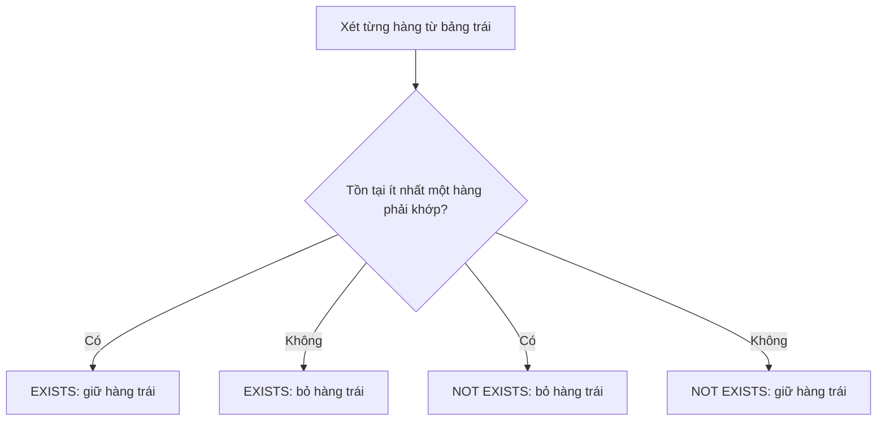
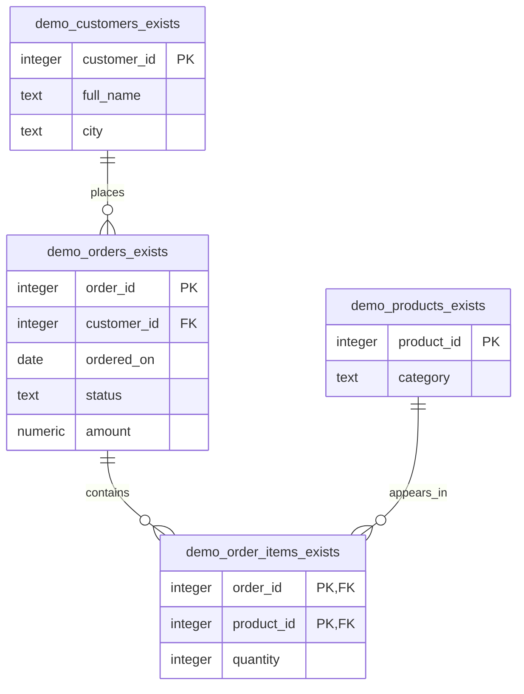

# Mô hình bán kết nối và phản kết nối bằng EXISTS

Khi viết SQL, không phải lúc nào ta cũng muốn lấy dữ liệu từ **cả hai bảng**. Nhiều yêu cầu chỉ hỏi về **sự tồn tại của một quan hệ**:

- Khách hàng nào **đã có ít nhất một** đơn hàng?
- Khách hàng nào **chưa có** đơn hàng nào?
- Sản phẩm nào **đã từng xuất hiện** trong chi tiết đơn?
- Đơn hàng nào **không có** dòng chi tiết?
- Khách hàng nào **có đơn**, nhưng **không có đơn đã thanh toán**?
- Khách hàng nào đã mua **mọi nhóm sản phẩm bắt buộc**?

Viết `JOIN` rồi `DISTINCT` đôi khi trả đúng danh sách ID, nhưng có thể tạo nhiều hàng trung gian không cần thiết. Đặc biệt, `JOIN` một-nhiều làm số hàng tăng, dẫn đến lỗi đếm/tổng hợp khi câu hỏi thực sự chỉ cần biết “có hay không”.

SQL cung cấp hai dạng truy vấn đặc biệt phù hợp:

- **`EXISTS`**: trả lời “truy vấn con có **ít nhất một hàng** hay không?” — diễn đạt một **bán kết nối** (*semi join*).
- **`NOT EXISTS`**: trả lời “truy vấn con có **không hàng nào** hay không?” — diễn đạt một **phản kết nối** (*anti join*).

Bài học thuộc chương **Kết nối bảng** của Database SQL. Các ví dụ chạy trong **PostgreSQL**, nhưng ý tưởng tồn tại/không tồn tại và hai toán tử `EXISTS`, `NOT EXISTS` được hỗ trợ rộng rãi trong SQL. Những chi tiết về kế hoạch thực thi, chỉ mục, `NULL` và cú pháp công cụ có thể khác giữa các hệ quản trị.

## 1. Bán kết nối và phản kết nối là mô hình gì?

Giả sử hai bảng:

```text
customers (bảng trái)                orders (bảng phải)
+-------------+-------+              +----------+-------------+
| customer_id | name  |              | order_id | customer_id |
+-------------+-------+              +----------+-------------+
| 1           | An    |              | 101      | 1           |
| 2           | Binh  |              | 102      | 1           |
| 3           | Chi   |              | 103      | 2           |
| 4           | Dung  |              +----------+-------------+
+-------------+-------+
```

Nếu `INNER JOIN` trên `customer_id`:

```text
An  - 101
An  - 102
Binh - 103
```

Một khách có hai đơn xuất hiện **hai hàng**. Nhưng nếu câu hỏi là “khách nào có ít nhất một đơn”, đầu ra chỉ cần:

```text
An
Binh
```

Đây là **bán kết nối trái** (*left semi join*): chỉ giữ các hàng bên trái có ít nhất một hàng phù hợp bên phải; không đưa các cột bên phải vào kết quả và không nhân hàng trái theo số lần khớp.

Ngược lại, “khách nào không có đơn nào” trả:

```text
Chi
Dung
```

Đây là **phản kết nối trái** (*left anti join*): chỉ giữ các hàng trái không có bất kỳ hàng phù hợp nào ở phía phải.

### 1.1. So sánh ngữ nghĩa

| Phép toán | Câu hỏi | Hàng bên trái được giữ khi nào? | Có nhân hàng trái theo số lượng khớp? |
| --- | --- | --- | --- |
| `INNER JOIN` | Kết hợp các cặp hàng khớp | Có một hoặc nhiều cặp khớp | **Có thể có** |
| `LEFT JOIN` | Giữ mọi hàng trái và nối hàng phải khi có | Luôn giữ hàng trái | **Có thể có** |
| **Semi join** / `EXISTS` | Có ít nhất một khớp? | Có ≥ 1 hàng phải phù hợp | **Không** |
| **Anti join** / `NOT EXISTS` | Không có khớp? | Có 0 hàng phải phù hợp | **Không** |

Trong SQL PostgreSQL, ta thường **không viết trực tiếp** một từ khóa `LEFT SEMI JOIN` hay `LEFT ANTI JOIN` trong câu SQL thông thường. Ta dùng `EXISTS`/`NOT EXISTS` để diễn đạt ngữ nghĩa; bộ tối ưu hóa **có thể** chuyển chúng thành các nút kế hoạch kiểu *Semi Join* hoặc *Anti Join*.

Sơ đồ ý tưởng:



Một điểm quan trọng: **“giữ một hàng trái” không có nghĩa bảng trái bị loại bỏ các bản ghi trùng theo toàn bộ cột**. Nếu bảng trái có hai hàng khác nhau nhưng giá trị hiển thị giống nhau, `EXISTS` vẫn đánh giá và có thể trả cả hai. Sự không nhân hàng chỉ nói rằng một hàng trái không được lặp thêm chỉ vì nhiều hàng phải khớp.

## 2. Dựng bộ dữ liệu để kiểm chứng

Để các kết quả có thể tự tính bằng tay, ta tạo bốn bảng tạm PostgreSQL: khách hàng, đơn hàng, sản phẩm và chi tiết đơn hàng.

### 2.1. Các quan hệ



Mỗi khách có thể có nhiều đơn; mỗi đơn có thể chứa nhiều dòng sản phẩm. Một số khách **không có đơn** và một đơn mẫu **không có chi tiết**, để kiểm tra chính xác các tình huống phản kết nối.

### 2.2. Tạo bảng

```sql
CREATE TEMP TABLE demo_customers_exists (
    customer_id INTEGER PRIMARY KEY,
    full_name   TEXT NOT NULL,
    city        TEXT
);

CREATE TEMP TABLE demo_orders_exists (
    order_id    INTEGER PRIMARY KEY,
    customer_id INTEGER NOT NULL
        REFERENCES demo_customers_exists(customer_id),
    ordered_on  DATE NOT NULL,
    status      TEXT NOT NULL
        CHECK (status IN ('paid', 'pending', 'cancelled')),
    amount      NUMERIC(12, 2) NOT NULL CHECK (amount >= 0)
);

CREATE TEMP TABLE demo_products_exists (
    product_id INTEGER PRIMARY KEY,
    product_name TEXT NOT NULL,
    category     TEXT NOT NULL
);

CREATE TEMP TABLE demo_order_items_exists (
    order_id   INTEGER NOT NULL
        REFERENCES demo_orders_exists(order_id),
    product_id INTEGER NOT NULL
        REFERENCES demo_products_exists(product_id),
    quantity   INTEGER NOT NULL CHECK (quantity > 0),
    PRIMARY KEY (order_id, product_id)
);
```

### 2.3. Chèn dữ liệu

```sql
INSERT INTO demo_customers_exists
    (customer_id, full_name, city)
VALUES
    (1, 'An',    'Ha Noi'),
    (2, 'Binh',  'TP HCM'),
    (3, 'Chi',   'Ha Noi'),
    (4, 'Dung',  NULL),
    (5, 'Em',    'TP HCM'),
    (6, 'Giang', 'Ha Noi');

INSERT INTO demo_orders_exists
    (order_id, customer_id, ordered_on, status, amount)
VALUES
    (101, 1, DATE '2025-05-02', 'paid',       150.00),
    (102, 1, DATE '2025-05-03', 'pending',     80.00),
    (103, 2, DATE '2025-05-04', 'cancelled',  200.00),
    (104, 2, DATE '2025-05-10', 'paid',       120.00),
    (105, 2, DATE '2025-06-01', 'paid',        90.00),
    (106, 3, DATE '2025-05-06', 'pending',     50.00),
    (107, 5, DATE '2025-05-12', 'paid',        60.00),
    (108, 5, DATE '2025-05-13', 'paid',        75.00),
    (109, 3, DATE '2025-05-15', 'pending',     10.00);

INSERT INTO demo_products_exists
    (product_id, product_name, category)
VALUES
    (10, 'Book A',  'Books'),
    (11, 'Book B',  'Books'),
    (12, 'Mouse',   'Tech'),
    (13, 'Keyboard','Tech'),
    (14, 'Book C',  'Books');

INSERT INTO demo_order_items_exists
    (order_id, product_id, quantity)
VALUES
    (101, 10, 1),
    (101, 12, 1),
    (102, 11, 1),
    (103, 12, 1),
    (104, 10, 1),
    (104, 11, 1),
    (105, 13, 1),
    (106, 10, 1),
    (107, 12, 1),
    (108, 10, 1);
```

Dữ liệu được bố trí có chủ đích:

- Khách `1` có hai đơn, trong đó một đơn `paid`.
- Khách `2` có ba đơn: một `cancelled`, hai `paid`; một đơn paid ở tháng 6.
- Khách `3` có hai đơn `pending` nhưng **không có đơn paid**.
- Khách `4` và `6` **chưa có đơn nào**.
- Khách `5` có hai đơn và **cả hai đều paid**.
- Đơn `109` tồn tại nhưng **chưa có dòng chi tiết**.
- Sản phẩm `14` tồn tại nhưng **chưa xuất hiện trong chi tiết đơn nào**.

Với tập mẫu: có **6 khách**, **9 đơn**, **10 dòng chi tiết**, **5 sản phẩm**. Các đơn `paid` là `101, 104, 105, 107, 108`. Tổng `amount` của các đơn paid là `150 + 120 + 90 + 60 + 75 = 495`.

### 2.4. Bảng đối chiếu quan hệ khách–đơn

| Khách | Các đơn | Đơn paid | Kết luận |
| --- | --- | --- | --- |
| 1 – An | 101, 102 | 101 | Có đơn và có đơn paid |
| 2 – Binh | 103, 104, 105 | 104, 105 | Có đơn và có đơn paid |
| 3 – Chi | 106, 109 | Không có | Có đơn, không có paid |
| 4 – Dung | Không có | Không có | Chưa có đơn |
| 5 – Em | 107, 108 | 107, 108 | Có đơn và có paid |
| 6 – Giang | Không có | Không có | Chưa có đơn |

Bảng này là **đáp án kiểm chứng thủ công**. Khi đọc mỗi ví dụ, hãy dự đoán tập `customer_id` trước khi xem SQL.

## 3. EXISTS: bán kết nối để hỏi “có ít nhất một”

Yêu cầu: **Liệt kê khách hàng đã từng đặt ít nhất một đơn, bất kể trạng thái**.

```sql
SELECT
    c.customer_id,
    c.full_name
FROM demo_customers_exists AS c
WHERE EXISTS (
    SELECT 1
    FROM demo_orders_exists AS o
    WHERE o.customer_id = c.customer_id
)
ORDER BY c.customer_id;
```

Kết quả:

| `customer_id` | `full_name` |
| ---: | --- |
| 1 | An |
| 2 | Binh |
| 3 | Chi |
| 5 | Em |

### 3.1. Đọc câu truy vấn theo từng hàng ngoài

Trong truy vấn trên:

- `c` là **bảng ngoài**: tập ứng viên gồm 6 khách.
- `o` là bảng trong truy vấn con: dùng để kiểm tra đơn hàng.
- `o.customer_id = c.customer_id` là **điều kiện tương quan** (*correlation predicate*): nó kết nối truy vấn con với khách đang xét.
- `EXISTS (...)` trả `TRUE` nếu truy vấn con tạo **ít nhất một hàng**; ngược lại trả `FALSE`.
- `WHERE EXISTS (...)` chỉ giữ những khách nhận `TRUE`.

Bảng chân trị:

| Khách đang xét | Đơn khớp theo `customer_id` | `EXISTS` |
| --- | --- | --- |
| An (1) | 101, 102 | `TRUE` |
| Binh (2) | 103, 104, 105 | `TRUE` |
| Chi (3) | 106, 109 | `TRUE` |
| Dung (4) | Không có | `FALSE` |
| Em (5) | 107, 108 | `TRUE` |
| Giang (6) | Không có | `FALSE` |

**Một khách chỉ được xuất hiện một lần trong kết quả**, vì mỗi hàng `c` được trả về hoặc bị loại, không được sao chép theo số lượng đơn.

### 3.2. Tại sao thường viết SELECT 1 trong EXISTS?

Trong ví dụ:

```sql
EXISTS (
    SELECT 1
    FROM demo_orders_exists AS o
    WHERE o.customer_id = c.customer_id
)
```

giá trị cụ thể của `1` **không phải điều kiện kiểm tra**. Điều quan trọng là **có hàng hay không**. Nói chung, với một truy vấn con đơn giản:

```sql
EXISTS (SELECT 1 FROM ...)
```

và:

```sql
EXISTS (SELECT o.order_id FROM ...)
```

có cùng kết quả về tồn tại nếu các mệnh đề khác giống nhau. `SELECT 1` truyền đạt rõ rằng truy vấn **không quan tâm dữ liệu của các cột bên phải**.

Không phải mọi truy vấn con phức tạp đều bất biến khi tùy tiện thay danh sách `SELECT`: các cấu trúc như `INTERSECT`, `EXCEPT` hoặc một số biểu thức không hợp lệ vẫn có quy tắc riêng. Nhưng đối với `EXISTS` tương quan đơn giản, `SELECT 1` là cách viết rõ ý nghĩa và phổ biến.

### 3.3. EXISTS quan tâm hàng, không quan tâm giá trị trong hàng

```sql
SELECT
    EXISTS (SELECT NULL) AS one_null_row_exists,
    EXISTS (SELECT 1 WHERE FALSE) AS no_row_exists;
```

Trong PostgreSQL:

| Biểu thức | Kết quả |
| --- | --- |
| `EXISTS (SELECT NULL)` | `TRUE` |
| `EXISTS (SELECT 1 WHERE FALSE)` | `FALSE` |

Ở câu đầu, truy vấn con trả **một hàng có giá trị `NULL`**, nên `EXISTS` vẫn là `TRUE`. Ở câu sau, truy vấn con **không trả hàng nào**, nên `EXISTS` là `FALSE`.

Đây là khác biệt nền tảng so với việc so sánh `NULL` bằng `=` hoặc `IN`.

## 4. EXISTS khác INNER JOIN ở chỗ không nhân hàng

Cùng yêu cầu “khách đã từng có đơn”, nếu dùng `INNER JOIN`:

```sql
SELECT
    c.customer_id,
    c.full_name,
    o.order_id
FROM demo_customers_exists AS c
JOIN demo_orders_exists AS o
  ON o.customer_id = c.customer_id
ORDER BY c.customer_id, o.order_id;
```

Kết quả có **9 hàng** vì mỗi đơn tạo một cặp kết hợp:

| Khách | Đơn |
| --- | ---: |
| An | 101 |
| An | 102 |
| Binh | 103 |
| Binh | 104 |
| Binh | 105 |
| Chi | 106 |
| Chi | 109 |
| Em | 107 |
| Em | 108 |

Nếu chỉ chọn cột khách:

```sql
SELECT c.customer_id, c.full_name
FROM demo_customers_exists AS c
JOIN demo_orders_exists AS o
  ON o.customer_id = c.customer_id;
```

thì An vẫn xuất hiện hai lần, Binh ba lần, Chi hai lần, Em hai lần.

Một cách viết khác là:

```sql
SELECT DISTINCT c.customer_id, c.full_name
FROM demo_customers_exists AS c
JOIN demo_orders_exists AS o
  ON o.customer_id = c.customer_id
ORDER BY c.customer_id;
```

Nó trả 4 khách đúng với dữ liệu mẫu. Nhưng cách này yêu cầu tạo tập các cặp khớp rồi **loại trùng kết quả theo cột chọn** theo ngữ nghĩa logic. Khi chỉ cần tồn tại, `EXISTS` diễn đạt ý định trực tiếp hơn và giúp tránh các lỗi đếm do join một-nhiều.

**Không phải cứ thấy `JOIN DISTINCT` là sai.** Nếu nghiệp vụ cần dữ liệu hoặc điều kiện kết hợp phức tạp, `JOIN` có thể phù hợp. Điểm cần phân biệt là **mục tiêu chỉ kiểm tra tồn tại** hay **mục tiêu lấy từng cặp hàng**.

### 4.1. Lỗi đếm rất thường gặp

```sql
-- Đếm số hàng khớp sau JOIN: 9 đơn.
SELECT COUNT(*) AS join_rows
FROM demo_customers_exists AS c
JOIN demo_orders_exists AS o
  ON o.customer_id = c.customer_id;
```

Đáp án là **9**, không phải 4. Muốn đếm khách có ít nhất một đơn, có thể dùng:

```sql
SELECT COUNT(*) AS customers_with_orders
FROM demo_customers_exists AS c
WHERE EXISTS (
    SELECT 1
    FROM demo_orders_exists AS o
    WHERE o.customer_id = c.customer_id
);
-- 4
```

Hoặc `COUNT(DISTINCT c.customer_id)` sau join nếu thật sự cần join cho mục tiêu khác. Trước khi đếm, luôn xác định **mỗi hàng của tập đầu vào đại diện cho đối tượng gì**.

### 4.2. Nguyên tắc “semi join giữ grain bảng trái”

Khi bảng trái có **một hàng trên mỗi khách** và dùng `WHERE EXISTS`, kết quả vẫn có **tối đa một hàng trên mỗi khách**. Khi bảng trái là `demo_orders_exists`, kết quả của `WHERE EXISTS` vẫn là **một hàng trên mỗi đơn**, không phải mỗi sản phẩm.

Cơ chế này đặc biệt hữu ích trong các truy vấn có một-nhiều hoặc nhiều-nhiều khi dashboard chỉ cần biết đối tượng bên trái có quan hệ hay không.

## 5. Thêm điều kiện bên trong EXISTS: tồn tại loại quan hệ nào?

Yêu cầu thay đổi từ “có đơn” thành **“có ít nhất một đơn đã thanh toán”**:

```sql
SELECT
    c.customer_id,
    c.full_name
FROM demo_customers_exists AS c
WHERE EXISTS (
    SELECT 1
    FROM demo_orders_exists AS o
    WHERE o.customer_id = c.customer_id
      AND o.status = 'paid'
)
ORDER BY c.customer_id;
```

Kết quả:

| `customer_id` | `full_name` | Các đơn paid làm bằng chứng |
| ---: | --- | --- |
| 1 | An | 101 |
| 2 | Binh | 104, 105 |
| 5 | Em | 107, 108 |

Lúc này `Chi` bị loại dù có hai đơn, vì cả hai đơn đều `pending`.

**Điều kiện bên trong `EXISTS` quyết định khái niệm “khớp”.** Nếu thay `o.status = 'paid'` bằng `o.status = 'cancelled'`, kết quả chỉ còn `Binh`.

### 5.1. Kết hợp điều kiện trên bảng ngoài và bảng trong

Câu hỏi: **Khách ở Hà Nội nào đã có ít nhất một đơn paid?**

```sql
SELECT c.customer_id, c.full_name
FROM demo_customers_exists AS c
WHERE c.city = 'Ha Noi'
  AND EXISTS (
      SELECT 1
      FROM demo_orders_exists AS o
      WHERE o.customer_id = c.customer_id
        AND o.status = 'paid'
  )
ORDER BY c.customer_id;
```

Kết quả chỉ có **An**.

Có hai lớp điều kiện:

- `c.city = 'Ha Noi'` áp dụng cho **khách** ở bảng ngoài.
- `o.status = 'paid'` áp dụng cho **đơn** được tìm trong bảng phải.

Hai điều kiện kết hợp với nhau tạo đúng nhu cầu “khách tại Hà Nội **và** có bằng chứng đơn paid”.

### 5.2. Đơn paid trong một khoảng thời gian

Câu hỏi: **Khách nào có ít nhất một đơn paid trong tháng 5/2025?**

```sql
SELECT c.customer_id, c.full_name
FROM demo_customers_exists AS c
WHERE EXISTS (
    SELECT 1
    FROM demo_orders_exists AS o
    WHERE o.customer_id = c.customer_id
      AND o.status = 'paid'
      AND o.ordered_on >= DATE '2025-05-01'
      AND o.ordered_on <  DATE '2025-06-01'
)
ORDER BY c.customer_id;
```

Đáp án: **An, Binh, Em**. Binh có đơn `104` trong tháng 5; đơn `105` của Binh thuộc tháng 6, nhưng chỉ cần **một** đơn phù hợp là đủ.

Điều kiện phạm vi thời gian dạng `>= start` và `< next_start` thích hợp khi ứng dụng sau này đổi từ `DATE` sang `TIMESTAMP` có phần lẻ giây. Nếu báo cáo theo múi giờ, cần xác định ranh giới ngày theo múi giờ nghiệp vụ.

### 5.3. Điều kiện tương quan nhiều cột

Giả sử dữ liệu có nhiều tenant, và `customer_id` chỉ duy nhất **trong mỗi tenant**. Khi đó tồn tại một đơn đúng khách phải được kiểm tra theo **cả `tenant_id` và `customer_id`**:

```sql
-- Ví dụ cấu trúc, giả sử hai bảng đều có tenant_id.
SELECT c.tenant_id, c.customer_id
FROM tenant_customers AS c
WHERE EXISTS (
    SELECT 1
    FROM tenant_orders AS o
    WHERE o.tenant_id = c.tenant_id
      AND o.customer_id = c.customer_id
      AND o.status = 'paid'
);
```

Các bảng `tenant_customers`/`tenant_orders` ở đây là **ví dụ khái niệm**, không có trong bộ dữ liệu tạm. Bỏ điều kiện tenant có thể lấy nhầm đơn của khách cùng ID ở tenant khác, gây lỗi dữ liệu và có thể tạo rủi ro bảo mật.

## 6. NOT EXISTS: phản kết nối để tìm đối tượng không khớp

Yêu cầu: **Khách hàng chưa có bất kỳ đơn nào**.

```sql
SELECT
    c.customer_id,
    c.full_name
FROM demo_customers_exists AS c
WHERE NOT EXISTS (
    SELECT 1
    FROM demo_orders_exists AS o
    WHERE o.customer_id = c.customer_id
)
ORDER BY c.customer_id;
```

Kết quả:

| `customer_id` | `full_name` |
| ---: | --- |
| 4 | Dung |
| 6 | Giang |

`NOT EXISTS` trả `TRUE` khi truy vấn con **không tạo ra hàng khớp** cho khách đang xét.

Một bảng chân trị:

| Khách | Có đơn? | `EXISTS` | `NOT EXISTS` |
| --- | --- | --- | --- |
| An | Có | `TRUE` | `FALSE` |
| Binh | Có | `TRUE` | `FALSE` |
| Chi | Có | `TRUE` | `FALSE` |
| Dung | Không | `FALSE` | `TRUE` |
| Em | Có | `TRUE` | `FALSE` |
| Giang | Không | `FALSE` | `TRUE` |

### 6.1. “Không có đơn” khác “không có đơn paid”

Đây là hai câu hỏi nghiệp vụ khác nhau.

**Không có bất kỳ đơn nào:**

```sql
SELECT c.customer_id
FROM demo_customers_exists AS c
WHERE NOT EXISTS (
    SELECT 1
    FROM demo_orders_exists AS o
    WHERE o.customer_id = c.customer_id
)
ORDER BY c.customer_id;
-- 4, 6
```

**Không có đơn đã thanh toán:**

```sql
SELECT c.customer_id
FROM demo_customers_exists AS c
WHERE NOT EXISTS (
    SELECT 1
    FROM demo_orders_exists AS o
    WHERE o.customer_id = c.customer_id
      AND o.status = 'paid'
)
ORDER BY c.customer_id;
-- 3, 4, 6
```

`Chi` được giữ trong câu thứ hai vì có đơn, nhưng không có đơn nào thỏa `status = 'paid'`. Dung và Giang vẫn được giữ vì không có đơn nào cả.

Cụm “không có” phải luôn đi kèm **loại quan hệ và điều kiện** cần loại trừ. Nếu chỉ biết khách không có đơn paid, chưa thể kết luận khách chưa từng đặt hàng.

### 6.2. Có đơn, nhưng không có đơn paid

Yêu cầu chính xác hơn: **Khách đã từng đặt hàng nhưng chưa thanh toán đơn nào**.

```sql
SELECT
    c.customer_id,
    c.full_name
FROM demo_customers_exists AS c
WHERE EXISTS (
    SELECT 1
    FROM demo_orders_exists AS any_o
    WHERE any_o.customer_id = c.customer_id
)
AND NOT EXISTS (
    SELECT 1
    FROM demo_orders_exists AS paid_o
    WHERE paid_o.customer_id = c.customer_id
      AND paid_o.status = 'paid'
)
ORDER BY c.customer_id;
```

Kết quả chỉ có **Chi (3)**.

Câu này kết hợp:

- Một bán kết nối: **có ít nhất một đơn**.
- Một phản kết nối: **không có đơn paid**.

Nếu bỏ `EXISTS` đầu tiên, những khách chưa có đơn (Dung, Giang) cũng được đưa vào. Đây là một lỗi logic quan trọng khi diễn đạt “có hoạt động, nhưng không có hoạt động thuộc loại X”.

### 6.3. Tìm đơn không có dòng chi tiết

Đổi bảng trái từ khách sang đơn:

```sql
SELECT o.order_id, o.customer_id, o.status
FROM demo_orders_exists AS o
WHERE NOT EXISTS (
    SELECT 1
    FROM demo_order_items_exists AS oi
    WHERE oi.order_id = o.order_id
)
ORDER BY o.order_id;
```

Kết quả là **đơn 109** — đơn đã tạo nhưng chưa có bất kỳ dòng chi tiết nào.

Đây là ví dụ điển hình trong công việc kiểm tra chất lượng dữ liệu: “bản ghi cha tồn tại, nhưng chưa có bản ghi con”.

### 6.4. Tìm sản phẩm chưa từng được dùng

```sql
SELECT p.product_id, p.product_name
FROM demo_products_exists AS p
WHERE NOT EXISTS (
    SELECT 1
    FROM demo_order_items_exists AS oi
    WHERE oi.product_id = p.product_id
)
ORDER BY p.product_id;
```

Kết quả: **Book C (product_id = 14)**.

Lưu ý câu này kiểm tra sản phẩm có từng xuất hiện trong **bất kỳ** dòng chi tiết nào, bất kể đơn đã thanh toán hay chưa. Nếu yêu cầu “sản phẩm chưa từng xuất hiện trong một đơn paid”, phải thêm `JOIN` từ `order_items` sang `orders` và điều kiện trạng thái **bên trong** truy vấn con.

## 7. LEFT JOIN ... IS NULL: cách diễn đạt phản kết nối khác

Nhiều người học biết cách tìm “không có bản ghi liên quan” bằng `LEFT JOIN` và `IS NULL`:

```sql
SELECT
    c.customer_id,
    c.full_name
FROM demo_customers_exists AS c
LEFT JOIN demo_orders_exists AS o
    ON o.customer_id = c.customer_id
WHERE o.order_id IS NULL
ORDER BY c.customer_id;
```

Với bộ dữ liệu mẫu, kết quả là **Dung và Giang**, giống `NOT EXISTS`.

### 7.1. Vì sao phải kiểm tra cột không NULL được ở phía phải?

Trong bảng `demo_orders_exists`, `order_id` là `PRIMARY KEY` nên chắc chắn **không `NULL`** ở hàng thật. Nếu sau `LEFT JOIN`, `o.order_id IS NULL`, đó là tín hiệu rằng không có hàng đơn nào khớp và các cột phía phải là hàng mở rộng `NULL` của outer join.

Nếu chọn một cột **có thể `NULL`** ở bảng phải để kiểm tra, ví dụ `o.optional_note IS NULL` trong bảng thiết kế khác, ta có thể giữ cả những hàng **đã khớp nhưng ghi chú trống**. Khi ấy nó không còn là phép phản kết nối chính xác.

Vì vậy, nếu dùng mẫu `LEFT JOIN ... IS NULL`, hãy chọn một cột bên phải được bảo đảm **không `NULL` trên hàng khớp** — thường là khóa chính.

### 7.2. Điều kiện lọc ở ON khác điều kiện lọc ở WHERE

Muốn tìm khách **không có đơn paid**, cách `LEFT JOIN` đúng là:

```sql
SELECT c.customer_id, c.full_name
FROM demo_customers_exists AS c
LEFT JOIN demo_orders_exists AS o
    ON o.customer_id = c.customer_id
   AND o.status = 'paid'
WHERE o.order_id IS NULL
ORDER BY c.customer_id;
-- 3, 4, 6
```

Điều kiện `o.status = 'paid'` nằm trong `ON`, tức một đơn được xem là **khớp** chỉ nếu vừa thuộc khách vừa paid.

Cách sau **không tương đương**:

```sql
-- Sai cho mục tiêu "khách không có đơn paid":
SELECT c.customer_id
FROM demo_customers_exists AS c
LEFT JOIN demo_orders_exists AS o
    ON o.customer_id = c.customer_id
WHERE o.status = 'paid'
  AND o.order_id IS NULL;
```

Một hàng vừa có `o.status = 'paid'` vừa có `o.order_id IS NULL` sau phép nối như vậy không thể thỏa theo mục tiêu đã định. Đặt bộ lọc của hàng phải vào `WHERE` cũng có thể làm mất những hàng trái không khớp vì so sánh với `NULL` cho kết quả `UNKNOWN`.

Mẫu `NOT EXISTS` thường dễ đọc hơn:

```sql
WHERE NOT EXISTS (
    SELECT 1
    FROM demo_orders_exists AS o
    WHERE o.customer_id = c.customer_id
      AND o.status = 'paid'
)
```

Mọi điều kiện xác định “một hàng phải được xem là khớp” đều nằm cùng trong truy vấn con.

### 7.3. EXISTS và LEFT JOIN anti có luôn chạy cùng tốc độ?

Không. Cả hai có thể được bộ tối ưu hóa biến đổi thành kế hoạch tương tự trong trường hợp đơn giản, nhưng chi phí thực tế phụ thuộc DBMS, index, thống kê, độ chọn lọc, cấu trúc `ON`/`WHERE` và các điều kiện khác.

Chọn `NOT EXISTS` khi nó diễn đạt yêu cầu rõ nhất; sau đó đo hiệu năng bằng kế hoạch thực thi. Tránh quy tắc tuyệt đối kiểu “`LEFT JOIN IS NULL` lúc nào cũng nhanh hơn” hoặc “`NOT EXISTS` lúc nào cũng nhanh hơn”.

## 8. EXISTS, IN và đặc biệt bẫy NOT IN với NULL

Với điều kiện không có `NULL` gây ảnh hưởng, yêu cầu “khách có đơn” có thể diễn đạt bằng `IN`:

```sql
SELECT c.customer_id
FROM demo_customers_exists AS c
WHERE c.customer_id IN (
    SELECT o.customer_id
    FROM demo_orders_exists AS o
)
ORDER BY c.customer_id;
-- 1, 2, 3, 5
```

Trong ví dụ, `orders.customer_id` được khai báo `NOT NULL`, và `customers.customer_id` là `PRIMARY KEY`, nên `IN` thể hiện đúng điều kiện thành viên.

### 8.1. NOT IN có bẫy ba giá trị logic

Một phản kết nối thường được viết ngắn bằng:

```sql
SELECT c.customer_id
FROM demo_customers_exists AS c
WHERE c.customer_id NOT IN (
    SELECT o.customer_id
    FROM demo_orders_exists AS o
)
ORDER BY c.customer_id;
-- 4, 6 với schema hiện tại
```

Trên **schema mẫu này**, câu chạy đúng vì `o.customer_id` không bao giờ `NULL`. Nhưng nếu truy vấn con có thể trả một `NULL`, hành vi sẽ rất khác.

Ví dụ độc lập:

```sql
SELECT
    2 NOT IN (1, NULL) AS missing_but_unknown,
    1 NOT IN (1, NULL) AS known_match_is_false;
```

Trong PostgreSQL:

| Biểu thức | Giá trị |
| --- | --- |
| `2 NOT IN (1, NULL)` | `NULL` / `UNKNOWN` |
| `1 NOT IN (1, NULL)` | `FALSE` |

Vì sao `2 NOT IN (1, NULL)` không là `TRUE`? Về logic nó cần khẳng định `2 <> 1` **và** `2 <> NULL`. Vế thứ hai là `UNKNOWN`, nên toàn bộ điều kiện không thể khẳng định `TRUE`.

Trong `WHERE`, cả `FALSE` và `UNKNOWN` đều bị loại. Chỉ cần một `NULL` xuất hiện từ truy vấn con, nhiều hàng lẽ ra “không thuộc tập” sẽ **biến mất khỏi kết quả**.

### 8.2. Thử bẫy NULL trên một tập con nhân tạo

```sql
WITH imported_customer_ids(customer_id) AS (
    VALUES (1), (NULL::integer)
)
SELECT c.customer_id
FROM demo_customers_exists AS c
WHERE c.customer_id NOT IN (
    SELECT customer_id FROM imported_customer_ids
)
ORDER BY c.customer_id;
```

Kết quả là **0 hàng**, dù về trực giác ta muốn lấy các khách khác `1`. Các khách không bằng `1` vẫn phải so sánh với `NULL` nên kết quả thành `UNKNOWN`.

Trong khi đó:

```sql
WITH imported_customer_ids(customer_id) AS (
    VALUES (1), (NULL::integer)
)
SELECT c.customer_id
FROM demo_customers_exists AS c
WHERE NOT EXISTS (
    SELECT 1
    FROM imported_customer_ids AS x
    WHERE x.customer_id = c.customer_id
)
ORDER BY c.customer_id;
```

Kết quả là **2, 3, 4, 5, 6**, vì hàng `x.customer_id IS NULL` không thỏa phép bằng với bất kỳ khóa khách không `NULL` nào, nên nó **không được xem là một hàng khớp**.

### 8.3. NOT EXISTS không tự hiểu NULL là bằng NULL

Một điểm cần chú ý: `NOT EXISTS` tránh bẫy một `NULL` trong tập truy vấn con làm nhiễm toàn bộ phép `NOT IN`, nhưng **điều kiện tương quan bên trong nó vẫn dùng logic SQL thông thường**.

Nếu cả hai cột khóa có thể `NULL` và nghiệp vụ muốn **coi hai `NULL` là một cặp khớp**, điều kiện:

```sql
WHERE inner_key = outer_key
```

không làm hai `NULL` khớp nhau. Trong PostgreSQL, có thể dùng:

```sql
WHERE inner_key IS NOT DISTINCT FROM outer_key
```

để diễn đạt so sánh bằng có xử lý `NULL` như một giá trị tương đương. Chỉ dùng điều đó nếu đúng ý nghĩa nghiệp vụ; trong quan hệ khóa chính/khóa ngoại thông thường, khóa chính không `NULL` nên tránh vấn đề này bằng schema tốt.

### 8.4. Khi nào IN/NOT IN là lựa chọn hợp lý?

- `IN` phù hợp cho điều kiện thành viên, nhất là khi tập truy vấn con một cột và các quy tắc `NULL` đã rõ.
- `EXISTS` thường rõ hơn khi tương quan theo **nhiều cột** hoặc có điều kiện khớp phức tạp.
- `NOT EXISTS` thường là cách diễn đạt phản kết nối an toàn, dễ giải thích trước dữ liệu có thể chứa `NULL`.
- `NOT IN` có thể đúng và gọn khi **chắc chắn cả giá trị trái và tập phải không `NULL`**; nên dựa vào ràng buộc schema hoặc điều kiện rõ ràng, không chỉ dữ liệu tình cờ hôm nay chưa có `NULL`.

Không phải mọi thay thế giữa `IN` và `EXISTS` đều giữ nguyên ngữ nghĩa khi có `NULL`, biểu thức phức tạp hoặc truy vấn con nhiều cột. Hãy ưu tiên nói đúng yêu cầu, rồi kiểm chứng.

## 9. Truy vấn con tương quan: hiểu điều kiện trước khi nhìn hiệu năng

Một subquery được gọi là **tương quan** khi nó tham chiếu các giá trị từ truy vấn ngoài.

```sql
SELECT c.customer_id
FROM demo_customers_exists AS c
WHERE EXISTS (
    SELECT 1
    FROM demo_orders_exists AS o
    WHERE o.customer_id = c.customer_id
);
```

Biểu thức `c.customer_id` trong truy vấn con là giá trị của bảng ngoài. Để suy luận về kết quả, ta có thể **tưởng tượng** rằng với mỗi khách, truy vấn con kiểm tra những đơn tương ứng rồi trả `TRUE/FALSE`.

Nhưng đó là **mô hình logic để đọc SQL**, không phải cam kết rằng database sẽ chạy truy vấn con một lần vật lý cho mỗi khách. PostgreSQL và các DBMS khác có thể biến đổi (*decorrelate*) điều kiện thành bán kết nối với hash, merge hoặc nested loop tùy kế hoạch.

### 9.1. Một truy vấn con không tương quan là câu hỏi toàn cục

Ví dụ:

```sql
SELECT c.customer_id, c.full_name
FROM demo_customers_exists AS c
WHERE EXISTS (
    SELECT 1
    FROM demo_orders_exists AS o
    WHERE o.status = 'paid'
)
ORDER BY c.customer_id;
```

Ở đây không có `o.customer_id = c.customer_id`. Truy vấn con chỉ hỏi: **Trong toàn bộ hệ thống có ít nhất một đơn paid không?**

Với dữ liệu mẫu, câu trả lời là **có**, nên **cả 6 khách** được trả về. Đây là một lỗi rất dễ xảy ra khi quên điều kiện tương quan.

Nếu không có đơn paid nào trong toàn bộ bảng, câu trên sẽ trả **0 khách**, bất kể từng khách có đơn hay không.

### 9.2. Không phải mọi điều kiện bên trong EXISTS đều là tương quan

```sql
WHERE EXISTS (
    SELECT 1
    FROM demo_orders_exists AS o
    WHERE o.customer_id = c.customer_id  -- tương quan
      AND o.status = 'paid'               -- lọc hàng bên trong
)
```

Chỉ biểu thức liên kết với `c.customer_id` mới phụ thuộc hàng ngoài. Điều kiện `o.status = 'paid'` là một bộ lọc của các đơn được tìm thấy. Cách đọc này giúp phát hiện trường hợp đã đặt điều kiện nhưng quên nối đúng khách.

### 9.3. Alias và phạm vi tên

Khi hai bảng đều có cột `customer_id`, luôn dùng alias rõ ràng:

```sql
WHERE o.customer_id = c.customer_id
```

Đừng viết một điều kiện mơ hồ như:

```sql
-- Sai chủ đích: cùng cột phía trong so sánh với chính nó.
WHERE o.customer_id = o.customer_id
```

Điều kiện này đúng với mọi hàng có `o.customer_id` không `NULL`, nhưng không liên hệ đơn với khách ngoài. Kết quả `EXISTS` có thể trở thành kiểm tra toàn cục và trả sai tập khách.

Ngay cả khi câu SQL không báo lỗi cú pháp, lỗi alias có thể làm một phản kết nối trả toàn bộ hoặc không trả hàng nào.

## 10. EXISTS qua nhiều bảng: quan hệ tồn tại có điều kiện

Yêu cầu: **Khách hàng nào có ít nhất một đơn `paid` chứa sản phẩm thuộc nhóm `Books`?**

Quan hệ cần tìm đi qua ba bảng bên phải:

```text
customer
   ↓ có đơn paid
order
   ↓ có dòng chi tiết
order_item
   ↓ sản phẩm có category Books
product
```

Một cách viết rõ:

```sql
SELECT c.customer_id, c.full_name
FROM demo_customers_exists AS c
WHERE EXISTS (
    SELECT 1
    FROM demo_orders_exists AS o
    JOIN demo_order_items_exists AS oi
        ON oi.order_id = o.order_id
    JOIN demo_products_exists AS p
        ON p.product_id = oi.product_id
    WHERE o.customer_id = c.customer_id
      AND o.status = 'paid'
      AND p.category = 'Books'
)
ORDER BY c.customer_id;
```

Kết quả: **An, Binh, Em**.

Bằng chứng:

- An: đơn paid `101` chứa `Book A`.
- Binh: đơn paid `104` chứa `Book A` và `Book B`.
- Em: đơn paid `108` chứa `Book A`.
- Chi có dòng sản phẩm Books ở đơn `106`, nhưng đơn đó `pending`, nên **không thỏa**.

Ở đây, `JOIN` **bên trong `EXISTS`** là hoàn toàn phù hợp: nó giúp xác định **có ít nhất một tổ hợp đơn–chi tiết–sản phẩm đáp ứng điều kiện**. Bảng ngoài vẫn trả mỗi khách tối đa một lần.

### 10.1. Nếu yêu cầu sản phẩm Tech thì sao?

Thay điều kiện:

```sql
AND p.category = 'Tech'
```

Kết quả: **An, Binh, Em**, nếu xét toàn bộ thời gian:

- An: đơn `101` có Mouse.
- Binh: đơn paid `105` tháng 6 có Keyboard.
- Em: đơn `107` có Mouse.

Nếu chỉ xét **tháng 5**, thêm điều kiện kỳ vào bảng `o`:

```sql
AND o.ordered_on >= DATE '2025-05-01'
AND o.ordered_on <  DATE '2025-06-01'
```

Khi đó chỉ còn **An và Em** có đơn paid trong tháng 5 chứa sản phẩm Tech.

Với các câu hỏi về quan hệ tồn tại, phải đặt đủ điều kiện cho **cùng một chuỗi quan hệ** — đơn nào, thời gian nào, trạng thái nào và sản phẩm nào.

### 10.2. Tránh tách hai EXISTS khi yêu cầu cùng một đơn

Giả sử yêu cầu “khách có một đơn paid chứa hàng Tech”. Câu này cần **cùng một đơn** vừa paid vừa có Tech.

Nếu viết một `EXISTS` kiểm tra khách có đơn paid, và một `EXISTS` độc lập kiểm tra khách có đơn chứa Tech:

```sql
-- Không tương đương yêu cầu "cùng một đơn vừa paid vừa có Tech".
SELECT c.customer_id
FROM demo_customers_exists AS c
WHERE EXISTS (
    SELECT 1
    FROM demo_orders_exists AS o
    WHERE o.customer_id = c.customer_id
      AND o.status = 'paid'
)
AND EXISTS (
    SELECT 1
    FROM demo_orders_exists AS o
    JOIN demo_order_items_exists AS oi
      ON oi.order_id = o.order_id
    JOIN demo_products_exists AS p
      ON p.product_id = oi.product_id
    WHERE o.customer_id = c.customer_id
      AND p.category = 'Tech'
);
```

Hai điều kiện có thể được thỏa bởi **hai đơn khác nhau**. Trong dữ liệu mẫu, có thể phát sinh kết quả trùng với yêu cầu đúng ở một số phạm vi, nhưng cấu trúc này **không đảm bảo** “cùng đơn”.

Câu hỏi nào đòi **cùng một thực thể trung gian**, nên đặt các điều kiện liên quan trong **một EXISTS có cùng alias đơn** hoặc nối qua cùng khóa trung gian.

## 11. Bán kết nối và phản kết nối ở từng cấp đối tượng

Kỹ thuật `EXISTS` không chỉ áp dụng từ khách sang đơn. Ta có thể đổi bảng trái tùy “đối tượng cần trả”:

| Đối tượng trả về | Quan hệ kiểm tra | Câu hỏi |
| --- | --- | --- |
| Khách | Đơn hàng | Khách nào có đơn? |
| Khách | Đơn paid | Khách nào không có đơn paid? |
| Đơn | Chi tiết đơn | Đơn nào có ít nhất một dòng chi tiết? |
| Đơn | Chi tiết đơn | Đơn nào không có chi tiết? |
| Sản phẩm | Dòng chi tiết | Sản phẩm nào từng được mua hoặc dùng trong đơn? |
| Sản phẩm | Chi tiết thuộc đơn paid | Sản phẩm nào chưa từng xuất hiện ở đơn paid? |

### 11.1. Đơn hàng có ít nhất một dòng chi tiết

```sql
SELECT o.order_id, o.status
FROM demo_orders_exists AS o
WHERE EXISTS (
    SELECT 1
    FROM demo_order_items_exists AS oi
    WHERE oi.order_id = o.order_id
)
ORDER BY o.order_id;
```

Kết quả là mọi đơn **trừ `109`**, tổng cộng 8 đơn.

### 11.2. Sản phẩm chưa từng xuất hiện trong đơn paid

```sql
SELECT p.product_id, p.product_name
FROM demo_products_exists AS p
WHERE NOT EXISTS (
    SELECT 1
    FROM demo_order_items_exists AS oi
    JOIN demo_orders_exists AS o
      ON o.order_id = oi.order_id
    WHERE oi.product_id = p.product_id
      AND o.status = 'paid'
)
ORDER BY p.product_id;
```

Kết quả: **Book C (14)**.

Giải thích:

- Book B xuất hiện trong đơn `102` pending và `104` paid → như vậy **Book B thực ra đã có đơn paid**, nên **không** được trả về.
- Book C chưa xuất hiện ở bất kỳ đơn nào → được trả về.
- Mouse xuất hiện trong đơn paid `101` và `107` → không được trả.
- Keyboard xuất hiện trong đơn paid `105` → không được trả.
- Book A xuất hiện trong nhiều đơn paid → không được trả.

Do đó **kết quả chính xác chỉ là Book C (14)**. Trường hợp Book B minh họa vì sao phải kiểm tra cả trạng thái của đơn, không chỉ thấy một lần xuất hiện trong đơn pending rồi kết luận “chưa từng bán paid”.

### 11.3. Hai chiều “đã từng” và “đã từng trong tháng”

Một sản phẩm có thể đã xuất hiện trong đơn paid cả năm nhưng chưa xuất hiện trong **tháng 5**. Với Keyboard (`product_id = 13`), đơn paid duy nhất chứa nó là `105` ở tháng 6.

```sql
SELECT p.product_id, p.product_name
FROM demo_products_exists AS p
WHERE NOT EXISTS (
    SELECT 1
    FROM demo_order_items_exists AS oi
    JOIN demo_orders_exists AS o
      ON o.order_id = oi.order_id
    WHERE oi.product_id = p.product_id
      AND o.status = 'paid'
      AND o.ordered_on >= DATE '2025-05-01'
      AND o.ordered_on <  DATE '2025-06-01'
)
ORDER BY p.product_id;
```

Kết quả: **Keyboard (13)** và **Book C (14)**. Đó là hai sản phẩm không có dòng nào thuộc một đơn paid trong tháng 5.

## 12. Phủ định nhiều tầng: “mọi” qua NOT EXISTS lồng nhau

`EXISTS` diễn đạt “**có ít nhất một**”, còn `NOT EXISTS` diễn đạt “**không có cái nào**”. Ta có thể diễn đạt “**mọi đối tượng yêu cầu đều có quan hệ**” bằng việc phủ định một phản ví dụ:

> Một khách mua **mọi nhóm sản phẩm bắt buộc** khi **không tồn tại nhóm bắt buộc nào mà khách chưa mua**.

Đây là mô hình thường gọi là **phép chia quan hệ** (*relational division*) và rất hữu ích với yêu cầu “có tất cả”, “đã hoàn thành mọi”, “được cấp đủ mọi”.

### 12.1. Tập yêu cầu

Xét hai nhóm bắt buộc: `Books` và `Tech`. Định nghĩa “đã mua” trong ví dụ là có ít nhất một đơn **paid trong tháng 5/2025** chứa sản phẩm thuộc nhóm đó.

```sql
WITH required_categories(category) AS (
    VALUES ('Books'::text), ('Tech'::text)
)
SELECT category
FROM required_categories
ORDER BY category;
```

### 12.2. Câu SQL hai tầng NOT EXISTS

```sql
WITH required_categories(category) AS (
    VALUES ('Books'::text), ('Tech'::text)
)
SELECT c.customer_id, c.full_name
FROM demo_customers_exists AS c
WHERE NOT EXISTS (
    SELECT 1
    FROM required_categories AS r
    WHERE NOT EXISTS (
        SELECT 1
        FROM demo_orders_exists AS o
        JOIN demo_order_items_exists AS oi
          ON oi.order_id = o.order_id
        JOIN demo_products_exists AS p
          ON p.product_id = oi.product_id
        WHERE o.customer_id = c.customer_id
          AND o.status = 'paid'
          AND o.ordered_on >= DATE '2025-05-01'
          AND o.ordered_on <  DATE '2025-06-01'
          AND p.category = r.category
    )
)
ORDER BY c.customer_id;
```

Kết quả là **An (1)** và **Em (5)**.

### 12.3. Đọc từ trong ra ngoài

Với một khách `c` và một nhóm `r`:

1. `EXISTS` bên trong (trong ví dụ nằm dưới `NOT EXISTS`) kiểm tra có đơn paid trong tháng 5 chứa sản phẩm thuộc nhóm `r` không.
2. `NOT EXISTS` ở tầng giữa trả `TRUE` nếu **khách thiếu nhóm `r`**.
3. Truy vấn trên `required_categories` tìm **bất kỳ nhóm bắt buộc bị thiếu**.
4. `NOT EXISTS` ngoài cùng giữ khách khi **không tồn tại nhóm bị thiếu nào**.

Bảng suy luận:

| Khách | Có Books paid trong tháng 5? | Có Tech paid trong tháng 5? | Đủ cả hai? |
| --- | --- | --- | --- |
| An | Có (101) | Có (101) | Có |
| Binh | Có (104) | Không (Tech paid ở tháng 6) | Không |
| Chi | Không | Không | Không |
| Dung | Không | Không | Không |
| Em | Có (108) | Có (107) | Có |
| Giang | Không | Không | Không |

### 12.4. Bẫy tập yêu cầu rỗng

Nếu `required_categories` **không có hàng nào**, truy vấn `NOT EXISTS (SELECT ... FROM required_categories ...)` ngoài cùng trả `TRUE` với **mọi khách**. Đây là quy tắc logic *mọi phần tử của tập rỗng đều thỏa điều kiện* (*vacuous truth*).

Nếu nghiệp vụ yêu cầu “tập bắt buộc không được rỗng”, thêm điều kiện kiểm tra tập yêu cầu có ít nhất một hàng:

```sql
WITH required_categories(category) AS (
    VALUES ('Books'::text), ('Tech'::text)
)
SELECT c.customer_id
FROM demo_customers_exists AS c
WHERE EXISTS (
    SELECT 1
    FROM required_categories
)
AND NOT EXISTS (
    SELECT 1
    FROM required_categories AS r
    WHERE NOT EXISTS (
        SELECT 1
        FROM demo_orders_exists AS o
        JOIN demo_order_items_exists AS oi
          ON oi.order_id = o.order_id
        JOIN demo_products_exists AS p
          ON p.product_id = oi.product_id
        WHERE o.customer_id = c.customer_id
          AND o.status = 'paid'
          AND o.ordered_on >= DATE '2025-05-01'
          AND o.ordered_on <  DATE '2025-06-01'
          AND p.category = r.category
    )
)
ORDER BY c.customer_id;
```

Điều kiện `EXISTS (SELECT ... FROM required_categories)` đảm bảo có ít nhất một yêu cầu, còn hai tầng `NOT EXISTS` đảm bảo không có yêu cầu nào bị thiếu.

## 13. EXISTS và các hàm tổng hợp: phân biệt “có hàng” với “đủ số lượng”

### 13.1. Tìm khách có ít nhất một đơn paid

```sql
SELECT c.customer_id
FROM demo_customers_exists AS c
WHERE EXISTS (
    SELECT 1
    FROM demo_orders_exists AS o
    WHERE o.customer_id = c.customer_id
      AND o.status = 'paid'
);
```

Câu này chỉ hỏi “có ≥ 1”, không đếm chính xác.

### 13.2. Tìm khách có ít nhất hai đơn paid

Khi yêu cầu có ngưỡng số lượng, `EXISTS` có thể kết hợp với `GROUP BY` và `HAVING`:

```sql
SELECT c.customer_id, c.full_name
FROM demo_customers_exists AS c
WHERE EXISTS (
    SELECT 1
    FROM demo_orders_exists AS o
    WHERE o.customer_id = c.customer_id
      AND o.status = 'paid'
    GROUP BY o.customer_id
    HAVING COUNT(*) >= 2
)
ORDER BY c.customer_id;
```

Kết quả là **Binh (2)** và **Em (5)**, vì mỗi người có hai đơn paid. An chỉ có một đơn paid.

Cách khác là tổng hợp trước:

```sql
WITH paid_counts AS (
    SELECT customer_id, COUNT(*) AS paid_count
    FROM demo_orders_exists
    WHERE status = 'paid'
    GROUP BY customer_id
)
SELECT c.customer_id, c.full_name, pc.paid_count
FROM demo_customers_exists AS c
JOIN paid_counts AS pc
  ON pc.customer_id = c.customer_id
WHERE pc.paid_count >= 2
ORDER BY c.customer_id;
```

Phương án `JOIN` với tập đã tổng hợp là phù hợp nếu **cần trả thêm `paid_count`** cho mỗi khách. `EXISTS` phù hợp nếu chỉ cần điều kiện đủ/ngưỡng.

### 13.3. Bẫy EXISTS kết hợp COUNT(*) mà không có GROUP BY/HAVING

Câu sau có vẻ hỏi “có ít nhất một đơn” nhưng **sai logic**:

```sql
SELECT c.customer_id
FROM demo_customers_exists AS c
WHERE EXISTS (
    SELECT COUNT(*)
    FROM demo_orders_exists AS o
    WHERE o.customer_id = c.customer_id
);
```

Một truy vấn tổng hợp `SELECT COUNT(*)` **không có `GROUP BY`** thường trả **một hàng** ngay cả khi không có bản ghi nguồn, với giá trị `0`. Vì thế, `EXISTS` thấy **có một hàng kết quả** và có thể trả `TRUE` cho cả sáu khách.

Nếu muốn “có đơn”, đừng đặt `COUNT(*)` vào danh sách chọn của subquery chỉ để EXISTS kiểm tra. Dùng:

```sql
WHERE EXISTS (
    SELECT 1
    FROM demo_orders_exists AS o
    WHERE o.customer_id = c.customer_id
)
```

Nếu muốn “ít nhất hai”, dùng `GROUP BY ... HAVING COUNT(*) >= 2` hoặc một truy vấn tổng hợp rõ mục đích.

## 14. EXISTS trong SELECT: cờ Boolean thay vì lọc hàng

`EXISTS` không chỉ dùng được trong `WHERE`. PostgreSQL cho phép đưa biểu thức Boolean vào danh sách `SELECT`:

```sql
SELECT
    c.customer_id,
    c.full_name,
    EXISTS (
        SELECT 1
        FROM demo_orders_exists AS o
        WHERE o.customer_id = c.customer_id
    ) AS has_any_order,
    EXISTS (
        SELECT 1
        FROM demo_orders_exists AS o
        WHERE o.customer_id = c.customer_id
          AND o.status = 'paid'
    ) AS has_paid_order
FROM demo_customers_exists AS c
ORDER BY c.customer_id;
```

Kết quả:

| Khách | `has_any_order` | `has_paid_order` |
| --- | --- | --- |
| An | `TRUE` | `TRUE` |
| Binh | `TRUE` | `TRUE` |
| Chi | `TRUE` | `FALSE` |
| Dung | `FALSE` | `FALSE` |
| Em | `TRUE` | `TRUE` |
| Giang | `FALSE` | `FALSE` |

Truy vấn này **giữ cả sáu khách** và chỉ bổ sung các cờ có/không. Nó phù hợp khi màn hình cần hiển thị toàn bộ danh sách khách, kèm trạng thái “đã có đơn” và “đã có đơn paid”.

### 14.1. Dùng CASE để đặt nhãn

```sql
SELECT
    c.customer_id,
    c.full_name,
    CASE
        WHEN EXISTS (
            SELECT 1
            FROM demo_orders_exists AS o
            WHERE o.customer_id = c.customer_id
              AND o.status = 'paid'
        ) THEN 'has_paid_order'
        WHEN EXISTS (
            SELECT 1
            FROM demo_orders_exists AS o
            WHERE o.customer_id = c.customer_id
        ) THEN 'only_unpaid_or_cancelled'
        ELSE 'no_orders'
    END AS order_state
FROM demo_customers_exists AS c
ORDER BY c.customer_id;
```

Kết quả:

| Khách | `order_state` |
| --- | --- |
| An | has_paid_order |
| Binh | has_paid_order |
| Chi | only_unpaid_or_cancelled |
| Dung | no_orders |
| Em | has_paid_order |
| Giang | no_orders |

Thứ tự các nhánh `CASE` có ý nghĩa: khách có đơn paid cũng có đơn nói chung, nên phải kiểm tra điều kiện **cụ thể hơn** trước nếu muốn trả nhãn tương ứng.

Với SQL Server, biểu thức `EXISTS` thường được đưa vào nhánh `CASE WHEN EXISTS (...) THEN 1 ELSE 0 END` thay vì giả định có thể chọn trực tiếp một giá trị Boolean SQL giống PostgreSQL.

## 15. EXISTS trong UPDATE và DELETE: thao tác theo điều kiện liên quan

Mô hình bán kết nối/phản kết nối còn hữu ích khi **cập nhật hoặc xóa** dữ liệu dựa trên sự tồn tại của hàng liên quan. Các ví dụ dưới đây là **minh họa an toàn trong transaction có ROLLBACK**, không thay đổi vĩnh viễn bộ dữ liệu tạm.

### 15.1. Cập nhật cờ báo cáo cho khách có đơn paid

Giả sử ứng dụng muốn ghi một cột đánh dấu:

```sql
ALTER TABLE demo_customers_exists
ADD COLUMN has_paid_history BOOLEAN NOT NULL DEFAULT FALSE;

BEGIN;

UPDATE demo_customers_exists AS c
SET has_paid_history = TRUE
WHERE EXISTS (
    SELECT 1
    FROM demo_orders_exists AS o
    WHERE o.customer_id = c.customer_id
      AND o.status = 'paid'
);

SELECT customer_id, has_paid_history
FROM demo_customers_exists
ORDER BY customer_id;

ROLLBACK;
```

Trong transaction, các khách `1, 2, 5` được cập nhật thành `TRUE`. Sau `ROLLBACK`, cột vẫn tồn tại vì `ALTER TABLE` được thực hiện **trước** transaction; các thay đổi cờ của `UPDATE` được hoàn tác.

Việc lưu cờ có thể gây **lỗi dữ liệu cũ** khi đơn sau này đổi trạng thái, bị xóa hoặc thêm mới. Nếu có thể tính được nhanh từ dữ liệu gốc, cân nhắc dùng `EXISTS` ngay lúc truy vấn thay vì duy trì cờ trùng lặp. Nếu cần cờ lưu để tối ưu, phải thiết kế cơ chế đồng bộ.

### 15.2. Xóa dữ liệu theo điều kiện không có quan hệ

Giả sử bảng staging chứa các bản ghi tạm. Có thể muốn xóa những bản ghi không còn tham chiếu từ bảng con bằng `NOT EXISTS`, nhưng thao tác thật phải xem FK và quy tắc nghiệp vụ.

Ví dụ trên sản phẩm mẫu:

```sql
BEGIN;

DELETE FROM demo_products_exists AS p
WHERE NOT EXISTS (
    SELECT 1
    FROM demo_order_items_exists AS oi
    WHERE oi.product_id = p.product_id
)
RETURNING p.product_id, p.product_name;

ROLLBACK;
```

Kết quả trong transaction trả **Book C (14)**. `ROLLBACK` hoàn tác xóa, nên dữ liệu mẫu vẫn còn để học.

**Cảnh báo:** Một câu `DELETE ... WHERE NOT EXISTS` không tự bảo đảm an toàn trong mọi tình huống cạnh tranh khi có phiên ghi khác. Ràng buộc `FOREIGN KEY` và transaction là lớp bảo vệ quan hệ; quy tắc xóa dữ liệu nghiệp vụ có thể cần kiểm tra và cơ chế đồng bộ bổ sung.

## 16. Hiệu năng: vì sao EXISTS thường diễn đạt phép kiểm tra tồn tại hiệu quả?

Một truy vấn `EXISTS` chỉ cần xác định **có ít nhất một hàng thỏa điều kiện**, không cần trả mọi hàng phù hợp bên phải. Về mặt cơ hội tối ưu, engine có thể tránh đọc thêm các hàng khớp khi đã đủ biết kết quả tồn tại.

Tuy nhiên, điều đó không có nghĩa PostgreSQL **luôn** thực thi subquery từng hàng và dừng ngay ở khớp đầu tiên. Optimizer có thể chuyển sang kế hoạch bán kết nối, dùng hash bảng phải hoặc nhiều kỹ thuật khác, tùy điều kiện và thống kê.

### 16.1. Một số dạng kế hoạch có thể gặp

Khi dùng PostgreSQL `EXPLAIN`:

```sql
EXPLAIN
SELECT c.customer_id
FROM demo_customers_exists AS c
WHERE EXISTS (
    SELECT 1
    FROM demo_orders_exists AS o
    WHERE o.customer_id = c.customer_id
      AND o.status = 'paid'
);
```

Bạn có thể gặp các nút kế hoạch như:

- `Nested Loop Semi Join`.
- `Hash Semi Join`.
- `Merge Semi Join`.
- Một `SubPlan` hoặc kế hoạch khác nếu điều kiện không được decorrelate theo cách tương đương.

Với `NOT EXISTS`, có thể gặp `Hash Anti Join` hoặc `Nested Loop Anti Join`. Tên nút cụ thể phụ thuộc phiên bản, cấu trúc truy vấn, thống kê và số lượng dữ liệu.

**Ngữ nghĩa không phụ thuộc tên plan:** cùng câu SQL hợp lệ có thể được thực thi bằng nhiều kế hoạch mà vẫn trả đúng tập hàng.

### 16.2. Chỉ mục nào thường có ích?

Điều kiện tương quan cơ bản:

```sql
WHERE o.customer_id = c.customer_id
  AND o.status = 'paid'
```

gợi ý index ở **bảng bên trong** trên cột tìm kiếm:

```sql
CREATE INDEX idx_demo_orders_customer_status
ON demo_orders_exists (customer_id, status);
```

Nếu thường tìm đơn paid của khách trong khoảng ngày:

```sql
CREATE INDEX idx_demo_orders_customer_status_date
ON demo_orders_exists (customer_id, status, ordered_on);
```

Với workload chủ yếu kiểm tra `paid`, PostgreSQL cũng hỗ trợ partial index:

```sql
CREATE INDEX idx_demo_orders_paid_customer
ON demo_orders_exists (customer_id)
WHERE status = 'paid';
```

Partial index chỉ chứa các hàng `paid` theo predicate đã khai báo. Điều kiện truy vấn phải phù hợp để optimizer có thể sử dụng nó; prepared statement và tham số hóa predicate có thể ảnh hưởng khả năng chứng minh điều kiện phù hợp với index.

Trên bộ dữ liệu chỉ vài hàng, `Seq Scan` có thể nhanh hơn dùng index. Đây không phải bằng chứng index “không hoạt động”; cần đánh giá trên kích thước và phân bố dữ liệu thực tế.

### 16.3. Đường nối nhiều bảng cần index theo khóa liên quan

Với truy vấn từ khách → đơn → chi tiết → sản phẩm:

- `orders(customer_id, status, ordered_on)` giúp lọc đơn theo khách.
- `order_items(order_id, product_id)` đã có index từ khóa chính ghép trong ví dụ, hỗ trợ tìm chi tiết theo `order_id`.
- `products(product_id)` có index khóa chính.
- Nếu truy vấn thường bắt đầu từ `category` hoặc tìm sản phẩm theo danh mục, index trên `products(category)` có thể hữu ích tùy kích thước và độ chọn lọc.

Không có index duy nhất tối ưu mọi câu `EXISTS`. Cần xem **điều kiện tương quan**, đường JOIN thực tế và kế hoạch.

### 16.4. Đo kế hoạch với EXPLAIN ANALYZE

```sql
EXPLAIN (ANALYZE, BUFFERS)
SELECT c.customer_id
FROM demo_customers_exists AS c
WHERE NOT EXISTS (
    SELECT 1
    FROM demo_orders_exists AS o
    WHERE o.customer_id = c.customer_id
);
```

`EXPLAIN ANALYZE` thực sự chạy truy vấn; ở đây truy vấn chỉ đọc. Với câu lệnh `UPDATE`/`DELETE`, `EXPLAIN ANALYZE` cũng có thể thực thi thay đổi, nên không dùng tùy tiện trên dữ liệu production.

Khi phân tích, chú ý số hàng đầu vào, số hàng trả, số vòng lặp, chi phí scan/index, thống kê và các phép kiểm tra trùng lặp. **Không lấy việc đổi `EXISTS` sang `JOIN DISTINCT` như một “tối ưu” nếu chưa đo trên dữ liệu thật.**

## 17. Tương quan, NULL và điều kiện không đối xứng

### 17.1. Phép so sánh bên trong EXISTS vẫn tuân theo SQL ba giá trị

Nếu điều kiện:

```sql
WHERE o.customer_id = c.customer_id
```

gặp một phía `NULL`, kết quả bằng là `UNKNOWN`, không được xem là khớp bởi `WHERE` bên trong subquery. `EXISTS` bên ngoài sau đó chỉ xem subquery có **hàng nào vượt qua điều kiện** hay không; nó không tự biến `UNKNOWN` thành một hàng khớp.

### 17.2. NOT EXISTS và các điều kiện phạm vi

Xét câu hỏi: “Khách không có đơn paid **trong tháng 5**”.

```sql
SELECT c.customer_id
FROM demo_customers_exists AS c
WHERE NOT EXISTS (
    SELECT 1
    FROM demo_orders_exists AS o
    WHERE o.customer_id = c.customer_id
      AND o.status = 'paid'
      AND o.ordered_on >= DATE '2025-05-01'
      AND o.ordered_on <  DATE '2025-06-01'
)
ORDER BY c.customer_id;
```

Kết quả: **3, 4, 6**.

Đơn paid tháng 6 của Binh không quan trọng vì Binh **đã có** đơn paid `104` trong tháng 5. Nếu Binh chỉ có đơn tháng 6 mà không có tháng 5, Binh sẽ được đưa vào, mặc dù có đơn paid ở kỳ khác.

Hãy luôn đặt **toàn bộ điều kiện loại trừ** vào cùng subquery. “Không có đơn” và “không có đơn phù hợp khoảng thời gian” là hai phạm vi khác nhau.

### 17.3. Điều kiện tồn tại chỉ đúng tại trạng thái dữ liệu được nhìn thấy

Với hệ quản trị có transaction và snapshot, một truy vấn `NOT EXISTS` trả kết quả dựa trên dữ liệu **mà câu lệnh được phép nhìn thấy** tại thời điểm/mức cô lập tương ứng. Nếu phiên khác vừa tạo một đơn nhưng chưa commit, truy vấn có thể chưa nhìn thấy nó.

Sau khi transaction khác commit, cùng câu SQL chạy lại có thể trả tập kết quả khác. Đây là hành vi bình thường của hệ thống nhiều phiên, không phải `NOT EXISTS` bất định.

## 18. NOT EXISTS không thay thế ràng buộc duy nhất trong thao tác ghi đồng thời

Một lỗi thiết kế nguy hiểm là dùng `NOT EXISTS` để quyết định có tạo một hàng mới hay không, rồi **tưởng rằng điều kiện đó chống được hai phiên ghi trùng**.

Giả sử có bảng đăng ký:

```sql
CREATE TEMP TABLE demo_subscriptions (
    customer_id INTEGER NOT NULL,
    newsletter_id INTEGER NOT NULL,
    created_at TIMESTAMPTZ NOT NULL DEFAULT CURRENT_TIMESTAMP,
    PRIMARY KEY (customer_id, newsletter_id)
);
```

Ứng dụng có thể thử:

```sql
INSERT INTO demo_subscriptions (customer_id, newsletter_id)
SELECT 1, 10
WHERE NOT EXISTS (
    SELECT 1
    FROM demo_subscriptions AS s
    WHERE s.customer_id = 1
      AND s.newsletter_id = 10
);
```

Trong **một phiên đơn lẻ**, thao tác chỉ chèn khi chưa có cặp `(1,10)`. Nhưng hai transaction đồng thời có thể cùng nhìn thấy “chưa có” rồi cùng thử chèn. Chỉ **ràng buộc khóa chính** mới ngăn dữ liệu trùng một cách đáng tin cậy tại database trong ví dụ này.

PostgreSQL hỗ trợ thao tác idempotent dựa trên ràng buộc:

```sql
INSERT INTO demo_subscriptions (customer_id, newsletter_id)
VALUES (1, 10)
ON CONFLICT (customer_id, newsletter_id) DO NOTHING;
```

`ON CONFLICT DO NOTHING` dùng ràng buộc duy nhất/khóa chính để xử lý tranh chấp khi ghi, thay vì chỉ dựa trên một phép kiểm tra đọc trước. Với những giao dịch nghiệp vụ phức tạp hơn, có thể cần transaction, khóa phù hợp hoặc mức cô lập tương ứng.

**Tách hai mục tiêu:**

- `NOT EXISTS` trong `SELECT`: tìm đối tượng không có quan hệ theo dữ liệu nhìn thấy.
- Quy tắc “không bao giờ được lưu hai hàng trùng khóa” khi ghi: phải có `UNIQUE`/`PRIMARY KEY` và cơ chế ghi có xử lý tranh chấp.

## 19. Bán kết nối trong ứng dụng và bảo mật dữ liệu

### 19.1. Kiểm tra quyền dựa trên sự tồn tại quan hệ

Một ứng dụng có thể muốn xem người dùng hiện tại có thuộc nhóm cho phép truy cập một tài nguyên không:

```sql
-- Ví dụ cấu trúc, giả sử có bảng resources và memberships.
SELECT r.resource_id, r.title
FROM resources AS r
WHERE EXISTS (
    SELECT 1
    FROM memberships AS m
    WHERE m.resource_id = r.resource_id
      AND m.user_id = $1
      AND m.active = TRUE
);
```

`$1` là tham số người dùng đã được xác thực và bind an toàn. `resources`/`memberships` là bảng minh họa, không có trong bộ dữ liệu tạm.

Điều kiện tương quan `m.resource_id = r.resource_id` rất quan trọng: thiếu nó có thể khiến sự tồn tại của **bất kỳ membership nào** mở quyền cho **mọi resource**.

Tuy nhiên, `EXISTS` chỉ là một phần của cơ chế phân quyền. Với hệ thống nhiều tenant, cần giới hạn tenant và áp dụng chính sách bảo mật phù hợp ở các lớp liên quan; không dựa vào một ví dụ đơn giản để khẳng định toàn bộ quyền truy cập.

### 19.2. Không tiết lộ hàng nhạy cảm khi chỉ cần cờ tồn tại

Khi chỉ cần biết khách có một đơn paid, `EXISTS` cho phép trả ID khách/cờ tồn tại mà không phải trả các cột chi tiết của đơn. Điều này có thể giúp giảm dữ liệu không cần thiết trong kết quả; nó không thay thế các quy tắc kiểm soát quyền trên bảng mà truy vấn được phép đọc.

### 19.3. Java/JDBC với PreparedStatement

Ví dụ tìm khách có đơn paid bằng tham số trạng thái:

```java
import java.sql.Connection;
import java.sql.PreparedStatement;
import java.sql.ResultSet;
import java.sql.SQLException;

public class CustomerQuery {
    public void printCustomersWithOrderStatus(
            Connection connection,
            String status
    ) throws SQLException {

        String sql = """
            SELECT c.customer_id, c.full_name
            FROM demo_customers_exists AS c
            WHERE EXISTS (
                SELECT 1
                FROM demo_orders_exists AS o
                WHERE o.customer_id = c.customer_id
                  AND o.status = ?
            )
            ORDER BY c.customer_id
            """;

        try (PreparedStatement statement =
                 connection.prepareStatement(sql)) {
            statement.setString(1, status);
            try (ResultSet rows = statement.executeQuery()) {
                while (rows.next()) {
                    System.out.printf(
                        "%d: %s%n",
                        rows.getInt("customer_id"),
                        rows.getString("full_name")
                    );
                }
            }
        }
    }
}
```

Nếu gọi với `status = "paid"` trên cùng phiên PostgreSQL chứa các bảng tạm, kết quả là An, Binh và Em. Bảng tạm chỉ tồn tại trong **kết nối đã tạo nó**, nên với ứng dụng thực tế cần dùng bảng/schema lâu dài hoặc bảo đảm câu truy vấn chạy đúng kết nối thực hành.

Prepared statement tránh nối trực tiếp chuỗi đầu vào vào SQL. Nó không tự đảm bảo giá trị trạng thái hợp lệ: ứng dụng vẫn cần xác thực tham số theo hợp đồng nghiệp vụ.

## 20. Các hệ quản trị SQL xử lý EXISTS/NOT EXISTS thế nào?

`EXISTS` và `NOT EXISTS` là cấu trúc phổ biến trong các hệ quản trị quan hệ. Sự khác biệt thường nằm ở **cách tối ưu hóa**, cú pháp xung quanh và các tính năng hỗ trợ:

| Hệ quản trị | Ghi chú |
| --- | --- |
| **PostgreSQL** | Hỗ trợ truy vấn con tương quan, `EXISTS`/`NOT EXISTS`, có thể hiển thị các nút `Semi Join`/`Anti Join` trong `EXPLAIN`; có `IS NOT DISTINCT FROM` để so sánh `NULL`-safe. |
| **SQL Server** | Dùng `EXISTS`/`NOT EXISTS` trong `WHERE`, `CASE`; execution plan có thể dùng các phép bán kết nối/phản kết nối. Cú pháp cập nhật và giới hạn hàng khác PostgreSQL. |
| **MySQL** | Hỗ trợ `EXISTS`/`NOT EXISTS`; optimizer có thể dùng các chiến lược semijoin/antijoin tùy phiên bản, điều kiện và kiểu truy vấn. |
| **Oracle Database** | Hỗ trợ `EXISTS`/`NOT EXISTS` và các phép biến đổi optimizer liên quan; cơ chế đọc nhất quán và quản lý NULL cần xem theo ngữ nghĩa Oracle. |
| **SQLite** | Hỗ trợ truy vấn con tương quan với `EXISTS`/`NOT EXISTS`; có thể quan sát kế hoạch bằng `EXPLAIN QUERY PLAN`, các lựa chọn index/optimizer khác với PostgreSQL. |

Một mẫu cơ bản có thể dịch khá trực tiếp:

```sql
SELECT c.customer_id
FROM customers AS c
WHERE NOT EXISTS (
    SELECT 1
    FROM orders AS o
    WHERE o.customer_id = c.customer_id
);
```

Nhưng **không** nên đưa nguyên cú pháp PostgreSQL như `IS NOT DISTINCT FROM`, `RETURNING`, `DATE '...'` hoặc `EXPLAIN (ANALYZE, BUFFERS)` sang một DBMS khác mà không kiểm tra hỗ trợ thực tế.

Bẫy `NULL` của `NOT IN` xuất phát từ logic SQL ba giá trị và cần được quan tâm trên nhiều DBMS; dù optimizer của từng hệ có chiến lược riêng, một truy vấn trả **sai ý nghĩa nghiệp vụ** không trở nên đúng chỉ nhờ chạy nhanh hơn.

## 21. Các sai lầm thường gặp và cách sửa

| Mẫu sai hoặc dễ gây nhầm | Nguyên nhân | Cách làm rõ |
| --- | --- | --- |
| Dùng `JOIN` rồi `COUNT(*)` để đếm khách có đơn | Mỗi đơn tạo một hàng sau join | `COUNT(*)` trên khách có `WHERE EXISTS` hoặc `COUNT(DISTINCT customer_id)` có chủ đích |
| `EXISTS` nhưng thiếu điều kiện `o.customer_id = c.customer_id` | Kiểm tra toàn cục thay vì quan hệ của khách | Thêm điều kiện tương quan đúng khóa |
| `NOT EXISTS` không có bộ lọc `status='paid'` khi hỏi “không có đơn paid” | Từ chối mọi khách có bất kỳ đơn nào | Đặt đủ bộ lọc của quan hệ cần loại trừ trong subquery |
| `NOT IN` trên tập có thể chứa `NULL` | Logic ba giá trị khiến hàng không thuộc tập cho `UNKNOWN` | Ưu tiên `NOT EXISTS` hoặc chứng minh tập con không `NULL` |
| `LEFT JOIN ... WHERE nullable_column IS NULL` | Có thể giữ cả hàng đã khớp nhưng giá trị cột đó `NULL` | Kiểm tra cột phải `NOT NULL` ở hàng thật hoặc dùng `NOT EXISTS` |
| Đặt `o.status='paid'` trong `WHERE` rồi kiểm tra anti join | Điều kiện vô tình loại các hàng mở rộng `NULL` | Đặt trong `ON` hoặc dùng `NOT EXISTS` |
| `EXISTS(SELECT COUNT(*) ...)` | `COUNT(*)` không có GROUP BY trả một hàng ngay cả với tập rỗng | `EXISTS(SELECT 1 ...)` hoặc dùng `HAVING` nếu cần ngưỡng |
| Dùng hai `EXISTS` độc lập khi yêu cầu cùng một đơn thỏa hai tính chất | Hai tính chất có thể thuộc hai đơn khác nhau | Gom điều kiện vào một subquery với cùng alias đơn |
| Cho rằng `EXISTS` chạy vật lý một lần trên mỗi hàng trái | Nhầm mô hình logic với kế hoạch optimizer | Dùng `EXPLAIN` để quan sát kế hoạch thật |
| Dùng `NOT EXISTS` như biện pháp duy nhất chống ghi trùng đồng thời | Hai transaction có thể cùng thấy chưa tồn tại | Dùng `UNIQUE`/`PRIMARY KEY` và thao tác ghi atomic |
| Thêm `LIMIT 1` trong mọi EXISTS để “tối ưu” | EXISTS đã chỉ quan tâm có ít nhất một hàng; optimizer có thể tự tối ưu | Giữ truy vấn rõ ràng, đo hiệu năng khi cần |
| Đọc `EXISTS(SELECT NULL)` là `FALSE` | EXISTS kiểm tra **hàng**, không kiểm tra giá trị khác NULL | Một hàng chứa NULL vẫn làm EXISTS trả TRUE |

## 22. Bài tập thực hành có đáp án

Dùng bộ dữ liệu `demo_customers_exists`, `demo_orders_exists`, `demo_products_exists` và `demo_order_items_exists` được tạo ở phần 2. Trước khi chạy, hãy tự ghi danh sách ID dự kiến.

### Bài 1 — Khách có ít nhất một đơn

```sql
SELECT c.customer_id
FROM demo_customers_exists AS c
WHERE EXISTS (
    SELECT 1
    FROM demo_orders_exists AS o
    WHERE o.customer_id = c.customer_id
)
ORDER BY c.customer_id;
```

**Đáp án:** `1, 2, 3, 5`. Khách 4 và 6 chưa có đơn.

### Bài 2 — Khách chưa có đơn

```sql
SELECT c.customer_id
FROM demo_customers_exists AS c
WHERE NOT EXISTS (
    SELECT 1
    FROM demo_orders_exists AS o
    WHERE o.customer_id = c.customer_id
)
ORDER BY c.customer_id;
```

**Đáp án:** `4, 6`.

### Bài 3 — Khách không có đơn paid

```sql
SELECT c.customer_id
FROM demo_customers_exists AS c
WHERE NOT EXISTS (
    SELECT 1
    FROM demo_orders_exists AS o
    WHERE o.customer_id = c.customer_id
      AND o.status = 'paid'
)
ORDER BY c.customer_id;
```

**Đáp án:** `3, 4, 6`. Khách Chi có hai đơn pending nhưng không có đơn paid.

### Bài 4 — Khách đã từng có đơn nhưng không có paid

```sql
SELECT c.customer_id
FROM demo_customers_exists AS c
WHERE EXISTS (
    SELECT 1
    FROM demo_orders_exists AS o
    WHERE o.customer_id = c.customer_id
)
AND NOT EXISTS (
    SELECT 1
    FROM demo_orders_exists AS o
    WHERE o.customer_id = c.customer_id
      AND o.status = 'paid'
)
ORDER BY c.customer_id;
```

**Đáp án:** Chỉ `3` (Chi). Điều kiện đầu loại khách hoàn toàn chưa có đơn.

### Bài 5 — Đơn không có dòng chi tiết

```sql
SELECT o.order_id
FROM demo_orders_exists AS o
WHERE NOT EXISTS (
    SELECT 1
    FROM demo_order_items_exists AS oi
    WHERE oi.order_id = o.order_id
);
```

**Đáp án:** `109`.

### Bài 6 — Sản phẩm chưa từng xuất hiện trong đơn

```sql
SELECT p.product_id
FROM demo_products_exists AS p
WHERE NOT EXISTS (
    SELECT 1
    FROM demo_order_items_exists AS oi
    WHERE oi.product_id = p.product_id
)
ORDER BY p.product_id;
```

**Đáp án:** `14`.

### Bài 7 — Sản phẩm chưa xuất hiện trong đơn paid tháng 5

```sql
SELECT p.product_id
FROM demo_products_exists AS p
WHERE NOT EXISTS (
    SELECT 1
    FROM demo_order_items_exists AS oi
    JOIN demo_orders_exists AS o
      ON o.order_id = oi.order_id
    WHERE oi.product_id = p.product_id
      AND o.status = 'paid'
      AND o.ordered_on >= DATE '2025-05-01'
      AND o.ordered_on <  DATE '2025-06-01'
)
ORDER BY p.product_id;
```

**Đáp án:** `13, 14`. Keyboard chỉ xuất hiện trong đơn paid tháng 6; Book C chưa xuất hiện lần nào.

### Bài 8 — Vì sao JOIN đếm ra 9 thay vì 4?

```sql
SELECT COUNT(*)
FROM demo_customers_exists AS c
JOIN demo_orders_exists AS o
  ON o.customer_id = c.customer_id;
```

**Đáp án:** Truy vấn đếm **9 cặp khách–đơn**, không phải số khách khác nhau có đơn. Bán kết nối `EXISTS` giữ một hàng trên mỗi khách, nên đếm được **4 khách**.

### Bài 9 — EXISTS(SELECT COUNT(*)) có kiểm tra có đơn không?

```sql
SELECT c.customer_id
FROM demo_customers_exists AS c
WHERE EXISTS (
    SELECT COUNT(*)
    FROM demo_orders_exists AS o
    WHERE o.customer_id = c.customer_id
)
ORDER BY c.customer_id;
```

**Đáp án:** Câu này trả **cả sáu khách** trong PostgreSQL vì `COUNT(*)` không `GROUP BY` trả một hàng kết quả, kể cả khi đếm bằng 0. Muốn kiểm tra có đơn, dùng `EXISTS (SELECT 1 ... WHERE ...)`.

### Bài 10 — Bẫy NOT IN

```sql
SELECT c.customer_id
FROM demo_customers_exists AS c
WHERE c.customer_id NOT IN (
    SELECT x.customer_id
    FROM (VALUES (1), (NULL::integer))
        AS x(customer_id)
)
ORDER BY c.customer_id;
```

**Đáp án:** Không trả hàng nào. Các ID khác 1 cho kết quả `UNKNOWN` do tập phải chứa `NULL`. Thay bằng `NOT EXISTS` với điều kiện tương quan phù hợp để lấy `2, 3, 4, 5, 6`.

### Bài 11 — Khách có ít nhất hai đơn paid

```sql
SELECT c.customer_id
FROM demo_customers_exists AS c
WHERE EXISTS (
    SELECT 1
    FROM demo_orders_exists AS o
    WHERE o.customer_id = c.customer_id
      AND o.status = 'paid'
    GROUP BY o.customer_id
    HAVING COUNT(*) >= 2
)
ORDER BY c.customer_id;
```

**Đáp án:** `2, 5`.

### Bài 12 — Khách đã mua cả Books và Tech trong tháng 5

Dùng tập yêu cầu `('Books'), ('Tech')` và hai tầng `NOT EXISTS` theo phần 12.

**Đáp án:** `1, 5`. An mua hai nhóm trong đơn paid `101`; Em mua Tech ở đơn `107` và Books ở đơn `108`. Binh mua Tech ở tháng 6, nên không đạt nếu kỳ đang xét là tháng 5.

### Bài 13 — Ba trạng thái khách hàng

Viết truy vấn phân loại khách thành:

- `has_paid_order`.
- `has_orders_but_none_paid`.
- `no_orders`.

**Đáp án gợi ý:**

```sql
SELECT
    c.customer_id,
    CASE
        WHEN EXISTS (
            SELECT 1
            FROM demo_orders_exists AS o
            WHERE o.customer_id = c.customer_id
              AND o.status = 'paid'
        ) THEN 'has_paid_order'
        WHEN EXISTS (
            SELECT 1
            FROM demo_orders_exists AS o
            WHERE o.customer_id = c.customer_id
        ) THEN 'has_orders_but_none_paid'
        ELSE 'no_orders'
    END AS customer_order_state
FROM demo_customers_exists AS c
ORDER BY c.customer_id;
```

**Đáp án:** `1,2,5` ở trạng thái có paid; `3` có đơn nhưng không paid; `4,6` chưa có đơn.

### Bài 14 — Chứng minh một truy vấn con quên tương quan

```sql
SELECT c.customer_id
FROM demo_customers_exists AS c
WHERE EXISTS (
    SELECT 1
    FROM demo_orders_exists AS o
    WHERE o.status = 'paid'
)
ORDER BY c.customer_id;
```

**Đáp án:** Trả cả sáu khách vì trong toàn hệ thống có đơn paid. Thiếu `o.customer_id = c.customer_id` nên câu này không kiểm tra đơn của từng khách.

### Bài 15 — Tự viết phản kết nối bằng LEFT JOIN

Hãy viết câu tìm khách không có đơn paid, dùng `LEFT JOIN ... IS NULL`.

**Đáp án:**

```sql
SELECT c.customer_id
FROM demo_customers_exists AS c
LEFT JOIN demo_orders_exists AS o
  ON o.customer_id = c.customer_id
 AND o.status = 'paid'
WHERE o.order_id IS NULL
ORDER BY c.customer_id;
```

Kết quả `3,4,6`. Cột `o.order_id` được chọn để kiểm tra `NULL` vì là khóa chính không thể `NULL` ở hàng đơn thật.

## 23. Quy trình suy luận khi cần tìm quan hệ tồn tại

Khi nhận câu hỏi nghiệp vụ về “đã có”, “chưa có”, “có nhưng chưa”, “chưa từng”, “mọi”, hãy đi theo thứ tự:

1. **Xác định đối tượng cần trả:** khách, đơn, sản phẩm hay dòng chi tiết? Đây là bảng ngoài/bên trái của mô hình.
2. **Xác định quan hệ cần kiểm tra:** bảng nào hoặc chuỗi bảng nào tạo bằng chứng liên quan?
3. **Viết điều kiện tương quan đúng khóa:** nối hàng trong với hàng ngoài bằng khóa liên quan; nếu nhiều tenant, cần đầy đủ khóa phạm vi.
4. **Định nghĩa “một hàng khớp” thật chính xác:** trạng thái, thời gian, loại sản phẩm, quyền truy cập và những điều kiện khác phải cùng áp dụng.
5. **Chọn `EXISTS` hay `NOT EXISTS`:** giữ đối tượng có ít nhất một bằng chứng, hay giữ đối tượng không có bằng chứng?
6. **Nếu cần “có X nhưng không có Y”**, kết hợp các điều kiện `EXISTS` và `NOT EXISTS`; đừng bỏ qua nhóm chưa có dữ liệu nào.
7. **Nếu cần “đủ mọi yêu cầu”**, dùng mô hình “không tồn tại yêu cầu nào bị thiếu” với hai tầng `NOT EXISTS`, đồng thời xác định cách xử lý tập yêu cầu rỗng.
8. **Nếu có `NULL`**, đừng thay phản kết nối bằng `NOT IN` mà không xét logic ba giá trị; kiểm tra điều kiện tương quan dùng `=` hay cần phép so sánh `NULL`-safe.
9. **Nếu cần đếm hơn một**, cân nhắc `GROUP BY/HAVING` hoặc tập tổng hợp; `EXISTS` thuần chỉ kiểm tra có hay không.
10. **Nếu câu truy vấn được dùng để ghi dữ liệu**, đừng coi `NOT EXISTS` là thay thế cho `UNIQUE`/`PRIMARY KEY` trong môi trường đồng thời.
11. **Kiểm chứng bằng dữ liệu mẫu có 0, 1 và nhiều hàng con:** một khách chưa có đơn, một khách có một đơn, một khách có nhiều đơn, một khách có đơn không đúng trạng thái.
12. **Tối ưu sau khi đúng ý nghĩa:** xem `EXPLAIN`, index trên khóa tương quan và điều kiện lọc; không giả định một cách viết luôn nhanh nhất.

Điểm cốt lõi là **`EXISTS` và `NOT EXISTS` chọn các hàng của bảng ngoài theo sự tồn tại của quan hệ, chứ không tạo các cặp kết hợp như `JOIN` thông thường**. Khi hiểu rõ điều kiện tương quan, phạm vi “khớp”, logic `NULL` và cấp độ dữ liệu đầu ra, bạn có thể viết các truy vấn bán kết nối/phản kết nối rõ nghĩa, tránh nhân hàng ngoài ý muốn và dễ kiểm chứng hơn.

