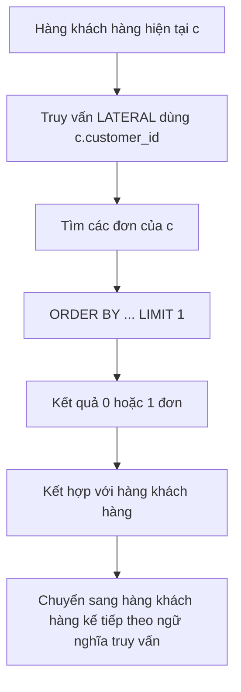

# LATERAL hoặc APPLY cho truy vấn phụ thuộc từng hàng

Khi kết nối bảng bằng SQL, nhiều bài toán không chỉ cần nối hai tập dữ liệu có sẵn. Ta còn muốn chạy **một truy vấn nhỏ phụ thuộc vào từng hàng của bảng đứng trước**. Chẳng hạn:

- Với **mỗi khách hàng**, tìm **đơn hàng mới nhất**.
- Với **mỗi sản phẩm**, lấy **hai giao dịch gần nhất**.
- Với **mỗi nhân viên**, tính một thống kê chỉ trong bộ phận của nhân viên đó.
- Với **mỗi tài liệu JSON**, tách mảng chứa bên trong thành các hàng.
- Với **mỗi bản ghi**, lấy một tập kết quả từ hàm nhận giá trị của bản ghi ấy làm tham số.

Trong SQL, cách thể hiện trực tiếp là **`LATERAL`** (PostgreSQL, MySQL phiên bản hỗ trợ, Oracle và một số DBMS khác) hoặc **`CROSS APPLY` / `OUTER APPLY`** (SQL Server và Oracle). Các cú pháp này cho phép biểu thức bảng ở bên phải tham chiếu tới những cột đã có từ phía bên trái của mệnh đề `FROM`.

Bài học giải thích ngữ nghĩa, ví dụ có kết quả, cách chọn giữa nối trong/nối ngoài, cách xử lý hàng không khớp, phân trang theo từng nhóm, đối chiếu với truy vấn con tương quan và hàm cửa sổ, cùng những điểm khác nhau giữa các phương ngữ SQL.

## 1. Vấn đề của JOIN thông thường

Giả sử có bảng `customers` chứa khách hàng và `customer_orders` chứa các đơn của họ. Ta muốn hiển thị **mỗi khách hàng một hàng**, kèm thông tin **đơn mới nhất** nếu có.

Một phép nối thông thường:

```sql
SELECT
    c.customer_id,
    c.customer_name,
    o.order_id,
    o.ordered_at
FROM customers AS c
LEFT JOIN customer_orders AS o
    ON o.customer_id = c.customer_id;
```

chưa giải quyết được yêu cầu “mỗi khách hàng chỉ lấy đơn mới nhất”. Nếu khách hàng có ba đơn, kết quả `LEFT JOIN` sẽ có ba hàng của khách hàng đó.

Ta cần **một giới hạn riêng cho từng khách hàng**, không phải `LIMIT 1` cho toàn bộ tập kết quả.

### 1.1. Vì sao LIMIT 1 ở cuối câu lệnh không đủ?

```sql
-- PostgreSQL/MySQL/SQLite: ví dụ không đúng yêu cầu "mỗi khách hàng".
SELECT
    c.customer_id,
    c.customer_name,
    o.order_id,
    o.ordered_at
FROM customers AS c
LEFT JOIN customer_orders AS o
    ON o.customer_id = c.customer_id
ORDER BY o.ordered_at DESC
LIMIT 1;
```

`LIMIT 1` ở cuối chỉ lấy **một hàng của toàn bộ kết quả**, không phải một đơn cho **mỗi** khách hàng.

Nhu cầu thực sự là:

1. Lấy một khách hàng `c`.
2. Tìm các đơn có `customer_id = c.customer_id`.
3. Sắp các đơn đó theo thời gian và mã đơn.
4. Chọn đơn đầu tiên.
5. Ghép kết quả với chính khách hàng `c`.
6. Tiếp tục với khách hàng khác.

`LATERAL` hoặc `APPLY` diễn đạt mối quan hệ “phía phải được tham số hóa bằng hàng phía trái” ngay trong `FROM`.

## 2. LATERAL là gì?

Trong PostgreSQL, một truy vấn con ở `FROM` bình thường không được tham chiếu tùy ý đến cột của bảng đứng bên ngoài nó trong cùng mệnh đề `FROM`.

Ví dụ dạng không hợp lệ:

```sql
-- PostgreSQL: truy vấn con FROM tham chiếu c nhưng thiếu LATERAL.
SELECT c.customer_id, recent.order_id
FROM customers AS c
JOIN (
    SELECT o.order_id
    FROM customer_orders AS o
    WHERE o.customer_id = c.customer_id
    ORDER BY o.ordered_at DESC, o.order_id DESC
    LIMIT 1
) AS recent ON TRUE;
```

Bên trong derived table `recent`, alias `c` của bảng `customers` không nằm trong phạm vi được phép tham chiếu theo cách viết này. Truy vấn con không thể tự lấy giá trị `c.customer_id` nếu không được khai báo như một phép nối phụ thuộc.

Thêm **`LATERAL`**:

```sql
-- PostgreSQL
SELECT c.customer_id, recent.order_id
FROM customers AS c
JOIN LATERAL (
    SELECT o.order_id
    FROM customer_orders AS o
    WHERE o.customer_id = c.customer_id
    ORDER BY o.ordered_at DESC, o.order_id DESC
    LIMIT 1
) AS recent ON TRUE;
```

Bây giờ truy vấn con `recent` được phép tham chiếu `c.customer_id`.

### 2.1. Định nghĩa dễ nhớ

**`LATERAL`** cho phép một biểu thức dạng bảng ở phía sau sử dụng các cột của nguồn dữ liệu **đã xuất hiện trước nó** trong phạm vi `FROM` tương ứng.

Có thể hình dung:



Sơ đồ là **mô hình tư duy về kết quả**. DBMS không bắt buộc thực thi từng bước đúng thứ tự vật lý; bộ tối ưu có thể biến đổi kế hoạch mà vẫn phải bảo toàn ngữ nghĩa.

### 2.2. Đâu là “phụ thuộc từng hàng”?

Điểm quyết định là điều kiện:

```sql
WHERE o.customer_id = c.customer_id
```

`o.customer_id` thuộc bảng đơn hàng **ở bên trong** truy vấn con. `c.customer_id` thuộc bảng khách hàng **ở bên ngoài, xuất hiện trước** biểu thức `LATERAL`.

Không có `c.customer_id`, truy vấn con chỉ là một tập dữ liệu độc lập. Có tham chiếu ấy, nó nhận ngữ cảnh từ mỗi hàng bên trái.

### 2.3. LATERAL có bắt buộc truy vấn bên phải phải dùng cột bên trái?

Không nhất thiết. Một biểu thức `LATERAL` có thể không tham chiếu bất kỳ cột nào ở bên trái; nhưng khi đó nó không có lợi thế phụ thuộc từng hàng và thường có thể viết như derived table thông thường.

**Lý do dùng `LATERAL`** là làm rõ việc truy vấn/hàm bên phải **có thể** dùng giá trị từ các nguồn đứng trước. Đó không phải lệnh “chạy N lần trong mọi kế hoạch vật lý”.

## 3. Tạo dữ liệu mẫu để thực hành

Các ví dụ chính dùng **PostgreSQL**.

```sql
CREATE TABLE customers (
    customer_id INTEGER PRIMARY KEY,
    customer_name VARCHAR(100) NOT NULL
);

CREATE TABLE customer_orders (
    order_id INTEGER PRIMARY KEY,
    customer_id INTEGER NOT NULL
        REFERENCES customers(customer_id),
    ordered_at TIMESTAMP NOT NULL,
    amount NUMERIC(12, 2) NOT NULL,
    order_status VARCHAR(20) NOT NULL
);

INSERT INTO customers (customer_id, customer_name)
VALUES
    (1, 'An'),
    (2, 'Bình'),
    (3, 'Chi'),
    (4, 'Dung');

INSERT INTO customer_orders (
    order_id, customer_id, ordered_at, amount, order_status
)
VALUES
    (101, 1, '2026-10-01 09:00:00', 1200000, 'PAID'),
    (102, 1, '2026-10-10 10:00:00',  300000, 'NEW'),
    (103, 2, '2026-10-05 15:00:00',  500000, 'PAID'),
    (104, 2, '2026-10-05 15:00:00',  700000, 'PAID'),
    (105, 2, '2026-10-16 11:00:00',  900000, 'NEW'),
    (106, 3, '2026-10-12 08:00:00',  100000, 'PAID'),
    (107, 3, '2026-10-12 08:00:00',  100000, 'NEW');
```

Bảng khách hàng:

| customer_id | customer_name |
| ---: | --- |
| 1 | An |
| 2 | Bình |
| 3 | Chi |
| 4 | Dung |

Bảng đơn hàng, sắp theo `order_id` chỉ để dễ xem:

| order_id | customer_id | ordered_at | amount | order_status |
| ---: | ---: | --- | ---: | --- |
| 101 | 1 | 2026-10-01 09:00 | 1200000 | PAID |
| 102 | 1 | 2026-10-10 10:00 | 300000 | NEW |
| 103 | 2 | 2026-10-05 15:00 | 500000 | PAID |
| 104 | 2 | 2026-10-05 15:00 | 700000 | PAID |
| 105 | 2 | 2026-10-16 11:00 | 900000 | NEW |
| 106 | 3 | 2026-10-12 08:00 | 100000 | PAID |
| 107 | 3 | 2026-10-12 08:00 | 100000 | NEW |

Dữ liệu có các tình huống quan trọng:

- **An** có hai đơn.
- **Bình** có ba đơn; hai đơn có **cùng thời điểm**.
- **Chi** có hai đơn cũng **cùng thời điểm**.
- **Dung** chưa có đơn nào.

Những trường hợp này giúp thấy rõ sự khác nhau giữa `CROSS JOIN LATERAL` và `LEFT JOIN LATERAL`, đồng thời cho thấy vì sao phải có khóa phụ khi chọn “mới nhất”.

## 4. CROSS JOIN LATERAL: chỉ giữ hàng bên trái khi có hàng bên phải

Trong PostgreSQL, có thể viết:

```sql
SELECT
    c.customer_id,
    c.customer_name,
    recent.order_id,
    recent.ordered_at,
    recent.amount
FROM customers AS c
CROSS JOIN LATERAL (
    SELECT
        o.order_id,
        o.ordered_at,
        o.amount
    FROM customer_orders AS o
    WHERE o.customer_id = c.customer_id
    ORDER BY o.ordered_at DESC, o.order_id DESC
    LIMIT 1
) AS recent
ORDER BY c.customer_id;
```

Kết quả:

| customer_id | customer_name | order_id | ordered_at | amount |
| ---: | --- | ---: | --- | ---: |
| 1 | An | 102 | 2026-10-10 10:00 | 300000 |
| 2 | Bình | 105 | 2026-10-16 11:00 | 900000 |
| 3 | Chi | 107 | 2026-10-12 08:00 | 100000 |

**Dung không xuất hiện** vì truy vấn con tương ứng với `customer_id = 4` không tìm thấy đơn nào và trả **0 hàng**.

### 4.1. Tại sao Chi chọn đơn 107 thay vì 106?

Hai đơn của Chi cùng `ordered_at = '2026-10-12 08:00:00'`. Ta thêm:

```sql
ORDER BY o.ordered_at DESC, o.order_id DESC
```

Khi thời điểm bằng nhau, `order_id DESC` chọn mã lớn hơn trước. Do đó đơn `107` là hàng đầu tiên trong tập của Chi.

Nếu chỉ viết:

```sql
ORDER BY o.ordered_at DESC
LIMIT 1
```

truy vấn vẫn tìm một đơn có thời gian mới nhất, nhưng **không xác định chắc chắn** chọn `106` hay `107` khi đồng hạng. Thêm khóa phụ duy nhất giúp quy tắc rõ ràng.

### 4.2. Tại sao gọi là CROSS JOIN?

`CROSS JOIN LATERAL` có thể tạo **0, 1 hoặc nhiều hàng bên phải** cho mỗi hàng bên trái:

- Nếu bên phải **0 hàng**, hàng bên trái không được giữ.
- Nếu bên phải **1 hàng**, tạo một hàng kết hợp.
- Nếu bên phải **n hàng**, tạo n hàng kết hợp.

Trong ví dụ có `LIMIT 1` nên mỗi khách hàng có tối đa một hàng đơn được chọn. Nhưng **`CROSS JOIN LATERAL` không tự giới hạn về một hàng**; giới hạn đến từ `LIMIT 1` bên trong.

Trong PostgreSQL, cú pháp:

```sql
FROM customers AS c
JOIN LATERAL (...) AS recent ON TRUE
```

thường dùng để thể hiện cùng kiểu ghép trong như `CROSS JOIN LATERAL` ở ví dụ, khi không cần điều kiện ghép thêm ở ngoài. Sự phụ thuộc đã nằm trong điều kiện `WHERE` của truy vấn con.

## 5. LEFT JOIN LATERAL: giữ cả khách hàng không có đơn

Nếu nghiệp vụ yêu cầu hiển thị **mọi khách hàng**, kể cả người chưa mua hàng, dùng **`LEFT JOIN LATERAL`**:

```sql
SELECT
    c.customer_id,
    c.customer_name,
    recent.order_id,
    recent.ordered_at,
    recent.amount
FROM customers AS c
LEFT JOIN LATERAL (
    SELECT
        o.order_id,
        o.ordered_at,
        o.amount
    FROM customer_orders AS o
    WHERE o.customer_id = c.customer_id
    ORDER BY o.ordered_at DESC, o.order_id DESC
    LIMIT 1
) AS recent ON TRUE
ORDER BY c.customer_id;
```

Kết quả:

| customer_id | customer_name | order_id | ordered_at | amount |
| ---: | --- | ---: | --- | ---: |
| 1 | An | 102 | 2026-10-10 10:00 | 300000 |
| 2 | Bình | 105 | 2026-10-16 11:00 | 900000 |
| 3 | Chi | 107 | 2026-10-12 08:00 | 100000 |
| 4 | Dung | `NULL` | `NULL` | `NULL` |

**Dung được giữ lại**. Vì truy vấn con không trả hàng cho Dung, các cột lấy từ `recent` được bổ sung `NULL` theo ngữ nghĩa nối trái.

### 5.1. ON TRUE có ý nghĩa gì?

Trong PostgreSQL, dạng:

```sql
LEFT JOIN LATERAL (...) AS recent ON TRUE
```

thường dùng `ON TRUE` vì **điều kiện liên hệ khách hàng–đơn hàng đã nằm trong truy vấn con**:

```sql
WHERE o.customer_id = c.customer_id
```

`ON TRUE` cho phép mọi hàng do subquery trả về được xem là khớp ở bước nối. Nếu subquery không trả hàng, `LEFT JOIN` vẫn giữ hàng trái với các cột bên phải là `NULL`.

`ON TRUE` không có nghĩa “bỏ qua điều kiện lọc đơn hàng”: điều kiện tương quan trong `WHERE` bên trong vẫn hoạt động.

### 5.2. Bảng đối chiếu

| Tình huống | `CROSS JOIN LATERAL` | `LEFT JOIN LATERAL ... ON TRUE` |
| --- | --- | --- |
| Subquery trả 2 hàng cho một hàng trái | 2 hàng kết hợp | 2 hàng kết hợp |
| Subquery trả 1 hàng | 1 hàng kết hợp | 1 hàng kết hợp |
| Subquery trả 0 hàng | Không có hàng kết quả cho hàng trái đó | Giữ hàng trái với phía phải `NULL` |
| Dùng để tìm mỗi khách hàng đơn mới nhất | Chỉ khách có đơn | Kể cả khách chưa có đơn |
| Dùng với `LIMIT 1` bên trong | Tối đa 1 đơn cho khách có đơn | Tối đa 1 đơn, hoặc hàng `NULL` nếu không có đơn |

Cần chọn kiểu nối theo **yêu cầu có giữ hàng không khớp hay không**, không theo việc câu SQL nào ngắn hơn.

## 6. APPLY của SQL Server: CROSS APPLY và OUTER APPLY

Microsoft SQL Server dùng cú pháp **`APPLY`** để biểu diễn nguồn bên phải phụ thuộc hàng bên trái.

### 6.1. CROSS APPLY tương ứng mục đích với CROSS JOIN LATERAL

Ví dụ trên SQL Server (giả sử bảng tương ứng được tạo trong schema `dbo`):

```sql
SELECT
    c.customer_id,
    c.customer_name,
    recent.order_id,
    recent.ordered_at,
    recent.amount
FROM dbo.customers AS c
CROSS APPLY (
    SELECT TOP (1)
        o.order_id,
        o.ordered_at,
        o.amount
    FROM dbo.customer_orders AS o
    WHERE o.customer_id = c.customer_id
    ORDER BY o.ordered_at DESC, o.order_id DESC
) AS recent
ORDER BY c.customer_id;
```

SQL Server dùng **`TOP (1)`** thay cho `LIMIT 1`. Kết quả có An/Bình/Chi và không có Dung, vì phía phải không trả hàng cho Dung.

### 6.2. OUTER APPLY tương ứng mục đích với LEFT JOIN LATERAL

```sql
SELECT
    c.customer_id,
    c.customer_name,
    recent.order_id,
    recent.ordered_at,
    recent.amount
FROM dbo.customers AS c
OUTER APPLY (
    SELECT TOP (1)
        o.order_id,
        o.ordered_at,
        o.amount
    FROM dbo.customer_orders AS o
    WHERE o.customer_id = c.customer_id
    ORDER BY o.ordered_at DESC, o.order_id DESC
) AS recent
ORDER BY c.customer_id;
```

`OUTER APPLY` giữ Dung với các cột `recent` là `NULL`.

### 6.3. Đối chiếu cú pháp hai họ phương ngữ

| Ý định | PostgreSQL | SQL Server |
| --- | --- | --- |
| Bên phải phụ thuộc từng hàng, bỏ hàng trái nếu không có khớp | `CROSS JOIN LATERAL (...) AS x` | `CROSS APPLY (...) AS x` |
| Bên phải phụ thuộc từng hàng, giữ hàng trái không có khớp | `LEFT JOIN LATERAL (...) AS x ON TRUE` | `OUTER APPLY (...) AS x` |
| Chọn một hàng trong mỗi subquery | `ORDER BY ... LIMIT 1` | `SELECT TOP (1) ... ORDER BY ...` |
| Chọn hai hàng mỗi subquery | `ORDER BY ... LIMIT 2` | `SELECT TOP (2) ... ORDER BY ...` |
| Sắp kết quả chung | `ORDER BY` ngoài cùng | `ORDER BY` ngoài cùng |

Đây là **đối chiếu về ý nghĩa sử dụng phổ biến**; SQL Server còn hỗ trợ `APPLY` với table-valued function và có các chi tiết tối ưu riêng. Không nên coi việc đổi vài từ khóa là bảo đảm mọi truy vấn phức tạp sẽ chuyển DBMS một cách tự động.

## 7. Top N theo từng khách hàng

Bài toán thường gặp: lấy **hai đơn mới nhất** của **mỗi** khách hàng.

### 7.1. PostgreSQL: LIMIT 2 nằm bên trong LATERAL

```sql
SELECT
    c.customer_id,
    c.customer_name,
    recent.order_id,
    recent.ordered_at,
    recent.amount
FROM customers AS c
CROSS JOIN LATERAL (
    SELECT
        o.order_id,
        o.ordered_at,
        o.amount
    FROM customer_orders AS o
    WHERE o.customer_id = c.customer_id
    ORDER BY o.ordered_at DESC, o.order_id DESC
    LIMIT 2
) AS recent
ORDER BY
    c.customer_id,
    recent.ordered_at DESC,
    recent.order_id DESC;
```

Kết quả:

| customer_id | customer_name | order_id | amount |
| ---: | --- | ---: | ---: |
| 1 | An | 102 | 300000 |
| 1 | An | 101 | 1200000 |
| 2 | Bình | 105 | 900000 |
| 2 | Bình | 104 | 700000 |
| 3 | Chi | 107 | 100000 |
| 3 | Chi | 106 | 100000 |

Dung không có đơn nên không xuất hiện với `CROSS JOIN LATERAL`.

### 7.2. LEFT JOIN LATERAL cho top 2

Nếu thay bằng:

```sql
SELECT
    c.customer_id,
    c.customer_name,
    recent.order_id
FROM customers AS c
LEFT JOIN LATERAL (
    SELECT o.order_id, o.ordered_at
    FROM customer_orders AS o
    WHERE o.customer_id = c.customer_id
    ORDER BY o.ordered_at DESC, o.order_id DESC
    LIMIT 2
) AS recent ON TRUE
ORDER BY
    c.customer_id,
    recent.ordered_at DESC NULLS LAST,
    recent.order_id DESC NULLS LAST;
```

truy vấn sẽ có thêm **Dung / `NULL`** như một hàng giữ chỗ. Nó không thêm **hai** hàng `NULL` cho Dung; nối trái chỉ bổ sung một hàng bên phải thiếu khi không có kết quả nào khớp.

### 7.3. LIMIT phải nằm ở cấp nào?

Đặt `LIMIT 2` **bên trong truy vấn LATERAL** để chọn tối đa hai hàng **cho mỗi khách hàng**.

Nếu đặt `LIMIT 2` **ở ngoài cùng**, nó giới hạn tổng cộng hai hàng của toàn bộ kết quả cuối, không phải hai đơn của mỗi khách.

### 7.4. Vì sao cần cả ORDER BY trong và ngoài?

```sql
ORDER BY o.ordered_at DESC, o.order_id DESC
LIMIT 2
```

ở **truy vấn con** chọn đúng hai đơn mới nhất mỗi khách. Nhưng sau khi nối với nhiều khách hàng, thứ tự hàng cuối cùng **không tự được bảo đảm** bởi `ORDER BY` ở subquery.

Do đó truy vấn ngoài dùng:

```sql
ORDER BY c.customer_id,
         recent.ordered_at DESC,
         recent.order_id DESC
```

để đảm bảo kết quả hiển thị theo khách và thứ tự đơn.

## 8. Tìm đơn có số tiền lớn nhất theo từng khách hàng

`LATERAL` không chỉ dùng với thời gian. Giả sử muốn lấy **đơn giá trị cao nhất** của mỗi khách, và khi tiền bằng nhau thì chọn mã đơn nhỏ nhất.

```sql
SELECT
    c.customer_id,
    c.customer_name,
    expensive.order_id,
    expensive.amount
FROM customers AS c
LEFT JOIN LATERAL (
    SELECT o.order_id, o.amount
    FROM customer_orders AS o
    WHERE o.customer_id = c.customer_id
    ORDER BY o.amount DESC, o.order_id ASC
    LIMIT 1
) AS expensive ON TRUE
ORDER BY c.customer_id;
```

Kết quả:

| customer_id | customer_name | order_id | amount |
| ---: | --- | ---: | ---: |
| 1 | An | 101 | 1200000 |
| 2 | Bình | 105 | 900000 |
| 3 | Chi | 106 | 100000 |
| 4 | Dung | `NULL` | `NULL` |

Hai đơn `106` và `107` của Chi đều có số tiền `100000`, nên `order_id ASC` chọn đơn `106`.

**Quan trọng:** Đơn “mới nhất” và đơn “giá trị cao nhất” là hai bài toán khác nhau; `LATERAL` chỉ là công cụ biểu đạt, còn điều kiện `WHERE` và `ORDER BY` phải theo đúng nghiệp vụ.

## 9. Kết hợp điều kiện nghiệp vụ trong LATERAL

Ví dụ muốn lấy **đơn đã thanh toán gần nhất** của mỗi khách hàng.

```sql
SELECT
    c.customer_id,
    c.customer_name,
    paid.order_id,
    paid.ordered_at,
    paid.amount
FROM customers AS c
LEFT JOIN LATERAL (
    SELECT
        o.order_id,
        o.ordered_at,
        o.amount
    FROM customer_orders AS o
    WHERE o.customer_id = c.customer_id
      AND o.order_status = 'PAID'
    ORDER BY o.ordered_at DESC, o.order_id DESC
    LIMIT 1
) AS paid ON TRUE
ORDER BY c.customer_id;
```

Kết quả:

| customer_id | customer_name | order_id | amount |
| ---: | --- | ---: | ---: |
| 1 | An | 101 | 1200000 |
| 2 | Bình | 104 | 700000 |
| 3 | Chi | 106 | 100000 |
| 4 | Dung | `NULL` | `NULL` |

Với Bình, các đơn `103` và `104` cùng thời điểm nhưng đều `PAID`; điều kiện `order_id DESC` chọn `104`.

### 9.1. Đặt điều kiện bên trong hay ngoài LATERAL?

Xem hai cách viết dưới đây.

**A — Tìm đơn đã thanh toán gần nhất:**

```sql
LEFT JOIN LATERAL (
    SELECT o.order_id, o.order_status, o.ordered_at
    FROM customer_orders AS o
    WHERE o.customer_id = c.customer_id
      AND o.order_status = 'PAID'
    ORDER BY o.ordered_at DESC, o.order_id DESC
    LIMIT 1
) AS recent ON TRUE
```

**B — Tìm đơn gần nhất bất kể trạng thái, rồi chỉ giữ nếu đơn ấy PAID:**

```sql
LEFT JOIN LATERAL (
    SELECT o.order_id, o.order_status, o.ordered_at
    FROM customer_orders AS o
    WHERE o.customer_id = c.customer_id
    ORDER BY o.ordered_at DESC, o.order_id DESC
    LIMIT 1
) AS recent ON recent.order_status = 'PAID'
```

Hai cách **không tương đương**:

- Với An, A tìm đơn `101` vì đó là đơn `PAID` gần nhất, dù đơn mới hơn `102` có trạng thái `NEW`.
- Với An, B chọn đơn `102` trước; vì `102` không `PAID`, điều kiện `ON` không khớp, nên An được giữ với cột `recent` là `NULL`. B **không quay lại tìm** đơn `101`.

Khi muốn **chọn hàng từ tập đã được lọc theo trạng thái**, đặt điều kiện trong subquery **trước `ORDER BY ... LIMIT 1`**.

### 9.2. WHERE bên ngoài có thể biến LEFT JOIN thành dạng chỉ lấy hàng khớp

```sql
SELECT c.customer_id, recent.order_id
FROM customers AS c
LEFT JOIN LATERAL (
    SELECT o.order_id, o.order_status
    FROM customer_orders AS o
    WHERE o.customer_id = c.customer_id
    ORDER BY o.ordered_at DESC, o.order_id DESC
    LIMIT 1
) AS recent ON TRUE
WHERE recent.order_status = 'PAID';
```

Điều kiện `WHERE` loại hàng mà `recent.order_status` là `NULL` (ví dụ Dung), vì `NULL = 'PAID'` không cho `TRUE`.

Nếu cần **giữ khách hàng chưa có đơn**, tránh đặt điều kiện lọc cột phải ở `WHERE` khi nó sẽ loại hàng `NULL` do nối trái. Chọn vị trí điều kiện theo ý định “lọc trước khi tìm top N”, “lọc cặp được nối” hay “lọc hàng kết quả cuối”.

## 10. LATERAL kết hợp truy vấn tổng hợp có điều kiện

Bên phải không nhất thiết phải trả một hàng đơn hàng. Nó có thể trả **một hàng thống kê** phụ thuộc khách hàng.

```sql
SELECT
    c.customer_id,
    c.customer_name,
    s.order_count,
    s.total_spend
FROM customers AS c
CROSS JOIN LATERAL (
    SELECT
        COUNT(*) AS order_count,
        COALESCE(SUM(o.amount), 0) AS total_spend
    FROM customer_orders AS o
    WHERE o.customer_id = c.customer_id
) AS s
ORDER BY c.customer_id;
```

Kết quả:

| customer_id | customer_name | order_count | total_spend |
| ---: | --- | ---: | ---: |
| 1 | An | 2 | 1500000 |
| 2 | Bình | 3 | 2100000 |
| 3 | Chi | 2 | 200000 |
| 4 | Dung | 0 | 0 |

**Tại sao Dung vẫn xuất hiện khi dùng CROSS JOIN LATERAL?**

Vì truy vấn con chứa `COUNT(*)` và `SUM(...)` **không có `GROUP BY`**. Một truy vấn tổng hợp vô hướng kiểu này tạo **một hàng kết quả** ngay cả khi không có bản ghi nguồn khớp:

- `COUNT(*) = 0`.
- `SUM(amount) = NULL` nếu không có giá trị để cộng.
- `COALESCE(SUM(amount), 0) = 0`.

`CROSS JOIN LATERAL` chỉ loại khách khi **bên phải trả 0 hàng**. Trường hợp tổng hợp trên tạo **1 hàng** cho Dung, nên Dung được giữ.

### 10.1. Khác biệt với aggregate có GROUP BY

Nếu subquery thêm `GROUP BY o.customer_id`:

```sql
SELECT
    c.customer_id,
    c.customer_name,
    s.order_count
FROM customers AS c
CROSS JOIN LATERAL (
    SELECT COUNT(*) AS order_count
    FROM customer_orders AS o
    WHERE o.customer_id = c.customer_id
    GROUP BY o.customer_id
) AS s
ORDER BY c.customer_id;
```

Dung **không xuất hiện**, vì không có hàng đơn nào tạo được nhóm `o.customer_id` tương ứng. Bên phải trả 0 hàng cho Dung.

Đây là bẫy quan trọng: **khả năng giữ hàng trái phụ thuộc subquery trả bao nhiêu hàng**, chứ không chỉ dựa trên việc có từ khóa `COUNT` hay không.

### 10.2. Cũng có thể giải bằng GROUP BY và LEFT JOIN

Bài toán đếm đơn có thể được giải đơn giản hơn:

```sql
SELECT
    c.customer_id,
    c.customer_name,
    COUNT(o.order_id) AS order_count,
    COALESCE(SUM(o.amount), 0) AS total_spend
FROM customers AS c
LEFT JOIN customer_orders AS o
    ON o.customer_id = c.customer_id
GROUP BY c.customer_id, c.customer_name
ORDER BY c.customer_id;
```

`LATERAL` không phải giải pháp bắt buộc cho mọi phép tổng hợp theo bảng cha. Dùng `JOIN + GROUP BY` thường dễ đọc hơn khi chỉ cần thống kê đơn giản cho tất cả khách hàng.

## 11. Nhiều LATERAL có thể phụ thuộc lẫn nhau

Một nguồn `LATERAL` sau có thể dùng cột đã tạo ở nguồn bên trái, kể cả cột của nguồn `LATERAL` trước đó.

Ví dụ: tính thống kê đơn hàng cho mỗi khách, rồi suy ra **phân khúc** từ tổng chi tiêu.

```sql
SELECT
    c.customer_id,
    c.customer_name,
    s.order_count,
    s.total_spend,
    segment.customer_segment
FROM customers AS c
CROSS JOIN LATERAL (
    SELECT
        COUNT(*) AS order_count,
        COALESCE(SUM(o.amount), 0) AS total_spend
    FROM customer_orders AS o
    WHERE o.customer_id = c.customer_id
) AS s
CROSS JOIN LATERAL (
    SELECT CASE
        WHEN s.total_spend >= 2000000 THEN 'VIP'
        WHEN s.total_spend > 0 THEN 'ACTIVE'
        ELSE 'NEW'
    END AS customer_segment
) AS segment
ORDER BY c.customer_id;
```

Kết quả:

| customer_id | customer_name | order_count | total_spend | customer_segment |
| ---: | --- | ---: | ---: | --- |
| 1 | An | 2 | 1500000 | ACTIVE |
| 2 | Bình | 3 | 2100000 | VIP |
| 3 | Chi | 2 | 200000 | ACTIVE |
| 4 | Dung | 0 | 0 | NEW |

Nguồn thứ hai `segment` tham chiếu `s.total_spend` do nguồn `LATERAL` thứ nhất cung cấp.

### 11.1. Khi nào nên dùng chuỗi LATERAL?

Cách này tiện khi mỗi bước tính có **ngữ nghĩa rõ ràng**:

1. Bước thứ nhất tạo thống kê.
2. Bước thứ hai tạo nhãn từ thống kê.
3. Bước cuối trả kết quả.

Tuy nhiên, nếu chỉ là một biểu thức `CASE` rất đơn giản, CTE hoặc derived table thông thường cũng có thể đủ. Không nên lạm dụng nhiều cấp `LATERAL` khiến câu SQL khó hiểu.

### 11.2. Phạm vi tham chiếu từ trái sang phải

Một nguồn `LATERAL` có thể dùng dữ liệu đã có từ những thành phần bên trái trong phạm vi `FROM` thích hợp. Nó **không thể tự do tham chiếu một alias chỉ được định nghĩa ở phía phải, chưa xuất hiện**.

Ví dụ ý tưởng sai:

```sql
-- Không hợp lệ: "next_source" chưa tồn tại ở bên trái.
SELECT *
FROM customers AS c
CROSS JOIN LATERAL (
    SELECT next_source.some_value
) AS first_source
CROSS JOIN LATERAL (
    SELECT 123 AS some_value
) AS next_source;
```

Đúng là:

```sql
SELECT *
FROM customers AS c
CROSS JOIN LATERAL (
    SELECT 123 AS some_value
) AS first_source
CROSS JOIN LATERAL (
    SELECT first_source.some_value * 2 AS doubled_value
) AS next_source;
```

Khả năng tham chiếu còn chịu các ràng buộc về loại JOIN và phạm vi tên của DBMS; khi truy vấn phức tạp, nên đặt alias rõ ràng và giữ các phụ thuộc theo thứ tự dễ đọc.

## 12. Hàm trả nhiều hàng: một trường hợp LATERAL rất hữu ích

`LATERAL` không chỉ áp dụng với subquery; nó còn tự nhiên khi gọi **hàm trả về bảng hoặc nhiều hàng** với tham số từ hàng bên trái.

Ví dụ PostgreSQL có dữ liệu JSONB:

```sql
CREATE TABLE products (
    product_id INTEGER PRIMARY KEY,
    product_name VARCHAR(100) NOT NULL,
    tags JSONB
);

INSERT INTO products (product_id, product_name, tags)
VALUES
    (1, 'Áo',     '["thời trang", "mùa hè"]'::jsonb),
    (2, 'Sách',   '["giáo dục"]'::jsonb),
    (3, 'Bút',    '[]'::jsonb),
    (4, 'Vở',     NULL);
```

Muốn biến mỗi phần tử trong mảng `tags` thành một hàng:

```sql
SELECT
    p.product_id,
    p.product_name,
    tag.value AS tag_name
FROM products AS p
CROSS JOIN LATERAL jsonb_array_elements_text(
    COALESCE(p.tags, '[]'::jsonb)
) AS tag(value)
ORDER BY p.product_id, tag.value;
```

Kết quả:

| product_id | product_name | tag_name |
| ---: | --- | --- |
| 1 | Áo | mùa hè |
| 1 | Áo | thời trang |
| 2 | Sách | giáo dục |

Sản phẩm `Bút` có mảng rỗng và `Vở` có `NULL` (đã được thay bằng mảng rỗng), nên hàm trả **0 phần tử** và `CROSS JOIN LATERAL` loại hai sản phẩm đó.

### 12.1. Giữ sản phẩm không có tag bằng LEFT JOIN LATERAL

```sql
SELECT
    p.product_id,
    p.product_name,
    tag.value AS tag_name
FROM products AS p
LEFT JOIN LATERAL jsonb_array_elements_text(
    COALESCE(p.tags, '[]'::jsonb)
) AS tag(value) ON TRUE
ORDER BY p.product_id, tag.value NULLS LAST;
```

Kết quả có thêm:

| product_id | product_name | tag_name |
| ---: | --- | --- |
| 3 | Bút | `NULL` |
| 4 | Vở | `NULL` |

Đây là ứng dụng cùng ngữ nghĩa **inner versus outer** như khi tìm đơn mới nhất theo khách hàng.

### 12.2. PostgreSQL có thể ngầm hiểu LATERAL với hàm trong FROM

Với hàm nhận tham số là cột của nguồn trước, PostgreSQL cho phép bỏ từ khóa `LATERAL` trong nhiều trường hợp:

```sql
-- PostgreSQL: LATERAL có thể được ngầm hiểu cho table function.
SELECT p.product_id, tag.value
FROM products AS p
CROSS JOIN jsonb_array_elements_text(
    COALESCE(p.tags, '[]'::jsonb)
) AS tag(value);
```

Nhưng với một **subquery trong `FROM`** tham chiếu cột của nguồn trước, cần khai báo `LATERAL` như đã trình bày. Không nên suy ra vì function có cơ chế ngầm thì mọi derived table cũng vậy.

### 12.3. SQL Server với table-valued function

SQL Server hỗ trợ `APPLY` để gọi hàm trả tập giá trị dựa trên một cột của hàng bên trái. Ví dụ với cột chứa chuỗi phân cách bằng dấu phẩy:

```sql
-- SQL Server: giả sử dbo.products có cột tags_csv dạng NVARCHAR.
SELECT
    p.product_id,
    tag.value AS tag_name
FROM dbo.products AS p
CROSS APPLY STRING_SPLIT(p.tags_csv, N',') AS tag;
```

`STRING_SPLIT` là hàm đặc thù SQL Server, nhận chuỗi của từng sản phẩm và trả các giá trị sau khi tách. Thứ tự các phần tử đầu ra của hàm **không nên mặc định** theo vị trí trong chuỗi; nếu nghiệp vụ cần thứ tự, hãy dùng tính năng ordinal tương ứng ở phiên bản hỗ trợ và `ORDER BY` ở truy vấn ngoài.

`OUTER APPLY` có thể dùng để giữ sản phẩm không có phần tử được trả về, với phía phải được bổ sung `NULL`.

## 13. LATERAL so với correlated scalar subquery

Trước khi có `LATERAL`/`APPLY` hoặc khi câu SQL rất đơn giản, ta có thể dùng **truy vấn con tương quan dạng vô hướng** ngay trong `SELECT`.

Ví dụ lấy mã đơn mới nhất:

```sql
SELECT
    c.customer_id,
    c.customer_name,
    (
        SELECT o.order_id
        FROM customer_orders AS o
        WHERE o.customer_id = c.customer_id
        ORDER BY o.ordered_at DESC, o.order_id DESC
        LIMIT 1
    ) AS latest_order_id
FROM customers AS c
ORDER BY c.customer_id;
```

Kết quả có cùng cột `latest_order_id` như trường hợp `LEFT JOIN LATERAL`; Dung có giá trị `NULL`.

### 13.1. Điểm mạnh và giới hạn

| Tiêu chí | Scalar correlated subquery | LATERAL/APPLY |
| --- | --- | --- |
| Vị trí thường dùng | Một biểu thức trong `SELECT` hoặc điều kiện | Nguồn quan hệ trong `FROM` |
| Giá trị trả về | Một cột, tối đa một hàng cho mỗi biểu thức | Có thể nhiều cột và nhiều hàng |
| Không có hàng khớp | Biểu thức scalar thường cho `NULL` | `CROSS` loại hàng trái; `LEFT/OUTER` giữ với `NULL` bên phải |
| Cần nhiều thuộc tính từ một đơn | Có thể phải viết nhiều scalar subquery hoặc dùng cách khác | Một subquery lấy cả `order_id`, `ordered_at`, `amount` |
| Chọn top N (N > 1) | Không trực tiếp diễn đạt như một giá trị vô hướng | Tự nhiên: `ORDER BY ... LIMIT N` / `TOP (N)` |

Một scalar subquery nếu trả **nhiều hơn một hàng** ở nơi yêu cầu scalar thường gây lỗi. `LATERAL` là **nguồn bảng**, nên hợp pháp trả 0, 1 hoặc nhiều hàng tùy loại nối.

### 13.2. Tránh nhiều scalar subquery giống nhau

Ví dụ muốn cả mã đơn, tiền và thời gian mới nhất:

```sql
-- Cách làm có thể lặp công việc: minh họa, không khuyến nghị.
SELECT
    c.customer_id,
    (SELECT o.order_id
     FROM customer_orders AS o
     WHERE o.customer_id = c.customer_id
     ORDER BY o.ordered_at DESC, o.order_id DESC
     LIMIT 1) AS latest_order_id,
    (SELECT o.amount
     FROM customer_orders AS o
     WHERE o.customer_id = c.customer_id
     ORDER BY o.ordered_at DESC, o.order_id DESC
     LIMIT 1) AS latest_order_amount
FROM customers AS c;
```

Hai biểu thức có cùng điều kiện và thứ tự. Một `LEFT JOIN LATERAL` có thể đọc rõ ràng hơn vì lấy **các cột từ cùng hàng đã chọn**:

```sql
SELECT
    c.customer_id,
    recent.order_id AS latest_order_id,
    recent.amount AS latest_order_amount
FROM customers AS c
LEFT JOIN LATERAL (
    SELECT o.order_id, o.amount
    FROM customer_orders AS o
    WHERE o.customer_id = c.customer_id
    ORDER BY o.ordered_at DESC, o.order_id DESC
    LIMIT 1
) AS recent ON TRUE;
```

Không nên mặc định rằng hai scalar subquery **luôn** chậm hơn: bộ tối ưu có thể có các chiến lược khác nhau. Nhưng về **tính rõ ràng và tính nhất quán của các cột từ một hàng**, `LATERAL` thường có lợi.

## 14. LATERAL so với window function ROW_NUMBER

Bài toán “đơn mới nhất cho mỗi khách” cũng có thể giải bằng hàm cửa sổ.

### 14.1. Gán thứ hạng trong toàn bộ bảng đơn

```sql
WITH ranked_orders AS (
    SELECT
        o.order_id,
        o.customer_id,
        o.ordered_at,
        o.amount,
        ROW_NUMBER() OVER (
            PARTITION BY o.customer_id
            ORDER BY o.ordered_at DESC, o.order_id DESC
        ) AS rn
    FROM customer_orders AS o
)
SELECT
    c.customer_id,
    c.customer_name,
    r.order_id,
    r.ordered_at,
    r.amount
FROM customers AS c
LEFT JOIN ranked_orders AS r
    ON r.customer_id = c.customer_id
   AND r.rn = 1
ORDER BY c.customer_id;
```

Kết quả tương đương ví dụ `LEFT JOIN LATERAL ... LIMIT 1`.

**Chú ý vị trí điều kiện `r.rn = 1`:** đặt trong `ON` để khách chưa có đơn vẫn được giữ. Nếu chuyển sang `WHERE r.rn = 1`, khách Dung bị loại vì hàng nối ngoài có `r.rn = NULL`.

### 14.2. Hai cách tiếp cận

**LATERAL/APPLY:**

- Bắt đầu với mỗi khách hàng ở nguồn bên trái.
- Mô tả truy vấn phụ thuộc khách đó.
- Có thể yêu cầu `ORDER BY ... LIMIT 1` để lấy đúng một đơn.
- Thường thuận tiện khi **bảng khách đã được lọc thành một tập nhỏ** và tồn tại chỉ mục phù hợp để tìm top N từng khách.

**Window function:**

- Tính thứ hạng `ROW_NUMBER()` cho các đơn theo `PARTITION BY customer_id`.
- Chọn `rn = 1`.
- Thường phù hợp khi cần xử lý **toàn bộ hoặc một phần lớn** bảng đơn và tạo thứ hạng của mọi nhóm.
- Có thể dễ dùng cho xếp hạng nhiều mức hoặc tính toán cửa sổ khác.

Không có quy tắc phổ quát rằng `LATERAL` luôn nhanh hơn `ROW_NUMBER()` hoặc ngược lại. Quyết định dựa trên bộ lọc ngoài, số khách, số đơn, chỉ mục và kế hoạch thực thi.

### 14.3. Top 2 bằng ROW_NUMBER

```sql
WITH ranked_orders AS (
    SELECT
        o.customer_id,
        o.order_id,
        o.ordered_at,
        ROW_NUMBER() OVER (
            PARTITION BY o.customer_id
            ORDER BY o.ordered_at DESC, o.order_id DESC
        ) AS rn
    FROM customer_orders AS o
)
SELECT
    c.customer_id,
    c.customer_name,
    r.order_id,
    r.rn
FROM customers AS c
LEFT JOIN ranked_orders AS r
    ON r.customer_id = c.customer_id
   AND r.rn <= 2
ORDER BY c.customer_id, r.rn NULLS LAST;
```

Dạng này lấy tối đa hai đơn cho mỗi khách và giữ khách không có đơn. Trên PostgreSQL, `NULLS LAST` giúp các cột thứ hạng thiếu xuất hiện ở vị trí mong muốn.

## 15. Cần cẩn thận với JOIN thường cộng với MAX

Một cách thử khác:

```sql
SELECT
    customer_id,
    MAX(ordered_at) AS latest_time
FROM customer_orders
GROUP BY customer_id;
```

Đây là cách hợp lệ để lấy **thời gian mới nhất**, nhưng chưa chỉ ra **đơn nào** có thời gian đó. Với Chi, cả `106` và `107` đều ở thời điểm mới nhất; với Bình, `MAX(ordered_at)` là đơn `105`.

Nếu JOIN ngược để tìm các đơn bằng `MAX(ordered_at)`, có thể nhận **nhiều đơn** cho một khách khi trùng thời điểm:

```sql
WITH latest_time AS (
    SELECT customer_id, MAX(ordered_at) AS max_time
    FROM customer_orders
    GROUP BY customer_id
)
SELECT o.customer_id, o.order_id, o.ordered_at
FROM customer_orders AS o
JOIN latest_time AS t
    ON t.customer_id = o.customer_id
   AND t.max_time = o.ordered_at;
```

Trong dữ liệu mẫu, Chi có thể xuất hiện **hai hàng**. Nếu nghiệp vụ cần **chính xác một đơn**, phải thêm quy tắc phá hòa — thường thông qua `ROW_NUMBER()` hoặc `LATERAL ... ORDER BY ... LIMIT 1`.

`MAX(order_id)` cũng không mặc nhiên tương đương “mới nhất theo `ordered_at`” nếu mã đơn không được bảo đảm tăng theo thời gian nghiệp vụ. Không được thay thế một khóa sắp xếp bằng khóa khác chỉ vì chúng tình cờ tương ứng trong dữ liệu mẫu.

## 16. LATERAL có thể thay thế nhiều bước xử lý cồng kềnh

Bài toán: với mỗi khách, hiển thị:

1. Mã và thời điểm đơn mới nhất.
2. Tổng doanh thu các đơn.
3. Phân khúc dựa trên doanh thu.

Có thể viết:

```sql
SELECT
    c.customer_id,
    c.customer_name,
    latest.order_id AS latest_order_id,
    latest.ordered_at AS latest_order_at,
    stats.order_count,
    stats.total_spend,
    CASE
        WHEN stats.total_spend >= 2000000 THEN 'VIP'
        WHEN stats.total_spend > 0 THEN 'ACTIVE'
        ELSE 'NEW'
    END AS customer_segment
FROM customers AS c
LEFT JOIN LATERAL (
    SELECT o.order_id, o.ordered_at
    FROM customer_orders AS o
    WHERE o.customer_id = c.customer_id
    ORDER BY o.ordered_at DESC, o.order_id DESC
    LIMIT 1
) AS latest ON TRUE
CROSS JOIN LATERAL (
    SELECT
        COUNT(*) AS order_count,
        COALESCE(SUM(o.amount), 0) AS total_spend
    FROM customer_orders AS o
    WHERE o.customer_id = c.customer_id
) AS stats
ORDER BY c.customer_id;
```

Kết quả:

| customer_id | latest_order_id | order_count | total_spend | customer_segment |
| ---: | ---: | ---: | ---: | --- |
| 1 | 102 | 2 | 1500000 | ACTIVE |
| 2 | 105 | 3 | 2100000 | VIP |
| 3 | 107 | 2 | 200000 | ACTIVE |
| 4 | `NULL` | 0 | 0 | NEW |

Một nguồn `LATERAL` dành cho **top 1 đơn**, một nguồn dành cho **thống kê**, rồi biểu thức `CASE` dùng thống kê để phân loại.

Tính rõ ràng của cấu trúc này có thể tốt khi ứng dụng cần nhiều thông tin theo từng khách. Tuy nhiên, truy vấn có thể tìm bảng `customer_orders` theo khách **hai lần về mặt logic** (một lần cho top 1, một lần cho tổng hợp). Khi bảng lớn, hãy kiểm tra kế hoạch thực thi để quyết định có nên dùng cấu trúc khác.

## 17. Điều kiện tương quan và NULL

Trong các ví dụ, `customers.customer_id` là khóa chính `NOT NULL` và `customer_orders.customer_id` là khóa ngoại `NOT NULL`. Vì thế:

```sql
o.customer_id = c.customer_id
```

có ý nghĩa rõ ràng.

Nếu cột dùng để so khớp có thể `NULL`, phép `NULL = NULL` **không cho `TRUE`** trong logic SQL thông thường. Một `LATERAL` với điều kiện bằng thông thường sẽ **không tìm thấy** hàng khớp chỉ vì cả hai cột đều `NULL`.

Ví dụ:

```sql
-- PostgreSQL: nếu hai cột có thể NULL và nghiệp vụ xem
-- hai giá trị NULL là tương đương.
WHERE child.optional_code IS NOT DISTINCT FROM parent.optional_code
```

`IS NOT DISTINCT FROM` là phép so sánh null-safe trong PostgreSQL và những DBMS hỗ trợ. Tuy nhiên, việc coi hai `NULL` là một cặp khớp **phải có lý do nghiệp vụ**, không phải mặc định.

### 17.1. NULL xuất hiện vì nối trái hay từ dữ liệu?

Khi dùng `LEFT JOIN LATERAL`, cột bên phải có thể là `NULL` vì:

1. Không có hàng bên phải, nên nối trái bổ sung `NULL`.
2. Có hàng bên phải nhưng chính cột được chọn của hàng ấy có giá trị `NULL`.

Nếu cần biết **có tìm được hàng bên phải thật hay không**, hãy chọn thêm một cột không `NULL` của hàng bên phải, thường là khóa chính:

```sql
SELECT
    c.customer_id,
    recent.order_id,
    CASE
        WHEN recent.order_id IS NULL THEN 0
        ELSE 1
    END AS has_order
FROM customers AS c
LEFT JOIN LATERAL (
    SELECT o.order_id
    FROM customer_orders AS o
    WHERE o.customer_id = c.customer_id
    ORDER BY o.ordered_at DESC, o.order_id DESC
    LIMIT 1
) AS recent ON TRUE;
```

Ở bảng mẫu, `order_id` là khóa chính không thể `NULL`, nên điều kiện `recent.order_id IS NULL` xác định đúng việc không có hàng khớp. Nếu dùng một cột nullable như `notes` để kiểm tra thì có thể kết luận sai.

## 18. Một số bẫy về số hàng và thứ tự

### 18.1. Không có LIMIT nghĩa là có thể có nhiều hàng mỗi khách

```sql
SELECT c.customer_id, o.order_id
FROM customers AS c
CROSS JOIN LATERAL (
    SELECT order_id
    FROM customer_orders
    WHERE customer_id = c.customer_id
) AS o
ORDER BY c.customer_id, o.order_id;
```

Truy vấn này tạo **bảy hàng** trong dữ liệu mẫu, không phải bốn hàng. Một khách có ba đơn tạo ba hàng, vì `CROSS JOIN LATERAL` nối với **mọi hàng** subquery trả về.

**LATERAL không tự giới hạn về một hàng**. Muốn một hàng, sử dụng `LIMIT 1`/`TOP (1)` hoặc thiết kế truy vấn con chỉ trả một hàng như aggregate không `GROUP BY`.

### 18.2. Có ORDER BY bên trong nhưng không có ngoài

```sql
SELECT c.customer_id, recent.order_id
FROM customers AS c
CROSS JOIN LATERAL (
    SELECT o.order_id, o.ordered_at
    FROM customer_orders AS o
    WHERE o.customer_id = c.customer_id
    ORDER BY o.ordered_at DESC, o.order_id DESC
    LIMIT 2
) AS recent;
```

`ORDER BY` bên trong giúp chọn đúng hai đơn mỗi khách, nhưng **không bảo đảm thứ tự cuối cùng** của toàn bộ kết quả. Nếu cần hiển thị theo khách và thời gian, hãy thêm `ORDER BY` của truy vấn ngoài cùng.

### 18.3. LIMIT ngoài cùng chỉ giới hạn tổng số hàng

```sql
SELECT c.customer_id, o.order_id
FROM customers AS c
CROSS JOIN LATERAL (
    SELECT order_id, ordered_at
    FROM customer_orders
    WHERE customer_id = c.customer_id
    ORDER BY ordered_at DESC, order_id DESC
) AS o
ORDER BY c.customer_id, o.ordered_at DESC, o.order_id DESC
LIMIT 2;
```

Câu này lấy tối đa **hai hàng của toàn bộ truy vấn** (trong dữ liệu mẫu có thể là hai đơn của An), không phải hai đơn **mỗi** khách. Vị trí của `LIMIT` tạo ra sự khác biệt lớn về ngữ nghĩa.

### 18.4. Tên alias và cột phải rõ ràng

Trong `LATERAL`, ta thường có nhiều bảng chứa các cột cùng tên `customer_id`, `created_at` hay `status`. Nên viết:

```sql
WHERE o.customer_id = c.customer_id
```

thay vì bỏ alias, tránh nhập nhằng hoặc vô tình viết so sánh một cột với chính nó. Đặc biệt, trong một truy vấn con:

```sql
WHERE customer_id = customer_id
```

có thể chỉ so sánh cột trong cùng bảng với chính nó, không có tương quan thực sự với bảng khách bên ngoài.

## 19. Khác biệt phương ngữ giữa các hệ quản trị

### 19.1. PostgreSQL

PostgreSQL hỗ trợ `LATERAL` với subquery hoặc biểu thức bảng trong `FROM`. Cú pháp thường gặp:

```sql
CROSS JOIN LATERAL (
    SELECT ...
    WHERE child.foreign_id = parent.id
    ORDER BY ...
    LIMIT 1
) AS x
```

và:

```sql
LEFT JOIN LATERAL (
    SELECT ...
) AS x ON TRUE
```

PostgreSQL cũng cho phép các table function trong `FROM` tham chiếu cột nguồn trước mà không luôn cần ghi từ khóa `LATERAL`.

### 19.2. SQL Server

SQL Server dùng:

```sql
CROSS APPLY (
    SELECT TOP (1) ...
    WHERE child.foreign_id = parent.id
    ORDER BY ...
) AS x
```

và:

```sql
OUTER APPLY (
    SELECT TOP (1) ...
    WHERE child.foreign_id = parent.id
    ORDER BY ...
) AS x
```

`CROSS APPLY` tương tự kiểu inner, `OUTER APPLY` tương tự kiểu left outer. T-SQL còn cho phép dùng `APPLY` với nhiều table-valued function.

### 19.3. Oracle Database

Oracle từ **12c** hỗ trợ những cấu trúc liên quan như `LATERAL`, `CROSS APPLY` và `OUTER APPLY`. Có thể thể hiện bài toán tương tự:

```sql
-- Oracle 12c+: ví dụ cú pháp APPLY
SELECT
    c.customer_id,
    recent.order_id
FROM customers c
OUTER APPLY (
    SELECT o.order_id, o.ordered_at
    FROM customer_orders o
    WHERE o.customer_id = c.customer_id
    ORDER BY o.ordered_at DESC, o.order_id DESC
    FETCH FIRST 1 ROW ONLY
) recent
ORDER BY c.customer_id;
```

`FETCH FIRST 1 ROW ONLY` là cú pháp giới hạn hàng được Oracle hỗ trợ từ 12c. Cú pháp chi tiết, tương tác giữa `LATERAL` và các loại phép nối hoặc hàm phân tích có thể có giới hạn riêng trong phiên bản Oracle; khi triển khai cần kiểm tra môi trường đang dùng.

### 19.4. MySQL

**MySQL 8.0.14+** hỗ trợ `LATERAL` cho derived table tương quan trong `FROM`.

```sql
-- MySQL 8.0.14+
SELECT
    c.customer_id,
    c.customer_name,
    recent.order_id
FROM customers AS c
LEFT JOIN LATERAL (
    SELECT o.order_id
    FROM customer_orders AS o
    WHERE o.customer_id = c.customer_id
    ORDER BY o.ordered_at DESC, o.order_id DESC
    LIMIT 1
) AS recent ON TRUE
ORDER BY c.customer_id;
```

Các bản MySQL cũ hơn không hỗ trợ cú pháp này theo cùng cách. MySQL còn có quy tắc riêng về phạm vi tham chiếu và các hạn chế với derived table, cũng như tính năng `JSON_TABLE` có hành vi lateral đặc biệt ở các phiên bản hỗ trợ.

Không nên mặc định **MariaDB** và MySQL có tính năng `LATERAL` hoặc cùng tên cú pháp ở mọi phiên bản; cần xác minh DBMS thực tế.

### 19.5. SQLite

SQLite phổ biến không cung cấp cặp cú pháp `LATERAL`/`APPLY` giống PostgreSQL/SQL Server trong SQL lõi. Với bài toán top 1 theo từng nhóm, thường dùng:

- Scalar correlated subquery trong `SELECT` nếu chỉ cần một giá trị.
- `ROW_NUMBER() OVER (PARTITION BY ... ORDER BY ...)` nếu phiên bản SQLite hỗ trợ window function.
- Các phương án nối và tổng hợp tương ứng.

Ví dụ SQLite sử dụng `ROW_NUMBER()`:

```sql
WITH ranked_orders AS (
    SELECT
        o.customer_id,
        o.order_id,
        o.ordered_at,
        ROW_NUMBER() OVER (
            PARTITION BY o.customer_id
            ORDER BY o.ordered_at DESC, o.order_id DESC
        ) AS rn
    FROM customer_orders AS o
)
SELECT
    c.customer_id,
    c.customer_name,
    r.order_id
FROM customers AS c
LEFT JOIN ranked_orders AS r
    ON r.customer_id = c.customer_id
   AND r.rn = 1
ORDER BY c.customer_id;
```

Điều quan trọng là hiểu **yêu cầu phụ thuộc theo từng nhóm**, rồi chọn cú pháp phù hợp với DBMS; không nhất thiết mọi hệ đều phải có `LATERAL` để giải được bài toán.

### 19.6. Bảng đối chiếu

| DBMS | Cách phổ biến diễn đạt quan hệ phụ thuộc | Giới hạn top N |
| --- | --- | --- |
| PostgreSQL | `JOIN LATERAL`, `CROSS JOIN LATERAL`, `LEFT JOIN LATERAL` | `LIMIT N` hoặc `FETCH FIRST` |
| SQL Server | `CROSS APPLY`, `OUTER APPLY` | `TOP (N)` hoặc cấu trúc `OFFSET/FETCH` |
| Oracle 12c+ | `LATERAL` và `CROSS APPLY`/`OUTER APPLY` | `FETCH FIRST N ROWS ONLY` |
| MySQL 8.0.14+ | `LATERAL` derived table | `LIMIT N` |
| SQLite phổ biến | Scalar subquery, window function, JOIN thích hợp | `LIMIT N` trong phương án tương ứng |

## 20. Hiệu năng: tại sao LATERAL có thể rất phù hợp với chỉ mục?

Giả sử hệ thống có nhiều đơn hàng nhưng chỉ cần đơn mới nhất của một số khách đã được lọc. Truy vấn:

```sql
SELECT c.customer_id, recent.order_id
FROM customers AS c
LEFT JOIN LATERAL (
    SELECT o.order_id
    FROM customer_orders AS o
    WHERE o.customer_id = c.customer_id
    ORDER BY o.ordered_at DESC, o.order_id DESC
    LIMIT 1
) AS recent ON TRUE
WHERE c.customer_id IN (1, 3, 4);
```

có thể rất phù hợp khi bảng `customer_orders` có chỉ mục:

```sql
-- PostgreSQL: ví dụ chỉ mục phục vụ truy vấn.
CREATE INDEX idx_customer_orders_latest
ON customer_orders (
    customer_id,
    ordered_at DESC,
    order_id DESC
);
```

### 20.1. Vì sao thứ tự cột trong chỉ mục này hợp lý?

Điều kiện tương quan:

```sql
WHERE o.customer_id = c.customer_id
```

tìm theo `customer_id` trước. Sau đó:

```sql
ORDER BY o.ordered_at DESC, o.order_id DESC
LIMIT 1
```

muốn lấy đơn đầu trong thứ tự thời gian/mã đã xác định.

Chỉ mục bắt đầu bằng khóa tìm kiếm `customer_id`, theo sau bằng khóa sắp xếp, có thể cho DBMS khả năng lấy những hàng ưu tiên mà không cần sắp lại mọi đơn của khách.

**Không có bảo đảm chỉ mục luôn được sử dụng.** Với bảng nhỏ, ít hàng hoặc phân phối dữ liệu khác, bộ tối ưu có thể chọn quét bảng hay kế hoạch khác. Cần xem `EXPLAIN` hoặc công cụ execution plan phù hợp.

### 20.2. LATERAL không bảo đảm một lần quét nhanh cho mọi khách

Nếu truy vấn ngoài có hàng triệu khách hàng và mỗi khách gây một phép tìm kiếm phức tạp ở bên phải, chi phí có thể lớn. Một giải pháp bằng `ROW_NUMBER()` trên toàn bộ bảng đơn, hoặc một phép tổng hợp/nối hợp lý, có thể hiệu quả hơn.

Ngược lại, nếu chỉ cần đơn mới nhất của vài khách, phương án `LATERAL` với chỉ mục phù hợp thường đáng xem xét.

### 20.3. Bộ tối ưu có thể biến đổi truy vấn

`LATERAL` cho phép biểu diễn **phụ thuộc logic**, không bắt buộc DBMS thực thi một vòng lặp đơn giản theo đúng hình dung người học. DBMS có thể tái sử dụng kết quả, gộp điều kiện hoặc dùng thuật toán join phù hợp khi phép biến đổi bảo toàn ngữ nghĩa.

Không nên dùng số lượng hàng bảng trái để suy ra chính xác số lần một subquery hoặc hàm sẽ được gọi ở mức vật lý.

### 20.4. Chỉ tối ưu sau khi đúng ngữ nghĩa

Những yếu tố cần kiểm tra trước tiên:

1. Đơn “mới nhất” là theo cột nào?
2. Khi trùng thời điểm, chọn mã nào?
3. Khách không có đơn có phải được giữ lại?
4. Có cần top 1 hay top N?
5. Có cần lọc trạng thái trước khi chọn top N?
6. Dữ liệu có thay đổi giữa hai lần truy vấn không?

Sau khi trả lời được, mới cân nhắc chỉ mục, plan và quy mô dữ liệu.

## 21. Bài tập thực hành

Các bài dùng bảng `customers` và `customer_orders` ở mục 3, với cú pháp PostgreSQL trừ khi được ghi khác.

### Bài 1. Tìm đơn mới nhất của khách có đơn

**Yêu cầu:** Chỉ lấy các khách có ít nhất một đơn, mỗi khách một đơn mới nhất.

```sql
SELECT
    c.customer_id,
    c.customer_name,
    latest.order_id
FROM customers AS c
CROSS JOIN LATERAL (
    SELECT o.order_id
    FROM customer_orders AS o
    WHERE o.customer_id = c.customer_id
    ORDER BY o.ordered_at DESC, o.order_id DESC
    LIMIT 1
) AS latest
ORDER BY c.customer_id;
```

**Đáp án:** `(1, An, 102)`, `(2, Bình, 105)`, `(3, Chi, 107)`. Dung không xuất hiện.

### Bài 2. Giữ tất cả khách hàng

Thay `CROSS JOIN LATERAL` bằng `LEFT JOIN LATERAL ... ON TRUE`:

```sql
SELECT
    c.customer_id,
    c.customer_name,
    latest.order_id
FROM customers AS c
LEFT JOIN LATERAL (
    SELECT o.order_id
    FROM customer_orders AS o
    WHERE o.customer_id = c.customer_id
    ORDER BY o.ordered_at DESC, o.order_id DESC
    LIMIT 1
) AS latest ON TRUE
ORDER BY c.customer_id;
```

**Đáp án:** có thêm `(4, Dung, NULL)`.

### Bài 3. Viết lại bằng SQL Server OUTER APPLY

**Yêu cầu:** Chuyển bài 2 thành T-SQL.

```sql
SELECT
    c.customer_id,
    c.customer_name,
    latest.order_id
FROM dbo.customers AS c
OUTER APPLY (
    SELECT TOP (1) o.order_id
    FROM dbo.customer_orders AS o
    WHERE o.customer_id = c.customer_id
    ORDER BY o.ordered_at DESC, o.order_id DESC
) AS latest
ORDER BY c.customer_id;
```

**Đáp án:** tập khách giống bài 2 nếu dữ liệu tương ứng; dùng `TOP (1)` thay `LIMIT 1` và `OUTER APPLY` thay `LEFT JOIN LATERAL`.

### Bài 4. Lấy hai đơn gần nhất mỗi khách

```sql
SELECT c.customer_id, recent.order_id
FROM customers AS c
CROSS JOIN LATERAL (
    SELECT o.order_id, o.ordered_at
    FROM customer_orders AS o
    WHERE o.customer_id = c.customer_id
    ORDER BY o.ordered_at DESC, o.order_id DESC
    LIMIT 2
) AS recent
ORDER BY c.customer_id, recent.ordered_at DESC, recent.order_id DESC;
```

**Đáp án:**

| customer_id | order_id |
| ---: | ---: |
| 1 | 102 |
| 1 | 101 |
| 2 | 105 |
| 2 | 104 |
| 3 | 107 |
| 3 | 106 |

### Bài 5. Tìm đơn đã thanh toán gần nhất

```sql
SELECT c.customer_id, recent.order_id
FROM customers AS c
LEFT JOIN LATERAL (
    SELECT o.order_id
    FROM customer_orders AS o
    WHERE o.customer_id = c.customer_id
      AND o.order_status = 'PAID'
    ORDER BY o.ordered_at DESC, o.order_id DESC
    LIMIT 1
) AS recent ON TRUE
ORDER BY c.customer_id;
```

**Đáp án:** An `101`; Bình `104`; Chi `106`; Dung `NULL`.

### Bài 6. Tính tổng chi tiêu theo khách

```sql
SELECT
    c.customer_id,
    stats.order_count,
    stats.total_spend
FROM customers AS c
CROSS JOIN LATERAL (
    SELECT
        COUNT(*) AS order_count,
        COALESCE(SUM(o.amount), 0) AS total_spend
    FROM customer_orders AS o
    WHERE o.customer_id = c.customer_id
) AS stats
ORDER BY c.customer_id;
```

**Đáp án:** số đơn và tổng tiền lần lượt là:

- An: `2` và `1500000`.
- Bình: `3` và `2100000`.
- Chi: `2` và `200000`.
- Dung: `0` và `0`.

**Câu hỏi:** Vì sao Dung vẫn xuất hiện với `CROSS JOIN LATERAL`? Vì subquery aggregate không `GROUP BY` vẫn trả **một hàng** với `COUNT(*) = 0`.

### Bài 7. Nhận biết vị trí đặt điều kiện

Có hai yêu cầu:

- **A:** “Tìm đơn `PAID` gần nhất, nếu không có thì trả `NULL`”.
- **B:** “Tìm đơn gần nhất bất kể trạng thái, và chỉ hiển thị đơn nếu nó `PAID`”.

**Đáp án:**

- A: `WHERE order_status = 'PAID'` **bên trong** subquery, trước `ORDER BY ... LIMIT 1`.
- B: chọn top 1 trước, rồi áp dụng điều kiện trạng thái lên kết quả đã chọn, chẳng hạn qua điều kiện `ON` của `LEFT JOIN LATERAL`.

Với An, A trả `101`, còn B không trả thông tin đơn ở phía phải vì đơn mới nhất `102` là `NEW`.

### Bài 8. Tạo cờ có đơn

```sql
SELECT
    c.customer_id,
    CASE
        WHEN recent.order_id IS NULL THEN 0
        ELSE 1
    END AS has_order
FROM customers AS c
LEFT JOIN LATERAL (
    SELECT o.order_id
    FROM customer_orders AS o
    WHERE o.customer_id = c.customer_id
    ORDER BY o.ordered_at DESC, o.order_id DESC
    LIMIT 1
) AS recent ON TRUE
ORDER BY c.customer_id;
```

**Đáp án:** khách 1, 2, 3 có `has_order = 1`; khách 4 có `0`.

### Bài 9. So sánh với ROW_NUMBER

**Yêu cầu:** Viết lại bài 2 bằng hàm cửa sổ.

```sql
WITH ranked AS (
    SELECT
        o.customer_id,
        o.order_id,
        ROW_NUMBER() OVER (
            PARTITION BY o.customer_id
            ORDER BY o.ordered_at DESC, o.order_id DESC
        ) AS rn
    FROM customer_orders AS o
)
SELECT c.customer_id, c.customer_name, r.order_id
FROM customers AS c
LEFT JOIN ranked AS r
    ON r.customer_id = c.customer_id
   AND r.rn = 1
ORDER BY c.customer_id;
```

**Đáp án:** cùng tập hàng như bài 2. Lý do cần `AND r.rn = 1` nằm ở `ON` là để giữ khách không có đơn.

### Bài 10. Giải thích lỗi logic khi thiếu LATERAL

```sql
SELECT c.customer_id, recent.order_id
FROM customers AS c
JOIN (
    SELECT o.order_id
    FROM customer_orders AS o
    WHERE o.customer_id = c.customer_id
    LIMIT 1
) AS recent ON TRUE;
```

**Đáp án:** Trong PostgreSQL, derived table `recent` không thể tham chiếu `c.customer_id` trong phạm vi này nếu không được đánh dấu `LATERAL`. Sửa thành `JOIN LATERAL (...) AS recent ON TRUE`; đồng thời thêm `ORDER BY` xác định nếu nghiệp vụ cần đơn mới nhất.

### Bài 11. Chọn chỉ mục hỗ trợ

**Yêu cầu:** Đề xuất chỉ mục cho truy vấn lấy đơn mới nhất theo `customer_id`, `ordered_at DESC`, `order_id DESC`.

```sql
CREATE INDEX idx_customer_orders_latest
ON customer_orders (
    customer_id,
    ordered_at DESC,
    order_id DESC
);
```

**Giải thích:** khóa đầu giúp tìm theo khách; các khóa sau hỗ trợ thứ tự chọn top 1/top N. Có chỉ mục không đồng nghĩa bộ tối ưu luôn dùng nó.

## 22. Các lỗi dễ mắc và cách tránh

| Lỗi | Vì sao sai | Cách xử lý |
| --- | --- | --- |
| Dùng `LIMIT 1` ở cuối JOIN khi muốn mỗi khách một đơn | Giới hạn **toàn bộ kết quả**, không phải mỗi nhóm | Đặt `LIMIT 1` trong LATERAL hoặc dùng ROW_NUMBER |
| Quên `LATERAL` ở derived table tham chiếu alias bên trái | Không đúng phạm vi tên trong PostgreSQL | Thêm `LATERAL` |
| Dùng `CROSS JOIN LATERAL` khi cần giữ khách không có đơn | Bên phải 0 hàng sẽ loại khách | `LEFT JOIN LATERAL ... ON TRUE` |
| Dùng `OUTER APPLY` nhưng đặt `WHERE right.status=...` ở ngoài | Có thể loại hàng bên trái được nối với `NULL` | Đặt điều kiện đúng phạm vi trong subquery/ON |
| Không có khóa phụ khi chọn top 1 theo thời điểm trùng | Chọn hàng đồng hạng không ổn định | `ORDER BY ordered_at DESC, order_id DESC` |
| Tưởng `ORDER BY` bên trong đủ sắp kết quả cuối | Thứ tự kết quả ngoài không được cam kết | Thêm `ORDER BY` ngoài |
| Tưởng `LATERAL` luôn trả một hàng | Bên phải có thể trả 0, 1 hoặc nhiều hàng | Dùng LIMIT/aggregate phù hợp |
| Tưởng `COUNT(*)` khi không khớp làm subquery trả 0 hàng | Aggregate không GROUP BY thường trả một hàng COUNT=0 | Phân biệt số hàng của subquery với giá trị COUNT |
| Dùng `MAX(ordered_at)` để lấy một đơn duy nhất | Có thể nhiều đơn cùng thời điểm mới nhất | Phá hòa bằng khóa duy nhất |
| Dùng cột nullable ở phía phải để kiểm tra có hàng khớp | Cột có thể `NULL` ngay cả khi hàng tồn tại | Kiểm tra khóa không NULL của hàng bên phải |
| Dùng `CROSS APPLY` nguyên văn trên PostgreSQL | Phương ngữ khác SQL Server | Dùng `CROSS JOIN LATERAL` |
| Dùng `LIMIT` nguyên văn trên SQL Server | T-SQL không dùng LIMIT kiểu PostgreSQL | Dùng `TOP (N)` |
| Tưởng `LATERAL` luôn nhanh hơn window function | Hiệu năng phụ thuộc tập dữ liệu, chỉ mục và plan | Đo bằng EXPLAIN/plan |
| Chọn một thứ tự hiển thị nhưng điều kiện LIMIT ở cấp sai | Tập hàng được chọn thay đổi | Phân biệt thứ tự chọn trong subquery và thứ tự trả ở ngoài |

## 23. Ghi nhớ để chọn đúng LATERAL hoặc APPLY

Một cách quyết định nhanh khi cần truy vấn phụ thuộc theo từng hàng:

1. **Bên phải có cần dùng cột từ hàng bên trái không?** Nếu có và muốn bên phải là nguồn trong `FROM`, cân nhắc `LATERAL` hoặc `APPLY`.
2. **Mỗi hàng trái có thể sinh mấy hàng phải?** Subquery có thể trả 0, 1 hoặc nhiều hàng; `LATERAL` không tự giới hạn.
3. **Hàng trái không có kết quả phải có được giữ lại không?** Không cần giữ: `CROSS JOIN LATERAL`/`CROSS APPLY`; cần giữ: `LEFT JOIN LATERAL ... ON TRUE`/`OUTER APPLY`.
4. **Đang lấy top N theo từng nhóm không?** Đặt `ORDER BY ... LIMIT N` hoặc `TOP (N) ... ORDER BY ...` **bên trong** truy vấn phụ thuộc.
5. **Có các hàng đồng hạng không?** Thêm khóa phụ duy nhất để xác định đúng hàng được chọn.
6. **Có lọc trạng thái/trường hợp nghiệp vụ không?** Xác định cần lọc trước khi chọn top N hay sau khi chọn.
7. **Có thể giải đơn giản hơn không?** Với chỉ một giá trị, scalar correlated subquery có thể đủ; với thống kê toàn bảng, `GROUP BY`; với top N của nhiều nhóm, `ROW_NUMBER()` cũng là lựa chọn tốt.
8. **DBMS hỗ trợ cú pháp nào?** PostgreSQL dùng `LATERAL`; SQL Server dùng `APPLY`; Oracle hỗ trợ cả các cấu trúc tương ứng từ phiên bản phù hợp; MySQL cần phiên bản hỗ trợ `LATERAL`.
9. **Có cần tối ưu không?** Xem chỉ mục theo khóa tương quan và khóa sắp xếp, rồi kiểm tra execution plan với dữ liệu thực.

**Nguyên tắc cốt lõi:** `LATERAL` và `APPLY` biến một truy vấn/hàm ở phía phải thành **nguồn dữ liệu có thể phụ thuộc vào mỗi hàng của phía trái**. `CROSS`/`INNER` loại hàng trái khi bên phải không trả hàng; `LEFT`/`OUTER` giữ hàng trái và bổ sung `NULL`. Khi kết hợp đúng với `ORDER BY`, giới hạn hàng và chỉ mục phù hợp, đây là công cụ rất tự nhiên cho các yêu cầu **top N mỗi nhóm**, lấy bản ghi liên quan gần nhất và mở rộng dữ liệu từ từng hàng trong SQL.
