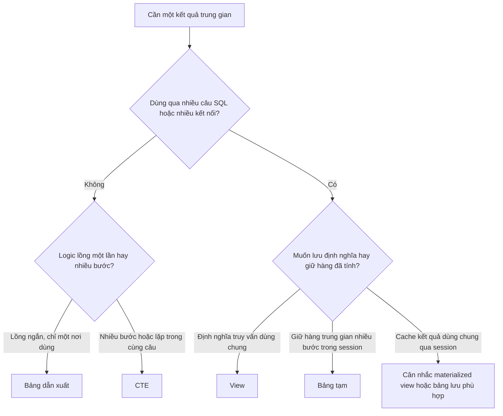

# Phân biệt CTE, bảng dẫn xuất, view và bảng tạm

Trong SQL, chúng ta thường viết một truy vấn dài, lặp lại cùng một phép lọc hoặc phép tổng hợp, rồi muốn đặt tên cho phần kết quả trung gian. Bốn công cụ thường được nhắc đến là **CTE (Common Table Expression)**, **bảng dẫn xuất (derived table)**, **view** và **bảng tạm (temporary table)**.

Cả bốn đều có thể giúp trình bày hoặc tái sử dụng kết quả của một truy vấn, nhưng **không tương đương về phạm vi tồn tại, cách lưu dữ liệu, vòng đời, quyền truy cập và khả năng tối ưu**.

Ví dụ, ta muốn tính số đơn đã thanh toán và tổng tiền đã thanh toán của từng khách hàng, sau đó ghép với danh sách khách. Ta có thể:

- Đặt phép tổng hợp trong `WITH paid_totals AS (...)` — **CTE**.
- Đặt phép tổng hợp ngay trong `FROM (...) AS paid_totals` — **bảng dẫn xuất**.
- Lưu **định nghĩa** phép tổng hợp thành `CREATE VIEW paid_totals AS ...` — **view thông thường**.
- Tạo một **bảng tạm chứa kết quả tại thời điểm tính** bằng `CREATE TEMP TABLE ... AS SELECT ...`.

Bài học giải thích ý nghĩa thực tế của từng cách, viết bốn phiên bản trên cùng bộ dữ liệu, chỉ ra khi nào nên chọn phương án nào, đồng thời phân biệt chúng với **materialized view**, **CTE đệ quy**, **CTE được bộ tối ưu materialize**, và những đặc điểm theo phương ngữ PostgreSQL, SQL Server, MySQL, Oracle, SQLite.

## 1. Bức tranh tổng quan

| Tiêu chí | CTE | Bảng dẫn xuất | View thông thường | Bảng tạm |
| --- | --- | --- | --- | --- |
| Cách khai báo thường gặp | `WITH x AS (SELECT ...)` | `FROM (SELECT ...) AS x` | `CREATE VIEW x AS SELECT ...` | `CREATE TEMP TABLE x AS SELECT ...` |
| Phạm vi tên | Câu lệnh SQL chứa CTE | Phần truy vấn mà alias trong `FROM` có hiệu lực | Đối tượng database, dùng trong nhiều câu lệnh | Thường trong session/kết nối; một số DBMS hỗ trợ vòng đời theo transaction |
| Có đối tượng lưu trong catalog? | Không phải view/bảng độc lập | Không | Có | Có đối tượng tạm, với cách quản lý tùy DBMS |
| Có tự lưu kết quả lâu dài? | Không; bộ tối ưu có thể lưu trung gian khi thực thi | Không; bộ tối ưu có thể dùng vùng trung gian | Không đối với view thông thường | **Có**, trong thời gian bảng tạm tồn tại |
| Tự phản ánh dữ liệu nguồn đã đổi ở truy vấn kế tiếp? | CTE được đánh giá trong câu lệnh mới | Truy vấn lại nguồn khi chạy câu lệnh mới | Thông thường có, theo snapshot/transaction của lần đọc | **Không tự cập nhật** chỉ vì bảng nguồn đổi |
| Dùng lại qua nhiều câu lệnh? | Không | Không | Có | Có trong vòng đời bảng tạm |
| Có thể tạo chỉ mục riêng? | Không tạo index trên tên CTE như bảng | Không tạo index trên alias | Không với ordinary view của PostgreSQL; một số DBMS có indexed view đặc thù | Thường có thể, tùy DBMS |
| Có thể đệ quy? | Có nếu DBMS hỗ trợ recursive CTE | Không phải cơ chế đệ quy trực tiếp tương đương | Định nghĩa có thể dựa trên SQL phù hợp, nhưng view không đồng nghĩa CTE đệ quy | Không tự đệ quy; dữ liệu có thể được xây qua nhiều lệnh |
| Có thể sửa dữ liệu trực tiếp? | Tùy cú pháp/DBMS; CTE bản thân không phải bảng có vòng đời riêng | Không phải đối tượng lưu trữ | Một số simple view có thể cập nhật theo điều kiện DBMS | Có thể `INSERT`/`UPDATE`/`DELETE` theo quy tắc bảng tạm |

Bảng chỉ mô tả **đặc điểm điển hình**. Ví dụ SQL Server có *indexed view*, Oracle có *global temporary table* và PostgreSQL có cơ chế điều khiển materialization của CTE. Vì vậy không nên dùng một tính chất tuyệt đối của một DBMS để định nghĩa tất cả DBMS.

### 1.1. Điểm phân biệt quan trọng nhất

Có thể ghi nhớ bằng hai câu hỏi:

1. **Tên này tồn tại bao lâu?** Trong một phần câu SQL, trong toàn câu SQL, trong nhiều câu lệnh hay suốt vòng đời một đối tượng database?
2. **Đây là định nghĩa một phép truy vấn hay một tập dữ liệu đã được lưu?**

Đặt một cái tên cho biểu thức SQL **không mặc nhiên tạo bảng vật lý**. Ngược lại, tạo một bảng tạm thường **thực sự tạo một nơi chứa hàng** tại thời điểm thao tác, dù nó không phải bảng vĩnh viễn.

## 2. Bộ dữ liệu mẫu để đối chiếu bốn phương án

Ta dùng hai bảng:

- `demo_customers`: danh sách khách.
- `demo_orders`: mỗi khách có thể có nhiều đơn; một số khách chưa có đơn.

Các ví dụ chính dưới đây dùng **PostgreSQL** trong database thực hành riêng.

```sql
CREATE TABLE demo_customers (
    customer_id INTEGER PRIMARY KEY,
    customer_name VARCHAR(100) NOT NULL
);

CREATE TABLE demo_orders (
    order_id INTEGER PRIMARY KEY,
    customer_id INTEGER NOT NULL
        REFERENCES demo_customers(customer_id),
    amount NUMERIC(12, 2) NOT NULL CHECK (amount >= 0),
    order_status VARCHAR(20) NOT NULL,
    ordered_at DATE NOT NULL
);

INSERT INTO demo_customers (customer_id, customer_name)
VALUES
    (1, 'An'),
    (2, 'Bình'),
    (3, 'Chi'),
    (4, 'Dung');

INSERT INTO demo_orders
    (order_id, customer_id, amount, order_status, ordered_at)
VALUES
    (101, 1, 120, 'PAID', '2026-10-01'),
    (102, 1,  80, 'NEW',  '2026-10-02'),
    (103, 2, 200, 'PAID', '2026-10-03'),
    (104, 2,  50, 'PAID', '2026-10-04'),
    (105, 3,  90, 'NEW',  '2026-10-05'),
    (106, 3,  90, 'PAID', '2026-10-06');
```

Dữ liệu:

| customer_id | customer_name | Các đơn |
| ---: | --- | --- |
| 1 | An | Đơn 101 đã trả 120; đơn 102 mới tạo 80 |
| 2 | Bình | Hai đơn đã trả 200 và 50 |
| 3 | Chi | Đơn mới 90 và đơn đã trả 90 |
| 4 | Dung | Không có đơn |

Mục tiêu chung của cả bốn cách triển khai:

> Trả mỗi khách một hàng, gồm `customer_id`, `customer_name`, số đơn `PAID` và tổng tiền `PAID`; khách chưa có đơn trả 0 cho hai chỉ số.

Kết quả mong muốn:

| customer_id | customer_name | paid_order_count | paid_amount |
| ---: | --- | ---: | ---: |
| 1 | An | 1 | 120 |
| 2 | Bình | 2 | 250 |
| 3 | Chi | 1 | 90 |
| 4 | Dung | 0 | 0 |

**Lưu ý về `LEFT JOIN`:** phép tổng hợp theo `customer_id` chỉ sinh hàng cho những khách có đơn `PAID`. Dung không có nhóm tương ứng, nên cột phía phải sẽ là `NULL`; `COALESCE(..., 0)` dùng để hiển thị 0 theo quy tắc báo cáo.

## 3. Bảng dẫn xuất: truy vấn con ngay trong FROM

**Bảng dẫn xuất (derived table)** là kết quả của một truy vấn con xuất hiện như một **nguồn dữ liệu trong `FROM` hoặc `JOIN`**.

Ví dụ đầy đủ:

```sql
SELECT
    c.customer_id,
    c.customer_name,
    COALESCE(p.paid_order_count, 0) AS paid_order_count,
    COALESCE(p.paid_amount, 0) AS paid_amount
FROM demo_customers AS c
LEFT JOIN (
    SELECT
        customer_id,
        COUNT(*) AS paid_order_count,
        SUM(amount) AS paid_amount
    FROM demo_orders
    WHERE order_status = 'PAID'
    GROUP BY customer_id
) AS p
    ON p.customer_id = c.customer_id
ORDER BY c.customer_id;
```

Phần:

```sql
(
    SELECT customer_id, COUNT(*), SUM(amount)
    FROM demo_orders
    WHERE order_status = 'PAID'
    GROUP BY customer_id
) AS p
```

là **bảng dẫn xuất**. Alias `p` cho phép câu truy vấn ngoài tham chiếu `p.customer_id`, `p.paid_order_count` và `p.paid_amount`.

### 3.1. Phạm vi của bảng dẫn xuất

Bảng dẫn xuất là một biểu thức SQL nằm **bên trong câu lệnh đang chạy**:

- Không có `CREATE TABLE`.
- Không tạo một bảng vĩnh viễn có tên `p`.
- Không thể viết một câu `SELECT * FROM p` riêng biệt ở lần chạy sau.
- Không thể tạo index bằng `CREATE INDEX ... ON p(...)` như thể `p` là bảng được lưu.

Một số DBMS yêu cầu alias cho derived table, ví dụ MySQL thường yêu cầu `AS p` hoặc `p` sau ngoặc. PostgreSQL mới có một số mở rộng về alias, nhưng khi viết SQL dễ chuyển DBMS, nên **luôn đặt alias có nghĩa**.

### 3.2. Bảng dẫn xuất rất phù hợp khi nào?

Dùng khi phép truy vấn trung gian:

- Ngắn và có **một nơi sử dụng**.
- Liên quan trực tiếp tới một `JOIN`.
- Không cần dùng ở câu lệnh khác.
- Được đặt gần vị trí sử dụng để người đọc thấy ngay điều kiện nối.

Ví dụ đơn giản:

```sql
SELECT s.customer_id, s.order_count
FROM (
    SELECT customer_id, COUNT(*) AS order_count
    FROM demo_orders
    GROUP BY customer_id
) AS s
WHERE s.order_count >= 2
ORDER BY s.customer_id;
```

Kết quả: các khách 1, 2, 3 — mỗi người có hai đơn.

### 3.3. Bảng dẫn xuất không mặc nhiên được lưu vật lý

Người học có thể tưởng DBMS sẽ “chạy subquery trước, ghi thành bảng, rồi join”. Đó là cách tưởng tượng hữu ích về **ngữ nghĩa**, không phải cam kết về **kế hoạch thực thi**.

Bộ tối ưu có thể:

- Trộn (*merge/flatten*) truy vấn con vào truy vấn ngoài.
- Đẩy một số điều kiện lọc xuống dưới.
- Dùng vùng trung gian hoặc bảng tạm **nội bộ của engine**.
- Tối ưu cả câu như một kế hoạch chung.

Việc engine tự tạo một cấu trúc trung gian trong lúc thực thi **không biến bảng dẫn xuất thành bảng tạm do người dùng sở hữu và tái sử dụng**.

## 4. CTE: đặt tên cho một truy vấn trung gian trong một câu lệnh

**CTE (Common Table Expression)** thường bắt đầu bằng `WITH`:

```sql
WITH paid_totals AS (
    SELECT
        customer_id,
        COUNT(*) AS paid_order_count,
        SUM(amount) AS paid_amount
    FROM demo_orders
    WHERE order_status = 'PAID'
    GROUP BY customer_id
)
SELECT
    c.customer_id,
    c.customer_name,
    COALESCE(p.paid_order_count, 0) AS paid_order_count,
    COALESCE(p.paid_amount, 0) AS paid_amount
FROM demo_customers AS c
LEFT JOIN paid_totals AS p
    ON p.customer_id = c.customer_id
ORDER BY c.customer_id;
```

Kết quả cũng là:

| customer_id | customer_name | paid_order_count | paid_amount |
| ---: | --- | ---: | ---: |
| 1 | An | 1 | 120 |
| 2 | Bình | 2 | 250 |
| 3 | Chi | 1 | 90 |
| 4 | Dung | 0 | 0 |

CTE `paid_totals` có thể được đọc như một **tập kết quả có tên**, nhưng tên này chỉ tồn tại trong phạm vi câu SQL mà `WITH` mở đầu.

### 4.1. So sánh trực tiếp với bảng dẫn xuất

CTE:

```sql
WITH x AS (
    SELECT ...
)
SELECT ...
FROM x;
```

Bảng dẫn xuất:

```sql
SELECT ...
FROM (
    SELECT ...
) AS x;
```

Khi nội dung đơn giản và chỉ được tham chiếu một lần, hai dạng thường **có thể biểu diễn cùng kết quả nghiệp vụ**.

Nhưng chúng khác ở vị trí và khả năng tổ chức:

- **Bảng dẫn xuất:** định nghĩa nằm ngay tại nơi sử dụng trong `FROM`.
- **CTE:** định nghĩa xuất hiện ở phần `WITH`, thường thuận tiện để đọc nhiều bước từ trên xuống.
- **CTE:** tên có thể được tham chiếu nhiều lần trong phạm vi một câu lệnh, nếu DBMS cho phép dạng truy vấn đó.
- **Bảng dẫn xuất:** alias chỉ biểu thị nguồn ở vị trí khai báo; muốn dùng cùng logic ở hai nơi khác nhau thường phải lặp subquery, hoặc chuyển sang CTE.

### 4.2. CTE tồn tại bao lâu?

Ví dụ:

```sql
WITH paid_totals AS (
    SELECT customer_id, SUM(amount) AS paid_amount
    FROM demo_orders
    WHERE order_status = 'PAID'
    GROUP BY customer_id
)
SELECT * FROM paid_totals;
```

Sau khi câu lệnh này hoàn tất, không thể chạy độc lập:

```sql
-- Lỗi nếu không có bảng/view thật cùng tên:
SELECT * FROM paid_totals;
```

vì tên CTE **không tồn tại như một đối tượng database độc lập**.

Nếu cần dùng `paid_totals` ở ba câu SQL khác nhau, hãy tạo lại CTE trong từng câu, dùng view, hoặc cân nhắc bảng tạm tùy mục đích.

### 4.3. CTE không đồng nghĩa bảng tạm

Nhiều tài liệu mô tả CTE là “temporary named result set”. Trong ngữ cảnh này, **temporary** nói về **phạm vi tên và thời gian dùng trong câu SQL**, không có nghĩa câu `WITH` tự gọi `CREATE TEMP TABLE`.

Một CTE có thể được bộ tối ưu xử lý mà không lưu toàn bộ tập hàng thành một vùng dữ liệu độc lập. Ngược lại, bảng tạm được tạo có chủ đích có thể được đọc lại sau câu lệnh tạo bảng.

Đây là khác biệt cần nhớ khi đánh giá hiệu năng và tính tái sử dụng.

## 5. CTE nhiều bước: nơi WITH thường dễ đọc hơn

Giả sử ta muốn phân khúc khách hàng theo **tổng tiền các đơn đã thanh toán**:

- Tổng từ 200 trở lên: `VIP`.
- Tổng lớn hơn 0 nhưng dưới 200: `ACTIVE`.
- Không có đơn đã thanh toán: `NEW`.

Có thể chia thành ba phần:

```sql
WITH paid_totals AS (
    SELECT
        customer_id,
        SUM(amount) AS paid_amount
    FROM demo_orders
    WHERE order_status = 'PAID'
    GROUP BY customer_id
),
customer_totals AS (
    SELECT
        c.customer_id,
        c.customer_name,
        COALESCE(p.paid_amount, 0) AS paid_amount
    FROM demo_customers AS c
    LEFT JOIN paid_totals AS p
        ON p.customer_id = c.customer_id
),
segmented AS (
    SELECT
        customer_id,
        customer_name,
        paid_amount,
        CASE
            WHEN paid_amount >= 200 THEN 'VIP'
            WHEN paid_amount > 0 THEN 'ACTIVE'
            ELSE 'NEW'
        END AS customer_segment
    FROM customer_totals
)
SELECT
    customer_id,
    customer_name,
    paid_amount,
    customer_segment
FROM segmented
ORDER BY customer_id;
```

Kết quả:

| customer_id | customer_name | paid_amount | customer_segment |
| ---: | --- | ---: | --- |
| 1 | An | 120 | ACTIVE |
| 2 | Bình | 250 | VIP |
| 3 | Chi | 90 | ACTIVE |
| 4 | Dung | 0 | NEW |

### 5.1. CTE có thể tham chiếu CTE khai báo trước

Ở ví dụ:

```text
paid_totals
    ↓
customer_totals
    ↓
segmented
    ↓
SELECT cuối
```

`customer_totals` tham chiếu `paid_totals`; `segmented` tham chiếu `customer_totals`. Cách tổ chức này tạo ra các **bước biến đổi được đặt tên** mà không cần lồng nhiều tầng ngoặc trong `FROM`.

Nhưng đây vẫn là **một câu lệnh SQL**, không phải ba thao tác tạo bảng vật lý.

### 5.2. Tránh nhầm CTE thành lệnh tuần tự có tác dụng lưu

`WITH a AS (...), b AS (...) SELECT ...` rất dễ đọc như một quy trình, nhưng DBMS có thể tối ưu lại kế hoạch thực thi theo các quy tắc cho phép. Không nên diễn giải rằng:

1. DBMS chắc chắn lưu `a` vào ổ đĩa.
2. Sau đó chắc chắn lưu `b`.
3. Rồi mới chạy `SELECT`.

Đó không phải cam kết của `WITH`. CTE giúp **mô tả và tổ chức câu SQL**; chi tiết vật lý cần xem kế hoạch thực thi trên DBMS và phiên bản cụ thể.

## 6. Dùng lại một CTE nhiều lần trong cùng câu lệnh

CTE có thể làm rõ một nguồn trung gian được dùng ở nhiều vị trí.

Ví dụ, với `paid_totals`, ta muốn hiển thị tiền từng khách đồng thời thêm số tiền lớn nhất của một khách bất kỳ:

```sql
WITH paid_totals AS (
    SELECT
        customer_id,
        SUM(amount) AS paid_amount
    FROM demo_orders
    WHERE order_status = 'PAID'
    GROUP BY customer_id
)
SELECT
    c.customer_id,
    c.customer_name,
    COALESCE(p.paid_amount, 0) AS paid_amount,
    (
        SELECT MAX(paid_amount)
        FROM paid_totals
    ) AS highest_customer_paid_amount
FROM demo_customers AS c
LEFT JOIN paid_totals AS p
    ON p.customer_id = c.customer_id
ORDER BY c.customer_id;
```

Ở đây `paid_totals` được tham chiếu:

1. Một lần trong `LEFT JOIN`.
2. Một lần trong scalar subquery tính `MAX(paid_amount)`.

Kết quả:

| customer_id | customer_name | paid_amount | highest_customer_paid_amount |
| ---: | --- | ---: | ---: |
| 1 | An | 120 | 250 |
| 2 | Bình | 250 | 250 |
| 3 | Chi | 90 | 250 |
| 4 | Dung | 0 | 250 |

**Dùng tên lại** không có nghĩa engine **luôn tính CTE đúng một lần**. Tùy DBMS, bộ tối ưu có thể materialize một lần, inline, tái thực thi hoặc dùng chiến lược khác. Phải tách **khả năng tham chiếu lại trong SQL** khỏi **cách tái sử dụng kết quả vật lý**.

### 6.1. Khi chỉ sử dụng một lần, derived table có thể đơn giản hơn

Nếu câu lệnh chỉ có một `JOIN` với tập tổng hợp, bảng dẫn xuất trong `FROM` thường đủ rõ ràng. Nếu phải đặt tên cho nhiều bước hoặc cùng nguồn được dùng ở nhiều chỗ, CTE thường giúp bố cục câu SQL dễ theo dõi hơn.

Đây là **quy ước viết SQL**, không phải quy tắc rằng CTE luôn nhanh hoặc luôn chậm hơn derived table.

## 7. View thông thường: lưu định nghĩa truy vấn thành đối tượng database

Khác với CTE và bảng dẫn xuất, **view** được tạo bằng DDL và trở thành một đối tượng database có tên dùng qua nhiều câu lệnh.

Trên PostgreSQL:

```sql
CREATE VIEW v_paid_totals AS
SELECT
    customer_id,
    COUNT(*) AS paid_order_count,
    SUM(amount) AS paid_amount
FROM demo_orders
WHERE order_status = 'PAID'
GROUP BY customer_id;
```

Sau đó, trong **một câu lệnh khác**:

```sql
SELECT
    c.customer_id,
    c.customer_name,
    COALESCE(v.paid_order_count, 0) AS paid_order_count,
    COALESCE(v.paid_amount, 0) AS paid_amount
FROM demo_customers AS c
LEFT JOIN v_paid_totals AS v
    ON v.customer_id = c.customer_id
ORDER BY c.customer_id;
```

Kết quả giống những cách trước.

### 7.1. View lưu điều gì?

**View thông thường lưu định nghĩa truy vấn**, không phải một bản sao lâu dài của các hàng do truy vấn tạo ra.

Tức là `CREATE VIEW v_paid_totals AS SELECT ...`:

- Tạo đối tượng `v_paid_totals` trong database.
- Ghi nhận SQL/metadata định nghĩa cột của view.
- Cho phép các câu lệnh khác truy vấn `v_paid_totals` như một nguồn quan hệ.
- **Không mặc nhiên chụp và lưu vĩnh viễn** tổng tiền hiện có vào một bảng riêng.

Khi bảng nguồn thay đổi, truy vấn view thông thường ở lần đọc sau sẽ phản ánh dữ liệu nguồn phù hợp với **snapshot, transaction và quyền truy cập** của lần đọc đó.

### 7.2. View không tự tồn tại chỉ trong session

View thông thường là một đối tượng database, nên vẫn tồn tại sau khi kết nối tạo view đóng, trừ khi được xóa hoặc có quy tắc vòng đời khác theo DBMS.

Dùng lại:

```sql
SELECT * FROM v_paid_totals;
```

ở câu lệnh khác hoặc từ kết nối phù hợp, với điều kiện đối tượng còn tồn tại và người dùng có quyền.

Muốn xóa view trong môi trường thực hành:

```sql
DROP VIEW v_paid_totals;
```

Không nên chạy `DROP VIEW` đối với view đang dùng ở hệ thống khác; đây là câu lệnh DDL thay đổi schema.

### 7.3. Khi nào view phù hợp?

View thường hữu ích khi:

- Một định nghĩa truy vấn cần dùng **qua nhiều câu SQL**.
- Nhiều báo cáo hoặc ứng dụng cần cùng một cách hiểu về “đơn đã thanh toán”.
- Muốn công bố một cấu trúc đọc ổn định thay cho việc lặp điều kiện.
- Cần tổ chức lớp dữ liệu truy vấn hoặc phân quyền phù hợp với chính sách DBMS.
- Muốn quản lý định nghĩa tập trung, có phiên bản và migration rõ ràng.

Tuy nhiên, view **không phải một bảng cache**; nếu nguồn lớn và truy vấn tốn kém, việc có view thông thường không bảo đảm các báo cáo sẽ chạy nhanh hơn.

## 8. Kiểm tra phản ứng khi dữ liệu nguồn thay đổi

Để thấy khác biệt giữa **view** và **bảng tạm**, giả sử đã có view `v_paid_totals` từ mục trước.

Chèn thêm một đơn `PAID` cho An trong môi trường thử nghiệm:

```sql
INSERT INTO demo_orders
    (order_id, customer_id, amount, order_status, ordered_at)
VALUES
    (107, 1, 30, 'PAID', '2026-10-07');
```

Lúc này tổng tiền đã thanh toán của An trở thành `150`.

Nếu chạy:

```sql
SELECT customer_id, paid_amount
FROM v_paid_totals
WHERE customer_id = 1;
```

kết quả thông thường sau khi thay đổi dữ liệu đã được commit và nhìn thấy trong transaction là:

| customer_id | paid_amount |
| ---: | ---: |
| 1 | 150 |

View được dùng để **truy vấn lại định nghĩa** trên dữ liệu nguồn hiện hành theo snapshot của câu lệnh. Nó không giữ `120` như một bảng ảnh chụp riêng.

**Lưu ý:** Ví dụ chèn đơn 107 chỉ dành cho thí nghiệm này. Các phần bài tập khác mặc định dùng lại bộ dữ liệu gốc ở mục 2, chưa có đơn 107, trừ khi nói rõ đã chèn thêm. Nếu muốn giữ nguyên số liệu trong một phiên thực hành, hãy chạy các thí nghiệm trên bản dữ liệu riêng hoặc rollback theo cách phù hợp với DBMS.

### 8.1. View không hoàn toàn tương đương truy vấn nguồn về quyền

View là đối tượng có thể được cấp quyền truy cập và đôi khi che bớt cột, hàng hoặc chi tiết của bảng bên dưới. Nhưng cơ chế quyền ở view **khác nhau theo DBMS**; nhiều hệ quản trị phân biệt quyền của người tạo view, người đọc view hoặc cách kiểm tra quyền ở bảng nguồn.

Không nên coi việc “tạo một view rồi cấp SELECT” tự động tạo ra **ranh giới bảo mật hoàn chỉnh** cho mọi ứng dụng. Với dữ liệu nhạy cảm, cần xem các quy tắc phân quyền, row-level security, thay đổi schema và các thiết lập security view đặc thù.

## 9. Bảng tạm: lưu kết quả để dùng trong nhiều câu lệnh

**Bảng tạm (temporary table)** là một bảng có phạm vi tồn tại giới hạn hơn bảng vĩnh viễn. Tùy DBMS, nó thường gắn với **session/kết nối** hoặc **transaction**, và chứa các hàng đã được ghi vào nó.

Trên PostgreSQL:

```sql
CREATE TEMP TABLE tmp_paid_totals AS
SELECT
    customer_id,
    COUNT(*) AS paid_order_count,
    SUM(amount) AS paid_amount
FROM demo_orders
WHERE order_status = 'PAID'
GROUP BY customer_id;
```

Sau đó ở **câu lệnh khác trên cùng kết nối**:

```sql
SELECT
    c.customer_id,
    c.customer_name,
    COALESCE(t.paid_order_count, 0) AS paid_order_count,
    COALESCE(t.paid_amount, 0) AS paid_amount
FROM demo_customers AS c
LEFT JOIN tmp_paid_totals AS t
    ON t.customer_id = c.customer_id
ORDER BY c.customer_id;
```

Với dữ liệu gốc, kết quả giống các cách trước.

### 9.1. Điểm khác căn bản với CTE

CTE:

```sql
WITH x AS (...) SELECT ... FROM x;
```

Bảng tạm:

```sql
CREATE TEMP TABLE x AS SELECT ...;
SELECT ... FROM x;
SELECT COUNT(*) FROM x;
```

Bảng tạm có thể được **đọc nhiều lần bởi những câu lệnh khác nhau** khi nó còn tồn tại trong cùng phạm vi, và có thể được **cập nhật, thêm, xóa dữ liệu** như bảng phù hợp với DBMS.

Ví dụ PostgreSQL:

```sql
SELECT COUNT(*) AS customer_groups
FROM tmp_paid_totals;

UPDATE tmp_paid_totals
SET paid_amount = paid_amount + 10
WHERE customer_id = 1;
```

Việc `UPDATE tmp_paid_totals` chỉ thay đổi **dữ liệu của bảng tạm**, không tự cập nhật các hàng gốc ở `demo_orders`.

### 9.2. Bảng tạm không tự đồng bộ với nguồn

Giả sử tạo bảng tạm từ dữ liệu gốc khi An có tổng `120`, rồi mới chèn đơn 107 tiền `30` như mục 8.

View thông thường khi được truy vấn lại có thể trả `150`, nhưng:

```sql
SELECT paid_amount
FROM tmp_paid_totals
WHERE customer_id = 1;
```

vẫn trả `120`, **nếu bảng tạm chưa bị cập nhật hoặc làm mới** và không có thao tác khác ảnh hưởng.

Bảng tạm là một **tập dữ liệu đã được lưu** tại một thời điểm; nếu muốn phản ánh bảng nguồn mới hơn, phải chủ động:

- `TRUNCATE`/`DELETE` rồi nạp lại (theo hỗ trợ của DBMS).
- `INSERT`, `UPDATE` hoặc áp dụng thao tác đồng bộ.
- Xóa và tạo lại bảng tạm.

Chọn cách làm mới theo yêu cầu tính nhất quán, hiệu năng và transaction.

### 9.3. Bảng tạm không nhất thiết chỉ nằm trong RAM

Tên “temporary” không có nghĩa dữ liệu luôn ở bộ nhớ và không dùng ổ đĩa. PostgreSQL và SQL Server có các cơ chế lưu trữ/tệp/tablespace hoặc `tempdb` cho bảng tạm. Chi phí I/O, ghi dữ liệu và quản lý chỉ mục có thể đáng kể.

Không nên kết luận bảng tạm “luôn nhanh hơn” chỉ vì tên của nó.

## 10. Vòng đời và phạm vi của bảng tạm theo PostgreSQL

Trên PostgreSQL, `CREATE TEMP TABLE` mặc định tạo một bảng tạm **cho session hiện tại**. Nó thường được tự xóa khi session kết thúc, hoặc có thể xóa sớm:

```sql
DROP TABLE tmp_paid_totals;
```

Một kết nối khác thường **không nhìn thấy cùng đối tượng bảng tạm** của kết nối hiện tại.

### 10.1. Điều gì xảy ra khi COMMIT?

PostgreSQL có thể chỉ định chính sách:

```sql
CREATE TEMP TABLE tmp_metrics (
    customer_id INTEGER,
    total_amount NUMERIC(12, 2)
) ON COMMIT PRESERVE ROWS;
```

Ba lựa chọn đáng biết trong PostgreSQL:

| Chế độ | Ý nghĩa |
| --- | --- |
| `ON COMMIT PRESERVE ROWS` | Giữ hàng trong bảng tạm sau khi commit; là cách mặc định của PostgreSQL |
| `ON COMMIT DELETE ROWS` | Tự xóa các hàng của bảng tạm tại mỗi lần commit, nhưng cấu trúc vẫn còn |
| `ON COMMIT DROP` | Xóa bảng tạm khi transaction tạo bảng được commit |

**Ví dụ:** nếu một quy trình cần tạo bảng tạm và dùng nó sau nhiều câu lệnh đã commit trên cùng session, chọn chính sách phù hợp; `ON COMMIT DROP` không phù hợp nếu bạn kỳ vọng bảng còn sau commit.

### 10.2. Bảng tạm và connection pool

Trong ứng dụng, có thể tưởng rằng:

```text
request A: CREATE TEMP TABLE ...
request B: SELECT * FROM temp_table
```

sẽ luôn hoạt động. Nhưng **connection pool** có thể đưa hai request lên **hai kết nối database khác nhau**. Bảng tạm của request A có thể không nhìn thấy ở request B.

Cũng cần lưu ý: một kết nối được tái sử dụng có thể còn các đối tượng tạm từ công việc trước nếu chúng chưa bị xóa. Hãy kiểm soát vòng đời, transaction và cleanup.

Vì vậy, bảng tạm hữu ích cho **một quy trình nhiều bước trên kết nối được quản lý rõ**, chứ không phải công cụ chia sẻ dữ liệu trực tiếp giữa các kết nối như bảng vĩnh viễn.

### 10.3. Bảng tạm có thể bị trùng tên với bảng khác

Ở PostgreSQL, bảng tạm của session có thể chiếm ưu tiên phân giải tên đối với một bảng vĩnh viễn trùng tên trong một số ngữ cảnh. Vì vậy cần đặt tên rõ ràng như `tmp_paid_totals` và tránh dùng tên bảng sản xuất thông thường.

Việc khai báo schema, quy tắc `search_path` hoặc cách truy cập tên không đủ điều kiện cần được kiểm tra nếu hệ thống có nhiều schema.

## 11. Chỉ mục và thống kê trên bảng tạm

Vì bảng tạm là một bảng có dữ liệu, PostgreSQL cho phép tạo chỉ mục trên nó:

```sql
CREATE INDEX idx_tmp_paid_totals_customer
ON tmp_paid_totals (customer_id);
```

Cũng có thể thu thập thống kê khi cần:

```sql
ANALYZE tmp_paid_totals;
```

Điều này đặc biệt hữu ích khi:

- Bảng tạm chứa nhiều hàng.
- Có nhiều câu lệnh sau đó `JOIN` theo `customer_id`.
- Truy vấn thường xuyên lọc hoặc sắp theo những cột xác định.
- DBMS có thể chọn kế hoạch tốt hơn nếu có thống kê về số hàng và phân phối dữ liệu.

### 11.1. CTE và derived table có tạo index riêng không?

Không thể làm:

```sql
-- Không hợp lệ nếu paid_totals chỉ là CTE của câu lệnh khác:
CREATE INDEX idx_paid_totals ON paid_totals(customer_id);
```

CTE và derived table **không tồn tại như bảng để nhận lệnh DDL riêng**.

Điều đó không có nghĩa truy vấn dùng CTE không thể tận dụng index: bộ tối ưu vẫn có thể dùng **chỉ mục của các bảng nguồn**, hoặc tạo cấu trúc trung gian theo chiến lược riêng của DBMS.

### 11.2. View thông thường có index không?

Trong PostgreSQL, `CREATE INDEX` không áp dụng trực tiếp cho một **ordinary view** như áp dụng với bảng hoặc materialized view. Truy vấn đọc view có thể được tối ưu qua **index của bảng nguồn**.

**Ngoại lệ theo DBMS:** SQL Server hỗ trợ *indexed view* với những điều kiện riêng như `SCHEMABINDING`, chỉ mục phù hợp và các yêu cầu nhất định. Đây không phải tính chất chung của ordinary view trên PostgreSQL.

### 11.3. Khi nào tạo bảng tạm lại chậm hơn?

Bảng tạm có chi phí:

- Ghi hàng ra vùng lưu trữ tạm.
- Tạo chỉ mục và thu thập thống kê nếu có.
- Quản lý DDL/transaction/session.
- Nạp lại khi dữ liệu nguồn thay đổi.

Nếu chỉ đọc kết quả trung gian **một lần** và câu SQL có thể được tối ưu hiệu quả, CTE hoặc derived table thường đơn giản và có thể không phải chịu chi phí lưu trung gian do người dùng yêu cầu.

## 12. Materialization: khái niệm hay bị hiểu nhầm

**Materialization** là việc tạo/lưu một dạng kết quả trung gian để phục vụ quá trình tính toán, thay vì chỉ biến đổi biểu thức và truy vấn nguồn theo cách trực tiếp.

Nhưng có **nhiều lớp ý nghĩa**:

1. **CTE được materialize trong một kế hoạch thực thi:** DBMS có thể giữ một tập hàng trung gian trong thời gian chạy câu lệnh.
2. **Derived table được materialize bởi optimizer:** tương tự, DBMS có thể chọn tạo kết quả trung gian.
3. **Bảng tạm do người dùng tạo:** kết quả được lưu thành đối tượng bảng tạm có vòng đời qua nhiều câu lệnh.
4. **Materialized view:** đối tượng database riêng lưu kết quả truy vấn và có cơ chế làm mới của DBMS.

Bốn trường hợp này **không cùng loại đối tượng**, dù đều có thể có bước lưu dữ liệu.

### 12.1. Materialized CTE không phải temporary table

Nếu PostgreSQL chọn materialize `WITH x AS (...)`, nó không có nghĩa sau câu lệnh ta có thể chạy:

```sql
SELECT * FROM x;
```

vì tên CTE vẫn chỉ có phạm vi **một câu lệnh**.

Bảng tạm tồn tại riêng trong session/transaction, có thể được chọn lại và nhận DML/DDL phù hợp.

### 12.2. View thường không mặc định materialize

Với:

```sql
CREATE VIEW v_paid_totals AS
SELECT ...
```

view thông thường lưu **định nghĩa**, không tự tạo một bản kết quả cố định để truy vấn lại. Đó là khác biệt then chốt so với materialized view và bảng tạm.

## 13. PostgreSQL 12+: MATERIALIZED và NOT MATERIALIZED của CTE

PostgreSQL có các tùy chọn kiểm soát cách xử lý CTE không đệ quy, không có tác dụng phụ trong các trường hợp được hỗ trợ:

```sql
WITH paid_totals AS MATERIALIZED (
    SELECT
        customer_id,
        SUM(amount) AS paid_amount
    FROM demo_orders
    WHERE order_status = 'PAID'
    GROUP BY customer_id
)
SELECT * FROM paid_totals;
```

Tùy chọn `MATERIALIZED` yêu cầu giữ kết quả CTE như một đơn vị trung gian thay vì gộp nó vào truy vấn cha trong những tình huống được hỗ trợ.

```sql
WITH paid_totals AS NOT MATERIALIZED (
    SELECT
        customer_id,
        SUM(amount) AS paid_amount
    FROM demo_orders
    WHERE order_status = 'PAID'
    GROUP BY customer_id
)
SELECT * FROM paid_totals
WHERE customer_id = 2;
```

`NOT MATERIALIZED` có thể cho phép optimizer đưa logic CTE vào truy vấn cha và đẩy điều kiện xuống hiệu quả hơn. Nhưng nếu CTE được tham chiếu nhiều lần, cách gộp cũng có thể dẫn đến **tính toán lặp**.

### 13.1. Quy tắc mặc định quan trọng

Từ PostgreSQL 12, CTE `SELECT` không đệ quy, không có tác dụng phụ và thường chỉ được tham chiếu **một lần** có thể được gộp vào truy vấn cha; với CTE dùng nhiều lần, mặc định thường nghiêng về xử lý riêng để tránh tính lặp. Chi tiết phụ thuộc tính chất câu lệnh và phiên bản.

Các phiên bản PostgreSQL cũ hơn, đặc biệt trước 12, có hành vi CTE thường như **ranh giới tối ưu hóa (*optimization fence*)** rõ hơn. Vì vậy lời khuyên “CTE PostgreSQL luôn materialize” hoặc “CTE luôn inline” đều không chính xác trên mọi phiên bản.

### 13.2. NOT MATERIALIZED không áp dụng tùy ý

Các giới hạn của `NOT MATERIALIZED` đối với CTE đệ quy, CTE có tác dụng phụ hoặc những trường hợp đặc biệt được PostgreSQL xác định theo ngữ nghĩa. Không dùng gợi ý này như một lệnh phổ quát để buộc mọi CTE được inline.

Cú pháp `AS MATERIALIZED`/`AS NOT MATERIALIZED` của PostgreSQL cũng **không phải SQL di động trên mọi DBMS**, dù vài DBMS khác có các cơ chế riêng hoặc hỗ trợ một phần cú pháp.

### 13.3. Đừng quyết định theo tên cú pháp

Nếu cần tối ưu, hãy xem `EXPLAIN`:

```sql
EXPLAIN
WITH paid_totals AS (
    SELECT
        customer_id,
        SUM(amount) AS paid_amount
    FROM demo_orders
    WHERE order_status = 'PAID'
    GROUP BY customer_id
)
SELECT * FROM paid_totals
WHERE customer_id = 2;
```

Quan sát kế hoạch cho thấy DBMS xử lý thế nào trong môi trường thực tế. Một CTE “đẹp hơn” không tự làm truy vấn nhanh hơn; cách tổ chức SQL và kế hoạch vật lý là hai mối quan tâm riêng.

## 14. Materialized view: không phải view thường cũng không phải CTE

Một **materialized view** là đối tượng database **lưu kết quả truy vấn** để tái sử dụng; phải xem cơ chế làm mới dữ liệu cụ thể.

PostgreSQL hỗ trợ:

```sql
CREATE MATERIALIZED VIEW mv_paid_totals AS
SELECT
    customer_id,
    COUNT(*) AS paid_order_count,
    SUM(amount) AS paid_amount
FROM demo_orders
WHERE order_status = 'PAID'
GROUP BY customer_id;
```

Lúc tạo, materialized view được nạp dữ liệu theo truy vấn. Có thể đọc nhiều lần:

```sql
SELECT * FROM mv_paid_totals
ORDER BY customer_id;
```

### 14.1. View thường và materialized view khác nhau

| Tiêu chí | Ordinary view | Materialized view trên PostgreSQL |
| --- | --- | --- |
| Định nghĩa có được lưu không? | Có | Có |
| Kết quả truy vấn có được lưu thành dữ liệu riêng không? | Không theo cơ chế view thường | Có |
| Dữ liệu nguồn đổi, đọc lại có tự thấy ngay không? | Thông thường thấy dữ liệu nguồn theo snapshot hiện hành | **Không**, cần làm mới |
| Cần cơ chế refresh? | Không theo ý nghĩa cache dữ liệu | Có |
| Có thể tạo index trên đối tượng không? | Không trên ordinary view PostgreSQL | Có |

Ví dụ làm mới:

```sql
REFRESH MATERIALIZED VIEW mv_paid_totals;
```

Chỉ sau một lần refresh phù hợp, kết quả lưu của materialized view mới phản ánh các thay đổi nguồn theo cơ chế của PostgreSQL.

PostgreSQL có `REFRESH MATERIALIZED VIEW CONCURRENTLY` với những điều kiện nhất định, ví dụ yêu cầu chỉ mục unique phù hợp trên materialized view và trạng thái đã được nạp dữ liệu. Không thể tùy ý thêm `CONCURRENTLY` cho mọi materialized view.

### 14.2. Materialized view khác bảng tạm

Cả hai có thể chứa kết quả được lưu, nhưng:

- **Materialized view** thường là đối tượng database tồn tại qua nhiều session, có **định nghĩa truy vấn** và cơ chế refresh.
- **Bảng tạm** thường gắn session/transaction; có thể được cập nhật trực tiếp theo nhu cầu và không mặc nhiên lưu định nghĩa nguồn để refresh.
- Quyền, chỉ mục, locking, vòng đời và khả năng chia sẻ khác nhau.

Trong một báo cáo lặp lại dùng cho nhiều người, materialized view có thể phù hợp hơn bảng tạm; trong quy trình tính toán nhiều bước chỉ dành cho một session, bảng tạm lại tự nhiên hơn.

## 15. CTE đệ quy: năng lực riêng đáng biết

Một trong những lý do chính để dùng CTE là **truy vấn đệ quy**, ví dụ duyệt cấu trúc cây, phân cấp hoặc tạo dãy số.

Trên PostgreSQL:

```sql
WITH RECURSIVE numbers(n) AS (
    SELECT 1
    UNION ALL
    SELECT n + 1
    FROM numbers
    WHERE n < 5
)
SELECT n
FROM numbers
ORDER BY n;
```

Kết quả:

| n |
| ---: |
| 1 |
| 2 |
| 3 |
| 4 |
| 5 |

### 15.1. Hai phần của recursive CTE

- **Phần neo (*anchor*)**: `SELECT 1` tạo giá trị bắt đầu.
- **Phần đệ quy (*recursive member*)**: đọc kết quả của bước trước, tạo `n + 1` khi `n < 5`.
- `UNION ALL` kết hợp các mức theo ngữ nghĩa đệ quy của DBMS.

Điều kiện dừng `WHERE n < 5` là quan trọng. Một recursive CTE thiếu điều kiện dừng phù hợp có thể sinh quá nhiều hàng, tốn tài nguyên hoặc bị chặn bởi giới hạn đệ quy của DBMS.

### 15.2. Derived table và view có làm y hệt không?

Một derived table đơn giản không có cú pháp tự tham chiếu trực tiếp giống `WITH RECURSIVE`. View thông thường không phải cơ chế tổ chức đệ quy thông dụng cho bài toán này.

Dù các hệ quản trị có những công cụ truy vấn phân cấp khác nhau (ví dụ Oracle `CONNECT BY`), **recursive CTE là công cụ biểu đạt tự nhiên** cho nhiều bài toán cây hoặc dãy số trong những DBMS hỗ trợ.

### 15.3. Khác biệt cú pháp

- PostgreSQL/MySQL 8+/SQLite: thường dùng `WITH RECURSIVE`.
- SQL Server: dùng `WITH cte AS (...)` với thành phần đệ quy, **không có từ khóa `RECURSIVE`**; có giới hạn số mức đệ quy và tùy chọn `MAXRECURSION`.
- Oracle: hỗ trợ recursive subquery factoring với cú pháp `WITH`, không dùng nguyên mẫu `WITH RECURSIVE` của PostgreSQL.

Cần kiểm tra cú pháp đệ quy theo DBMS và phiên bản trước khi chuyển mã.

## 16. Các thao tác viết dữ liệu và giới hạn của mỗi công cụ

Không nên dựa vào tên “CTE”, “view” hoặc “table” để suy ra rằng tất cả đều chỉ đọc, hoặc tất cả đều có thể sửa dữ liệu giống nhau.

### 16.1. CTE với INSERT/UPDATE/DELETE

Ở nhiều DBMS, có thể dùng CTE để định nghĩa nguồn dữ liệu phục vụ `INSERT`, `UPDATE` hoặc `DELETE`.

Ví dụ PostgreSQL, minh họa một `INSERT ... SELECT` dùng CTE:

```sql
-- Giả sử đã tạo bảng đích có hai cột thích hợp.
WITH paid_totals AS (
    SELECT customer_id, SUM(amount) AS paid_amount
    FROM demo_orders
    WHERE order_status = 'PAID'
    GROUP BY customer_id
)
INSERT INTO reporting_customer_totals (customer_id, paid_amount)
SELECT customer_id, paid_amount
FROM paid_totals;
```

CTE ở đây vẫn **chỉ tồn tại trong câu INSERT**, không trở thành một bảng độc lập.

PostgreSQL còn có các dạng *data-modifying CTE* với `INSERT`, `UPDATE`, `DELETE` và `RETURNING` trong `WITH`, nhưng chúng có quy tắc riêng về thực thi và dữ liệu. Không suy rằng mọi DBMS hỗ trợ việc sửa dữ liệu trực tiếp bên trong `WITH` giống PostgreSQL.

### 16.2. View có cập nhật được không?

Một số **simple view** có thể cho phép `UPDATE`, `INSERT` hoặc `DELETE` lên bảng cơ sở theo quy tắc của DBMS.

Nhưng view có `GROUP BY`, `SUM` hoặc phép kết hợp phức tạp thường **không tự cập nhật trực tiếp được** như bảng dữ liệu gốc. Ví dụ `v_paid_totals` là view tổng hợp, không nên coi:

```sql
UPDATE v_paid_totals SET paid_amount = 999;
```

là thao tác hợp lệ để sửa tổng tiền trong `demo_orders`.

Một số DBMS có *INSTEAD OF trigger* hoặc cơ chế tương tự để điều khiển DML qua view; đây là tính năng riêng cần thiết kế tường minh.

### 16.3. Bảng tạm có thể cập nhật nhưng không tự lan sang nguồn

```sql
UPDATE tmp_paid_totals
SET paid_amount = 999
WHERE customer_id = 1;
```

Trên PostgreSQL, đây là thao tác lên **bảng tạm `tmp_paid_totals`**, không phải cập nhật `amount` của mọi đơn hàng gốc.

Nếu mục tiêu là sửa dữ liệu nghiệp vụ, thao tác phải nhắm đúng bảng nguồn và được bảo vệ bởi transaction/ràng buộc tương ứng. Một bảng tạm chỉ là vùng dữ liệu trung gian trừ khi ứng dụng chủ động sử dụng nó để tạo lệnh cập nhật nguồn về sau.

## 17. So sánh phạm vi: một câu SQL, nhiều câu SQL và nhiều kết nối

Xét ba lời gọi:

```text
Kết nối A:
  Statement 1
  Statement 2
  Statement 3

Kết nối B:
  Statement 4
```

Đặc điểm:

| Đối tượng | Statement 1 sang Statement 2 trên kết nối A | Kết nối A sang kết nối B |
| --- | --- | --- |
| CTE | Không tồn tại tên CTE sau Statement 1 | Không |
| Derived table | Không tồn tại alias sau Statement 1 | Không |
| View thường | Có thể dùng lại nếu object còn tồn tại và có quyền | Có thể dùng nếu đúng database/schema và quyền |
| Temp table PostgreSQL mặc định | Có thể dùng lại trong cùng session, nếu chưa drop | Không phải cùng đối tượng |
| Materialized view PostgreSQL | Có thể dùng lại | Có thể dùng nếu có quyền, nhưng dữ liệu lưu có thể cũ |

### 17.1. Transaction khác session

Một transaction có thể bao gồm nhiều câu SQL, nhưng điều đó **không khiến tên CTE còn sống qua các câu**.

Ngược lại, bảng tạm PostgreSQL với `ON COMMIT PRESERVE ROWS` có thể còn cả dữ liệu sau commit trong cùng session.

**Khái niệm cần phân biệt:**

- **Câu lệnh (statement)**: đơn vị SQL được thực thi.
- **Transaction**: nhóm thao tác commit/rollback theo quy tắc isolation.
- **Session/connection**: ngữ cảnh kết nối giữa ứng dụng và DBMS.
- **Database object**: đối tượng có định nghĩa và vòng đời do hệ quản trị quản lý.

CTE, bảng dẫn xuất, view và bảng tạm nằm ở những phạm vi khác nhau của bốn khái niệm này.

## 18. Quyền truy cập và khả năng chia sẻ

### 18.1. View và chia sẻ logic qua nhiều ứng dụng

Một view có thể đóng vai trò **giao diện đọc chung**:

```sql
SELECT customer_id, paid_order_count, paid_amount
FROM v_paid_totals;
```

Ứng dụng A và B có thể dùng cùng định nghĩa được quản lý ở database. Nếu muốn sửa quy tắc “đã thanh toán”, nhóm quản trị schema có thể thay đổi view bằng migration phù hợp.

Tuy nhiên, thay đổi view có thể ảnh hưởng nhiều ứng dụng cùng lúc; cần quản lý phiên bản, tên cột và tính tương thích.

### 18.2. CTE và derived table thuộc truy vấn đang gọi

Nếu ứng dụng A viết `WITH paid_totals AS (...)` thì ứng dụng B không tự có một đối tượng `paid_totals` để đọc. Muốn tái sử dụng logic, phải chia sẻ **mã SQL** qua thư viện, module hoặc chuyển thành đối tượng như view.

### 18.3. Bảng tạm thường không dành cho chia sẻ giữa người dùng

Dữ liệu tạm thường phục vụ từng connection/session. Không nên dùng nó làm nơi chia sẻ số liệu chung của toàn hệ thống mà không hiểu quy tắc riêng của DBMS.

Oracle là ví dụ quan trọng: với **global temporary table**, định nghĩa bảng là đối tượng tồn tại trong schema, nhưng **dữ liệu của từng session/transaction được cách ly** theo quy tắc của Oracle. “Global” ở đây không có nghĩa mọi session nhìn thấy cùng dữ liệu hàng.

### 18.4. Quyền trên bảng nguồn vẫn cần được thiết kế

Việc dùng view, CTE hay bảng tạm không tự xóa bỏ yêu cầu bảo mật. Cơ chế kiểm tra quyền của view, khả năng dùng quyền của chủ sở hữu, row-level security và các chính sách truy cập dữ liệu khác phụ thuộc DBMS.

Nếu cần giới hạn người dùng chỉ thấy các cột/hàng nhất định, hãy dùng cơ chế phân quyền được DBMS hỗ trợ và kiểm chứng quyền hiệu lực, thay vì giả định tên “view” đồng nghĩa bảo mật đầy đủ.

## 19. Các khác biệt phương ngữ quan trọng

### 19.1. PostgreSQL

PostgreSQL hỗ trợ:

```sql
-- CTE:
WITH x AS (SELECT 1 AS n)
SELECT * FROM x;

-- Derived table:
SELECT x.n
FROM (SELECT 1 AS n) AS x;

-- View:
CREATE VIEW v_demo_number AS SELECT 1 AS n;

-- Temp table:
CREATE TEMP TABLE tmp_demo_number AS SELECT 1 AS n;
```

Có `WITH RECURSIVE`, `MATERIALIZED`/`NOT MATERIALIZED` ở phiên bản hỗ trợ, `CREATE MATERIALIZED VIEW`, `ON COMMIT` cho bảng tạm.

Khi thử nhiều ví dụ, nên chú ý câu lệnh `CREATE` tạo đối tượng thực và có thể xung đột tên nếu chạy lại. Việc dùng `DROP` hoặc quản lý schema thử nghiệm phải có chủ đích.

### 19.2. SQL Server

SQL Server hỗ trợ CTE:

```sql
-- T-SQL:
;WITH paid_totals AS (
    SELECT
        customer_id,
        SUM(amount) AS paid_amount
    FROM dbo.demo_orders
    WHERE order_status = 'PAID'
    GROUP BY customer_id
)
SELECT *
FROM paid_totals;
```

Nếu một câu lệnh khác đứng trước `WITH` trong cùng batch, SQL Server thường yêu cầu câu lệnh trước kết thúc bằng dấu `;`. Vì vậy mẫu `;WITH` thường được viết để an toàn với ngữ cảnh T-SQL.

Bảng tạm cục bộ trong SQL Server thường có tên bắt đầu bằng `#`:

```sql
-- SQL Server:
SELECT
    customer_id,
    SUM(amount) AS paid_amount
INTO #paid_totals
FROM dbo.demo_orders
WHERE order_status = 'PAID'
GROUP BY customer_id;

SELECT *
FROM #paid_totals;
```

Bảng tạm này có dữ liệu trong `tempdb` theo cơ chế SQL Server, với phạm vi tồn tại liên quan session và các ngữ cảnh thủ tục/batch phù hợp. SQL Server còn có bảng tạm toàn cục `##...` và table variable `@...`, nhưng chúng có **quy tắc vòng đời và tối ưu khác nhau**, không nên đồng nhất.

**CTE trong SQL Server không phải đối tượng materialized được bảo đảm**; khi tham chiếu lại cùng kết quả nhiều lần, tài liệu và kế hoạch thực thi có thể khuyến nghị dùng bảng tạm nếu muốn có tập trung gian tái sử dụng.

SQL Server có *indexed view* với nhiều điều kiện riêng; không nên áp dụng nhận xét “view luôn không có index” cho mọi DBMS.

### 19.3. MySQL 8+

MySQL 8.0 hỗ trợ nonrecursive và recursive CTE:

```sql
WITH paid_totals AS (
    SELECT customer_id, SUM(amount) AS paid_amount
    FROM demo_orders
    WHERE order_status = 'PAID'
    GROUP BY customer_id
)
SELECT * FROM paid_totals;
```

MySQL hỗ trợ derived table, view và temporary table:

```sql
CREATE TEMPORARY TABLE tmp_paid_totals AS
SELECT
    customer_id,
    SUM(amount) AS paid_amount
FROM demo_orders
WHERE order_status = 'PAID'
GROUP BY customer_id;
```

MySQL dùng từ khóa `TEMPORARY` trong `CREATE TEMPORARY TABLE`. Cách optimizer xử lý CTE/derived table có thể là merge hoặc materialize theo cấu trúc truy vấn và phiên bản; **không nên mặc định CTE MySQL luôn được lưu vào một bảng vật lý riêng**.

MySQL có giới hạn và quy tắc riêng khi một temporary table bị tham chiếu nhiều lần trong cùng câu SQL hoặc trong những ngữ cảnh đặc biệt, tùy phiên bản. Khi muốn một CTE dùng nhiều lần, không thể tự động thay bằng temporary table rồi coi mọi câu SQL tương đương về khả năng tham chiếu.

### 19.4. Oracle Database

Oracle hỗ trợ **subquery factoring** bằng `WITH` từ các phiên bản lâu đời; có recursive subquery factoring theo cú pháp Oracle.

Khái niệm bảng tạm thường gặp là **Global Temporary Table (GTT)**:

```sql
-- Oracle: định nghĩa là đối tượng schema tồn tại lâu dài.
CREATE GLOBAL TEMPORARY TABLE tmp_paid_totals (
    customer_id NUMBER,
    paid_amount NUMBER
) ON COMMIT DELETE ROWS;
```

Khác PostgreSQL `CREATE TEMP TABLE`:

- **Định nghĩa GTT** trong Oracle tồn tại trong schema sau khi tạo, không tự bị xóa khi session đóng.
- **Dữ liệu trong bảng tạm** là riêng theo session/transaction theo quy tắc Oracle.
- `ON COMMIT DELETE ROWS` hoặc `ON COMMIT PRESERVE ROWS` quyết định vòng đời của hàng.

Từ Oracle 18c có thêm **private temporary table** với cách đặt tên/vòng đời riêng. Không nên gộp mọi loại temporary table Oracle thành một quy tắc duy nhất.

Oracle có `CREATE MATERIALIZED VIEW` và những khả năng refresh riêng. Cũng có `VIEW` thông thường, `WITH`, derived table; việc chọn phương án dựa trên cùng câu hỏi nghiệp vụ và vòng đời.

### 19.5. SQLite

SQLite hỗ trợ CTE và recursive CTE:

```sql
WITH paid_totals AS (
    SELECT customer_id, SUM(amount) AS paid_amount
    FROM demo_orders
    WHERE order_status = 'PAID'
    GROUP BY customer_id
)
SELECT * FROM paid_totals;
```

SQLite hỗ trợ view và **TEMP table** gắn với kết nối:

```sql
CREATE TEMP TABLE tmp_paid_totals AS
SELECT customer_id, SUM(amount) AS paid_amount
FROM demo_orders
WHERE order_status = 'PAID'
GROUP BY customer_id;
```

SQLite cũng hỗ trợ `TEMP VIEW`. Những đối tượng tạm của SQLite có phạm vi kết nối, không phải chia sẻ tự động qua mọi connection mở cùng tệp database.

SQLite có các **materialization hints** cho CTE ở phiên bản hỗ trợ, nhưng đây là cú pháp và quy tắc riêng; không nên giả định mọi bản SQLite đều có cùng khả năng như PostgreSQL.

### 19.6. Bảng đối chiếu cú pháp

| Mục đích | PostgreSQL | SQL Server | MySQL 8+ | Oracle | SQLite |
| --- | --- | --- | --- | --- | --- |
| CTE thường | `WITH` | `WITH` | `WITH` | `WITH` | `WITH` |
| Đệ quy | `WITH RECURSIVE` | CTE tự tham chiếu, không dùng `RECURSIVE` | `WITH RECURSIVE` | Recursive subquery factoring riêng | `WITH RECURSIVE` |
| Derived table | `FROM (...) AS t` | `FROM (...) AS t` | `FROM (...) AS t` | `FROM (...) t` | `FROM (...) AS t` |
| View | `CREATE VIEW` | `CREATE VIEW` | `CREATE VIEW` | `CREATE VIEW` | `CREATE VIEW` |
| Bảng tạm điển hình | `CREATE TEMP TABLE` | `#temp` hoặc `CREATE TABLE #temp` | `CREATE TEMPORARY TABLE` | `CREATE GLOBAL TEMPORARY TABLE` | `CREATE TEMP TABLE` |
| Materialized view dựng sẵn | Có | Có indexed view với đặc điểm riêng | Không đồng nhất với PostgreSQL materialized view | Có | Không có lệnh lõi tương đương PostgreSQL |

Cách đặt tên cụ thể, quyền DDL và cú pháp giới hạn theo phiên bản phải được xác minh trên DBMS đang triển khai.

## 20. Khi nào chọn CTE, derived table, view hay bảng tạm?

Một quy trình quyết định ngắn:



Lưu ý sơ đồ là **công cụ lựa chọn ban đầu**, không thay thế phân tích transaction, quyền, hiệu năng và tính nhất quán.

### 20.1. Bảng câu hỏi thực tế

| Câu hỏi | Hướng lựa chọn |
| --- | --- |
| Phần SQL ngắn, chỉ dùng một lần ở `JOIN`? | Bảng dẫn xuất |
| Có nhiều bước đặt tên để giảm lồng ngoặc? | CTE |
| Muốn tham chiếu cùng tập con ở hai vị trí trong một câu SQL? | CTE thường rõ ràng |
| Muốn dùng một logic báo cáo từ nhiều câu SQL/ứng dụng? | View |
| Cần chụp kết quả trung gian, tạo index, rồi xử lý qua nhiều câu trên một connection? | Bảng tạm |
| Muốn kết quả được cache cho nhiều session và có chính sách refresh? | Materialized view hoặc bảng kết quả được quản lý |
| Cần truy vấn cây/phân cấp đệ quy? | Recursive CTE hoặc cơ chế chuyên biệt DBMS |
| Chỉ muốn tăng tốc một truy vấn một lần? | Chưa thể kết luận; xem plan thay vì đoán theo tên công cụ |

## 21. Ví dụ đối chiếu: cùng mục tiêu, bốn mức vòng đời

### 21.1. Dùng một lần trong một câu SQL — bảng dẫn xuất

```sql
SELECT c.customer_name, p.paid_amount
FROM demo_customers AS c
JOIN (
    SELECT customer_id, SUM(amount) AS paid_amount
    FROM demo_orders
    WHERE order_status = 'PAID'
    GROUP BY customer_id
) AS p
    ON p.customer_id = c.customer_id;
```

Tên `p` chỉ có ý nghĩa trong câu truy vấn này. Kết quả loại Dung do `JOIN` trong.

### 21.2. Dùng một lần nhưng muốn đặt tên riêng — CTE

```sql
WITH paid_totals AS (
    SELECT customer_id, SUM(amount) AS paid_amount
    FROM demo_orders
    WHERE order_status = 'PAID'
    GROUP BY customer_id
)
SELECT c.customer_name, p.paid_amount
FROM demo_customers AS c
JOIN paid_totals AS p
    ON p.customer_id = c.customer_id;
```

Kết quả giống `21.1`, nhưng tên `paid_totals` biểu thị bước tổng hợp rõ hơn.

### 21.3. Dùng lại qua nhiều ngày/báo cáo — view

```sql
CREATE VIEW v_paid_totals AS
SELECT customer_id, SUM(amount) AS paid_amount
FROM demo_orders
WHERE order_status = 'PAID'
GROUP BY customer_id;
```

Sau đó bất kỳ câu SQL đủ quyền nào có thể đọc `v_paid_totals` ở đúng schema/database. Bản thân view không phải một bảng dữ liệu snapshot.

### 21.4. Chụp kết quả cho một quy trình xử lý — bảng tạm

```sql
CREATE TEMP TABLE tmp_paid_totals AS
SELECT customer_id, SUM(amount) AS paid_amount
FROM demo_orders
WHERE order_status = 'PAID'
GROUP BY customer_id;

CREATE INDEX idx_tmp_paid_customer
ON tmp_paid_totals (customer_id);

SELECT * FROM tmp_paid_totals ORDER BY customer_id;
```

Có thể tiếp tục dùng bảng tạm trong các câu tiếp theo của cùng session. Nếu bảng nguồn đổi, kết quả trong bảng tạm không tự cập nhật. Cần quản lý vòng đời và nạp lại.

**Ghi chú thực hành:** các ví dụ `CREATE VIEW v_paid_totals` và `CREATE TEMP TABLE tmp_paid_totals` là **các phương án độc lập**. Nếu chạy lặp trong cùng môi trường, cần tránh xung đột tên hoặc xóa đối tượng thử nghiệm có chủ đích trước khi tạo lại.

## 22. Vấn đề hiệu năng: so sánh đúng điều gì?

Người học thường hỏi: “CTE có nhanh hơn subquery không?”, “View nhanh hơn CTE không?”, hoặc “Bảng tạm luôn nhanh nhất phải không?”.

**Không có một câu trả lời cố định.**

Hiệu năng phụ thuộc:

- Số hàng nguồn và mức chọn lọc của `WHERE`.
- Số lần kết quả trung gian được sử dụng.
- Có chỉ mục phù hợp ở bảng nguồn không.
- Bộ tối ưu có thể đẩy điều kiện lọc xuống đâu.
- DBMS có inline/materialize CTE hoặc derived table không.
- Có cần ghi và đọc lại bảng tạm không.
- Có cần tạo index trên bảng tạm và thu thập thống kê không.
- Có cần dùng kết quả qua nhiều câu lệnh/connection không.
- Mức độ dữ liệu thay đổi và yêu cầu snapshot/refresh.
- Khả năng song song hóa và tài nguyên memory/temp storage.

### 22.1. Ví dụ điều kiện lọc cần được đẩy xuống

```sql
WITH paid_totals AS (
    SELECT customer_id, SUM(amount) AS paid_amount
    FROM demo_orders
    WHERE order_status = 'PAID'
    GROUP BY customer_id
)
SELECT *
FROM paid_totals
WHERE customer_id = 2;
```

Nếu optimizer có thể đẩy điều kiện `customer_id = 2` xuống khi quét `demo_orders`, có thể giảm công việc. Nhưng nếu bị buộc materialize toàn bộ CTE trước, engine có thể tính tổng cho tất cả khách rồi mới lọc khách 2.

Tính chất và chi phí này phụ thuộc **plan thực tế**, không chỉ phụ thuộc từ khóa `WITH`.

### 22.2. Đo đúng bằng execution plan

Trên PostgreSQL có thể bắt đầu:

```sql
EXPLAIN
WITH paid_totals AS (
    SELECT customer_id, SUM(amount) AS paid_amount
    FROM demo_orders
    WHERE order_status = 'PAID'
    GROUP BY customer_id
)
SELECT * FROM paid_totals WHERE customer_id = 2;
```

Công cụ `EXPLAIN ANALYZE` có thể đo thực thi nhưng **thực sự chạy câu lệnh**, nên cần thận trọng với các truy vấn có tác dụng phụ và môi trường production.

Nếu so sánh hiệu năng, hãy dùng dữ liệu có quy mô phù hợp, thống kê cập nhật, cùng điều kiện lọc và cùng kết quả nghiệp vụ. Không có ý nghĩa khi so một CTE trả 1.000 hàng với một bảng tạm chỉ được nạp 100 hàng rồi kết luận cái nào nhanh hơn.

### 22.3. CTE có thể bị dùng lại nhiều lần

Trong PostgreSQL, CTE được tham chiếu nhiều lần có thể có lợi khi materialize một lần, nhưng đôi lúc điều đó cản trở việc đẩy điều kiện khác nhau từ mỗi nơi tham chiếu xuống nguồn.

`NOT MATERIALIZED` có thể thích hợp trong một số tình huống, nhưng cũng có thể làm tăng tính toán lặp. Đây là quyết định tối ưu hóa dựa trên plan và dữ liệu, không nên áp dụng máy móc.

### 22.4. Khi bảng tạm có lợi

Bảng tạm đáng cân nhắc nếu:

- Kết quả trung gian tốn kém và sẽ được đọc nhiều lần **qua nhiều câu SQL**.
- Muốn index/stats trực tiếp trên kết quả đã lưu.
- Một bước xử lý cần đóng băng tập hàng trước khi chạy các bước kế tiếp.
- Quy trình có kết nối/session được quản lý rõ ràng.

Nhưng bảng tạm không thay thế yêu cầu transaction nhất quán và có thể gây thêm chi phí tạo đối tượng, ghi dữ liệu và cleanup.

## 23. Tính nhất quán và dữ liệu thay đổi

Giả sử một báo cáo chạy hai câu SQL liên tiếp:

1. Đọc tổng đã thanh toán của khách 1.
2. Đọc lại tổng đã thanh toán của khách 1 sau khi giao dịch khác cập nhật dữ liệu.

**CTE, derived table và view thông thường** đều truy vấn dữ liệu theo ngữ nghĩa transaction/snapshot tại lúc chạy câu SQL tương ứng. Chúng không tự bảo đảm hai câu nhìn cùng dữ liệu.

**Bảng tạm** có thể giữ một tập kết quả được nạp trước đó, nên hai lần đọc bảng tạm sẽ không phản ánh thay đổi bảng nguồn nếu không có thao tác cập nhật bảng tạm. Tuy nhiên, bảng tạm vẫn có thể bị **chính session** thay đổi và còn chịu ngữ nghĩa transaction/rollback của DBMS.

### 23.1. Bảng tạm không thay thế isolation

Bảng tạm có thể là một cách lưu snapshot ứng dụng tại một thời điểm, nhưng việc **nạp** nó từ nhiều bảng nguồn trong điều kiện dữ liệu đang đổi vẫn phải xem mức isolation, snapshot và transaction để đảm bảo dữ liệu ban đầu nhất quán theo yêu cầu.

### 23.2. View không phải bản chụp lịch sử

Nếu cần báo cáo “doanh thu chốt ngày 31/10” với số liệu bất biến sau khi đóng kỳ, một ordinary view tính lại từ bảng nguồn hiện hành không nhất thiết tái hiện đúng số liệu đã chốt khi dữ liệu bị sửa hồi tố.

Bài toán lịch sử có thể cần bảng snapshot/bảng sự kiện, thời điểm chốt và quy tắc lưu phiên bản — không phải chỉ chọn từ khóa `VIEW` thay `WITH`.

### 23.3. Materialized view cũng cần xác định độ mới

Materialized view giúp đọc dữ liệu đã lưu nhưng có thể **stale** trước khi refresh. Cần làm rõ:

- Bao lâu refresh một lần?
- Khi refresh, có thể chặn hoặc ảnh hưởng người đọc không?
- Báo cáo cho phép dữ liệu trễ bao lâu?
- Có cần truy vấn đồng nhất với snapshot nào không?

Các câu hỏi này thuộc thiết kế hệ thống dữ liệu, không được giải quyết chỉ bằng tên đối tượng.

## 24. Một số nhầm lẫn và lỗi thường gặp

### 24.1. Nhầm WITH tạo bảng vật lý

```sql
WITH x AS (
    SELECT 1 AS n
)
SELECT n FROM x;
```

Truy vấn tạo một tập kết quả có tên trong một câu SQL. Nó không tương đương:

```sql
CREATE TEMP TABLE x AS SELECT 1 AS n;
```

Lệnh thứ hai tạo một bảng tạm có dữ liệu và vòng đời riêng.

### 24.2. Nhầm view lưu sẵn dữ liệu

`CREATE VIEW` thường lưu định nghĩa truy vấn, không phải bản sao hàng. Muốn lưu kết quả để tái sử dụng cần bảng tạm, bảng vĩnh viễn hoặc materialized view tùy yêu cầu.

### 24.3. Dùng bảng tạm giữa hai connection khác nhau

`CREATE TEMP TABLE` ở kết nối A không bảo đảm có thể đọc đối tượng đó ở kết nối B. Connection pooling là nguồn lỗi phổ biến của cách thiết kế này.

### 24.4. Tin rằng CTE luôn tối ưu kém hơn derived table

Cách xử lý phụ thuộc DBMS, phiên bản, cấu trúc SQL và plan. PostgreSQL trước/sau 12 có khác biệt về việc gộp CTE; những hệ khác có chiến lược khác.

### 24.5. Lạm dụng bảng tạm cho mọi truy vấn nhỏ

Thêm DDL, ghi dữ liệu và tạo chỉ mục có thể tốn công hơn việc chạy một truy vấn trực tiếp. Chỉ nên lưu trung gian khi có lý do về tái sử dụng qua nhiều câu lệnh hoặc plan hiệu quả hơn.

### 24.6. Tin rằng view luôn có thể UPDATE

Simple view có thể cập nhật theo quy tắc nhất định; view tổng hợp `GROUP BY`/`SUM` không tự tương đương một bảng dữ liệu có thể sửa từng hàng.

### 24.7. Quên rằng dữ liệu trong temp table có thể cũ

Sau `CREATE TEMP TABLE ... AS SELECT ...`, bảng tạm không tự đồng bộ với bảng nguồn. Khi nghiệp vụ yêu cầu số liệu mới nhất, cần làm mới hoặc truy vấn lại nguồn.

### 24.8. Quên khóa chính khi dùng bảng trung gian

Nếu bảng tạm chứa nhiều hàng trên cùng khóa, phép `JOIN` về bảng khách có thể nhân hàng. Hãy xác định rõ bảng trung gian có **một hàng mỗi khách** hay **nhiều hàng mỗi khách**, rồi chọn chỉ mục/ràng buộc phù hợp.

### 24.9. Dùng view làm ranh giới bảo mật mà không xét quyền

Quyền trên view, chủ sở hữu và quyền đối với bảng nguồn không giống nhau trên mọi DBMS. Phải thiết kế và kiểm tra chính sách quyền cụ thể.

### 24.10. Dùng recursive CTE không có điều kiện dừng

Một recursive CTE cần điều kiện dừng hoặc giới hạn tương ứng để tránh chuỗi sinh dữ liệu không mong muốn. Dạng đệ quy cũng chịu các giới hạn theo DBMS.

## 25. Bài tập thực hành và lời giải

Các bài từ 1 đến 9 sử dụng bộ dữ liệu PostgreSQL ở mục 2 và **không** tính thêm đơn 107 trong thí nghiệm mục 8.

### Bài 1. Viết bảng dẫn xuất tính tổng tiền đã thanh toán

**Yêu cầu:** mỗi khách có ít nhất một đơn `PAID` sẽ có một hàng tổng.

```sql
SELECT
    p.customer_id,
    p.paid_amount
FROM (
    SELECT
        customer_id,
        SUM(amount) AS paid_amount
    FROM demo_orders
    WHERE order_status = 'PAID'
    GROUP BY customer_id
) AS p
ORDER BY p.customer_id;
```

**Kết quả:**

| customer_id | paid_amount |
| ---: | ---: |
| 1 | 120 |
| 2 | 250 |
| 3 | 90 |

Dung không xuất hiện vì không có đơn đã thanh toán để tạo nhóm.

### Bài 2. Chuyển bảng dẫn xuất thành CTE

```sql
WITH paid_totals AS (
    SELECT
        customer_id,
        SUM(amount) AS paid_amount
    FROM demo_orders
    WHERE order_status = 'PAID'
    GROUP BY customer_id
)
SELECT *
FROM paid_totals
ORDER BY customer_id;
```

**Kết quả:** giống bài 1. **Khác biệt:** phép tổng hợp được đặt tên trong `WITH` thay vì khai báo trực tiếp trong `FROM`.

### Bài 3. Giữ cả khách chưa có đơn

```sql
WITH paid_totals AS (
    SELECT customer_id, SUM(amount) AS paid_amount
    FROM demo_orders
    WHERE order_status = 'PAID'
    GROUP BY customer_id
)
SELECT
    c.customer_id,
    COALESCE(p.paid_amount, 0) AS paid_amount
FROM demo_customers AS c
LEFT JOIN paid_totals AS p
    ON p.customer_id = c.customer_id
ORDER BY c.customer_id;
```

**Kết quả:** An 120, Bình 250, Chi 90, Dung 0. Dùng `LEFT JOIN` để giữ khách không có nhóm ở bên phải.

### Bài 4. CTE có tồn tại ở câu lệnh tiếp theo không?

```sql
WITH demo_numbers AS (
    SELECT 1 AS n
)
SELECT * FROM demo_numbers;

SELECT * FROM demo_numbers;
```

**Đáp án:** câu đầu hợp lệ; câu thứ hai không thể đọc tên CTE đã hết phạm vi, trừ khi có một đối tượng khác trong database trùng tên `demo_numbers`.

### Bài 5. Khi nào chọn VIEW?

**Tình huống:** nhiều báo cáo khác nhau cần cùng định nghĩa “tổng tiền đơn PAID theo khách”, và schema được quản lý bằng migration.

**Gợi ý:** tạo một **view** với định nghĩa tổng hợp để các báo cáo dùng lại. Xem quyền, version và chi phí truy vấn nguồn; ordinary view không tự cache dữ liệu.

### Bài 6. Khi nào chọn bảng tạm?

**Tình huống:** một quy trình xử lý trên cùng connection cần tạo kết quả trung gian rất lớn, đọc lại kết quả đó trong bốn câu SQL và có nhu cầu index trực tiếp.

**Gợi ý:** cân nhắc **bảng tạm**, kiểm tra chi phí nạp, chỉ mục, thống kê và quản lý session. Nó có thể phù hợp hơn việc tính lại cùng biểu thức ở bốn câu lệnh riêng biệt, nhưng phải đo plan thực tế.

### Bài 7. Dữ liệu nguồn đổi thì sao?

**Tình huống:** đã tạo `v_paid_totals` và `tmp_paid_totals` cùng từ dữ liệu gốc; sau đó thêm một đơn `PAID` tiền 30 cho An và commit.

**Dự đoán:**

- Query view thông thường lại: tổng An có thể thành **150** theo snapshot hiện hành.
- Query bảng tạm chưa làm mới: tổng An vẫn **120**.
- Query CTE/derived table mới trên nguồn: tổng An có thể thành **150**.

### Bài 8. Phân biệt materialized CTE và materialized view

**Câu hỏi:** nếu dùng `WITH x AS MATERIALIZED (...)` trong PostgreSQL, sau câu SQL đó có thể đọc `x` từ một connection khác không?

**Đáp án:** Không. `MATERIALIZED` ở CTE điều khiển cách xử lý trong phạm vi thực thi phù hợp; **không tạo đối tượng view hay bảng** dùng qua connection. `CREATE MATERIALIZED VIEW` mới tạo đối tượng database có dữ liệu lưu.

### Bài 9. Truy vấn đệ quy tạo số 1 đến 4

```sql
WITH RECURSIVE seq(n) AS (
    SELECT 1
    UNION ALL
    SELECT n + 1
    FROM seq
    WHERE n < 4
)
SELECT n
FROM seq
ORDER BY n;
```

**Kết quả:** 1, 2, 3, 4. Recursive CTE là một lý do rõ ràng để chọn `WITH` thay cho derived table thông thường.

### Bài 10. SQL Server có cần đúng cú pháp PostgreSQL cho bảng tạm không?

**Đáp án:** Không. SQL Server thường dùng `#temp` hoặc `SELECT ... INTO #temp`, còn PostgreSQL dùng `CREATE TEMP TABLE`. Cơ chế vòng đời, transaction và lưu trữ khác nhau theo DBMS.

### Bài 11. Oracle GTT có biến mất sau session không?

**Đáp án:** Định nghĩa `GLOBAL TEMPORARY TABLE` trong Oracle là đối tượng schema vẫn tồn tại. Dữ liệu được quản lý theo session/transaction tùy `ON COMMIT`. Đây là khác biệt đáng kể so với bảng tạm PostgreSQL tạo riêng cho session.

### Bài 12. Bảng tạm có làm JOIN không nhân hàng nữa không?

Giả sử bảng tạm chứa:

| customer_id | paid_amount |
| ---: | ---: |
| 1 | 120 |
| 1 | 30 |

**Câu hỏi:** nếu `JOIN` với `demo_customers` theo `customer_id`, An xuất hiện bao nhiêu lần?

**Đáp án:** Hai lần. Bảng tạm là bảng dữ liệu bình thường trong phạm vi sử dụng; nó **không tự bảo đảm một hàng mỗi khóa**. Cần tổng hợp về một hàng, ràng buộc unique phù hợp hoặc viết JOIN theo đúng cardinality nghiệp vụ.

## 26. Bảng ghi nhớ cuối bài

| Nhu cầu | Công cụ phù hợp để bắt đầu | Điều không được nhầm |
| --- | --- | --- |
| Một subquery trong `FROM` dùng một lần | Bảng dẫn xuất | Không phải bảng được lưu |
| Nhiều bước trong một câu SQL | CTE | Không tồn tại qua các câu tiếp theo |
| Dùng cùng kết quả logic ở hai nơi trong một câu | CTE | Dùng lại tên không bảo đảm engine tính đúng một lần |
| Định nghĩa SQL dùng chung cho nhiều câu/báo cáo | View | View thường không tự lưu cache dữ liệu |
| Kết quả trung gian đã lưu trong session | Bảng tạm | Không tự cập nhật khi bảng nguồn đổi; không tự chia sẻ qua connection |
| Kết quả lưu qua nhiều session có chính sách refresh | Materialized view | Không giống view thường hay bảng tạm |
| Truy vấn cây hoặc sinh dãy số đệ quy | Recursive CTE | Cú pháp/giới hạn theo DBMS |
| Tối ưu top N, lọc hoặc JOIN | Bắt đầu từ câu SQL đúng, xem plan | Không có công cụ nào luôn nhanh hơn |
| Chia sẻ quyền đọc truy vấn | View với thiết kế quyền phù hợp | Không tự bảo đảm chính sách bảo mật hoàn chỉnh |
| Báo cáo cần snapshot nhất quán | Transaction/snapshot và chiến lược lưu phù hợp | Đổi `WITH` thành `VIEW` không tự giải quyết |

**Kết luận:** CTE và bảng dẫn xuất là **cách tổ chức truy vấn trong một câu SQL**; view là **định nghĩa truy vấn có tên được lưu như đối tượng database**; bảng tạm là **nơi lưu dữ liệu trung gian có vòng đời giới hạn**. Bốn công cụ có thể trả kết quả giống nhau trong một ví dụ nhỏ, nhưng khác nhau rõ rệt khi dữ liệu nguồn thay đổi, khi một tập kết quả được dùng lại qua nhiều câu lệnh, khi cần chỉ mục riêng hoặc khi truy cập từ nhiều connection. Hãy chọn dựa trên **phạm vi tái sử dụng, vòng đời dữ liệu, mức độ mới, quyền truy cập và kế hoạch thực thi**, thay vì dựa vào tên gọi “tạm” hay giả định một công cụ luôn nhanh hơn công cụ khác.
