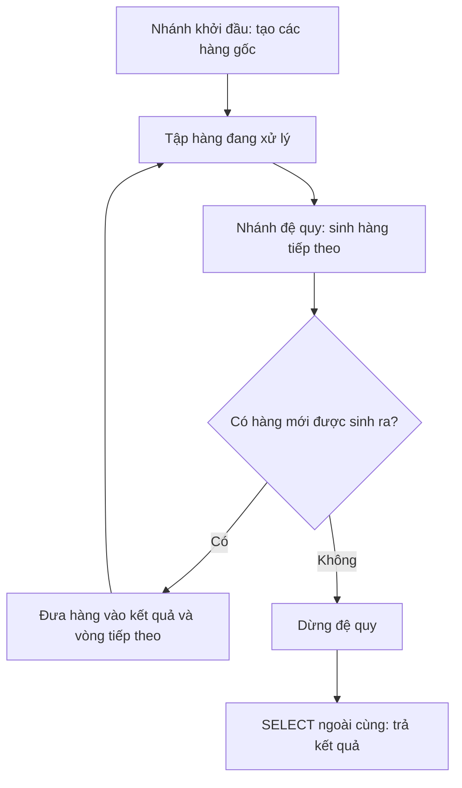
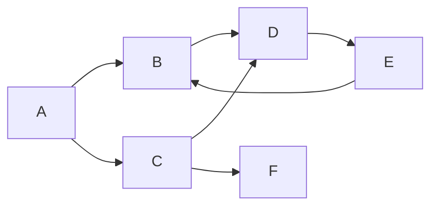

# Nhánh khởi đầu, nhánh đệ quy và điều kiện dừng

Một truy vấn SQL thông thường lấy dữ liệu từ các bảng đã tồn tại rồi lọc, nối hoặc tổng hợp chúng. Nhưng có những bài toán cần **lặp lại cùng một quy tắc trên kết quả vừa tìm được**:

- Bắt đầu từ trưởng phòng, tìm nhân viên trực tiếp, rồi tìm nhân viên dưới quyền của những người đó, tiếp tục đến hết sơ đồ tổ chức.
- Từ một danh mục cha, đi xuống tất cả danh mục con nhiều cấp.
- Từ một nút mạng, tìm những nút có thể đi tới qua nhiều cạnh.
- Sinh một dãy số, các ngày liên tiếp hoặc các mức của một phép tính lặp.

SQL hỗ trợ cách diễn đạt này bằng **truy vấn đệ quy**, thường viết dưới dạng `WITH RECURSIVE`. Điểm cần hiểu không phải chỉ là cú pháp, mà là ba thành phần quyết định ý nghĩa và mức độ an toàn của truy vấn:

1. **Nhánh khởi đầu** (*anchor member* hoặc *non-recursive term*): tạo tập hàng đầu tiên.
2. **Nhánh đệ quy** (*recursive member* hoặc *recursive term*): dựa trên những hàng vừa tìm được để tạo hàng mới.
3. **Điều kiện dừng** (*termination condition*): bảo đảm có một vòng lặp mà nhánh đệ quy **không sinh thêm hàng nào**.

Bài học thuộc chương **Truy vấn đệ quy** của Database SQL. Ví dụ thực hành chính sử dụng **PostgreSQL**; phần cuối giải thích những khác biệt khi triển khai trên SQL Server, MySQL, SQLite và Oracle.

## 1. Khi nào nên dùng truy vấn đệ quy?

Hãy phân biệt hai kiểu dữ liệu:

**Quan hệ có số cấp cố định:**

```text
customers → orders → order_items
```

Nếu biết chắc chỉ có ba bảng và hai bước nối, một vài `JOIN` thông thường là đủ.

**Quan hệ có số cấp không cố định:**

```text
Lan
├── Minh
│   ├── Binh
│   │   └── Em
│   └── Chi
└── An
    └── Dung
```

Để tìm tất cả nhân viên dưới quyền Lan, ta không thể biết trước sơ đồ có 2, 5 hay 20 tầng. Viết sẵn 20 phép `JOIN` vừa cồng kềnh vừa không diễn đạt đúng bản chất.

Truy vấn đệ quy mô tả một quy tắc tổng quát:

> Bắt đầu từ tập gốc. Từ mỗi hàng đã tìm được, tìm các hàng liên quan ở cấp tiếp theo. Lặp lại cho tới khi không có hàng mới phù hợp.

### 1.1. Truy vấn đệ quy khác vòng lặp trong ứng dụng thế nào?

Trong Java, ta có thể dùng một hàng đợi và vòng `while` để duyệt cây. Với SQL, ta biểu diễn việc đó bằng **một câu truy vấn khai báo**. Database quyết định kế hoạch thực thi và quản lý các tập kết quả trung gian.

Đối với ứng dụng, ưu điểm là không cần gửi một câu `SELECT` mới cho từng tầng của cây. Nhưng điều này **không tự bảo đảm hiệu năng tốt**: một truy vấn đệ quy không có điều kiện dừng, gặp chu trình hoặc sinh quá nhiều đường đi vẫn có thể chạy rất lâu.

## 2. Khung cú pháp WITH RECURSIVE

Dạng cơ bản trong PostgreSQL:

```sql
WITH RECURSIVE recursive_cte (column_1, column_2, ...) AS (
    -- Nhánh khởi đầu: không tham chiếu recursive_cte.
    SELECT ...

    UNION ALL

    -- Nhánh đệ quy: tham chiếu recursive_cte.
    SELECT ...
    FROM recursive_cte AS previous
    ...
    WHERE ...
)
SELECT ...
FROM recursive_cte;
```

Đọc khung trên:

- `WITH RECURSIVE` khai báo một CTE (*common table expression*) có khả năng tham chiếu lại chính tên của nó.
- `recursive_cte` là tên tập kết quả đệ quy.
- Danh sách `(column_1, column_2, ...)` đặt tên các cột của tập kết quả; có thể bỏ nếu hệ quản trị suy ra tên phù hợp từ nhánh khởi đầu.
- **Nhánh khởi đầu** chạy về mặt logic để tạo những hàng đầu tiên, còn gọi là *seed rows*.
- `UNION ALL` ghép các hàng do các vòng lặp tạo ra, **không tự loại hàng trùng**.
- **Nhánh đệ quy** phải tham chiếu CTE theo cách hợp lệ. Trong PostgreSQL, tham chiếu này đại diện cho **tập đang được xử lý ở vòng hiện tại**.
- `WHERE` hoặc điều kiện nối trong nhánh đệ quy thường quy định việc được đi tiếp hay không.
- `SELECT` ngoài cùng chọn, lọc và sắp xếp kết quả sau khi CTE được sử dụng.

Một cách nhìn bằng sơ đồ:



**Điều kiện dừng trong SQL không nhất thiết là một từ khóa riêng.** Sự lặp lại dừng khi nhánh đệ quy trả **tập rỗng**. Điều kiện `WHERE`, khóa nối không còn hàng khớp, giới hạn độ sâu và cơ chế phát hiện chu trình đều có thể góp phần tạo ra trạng thái đó.

## 3. Ví dụ đầu tiên: sinh các số từ 1 đến 5

```sql
WITH RECURSIVE numbers(n) AS (
    SELECT 1

    UNION ALL

    SELECT n + 1
    FROM numbers
    WHERE n < 5
)
SELECT n
FROM numbers
ORDER BY n;
```

Kết quả:

| `n` |
| ---: |
| 1 |
| 2 |
| 3 |
| 4 |
| 5 |

### 3.1. Xác định ba thành phần

**Nhánh khởi đầu:**

```sql
SELECT 1
```

Nhánh này không tham chiếu `numbers`. Nó tạo hàng `n = 1` để bắt đầu.

**Nhánh đệ quy:**

```sql
SELECT n + 1
FROM numbers
WHERE n < 5
```

Nhánh này lấy số từ tập hiện tại, tăng thêm 1 và tạo giá trị của vòng tiếp theo.

**Điều kiện dừng:**

```sql
WHERE n < 5
```

Khi một vòng nhận `n = 5`, điều kiện không đúng nên không tạo số 6. Nhánh đệ quy trả về **0 hàng**, truy vấn dừng.

### 3.2. Bảng theo dõi từng vòng

| Giai đoạn | Hàng đầu vào của nhánh đệ quy | Điều kiện `n < 5` | Hàng mới |
| --- | --- | --- | --- |
| Khởi đầu | Không có | Không áp dụng | 1 |
| Vòng 1 | 1 | Đúng | 2 |
| Vòng 2 | 2 | Đúng | 3 |
| Vòng 3 | 3 | Đúng | 4 |
| Vòng 4 | 4 | Đúng | 5 |
| Vòng 5 | 5 | Sai | Không có → dừng |

Sau mỗi vòng, kết quả tích lũy giữ lại các hàng cũ, còn **tập đang xử lý** được thay bằng những hàng mới vừa tạo ra.

### 3.3. Sai một dấu so sánh có thể làm lệch một hàng

Nếu đổi điều kiện thành:

```sql
WHERE n <= 5
```

thì khi `n = 5`, điều kiện vẫn đúng và truy vấn tạo thêm `6`. Vòng tiếp theo với `n = 6` mới không sinh hàng.

Kết quả lúc đó là `1, 2, 3, 4, 5, 6`.

Điều kiện dừng cần được diễn đạt dựa trên **giá trị đang được kiểm tra** hay **giá trị sẽ sinh ra**. Ở ví dụ này, kiểm tra `n < 5` trước khi tạo `n + 1` giúp số lớn nhất đúng bằng 5.

### 3.4. Nếu số bắt đầu đã lớn hơn giới hạn?

```sql
WITH RECURSIVE numbers(n) AS (
    SELECT 10

    UNION ALL

    SELECT n + 1
    FROM numbers
    WHERE n < 5
)
SELECT n FROM numbers;
```

Kết quả vẫn có **một hàng 10**, bởi nhánh khởi đầu đã sinh ra hàng đó. Điều kiện `n < 5` chỉ ngăn **những hàng tiếp theo**, không tự xóa hàng đã được nhánh khởi đầu tạo ra.

Nếu yêu cầu là “chỉ sinh dãy khi đầu bắt đầu không vượt giới hạn”, nên lọc cả nhánh khởi đầu:

```sql
WITH RECURSIVE numbers(n) AS (
    SELECT 10
    WHERE 10 <= 5

    UNION ALL

    SELECT n + 1
    FROM numbers
    WHERE n < 5
)
SELECT n FROM numbers;
```

Lúc này nhánh khởi đầu rỗng, nên không có vòng đệ quy nào tạo thêm hàng.

## 4. PostgreSQL thực hiện đệ quy như một quá trình lặp

Mặc dù cú pháp có tên `RECURSIVE`, PostgreSQL xử lý một CTE đệ quy qua một thuật toán **lặp với các tập trung gian** (*working table*), không cần hiểu như việc gọi hàm đệ quy Java với một ngăn xếp lời gọi.

Mô hình logic:

1. Đánh giá nhánh khởi đầu; đưa các hàng của nó vào kết quả và **working table**.
2. Khi working table không rỗng, đánh giá nhánh đệ quy với tham chiếu CTE đại diện cho working table hiện tại.
3. Nếu dùng `UNION` thay vì `UNION ALL`, áp dụng quy tắc loại hàng trùng phù hợp.
4. Đưa các hàng mới vào tập kết quả tích lũy và chuẩn bị **working table mới**.
5. Lặp cho đến khi working table mới rỗng.

Minh họa dãy số:

```text
Kết quả tích lũy       Working table
------------------     -------------
[1]                    [1]        ← anchor
[1,2]                  [2]
[1,2,3]                [3]
[1,2,3,4]              [4]
[1,2,3,4,5]            [5]
[1,2,3,4,5]            []         ← dừng
```

Sơ đồ giải thích **ngữ nghĩa kết quả**. Không nên dựa vào thứ tự các hàng xuất hiện khi không có `ORDER BY`. Dù một số kế hoạch PostgreSQL thường phát hàng theo từng mức (tương tự breadth-first), SQL không cam kết thứ tự trình bày cuối cùng từ cách đánh giá đệ quy.

### 4.1. Điều gì xảy ra nếu anchor rỗng?

Giả sử truy vấn bắt đầu từ mã nhân viên không tồn tại:

```sql
WITH RECURSIVE roots(n) AS (
    SELECT 1 WHERE FALSE
    UNION ALL
    SELECT n + 1 FROM roots WHERE n < 10
)
SELECT n FROM roots;
```

Nhánh khởi đầu không có hàng; nhánh đệ quy không có đầu vào để sinh hàng; kết quả cuối cùng rỗng.

Đây là quy tắc quan trọng: **nhánh đệ quy không tự tìm một điểm bắt đầu mới** nếu anchor không tạo ra seed.

### 4.2. Nhiều hàng ở anchor

Truy vấn đệ quy không bắt buộc chỉ có một seed. Nếu nhánh khởi đầu trả hai hàng, cả hai trở thành đầu vào ban đầu.

Ví dụ một truy vấn sinh dãy riêng cho hai nhóm:

```sql
WITH RECURSIVE sequences(group_id, n) AS (
    SELECT group_id, 1
    FROM (VALUES (10), (20)) AS g(group_id)

    UNION ALL

    SELECT group_id, n + 1
    FROM sequences
    WHERE n < 3
)
SELECT group_id, n
FROM sequences
ORDER BY group_id, n;
```

Kết quả:

| `group_id` | `n` |
| ---: | ---: |
| 10 | 1 |
| 10 | 2 |
| 10 | 3 |
| 20 | 1 |
| 20 | 2 |
| 20 | 3 |

Hai chuỗi cùng áp dụng một quy tắc đệ quy, nhưng mang khóa `group_id` để không bị lẫn ý nghĩa.

## 5. Nhánh khởi đầu phải xác định đúng điểm bắt đầu

Trong thực tế, kết quả truy vấn đệ quy phụ thuộc rất nhiều vào **anchor**.

Xét cây tổ chức:

```text
Lan (ID 1)
├── Minh (ID 2)
│   ├── Binh (ID 4)
│   │   └── Em (ID 7)
│   └── Chi (ID 5)
└── An (ID 3)
    └── Dung (ID 6)

Giang (ID 8)
└── Hanh (ID 9)
```

Hai nhân viên Lan và Giang là hai gốc khác nhau. Nếu yêu cầu “toàn bộ nhân viên dưới quyền Lan”, anchor phải chọn **Lan**, không được chọn tất cả nhân viên hoặc tất cả người quản lý.

### 5.1. Tạo bảng nhân viên thực hành

```sql
CREATE TEMP TABLE demo_employees_recursive (
    employee_id INTEGER PRIMARY KEY,
    full_name   TEXT NOT NULL,
    manager_id  INTEGER
        REFERENCES demo_employees_recursive(employee_id)
);

INSERT INTO demo_employees_recursive
    (employee_id, full_name, manager_id)
VALUES
    (1, 'Lan',   NULL),
    (2, 'Minh',  1),
    (3, 'An',    1),
    (4, 'Binh',  2),
    (5, 'Chi',   2),
    (6, 'Dung',  3),
    (7, 'Em',    4),
    (8, 'Giang', NULL),
    (9, 'Hanh',  8);
```

Ý nghĩa:

- `employee_id` định danh nhân viên.
- `manager_id` tham chiếu nhân viên quản lý trực tiếp.
- `manager_id IS NULL` biểu diễn nhân viên **không có người quản lý** trong dữ liệu mẫu.
- Có hai cây: gốc `1` và gốc `8`.

Khóa ngoại tự tham chiếu giúp `manager_id` phải chỉ đến một nhân viên tồn tại (hoặc `NULL`), nhưng **không tự động ngăn chu trình quản lý**. Một tập dữ liệu như A quản lý B và B quản lý A vẫn có thể thỏa khóa ngoại nếu được tạo theo trình tự/ràng buộc phù hợp.

### 5.2. Anchor là một nhân viên được chọn

```sql
WITH RECURSIVE subtree (
    employee_id,
    full_name,
    manager_id,
    depth
) AS (
    SELECT
        e.employee_id,
        e.full_name,
        e.manager_id,
        0 AS depth
    FROM demo_employees_recursive AS e
    WHERE e.employee_id = 1

    UNION ALL

    SELECT
        child.employee_id,
        child.full_name,
        child.manager_id,
        parent.depth + 1
    FROM demo_employees_recursive AS child
    JOIN subtree AS parent
      ON child.manager_id = parent.employee_id
)
SELECT employee_id, full_name, depth
FROM subtree
ORDER BY depth, employee_id;
```

Kết quả:

| `employee_id` | Tên | `depth` |
| ---: | --- | ---: |
| 1 | Lan | 0 |
| 2 | Minh | 1 |
| 3 | An | 1 |
| 4 | Binh | 2 |
| 5 | Chi | 2 |
| 6 | Dung | 2 |
| 7 | Em | 3 |

Không có Giang và Hanh, bởi chúng không nằm trong cây có gốc Lan.

### 5.3. Giải thích từng cột của CTE

CTE `subtree` trả bốn cột:

- `employee_id`: ID nhân viên hiện tại.
- `full_name`: tên hiện tại.
- `manager_id`: quản lý trực tiếp của người hiện tại.
- `depth`: số cạnh tính từ điểm bắt đầu; Lan có `depth = 0`.

Nhánh khởi đầu tạo `Lan` ở độ sâu 0. Nhánh đệ quy:

```sql
FROM demo_employees_recursive AS child
JOIN subtree AS parent
  ON child.manager_id = parent.employee_id
```

tìm người có `manager_id` bằng `employee_id` của một hàng **đang xử lý**. Những người đó được thêm với `depth = parent.depth + 1`.

### 5.4. Bảng từng vòng cho cây tổ chức

| Giai đoạn | Nhân viên đang xử lý | Hàng mới |
| --- | --- | --- |
| Anchor | — | Lan (độ sâu 0) |
| Vòng 1 | Lan | Minh, An (độ sâu 1) |
| Vòng 2 | Minh, An | Binh, Chi, Dung (độ sâu 2) |
| Vòng 3 | Binh, Chi, Dung | Em (độ sâu 3) |
| Vòng 4 | Em | Không có → dừng |

Ở dữ liệu **cây hữu hạn không có chu trình**, việc không còn con phù hợp là một **điều kiện dừng dựa trên dữ liệu**. Truy vấn ví dụ không cần `WHERE depth < ...` để kết thúc.

Nhưng điều đó dựa trên giả định dữ liệu thực sự là cây không có chu trình. Nếu bảng bị sửa thành cấu trúc có vòng lặp, chỉ có phép nối mà không có cơ chế bảo vệ có thể dẫn đến truy vấn không dừng.

## 6. Điều kiện dừng loại thứ nhất: không còn hàng liên quan

Đây là cách dừng tự nhiên trong cây và danh mục phân cấp:

```sql
SELECT child.employee_id, ...
FROM demo_employees_recursive AS child
JOIN subtree AS parent
  ON child.manager_id = parent.employee_id
```

Khi một nhân viên không có ai dưới quyền, phép `JOIN` không tìm được `child` mới và không sinh hàng cho nhánh đó.

Một truy vấn đệ quy có thể có **nhiều nhánh cùng lúc**:

- Nhánh Minh còn con → tiếp tục.
- Nhánh An còn con → tiếp tục.
- Nhánh Chi không có con → dừng riêng nhánh đó.
- Cả truy vấn chỉ dừng khi **tất cả nhánh đang xét đều không sinh hàng mới**.

### 6.1. Tìm chuỗi quản lý theo hướng ngược lại

Với nhân viên Em (ID 7), hãy tìm Em rồi các quản lý của Em lên tới gốc:

```sql
WITH RECURSIVE manager_chain (
    employee_id,
    full_name,
    manager_id,
    distance
) AS (
    SELECT
        e.employee_id,
        e.full_name,
        e.manager_id,
        0
    FROM demo_employees_recursive AS e
    WHERE e.employee_id = 7

    UNION ALL

    SELECT
        manager.employee_id,
        manager.full_name,
        manager.manager_id,
        child.distance + 1
    FROM demo_employees_recursive AS manager
    JOIN manager_chain AS child
      ON manager.employee_id = child.manager_id
)
SELECT employee_id, full_name, distance
FROM manager_chain
ORDER BY distance;
```

Kết quả:

| `distance` | `employee_id` | Tên |
| ---: | ---: | --- |
| 0 | 7 | Em |
| 1 | 4 | Binh |
| 2 | 2 | Minh |
| 3 | 1 | Lan |

Khi đến Lan, `manager_id IS NULL`. Điều kiện nối `manager.employee_id = child.manager_id` không tìm được hàng quản lý mới, nên truy vấn dừng.

**Chiều của phép JOIN quyết định hướng duyệt:**

- `child.manager_id = parent.employee_id` → đi **xuống** nhân viên cấp dưới.
- `manager.employee_id = child.manager_id` → đi **lên** chuỗi quản lý.

Nhánh khởi đầu vẫn xác định điểm xuất phát ở cả hai hướng.

## 7. Điều kiện dừng loại thứ hai: giới hạn độ sâu

Không phải lúc nào ta cũng cần duyệt toàn bộ hệ phân cấp. Có khi chỉ cần hai cấp dưới quyền Lan.

```sql
WITH RECURSIVE subtree(employee_id, full_name, depth) AS (
    SELECT employee_id, full_name, 0
    FROM demo_employees_recursive
    WHERE employee_id = 1

    UNION ALL

    SELECT child.employee_id,
           child.full_name,
           parent.depth + 1
    FROM demo_employees_recursive AS child
    JOIN subtree AS parent
      ON child.manager_id = parent.employee_id
    WHERE parent.depth < 2
)
SELECT employee_id, full_name, depth
FROM subtree
ORDER BY depth, employee_id;
```

Kết quả:

| Cấp | Nhân viên |
| ---: | --- |
| 0 | Lan |
| 1 | Minh, An |
| 2 | Binh, Chi, Dung |

Nhân viên Em (cấp 3) không được sinh ra.

### 7.1. Vì sao dùng `parent.depth < 2`?

Nhánh đệ quy sinh ra hàng mới với:

```sql
parent.depth + 1
```

Muốn hàng sâu nhất có `depth = 2`, chỉ cho sinh con từ các hàng có độ sâu **nhỏ hơn 2**. Khi hàng ở độ sâu 2 được xử lý, điều kiện sai và không sinh thêm hàng ở độ sâu 3.

Tổng quát, nếu anchor có `depth = 0` và muốn bao gồm độ sâu từ 0 đến `max_depth`:

```sql
WHERE previous.depth < max_depth
```

Tất nhiên, phải kiểm tra `max_depth` hợp lệ ở tầng ứng dụng. Nếu anchor luôn được tạo, giới hạn độ sâu 0 vẫn bao gồm **hàng anchor**.

### 7.2. Lọc độ sâu ở ngoài có giống chặn sinh con không?

Hai dạng:

```sql
-- A: chặn mở rộng ở nhánh đệ quy.
WHERE parent.depth < 2
```

và:

```sql
-- B: cho nhánh đệ quy đi sâu rồi chỉ hiển thị depth <= 2.
SELECT ...
FROM subtree
WHERE depth <= 2;
```

có thể trả cùng các hàng cuối khi dữ liệu là **cây hữu hạn, không có chu trình**, nhưng khác về lượng công việc và mức an toàn. Dạng B vẫn có thể sinh tất cả hàng sâu hơn trước khi bộ lọc ngoài bỏ chúng; nếu có chu trình hoặc số hàng bùng nổ, nó không phải giới hạn đệ quy đáng tin cậy.

**Muốn chặn việc đi tiếp, hãy đặt điều kiện giới hạn trong nhánh đệ quy.**

### 7.3. Giới hạn độ sâu là bảo vệ, không phải chứng minh dữ liệu đúng

Một graph có chu trình vẫn có thể sinh các đường đi lặp tới `max_depth` rồi dừng. Vì vậy:

- `depth < N` giúp bảo đảm **giới hạn số vòng** trong trường hợp bước đệ quy tăng độ sâu đúng quy tắc.
- Nó **không loại những hàng đã thăm** và không tự chứng minh dữ liệu không có chu trình.
- Nếu có nhiều lựa chọn đi tiếp, số hàng vẫn có thể tăng rất nhanh trước khi chạm N.

Trong bài toán graph, thường kết hợp **giới hạn độ sâu** với **phát hiện chu trình** hoặc cơ chế khử trùng thích hợp.

## 8. Điều kiện dừng loại thứ ba: quy tắc dữ liệu và trạng thái

Trong thực tế, truy vấn có thể dừng mở rộng một nhánh không phải vì thiếu hàng con, mà vì quy tắc nghiệp vụ: “không đi qua một phòng ban đã khóa”, “chỉ theo các cạnh còn hiệu lực”, “dừng khi gặp nút đích”.

### 8.1. Đặt điều kiện ở nhánh đệ quy có thể cắt cả cây con

Ví dụ muốn **không đi qua nhân viên Minh (ID 2)**:

```sql
WITH RECURSIVE subtree(employee_id, full_name, depth) AS (
    SELECT employee_id, full_name, 0
    FROM demo_employees_recursive
    WHERE employee_id = 1

    UNION ALL

    SELECT child.employee_id,
           child.full_name,
           parent.depth + 1
    FROM demo_employees_recursive AS child
    JOIN subtree AS parent
      ON child.manager_id = parent.employee_id
    WHERE child.employee_id <> 2
)
SELECT employee_id, full_name, depth
FROM subtree
ORDER BY depth, employee_id;
```

Kết quả: **Lan, An, Dung**.

Vì Minh không được thêm vào working table, truy vấn **không thể đi qua Minh** để tìm Binh, Chi và Em. Nhánh đó bị cắt hoàn toàn.

### 8.2. Chỉ lọc kết quả ngoài không cắt cây con

Nếu mục tiêu là “duyệt cả cây nhưng **không hiển thị Minh**”, thì lọc sau khi đã duyệt:

```sql
WITH RECURSIVE subtree(employee_id, full_name, depth) AS (
    SELECT employee_id, full_name, 0
    FROM demo_employees_recursive
    WHERE employee_id = 1

    UNION ALL

    SELECT child.employee_id,
           child.full_name,
           parent.depth + 1
    FROM demo_employees_recursive AS child
    JOIN subtree AS parent
      ON child.manager_id = parent.employee_id
)
SELECT employee_id, full_name, depth
FROM subtree
WHERE employee_id <> 2
ORDER BY depth, employee_id;
```

Kết quả: **Lan, An, Binh, Chi, Dung, Em**.

Khác biệt:

- Lọc trong nhánh đệ quy: **không tạo Minh**, nên cũng không đi xuống cây con của Minh.
- Lọc ở `SELECT` ngoài: **vẫn đi qua Minh**, nhưng loại Minh khỏi phần hiển thị.

Việc lựa chọn vị trí bộ lọc là một phần **ngữ nghĩa truy vấn**, không chỉ tối ưu hiệu năng.

### 8.3. Dừng khi gặp đích

Giả sử graph có một nút đích `'F'` và quy tắc là “không mở rộng thêm từ F”. Có thể thêm điều kiện ở nhánh đệ quy:

```sql
WHERE previous.node <> 'F'
```

Điều này cho phép **nút F vẫn xuất hiện trong kết quả** khi được tìm thấy, nhưng không sinh các nút đi tiếp từ nó.

Nếu thay bằng `WHERE edge.to_node <> 'F'`, ta **không bao giờ thêm F** vào kết quả. Hai điều kiện có ý nghĩa khác nhau:

- Kiểm tra **nút hiện tại**: có mở rộng tiếp từ nút này không?
- Kiểm tra **nút kế tiếp**: có cho phép đi vào nút đó không?

## 9. UNION ALL và UNION trong truy vấn đệ quy

Hai từ khóa đều có thể dùng để kết nối nhánh khởi đầu và nhánh đệ quy trong PostgreSQL:

```sql
anchor
UNION ALL
recursive_term
```

hoặc:

```sql
anchor
UNION
recursive_term
```

Nhưng chúng có **ngữ nghĩa bản sao khác nhau**.

### 9.1. UNION ALL giữ những hàng được sinh ra

Với `UNION ALL`, mọi hàng từ nhánh đệ quy được thêm vào kết quả, kể cả khi **cùng bộ giá trị đã từng xuất hiện**. Điều này phù hợp khi cần giữ **mọi đường đi**, mọi lần xuất hiện hoặc các kết quả khác nhau về `depth`, `path`.

Trong cây tổ chức chuẩn mà mỗi nhân viên có đúng một quản lý, từ một gốc thường chỉ có một đường đi đến mỗi nhân viên. Nhưng trong đồ thị có nhiều đường đi, cùng một nút có thể được sinh ra nhiều lần.

### 9.2. UNION loại hàng trùng theo toàn bộ cột CTE

`UNION` trong recursive CTE loại các hàng trùng **trong cùng vòng và so với tập kết quả đã tích lũy** theo ngữ nghĩa hàng trùng của set operator.

Nếu CTE chỉ lưu `node`:

```sql
WITH RECURSIVE reachable(node) AS (
    SELECT 'A'::text
    UNION
    SELECT e.to_node
    FROM demo_graph_edges AS e
    JOIN reachable AS r
      ON e.from_node = r.node
)
SELECT node FROM reachable;
```

thì mỗi nút có thể chỉ xuất hiện một lần trong kết quả, giúp quá trình **tìm tập nút có thể tới** dừng trên một đồ thị hữu hạn ngay cả khi có chu trình.

Tuy nhiên, điều đó chỉ đúng vì hàng CTE được nhận diện **bằng node**. Nếu thêm `depth` hoặc `path`, cùng một nút với độ sâu/đường đi khác sẽ trở thành **hàng khác nhau**, nên `UNION` không còn loại được mọi lần quay lại nút.

Ta sẽ thực hành điều này bằng một bảng cạnh ở phần tiếp theo.

## 10. Dữ liệu đồ thị: tại sao chu trình là vấn đề?

Cây quản lý có một cha trên mỗi nút, nhưng đồ thị tổng quát có thể có nhiều đường đến cùng một nút và có thể có vòng lặp.

Tạo bảng cạnh:

```sql
CREATE TEMP TABLE demo_graph_edges (
    from_node TEXT NOT NULL,
    to_node   TEXT NOT NULL,
    PRIMARY KEY (from_node, to_node)
);

INSERT INTO demo_graph_edges (from_node, to_node) VALUES
    ('A', 'B'),
    ('A', 'C'),
    ('B', 'D'),
    ('C', 'D'),
    ('C', 'F'),
    ('D', 'E'),
    ('E', 'B');
```

Sơ đồ:



Có hai điểm đáng chú ý:

1. **Hai đường đi đến D**: `A → B → D` và `A → C → D`.
2. **Một chu trình**: `B → D → E → B`.

Nếu cứ đi từ A theo các cạnh và không nhớ đã đi qua nút nào, nhánh `B → D → E → B → ...` có thể lặp vô hạn.

### 10.1. Câu truy vấn nguy hiểm: UNION ALL không có điều kiện dừng

Đoạn sau **chỉ dùng để minh họa lỗi; không chạy nguyên dạng**:

```sql
-- KHÔNG THỰC THI: có chu trình B -> D -> E -> B.
WITH RECURSIVE walk(node) AS (
    SELECT 'A'::text
    UNION ALL
    SELECT e.to_node
    FROM demo_graph_edges AS e
    JOIN walk AS w
      ON e.from_node = w.node
)
SELECT COUNT(*)
FROM walk;
```

Từ A có thể đến B, D, E rồi quay lại B mãi mãi. `UNION ALL` giữ mỗi lần xuất hiện; `COUNT(*)` ngoài cần tiêu thụ toàn bộ tập kết quả để tính số hàng, nên truy vấn không có lý do logic để kết thúc.

Không nên thử một đệ quy không giới hạn trên dữ liệu chưa chắc chắn; nó có thể gây tiêu thụ CPU, bộ nhớ, đĩa hoặc bị hủy do hạn mức tài nguyên.

### 10.2. Giải pháp A: chỉ cần tập nút thì dùng UNION

```sql
WITH RECURSIVE reachable(node) AS (
    SELECT 'A'::text

    UNION

    SELECT e.to_node
    FROM demo_graph_edges AS e
    JOIN reachable AS r
      ON e.from_node = r.node
)
SELECT node
FROM reachable
ORDER BY node;
```

Kết quả:

| `node` |
| --- |
| A |
| B |
| C |
| D |
| E |
| F |

Vì CTE chỉ có một cột `node`, khi B được tìm lại qua chu trình, hàng `('B')` đã tồn tại nên `UNION` không thêm bản sao mới. Đến một vòng, không còn nút mới nào được sinh ra và truy vấn dừng.

**Điều kiện dừng ở đây là sự cạn kiệt nút mới dưới quy tắc loại trùng**, không phải một điều kiện `WHERE depth < ...`.

Giải pháp này phù hợp với câu hỏi **“những nút nào có thể đến được từ A?”**. Nó không trả lời **“có bao nhiêu đường đi khác nhau đến D?”** vì đã cố ý gộp các lần xuất hiện của cùng một nút.

### 10.3. Vì sao thêm depth vào UNION có thể làm truy vấn không dừng?

Đoạn sau cũng **không nên chạy nguyên dạng** trên graph có chu trình:

```sql
-- KHÔNG THỰC THI: UNION không loại hàng khi depth cứ tăng.
WITH RECURSIVE reachable(node, depth) AS (
    SELECT 'A'::text, 0

    UNION

    SELECT e.to_node, r.depth + 1
    FROM demo_graph_edges AS e
    JOIN reachable AS r
      ON e.from_node = r.node
)
SELECT node, depth
FROM reachable;
```

Qua chu trình:

```text
(B, 1)
(D, 2)
(E, 3)
(B, 4)
(D, 5)
(E, 6)
(B, 7)
...
```

Mỗi hàng có **depth khác nhau** nên không trùng trên toàn bộ hai cột `(node, depth)`. `UNION` không thể coi `(B,1)` và `(B,4)` là cùng một hàng.

**Nguyên tắc:** Loại trùng toàn hàng không tương đương với **phát hiện đã thăm một nút** nếu hàng còn chứa thuộc tính thay đổi ở mỗi vòng.

## 11. Giải pháp B: theo dõi đường đi để tránh chu trình

Nếu cần giữ **các đường đi khác nhau**, không thể dùng `UNION` chỉ với cột node. Ta nên bổ sung một cột `path` chứa lịch sử nút đã đi qua trong **từng đường**.

```sql
WITH RECURSIVE walk(node, depth, path) AS (
    SELECT
        'A'::text AS node,
        0 AS depth,
        ARRAY['A'::text] AS path

    UNION ALL

    SELECT
        e.to_node,
        w.depth + 1,
        w.path || e.to_node
    FROM demo_graph_edges AS e
    JOIN walk AS w
      ON e.from_node = w.node
    WHERE NOT (e.to_node = ANY(w.path))
      AND w.depth < 5
)
SELECT
    node,
    depth,
    array_to_string(path, ' -> ') AS route
FROM walk
ORDER BY path;
```

Có hai cơ chế dừng phối hợp:

- `NOT (e.to_node = ANY(w.path))`: không đi vào một nút **đã nằm trong đường đi hiện tại**, tránh lặp vòng trên đường đó.
- `w.depth < 5`: không sinh hàng sâu hơn độ sâu 5, để có giới hạn phòng vệ.

### 11.1. Cột path hoạt động thế nào?

Giả sử một nhánh đang có:

```text
node = E
depth = 3
path = [A, B, D, E]
```

Bảng cạnh có `E → B`. Điều kiện:

```sql
e.to_node = ANY(w.path)
```

kiểm tra B có nằm trong `[A,B,D,E]` không. Kết quả là `TRUE`, nên `NOT (...)` thành `FALSE` và truy vấn **không sinh lại B** trên nhánh này.

Nhánh khác:

```text
path = [A, C, D, E]
```

cũng có cạnh `E → B`, nhưng B **chưa** nằm trong đường đi này nên vẫn được phép tạo:

```text
[A, C, D, E, B]
```

Sau đó cạnh `B → D` bị chặn vì D đã nằm trong đường đó.

### 11.2. Một số đường đi được tạo ra

| `node` cuối | `depth` | `route` |
| --- | ---: | --- |
| A | 0 | A |
| B | 1 | A → B |
| C | 1 | A → C |
| D | 2 | A → B → D |
| D | 2 | A → C → D |
| F | 2 | A → C → F |
| E | 3 | A → B → D → E |
| E | 3 | A → C → D → E |
| B | 4 | A → C → D → E → B |

**Có nhiều hàng với cùng node** vì những đường đi khác nhau được giữ. Đây là tính năng mong muốn của truy vấn liệt kê đường đi, không phải lỗi trùng cần xóa.

### 11.3. Chống chu trình trong một đường khác với “đã thăm toàn cục”

Điều kiện `ANY(path)` cấm lặp nút **trong cùng một đường**, nhưng không cấm hai đường đi độc lập đến cùng một nút. Vì vậy:

- Bài toán **tập nút có thể đến được**: thường dùng `UNION` trên node hoặc một cấu trúc visited phù hợp.
- Bài toán **tất cả đường đi đơn giản**: có thể dùng `UNION ALL` + `path` + điều kiện không quay lại nút trong path.
- Bài toán **đường đi ngắn nhất**: đòi hỏi mục tiêu, trọng số và cách chọn tối ưu khác; không mặc định mọi `WITH RECURSIVE` liệt kê đường đi là thuật toán tối ưu cho shortest path.

Số **đường đi đơn giản** trong graph hữu hạn vẫn có thể rất lớn (thậm chí tăng theo cấp số mũ). Chặn chu trình bảo đảm mỗi đường không lặp nút, nhưng không bảo đảm truy vấn có chi phí nhỏ.

### 11.4. NULL trong node và điều kiện ANY

Trong bảng graph mẫu, `from_node` và `to_node` đều `NOT NULL`. Nếu graph cho phép nút `NULL`, biểu thức:

```sql
NOT (e.to_node = ANY(w.path))
```

có thể cho `UNKNOWN` do phép so sánh với `NULL`. Khi đó cần một quy tắc định danh nút và kiểm tra trùng có xử lý `NULL` đúng nghiệp vụ, thay vì áp dụng máy móc điều kiện trên. Thực tế, các ID nút thường nên là khóa `NOT NULL` để việc truy vết rõ nghĩa.

## 12. Cơ chế CYCLE khi PostgreSQL hỗ trợ

Từ PostgreSQL 14, cú pháp `CYCLE` cho recursive CTE giúp khai báo cách đánh dấu chu trình mà không cần tự viết toàn bộ biểu thức mảng đường đi.

Ví dụ trên graph mẫu:

```sql
WITH RECURSIVE walk(node, depth) AS (
    SELECT 'A'::text, 0

    UNION ALL

    SELECT e.to_node, w.depth + 1
    FROM demo_graph_edges AS e
    JOIN walk AS w
      ON e.from_node = w.node
)
CYCLE node SET is_cycle USING cycle_path
SELECT
    node,
    depth,
    is_cycle,
    cycle_path
FROM walk
ORDER BY cycle_path;
```

Trong PostgreSQL, `CYCLE node SET is_cycle USING cycle_path` yêu cầu engine theo dõi khóa `node` trên đường đi, bổ sung cột cờ `is_cycle` và cột theo dõi `cycle_path`.

Khi một đường cố đi vào nút đã nằm trên chính đường đó, hàng phát hiện chu trình có thể được **đánh dấu**, và quá trình không mở rộng tiếp từ hàng đã đánh dấu. Nếu giao diện chỉ muốn các đường không lặp nút, có thể lọc:

```sql
WITH RECURSIVE walk(node, depth) AS (
    SELECT 'A'::text, 0
    UNION ALL
    SELECT e.to_node, w.depth + 1
    FROM demo_graph_edges AS e
    JOIN walk AS w
      ON e.from_node = w.node
)
CYCLE node SET is_cycle USING cycle_path
SELECT node, depth
FROM walk
WHERE NOT is_cycle
ORDER BY depth, node;
```

### 12.1. CYCLE không có nghĩa tự tìm đường ngắn nhất

`CYCLE` giúp ngăn mở rộng những vòng lặp lặp lại khóa trong một đường. Nó **không** mặc định:

- Chọn một đường duy nhất tới mỗi nút.
- Đảm bảo đường có ít bước nhất.
- Giới hạn số lượng đường đơn giản có thể sinh.
- Bảo đảm kết quả có thứ tự trình bày nếu không có `ORDER BY`.

Tùy yêu cầu, có thể cần thêm giới hạn độ sâu, lọc theo trạng thái hoặc một lớp tổng hợp/định hạng sau khi duyệt.

### 12.2. CYCLE và SEARCH là những vấn đề khác nhau

Trong PostgreSQL 14+, cú pháp `SEARCH` có thể tạo một cột thứ tự cho cách trình bày kết quả theo chiều sâu hoặc chiều rộng. `CYCLE` phục vụ **phát hiện vòng lặp**.

Một truy vấn có `SEARCH` không vì thế tự được bảo vệ khỏi chu trình. Và ngay cả khi dùng `CYCLE`, muốn kết quả theo thứ tự cụ thể vẫn cần `ORDER BY` phù hợp.

Khi mới học, điều cần ưu tiên là **định nghĩa anchor, quy tắc mở rộng và điều kiện dừng đúng**; cách trình bày depth-first/breadth-first là bước tiếp theo.

## 13. Giới hạn hàng ở ngoài không thay thế điều kiện dừng

Một người học có thể thử:

```sql
-- Ví dụ có rủi ro, không dùng làm cách chặn đệ quy chính.
WITH RECURSIVE numbers(n) AS (
    SELECT 1
    UNION ALL
    SELECT n + 1 FROM numbers
)
SELECT n
FROM numbers
LIMIT 10;
```

Trong một số truy vấn PostgreSQL đơn giản, lớp ngoài có `LIMIT` có thể khiến engine chỉ yêu cầu một phần hàng từ CTE, nên câu lệnh trông như đã dừng. Nhưng đây **không phải cơ chế dừng đáng tin cậy**, vì:

- Một `ORDER BY` bên ngoài có thể buộc engine thu thập toàn bộ kết quả trước khi sắp.
- Một `JOIN` hoặc aggregate ngoài có thể cần tiêu thụ nhiều hoặc tất cả hàng.
- Truy vấn có thể được chuyển sang DBMS khác với chiến lược thực thi khác.
- Logic nhánh đệ quy vẫn không có giới hạn hoặc cơ chế ngăn chu trình.

Cách đúng:

```sql
WITH RECURSIVE numbers(n) AS (
    SELECT 1

    UNION ALL

    SELECT n + 1
    FROM numbers
    WHERE n < 10
)
SELECT n
FROM numbers
ORDER BY n;
```

Giới hạn được đặt **bên trong nhánh đệ quy**, nên số lớn nhất được tạo theo logic là 10.

### 13.1. ORDER BY cuối cùng không quyết định thứ tự duyệt

```sql
SELECT employee_id, full_name, depth
FROM subtree
ORDER BY depth, employee_id;
```

là yêu cầu trình bày các hàng kết quả theo độ sâu, sau đó theo ID. Nó **không điều khiển thứ tự vật lý** mà PostgreSQL chọn để mở rộng các nhánh.

Tương tự, nếu tạo cột `path` rồi `ORDER BY path`, kết quả có thể trông giống duyệt theo chiều sâu nhưng đây là **cách sắp sau khi biểu diễn kết quả**. Không nên dựa vào thứ tự hàng chưa sắp để đưa ra kết luận về thuật toán.

## 14. Sinh chuỗi ngày bằng nhánh khởi đầu và nhánh đệ quy

Một ứng dụng đơn giản của `WITH RECURSIVE` là tạo các ngày liên tiếp trong một khoảng:

```sql
WITH RECURSIVE calendar(day_value) AS (
    SELECT DATE '2025-06-01'

    UNION ALL

    SELECT day_value + 1
    FROM calendar
    WHERE day_value < DATE '2025-06-07'
)
SELECT day_value
FROM calendar
ORDER BY day_value;
```

Kết quả gồm bảy ngày:

```text
2025-06-01
2025-06-02
2025-06-03
2025-06-04
2025-06-05
2025-06-06
2025-06-07
```

Cơ chế:

- Anchor chọn ngày `2025-06-01`.
- Recursive term cộng một ngày cho mỗi vòng bằng `day_value + 1` (kiểu `DATE` + số nguyên trong PostgreSQL).
- Điều kiện `day_value < DATE '2025-06-07'` ngăn sinh ngày 8/6.

### 14.1. Tham số ngày đầu và ngày cuối

Để tránh mốc cố định, có thể truyền phạm vi dưới dạng tham số với `PREPARE`:

```sql
PREPARE make_calendar(date, date) AS
WITH RECURSIVE calendar(day_value) AS (
    SELECT $1
    WHERE $1 <= $2

    UNION ALL

    SELECT day_value + 1
    FROM calendar
    WHERE day_value < $2
)
SELECT day_value
FROM calendar
ORDER BY day_value;

EXECUTE make_calendar(
    DATE '2025-06-01',
    DATE '2025-06-05'
);

DEALLOCATE make_calendar;
```

Ở đây điều kiện tại **anchor** xử lý trường hợp ngày bắt đầu sau ngày kết thúc: không tạo ngày nào. Điều kiện ở **recursive term** bảo đảm không vượt quá ngày cuối.

Với PostgreSQL, `generate_series` thường ngắn và tiện hơn cho bài toán dãy số/ngày đơn giản. `WITH RECURSIVE` vẫn hữu ích để hiểu nguyên tắc hoặc khi bước tạo phần tử mới phụ thuộc logic phức tạp hơn phép cộng một đơn vị.

### 14.2. Đừng nhầm DATE với timestamp/múi giờ

Truy vấn dùng kiểu `DATE` để sinh **ngày lịch**. Nếu yêu cầu sinh các thời điểm theo `TIMESTAMPTZ` qua vùng có chuyển đổi giờ mùa hè, việc cộng một ngày lịch và cộng đúng 24 giờ thực có thể khác nhau. Cần định nghĩa rõ yêu cầu theo **ngày địa phương** hay **thời lượng thực** trước khi chọn kiểu dữ liệu và bước đệ quy.

## 15. Đệ quy mang nhiều trạng thái: ví dụ Fibonacci

Một recursive CTE không bị giới hạn chỉ có cột `n`. Nó có thể mang theo **nhiều biến trạng thái** cần cho bước tiếp theo.

Ví dụ sinh tám giá trị Fibonacci, từ bước 0 đến bước 7:

```sql
WITH RECURSIVE fibonacci (
    step_no,
    current_value,
    next_value
) AS (
    SELECT
        0,
        0::bigint,
        1::bigint

    UNION ALL

    SELECT
        step_no + 1,
        next_value,
        current_value + next_value
    FROM fibonacci
    WHERE step_no < 7
)
SELECT step_no, current_value AS fibonacci_number
FROM fibonacci
ORDER BY step_no;
```

Kết quả:

| `step_no` | `fibonacci_number` |
| ---: | ---: |
| 0 | 0 |
| 1 | 1 |
| 2 | 1 |
| 3 | 2 |
| 4 | 3 |
| 5 | 5 |
| 6 | 8 |
| 7 | 13 |

Giải thích:

- Anchor lưu ba trạng thái: bước 0, giá trị hiện tại 0, giá trị kế tiếp 1.
- Recursive term dịch trạng thái từ `(current, next)` thành `(next, current+next)`.
- `WHERE step_no < 7` giới hạn số lần chuyển.
- Mỗi vòng tạo một hàng mới với giá trị hiện tại là một số Fibonacci.

### 15.1. Điều kiện dừng nên dựa trên biến nào?

Trong ví dụ, nếu dừng bằng:

```sql
WHERE current_value < 10
```

thì ý nghĩa sẽ là “tiếp tục khi số hiện tại nhỏ hơn 10”, không còn là “sinh đúng tám số”. Thậm chí có thể sinh thêm một giá trị lớn hơn ngưỡng do kiểm tra **trạng thái cũ** trước khi tạo **trạng thái mới**.

Trước khi viết điều kiện dừng, phải xác định bài toán yêu cầu:

- **Đúng N bước** → dùng bộ đếm `step_no`.
- **Cho đến khi giá trị đạt ngưỡng** → dùng điều kiện trên giá trị, chú ý ranh giới.
- **Cho đến khi không có quan hệ tiếp theo** → dựa vào kết quả JOIN.
- **Cho đến khi gặp lại trạng thái đã thăm** → cần phát hiện chu trình hoặc loại trùng phù hợp.

### 15.2. Tràn kiểu số học

Kiểu `BIGINT` có giới hạn. Với dãy Fibonacci đủ dài, `current_value + next_value` có thể vượt phạm vi biểu diễn và báo lỗi. Giới hạn số bước ở đây cũng giúp ví dụ an toàn.

Một truy vấn muốn tính chuỗi lớn hơn cần kiểu dữ liệu phù hợp như `NUMERIC` và vẫn phải cân nhắc chi phí của số lớn. **Một điều kiện dừng logic không thay thế việc kiểm soát kiểu dữ liệu và tài nguyên.**

## 16. Nhiều nhánh mở rộng: từ cây sang đồ thị

Trong cây tổ chức, mỗi hàng cha có thể tạo **0, 1 hoặc nhiều hàng con**. Trong graph, một nút cũng có thể có nhiều cạnh đi ra.

Điều này làm tốc độ tăng số hàng khác với ví dụ dãy số. Với dãy `1 → 2 → 3`, mỗi vòng thường sinh **một** hàng. Với cây có nhiều nhánh:

```text
Depth 0:              1 node
Depth 1:              3 nodes
Depth 2:              9 nodes
Depth 3:             27 nodes
...
```

Nếu trung bình mỗi nút có ba con và không có trùng lặp, số hàng ở mỗi cấp có thể tăng theo `3^depth` cho đến khi dữ liệu hết nhánh.

### 16.1. Giới hạn độ sâu chưa đủ để giới hạn số hàng

Với depth tối đa 8 và hệ số nhánh lớn, truy vấn vẫn có thể sinh số hàng rất lớn trước khi dừng. Do đó cần cân nhắc:

- Phạm vi anchor có bị mở quá rộng không?
- Bảng cạnh có index theo cột nối không?
- Có yêu cầu trả **mọi đường đi** hay chỉ **mỗi nút một lần**?
- Có thể giới hạn thêm quan hệ hoặc trạng thái ở từng bước không?
- Có cần tổng hợp kết quả theo mức thay vì xuất toàn bộ đường đi không?

**Giới hạn độ sâu bảo vệ số vòng, không tự giới hạn số lượng hàng của từng vòng.**

### 16.2. Dữ liệu nhiều đường đi có thể tạo trùng nút hợp lệ

Trong graph:

```text
A → B → D
 \→ C → D
```

`D` được tìm qua hai đường khác nhau. Nếu truy vấn để **liệt kê đường đi**, hai hàng D với hai `path` khác nhau là kết quả hợp lệ. Nếu truy vấn để **đếm số nút có thể tới**, chỉ nên đếm D một lần theo ID nút.

Sai lầm thường gặp là thêm `DISTINCT` ở `SELECT` ngoài rồi nghĩ đã giải quyết vòng lặp. `DISTINCT` ngoài chỉ loại trùng **sau khi tập đầu vào đã được tạo**; nó không phải điều kiện ngăn đệ quy tiếp tục.

## 17. Tham số hóa giới hạn độ sâu và bảo vệ truy vấn

Giả sử ứng dụng Java hiển thị sơ đồ tổ chức, cho phép người dùng chọn nhân viên gốc và số cấp cần mở.

Có thể chuẩn bị một truy vấn PostgreSQL với hai tham số:

```sql
PREPARE employee_subtree(integer, integer) AS
WITH RECURSIVE subtree(
    employee_id,
    full_name,
    depth,
    path
) AS (
    SELECT
        e.employee_id,
        e.full_name,
        0,
        ARRAY[e.employee_id]::integer[]
    FROM demo_employees_recursive AS e
    WHERE e.employee_id = $1

    UNION ALL

    SELECT
        child.employee_id,
        child.full_name,
        parent.depth + 1,
        parent.path || child.employee_id
    FROM demo_employees_recursive AS child
    JOIN subtree AS parent
      ON child.manager_id = parent.employee_id
    WHERE parent.depth < $2
      AND NOT (child.employee_id = ANY(parent.path))
)
SELECT
    employee_id,
    full_name,
    depth,
    array_to_string(path, ' -> ') AS id_path
FROM subtree
ORDER BY path;

EXECUTE employee_subtree(1, 2);

DEALLOCATE employee_subtree;
```

Với tham số `(1, 2)`, kết quả gồm Lan ở cấp 0, Minh/An ở cấp 1 và Binh/Chi/Dung ở cấp 2.

### 17.1. Quy tắc kiểm tra đầu vào

Ở tầng ứng dụng, nên xác thực:

- `root_id` có thuộc phạm vi dữ liệu người dùng được phép xem không?
- `max_depth` có phải số nguyên không âm và không vượt ngưỡng hợp lý không?
- Nếu anchor không tồn tại, ứng dụng có xử lý **0 hàng kết quả** không?
- Có cần giới hạn số nút/đường đi hoặc thời gian chạy không?
- Quan hệ trong bảng có đảm bảo không có chu trình, hay cần path/CYCLE để tự bảo vệ?

Dùng prepared statement giúp bind tham số thay vì nối trực tiếp chuỗi đầu vào vào SQL. Nhưng **tham số hóa không tự thay thế kiểm soát quyền truy cập** hoặc hạn mức tài nguyên.

### 17.2. Giới hạn tài nguyên ở phía PostgreSQL

Trong môi trường thực, ngoài điều kiện dừng, còn có thể áp dụng chính sách thời gian thực thi, ví dụ `statement_timeout` thích hợp cho phiên/truy vấn.

Một ví dụ trong transaction thử nghiệm:

```sql
BEGIN;

SET LOCAL statement_timeout = '2s';

WITH RECURSIVE numbers(n) AS (
    SELECT 1
    UNION ALL
    SELECT n + 1 FROM numbers WHERE n < 1000
)
SELECT COUNT(*) FROM numbers;

COMMIT;
```

`statement_timeout` ở đây là một **lớp bảo vệ thời gian thực thi**, không phải sự thay thế cho điều kiện dừng. Trên hệ thống thực, ngưỡng timeout cần do chính sách vận hành quyết định, không lấy nguyên giá trị thử nghiệm làm mặc định cho mọi báo cáo.

## 18. Tách điều kiện dừng và điều kiện hiển thị

Đôi khi một truy vấn có nhiều điều kiện, cần phân nhóm rõ để dễ kiểm tra.

Ví dụ yêu cầu: “Tìm nhân viên trong cây Lan, tối đa 3 cấp, nhưng chỉ hiển thị cấp dưới (không hiển thị Lan).”

```sql
WITH RECURSIVE subtree(employee_id, full_name, depth) AS (
    SELECT employee_id, full_name, 0
    FROM demo_employees_recursive
    WHERE employee_id = 1

    UNION ALL

    SELECT child.employee_id,
           child.full_name,
           parent.depth + 1
    FROM demo_employees_recursive AS child
    JOIN subtree AS parent
      ON child.manager_id = parent.employee_id
    WHERE parent.depth < 3
)
SELECT employee_id, full_name, depth
FROM subtree
WHERE depth > 0
ORDER BY depth, employee_id;
```

Hai điều kiện có nhiệm vụ khác nhau:

- `parent.depth < 3` ở nhánh đệ quy **quyết định dừng mở rộng**.
- `depth > 0` ở ngoài **quyết định bỏ hàng gốc khỏi kết quả hiển thị**.

Nhân viên Lan vẫn phải được tạo ở anchor làm điểm xuất phát, dù giao diện chỉ hiển thị người dưới quyền.

### 18.1. Dừng ở giới hạn không có nghĩa là dữ liệu đã hết

Nếu kết quả kết thúc ở depth 2 vì `depth < 2`, người đọc **không được suy ra** những nhân viên cấp 2 là lá thật. Họ có thể còn cấp 3, 4… nhưng đã bị chặn bởi giới hạn.

Nếu API cần đánh dấu `has_more_children`, có thể kiểm tra riêng:

```sql
WITH RECURSIVE subtree(employee_id, full_name, depth) AS (
    SELECT employee_id, full_name, 0
    FROM demo_employees_recursive
    WHERE employee_id = 1

    UNION ALL

    SELECT child.employee_id,
           child.full_name,
           parent.depth + 1
    FROM demo_employees_recursive AS child
    JOIN subtree AS parent
      ON child.manager_id = parent.employee_id
    WHERE parent.depth < 2
)
SELECT
    s.employee_id,
    s.full_name,
    s.depth,
    EXISTS (
        SELECT 1
        FROM demo_employees_recursive AS child
        WHERE child.manager_id = s.employee_id
    ) AS has_direct_reports
FROM subtree AS s
ORDER BY s.depth, s.employee_id;
```

Với độ sâu tối đa 2, Binh có `has_direct_reports = TRUE` vì có Em ở cấp 3, dù Em chưa nằm trong kết quả. Điều đó giúp giao diện hiển thị nút “mở rộng thêm” thay vì coi Binh là lá.

## 19. Cấu trúc cột, kiểu dữ liệu và giới hạn cú pháp

Trong PostgreSQL, hai nhánh được nối bằng `UNION ALL` hoặc `UNION` phải trả cùng **số cột** và các kiểu dữ liệu phải tương thích.

### 19.1. Anchor quyết định kiểu cột nên cần CAST rõ ràng

Ví dụ với chuỗi đường đi:

```sql
WITH RECURSIVE labels(label, depth) AS (
    SELECT 'root'::text, 0

    UNION ALL

    SELECT label || ' -> child', depth + 1
    FROM labels
    WHERE depth < 2
)
SELECT label, depth FROM labels;
```

`'root'::text` giúp cột `label` có kiểu `TEXT` rõ ràng, phù hợp với phép nối chuỗi ở nhánh đệ quy.

Với `path` là mảng:

```sql
ARRAY[e.employee_id]::integer[]
```

giúp thể hiện rõ kiểu phần tử. Với các DBMS khác, kiểu chuỗi độ dài cố định của anchor có thể cần `CAST` độ dài đủ rộng để chứa các chuỗi nối dài ở nhánh đệ quy.

### 19.2. Các nhánh phải giữ cùng ý nghĩa cột

Nếu nhánh khởi đầu trả:

```text
(employee_id, manager_id, depth)
```

thì nhánh đệ quy cũng phải trả **đúng các cột cùng vị trí và cùng ý nghĩa**. Nếu vô ý đảo `manager_id` và `employee_id` ở nhánh đệ quy, truy vấn có thể vẫn qua kiểm tra kiểu vì đều là số nguyên nhưng kết quả và điều kiện nối sẽ sai.

Đặt tên cột CTE rõ ràng và viết mỗi biểu thức trên một dòng giúp tránh lỗi này.

### 19.3. Tham chiếu CTE trong recursive term có giới hạn

PostgreSQL không cho phép tùy ý dùng nhiều tham chiếu đệ quy hoặc đặt recursive reference ở mọi loại vị trí của truy vấn. Một số phép tổng hợp như aggregate trực tiếp trong recursive term cũng bị hạn chế.

Nếu cần tính số nút mỗi cấp, cách đơn giản thường là **duyệt trước rồi tổng hợp ở truy vấn ngoài**:

```sql
WITH RECURSIVE subtree(employee_id, depth) AS (
    SELECT employee_id, 0
    FROM demo_employees_recursive
    WHERE employee_id = 1

    UNION ALL

    SELECT child.employee_id, parent.depth + 1
    FROM demo_employees_recursive AS child
    JOIN subtree AS parent
      ON child.manager_id = parent.employee_id
)
SELECT depth, COUNT(*) AS people_at_depth
FROM subtree
GROUP BY depth
ORDER BY depth;
```

Kết quả:

| `depth` | `people_at_depth` |
| ---: | ---: |
| 0 | 1 |
| 1 | 2 |
| 2 | 3 |
| 3 | 1 |

Phần đệ quy chỉ có nhiệm vụ **tạo các hàng ở từng mức**; phần tổng hợp ngoài nhận tập kết quả đã được tạo và tính số người mỗi cấp.

## 20. Những lỗi phổ biến khiến truy vấn sai hoặc không dừng

| Tình huống | Triệu chứng | Cách xử lý |
| --- | --- | --- |
| Anchor chọn sai gốc | Có thêm cây không liên quan hoặc thiếu cây cần tìm | Xác nhận seed theo khóa và phạm vi |
| Anchor không có hàng | Kết quả rỗng | Kiểm tra điều kiện chọn seed và quyền truy cập |
| Nhánh đệ quy không tham chiếu đúng CTE | Truy vấn không tạo quan hệ theo cấp hoặc báo lỗi | Kiểm tra alias và khóa nối |
| Phép nối bị ngược chiều | Duyệt lên tổ tiên thay vì xuống con, hoặc ngược lại | Xác định chiều của khóa cha/con |
| Quên `WHERE n < max` trong dãy số | Sinh vô hạn cho tới lỗi/tài nguyên | Đặt điều kiện giới hạn trong recursive term |
| Dùng `n <= max` trước phép `n + 1` | Sinh thêm một giá trị quá ngưỡng | Kiểm tra trường hợp ranh giới |
| Chỉ đặt `WHERE depth <= N` ở query ngoài | Vẫn có thể mở rộng quá sâu trước khi lọc | Chặn `parent.depth < N` bên trong |
| `UNION ALL` trên graph có chu trình | Lặp vô hạn hoặc bùng nổ hàng | Chống chu trình, giới hạn độ sâu, cân nhắc `UNION` trên node |
| Dùng `UNION` nhưng CTE có `depth` thay đổi | Hàng cùng node vẫn khác nhau ở depth | Dùng visited path/CYCLE hoặc chỉ giữ node nếu nghiệp vụ cho phép |
| Thêm `DISTINCT` ở query ngoài | Không ngăn nhánh đệ quy tiếp tục sinh trùng | Ngăn trùng ngay trong logic mở rộng |
| Lọc một nút trung gian bên trong đệ quy | Mất toàn bộ cây con dưới nút đó | Phân biệt prune và filter hiển thị |
| Dùng `LIMIT` ngoài để “chữa” vòng lặp | Chỉ dừng trong một số kế hoạch cụ thể | Điều kiện dừng phải nằm trong recursive term hoặc cơ chế CYCLE |
| Nhầm số nút với số đường đi | Một node xuất hiện nhiều lần trong graph | Xác định grain: node hay path |
| Nhầm `ORDER BY` cuối với thứ tự thực thi | Phụ thuộc thứ tự không được bảo đảm | Chỉ dùng `ORDER BY` để trình bày xác định |
| Chọn kiểu cột anchor quá hẹp | Lỗi ép kiểu hoặc tràn khi nối chuỗi | CAST kiểu/độ dài phù hợp |
| Giới hạn depth quá lớn trên graph nhiều nhánh | Tài nguyên tăng mạnh dù có dừng | Kết hợp lọc sớm, kiểm soát số đường, timeout và đo kế hoạch |

## 21. Hiệu năng: đệ quy đúng ngữ nghĩa nhưng vẫn có thể chậm

Hai yếu tố chính là **chi phí tìm hàng tiếp theo** và **số hàng được sinh ra qua các vòng**.

### 21.1. Index trên khóa nối

Trong truy vấn cây tổ chức:

```sql
FROM demo_employees_recursive AS child
JOIN subtree AS parent
  ON child.manager_id = parent.employee_id
```

tìm các `child` theo `manager_id`. Một index trên cột này có thể giúp khi bảng nhân viên lớn:

```sql
CREATE INDEX idx_demo_employees_manager
ON demo_employees_recursive (manager_id);
```

Khóa chính `employee_id` có index, nhưng nó không tự tạo index theo `manager_id` trên mọi hệ quản trị. Vì vậy, cần xem hướng duyệt để chọn index phù hợp.

Với graph:

```sql
JOIN walk AS w ON e.from_node = w.node
```

index trên `demo_graph_edges(from_node)` thường hữu ích để tìm các cạnh đi ra. Trong bảng mẫu, khóa chính ghép `(from_node, to_node)` đã tạo một index có thể hỗ trợ tìm theo cột đầu `from_node`.

### 21.2. Đừng dùng EXPLAIN để thay kiểm chứng điều kiện dừng

Trong PostgreSQL:

```sql
EXPLAIN
WITH RECURSIVE subtree(employee_id, depth) AS (
    SELECT employee_id, 0
    FROM demo_employees_recursive
    WHERE employee_id = 1

    UNION ALL

    SELECT child.employee_id, p.depth + 1
    FROM demo_employees_recursive AS child
    JOIN subtree AS p
      ON child.manager_id = p.employee_id
    WHERE p.depth < 3
)
SELECT * FROM subtree;
```

`EXPLAIN` cho biết kế hoạch dự kiến, có thể hiển thị các nút như `Recursive Union` và `WorkTable Scan`. Nó không chứng minh dữ liệu không có chu trình hay logic điều kiện dừng là đúng.

`EXPLAIN ANALYZE` thực sự thực thi câu truy vấn; chỉ dùng khi điều kiện dừng và quy mô đã được kiểm soát thích hợp. Không chạy `EXPLAIN ANALYZE` trên một ví dụ đệ quy có chủ ý vô hạn.

### 21.3. Khi nào nên dùng giải pháp khác?

- **Dãy ngày/số đơn giản trong PostgreSQL**: `generate_series` thường dễ đọc hơn.
- **Hệ cây rất lớn, truy vấn nhiều lần**: có thể cân nhắc closure table, materialized path, ltree (PostgreSQL extension) hoặc mô hình dữ liệu tối ưu cho truy vấn phân cấp.
- **Đường đi ngắn nhất trên graph lớn**: có thể cần thuật toán chuyên dụng hoặc hệ quản trị/extension có chức năng graph phù hợp.
- **Kiểm tra quyền nhiều cấp**: cần giới hạn phạm vi, tránh chu trình và đảm bảo cách áp dụng quyền từ cha xuống con đúng nghiệp vụ.

`WITH RECURSIVE` là công cụ biểu diễn quan hệ lặp rất mạnh, nhưng không mặc định tối ưu cho mọi bài toán về graph.

## 22. Khác biệt giữa các hệ quản trị SQL

Ý tưởng anchor, recursive member và dừng khi không còn hàng mới xuất hiện ở nhiều hệ quản trị, nhưng cú pháp và giới hạn không hoàn toàn giống nhau.

### 22.1. PostgreSQL

PostgreSQL dùng `WITH RECURSIVE` và hỗ trợ cả `UNION` lẫn `UNION ALL` trong các cấu trúc đệ quy phù hợp.

```sql
WITH RECURSIVE nums(n) AS (
    SELECT 1
    UNION ALL
    SELECT n + 1 FROM nums WHERE n < 5
)
SELECT n FROM nums ORDER BY n;
```

PostgreSQL hỗ trợ `SEARCH`/`CYCLE` trong recursive CTE từ phiên bản 14. Không có cú pháp `OPTION (MAXRECURSION N)` giống SQL Server; điều kiện độ sâu, path/CYCLE và giới hạn tài nguyên phải được thiết kế rõ.

### 22.2. SQL Server

SQL Server dùng CTE đệ quy bằng `WITH` (không cần từ khóa `RECURSIVE`), thường kết hợp nhánh anchor và nhánh recursive bằng `UNION ALL`.

```sql
-- SQL Server:
WITH nums(n) AS (
    SELECT 1
    UNION ALL
    SELECT n + 1
    FROM nums
    WHERE n < 5
)
SELECT n
FROM nums
ORDER BY n
OPTION (MAXRECURSION 100);
```

`MAXRECURSION` là cơ chế giới hạn số lần đệ quy của câu lệnh, **không thay thế điều kiện dừng logic**. Trong SQL Server, mặc định có giới hạn recursion 100 khi không thay đổi cấu hình tùy chọn; `MAXRECURSION 0` bỏ giới hạn riêng đó, nên không dùng vô thức với dữ liệu có thể có chu trình.

SQL Server có quy định riêng về những phép toán được phép trong recursive member; không thể giả định mọi đoạn PostgreSQL đều chuyển nguyên dạng.

### 22.3. MySQL

MySQL 8.0+ có `WITH RECURSIVE`:

```sql
-- MySQL 8.0+:
WITH RECURSIVE nums(n) AS (
    SELECT 1
    UNION ALL
    SELECT n + 1
    FROM nums
    WHERE n < 5
)
SELECT n
FROM nums
ORDER BY n;
```

MySQL có giới hạn độ sâu thông qua cấu hình như `cte_max_recursion_depth`; ngưỡng cụ thể phụ thuộc phiên bản và cấu hình hệ thống. Với cột chuỗi path, MySQL còn có những quy tắc suy luận kiểu/độ dài từ anchor nên thường cần `CAST` rõ đủ rộng.

Không nên coi giới hạn cấu hình là điều kiện dừng nghiệp vụ. Nếu tăng hạn mức để chạy một truy vấn có chu trình mà không có bảo vệ, truy vấn vẫn sai logic.

### 22.4. SQLite

SQLite hỗ trợ `WITH RECURSIVE` trên các phiên bản hiện đại:

```sql
-- SQLite:
WITH RECURSIVE nums(n) AS (
    VALUES (1)
    UNION ALL
    SELECT n + 1
    FROM nums
    WHERE n < 5
)
SELECT n FROM nums ORDER BY n;
```

SQLite có các quy tắc riêng về recursive term, các giới hạn câu lệnh và cách sử dụng `ORDER BY`/`LIMIT` trong nhánh đệ quy. Không nên sao chép các kỹ thuật mảng `ARRAY[...]` hoặc `CYCLE` của PostgreSQL sang SQLite, vì SQLite không có đúng cùng cú pháp.

### 22.5. Oracle Database

Oracle hỗ trợ truy vấn phân cấp truyền thống qua `START WITH ... CONNECT BY` và cũng có recursive subquery factoring qua `WITH`, với cú pháp khác `WITH RECURSIVE` của PostgreSQL.

Ví dụ khái niệm dùng cú pháp phân cấp Oracle:

```sql
-- Oracle, giả sử bảng employees có employee_id/manager_id.
SELECT employee_id, manager_id, LEVEL
FROM employees
START WITH employee_id = 1
CONNECT BY NOCYCLE PRIOR employee_id = manager_id;
```

Trong cấu trúc này:

- `START WITH` là điều kiện chọn **điểm bắt đầu**.
- `CONNECT BY` mô tả quan hệ từ cấp hiện tại sang cấp tiếp theo.
- `NOCYCLE` hỗ trợ tránh lỗi do quan hệ có chu trình trong cấu trúc phân cấp tương ứng.

Đây **không phải** một bản dịch từng từ khóa của `WITH RECURSIVE`; cần hiểu rõ cú pháp và hành vi của Oracle theo phiên bản.

### 22.6. Bảng đối chiếu nhanh

| Hệ quản trị | Cú pháp phổ biến | Giới hạn/chống vòng cần chú ý |
| --- | --- | --- |
| PostgreSQL | `WITH RECURSIVE` | Điều kiện dừng trong recursive term; `CYCLE` từ 14; timeout |
| SQL Server | `WITH cte AS (...)` | `OPTION (MAXRECURSION N)`, giới hạn quy tắc recursive member |
| MySQL 8.0+ | `WITH RECURSIVE` | `cte_max_recursion_depth`, suy luận kiểu cột anchor |
| SQLite | `WITH RECURSIVE` | Quy tắc riêng về recursive term và biểu thức |
| Oracle | `WITH` đệ quy hoặc `CONNECT BY` | `CYCLE`/`NOCYCLE` theo cấu trúc và phiên bản |

Khi chuyển hệ, phải kiểm tra cả **cú pháp**, **kiểu dữ liệu**, **giới hạn độ sâu**, **cách phát hiện chu trình** và **các tính năng hỗ trợ** của phiên bản đang dùng.

## 23. Bài tập thực hành có đáp án gợi ý

Các bài sử dụng `demo_employees_recursive` và `demo_graph_edges` đã tạo ở phần 5 và 10, trừ khi nêu rõ dữ liệu khác.

### Bài 1 — Sinh dãy số 2, 3, 4, 5, 6

Viết anchor và recursive member có điều kiện dừng rõ ràng.

**Đáp án:**

```sql
WITH RECURSIVE seq(n) AS (
    SELECT 2
    UNION ALL
    SELECT n + 1 FROM seq WHERE n < 6
)
SELECT n FROM seq ORDER BY n;
```

Kết quả `2, 3, 4, 5, 6`.

### Bài 2 — Điều kiện sai một đơn vị

```sql
WITH RECURSIVE seq(n) AS (
    SELECT 1
    UNION ALL
    SELECT n + 1 FROM seq WHERE n <= 4
)
SELECT n FROM seq ORDER BY n;
```

**Đáp án:** `1,2,3,4,5`. Khi `n = 4`, nhánh đệ quy vẫn sinh 5.

### Bài 3 — Anchor không tìm thấy hàng

```sql
WITH RECURSIVE subtree(employee_id) AS (
    SELECT employee_id
    FROM demo_employees_recursive
    WHERE employee_id = 999

    UNION ALL

    SELECT child.employee_id
    FROM demo_employees_recursive AS child
    JOIN subtree AS p
      ON child.manager_id = p.employee_id
)
SELECT employee_id FROM subtree;
```

**Đáp án:** 0 hàng. Không có seed nên không có vòng đệ quy nào tạo hàng mới.

### Bài 4 — Toàn bộ cấp dưới của Lan

```sql
WITH RECURSIVE subtree(employee_id) AS (
    SELECT employee_id
    FROM demo_employees_recursive
    WHERE employee_id = 1

    UNION ALL

    SELECT child.employee_id
    FROM demo_employees_recursive AS child
    JOIN subtree AS p
      ON child.manager_id = p.employee_id
)
SELECT employee_id FROM subtree ORDER BY employee_id;
```

**Đáp án:** `1,2,3,4,5,6,7`. Kết quả bao gồm cả Lan vì hàng gốc được anchor tạo ra.

### Bài 5 — Chỉ hiển thị người dưới quyền, không hiển thị gốc

Làm thế nào để giữ khả năng đi xuống các tầng nhưng không trả về Lan?

**Đáp án:** Giữ anchor là Lan, duyệt cả cây, sau đó lọc `WHERE employee_id <> 1` hoặc `WHERE depth > 0` ở truy vấn ngoài. Không bỏ Lan khỏi anchor.

### Bài 6 — Đếm nhân viên mỗi cấp

```sql
WITH RECURSIVE subtree(employee_id, depth) AS (
    SELECT employee_id, 0
    FROM demo_employees_recursive
    WHERE employee_id = 1

    UNION ALL

    SELECT child.employee_id, p.depth + 1
    FROM demo_employees_recursive AS child
    JOIN subtree AS p
      ON child.manager_id = p.employee_id
)
SELECT depth, COUNT(*) AS person_count
FROM subtree
GROUP BY depth
ORDER BY depth;
```

**Đáp án:** Depth 0: 1 người; depth 1: 2; depth 2: 3; depth 3: 1.

### Bài 7 — Giới hạn đúng hai cấp dưới quyền Lan

Thêm điều kiện nào vào nhánh đệ quy để chỉ có depth 0, 1 và 2?

**Đáp án:**

```sql
WHERE p.depth < 2
```

Đặt trên hàng đang xử lý `p`, không phải ở `SELECT` ngoài. Kết quả không gồm Em ở depth 3.

### Bài 8 — Tìm tổ tiên của Em

Hãy dự đoán chuỗi người quản lý bắt đầu từ Em và đi lên.

**Đáp án:** Em (7, khoảng cách 0), Binh (4, 1), Minh (2, 2), Lan (1, 3). Nhánh đệ quy phải nối `manager.employee_id = current.manager_id`.

### Bài 9 — Hai gốc

```sql
WITH RECURSIVE forest(employee_id, depth) AS (
    SELECT employee_id, 0
    FROM demo_employees_recursive
    WHERE manager_id IS NULL

    UNION ALL

    SELECT child.employee_id, p.depth + 1
    FROM demo_employees_recursive AS child
    JOIN forest AS p
      ON child.manager_id = p.employee_id
)
SELECT employee_id, depth FROM forest
ORDER BY employee_id;
```

**Đáp án:** Cả **9 nhân viên** thuộc hai cây. Lan và Giang là hai seed có depth 0.

### Bài 10 — Chống chu trình bằng UNION trên node

Với graph `demo_graph_edges` có chu trình B–D–E–B:

```sql
WITH RECURSIVE reachable(node) AS (
    SELECT 'A'::text
    UNION
    SELECT e.to_node
    FROM demo_graph_edges AS e
    JOIN reachable AS r
      ON e.from_node = r.node
)
SELECT node FROM reachable ORDER BY node;
```

**Đáp án:** `A,B,C,D,E,F`, mỗi nút một lần. `UNION` ngăn tạo lại các hàng trùng **trên node**.

### Bài 11 — Vì sao UNION chưa đủ nếu có depth?

```sql
WITH RECURSIVE walk(node, depth) AS (
    SELECT 'A'::text, 0
    UNION
    SELECT e.to_node, w.depth + 1
    FROM demo_graph_edges AS e
    JOIN walk AS w
      ON e.from_node = w.node
)
SELECT * FROM walk;
```

**Đáp án:** Có nguy cơ không dừng trên graph có chu trình vì `(B,1)` và `(B,4)` khác hàng. **Không chạy nguyên dạng.** Cần visited path/`CYCLE`, giới hạn độ sâu, hoặc thay mô hình kết quả thành tập node nếu đúng nghiệp vụ.

### Bài 12 — Path trong graph có bao nhiêu lần xuất hiện nút D?

Dùng truy vấn `walk` có `path` và chặn lặp nút trong phần 11.

**Đáp án:** `D` xuất hiện trên **hai đường đi**: `A → B → D` và `A → C → D`. Chúng là hai hàng có `path` khác nhau, không phải lỗi nhân bản.

### Bài 13 — Cắt nhánh Minh

Nếu trong recursive term có:

```sql
WHERE child.employee_id <> 2
```

khi duyệt từ Lan, những ai biến mất?

**Đáp án:** Minh (2) cùng các hậu duệ Binh (4), Chi (5), Em (7). Kết quả còn Lan (1), An (3), Dung (6). Bộ lọc đã **prune** cây con của Minh.

### Bài 14 — Lọc ngoài khác cắt nhánh

Nếu vẫn duyệt đủ cây rồi ở `SELECT` ngoài viết:

```sql
WHERE employee_id <> 2
```

kết quả còn ai?

**Đáp án:** Lan, An, Binh, Chi, Dung, Em. Minh bị ẩn, nhưng hậu duệ của Minh vẫn có mặt vì quá trình đệ quy đã đi qua Minh.

### Bài 15 — Tạo bảy ngày liên tiếp

Viết truy vấn sinh từ ngày 1/6 đến 7/6/2025, bao gồm cả hai đầu.

**Đáp án:**

```sql
WITH RECURSIVE calendar(day_value) AS (
    SELECT DATE '2025-06-01'
    UNION ALL
    SELECT day_value + 1
    FROM calendar
    WHERE day_value < DATE '2025-06-07'
)
SELECT day_value FROM calendar ORDER BY day_value;
```

Kết quả gồm 7 hàng, từ 2025-06-01 đến 2025-06-07.

### Bài 16 — Fibonacci với trạng thái

Trong ví dụ Fibonacci, vì sao recursive term phải mang cả `current_value` và `next_value`?

**Đáp án:** Giá trị tiếp theo bằng tổng **hai giá trị liên tiếp**. Tập trạng thái `(current, next)` cho phép mỗi vòng tạo `(next, current+next)` mà không cần dò lại toàn bộ kết quả cũ.

### Bài 17 — LIMIT ngoài có cứu được truy vấn lặp vô hạn không?

Một truy vấn lặp không có điều kiện dừng, nhưng lớp ngoài có `LIMIT 10`. Có được coi là an toàn?

**Đáp án:** Không. Một số kế hoạch PostgreSQL đơn giản có thể chỉ yêu cầu 10 hàng, nhưng `ORDER BY`, `JOIN` hay aggregate ngoài có thể buộc lấy toàn bộ và làm truy vấn không dừng. Cần điều kiện dừng trong recursive term hoặc cơ chế chống chu trình thực sự.

### Bài 18 — Kiểm tra nút còn con khi đã cắt depth

Bình chọn `max_depth = 2` và thấy Binh ở depth 2. Có thể kết luận Binh là lá không?

**Đáp án:** Không. Binh còn nhân viên Em ở depth 3. Truy vấn chỉ **không mở rộng sâu hơn**, không chứng minh Binh hết hậu duệ. Dùng một `EXISTS` kiểm tra con trực tiếp nếu giao diện cần nút mở rộng.

## 24. Quy trình thiết kế truy vấn đệ quy

Khi nhận bài toán quan hệ nhiều cấp, có thể làm theo trình tự:

1. **Xác định một hàng kết quả đại diện cho gì.** Một nút duy nhất, một lần xuất hiện trong cây, một đường đi hay một trạng thái số học?
2. **Chọn nhánh khởi đầu chính xác.** Một gốc hay nhiều gốc? Anchor có được phép rỗng không? Có cần lọc quyền truy cập từ seed?
3. **Xác định quan hệ chuyển sang bước tiếp theo.** Đi xuống qua `child.parent_id = current.id`, đi lên qua `parent.id = current.parent_id`, hay theo cạnh graph?
4. **Thống nhất các cột trạng thái của CTE.** ID, depth, path, số tích lũy hoặc những biến cần cho bước kế tiếp; hai nhánh phải trả kiểu tương thích.
5. **Viết điều kiện dừng theo bài toán.** Không còn hàng khớp, đạt giá trị tối đa, chạm depth, gặp nút đích hay tránh đi lại nút đã thăm?
6. **Xác định có thể có chu trình không.** Graph tổng quát, quan hệ quản lý bị lỗi hoặc liên kết nhiều-nhiều đều cần cơ chế bảo vệ phù hợp.
7. **Chọn `UNION ALL` hay `UNION` có chủ đích.** Giữ mọi đường đi hay chỉ tập nút khác nhau? Nhớ rằng `depth/path` có thể làm mỗi lần lặp thành hàng mới.
8. **Tách điều kiện dừng khỏi điều kiện hiển thị.** Lọc ở recursive term có thể cắt cả nhánh; lọc bên ngoài chỉ ẩn hàng đã tìm.
9. **Kiểm chứng bằng dữ liệu nhỏ.** Dùng các trường hợp có 0 con, một con, nhiều con, nhiều gốc và một chu trình; lập bảng từng vòng để tự dự đoán kết quả.
10. **Thêm thứ tự hiển thị rõ ràng.** `ORDER BY depth, id` hoặc `ORDER BY path` khi cần; không dựa vào thứ tự phát hàng không được đảm bảo.
11. **Bảo vệ tài nguyên.** Xác thực độ sâu, kiểm soát số đường đi, timeout, và chọn index trên khóa nối.
12. **Đo hiệu năng khi đã đúng ngữ nghĩa.** Kiểm tra kế hoạch thực thi và cân nhắc mô hình dữ liệu khác nếu truy vấn phân cấp rất lớn hoặc cần gọi thường xuyên.

Tóm lại, **nhánh khởi đầu quyết định đi từ đâu**, **nhánh đệ quy quyết định đi tiếp như thế nào**, còn **điều kiện dừng quyết định khi nào không sinh thêm hàng**. Hiểu rõ ba thành phần này, cùng sự khác nhau giữa `UNION ALL`, `UNION` và phát hiện chu trình, giúp bạn viết `WITH RECURSIVE` đúng ý nghĩa, kiểm soát được phạm vi tìm kiếm và tránh những truy vấn lặp vô hạn trên dữ liệu thực tế.

