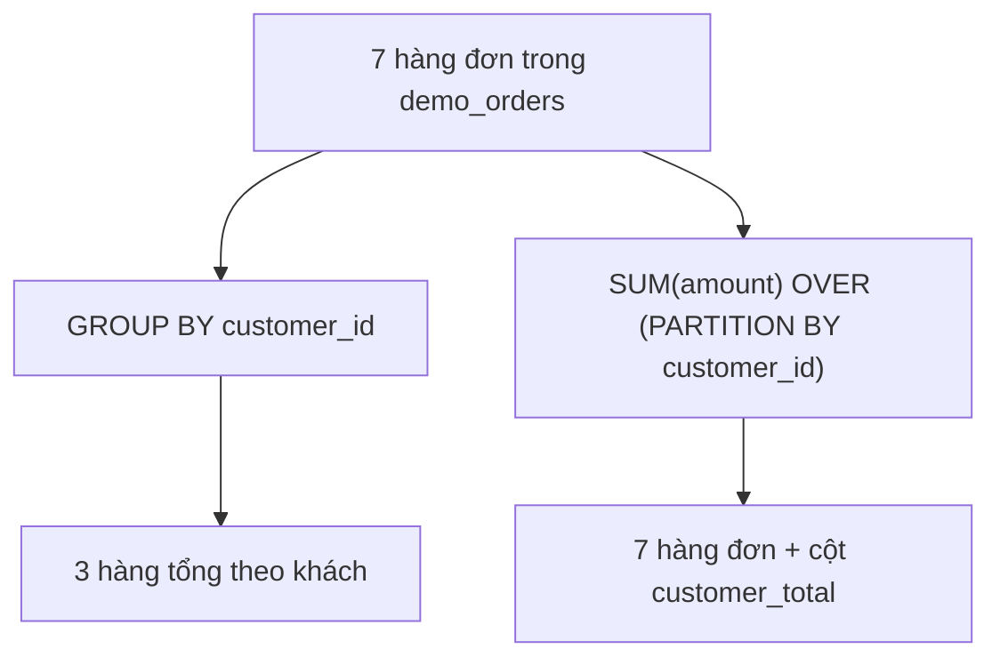

# Phân biệt hàm cửa sổ với GROUP BY và truy vấn con

Khi học SQL, người đọc thường gặp ba cách viết trông có vẻ cùng giải quyết một bài toán:

- `GROUP BY` để tính tổng tiền theo khách hàng.
- `SUM(amount) OVER (PARTITION BY customer_id)` để tính tổng tiền theo khách hàng.
- Một truy vấn con như `(SELECT SUM(amount) FROM orders WHERE ...)` để lấy tổng tiền của khách hàng hiện tại.

Cả ba có thể cho **cùng một con số**, nhưng khác rõ rệt ở **số hàng kết quả, phạm vi đánh giá, khả năng giữ dữ liệu chi tiết, cách xử lý điều kiện và vị trí được phép sử dụng trong câu SQL**.

Ví dụ, khách hàng An có ba đơn trị giá 100, 200 và 200. Cả `GROUP BY`, hàm cửa sổ và truy vấn con tương quan đều có thể tính tổng `500`. Nhưng:

- `GROUP BY customer_id` thường tạo **một hàng tổng hợp** cho An.
- `SUM(amount) OVER (PARTITION BY customer_id)` tạo **ba hàng đơn** của An, mỗi hàng có thêm tổng `500`.
- Scalar subquery tương quan trả **một giá trị `500` cho mỗi hàng của truy vấn ngoài**; nếu bên ngoài đang duyệt ba đơn của An thì giá trị ấy lặp ba lần, còn nếu bên ngoài đang duyệt một hàng khách hàng thì chỉ xuất hiện một lần.

Bài học sẽ làm rõ sự khác nhau này bằng một bộ dữ liệu thống nhất. Các ví dụ chính sử dụng **PostgreSQL**, sau đó đối chiếu với SQL Server, MySQL, Oracle và SQLite. Mục tiêu không phải học thuộc một cú pháp “tốt nhất”, mà là chọn đúng công cụ theo **mức chi tiết của kết quả** và **câu hỏi nghiệp vụ**.

## 1. Nhìn nhanh: ba công cụ trả lời ba kiểu câu hỏi

| Công cụ | Câu hỏi điển hình | Số hàng đầu ra thường gặp | Điểm quan trọng |
| --- | --- | --- | --- |
| `GROUP BY` + aggregate | “Tổng doanh thu **mỗi khách hàng** là bao nhiêu?” | Một hàng cho mỗi **nhóm** | Các hàng chi tiết được gom thành nhóm. |
| Hàm cửa sổ `... OVER (...)` | “Mỗi đơn thuộc khách nào, **tổng của khách đó** và **thứ hạng của đơn** là gì?” | Giữ các hàng của **tập đầu vào cửa sổ** | Thêm phép tính trên nhóm/cửa sổ nhưng không tự gom hàng. |
| Scalar subquery | “Với hàng hiện tại, một **giá trị liên quan** là bao nhiêu?” | Một giá trị cho mỗi hàng ngoài; truy vấn con phải phù hợp yêu cầu scalar | Có thể tương quan với hàng ngoài hoặc không. |
| `EXISTS`/`IN` subquery | “Hàng hiện tại có bản ghi liên quan hay thuộc tập đó không?” | Lọc các hàng ngoài, không tự nhân hàng bằng từng khớp | Chọn hàng theo điều kiện tồn tại/thuộc tập. |
| Derived table/CTE | “Tôi muốn xây **một nguồn trung gian** rồi truy vấn tiếp.” | Tùy câu con và phép nối ngoài | Là cách tổ chức truy vấn, có thể chứa `GROUP BY` và/hoặc window function. |

**Quy tắc ngắn gọn:** `GROUP BY` đổi **mức chi tiết** của tập kết quả; window function tạo **thông tin bổ sung trên các hàng đang có**; truy vấn con tạo **một biểu thức hoặc nguồn dữ liệu khác** để câu ngoài dùng.

Không nên đồng nhất tất cả subquery với scalar subquery. Một subquery trong `FROM` có thể trả nhiều hàng và nhiều cột; subquery trong `EXISTS` chỉ được kiểm tra xem có hàng hay không.

## 2. Dữ liệu mẫu để kiểm chứng

Ta sẽ dùng hai bảng: khách hàng và đơn hàng. Có khách **chưa có đơn**, có nhiều đơn cùng tiền, và có những đơn cùng thời điểm để thấy rõ các trường hợp đồng hạng.

Trên PostgreSQL trong database thực hành:

```sql
CREATE TABLE demo_customers (
    customer_id INTEGER PRIMARY KEY,
    customer_name VARCHAR(80) NOT NULL
);

CREATE TABLE demo_orders (
    order_id INTEGER PRIMARY KEY,
    customer_id INTEGER NOT NULL
        REFERENCES demo_customers(customer_id),
    ordered_at TIMESTAMP NOT NULL,
    amount NUMERIC(12, 2) NOT NULL,
    order_status VARCHAR(20) NOT NULL
);

INSERT INTO demo_customers (customer_id, customer_name)
VALUES
    (1, 'An'),
    (2, 'Bình'),
    (3, 'Chi'),
    (4, 'Dung');

INSERT INTO demo_orders
    (order_id, customer_id, ordered_at, amount, order_status)
VALUES
    (101, 1, '2026-10-01 09:00:00', 100, 'PAID'),
    (102, 1, '2026-10-05 10:00:00', 200, 'PAID'),
    (103, 1, '2026-10-05 10:00:00', 200, 'NEW'),
    (104, 2, '2026-10-02 08:00:00', 300, 'PAID'),
    (105, 2, '2026-10-03 09:00:00', 100, 'NEW'),
    (106, 2, '2026-10-08 12:00:00', 100, 'PAID'),
    (107, 3, '2026-10-04 16:00:00', 150, 'PAID');
```

Bảng đơn hàng được trình bày theo `order_id` để dễ đọc:

| order_id | customer_id | ordered_at | amount | order_status |
| ---: | ---: | --- | ---: | --- |
| 101 | 1 | 2026-10-01 09:00 | 100 | PAID |
| 102 | 1 | 2026-10-05 10:00 | 200 | PAID |
| 103 | 1 | 2026-10-05 10:00 | 200 | NEW |
| 104 | 2 | 2026-10-02 08:00 | 300 | PAID |
| 105 | 2 | 2026-10-03 09:00 | 100 | NEW |
| 106 | 2 | 2026-10-08 12:00 | 100 | PAID |
| 107 | 3 | 2026-10-04 16:00 | 150 | PAID |

Các tổng cần nhớ:

| customer_id | customer_name | Số đơn | Tổng amount |
| ---: | --- | ---: | ---: |
| 1 | An | 3 | 500 |
| 2 | Bình | 3 | 500 |
| 3 | Chi | 1 | 150 |
| 4 | Dung | 0 | Không có nhóm đơn |

**Tổng toàn bộ bảng đơn = 1.150.** Khi muốn cho khách Dung tổng tiền bằng `0` trong báo cáo, ta sẽ chủ động xử lý trường hợp không có đơn bằng `LEFT JOIN` và `COALESCE` hoặc bằng `COUNT` thích hợp.

## 3. GROUP BY: đổi từ hàng chi tiết sang hàng tổng hợp

Truy vấn thông thường:

```sql
SELECT
    customer_id,
    COUNT(*) AS order_count,
    SUM(amount) AS total_amount
FROM demo_orders
GROUP BY customer_id
ORDER BY customer_id;
```

Kết quả:

| customer_id | order_count | total_amount |
| ---: | ---: | ---: |
| 1 | 3 | 500 |
| 2 | 3 | 500 |
| 3 | 1 | 150 |

Từ **bảy hàng đơn** đầu vào, SQL tạo **ba hàng nhóm** — mỗi mã khách có đơn một hàng.

### 3.1. GROUP BY không giữ các cột chi tiết tùy ý

Câu SQL sau **không hợp lệ trong PostgreSQL**:

```sql
SELECT
    customer_id,
    order_id,
    SUM(amount) AS total_amount
FROM demo_orders
GROUP BY customer_id;
```

Lý do: một nhóm khách có thể chứa nhiều `order_id`. Sau khi gom nhóm, DBMS không có cơ sở chọn một `order_id` bất kỳ để gán vào hàng tổng, trừ khi có quy tắc/hàm phù hợp.

Muốn lấy một giá trị đại diện, phải định nghĩa rõ:

```sql
SELECT
    customer_id,
    MAX(order_id) AS highest_order_id,
    SUM(amount) AS total_amount
FROM demo_orders
GROUP BY customer_id
ORDER BY customer_id;
```

Nhưng `MAX(order_id)` chỉ nghĩa là **mã đơn lớn nhất**, không tự đồng nghĩa “đơn có amount lớn nhất” hay “đơn mới nhất theo thời điểm”, nếu dữ liệu không bảo đảm mối quan hệ đó.

### 3.2. GROUP BY để trả mỗi nhóm một hàng

Dùng `GROUP BY` khi mục tiêu tự nhiên là:

- Một hàng **mỗi khách**, kèm tổng đơn.
- Một hàng **mỗi ngày**, kèm tổng doanh thu.
- Một hàng **mỗi sản phẩm**, kèm lượng bán.
- Một hàng **mỗi phòng ban**, kèm số nhân viên.

Không nhất thiết cần hàm cửa sổ khi người dùng chỉ muốn kết quả ở **mức nhóm**.

## 4. Hàm cửa sổ: thêm số liệu nhưng giữ hàng đơn

Hàm cửa sổ có dạng chung:

```sql
function_name(...) OVER (
    [PARTITION BY expression_1, ...]
    [ORDER BY expression_2, ...]
    [ROWS | RANGE | GROUPS ...]
)
```

Ví dụ dùng `SUM` làm hàm cửa sổ:

```sql
SELECT
    order_id,
    customer_id,
    amount,
    SUM(amount) OVER (
        PARTITION BY customer_id
    ) AS customer_total
FROM demo_orders
ORDER BY customer_id, order_id;
```

Kết quả:

| order_id | customer_id | amount | customer_total |
| ---: | ---: | ---: | ---: |
| 101 | 1 | 100 | 500 |
| 102 | 1 | 200 | 500 |
| 103 | 1 | 200 | 500 |
| 104 | 2 | 300 | 500 |
| 105 | 2 | 100 | 500 |
| 106 | 2 | 100 | 500 |
| 107 | 3 | 150 | 150 |

**Có bảy hàng đầu ra, bằng số hàng đơn đầu vào.**

`PARTITION BY customer_id` chia các hàng thành những **phân vùng** dựa trên mã khách để tính `SUM`. Nó **không gom** ba đơn của An thành một hàng như `GROUP BY`.

### 4.1. Hình dung hai hướng



Với cùng dữ liệu và phép `SUM`:

- `GROUP BY` chuyển từ **chi tiết đơn** sang **chi tiết khách**.
- Window function giữ **chi tiết đơn** và gắn thêm thông tin từ **nhóm khách**.

### 4.2. PARTITION BY không phải GROUP BY khác tên

Hai mệnh đề có thể cùng liệt kê `customer_id` nhưng ngữ nghĩa khác:

```sql
GROUP BY customer_id
```

tạo nhóm làm đơn vị **hàng đầu ra**.

```sql
OVER (PARTITION BY customer_id)
```

xác định phạm vi **các hàng được dùng khi tính hàm cửa sổ** trên từng hàng kết quả hiện tại.

Nếu mục tiêu cần giữ `order_id` và `amount` nguyên vẹn, hàm cửa sổ là lựa chọn rất tự nhiên.

## 5. Một phép tổng, ba cách viết

### 5.1. Cách A — GROUP BY

```sql
SELECT customer_id, SUM(amount) AS customer_total
FROM demo_orders
GROUP BY customer_id
ORDER BY customer_id;
```

Đầu ra: **3 hàng**, một hàng cho mỗi khách có đơn.

### 5.2. Cách B — window function

```sql
SELECT
    order_id,
    customer_id,
    amount,
    SUM(amount) OVER (
        PARTITION BY customer_id
    ) AS customer_total
FROM demo_orders
ORDER BY customer_id, order_id;
```

Đầu ra: **7 hàng**, mỗi đơn giữ nguyên và có tổng theo khách.

### 5.3. Cách C — scalar correlated subquery

```sql
SELECT
    o.order_id,
    o.customer_id,
    o.amount,
    (
        SELECT SUM(i.amount)
        FROM demo_orders AS i
        WHERE i.customer_id = o.customer_id
    ) AS customer_total
FROM demo_orders AS o
ORDER BY o.customer_id, o.order_id;
```

Đầu ra: **7 hàng**, cùng số liệu `customer_total` như cách B.

Ở đây:

- Alias `o`: đơn hiện tại của truy vấn ngoài.
- Alias `i`: các đơn được duyệt trong subquery.
- Điều kiện `i.customer_id = o.customer_id`: subquery **tương quan** với từng hàng ngoài.
- `SUM(i.amount)` không có `GROUP BY`: trả một giá trị tổng hợp.

### 5.4. Cùng kết quả không có nghĩa cùng kế hoạch thực thi

Ngữ nghĩa ba cách khác nhau nhưng DBMS có thể chuyển đổi/tối ưu các phần của kế hoạch. Không thể kết luận `SUM(...) OVER (...)` **luôn nhanh hơn** scalar correlated subquery, hay `GROUP BY` **luôn nhanh nhất**, nếu chưa xét bộ lọc, chỉ mục, số hàng và execution plan.

Để chọn cách viết, hãy bắt đầu từ **hình dạng kết quả mong muốn**, rồi mới đánh giá hiệu năng.

## 6. GROUP BY rồi JOIN lại để giữ hàng chi tiết

Một cách phổ biến trước hoặc thay thế cho hàm cửa sổ là **tổng hợp theo khách trong bảng dẫn xuất/CTE, rồi nối lại bảng đơn**.

```sql
WITH customer_totals AS (
    SELECT
        customer_id,
        SUM(amount) AS customer_total
    FROM demo_orders
    GROUP BY customer_id
)
SELECT
    o.order_id,
    o.customer_id,
    o.amount,
    t.customer_total
FROM demo_orders AS o
JOIN customer_totals AS t
    ON t.customer_id = o.customer_id
ORDER BY o.customer_id, o.order_id;
```

Kết quả cũng có bảy hàng như `SUM(...) OVER (PARTITION BY customer_id)`.

### 6.1. Vì sao phải JOIN lại?

Bước `GROUP BY` đã **làm mất các hàng đơn chi tiết** trong kết quả trung gian. `JOIN` dùng khóa `customer_id` để gắn tổng tương ứng trở lại mỗi đơn.

Window function có thể làm công việc gắn tổng đó **trong một cấp SELECT**, không cần diễn đạt rõ một phép tự nối với tập tổng hợp.

### 6.2. Khi nào GROUP BY + JOIN là lựa chọn tốt?

- Cần một nguồn dữ liệu tổng hợp **một hàng trên mỗi khóa** để dùng ở nhiều phần của truy vấn.
- Muốn kết hợp nhiều bảng và kiểm soát mức nhóm trước khi nối.
- Có thể tái sử dụng tập tổng hợp trong nhiều mục đích khác, kể cả view.
- Kế hoạch thực thi cho thấy cách này phù hợp với phân phối dữ liệu và chỉ mục.

Điều kiện quan trọng là tập tổng hợp phải có **cardinality đúng**. Nếu bên phải chứa hai hàng cùng `customer_id` và ta nối lại đơn, mỗi đơn có thể bị nhân đôi.

### 6.3. CTE chỉ là cách tổ chức, không phải đối thủ của window function

`WITH customer_totals AS (...)` là cách **đặt tên một truy vấn trung gian**. Bên trong CTE có thể dùng `GROUP BY`, window function hoặc cả hai; trong câu ngoài cũng có thể dùng thêm window function.

So sánh chính xác là giữa **cách biến đổi hàng** (`GROUP BY` hay `OVER`), chứ không nên đặt “CTE” và “window function” vào cùng một nhóm lựa chọn hoàn toàn loại trừ nhau.

## 7. Truy vấn con tương quan: phụ thuộc vào hàng ngoài

Truy vấn con sau tính số đơn cho từng khách trong bảng khách hàng:

```sql
SELECT
    c.customer_id,
    c.customer_name,
    (
        SELECT COUNT(*)
        FROM demo_orders AS o
        WHERE o.customer_id = c.customer_id
    ) AS order_count
FROM demo_customers AS c
ORDER BY c.customer_id;
```

Kết quả:

| customer_id | customer_name | order_count |
| ---: | --- | ---: |
| 1 | An | 3 |
| 2 | Bình | 3 |
| 3 | Chi | 1 |
| 4 | Dung | 0 |

Đầu ra có **4 hàng** vì **truy vấn ngoài có 4 hàng khách hàng**. Scalar subquery chỉ bổ sung **một giá trị** cho mỗi hàng ngoài.

### 7.1. Số hàng đầu ra phụ thuộc truy vấn ngoài

Nếu truy vấn ngoài đổi sang `demo_orders`, tổng được lặp theo từng đơn:

```sql
SELECT
    o.order_id,
    (
        SELECT COUNT(*)
        FROM demo_orders AS i
        WHERE i.customer_id = o.customer_id
    ) AS orders_of_customer
FROM demo_orders AS o
ORDER BY o.order_id;
```

Kết quả có **7 hàng**, không phải 4. Vì vậy, không thể nói “scalar subquery luôn trả một hàng trong toàn bộ kết quả” — nó trả **một biểu thức giá trị cho mỗi hàng đang được xử lý ở ngoài**.

### 7.2. Scalar subquery 0, 1 và nhiều hàng

Ở vị trí scalar (một giá trị), subquery thường phải trả **tối đa một hàng một cột** trên PostgreSQL:

- **0 hàng:** biểu thức scalar nhận `NULL`.
- **1 hàng:** biểu thức nhận giá trị được chọn.
- **Nhiều hàng:** PostgreSQL báo lỗi.

Ví dụ:

```sql
-- Sai trên PostgreSQL nếu khách 1 có ba đơn.
SELECT (
    SELECT amount
    FROM demo_orders
    WHERE customer_id = 1
) AS one_amount;
```

Muốn lấy **tổng**, dùng `SUM`. Muốn lấy **một đơn cụ thể**, dùng `ORDER BY ... LIMIT 1`. Không thêm `LIMIT 1` mà chưa có tiêu chí vì hàng được chọn có thể không xác định.

### 7.3. Aggregate scalar khi không có dữ liệu

```sql
SELECT
    c.customer_id,
    (
        SELECT COUNT(*)
        FROM demo_orders AS o
        WHERE o.customer_id = c.customer_id
    ) AS order_count,
    (
        SELECT SUM(o.amount)
        FROM demo_orders AS o
        WHERE o.customer_id = c.customer_id
    ) AS total_amount
FROM demo_customers AS c
ORDER BY c.customer_id;
```

Với Dung:

- `COUNT(*)` trả **0**.
- `SUM(amount)` trả **`NULL`**, không tự là 0.

Một aggregate không `GROUP BY` tạo một hàng kết quả tổng hợp ngay cả khi không có hàng nguồn. Nếu muốn hiển thị 0, dùng `COALESCE` với ý nghĩa nghiệp vụ phù hợp.

## 8. LEFT JOIN + GROUP BY và trường hợp không có đơn

Khi cần **một hàng cho tất cả khách**, bao gồm Dung, `GROUP BY` có thể đặt sau `LEFT JOIN`:

```sql
SELECT
    c.customer_id,
    c.customer_name,
    COUNT(o.order_id) AS order_count,
    COALESCE(SUM(o.amount), 0) AS total_amount
FROM demo_customers AS c
LEFT JOIN demo_orders AS o
    ON o.customer_id = c.customer_id
GROUP BY c.customer_id, c.customer_name
ORDER BY c.customer_id;
```

Kết quả:

| customer_id | customer_name | order_count | total_amount |
| ---: | --- | ---: | ---: |
| 1 | An | 3 | 500 |
| 2 | Bình | 3 | 500 |
| 3 | Chi | 1 | 150 |
| 4 | Dung | 0 | 0 |

### 8.1. Vì sao COUNT(*) không đúng ở đây?

`LEFT JOIN` tạo **một hàng giữ chỗ** cho Dung dù không có đơn:

```text
c.customer_id = 4
o.order_id    = NULL
o.amount      = NULL
```

Nếu dùng `COUNT(*)` sau `LEFT JOIN`, Dung có giá trị **1** vì nó đếm hàng kết quả nối, không phải số đơn tồn tại.

Dùng `COUNT(o.order_id)` vì khóa đơn không `NULL` trong các hàng đơn thật, nên Dung nhận `0`.

### 8.2. Window function trên kết quả LEFT JOIN cũng gặp bẫy COUNT(*)

```sql
SELECT
    c.customer_id,
    o.order_id,
    COUNT(*) OVER (
        PARTITION BY c.customer_id
    ) AS joined_row_count,
    COUNT(o.order_id) OVER (
        PARTITION BY c.customer_id
    ) AS actual_order_count
FROM demo_customers AS c
LEFT JOIN demo_orders AS o
    ON o.customer_id = c.customer_id
ORDER BY c.customer_id, o.order_id;
```

Với Dung:

| customer_id | order_id | joined_row_count | actual_order_count |
| ---: | --- | ---: | ---: |
| 4 | `NULL` | 1 | 0 |

**Hàm cửa sổ không tự sửa sai cấp dữ liệu.** Nó tính trên những hàng do `FROM`/`JOIN` và các bộ lọc tạo ra. Hàng giữ chỗ của outer join là một hàng trong tập đầu vào cửa sổ.

## 9. PARTITION BY: phân vùng để tính, không phải để trả một hàng

`PARTITION BY` có thể bao gồm một hoặc nhiều cột:

```sql
SELECT
    order_id,
    customer_id,
    order_status,
    amount,
    SUM(amount) OVER (
        PARTITION BY customer_id, order_status
    ) AS status_total_for_customer
FROM demo_orders
ORDER BY customer_id, order_status, order_id;
```

Kết quả quan trọng:

| customer_id | order_status | order_id | amount | status_total_for_customer |
| ---: | --- | ---: | ---: | ---: |
| 1 | NEW | 103 | 200 | 200 |
| 1 | PAID | 101 | 100 | 300 |
| 1 | PAID | 102 | 200 | 300 |
| 2 | NEW | 105 | 100 | 100 |
| 2 | PAID | 104 | 300 | 400 |
| 2 | PAID | 106 | 100 | 400 |
| 3 | PAID | 107 | 150 | 150 |

Cùng một khách có thể có **nhiều phân vùng** theo trạng thái. Nhưng từng `order_id` vẫn được giữ.

### 9.1. Không có PARTITION BY thì sao?

```sql
SELECT
    order_id,
    amount,
    SUM(amount) OVER () AS total_all_orders
FROM demo_orders
ORDER BY order_id;
```

`OVER ()` dùng **toàn bộ các hàng trong tập đầu vào cửa sổ** làm một phân vùng. Mỗi trong bảy đơn có `total_all_orders = 1150`.

So sánh:

```sql
SELECT SUM(amount) AS total_all_orders
FROM demo_orders;
```

Truy vấn aggregate không `GROUP BY` chỉ trả **một hàng 1150**.

### 9.2. Một câu có thể dùng nhiều cửa sổ

```sql
SELECT
    order_id,
    customer_id,
    amount,
    SUM(amount) OVER () AS grand_total,
    SUM(amount) OVER (
        PARTITION BY customer_id
    ) AS customer_total,
    COUNT(*) OVER (
        PARTITION BY customer_id
    ) AS customer_order_count
FROM demo_orders
ORDER BY customer_id, order_id;
```

Ở mỗi đơn, ta biết đồng thời **tổng toàn bảng**, **tổng theo khách** và **số đơn theo khách** mà không phải gom các hàng đơn lại.

## 10. ORDER BY bên trong OVER khác ORDER BY cuối câu SQL

Đây là một khác biệt căn bản:

```sql
ROW_NUMBER() OVER (
    PARTITION BY customer_id
    ORDER BY ordered_at DESC, order_id DESC
)
```

`ORDER BY` trong `OVER` quy định **thứ tự logic dùng để đánh số** trong mỗi phân vùng.

Còn:

```sql
ORDER BY customer_id, order_id
```

ở cuối câu SQL quy định **thứ tự hiển thị các hàng kết quả**.

Ví dụ:

```sql
SELECT
    order_id,
    customer_id,
    ordered_at,
    ROW_NUMBER() OVER (
        PARTITION BY customer_id
        ORDER BY ordered_at DESC, order_id DESC
    ) AS newest_first
FROM demo_orders
ORDER BY customer_id, order_id;
```

Kết quả:

| customer_id | order_id | newest_first |
| ---: | ---: | ---: |
| 1 | 101 | 3 |
| 1 | 102 | 2 |
| 1 | 103 | 1 |
| 2 | 104 | 3 |
| 2 | 105 | 2 |
| 2 | 106 | 1 |
| 3 | 107 | 1 |

Dù thứ hạng `newest_first` ở An là **3, 2, 1** theo thứ tự hiển thị, phép tính hoàn toàn đúng: nó xếp đơn mới trước trong cửa sổ, sau đó truy vấn ngoài hiển thị theo mã tăng dần.

**Không được dựa vào `ORDER BY` trong `OVER` để bảo đảm thứ tự trả về cuối cùng.** Nếu ứng dụng cần hàng theo thứ hạng, thêm `ORDER BY customer_id, newest_first` ở cuối.

## 11. ROW_NUMBER, RANK và DENSE_RANK: bài toán không chỉ là SUM

Hàm cửa sổ còn làm được những việc khó diễn đạt ngắn gọn bằng `GROUP BY` một cấp, như **đánh số và xếp hạng từng hàng**.

Truy vấn:

```sql
SELECT
    order_id,
    customer_id,
    amount,
    ROW_NUMBER() OVER (
        PARTITION BY customer_id
        ORDER BY amount DESC, order_id ASC
    ) AS rn,
    RANK() OVER (
        PARTITION BY customer_id
        ORDER BY amount DESC
    ) AS amount_rank,
    DENSE_RANK() OVER (
        PARTITION BY customer_id
        ORDER BY amount DESC
    ) AS amount_dense_rank
FROM demo_orders
ORDER BY customer_id, amount DESC, order_id;
```

Kết quả:

| customer_id | order_id | amount | rn | amount_rank | amount_dense_rank |
| ---: | ---: | ---: | ---: | ---: | ---: |
| 1 | 102 | 200 | 1 | 1 | 1 |
| 1 | 103 | 200 | 2 | 1 | 1 |
| 1 | 101 | 100 | 3 | 3 | 2 |
| 2 | 104 | 300 | 1 | 1 | 1 |
| 2 | 105 | 100 | 2 | 2 | 2 |
| 2 | 106 | 100 | 3 | 2 | 2 |
| 3 | 107 | 150 | 1 | 1 | 1 |

### 11.1. Ba loại hạng không giống nhau

- `ROW_NUMBER()`: đánh số **1, 2, 3 ...** cho từng hàng theo thứ tự xác định. Ở đây thêm `order_id ASC` để phá hòa giữa các đơn cùng tiền.
- `RANK()`: các hàng cùng tiền được **đồng hạng**; hạng sau có thể nhảy. Với An: `1, 1, 3`.
- `DENSE_RANK()`: đồng hạng nhưng **không nhảy số**. Với An: `1, 1, 2`.

**Chi tiết quan trọng:** `RANK() OVER (ORDER BY amount DESC, order_id ASC)` sẽ xem hai đơn `102` và `103` có khóa sắp xếp khác nhau, nên **không còn đồng hạng**. Nếu muốn đồng hạng theo **amount**, chỉ dùng `amount` trong `ORDER BY` của `RANK`; khóa phụ duy nhất có thể dành riêng cho `ROW_NUMBER`.

### 11.2. GROUP BY có thay thế được RANK không?

`GROUP BY customer_id` trả một hàng cho mỗi khách và không còn các dòng đơn để xếp hạng riêng từng đơn.

Có thể tạo các truy vấn con phức tạp để đếm số đơn có amount lớn hơn đơn hiện tại, nhưng khi mục đích là xếp hạng trên tập hàng, `RANK`/`DENSE_RANK` thường diễn đạt trực tiếp hơn.

## 12. Top 1 hoặc top N mỗi nhóm

Muốn **đơn có tiền lớn nhất của mỗi khách**, lấy hàng có `rn = 1`. Không lọc trực tiếp bằng hàm cửa sổ trong `WHERE` cùng cấp trên PostgreSQL:

```sql
-- Không hợp lệ trên PostgreSQL:
SELECT *
FROM demo_orders
WHERE ROW_NUMBER() OVER (
    PARTITION BY customer_id
    ORDER BY amount DESC, order_id ASC
) = 1;
```

Hãy tính hạng trong CTE rồi lọc ở truy vấn ngoài:

```sql
WITH ranked AS (
    SELECT
        order_id,
        customer_id,
        amount,
        ROW_NUMBER() OVER (
            PARTITION BY customer_id
            ORDER BY amount DESC, order_id ASC
        ) AS rn
    FROM demo_orders
)
SELECT
    customer_id,
    order_id,
    amount
FROM ranked
WHERE rn = 1
ORDER BY customer_id;
```

Kết quả:

| customer_id | order_id | amount |
| ---: | ---: | ---: |
| 1 | 102 | 200 |
| 2 | 104 | 300 |
| 3 | 107 | 150 |

### 12.1. Vì sao không dùng MAX(amount) + GROUP BY rồi lấy order_id?

```sql
SELECT customer_id, MAX(amount) AS max_amount
FROM demo_orders
GROUP BY customer_id;
```

Truy vấn này chỉ cho **giá trị lớn nhất**:

| customer_id | max_amount |
| ---: | ---: |
| 1 | 200 |
| 2 | 300 |
| 3 | 150 |

Nó **không xác định duy nhất order_id**. Với An, có hai đơn cùng `amount = 200`: `102` và `103`.

Nếu join tập `MAX(amount)` trở lại bảng đơn, An sẽ nhận **hai hàng**, không phải một hàng. `ROW_NUMBER` với khóa phụ có thể chọn đúng một đơn theo chính sách rõ ràng.

### 12.2. Top 2 mỗi khách

```sql
WITH ranked AS (
    SELECT
        order_id,
        customer_id,
        amount,
        ROW_NUMBER() OVER (
            PARTITION BY customer_id
            ORDER BY amount DESC, order_id ASC
        ) AS rn
    FROM demo_orders
)
SELECT customer_id, order_id, amount, rn
FROM ranked
WHERE rn <= 2
ORDER BY customer_id, rn;
```

Kết quả gồm sáu hàng: An `102`, `103`; Bình `104`, `105`; Chi `107`. Chi chỉ có một đơn nên không được thêm một hàng giả để đủ hai.

### 12.3. Chọn đúng N hàng hay tất cả hàng đồng hạng?

- **Đúng tối đa N hàng cho mỗi khách:** `ROW_NUMBER()` và lọc `rn <= N`, có khóa phụ để thứ tự ổn định.
- **Tất cả đơn thuộc N mức tiền cao nhất phân biệt:** `DENSE_RANK()` rồi lọc `dense_rank <= N`.
- **Các hàng có thứ hạng cạnh tranh trong top N:** `RANK()` và lọc theo hạng tương ứng.

Những yêu cầu này có thể cho **số hàng khác nhau** khi có đơn trùng tiền. Không chọn một hàm xếp hạng chỉ dựa vào tên “top N”.

## 13. Top N bằng correlated subquery hoặc LATERAL

Không bắt buộc phải dùng window function. Với PostgreSQL, `LEFT JOIN LATERAL` có thể chọn một đơn theo từng khách:

```sql
SELECT
    c.customer_id,
    c.customer_name,
    best.order_id,
    best.amount
FROM demo_customers AS c
LEFT JOIN LATERAL (
    SELECT o.order_id, o.amount
    FROM demo_orders AS o
    WHERE o.customer_id = c.customer_id
    ORDER BY o.amount DESC, o.order_id ASC
    LIMIT 1
) AS best ON TRUE
ORDER BY c.customer_id;
```

Kết quả:

| customer_id | customer_name | order_id | amount |
| ---: | --- | ---: | ---: |
| 1 | An | 102 | 200 |
| 2 | Bình | 104 | 300 |
| 3 | Chi | 107 | 150 |
| 4 | Dung | `NULL` | `NULL` |

### 13.1. So với ROW_NUMBER

- `ROW_NUMBER` trong CTE dễ dùng khi cần **xếp hạng toàn bộ tập đơn** và sau đó chọn top N.
- `LATERAL ... ORDER BY ... LIMIT 1` phù hợp khi có **tập khách bên trái** và muốn tìm một hoặc vài đơn của **từng khách**, đặc biệt khi khách đã được lọc ít và có chỉ mục hỗ trợ.
- Cả hai đều cần **khóa phụ phá hòa** nếu muốn chính xác một đơn.
- `LEFT JOIN LATERAL` giúp giữ khách **không có đơn**; với window function, phải kết hợp `LEFT JOIN` với tập hạng và đặt điều kiện hạng trong `ON` nếu muốn giữ Dung.

Trên SQL Server, mẫu tương ứng phổ biến là `OUTER APPLY (SELECT TOP (1) ...)`. Trên hệ không có `LATERAL`, scalar subquery hoặc window function có thể là lựa chọn thích hợp.

### 13.2. Truy vấn con tương quan để đếm thứ hạng có thể phức tạp

Một ý tưởng khác là với mỗi đơn, đếm bao nhiêu đơn trong cùng khách **có amount lớn hơn**. Nhưng muốn diễn đạt `ROW_NUMBER` phải xử lý thêm khóa phụ và các trường hợp bằng tiền. `RANK` lại có quy tắc đồng hạng khác.

Hàm cửa sổ đóng gói những quy tắc này thành các hàm chuẩn, dễ đọc và ít dễ mắc lỗi hơn so với viết lại bằng nhiều correlated subquery.

## 14. Running total: GROUP BY không giải trực tiếp cùng hình dạng kết quả

**Tổng lũy kế** theo thời gian là ví dụ điển hình của hàm cửa sổ. Với mỗi đơn, ta muốn tổng tiền của các đơn **cùng khách và không đứng sau đơn hiện tại** trong thứ tự đã định nghĩa.

```sql
SELECT
    order_id,
    customer_id,
    ordered_at,
    amount,
    SUM(amount) OVER (
        PARTITION BY customer_id
        ORDER BY ordered_at ASC, order_id ASC
        ROWS BETWEEN UNBOUNDED PRECEDING AND CURRENT ROW
    ) AS running_total
FROM demo_orders
ORDER BY customer_id, ordered_at, order_id;
```

Kết quả:

| customer_id | order_id | amount | running_total |
| ---: | ---: | ---: | ---: |
| 1 | 101 | 100 | 100 |
| 1 | 102 | 200 | 300 |
| 1 | 103 | 200 | 500 |
| 2 | 104 | 300 | 300 |
| 2 | 105 | 100 | 400 |
| 2 | 106 | 100 | 500 |
| 3 | 107 | 150 | 150 |

### 14.1. Các thành phần của cửa sổ

- `PARTITION BY customer_id`: lũy kế **riêng cho từng khách**.
- `ORDER BY ordered_at ASC, order_id ASC`: xác định **thứ tự cộng**.
- `ROWS BETWEEN UNBOUNDED PRECEDING AND CURRENT ROW`: khung từ **hàng đầu phân vùng đến hàng hiện tại**.
- `SUM(amount)`: tổng các hàng trong khung.

Vì `order_id` là khóa duy nhất, thứ tự tương đối giữa các hàng cùng timestamp được xác định.

### 14.2. Vì sao GROUP BY theo khách không đủ?

`GROUP BY customer_id` chỉ cho tổng cuối cùng `500` của An, không cho ba mốc lũy kế `100`, `300`, `500` của ba đơn.

Có thể làm bằng self join hoặc correlated subquery so sánh thứ tự thời gian/mã đơn, nhưng window function diễn đạt trực tiếp và thường ngắn hơn.

## 15. ROWS và RANGE: cùng SUM nhưng kết quả có thể khác

Trên PostgreSQL, khi dùng aggregate window có `ORDER BY` mà **không viết rõ frame**, mặc định phổ biến là khung theo `RANGE BETWEEN UNBOUNDED PRECEDING AND CURRENT ROW` theo ngữ nghĩa có tính cả các **hàng đồng hạng về khóa ORDER BY** (*peers*).

Với An, hai đơn `102` và `103` cùng `ordered_at`.

### 15.1. Dùng ORDER BY chỉ theo thời gian, không khai báo ROWS

```sql
SELECT
    order_id,
    customer_id,
    amount,
    SUM(amount) OVER (
        PARTITION BY customer_id
        ORDER BY ordered_at
    ) AS running_by_time
FROM demo_orders
WHERE customer_id = 1
ORDER BY ordered_at, order_id;
```

Kết quả trên PostgreSQL:

| order_id | amount | running_by_time |
| ---: | ---: | ---: |
| 101 | 100 | 100 |
| 102 | 200 | 500 |
| 103 | 200 | 500 |

Do `102` và `103` cùng thời điểm, chúng là **peers** theo `ORDER BY ordered_at`; ở mức frame mặc định, hai hàng được tính cùng một mốc.

### 15.2. Dùng ROWS với khóa phụ

```sql
SELECT
    order_id,
    customer_id,
    amount,
    SUM(amount) OVER (
        PARTITION BY customer_id
        ORDER BY ordered_at, order_id
        ROWS BETWEEN UNBOUNDED PRECEDING AND CURRENT ROW
    ) AS running_by_row
FROM demo_orders
WHERE customer_id = 1
ORDER BY ordered_at, order_id;
```

Kết quả:

| order_id | amount | running_by_row |
| ---: | ---: | ---: |
| 101 | 100 | 100 |
| 102 | 200 | 300 |
| 103 | 200 | 500 |

### 15.3. Bản chất sự khác nhau

- `ROWS` xác định khung theo **vị trí các hàng** trong thứ tự cửa sổ.
- `RANGE` xác định theo **giá trị khóa sắp xếp** và quy tắc peer/frame, tùy dạng và DBMS.
- `GROUPS`, khi được hỗ trợ, định nghĩa khung theo **nhóm peer**.

Nếu nghiệp vụ cần “sau **mỗi giao dịch**”, `ROWS` cùng một khóa phụ duy nhất thường dễ hiểu. Nếu nghiệp vụ cần “sau **mỗi mốc thời gian**”, việc tính đồng thời các giao dịch cùng timestamp có thể là điều mong muốn.

**Không nên chỉ thêm hoặc bỏ `ROWS` để tối ưu hiệu năng**: thay đổi frame có thể thay đổi chính kết quả nghiệp vụ.

## 16. LAG và LEAD: truy cập hàng liền trước hoặc liền sau

`LAG` và `LEAD` là các hàm cửa sổ dùng để so sánh các hàng theo một thứ tự.

Ví dụ: mỗi đơn so với **đơn trước đó của cùng khách**.

```sql
SELECT
    customer_id,
    order_id,
    amount,
    LAG(order_id) OVER (
        PARTITION BY customer_id
        ORDER BY ordered_at, order_id
    ) AS previous_order_id,
    LAG(amount) OVER (
        PARTITION BY customer_id
        ORDER BY ordered_at, order_id
    ) AS previous_amount
FROM demo_orders
ORDER BY customer_id, ordered_at, order_id;
```

Kết quả:

| customer_id | order_id | amount | previous_order_id | previous_amount |
| ---: | ---: | ---: | ---: | ---: |
| 1 | 101 | 100 | `NULL` | `NULL` |
| 1 | 102 | 200 | 101 | 100 |
| 1 | 103 | 200 | 102 | 200 |
| 2 | 104 | 300 | `NULL` | `NULL` |
| 2 | 105 | 100 | 104 | 300 |
| 2 | 106 | 100 | 105 | 100 |
| 3 | 107 | 150 | `NULL` | `NULL` |

### 16.1. Điều kiện “trước” cần định nghĩa thứ tự

Nếu hai đơn có cùng `ordered_at`, cần khóa phụ, ví dụ `order_id`, để xác định đơn nào trước. Thiếu khóa phụ có thể dẫn đến `LAG` trả hàng “trước đó” không ổn định trong nhóm đồng thời điểm.

### 16.2. Làm bằng correlated subquery được không?

Được, nếu viết một truy vấn con tìm đơn có bộ khóa thời gian/mã nhỏ hơn đơn hiện tại, sắp giảm dần rồi `LIMIT 1`. Nhưng thường phức tạp hơn:

```sql
-- PostgreSQL: tìm mã đơn ngay trước theo (ordered_at, order_id).
SELECT
    o.order_id,
    (
        SELECT p.order_id
        FROM demo_orders AS p
        WHERE p.customer_id = o.customer_id
          AND (
              p.ordered_at < o.ordered_at
              OR (
                  p.ordered_at = o.ordered_at
                  AND p.order_id < o.order_id
              )
          )
        ORDER BY p.ordered_at DESC, p.order_id DESC
        LIMIT 1
    ) AS previous_order_id
FROM demo_orders AS o
ORDER BY o.customer_id, o.ordered_at, o.order_id;
```

`LAG` thể hiện ý định “hàng trước trong một thứ tự” ngắn gọn hơn.

## 17. FIRST_VALUE và LAST_VALUE: chú ý frame mặc định

Một bẫy thường gặp: `LAST_VALUE` không mặc nhiên có nghĩa “giá trị của hàng cuối **toàn phân vùng**” nếu frame đang kết thúc ở hàng hiện tại.

Ví dụ muốn gắn **mã đơn mới nhất theo thời gian** cho mọi đơn của cùng khách:

```sql
SELECT
    customer_id,
    order_id,
    LAST_VALUE(order_id) OVER (
        PARTITION BY customer_id
        ORDER BY ordered_at ASC, order_id ASC
        ROWS BETWEEN UNBOUNDED PRECEDING
             AND UNBOUNDED FOLLOWING
    ) AS latest_order_id
FROM demo_orders
ORDER BY customer_id, order_id;
```

Kết quả:

| customer_id | order_id | latest_order_id |
| ---: | ---: | ---: |
| 1 | 101 | 103 |
| 1 | 102 | 103 |
| 1 | 103 | 103 |
| 2 | 104 | 106 |
| 2 | 105 | 106 |
| 2 | 106 | 106 |
| 3 | 107 | 107 |

`UNBOUNDED FOLLOWING` đưa điểm cuối frame tới **hàng cuối của phân vùng**. Nếu bỏ frame này và dùng mặc định kết thúc ở hàng hiện tại/các peers, `LAST_VALUE` có thể trả giá trị khác điều bạn nghĩ.

Tương tự, `FIRST_VALUE` và `NTH_VALUE` cũng cần được xét với `ORDER BY` và frame phù hợp.

## 18. WHERE lọc trước khi hàm cửa sổ được đánh giá

Xét một câu hỏi:

> Mỗi đơn `PAID` có bao nhiêu đơn `PAID` cùng khách?

Truy vấn:

```sql
SELECT
    order_id,
    customer_id,
    order_status,
    COUNT(*) OVER (
        PARTITION BY customer_id
    ) AS paid_order_count
FROM demo_orders
WHERE order_status = 'PAID'
ORDER BY customer_id, order_id;
```

Kết quả:

| customer_id | order_id | order_status | paid_order_count |
| ---: | ---: | --- | ---: |
| 1 | 101 | PAID | 2 |
| 1 | 102 | PAID | 2 |
| 2 | 104 | PAID | 2 |
| 2 | 106 | PAID | 2 |
| 3 | 107 | PAID | 1 |

Ở đây `WHERE order_status = 'PAID'` loại đơn `NEW` **trước khi** hàm cửa sổ tính trên tập hàng còn lại.

### 18.1. Muốn giữ mọi đơn nhưng đếm riêng PAID?

Hãy dùng tổng có điều kiện bên trong cửa sổ:

```sql
SELECT
    order_id,
    customer_id,
    order_status,
    SUM(
        CASE
            WHEN order_status = 'PAID' THEN 1
            ELSE 0
        END
    ) OVER (
        PARTITION BY customer_id
    ) AS paid_order_count
FROM demo_orders
ORDER BY customer_id, order_id;
```

Kết quả có **cả bảy đơn**, và cột `paid_order_count` lần lượt là:

- Mọi đơn của An: `2`.
- Mọi đơn của Bình: `2`.
- Đơn của Chi: `1`.

Cách này khác với lọc `WHERE` vì **không bỏ các hàng `NEW` khỏi kết quả**.

### 18.2. FILTER của PostgreSQL

PostgreSQL có dạng:

```sql
COUNT(*) FILTER (
    WHERE order_status = 'PAID'
) OVER (
    PARTITION BY customer_id
)
```

Dạng `FILTER` diễn đạt aggregate có điều kiện ngắn gọn, nhưng không phải mọi DBMS đều hỗ trợ cùng cú pháp. `SUM(CASE WHEN ... THEN 1 ELSE 0 END) OVER (...)` thường dễ chuyển hệ hơn.

## 19. WHERE, GROUP BY, HAVING và window function trong thứ tự logic SQL

Một cách **khái niệm** để hiểu là:

1. `FROM` / `JOIN` tạo tập hàng đầu vào.
2. `WHERE` lọc các hàng.
3. `GROUP BY` gom các hàng nếu được dùng.
4. `HAVING` lọc nhóm.
5. **Hàm cửa sổ** được đánh giá trên các hàng còn lại của kết quả nhóm hoặc không nhóm.
6. `SELECT` tạo các biểu thức/cột kết quả.
7. `ORDER BY` ngoài cùng quy định thứ tự trả.
8. `LIMIT`/`OFFSET` hoặc cú pháp giới hạn tương ứng chọn phạm vi cuối theo quy tắc DBMS.

Đây là **trình tự ngữ nghĩa để suy luận**, không phải cam kết engine phải thực thi vật lý từng bước đúng thứ tự này.

### 19.1. Hàm cửa sổ không dùng trực tiếp trong WHERE/HAVING cùng cấp

Ví dụ PostgreSQL:

```sql
-- Không hợp lệ trên PostgreSQL:
SELECT order_id, customer_id
FROM demo_orders
WHERE ROW_NUMBER() OVER (
    PARTITION BY customer_id
    ORDER BY amount DESC
) = 1;
```

Cần CTE/bảng dẫn xuất để tính hạng trước, rồi lọc ngoài:

```sql
SELECT order_id, customer_id
FROM (
    SELECT
        order_id,
        customer_id,
        ROW_NUMBER() OVER (
            PARTITION BY customer_id
            ORDER BY amount DESC, order_id ASC
        ) AS rn
    FROM demo_orders
) AS x
WHERE x.rn = 1
ORDER BY customer_id;
```

Một số hệ dữ liệu có mệnh đề **`QUALIFY`** để lọc theo kết quả window function ở cùng khối query, nhưng **PostgreSQL không có `QUALIFY` trong cú pháp thông dụng**. Không nên giả định mọi DBMS hỗ trợ `QUALIFY`.

### 19.2. Vì sao không đặt window function trong GROUP BY?

`GROUP BY` quyết định những hàng nhóm **trước khi** cửa sổ được đánh giá. Window function được tính trên **các hàng kết quả đã qua bước grouping**. Do đó không thể dùng kết quả `ROW_NUMBER()` cùng cấp làm khóa phân nhóm theo cách trực tiếp trong các DBMS như PostgreSQL.

Nếu cần nhóm theo một hạng đã tính, tạo hạng trong CTE rồi nhóm ở câu ngoài.

## 20. Kết hợp GROUP BY và OVER trong cùng câu SQL

Đây là điểm dễ gây hiểu nhầm: **`GROUP BY` và window function không loại trừ nhau**. Ta có thể nhóm đơn thành một hàng mỗi khách, sau đó **xếp hạng những hàng tổng hợp**.

```sql
SELECT
    c.customer_id,
    c.customer_name,
    COALESCE(SUM(o.amount), 0) AS customer_total,
    RANK() OVER (
        ORDER BY COALESCE(SUM(o.amount), 0) DESC
    ) AS spending_rank
FROM demo_customers AS c
LEFT JOIN demo_orders AS o
    ON o.customer_id = c.customer_id
GROUP BY c.customer_id, c.customer_name
ORDER BY spending_rank, c.customer_id;
```

Kết quả:

| customer_id | customer_name | customer_total | spending_rank |
| ---: | --- | ---: | ---: |
| 1 | An | 500 | 1 |
| 2 | Bình | 500 | 1 |
| 3 | Chi | 150 | 3 |
| 4 | Dung | 0 | 4 |

### 20.1. Có hai cấp ý nghĩa

- `GROUP BY c.customer_id, c.customer_name`: biến kết quả nối thành **một hàng cho mỗi khách**.
- `SUM(o.amount)`: tính tổng tiền **theo nhóm**.
- `RANK() OVER (ORDER BY COALESCE(SUM(o.amount),0) DESC)`: xếp hạng **bốn hàng nhóm** theo tổng tiền.
- `ORDER BY spending_rank, c.customer_id` cuối cùng: sắp các hàng đầu ra để người đọc theo dõi thứ hạng.

Đây không còn là xếp hạng các **đơn hàng**, mà là xếp hạng **khách hàng theo tổng tiền**.

### 20.2. Dùng CTE để làm rõ hai bước

```sql
WITH customer_totals AS (
    SELECT
        c.customer_id,
        c.customer_name,
        COALESCE(SUM(o.amount), 0) AS customer_total
    FROM demo_customers AS c
    LEFT JOIN demo_orders AS o
        ON o.customer_id = c.customer_id
    GROUP BY c.customer_id, c.customer_name
)
SELECT
    customer_id,
    customer_name,
    customer_total,
    RANK() OVER (
        ORDER BY customer_total DESC
    ) AS spending_rank
FROM customer_totals
ORDER BY spending_rank, customer_id;
```

Cách này có thể dễ đọc hơn vì tách:

1. Tính **tổng tiền mỗi khách**.
2. Xếp hạng **các khách theo tổng tiền**.

CTE ở đây là **phương tiện tổ chức**, còn `GROUP BY` và `RANK() OVER` là **hai phép biến đổi dữ liệu**.

## 21. Phân biệt COUNT tổng hợp và COUNT cửa sổ

Hai câu SQL này không tương đương về số hàng:

```sql
-- Mỗi khách có đơn một hàng.
SELECT
    customer_id,
    COUNT(*) AS order_count
FROM demo_orders
GROUP BY customer_id;
```

```sql
-- Mỗi đơn vẫn là một hàng.
SELECT
    order_id,
    customer_id,
    COUNT(*) OVER (
        PARTITION BY customer_id
    ) AS order_count
FROM demo_orders;
```

Một lỗi khác là nhầm:

```sql
COUNT(*) OVER ()
```

với:

```sql
COUNT(*) OVER (PARTITION BY customer_id)
```

Dạng đầu đếm **tất cả hàng trong tập đầu vào cửa sổ**: `7` trên từng đơn. Dạng thứ hai đếm theo khách: `3` hoặc `1`.

### 21.1. Khi GROUP BY đã xảy ra, COUNT(*) OVER () đếm hàng nhóm

```sql
SELECT
    customer_id,
    SUM(amount) AS total_amount,
    COUNT(*) OVER () AS number_of_customer_groups
FROM demo_orders
GROUP BY customer_id
ORDER BY customer_id;
```

Kết quả:

| customer_id | total_amount | number_of_customer_groups |
| ---: | ---: | ---: |
| 1 | 500 | 3 |
| 2 | 500 | 3 |
| 3 | 150 | 3 |

`COUNT(*) OVER ()` ở đây đếm **3 hàng kết quả nhóm**, không đếm 7 đơn gốc.

Đây là một ví dụ cho thấy hàm cửa sổ hoạt động **trên mức dữ liệu mà câu truy vấn hiện tại đã tạo ra**.

## 22. Tỷ lệ đóng góp của mỗi đơn: window function rất tự nhiên

Giả sử cần mỗi đơn có tỷ lệ đóng góp vào doanh thu khách hàng của nó.

```sql
SELECT
    order_id,
    customer_id,
    amount,
    SUM(amount) OVER (
        PARTITION BY customer_id
    ) AS customer_total,
    100.0 * amount /
        NULLIF(
            SUM(amount) OVER (
                PARTITION BY customer_id
            ),
            0
        ) AS pct_of_customer_total
FROM demo_orders
ORDER BY customer_id, order_id;
```

Kết quả xấp xỉ:

| customer_id | order_id | amount | customer_total | pct_of_customer_total |
| ---: | ---: | ---: | ---: | ---: |
| 1 | 101 | 100 | 500 | 20.00 |
| 1 | 102 | 200 | 500 | 40.00 |
| 1 | 103 | 200 | 500 | 40.00 |
| 2 | 104 | 300 | 500 | 60.00 |
| 2 | 105 | 100 | 500 | 20.00 |
| 2 | 106 | 100 | 500 | 20.00 |
| 3 | 107 | 150 | 150 | 100.00 |

### 22.1. Vì sao dùng NULLIF?

Nếu tổng của phân vùng bằng 0, phép chia trực tiếp có thể gây lỗi chia cho 0 hoặc hành vi không mong muốn. `NULLIF(total,0)` trả `NULL` khi mẫu số bằng 0; khi ấy tỷ lệ có thể là `NULL`, báo rằng chưa định nghĩa được tỷ lệ.

`100.0` hướng phép tính sang số có phần thập phân ở những DBMS cần phân biệt phép chia nguyên. Kiểu chính xác và cách làm tròn còn phụ thuộc DBMS và driver.

### 22.2. Cũng có thể tính bằng GROUP BY + JOIN

Ta có thể tổng hợp `customer_total` theo khách rồi JOIN lại đơn để chia. Khi cần tỷ lệ trên **từng hàng đơn**, window function giúp tránh phải diễn đạt riêng bước tổng hợp và nối lại.

## 23. NULL trong hàm cửa sổ và GROUP BY

Bộ dữ liệu chính có `amount NOT NULL` để ví dụ dễ tính tay. Trong thực tế, giá trị số hoặc khóa phân vùng có thể `NULL`.

### 23.1. SUM và AVG bỏ qua NULL của đầu vào

Trong SQL phổ biến:

- `SUM(amount)` bỏ qua các giá trị `amount IS NULL`.
- `AVG(amount)` cũng bỏ qua các giá trị `NULL`.
- `COUNT(amount)` đếm những giá trị `amount` không `NULL`.
- `COUNT(*)` đếm **mọi hàng** của nhóm hoặc khung, kể cả khi `amount IS NULL`.

Quy tắc này áp dụng tương ứng khi các aggregate được dùng làm **window aggregate**:

```sql
SUM(amount) OVER (PARTITION BY customer_id)
COUNT(amount) OVER (PARTITION BY customer_id)
COUNT(*) OVER (PARTITION BY customer_id)
```

Vì vậy cùng một phân vùng có 3 hàng nhưng chỉ 2 `amount` không `NULL` thì hai phép đếm cuối có thể khác nhau.

### 23.2. PARTITION BY có thể tạo một phân vùng cho khóa NULL

Nếu `customer_id` của bảng nguồn có thể `NULL`, các hàng không xác định khách thường thuộc cùng một phân vùng theo `PARTITION BY customer_id`, tương tự cách `GROUP BY customer_id` đặt chúng vào một nhóm.

Tuy nhiên, đó **không có nghĩa `NULL = NULL` trong điều kiện `JOIN` hay `WHERE`**. Phép so sánh bằng thông thường với `NULL` cho `UNKNOWN`. Khi ghép với scalar subquery tương quan, phải làm rõ chính sách so khớp các giá trị `NULL`.

### 23.3. Khung rỗng hoặc không có giá trị phù hợp

Một cửa sổ/frame có thể không chứa giá trị hợp lệ cho `SUM`, khi đó kết quả có thể là `NULL`. `COUNT` có thể trả 0 cho frame rỗng. Đừng mặc định mọi window aggregate trả 0.

### 23.4. NULL do LEFT JOIN cần được hiểu khác NULL của bảng gốc

Với Dung, `LEFT JOIN` bổ sung một hàng không có đơn; cột `o.order_id` là `NULL` vì **không có hàng khớp**. Nếu một cột được phép thiếu ở hàng đơn thật cũng có `NULL`, việc kiểm tra một cột nullable không đủ để biết “không có đơn”.

Khi cần đếm đơn, nên dựa trên khóa chính không `NULL` ở phía đơn.

## 24. DISTINCT, GROUP BY và window function không thay thế nhau

`DISTINCT` loại hàng trùng ở **các biểu thức được chọn**:

```sql
SELECT DISTINCT customer_id
FROM demo_orders
ORDER BY customer_id;
```

Kết quả: `1, 2, 3`.

`GROUP BY customer_id` cũng có thể trả ba mã, nhưng thường được dùng để tính các aggregate theo nhóm.

Nếu lấy cột `customer_total` bằng cửa sổ rồi muốn ra đúng một hàng mỗi khách:

```sql
SELECT DISTINCT
    customer_id,
    SUM(amount) OVER (
        PARTITION BY customer_id
    ) AS customer_total
FROM demo_orders
ORDER BY customer_id;
```

Trên PostgreSQL, truy vấn này có thể tạo ba hàng `(1,500)`, `(2,500)`, `(3,150)`. Nhưng đó là **DISTINCT sau khi tạo các biểu thức kết quả**, không phải `SUM OVER` tự gom hàng.

### 24.1. Vì sao không nên dùng DISTINCT như bản vá tùy tiện?

Nếu thêm `order_id` vào `SELECT DISTINCT`, các hàng đơn có ID khác nhau, nên kết quả trở lại bảy hàng:

```sql
SELECT DISTINCT
    order_id,
    customer_id,
    SUM(amount) OVER (
        PARTITION BY customer_id
    ) AS customer_total
FROM demo_orders
ORDER BY customer_id, order_id;
```

Dùng `DISTINCT` khi **thực sự cần các bộ giá trị duy nhất**; nếu mục tiêu là một hàng mỗi khách kèm tổng, `GROUP BY` diễn đạt trực tiếp hơn.

### 24.2. COUNT(DISTINCT ...) OVER có thể bị hạn chế

Không phải DBMS nào cũng hỗ trợ:

```sql
COUNT(DISTINCT amount) OVER (
    PARTITION BY customer_id
)
```

PostgreSQL có giới hạn đối với `DISTINCT` trong window aggregate ở các phiên bản phổ biến. Nếu cần đếm số mức tiền khác nhau của mỗi khách, có thể:

1. Tính `COUNT(DISTINCT amount)` trong CTE bằng `GROUP BY customer_id`.
2. JOIN kết quả về bảng đơn nếu cần giữ từng đơn.

Không nên giả định cú pháp aggregate thông thường có thể thêm `OVER` trong mọi trường hợp mà không xét giới hạn DBMS.

## 25. Nhiều bảng một-nhiều: tránh nhân hàng trước khi dùng OVER

Giả sử mỗi khách có nhiều đơn và nhiều địa chỉ giao hàng. Nếu `JOIN` cả đơn và địa chỉ theo khách, mỗi đơn có thể bị lặp theo số địa chỉ.

Ví dụ khách An có:

- 3 đơn.
- 2 địa chỉ.

Phép nối cả hai bảng con có thể sinh **3 × 2 = 6 hàng** cho An.

Nếu sau phép nối ấy viết:

```sql
SUM(o.amount) OVER (
    PARTITION BY c.customer_id
)
```

hàm cửa sổ sẽ cộng trên **6 hàng kết quả nối**, không phải ba đơn nguồn. Tổng có thể bị nhân đôi thành **1.000** thay vì **500**.

### 25.1. Hàm cửa sổ không tự loại các bản sao do JOIN

Một số người thấy `PARTITION BY customer_id` rồi nghĩ DBMS sẽ tự hiểu “mỗi đơn tính một lần”. Không đúng. Partition dùng tập hàng **đã có** tại cấp truy vấn, và tập đó có thể bị nhân trước khi tới window function.

### 25.2. Cách thiết kế an toàn

Nếu cần tổng tiền mỗi khách, hãy tổng hợp ở đúng cấp `demo_orders`:

```sql
WITH order_totals AS (
    SELECT
        customer_id,
        SUM(amount) AS total_amount
    FROM demo_orders
    GROUP BY customer_id
)
SELECT
    c.customer_id,
    c.customer_name,
    COALESCE(t.total_amount, 0) AS total_amount
FROM demo_customers AS c
LEFT JOIN order_totals AS t
    ON t.customer_id = c.customer_id
ORDER BY c.customer_id;
```

Sau đó nếu cần nối thêm bảng địa chỉ, cần xác định đầu ra mong muốn là **một hàng mỗi khách** hay **một hàng mỗi địa chỉ**, và tổ chức truy vấn theo đúng cardinality.

**Nguyên tắc:** trước khi dùng `GROUP BY`, `OVER` hoặc scalar subquery, phải xác định **một hàng hiện tại đang đại diện cho cái gì**.

## 26. Hiệu năng: không có công cụ nào luôn nhanh nhất

Xét ba cách tính tổng tiền theo khách trên từng đơn:

1. `SUM(amount) OVER (PARTITION BY customer_id)`.
2. `GROUP BY customer_id` rồi `JOIN` lại đơn.
3. Scalar correlated subquery với `SUM`.

Chúng có thể trả cùng tập giá trị trong ví dụ, nhưng chi phí tùy:

- Số lượng khách và số đơn mỗi khách.
- Có lọc chỉ vài khách hay quét toàn bộ bảng?
- Chỉ mục trên `customer_id`, `ordered_at`, `order_id`.
- Có phải sắp/partition một tập rất lớn không?
- Bộ tối ưu có biến đổi correlated subquery thành phép nối/tổng hợp phù hợp không?
- Bộ nhớ, khả năng song song hóa và cách xử lý cửa sổ của DBMS.
- Có nhiều window cùng `PARTITION BY`/`ORDER BY` để có thể chia sẻ công việc không?
- Độ chọn lọc của `WHERE` và vị trí các phép `JOIN`.
- Số lần nguồn trung gian được dùng lại.

### 26.1. Window function không tự có chi phí cố định

`SUM(...) OVER (PARTITION BY customer_id)` có thể cần xử lý các phân vùng và có thể tận dụng dữ liệu đã được sắp/đánh chỉ mục phù hợp, tùy engine.

`ROW_NUMBER() OVER (PARTITION BY customer_id ORDER BY ordered_at DESC,order_id DESC)` đòi một thứ tự logic trong phân vùng. Chỉ mục thích hợp có thể giúp, nhưng không bảo đảm mọi plan đều tránh bước sort.

### 26.2. Scalar correlated subquery có thể phù hợp với số hàng ngoài nhỏ

Nếu chỉ xem một vài khách và có chỉ mục trên `demo_orders(customer_id)`, subquery tương quan có thể tìm dữ liệu liên quan hiệu quả.

Nếu phải trả hàng triệu đơn và mỗi hàng dùng một subquery tổng hợp phức tạp, cần xem liệu kế hoạch có làm công việc lặp lại hay không. Không nên khẳng định chắc chắn engine sẽ chạy subquery đúng N lần vì bộ tối ưu có thể biến đổi.

### 26.3. GROUP BY có thể tiết kiệm dữ liệu đầu ra

Nếu báo cáo cần đúng **một hàng mỗi khách**, dùng `GROUP BY` có thể tránh trả mọi đơn rồi loại trùng ở tầng ứng dụng. Dữ liệu truyền qua mạng và số hàng xử lý ở UI cũng là một phần hiệu năng, không chỉ thời gian CPU trong database.

### 26.4. Chỉ mục minh họa

Trên PostgreSQL, một chỉ mục cho các truy vấn tìm đơn theo khách và thời gian:

```sql
CREATE INDEX idx_demo_orders_customer_time
ON demo_orders (
    customer_id,
    ordered_at DESC,
    order_id DESC
);
```

Nó có thể hữu ích cho truy vấn tìm top đơn gần nhất của một khách, hoặc một số kế hoạch sắp theo khách/thời gian. Nhưng khả năng dùng index khác nhau với `ORDER BY amount DESC`, running total tăng dần, `GROUP BY`, và các điều kiện lọc cụ thể.

Không thêm chỉ mục chỉ vì một ví dụ có `PARTITION BY` — hãy xem `EXPLAIN` và tần suất truy vấn thực.

### 26.5. Xem kế hoạch thực thi

```sql
EXPLAIN
SELECT
    order_id,
    SUM(amount) OVER (
        PARTITION BY customer_id
    ) AS customer_total
FROM demo_orders;
```

Có thể so sánh với kế hoạch của truy vấn `GROUP BY + JOIN` và scalar subquery trên cùng dữ liệu và đầu ra nghiệp vụ. `EXPLAIN ANALYZE` thực sự thực thi trên PostgreSQL; dùng cẩn thận với câu lệnh có tác dụng phụ và dữ liệu production.

## 27. Khác biệt phương ngữ SQL

Hầu hết DBMS quan hệ hiện đại hỗ trợ `OVER`, nhưng các hàm, frame, cú pháp lọc và giới hạn có khác biệt.

| DBMS | Window function | Lưu ý |
| --- | --- | --- |
| PostgreSQL | `SUM/COUNT/AVG OVER`, `ROW_NUMBER`, `RANK`, `LAG`, `LEAD`, frame | Ví dụ chính của bài; hỗ trợ `FILTER` với aggregate và nhiều dạng frame. |
| SQL Server | Nhiều aggregate window, ranking và offset functions | Không dùng `LIMIT` như PostgreSQL; có `TOP` và `OFFSET/FETCH`; cấu trúc frame/hàm được hỗ trợ theo phiên bản. |
| MySQL 8.0+ | Window functions gồm aggregate/ranking/navigation | MySQL 5.x không có tập tính năng window tương đương; cần kiểm tra phiên bản. |
| Oracle Database | Các analytic/window functions rất phong phú | Có quy tắc riêng về cú pháp frame, null handling và giới hạn hàng; các hàm phân tích là công cụ quen thuộc. |
| SQLite 3.25+ | Hỗ trợ window functions | Một số tính năng được mở rộng qua phiên bản; không giả định mọi bản SQLite cũ đều có `OVER`. |

### 27.1. Cú pháp chọn top N không giống nhau

Khi dùng CTE `ROW_NUMBER`, bước lọc `rn <= 2` thường dễ chuyển giữa các DBMS hỗ trợ window function.

Nếu dùng correlated scalar subquery hoặc `LATERAL` để chọn top N:

- PostgreSQL/MySQL/SQLite thường dùng `LIMIT N`.
- SQL Server thường dùng `TOP (N)`.
- Oracle 12c+ có `FETCH FIRST N ROWS ONLY`.

Các khác biệt này thuộc **phương ngữ SQL**, không phải sự khác nhau về ý nghĩa của `GROUP BY` và `OVER`.

### 27.2. QUALIFY không phải cú pháp SQL chung

Một số hệ dữ liệu phân tích hỗ trợ `QUALIFY` để lọc sau bước tính window function:

```sql
-- Ví dụ minh họa trên DBMS có hỗ trợ QUALIFY:
SELECT
    customer_id,
    order_id,
    ROW_NUMBER() OVER (
        PARTITION BY customer_id
        ORDER BY amount DESC, order_id ASC
    ) AS rn
FROM demo_orders
QUALIFY rn = 1;
```

**Không chạy ví dụ này nguyên văn trên PostgreSQL** như cú pháp phổ biến. Trên PostgreSQL, dùng CTE/bảng dẫn xuất rồi `WHERE rn=1` ở cấp ngoài.

### 27.3. NULLS FIRST/LAST và các hàng đồng hạng

Thứ tự `NULL` trong `ORDER BY` có thể khác theo DBMS, và không phải hệ nào cũng hỗ trợ `NULLS FIRST`/`NULLS LAST` với cùng cú pháp.

Khi chọn top N hoặc dùng `ROW_NUMBER` trên cột nullable, hãy xác định rõ vị trí `NULL` và dùng khóa phụ duy nhất nếu cần kết quả ổn định.

### 27.4. Không phải mọi aggregate đều dùng OVER được như nhau

Một aggregate có thể được hỗ trợ trong `GROUP BY` nhưng bị hạn chế khi dùng với `OVER` hoặc `DISTINCT`. Hãy kiểm tra tài liệu DBMS với hàm/khung đang dùng, thay vì suy ra tất cả aggregate đều có hình thức window tương đương.

## 28. Ma trận lỗi thường gặp

| Lỗi | Vì sao sai | Hướng sửa |
| --- | --- | --- |
| Dùng `GROUP BY customer_id` rồi chọn `order_id` tùy ý | Một nhóm có nhiều đơn, không xác định đơn nào | Dùng window ranking hoặc quy tắc chọn hàng rõ ràng |
| Nghĩ `PARTITION BY` gom thành một hàng | `OVER` giữ hàng của tập đầu vào | Dùng `GROUP BY` nếu cần một hàng mỗi nhóm |
| Nghĩ scalar subquery luôn trả một hàng ngoài | Số hàng ngoài do query ngoài quyết định | Xét cardinality và nguồn ở cấp ngoài |
| Dùng subquery scalar chọn `amount` khi một khách có nhiều đơn | Nhiều hàng không hợp lệ cho scalar trên PostgreSQL | Aggregate hoặc top 1 có thứ tự |
| Dùng `MAX(amount)` rồi coi đó là mã đơn lớn nhất | Giá trị cực đại không định danh hàng | `ROW_NUMBER` với khóa phụ hoặc truy vấn chọn hàng |
| Dùng `COUNT(*)` sau `LEFT JOIN` để đếm đơn | Hàng giữ chỗ của Dung vẫn được đếm | `COUNT(o.order_id)` |
| Dùng `SUM OVER` sau khi JOIN nhân chéo | Cửa sổ tính trên hàng đã bị nhân | Tổng hợp đúng cấp trước JOIN |
| Dùng `ROW_NUMBER` trực tiếp trong `WHERE` cùng cấp | Cửa sổ được đánh giá sau `WHERE` về ngữ nghĩa | CTE/derived table; `QUALIFY` chỉ nơi hỗ trợ |
| Tin `ORDER BY` trong `OVER` sắp đầu ra | Nó dùng để tính cửa sổ, không bảo đảm thứ tự cuối | Thêm `ORDER BY` ngoài cùng |
| Thiếu khóa phá hòa cho `ROW_NUMBER` | Thứ tự các peer không ổn định | Thêm ID duy nhất vào `ORDER BY` |
| Thêm ID vào `RANK` nhưng vẫn muốn đồng hạng theo tiền | Peers được xác định theo toàn bộ khóa trong `OVER` | Để `RANK` chỉ sắp theo tiền |
| Dùng `RANK <= N` khi muốn chính xác N hàng | Đồng hạng có thể tạo số hàng khác | `ROW_NUMBER <= N` với thứ tự toàn phần |
| Dùng `SUM OVER (ORDER BY time)` mà không hiểu frame | Mặc định `RANGE` có thể gộp peers | Chỉ định `ROWS`/`RANGE` phù hợp |
| Dùng `LAST_VALUE` mà không chỉ định frame | Frame mặc định có thể dừng ở peer/hàng hiện tại | Khai báo `UNBOUNDED FOLLOWING` khi muốn cuối phân vùng |
| Thêm `WHERE status='PAID'` nhưng vẫn muốn thấy `NEW` | `WHERE` đã loại hàng trước khi tính cửa sổ | Aggregate có điều kiện trong `OVER` |
| Tin dùng CTE khiến window tự chạy nhanh | CTE chỉ tổ chức SQL; tối ưu tùy plan | Xem `EXPLAIN` |
| Dùng `DISTINCT` để vá mọi lỗi nhân hàng | Có thể làm mất giao dịch thật hoặc không loại được trùng | Thiết kế đúng cấp hàng và khóa |

## 29. Bài tập thực hành và lời giải

Dùng bảng `demo_customers` và `demo_orders` ở mục 2. Các lệnh bên dưới viết theo PostgreSQL.

### Bài 1. Đếm số đơn mỗi khách bằng GROUP BY

**Yêu cầu:** Một hàng mỗi khách **có đơn**, không cần tên khách.

```sql
SELECT
    customer_id,
    COUNT(*) AS order_count
FROM demo_orders
GROUP BY customer_id
ORDER BY customer_id;
```

**Đáp án:** khách 1 có 3 đơn, khách 2 có 3 đơn, khách 3 có 1 đơn. Dung không xuất hiện vì không có hàng trong `demo_orders` để tạo nhóm.

### Bài 2. Đếm số đơn nhưng giữ mọi hàng đơn

```sql
SELECT
    order_id,
    customer_id,
    COUNT(*) OVER (
        PARTITION BY customer_id
    ) AS order_count
FROM demo_orders
ORDER BY customer_id, order_id;
```

**Đáp án:** bảy hàng, trong đó `order_count` là `3,3,3,3,3,3,1` theo thứ tự mã đơn 101–107. Hai nhóm An và Bình cùng có ba đơn.

### Bài 3. Tính tổng tiền trên mỗi đơn bằng correlated subquery

```sql
SELECT
    o.order_id,
    o.customer_id,
    (
        SELECT SUM(i.amount)
        FROM demo_orders AS i
        WHERE i.customer_id = o.customer_id
    ) AS customer_total
FROM demo_orders AS o
ORDER BY o.order_id;
```

**Đáp án:** tổng trên ba đơn An là 500, trên ba đơn Bình là 500, trên một đơn Chi là 150. Truy vấn ngoài trả bảy hàng.

### Bài 4. Mỗi khách, kể cả Dung, có tổng bao nhiêu?

```sql
SELECT
    c.customer_id,
    c.customer_name,
    COUNT(o.order_id) AS order_count,
    COALESCE(SUM(o.amount), 0) AS customer_total
FROM demo_customers AS c
LEFT JOIN demo_orders AS o
    ON o.customer_id = c.customer_id
GROUP BY c.customer_id, c.customer_name
ORDER BY c.customer_id;
```

**Đáp án:** An (3,500), Bình (3,500), Chi (1,150), Dung (0,0).

### Bài 5. Thứ hạng tiền đơn trong mỗi khách

```sql
SELECT
    customer_id,
    order_id,
    amount,
    RANK() OVER (
        PARTITION BY customer_id
        ORDER BY amount DESC
    ) AS amount_rank
FROM demo_orders
ORDER BY customer_id, amount DESC, order_id;
```

**Đáp án:** An có các hạng 1,1,3; Bình có 1,2,2; Chi có hạng 1.

### Bài 6. Chọn một đơn có tiền lớn nhất mỗi khách

```sql
WITH ranked AS (
    SELECT
        customer_id,
        order_id,
        amount,
        ROW_NUMBER() OVER (
            PARTITION BY customer_id
            ORDER BY amount DESC, order_id ASC
        ) AS rn
    FROM demo_orders
)
SELECT customer_id, order_id, amount
FROM ranked
WHERE rn = 1
ORDER BY customer_id;
```

**Đáp án:** An đơn 102 (200), Bình đơn 104 (300), Chi đơn 107 (150). Không có Dung vì `ranked` được tạo từ bảng đơn.

### Bài 7. Giữ Dung trong kết quả top 1

```sql
WITH ranked AS (
    SELECT
        order_id,
        customer_id,
        amount,
        ROW_NUMBER() OVER (
            PARTITION BY customer_id
            ORDER BY amount DESC, order_id ASC
        ) AS rn
    FROM demo_orders
)
SELECT
    c.customer_id,
    c.customer_name,
    r.order_id,
    r.amount
FROM demo_customers AS c
LEFT JOIN ranked AS r
    ON r.customer_id = c.customer_id
   AND r.rn = 1
ORDER BY c.customer_id;
```

**Đáp án:** có thêm Dung với `order_id` và `amount` là `NULL`. Nếu đặt `r.rn=1` trong `WHERE` ngoài cùng, hàng giữ chỗ của Dung sẽ bị loại.

### Bài 8. Tổng lũy kế của An

```sql
SELECT
    order_id,
    amount,
    SUM(amount) OVER (
        PARTITION BY customer_id
        ORDER BY ordered_at, order_id
        ROWS BETWEEN UNBOUNDED PRECEDING AND CURRENT ROW
    ) AS running_total
FROM demo_orders
WHERE customer_id = 1
ORDER BY ordered_at, order_id;
```

**Đáp án:** đơn 101 → 100, 102 → 300, 103 → 500.

### Bài 9. Vì sao không có ROWS lại có thể ra 500 ngay ở đơn 102?

```sql
SELECT
    order_id,
    SUM(amount) OVER (
        PARTITION BY customer_id
        ORDER BY ordered_at
    ) AS running_total
FROM demo_orders
WHERE customer_id = 1
ORDER BY ordered_at, order_id;
```

**Đáp án:** mặc định kiểu `RANGE` trên PostgreSQL bao gồm cả các **peers** cùng `ordered_at`. Đơn 102 và 103 có cùng timestamp, nên cả hai có lũy kế 500.

### Bài 10. Xếp hạng khách theo tổng tiền

```sql
WITH totals AS (
    SELECT
        c.customer_id,
        COALESCE(SUM(o.amount), 0) AS total_amount
    FROM demo_customers AS c
    LEFT JOIN demo_orders AS o
        ON o.customer_id = c.customer_id
    GROUP BY c.customer_id
)
SELECT
    customer_id,
    total_amount,
    RANK() OVER (
        ORDER BY total_amount DESC
    ) AS customer_rank
FROM totals
ORDER BY customer_rank, customer_id;
```

**Đáp án:** An và Bình tổng 500 đồng hạng 1; Chi tổng 150 hạng 3; Dung tổng 0 hạng 4. Ở đây `GROUP BY` tạo **mức khách**, rồi `RANK` xếp hạng các **hàng khách**.

### Bài 11. Giữ cả NEW nhưng đếm PAID mỗi khách

```sql
SELECT
    order_id,
    customer_id,
    order_status,
    SUM(
        CASE
            WHEN order_status = 'PAID' THEN 1
            ELSE 0
        END
    ) OVER (
        PARTITION BY customer_id
    ) AS paid_count
FROM demo_orders
ORDER BY customer_id, order_id;
```

**Đáp án:** tất cả bảy đơn được giữ; `paid_count` là 2 cho An, 2 cho Bình, 1 cho Chi.

### Bài 12. Đếm hàng nhóm hay đếm hàng nguồn?

```sql
SELECT
    customer_id,
    COUNT(*) AS orders_in_group,
    COUNT(*) OVER () AS groups_in_result
FROM demo_orders
GROUP BY customer_id
ORDER BY customer_id;
```

**Đáp án:** `orders_in_group` là 3,3,1; `groups_in_result` là 3 trên cả ba hàng vì cửa sổ đang đếm **các hàng sau GROUP BY**, không phải bảy đơn ban đầu.

### Bài 13. Scalar subquery chọn amount không có tổng hợp

```sql
SELECT
    c.customer_id,
    (
        SELECT amount
        FROM demo_orders AS o
        WHERE o.customer_id = c.customer_id
    ) AS amount
FROM demo_customers AS c;
```

**Câu hỏi:** Truy vấn có an toàn trên PostgreSQL không?

**Đáp án:** Không. Subquery của An và Bình trả nhiều hàng. Muốn tổng dùng `SUM`; muốn đơn mới nhất hoặc lớn nhất dùng `ORDER BY` + `LIMIT 1` có khóa phụ; muốn nhiều đơn dùng quan hệ/`JOIN`.

### Bài 14. Khi nào chọn GROUP BY thay window?

**Yêu cầu:** Báo cáo chỉ cần `customer_id` và tổng tiền, một hàng mỗi khách **có đơn**.

**Đáp án:** `GROUP BY customer_id` là cách tự nhiên nhất. Dùng `SUM OVER` rồi `DISTINCT` có thể tạo cùng đầu ra ở trường hợp này, nhưng diễn đạt lòng vòng và dễ đổi số hàng khi thêm cột chi tiết.

### Bài 15. Khi nào chọn window thay GROUP BY?

**Yêu cầu:** Bảng chi tiết đơn phải hiện `order_id`, `amount`, `customer_total`, thứ hạng số tiền và đơn trước đó.

**Đáp án:** Dùng các hàm `SUM OVER`, `RANK/ROW_NUMBER OVER` và `LAG OVER` trên từng đơn. Một `GROUP BY customer_id` đơn thuần sẽ làm mất các hàng đơn để tính những thuộc tính theo thứ tự.

## 30. Quy trình chọn công cụ trong thực tế

Khi tiếp nhận một câu hỏi phân tích dữ liệu, hãy làm theo trình tự sau:

1. **Xác định đơn vị của một hàng đầu ra.** Một đơn, một khách, một ngày, một sản phẩm hay một bản ghi tương quan?
2. **Nếu mỗi hàng đầu ra là một nhóm**, bắt đầu từ `GROUP BY` và aggregate.
3. **Nếu mỗi hàng chi tiết phải được giữ**, nhưng cần tổng/xếp hạng/lũy kế/giá trị hàng trước, bắt đầu từ window function.
4. **Nếu mỗi hàng ngoài cần một giá trị riêng từ nguồn liên quan**, cân nhắc scalar correlated subquery; nếu muốn nhiều cột/hàng liên quan, cân nhắc derived table, JOIN hoặc LATERAL/APPLY.
5. **Nếu dùng CTE**, nhớ rằng nó là cách đặt tên một bước truy vấn, không tự quyết định số hàng, không thay thế `GROUP BY` hay `OVER`.
6. **Kiểm tra cardinality của JOIN.** Một hàng sau `LEFT JOIN` chưa chắc là một bản ghi con; một JOIN nhiều-nhiều có thể nhân hàng.
7. **Kiểm tra trường hợp 0 hàng và `NULL`.** `COUNT(*)`, `COUNT(column)` và `SUM` có kết quả khác nhau khi thiếu dữ liệu.
8. **Nếu dùng ranking/top N**, định nghĩa đúng thứ tự, xử lý đồng hạng và chọn `ROW_NUMBER`, `RANK` hoặc `DENSE_RANK` theo mục tiêu.
9. **Nếu dùng running total hoặc LAST_VALUE**, chỉ định khung cửa sổ khi frame mặc định không đúng nghiệp vụ.
10. **Nếu cần lọc theo kết quả cửa sổ**, tính trong CTE/bảng dẫn xuất rồi lọc cấp ngoài trên DBMS không hỗ trợ `QUALIFY`.
11. **Cuối cùng mới tối ưu.** So sánh kế hoạch thực thi và chi phí ở cùng mức dữ liệu đầu ra, thay vì chọn theo định kiến công cụ nào “luôn nhanh hơn”.

**Kết luận:** `GROUP BY` **gom nhiều hàng thành một hàng cho mỗi nhóm**; hàm cửa sổ `OVER` **tính số liệu, thứ hạng hoặc quan hệ giữa các hàng mà không tự gom các hàng hiện có**; còn truy vấn con **đưa một kết quả phụ thuộc hoặc một nguồn trung gian vào câu truy vấn ngoài**. Cả ba có thể phối hợp trong cùng câu SQL. Khi luôn bắt đầu từ câu hỏi **“một hàng kết quả đại diện cho điều gì?”**, bạn sẽ chọn đúng công cụ, giữ đúng mức chi tiết và tránh được những lỗi tổng hợp, nhân hàng, đồng hạng và lọc sai rất khó phát hiện.
