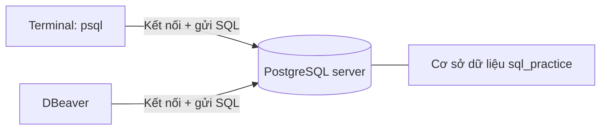

# Kết nối cơ sở dữ liệu bằng công cụ dòng lệnh và công cụ đồ họa

Khi học SQL, việc đầu tiên là **kết nối được đến cơ sở dữ liệu** để gửi câu lệnh và xem kết quả. Ta có thể làm việc qua **công cụ dòng lệnh (CLI)** như `psql`, hoặc qua **công cụ đồ họa (GUI)** như DBeaver, pgAdmin hay MySQL Workbench. Hai cách có giao diện khác nhau nhưng cùng thực hiện một việc: dùng thông tin kết nối để giao tiếp với hệ quản trị cơ sở dữ liệu (DBMS).

Bài này lấy **PostgreSQL** làm ví dụ thực hành chính, với `psql` ở dòng lệnh và **DBeaver** ở giao diện đồ họa. Cuối bài có cách đối chiếu với MySQL và SQLite. Nếu phòng thực hành sử dụng hệ quản trị khác, hãy thay công cụ, cổng và cú pháp tương ứng.

## 1. Hiểu kết nối trước khi thao tác

Một hệ thống cơ sở dữ liệu thường gồm hai phía:

- **Máy chủ cơ sở dữ liệu (database server):** nơi DBMS chạy, lưu bảng, thực thi SQL, quản lý người dùng và quyền truy cập.
- **Máy khách (database client):** phần mềm gửi yêu cầu đến máy chủ. Terminal chạy `psql` và ứng dụng DBeaver đều là máy khách.



Để kết nối, thông thường cần các thông số sau:

| Thông số | Ý nghĩa | Ví dụ PostgreSQL chạy trên máy cá nhân |
|---|---|---|
| **Host** | Máy đang chạy DBMS; tên máy hoặc địa chỉ IP | `127.0.0.1` |
| **Port** | Cổng dịch vụ DBMS lắng nghe | `5432` |
| **Database** | Tên cơ sở dữ liệu cần mở | `postgres` hoặc `sql_practice` |
| **Username** | Tài khoản đăng nhập DBMS | `postgres` hoặc tài khoản thực hành được cấp |
| **Password** | Mật khẩu của tài khoản trên | Mật khẩu đã thiết lập khi cài đặt/cấp tài khoản |
| **SSL/TLS** | Thiết lập mã hóa và xác thực kết nối nếu máy chủ yêu cầu | Theo cấu hình máy chủ |

`127.0.0.1` chỉ **chính máy đang chạy công cụ kết nối**. Nếu DBMS nằm trên máy khác, phải dùng đúng tên máy/IP có thể truy cập được. Trong Docker, `127.0.0.1` trên máy chủ host thường chỉ dùng được khi cổng container đã được công bố ra host; bên trong một container khác, ta thường dùng tên dịch vụ và cổng nội bộ.

**Phân biệt:** cài DBeaver hoặc `psql` không đồng nghĩa với việc đã có PostgreSQL server đang chạy. Bạn cần một server cục bộ, một container đã khởi động, hoặc một máy chủ được cấp quyền truy cập.

## 2. Chuẩn bị môi trường thực hành

Trong ví dụ tiếp theo, giả sử:

1. PostgreSQL server đang hoạt động trên máy của bạn và lắng nghe TCP tại `127.0.0.1:5432`.
2. Có tài khoản `postgres` và biết mật khẩu của tài khoản đó. Nếu lớp học cấp tài khoản khác, hãy thay tên tương ứng.
3. Máy có công cụ `psql` và DBeaver. Trên Windows, bản cài PostgreSQL thường có ứng dụng **SQL Shell (psql)**; nếu terminal không nhận lệnh `psql`, có thể mở SQL Shell hoặc bổ sung thư mục `bin` của PostgreSQL vào `PATH`.
4. Tài khoản được dùng có quyền tạo cơ sở dữ liệu cho bài tập, hoặc người quản trị đã tạo sẵn cơ sở dữ liệu thực hành.

Các giá trị `postgres`, `sql_practice`, `127.0.0.1` và `5432` bên dưới là **ví dụ**, không phải thông tin đăng nhập chung cho mọi máy. Không dán mật khẩu thực vào tài liệu, mã nguồn hay lệnh có thể được lưu vào lịch sử terminal.

## 3. Kết nối từ dòng lệnh với `psql`

### 3.1. Kiểm tra công cụ và mở kết nối

Mở Terminal trên Linux/macOS, PowerShell trên Windows hoặc SQL Shell (psql), rồi kiểm tra phiên bản máy khách:

```bash
psql --version
```

Kết nối tới cơ sở dữ liệu mặc định `postgres`:

```bash
psql -h 127.0.0.1 -p 5432 -U postgres -d postgres -W
```

Ý nghĩa các tham số:

| Tham số | Tác dụng |
|---|---|
| `-h 127.0.0.1` | Kết nối TCP đến địa chỉ máy chủ |
| `-p 5432` | Chọn cổng dịch vụ |
| `-U postgres` | Chọn tài khoản đăng nhập |
| `-d postgres` | Chọn cơ sở dữ liệu đích |
| `-W` | Yêu cầu nhập mật khẩu qua lời nhắc, không đưa mật khẩu vào dòng lệnh |

Sau khi nhập mật khẩu đúng, bạn sẽ vào dấu nhắc như `postgres=#` (hoặc `postgres=>` tùy quyền). Từ đây, lệnh SQL được gửi đến PostgreSQL server.

Chạy thử:

```sql
SELECT current_database() AS database_name,
       current_user AS login_user;

SELECT 1 AS connection_ok;
```

Nếu câu lệnh trả kết quả, bạn đã kết nối và thực thi được SQL. `current_database()` cho biết **database đang dùng**, còn `current_user` cho biết **tài khoản có hiệu lực** trong phiên kết nối.

### 3.2. Các lệnh điều khiển ngay trong `psql`

`psql` có những lệnh bắt đầu bằng dấu `\`. Chúng là **lệnh riêng của chương trình `psql`**, không phải cú pháp SQL phổ quát.

| Lệnh `psql` | Chức năng |
|---|---|
| `\conninfo` | Xem thông tin phiên kết nối hiện tại |
| `\l` | Liệt kê các cơ sở dữ liệu |
| `\c sql_practice` | Chuyển sang cơ sở dữ liệu `sql_practice` |
| `\dt` | Liệt kê các bảng nhìn thấy được trong schema đang tìm kiếm |
| `\d practice_students` | Xem định nghĩa bảng `practice_students` |
| `\q` | Thoát khỏi `psql` |

Chẳng hạn:

```text
postgres=# \conninfo
postgres=# \l
postgres=# \q
```

Với câu lệnh SQL, thông thường cần kết thúc bằng dấu chấm phẩy `;`; với lệnh `\` của `psql`, không cần dấu đó. Nếu bạn thấy dấu nhắc tiếp tục (`postgres-#`), hãy kiểm tra xem có đang thiếu dấu `;` hoặc dấu nháy đóng hay không.

### 3.3. Tạo cơ sở dữ liệu và bảng luyện tập

Kết nối lại đến database `postgres` bằng tài khoản có quyền tạo database. Chạy lệnh SQL sau một lần:

```sql
CREATE DATABASE sql_practice;
```

Lệnh `CREATE DATABASE` yêu cầu quyền thích hợp. Nếu hệ thống báo **permission denied**, hãy sử dụng database mà giảng viên/quản trị viên đã cấp. Nếu database `sql_practice` đã tồn tại, bỏ qua bước tạo mới.

Chuyển phiên `psql` sang database vừa tạo:

```text
\c sql_practice
```

Kiểm tra tên database rồi tạo một bảng nhỏ:

```sql
SELECT current_database();

CREATE TABLE practice_students (
    id INTEGER PRIMARY KEY,
    full_name VARCHAR(100) NOT NULL,
    enrolled_at DATE NOT NULL
);

INSERT INTO practice_students (id, full_name, enrolled_at)
VALUES
    (1, 'An', '2026-11-01'),
    (2, 'Bình', '2026-11-02');

SELECT id, full_name, enrolled_at
FROM practice_students
ORDER BY id;
```

Kết quả `SELECT` cần có hai dòng dữ liệu của An và Bình. Bạn có thể dùng `\dt` để xác nhận bảng đã xuất hiện và `\d practice_students` để xem cấu trúc cột, kiểu dữ liệu, khóa chính. Ví dụ tạo bảng chỉ chạy **một lần** trên cùng database; chạy lại khi bảng đã tồn tại sẽ nhận thông báo lỗi, nên hãy kiểm tra trạng thái thay vì xóa bảng tùy tiện.

Ngoài chế độ tương tác, `psql` cũng có thể chạy một truy vấn rồi tự thoát, hữu ích khi viết script hoặc kiểm tra kết nối:

```bash
psql -h 127.0.0.1 -p 5432 -U postgres -d sql_practice -W -c "SELECT COUNT(*) FROM practice_students;"
```

`-c` nhận câu lệnh SQL trên dòng lệnh. Sau khi truy vấn hoàn tất, chương trình trả kết quả về terminal và kết thúc.

## 4. Kết nối bằng công cụ đồ họa DBeaver

GUI phù hợp khi cần xem các database, schema, bảng, cột, dữ liệu và lịch sử truy vấn bằng thao tác trực quan. DBeaver hỗ trợ nhiều DBMS, nên cùng một phần mềm có thể tạo các kết nối PostgreSQL, MySQL, SQLite, v.v.

### 4.1. Tạo một connection PostgreSQL

1. Mở DBeaver, chọn **New Database Connection** (tùy phiên bản có thể thấy biểu tượng ổ cắm hoặc menu **Database → New Database Connection**).
2. Tìm và chọn **PostgreSQL**. Nếu phần mềm đề nghị tải **JDBC driver**, cho phép tải driver phù hợp khi có mạng.
3. Nhập các thông số kết nối theo môi trường thực tế:

   | Ô trong DBeaver | Giá trị cho ví dụ này |
   |---|---|
   | Host | `127.0.0.1` |
   | Port | `5432` |
   | Database | `sql_practice` |
   | Username | `postgres` |
   | Password | Nhập mật khẩu đã thiết lập |

4. Chọn **Test Connection**. Nếu thành công, chọn **Finish** để lưu connection; nếu lỗi, xem thông báo cụ thể trước khi sửa thông số.
5. Trong **Database Navigator**, mở connection mới và khám phá **Databases / Schemas / public / Tables** (tên nhóm hiển thị có thể khác giữa các phiên bản). Tìm bảng `practice_students`.

Nếu bạn chưa tạo `sql_practice` ở phần dòng lệnh, trước hết hãy kết nối GUI tới database `postgres` đã có sẵn. Trong SQL editor, người có quyền có thể chạy riêng lệnh `CREATE DATABASE sql_practice;` ở chế độ tự commit, rồi tạo một connection khác trỏ tới `sql_practice`. PostgreSQL không cho chạy `CREATE DATABASE` bên trong một transaction block, nên không gom lệnh này vào giao dịch nhiều câu lệnh.

### 4.2. Gửi SQL từ GUI

Trong Database Navigator, chọn connection `sql_practice`, mở **SQL Editor → New SQL Script**, rồi nhập:

```sql
SELECT current_database() AS database_name,
       current_user AS login_user;

SELECT id, full_name, enrolled_at
FROM practice_students
ORDER BY id;
```

Dùng nút **Execute SQL Statement** trên thanh công cụ để chạy câu lệnh đang chọn hoặc câu lệnh tại vị trí con trỏ. DBeaver thường hỗ trợ phím `Ctrl+Enter`, nhưng phím tắt có thể khác tùy hệ điều hành và cấu hình. Kết quả xuất hiện ở vùng **Results**; khi chọn một bảng trong Navigator, các thẻ **Properties**, **Data** hoặc tương tự giúp xem cấu trúc và dữ liệu mà không phải gõ SQL.

Hãy kiểm tra **connection/database đang được chọn trong SQL editor** trước khi chạy lệnh, nhất là khi cùng lúc mở môi trường thực hành và môi trường công việc. Một SQL editor có thể gắn với database khác với mục bạn vừa bấm trong cây điều hướng.

### 4.3. Phân biệt lưu, commit và đóng kết nối

- **Save script** lưu văn bản câu SQL để sử dụng lại; thao tác này **không** đồng nghĩa với việc thực thi hoặc lưu thay đổi dữ liệu.
- **Execute** gửi câu SQL đến DBMS. Với `SELECT`, bạn đọc dữ liệu; với `INSERT`, `UPDATE`, `DELETE`, bạn có thể làm thay đổi dữ liệu.
- **Commit/Rollback:** nếu GUI đang ở chế độ **Auto-commit**, thay đổi thường được xác nhận tự động khi câu lệnh thành công. Nếu **Auto-commit tắt**, bạn cần chủ động `COMMIT` hoặc `ROLLBACK` trước khi đóng kết nối, tùy mục đích.
- **Disconnect** chỉ ngắt phiên làm việc của client; không xóa database hay tắt PostgreSQL server.

Đặc biệt trong môi trường dùng chung, hãy xác nhận đúng host, database, tài khoản và trạng thái giao dịch trước khi sửa dữ liệu.

## 5. So sánh nhanh CLI và GUI

| Tiêu chí | Dòng lệnh, ví dụ `psql` | Giao diện đồ họa, ví dụ DBeaver |
|---|---|---|
| Cách thao tác | Gõ lệnh trong terminal | Chọn connection, xem cây đối tượng, mở SQL editor |
| Điểm mạnh | Gọn nhẹ, làm việc qua SSH, dễ lặp lại trong script | Dễ khám phá bảng/cột, đọc dữ liệu và nhiều kết quả truy vấn |
| Điểm cần lưu ý | Phải nhớ cú pháp lệnh của từng client | Phải chọn đúng connection, driver và chế độ transaction |
| Khi nào nên dùng | Kiểm tra nhanh, tự động hóa, hỗ trợ server không có giao diện | Học cấu trúc DB, viết và dò truy vấn, xem dữ liệu trực quan |

Không có cách nào làm cho SQL “mạnh hơn”: **quyền thực thi nằm ở tài khoản và DBMS**, không nằm ở việc dùng CLI hay GUI. Một tài khoản chỉ có quyền đọc sẽ không thể `INSERT` chỉ vì chuyển sang DBeaver.

## 6. Nếu hệ quản trị không phải PostgreSQL

Cú pháp kết nối và lệnh quản trị của từng client không hoàn toàn giống nhau:

| DBMS | Công cụ dòng lệnh thường dùng | GUI thường dùng | Cổng mặc định |
|---|---|---|---|
| PostgreSQL | `psql` | DBeaver, pgAdmin | `5432` |
| MySQL / MariaDB | `mysql` hoặc client tương thích | MySQL Workbench, DBeaver | `3306` |
| Microsoft SQL Server | `sqlcmd` | SQL Server Management Studio, DBeaver | `1433` khi dùng instance TCP mặc định đã cấu hình cổng này |
| SQLite | `sqlite3` | DB Browser for SQLite, DBeaver | Không có cổng mạng mặc định; thường mở file trực tiếp |

### Ví dụ MySQL

Giả sử MySQL server đang chạy cục bộ, tài khoản `learner` đã được cấp quyền và database `practice_db` đã tồn tại:

```bash
mysql -h 127.0.0.1 -P 3306 -u learner -p practice_db
```

Tham số `-P` viết hoa là **port**, còn `-p` viết thường yêu cầu **nhập mật khẩu**. Sau khi đăng nhập, có thể dùng:

```sql
SHOW DATABASES;
SELECT DATABASE(), USER();
SHOW TABLES;
```

Để thoát, gõ `exit` hoặc `quit`. Các lệnh `\dt`, `\conninfo` của `psql` không dùng được trong MySQL client. Trong MySQL Workbench hoặc DBeaver, tạo connection chọn loại **MySQL**, nhập host, port, username, password rồi **Test Connection** trước khi mở SQL editor.

### Ví dụ SQLite

SQLite thường lưu cơ sở dữ liệu vào **một file trên đĩa**, không cần PostgreSQL/MySQL server để kết nối:

```bash
sqlite3 practice.db
```

Trong SQLite shell:

```text
.databases
.tables
.schema
.quit
```

Lưu ý: `sqlite3 practice.db` **có thể tạo file mới** nếu file chưa tồn tại. Khi mở database được giao, hãy kiểm tra chính xác đường dẫn để tránh tưởng rằng một file mới rỗng là dữ liệu của bài tập. Với GUI như DB Browser for SQLite, chọn **Open Database** và trỏ đến đúng file `.db` hoặc `.sqlite`.

## 7. Lỗi kết nối thường gặp và cách xác định nguyên nhân

| Hiện tượng hoặc thông báo | Nguyên nhân có thể gặp | Cách xử lý phù hợp |
|---|---|---|
| `psql` không được nhận diện là lệnh | Chưa cài client hoặc thư mục thực thi chưa ở `PATH` | Mở SQL Shell (psql), cài client hoặc cấu hình `PATH` chính xác |
| `connection refused` | Server chưa chạy, sai host/cổng, cổng chưa được công bố từ container | Kiểm tra trạng thái DBMS, địa chỉ, port và cấu hình mạng |
| `connection timed out` | Không đến được server qua mạng/firewall hoặc server không phản hồi | Kiểm tra mạng, DNS, VPN được cấp và quy tắc truy cập với quản trị viên |
| `password authentication failed` | Sai username/password hoặc cơ chế xác thực không phù hợp | Kiểm tra tài khoản, nhập lại mật khẩu; nếu cần, nhờ quản trị viên kiểm tra cấu hình xác thực |
| `database ... does not exist` | Sai tên database hoặc database chưa được tạo | Kiểm tra tên chính xác và tạo bằng tài khoản đủ quyền nếu được phép |
| `permission denied` | Tài khoản thiếu quyền trên database, schema hoặc bảng | Dùng đúng tài khoản được cấp quyền; nhờ quản trị viên cấp quyền cần thiết |
| GUI báo thiếu driver | Chưa có driver phù hợp với DBMS | Cài/tải đúng driver trong trình quản lý driver của GUI |
| Lỗi chứng chỉ SSL/TLS | Thiết lập bảo mật không khớp yêu cầu server | Dùng cấu hình TLS và chứng chỉ do đơn vị vận hành cung cấp; không bỏ xác thực chứng chỉ để chữa lỗi ở môi trường thực |
| Kết nối được nhưng không thấy bảng | Đang chọn sai database/schema hoặc bộ lọc Navigator đang ẩn bảng | Kiểm tra `current_database()`, schema, bộ lọc và quyền xem bảng |

Khi xử lý lỗi, lần lượt kiểm tra: **server có chạy không → host/port có đúng và truy cập được không → database có tồn tại không → username/password có đúng không → tài khoản có quyền phù hợp không**. Nếu CLI và GUI dùng cùng thông số mà đều lỗi, thường cần tìm nguyên nhân ở server, tài khoản hoặc mạng; nếu chỉ một công cụ lỗi, hãy kiểm tra riêng driver và cấu hình của công cụ đó.

## 8. Thực hành đối chiếu giữa hai công cụ

Sau khi hoàn thành phần 3 và phần 4, thực hiện thử một vòng thao tác để xác nhận cả hai client đang nói chuyện với **cùng một database**:

1. Trong `psql`, chạy `SELECT current_database(), current_user;` và chắc chắn database là `sql_practice`.
2. Từ `psql`, thêm một dòng mới:

   ```sql
   INSERT INTO practice_students (id, full_name, enrolled_at)
   VALUES (3, 'Chi', '2026-11-03');
   ```

3. Trong DBeaver, mở SQL editor gắn với connection `sql_practice`, rồi chạy:

   ```sql
   SELECT id, full_name, enrolled_at
   FROM practice_students
   WHERE id = 3;
   ```

4. Nếu thấy dòng của Chi, dữ liệu do CLI ghi đã được GUI đọc qua một phiên kết nối khác. Nếu chưa thấy, kiểm tra database/schema đang chọn và xem thao tác ở client ghi đã **commit** hay chưa.
5. Từ DBeaver, chạy `SELECT COUNT(*) AS total_students FROM practice_students;`. Với dữ liệu mẫu của bài và không có thao tác khác, giá trị trả về là `3`.

Bạn có thể tự kiểm tra hiểu biết bằng ba câu hỏi: (1) Vì sao `psql` và DBeaver đều không kết nối được nếu server đang tắt? (2) Vì sao `\dt` chạy được trong `psql` nhưng không phải câu SQL chuẩn để đưa vào GUI? (3) Vì sao cùng host và port nhưng chọn sai database lại không nhìn thấy bảng của bài tập?

## 9. Thói quen an toàn khi làm việc với database

- **Giữ bí mật thông tin đăng nhập:** nhập mật khẩu qua lời nhắc hoặc ô mật khẩu của GUI; không gắn mật khẩu trực tiếp vào câu lệnh, file SQL chia sẻ, ảnh chụp màn hình hay kho Git. Nếu GUI hỗ trợ lưu mật khẩu, chỉ sử dụng trên máy được tin cậy theo quy định của môi trường.
- **Sử dụng tài khoản có quyền vừa đủ:** khi học truy vấn, tài khoản đọc dữ liệu hoặc tài khoản riêng cho database thực hành thường phù hợp hơn tài khoản quản trị toàn hệ thống.
- **Kiểm tra đích trước khi thay đổi dữ liệu:** xác nhận host, port, tên database và schema trước các lệnh `INSERT`, `UPDATE`, `DELETE`, `DROP`.
- **Ưu tiên kết nối mã hóa cho máy chủ từ xa:** tuân thủ yêu cầu TLS, chứng chỉ, VPN hoặc đường truyền được cấp. Không tự ý tắt xác thực chỉ để vượt qua lỗi cấu hình.
- **Chú ý trạng thái transaction:** dữ liệu chưa `COMMIT` có thể không hiển thị ở phiên kết nối khác; `ROLLBACK` hủy các thay đổi chưa được xác nhận trong giao dịch hiện tại.

Khi đã kết nối được bằng cả CLI và GUI, bạn có thể chuyển sang các bài thực hành SQL tiếp theo: tạo bảng, truy vấn với `SELECT`, lọc bằng `WHERE`, kết hợp bảng bằng `JOIN` và quản lý giao dịch. Điểm mấu chốt là biết **mình đang kết nối đến đâu, bằng tài khoản nào và câu SQL sẽ tác động vào database nào**.
