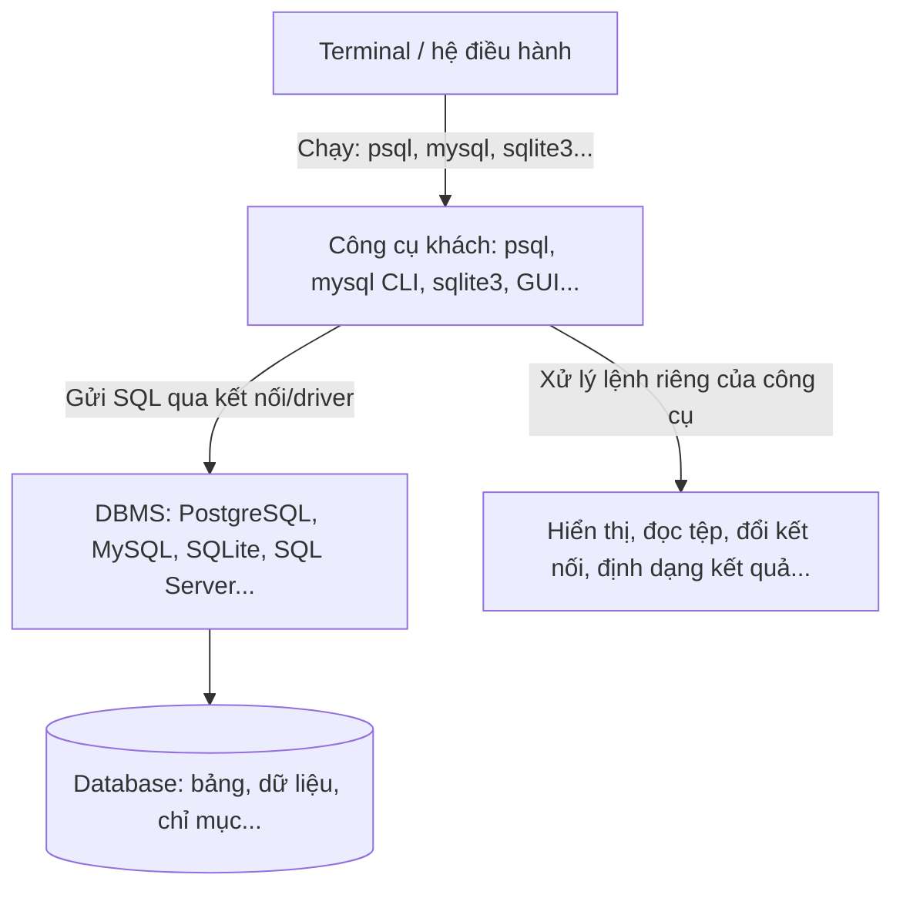
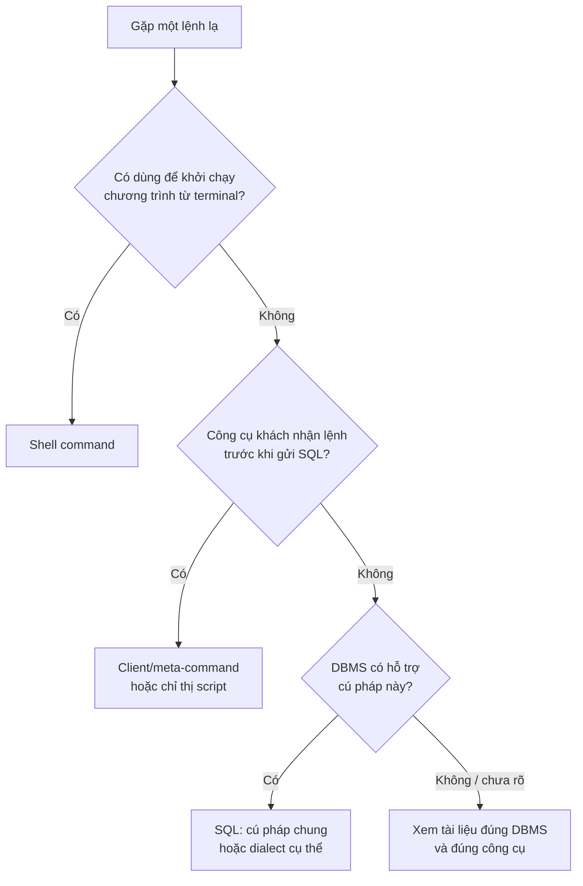

# Phân biệt lệnh SQL với lệnh riêng của công cụ khách

Khi bắt đầu thực hành SQL, bạn có thể gặp những câu lệnh trông rất khác nhau:

```sql
SELECT * FROM khach_hang;
```

```text
\dt
.tables
GO
```

Tất cả có thể xuất hiện trong một buổi làm việc với cơ sở dữ liệu, nhưng **chúng không được xử lý bởi cùng một thành phần**. `SELECT` là câu lệnh SQL gửi tới hệ quản trị cơ sở dữ liệu. `\dt` là lệnh riêng của chương trình dòng lệnh `psql`; `.tables` thuộc chương trình `sqlite3`; còn `GO` thường được công cụ của SQL Server hiểu là dấu kết thúc một *batch*. Đưa một lệnh riêng của công cụ khách vào trình điều khiển JDBC hoặc một công cụ khác thường gây lỗi cú pháp.

Bài học này giúp bạn phân biệt **SQL**, **cú pháp SQL riêng của từng hệ quản trị (SQL dialect)**, **lệnh điều khiển của công cụ khách (client command/meta-command)** và **lệnh của hệ điều hành (shell command)**. Bạn sẽ biết lệnh nào gửi tới máy chủ cơ sở dữ liệu, lệnh nào được xử lý tại nơi mình đang thao tác, và cách chuyển hướng khi đổi môi trường thực hành.

## 1. Bốn lớp dễ bị nhầm trong môi trường thực hành SQL

Một phiên làm việc có thể có các lớp sau:



Đường đi phổ biến là: mở chương trình khách từ terminal, công cụ khách kết nối tới DBMS, sau đó nhận câu lệnh SQL và chuyển cho DBMS xử lý. Nhưng ở từng lớp cũng tồn tại **các lệnh điều khiển riêng**.

| Loại lệnh | Ai hiểu và thực hiện? | Ví dụ | Mục đích |
| --- | --- | --- | --- |
| **SQL** | DBMS/SQL engine | `SELECT id FROM khach_hang;`, `CREATE TABLE ...` | Truy vấn và quản lý đối tượng, dữ liệu trong database. |
| **SQL dialect** | DBMS cụ thể | MySQL `SHOW TABLES;`; SQLite `PRAGMA table_info(khach_hang);` | Mở rộng hoặc biến thể SQL mà một hệ quản trị hỗ trợ. |
| **Client command / meta-command** | Chương trình khách đang sử dụng | `psql`: `\dt`; `sqlite3`: `.tables` | Điều khiển phiên khách, xuất kết quả, xem thông tin, tải tệp, hoặc tạo truy vấn hỗ trợ. |
| **Lệnh tách batch / chạy script** | Bộ đọc script của một công cụ | `GO` của `sqlcmd`/SSMS; `:r setup.sql` trong chế độ SQLCMD | Quy định cách công cụ chia hoặc nạp lệnh SQL. |
| **Shell command** | Terminal/hệ điều hành | `psql -U learner -d practice`, `sqlite3 practice.db` | Khởi chạy công cụ, truyền tham số kết nối, thao tác tệp/process. |

> **Nguyên tắc quan trọng:** Phân loại một lệnh theo **nơi thực thi và nơi phân tích cú pháp**, không chỉ dựa vào vẻ ngoài của nó. Lệnh bắt đầu bằng chữ tiếng Anh chưa chắc là SQL; lệnh có dấu chấm, dấu gạch chéo hay chữ hoa chưa chắc được DBMS hiểu.

### 1.1. SQL là ngôn ngữ gửi yêu cầu tới DBMS

Với SQL, bạn mô tả yêu cầu trên dữ liệu hoặc cấu trúc dữ liệu. Ví dụ:

```sql
CREATE TABLE khach_hang (
    id INTEGER PRIMARY KEY,
    ho_ten VARCHAR(100) NOT NULL
);

INSERT INTO khach_hang (id, ho_ten)
VALUES (1, 'An'), (2, 'Bình');

SELECT id, ho_ten
FROM khach_hang
WHERE id = 1;

UPDATE khach_hang
SET ho_ten = 'An Nguyễn'
WHERE id = 1;

DELETE FROM khach_hang
WHERE id = 2;
```

Các câu lệnh trên được xử lý theo cú pháp và quy tắc của **hệ quản trị cơ sở dữ liệu**, dù bạn gửi từ terminal, giao diện đồ họa hay chương trình Java. Cùng một lệnh có thể được gửi qua nhiều công cụ, miễn là hệ quản trị và ngữ cảnh tương ứng hỗ trợ cú pháp đó.

Các nhóm lệnh thường gặp gồm `SELECT` để truy vấn, `INSERT`/`UPDATE`/`DELETE` để thao tác dữ liệu và `CREATE`/`ALTER`/`DROP` để thay đổi cấu trúc.

### 1.2. SQL dialect cũng là SQL, nhưng chỉ được một số DBMS hỗ trợ

Các hệ quản trị không dùng duy nhất một bộ cú pháp hoàn toàn giống nhau. Mỗi hệ quản trị có những phần mở rộng hoặc khác biệt gọi là **SQL dialect**.

Ví dụ trong **MySQL**, lệnh sau được máy chủ MySQL xử lý:

```sql
SHOW TABLES;
```

Tuy nhiên, PostgreSQL không dùng cú pháp `SHOW TABLES` để liệt kê bảng. Đây là **SQL riêng của MySQL**, **không phải lệnh riêng của chương trình `mysql`**. Dù gõ từ ứng dụng Java kết nối tới MySQL thay vì chương trình `mysql`, cú pháp này vẫn có thể được máy chủ MySQL xử lý.

Một số ví dụ khác:

| Cú pháp | Thuộc về | Lưu ý |
| --- | --- | --- |
| `SELECT ... FROM ... WHERE ...` | SQL thông dụng | Cú pháp cơ bản được nhiều DBMS hỗ trợ. |
| `SHOW TABLES;` | SQL dialect của MySQL/MariaDB | Không phải meta-command của `mysql` CLI. |
| `DESCRIBE khach_hang;` | Câu lệnh mà MySQL hỗ trợ ở phía máy chủ | Không được suy ra rằng DBMS nào cũng hỗ trợ cách viết này. |
| `PRAGMA table_info('khach_hang');` | Cú pháp của SQLite | Được SQLite engine phân tích, khác lệnh dấu chấm của `sqlite3` CLI. |
| `SELECT current_database();` | SQL với hàm riêng của PostgreSQL | Câu lệnh `SELECT` dùng hàm có sẵn của PostgreSQL. |
| `USE practice;` | Câu lệnh phía máy chủ của MySQL/SQL Server | Không phải cách chuyển database của PostgreSQL `psql`. |

Cũng một từ có thể mang ý nghĩa khác nhau giữa các môi trường. Ví dụ `DESCRIBE khach_hang;` là lệnh được **MySQL server** hỗ trợ, nhưng `DESC khach_hang` trong SQL*Plus của Oracle là **lệnh công cụ khách**. Vì vậy, phải đọc tài liệu của đúng **DBMS và công cụ** đang dùng.

### 1.3. Meta-command là lệnh của công cụ khách

Công cụ dòng lệnh thường cung cấp các lệnh nhanh cho tác vụ tiện ích: xem danh sách bảng, đổi kết nối, chỉnh cách hiển thị, bật thời gian đo truy vấn hoặc chạy tệp SQL.

Ví dụ:

- `\dt`: hỏi chương trình **psql** liệt kê các bảng (theo ngữ cảnh và bộ lọc của psql).
- `.tables`: hỏi chương trình **sqlite3** liệt kê bảng.
- `\G`: dấu kết thúc truy vấn và yêu cầu trình bày kết quả theo dạng dọc trong **mysql CLI**.
- `\timing on`: bật thông báo thời gian thực thi trong **psql**.

Một meta-command có thể khiến chương trình khách **tự tạo một hoặc nhiều truy vấn SQL ở phía sau**. Điều đó không biến meta-command thành cú pháp SQL hợp lệ. Điều cần phân biệt là ai hiểu dòng lệnh **ban đầu**: `psql` hay máy chủ PostgreSQL.

### 1.4. Lệnh shell dùng để mở công cụ hoặc làm việc với máy tính

Ví dụ, khi đang ở terminal:

```bash
psql -h localhost -U learner -d practice
```

Đây là lệnh **shell** dùng để khởi động chương trình `psql` và chỉ định kết nối. Nó không phải truy vấn SQL. Sau khi `psql` mở thành công, bạn mới gõ SQL hoặc meta-command của `psql` vào dấu nhắc của chương trình.

Phân biệt hai môi trường gõ lệnh:

```text
Terminal (PowerShell/Bash):
    psql -U learner -d practice

Bên trong psql sau khi kết nối:
    SELECT current_database();
    \dt
```

Lệnh chạy đúng ở môi trường này có thể bị báo “không tìm thấy lệnh” hoặc “lỗi cú pháp” trong môi trường khác.

## 2. Ví dụ cụ thể với PostgreSQL và psql

**PostgreSQL** là hệ quản trị cơ sở dữ liệu; **psql** là công cụ dòng lệnh thường dùng để kết nối và làm việc với PostgreSQL. Tên của chúng có liên quan nhưng **không phải một thành phần**.

### 2.1. Khởi động psql từ terminal

Giả sử PostgreSQL đã chạy và bạn có tài khoản, database thử nghiệm phù hợp:

```bash
psql -h localhost -U learner -d practice
```

Dòng trên phải gõ ở **terminal của hệ điều hành**, không phải trong khung lệnh SQL. Sau khi kết nối, lời nhắc `psql` thường hiển thị tên database và cho phép nhập nội dung.

### 2.2. Truy vấn SQL gửi tới PostgreSQL

```sql
SELECT current_database();

SELECT
    table_schema,
    table_name
FROM information_schema.tables
WHERE table_schema = 'public'
  AND table_type = 'BASE TABLE'
ORDER BY table_name;
```

Hai câu lệnh này được gửi tới **PostgreSQL server**. Câu đầu dùng hàm riêng của PostgreSQL để lấy tên database hiện tại. Câu thứ hai truy vấn `information_schema`, một hệ thống view metadata được nhiều DBMS quan hệ hỗ trợ, để lấy tên bảng thường trong schema `public`; bộ lọc `public` là lựa chọn cụ thể cho ví dụ PostgreSQL.

### 2.3. Lệnh riêng của psql

Trong **psql**, bạn có thể nhập:

```text
\conninfo
\dt
\d khach_hang
\timing on
\x auto
\?
\h SELECT
```

| Lệnh psql | Ý nghĩa |
| --- | --- |
| `\conninfo` | Hiển thị thông tin kết nối hiện tại. |
| `\dt` | Liệt kê bảng theo phạm vi mặc định của psql; có thể dùng bộ lọc tên/schema. |
| `\d khach_hang` | Mô tả bảng hoặc đối tượng có tên phù hợp: cột, kiểu dữ liệu và các thông tin liên quan. |
| `\timing on` | Bật hiển thị thời gian thực thi câu lệnh. |
| `\x auto` | Tự chuyển sang cách hiển thị mở rộng khi thích hợp. |
| `\?` | Hiện trợ giúp cho meta-command của psql. |
| `\h SELECT` | Hiện trợ giúp cú pháp SQL mà psql cung cấp cho `SELECT`. |

Lưu ý: `\dt` **không phải** lệnh SQL của PostgreSQL. Nếu gửi chuỗi `\dt` tới PostgreSQL qua JDBC, máy chủ không có cú pháp SQL tương ứng để phân tích và có thể trả về lỗi tại ký tự `\`.

### 2.4. Chạy tệp bằng psql

Trong psql:

```text
\i ./setup.sql
```

Lệnh `\i` yêu cầu **psql đọc tệp** `setup.sql` ở phía công cụ khách, rồi xử lý nội dung tệp như đầu vào cho psql. Nội dung tệp có thể chứa các câu lệnh SQL và, trong ngữ cảnh psql, những meta-command thích hợp.

Đây là khác biệt quan trọng về vị trí tệp. Đường dẫn trong `\i` được hiểu ở **máy chạy psql**, không phải mặc định là đường dẫn trên máy chủ PostgreSQL. Nếu psql chạy trong container hoặc trên máy từ xa, hãy xét đường dẫn theo đúng môi trường chạy psql.

### 2.5. Phân biệt `\copy` với `COPY`

Một ví dụ dễ nhầm khác là xuất dữ liệu ra CSV.

**Lệnh riêng của psql**:

```text
\copy khach_hang TO './khach_hang.csv' WITH (FORMAT csv, HEADER true)
```

Đây là meta-command psql. Với dạng này, tệp CSV được xử lý ở **phía máy chạy psql**; psql trao đổi dữ liệu với PostgreSQL thông qua cơ chế COPY.

**Câu lệnh SQL của PostgreSQL**:

```sql
COPY khach_hang
TO '/path/on/database-server/khach_hang.csv'
WITH (FORMAT csv, HEADER true);
```

`COPY ... TO 'đường_dẫn'` là SQL do **PostgreSQL server** xử lý; đường dẫn tệp nằm trong môi trường máy chủ database và chịu kiểm tra quyền thích hợp. Hai cách thực hiện có khác biệt thực tế về **đường dẫn và quyền truy cập**, vì vậy không thể hoán đổi máy móc.

## 3. Ví dụ với MySQL và chương trình mysql

Tên **MySQL** thường chỉ hệ quản trị cơ sở dữ liệu. Chương trình khách dòng lệnh thông dụng cũng tên là `mysql`. Cần phân biệt hai vai trò này theo ngữ cảnh.

### 3.1. Mở mysql CLI từ terminal

```bash
mysql -u learner -p practice
```

Đây là **lệnh shell**: khởi động chương trình khách và yêu cầu mật khẩu theo cơ chế của công cụ. Không dán dòng này vào ô truy vấn SQL của một giao diện khác.

### 3.2. `SHOW TABLES` và `DESCRIBE` là lệnh phía máy chủ MySQL

Sau khi kết nối MySQL, hai lệnh sau hợp lệ nếu database và bảng tồn tại:

```sql
SHOW TABLES;

DESCRIBE khach_hang;
```

Chúng là **SQL dialect được MySQL hỗ trợ**. Máy chủ MySQL xử lý chúng; chúng không chỉ hoạt động trong `mysql` CLI.

Ngược lại, PostgreSQL không hỗ trợ `SHOW TABLES` theo cùng cú pháp. Nếu cần tác vụ tương đương ở PostgreSQL, có thể dùng `\dt` **trong psql** hoặc một truy vấn metadata phù hợp **gửi tới PostgreSQL**.

### 3.3. `\G` là dấu kết thúc lệnh của mysql CLI

Khi kết quả nhiều cột khó đọc theo hàng ngang, mysql CLI hỗ trợ hiển thị dạng dọc:

```text
SELECT * FROM khach_hang WHERE id = 1\G
```

Trong ví dụ này:

- `SELECT * FROM khach_hang WHERE id = 1` là phần truy vấn SQL.
- `\G` là dấu kết thúc/định dạng kết quả được **mysql CLI** hiểu để in dữ liệu theo chiều dọc.
- Không đưa `\G` vào chuỗi SQL gửi qua JDBC hoặc driver khác.

### 3.4. `source` và `DELIMITER` thuộc quy trình nhập lệnh của công cụ

Trong mysql CLI:

```text
source ./setup.sql
```

`source` yêu cầu công cụ khách đọc các lệnh từ một tệp tại môi trường chạy client. Nó không phải SQL gửi nguyên văn tới máy chủ.

Một trường hợp thường thấy khi tạo stored procedure trong mysql CLI là đổi dấu kết thúc lệnh:

```sql
DELIMITER $$

CREATE PROCEDURE vi_du()
BEGIN
    SELECT 1 AS gia_tri;
END$$

DELIMITER ;

CALL vi_du();
```

Ở đoạn này, `DELIMITER` là **chỉ thị của chương trình khách mysql**, dùng để công cụ biết khi nào một khối lệnh kết thúc. `CREATE PROCEDURE` và `CALL` thuộc SQL dialect của máy chủ MySQL. Phần `$$` sau `END` là dấu kết thúc mà mysql CLI đã được yêu cầu sử dụng; nó không phải một phần của thân SQL gửi tới MySQL server.

Một ứng dụng Java dùng JDBC không cần đặt `DELIMITER $$` trước khi gửi câu lệnh tạo procedure dưới dạng một lệnh thực thi phù hợp. Tương tự, các SQL editor có thể có cách xử lý delimiter hoặc script khác nhau.

## 4. Ví dụ với SQLite và chương trình sqlite3

**SQLite** là thư viện cơ sở dữ liệu nhúng có SQL engine. Chương trình **sqlite3** là công cụ dòng lệnh giúp thao tác với tệp database. Công cụ này dùng rất nhiều meta-command bắt đầu bằng dấu chấm (`.`).

### 4.1. Mở một database SQLite

Từ terminal:

```bash
sqlite3 practice.db
```

Trong chương trình sqlite3, nhập:

```text
.databases
.tables
.schema khach_hang
.headers on
.mode column
```

| Lệnh của sqlite3 CLI | Chức năng |
| --- | --- |
| `.databases` | Xem các database đang được gắn vào kết nối SQLite. |
| `.tables` | Liệt kê tên bảng/view theo cách trình bày của công cụ. |
| `.schema khach_hang` | Hiển thị SQL định nghĩa đối tượng khớp tên được yêu cầu. |
| `.headers on` | Bật in tên cột trong kết quả. |
| `.mode column` | Chọn cách hiển thị kết quả theo cột. |
| `.read ./setup.sql` | Đọc và thực thi nội dung script thông qua sqlite3 CLI. |
| `.quit` | Thoát chương trình sqlite3. |

Các dòng bắt đầu bằng dấu chấm là **lệnh của sqlite3 CLI**, không phải cú pháp SQL gửi vào SQLite engine. Một số dot-command có yêu cầu riêng về cách nhập và tách dòng; hãy sử dụng chúng ở lời nhắc sqlite3.

### 4.2. Hai cách xem cấu trúc khác nhau

Nếu đang dùng **sqlite3 CLI**, bạn có thể xem cấu trúc bằng:

```text
.schema khach_hang
```

Còn lệnh sau là cú pháp **phía SQLite engine**:

```sql
PRAGMA table_info('khach_hang');
```

`PRAGMA` là một cơ chế lệnh đặc thù của SQLite. Dù không thuộc cú pháp SQL chung của các DBMS, câu lệnh này vẫn được **SQLite phân tích và thực thi**, kể cả khi gửi từ một chương trình sử dụng thư viện SQLite phù hợp.

Bạn cũng có thể truy vấn metadata bằng SQL của SQLite:

```sql
SELECT name, type
FROM sqlite_schema
WHERE type IN ('table', 'view')
ORDER BY name;
```

Ví dụ này minh họa cách thay một lệnh tiện ích `.tables` bằng một câu truy vấn SQL trên metadata của SQLite. Hai cách không nhất thiết có tập kết quả và định dạng hoàn toàn giống nhau, vì `.tables` có cách lọc/trình bày riêng.

### 4.3. Lỗi khi chuyển môi trường

Trong lời nhắc sqlite3, `.tables` hợp lệ. Nếu dán `.tables` vào một chương trình Java rồi gọi trực tiếp `executeQuery(".tables")`, SQLite engine sẽ không hiểu lệnh đó như một câu truy vấn SQL.

Ngược lại, `SELECT name FROM sqlite_schema;` có thể chạy qua thư viện SQLite mà không cần mở chương trình sqlite3.

## 5. Ví dụ với SQL Server: `GO` không phải T-SQL

Với Microsoft SQL Server, bạn có thể thấy mã sau trong SQL Server Management Studio (SSMS) hoặc tiện ích dòng lệnh `sqlcmd`:

```sql
CREATE TABLE demo (
    id INT PRIMARY KEY
);
GO

INSERT INTO demo (id)
VALUES (1);
GO

SELECT * FROM demo;
GO
```

`CREATE TABLE`, `INSERT` và `SELECT` là các câu lệnh được SQL Server thực thi. **`GO` không phải câu lệnh Transact-SQL (T-SQL) mà SQL Server engine xử lý.** Trong những môi trường hỗ trợ nó, `GO` là dấu chia *batch*: công cụ tách văn bản thành các nhóm câu lệnh rồi gửi từng nhóm tới máy chủ.

Điều này giải thích tại sao một script chạy trong SSMS có thể báo lỗi khi được sao chép nguyên văn vào phương thức JDBC `Statement.execute(...)` hoặc một driver: driver không tự hiểu `GO` như SSMS.

Một lệnh khác của `sqlcmd` là:

```text
:r ./setup.sql
```

`:r` yêu cầu công cụ đọc nội dung từ một tệp. Trong SSMS, các chỉ thị `:r` chỉ có tác dụng khi dùng **SQLCMD Mode** thích hợp; editor SQL bình thường không nhất thiết chấp nhận chúng.

**Phân biệt thêm:** `USE practice;` trong SQL Server là lệnh T-SQL để chọn database theo ngữ cảnh kết nối; nó được server xử lý. Từ việc `GO` và `USE` có thể xuất hiện gần nhau trong cùng script không thể suy ra chúng đều là một loại lệnh.

## 6. Ví dụ với Oracle SQL*Plus

Một số công cụ khác sử dụng cú pháp riêng rất gần với SQL. SQL*Plus của Oracle là ví dụ:

| Dòng nhập trong SQL*Plus | Loại lệnh | Ý nghĩa |
| --- | --- | --- |
| `SELECT * FROM khach_hang;` | SQL | Gửi truy vấn tới Oracle Database. |
| `DESCRIBE khach_hang` | SQL*Plus command | Xem mô tả cột đối tượng trong giao diện SQL*Plus. |
| `SET LINESIZE 120` | SQL*Plus command | Chỉnh độ rộng trình bày kết quả của công cụ. |
| `@setup.sql` | SQL*Plus command | Nạp và thực thi script thông qua SQL*Plus. |
| `/` trên một dòng riêng | SQL*Plus command | Thực thi lại nội dung SQL/PLSQL đang nằm trong SQL buffer của SQL*Plus. |

Từ khóa `DESCRIBE` trong **SQL*Plus** không nên mặc nhiên được coi là cùng một thứ với `DESCRIBE` phía máy chủ **MySQL**. Tên gọi giống nhau nhưng trách nhiệm và trình phân tích cú pháp có thể khác nhau.

Nếu chạy mã Oracle trong công cụ khác (ví dụ một SQL editor kết nối Oracle qua JDBC), hãy xác định công cụ đó hỗ trợ những chỉ thị SQL*Plus nào; đừng giả định mọi editor kết nối Oracle đều hiểu `@script.sql` hoặc `SET LINESIZE`.

## 7. Giao diện đồ họa có thể che khuất ranh giới

Trong các ứng dụng như DBeaver, DataGrip, pgAdmin hoặc SSMS, người học thường nhập mọi thứ vào một “SQL editor”. Nhưng giao diện có thể thực hiện **nhiều thao tác khác nhau**:

- **Chạy một câu SQL:** gửi yêu cầu tới DBMS qua kết nối hiện tại.
- **Chạy nhiều câu SQL dưới dạng script:** công cụ trước hết chia văn bản theo quy tắc của nó, sau đó gửi các câu/batch riêng.
- **Mở danh sách bảng trong cây điều hướng:** công cụ tự lấy metadata qua API hoặc truy vấn nội bộ; người dùng không nhất thiết đã thực thi lệnh SQL nào trong editor.
- **Xuất kết quả CSV:** công cụ ghi tệp ở máy khách từ dữ liệu truy vấn, không có nghĩa DBMS đã thực thi lệnh SQL ghi ra đường dẫn đó.
- **Đổi kết nối hoặc chọn schema:** đôi khi là cấu hình phiên ở client, đôi khi công cụ còn gửi câu lệnh SQL tương ứng; cần dựa vào hành vi được tài liệu hóa.

Vì thế, việc một chương trình có nút “Run SQL” **không bảo đảm** chương trình đó chấp nhận mọi lệnh của psql, sqlite3, mysql CLI hay sqlcmd.

Ví dụ, bạn thấy danh sách bảng sau khi nhập `\dt` trong `psql`. Khi chuyển sang SQL editor khác kết nối tới PostgreSQL, bạn có thể:

1. Mở cây database/schema/table do giao diện cung cấp.
2. Chạy một truy vấn metadata phù hợp với PostgreSQL.
3. Dùng lệnh liệt kê bảng riêng mà **editor mới** hỗ trợ, nếu có tài liệu xác nhận.

Không nên chép nguyên `\dt` sang editor mới rồi mặc định nó sẽ hoạt động.

## 8. Dấu chấm phẩy và cách công cụ tách câu lệnh

Một nguồn nhầm lẫn lớn là dấu `;`. Với nhiều SQL client, dấu chấm phẩy dùng để đánh dấu kết thúc câu lệnh nhập vào, nhưng **cách công cụ đọc và gửi lệnh khác nhau**.

Xét script:

```sql
SELECT 1 AS gia_tri;
SELECT 2 AS gia_tri;
```

Một số công cụ tách thành hai yêu cầu gửi tới server. Một số API/driver chỉ nhận một câu lệnh hoặc có quy tắc riêng với nhiều câu lệnh. Dấu `;` cũng có thể nằm trong chuỗi ký tự hoặc khối chương trình; bộ tách script cần hiểu ngữ cảnh thay vì chỉ cắt theo mọi dấu chấm phẩy xuất hiện.

Ví dụ:

```sql
SELECT 'a;b' AS van_ban;
```

Dấu `;` nằm **trong chuỗi** `'a;b'` không phải dấu kết thúc câu lệnh.

Đối chiếu các môi trường:

| Môi trường | Dấu/điều khiển thường gặp | Ai xử lý? |
| --- | --- | --- |
| psql | `;` kết thúc câu SQL; `\g` có thể gửi buffer SQL đang nhập | psql điều khiển thời điểm gửi; server phân tích SQL. |
| sqlite3 CLI | `;` hoàn tất SQL; lệnh `.tables` là dòng meta-command riêng | sqlite3 CLI xử lý giao diện, SQLite engine xử lý SQL. |
| mysql CLI | `;` hoặc `\G` làm dấu kết thúc; `DELIMITER` đổi dấu kết thúc cho client | mysql CLI xử lý dấu kết thúc, MySQL server xử lý SQL. |
| SSMS/sqlcmd | `GO` trên dòng riêng tách batch | Công cụ nhận biết `GO`, SQL Server xử lý T-SQL từng batch. |
| JDBC | `execute(...)` gửi câu lệnh cho driver/DBMS theo API | Không tự hiểu meta-command của CLI hay `GO`. |

### Vì sao `GO` không giống `;`?

`;` có vai trò dấu kết thúc câu lệnh trong cú pháp SQL của nhiều hệ thống (mức độ bắt buộc tùy cú pháp và API). Ngược lại, `GO` là **chỉ thị chia batch của một số công cụ**. Máy chủ SQL Server không yêu cầu `GO` như một từ khóa trong T-SQL. Một batch có thể chứa nhiều câu lệnh T-SQL.

### Vì sao `DELIMITER` không gửi nguyên văn tới MySQL?

Trình nhập lệnh của mysql CLI cần nhận ra điểm kết thúc toàn bộ câu lệnh, đặc biệt khi thân procedure có các dấu `;`. `DELIMITER` thay đổi quy tắc của **client parser**; câu lệnh `CREATE PROCEDURE` thực tế mới là nội dung MySQL server nhận. Do đó, khi xây dựng lời gọi SQL từ JDBC, bạn phải tạo câu lệnh theo API của driver thay vì chép toàn bộ cú pháp script của mysql CLI.

## 9. Khi viết chương trình Java/JDBC, cần gửi loại lệnh nào?

Một chương trình Java thường làm việc với SQL qua JDBC: tạo kết nối, chuẩn bị câu lệnh và thực thi. Ví dụ ý tưởng sau sử dụng bảng `khach_hang` và một `Connection` đã được mở thành công:

```java
String sql = "SELECT id, ho_ten FROM khach_hang WHERE id = ?";

try (PreparedStatement statement = connection.prepareStatement(sql)) {
    statement.setInt(1, 1);

    try (ResultSet rows = statement.executeQuery()) {
        while (rows.next()) {
            System.out.println(rows.getInt("id")
                + " - " + rows.getString("ho_ten"));
        }
    }
}
```

Nội dung `SELECT ... WHERE id = ?` là một câu truy vấn SQL dạng tham số hóa theo API JDBC. Dấu `?` là **parameter marker** được JDBC driver xử lý theo giao thức của DBMS tương ứng; đây không phải meta-command của CLI. `PreparedStatement` cho phép truyền giá trị tham số qua API, thay vì nối dữ liệu trực tiếp vào câu SQL.

Ngược lại, các cách dưới đây không phải câu SQL phù hợp để gửi trực tiếp qua JDBC:

```java
// Sai môi trường: meta-command của psql.
statement.execute("\\dt");

// Sai môi trường: dot-command của sqlite3 CLI.
statement.execute(".tables");

// Sai môi trường: chỉ thị batch của SSMS/sqlcmd.
statement.execute("SELECT 1; GO");

// Sai môi trường: chỉ thị delimiter của mysql CLI.
statement.execute("DELIMITER $$");
```

Ví dụ trên minh họa **sai loại lệnh**, không phải ví dụ thực thi nên dùng. Để xem metadata một cách độc lập hơn với SQL dialect, JDBC cung cấp `DatabaseMetaData`, trong đó có API như `getTables(...)` và `getColumns(...)`; muốn truy vấn dữ liệu thực tế thì dùng SQL mà DBMS đã kết nối hỗ trợ.

Nếu ứng dụng cần chạy một tệp script chứa nhiều câu lệnh, hãy dùng công cụ chạy migration/script hiểu đúng dialect và quy tắc tách lệnh tương ứng; đừng giả định `Statement.execute` có thể hiểu mọi định dạng script từ terminal.

## 10. Cách nhận biết lệnh đang thuộc loại nào

Khi gặp một dòng mới trên tài liệu, video hoặc terminal, hãy lần lượt hỏi:

1. **Dòng này được gõ ở đâu?** Terminal của hệ điều hành, lời nhắc psql/mysql/sqlite3 hay ô SQL editor?
2. **Ai phân tích cú pháp dòng đó?** Shell, chương trình client, bộ chạy script, JDBC driver hay DBMS?
3. **Lệnh tác động vào cái gì?** Dữ liệu/schema trên server, thông tin kết nối, cấu hình hiển thị hay tệp cục bộ?
4. **Tài liệu mô tả lệnh ở đâu?** SQL reference của DBMS, mục “client commands/meta-commands” của công cụ, hay tài liệu terminal?
5. **Khi đổi công cụ, có cách tương đương nào?** SQL metadata, UI hoặc API chuẩn của driver có thể thay thế chức năng tiện ích mà không cần giữ nguyên ký hiệu.



Cây quyết định này là cách đặt câu hỏi khi nghiên cứu lệnh mới; không phải mọi môi trường đều để lộ chính xác cách gửi lệnh. Ví dụ một ứng dụng GUI có thể tự thực hiện truy vấn metadata mà không in SQL ra màn hình.

### Bảng tra nhanh theo thao tác

| Nhu cầu | Ví dụ đúng theo môi trường | Điều cần nhớ |
| --- | --- | --- |
| Liệt kê bảng ở psql | `\dt` | Meta-command của **psql**. |
| Liệt kê bảng ở PostgreSQL qua SQL | `SELECT table_name FROM information_schema.tables WHERE table_schema = 'public';` | Truy vấn metadata trên **PostgreSQL**. |
| Liệt kê bảng ở MySQL | `SHOW TABLES;` | SQL dialect phía **MySQL server**. |
| Liệt kê bảng ở sqlite3 CLI | `.tables` | Dot-command của **sqlite3**. |
| Liệt kê bảng SQLite qua SQL | `SELECT name FROM sqlite_schema WHERE type = 'table';` | SQL phía **SQLite engine**. |
| Xem cột qua psql | `\d khach_hang` | Lệnh phía **psql**. |
| Xem cột qua MySQL SQL | `DESCRIBE khach_hang;` | Lệnh phía **MySQL server**. |
| Xem cột qua SQLite SQL | `PRAGMA table_info('khach_hang');` | SQLite-specific SQL. |
| Bật đo thời gian ở psql | `\timing on` | Thay đổi cách **psql** báo thời gian. |
| Hiển thị kết quả dọc ở mysql CLI | `SELECT * FROM khach_hang\G` | `\G` là dấu định dạng của **client**. |
| Chạy script ở psql | `\i ./setup.sql` | Client đọc tệp script. |
| Chạy script ở sqlite3 CLI | `.read ./setup.sql` | Client đọc tệp script. |
| Chạy script ở sqlcmd | `:r ./setup.sql` | Chỉ thị của **sqlcmd**. |
| Chia batch trong SSMS/sqlcmd | `GO` | Công cụ tách batch; **không phải T-SQL**. |

## 11. Lỗi thường gặp khi sao chép lệnh giữa các môi trường

### Trường hợp A: `\dt` lỗi trong ứng dụng Java kết nối PostgreSQL

**Hiện tượng:** đưa `\dt` vào một câu lệnh JDBC và nhận lỗi cú pháp gần ký tự `\`.

**Nguyên nhân:** `\dt` chỉ được psql hiểu. JDBC gửi SQL tới PostgreSQL và không xử lý meta-command của psql.

**Cách xử lý:** nếu dùng psql, chạy `\dt` trực tiếp trong psql. Nếu đang lập trình Java, dùng truy vấn metadata PostgreSQL hoặc `DatabaseMetaData` của JDBC.

### Trường hợp B: `SHOW TABLES;` lỗi trên PostgreSQL

**Hiện tượng:** cùng một lệnh chạy trên MySQL nhưng không chạy trên PostgreSQL.

**Nguyên nhân:** `SHOW TABLES` là cú pháp phía máy chủ mà MySQL hỗ trợ, không phải cú pháp SQL thống nhất giữa các DBMS.

**Cách xử lý:** dùng truy vấn metadata tương ứng với PostgreSQL, hoặc `\dt` nếu đang ở psql.

### Trường hợp C: `.tables` lỗi trong SQL editor kết nối SQLite

**Hiện tượng:** trình soạn thảo gửi `.tables` tới SQLite engine và bị báo lỗi cú pháp.

**Nguyên nhân:** `.tables` thuộc sqlite3 CLI, còn editor đang gửi trực tiếp câu SQL.

**Cách xử lý:** dùng giao diện xem bảng của editor hoặc truy vấn `sqlite_schema` bằng SQL.

### Trường hợp D: script có `GO` lỗi khi chạy từ JDBC

**Hiện tượng:** nội dung copy từ SSMS chạy lỗi ở gần chữ `GO`.

**Nguyên nhân:** `GO` được SSMS/sqlcmd dùng để chia batch; SQL Server không phân tích nó như lệnh T-SQL.

**Cách xử lý:** chia script thành các batch thích hợp trước khi gọi API hoặc dùng bộ chạy script hỗ trợ `GO`. Cần giữ đúng ranh giới batch nếu lệnh T-SQL phụ thuộc phạm vi batch.

### Trường hợp E: `DELIMITER $$` lỗi ở MySQL driver

**Hiện tượng:** script tạo stored procedure chạy trong mysql CLI nhưng lỗi khi được gửi thẳng qua driver.

**Nguyên nhân:** `DELIMITER` là lệnh của mysql CLI để đọc script; máy chủ MySQL không dùng câu lệnh này.

**Cách xử lý:** gửi phần `CREATE PROCEDURE ...` như một câu lệnh theo driver/runner thích hợp; cấu hình bộ chạy script để hiểu cách chia câu lệnh, nếu cần.

### Trường hợp F: lệnh xuất tệp có đường dẫn nhưng không tạo tệp ở máy mình

**Hiện tượng:** chạy `COPY ... TO '/path/file.csv'` trên PostgreSQL, nhưng không thấy tệp tại máy mở terminal.

**Nguyên nhân:** SQL `COPY` với đường dẫn file làm việc với đường dẫn phía server; trong khi `\copy` của psql xử lý tệp ở máy khách.

**Cách xử lý:** xác định tệp thuộc máy chạy **server** hay **client**, kiểm tra quyền phù hợp và chọn lệnh đúng yêu cầu.

### Trường hợp G: gõ `psql -U ...` ngay trong lời nhắc psql

**Hiện tượng:** chương trình không thực hiện “kết nối lại” như kỳ vọng.

**Nguyên nhân:** `psql -U ...` là lệnh **khởi chạy chương trình từ terminal**, không phải lệnh bên trong phiên psql.

**Cách xử lý:** muốn khởi chạy phiên khác, quay về terminal; muốn đổi kết nối ngay trong psql, tham khảo meta-command `\connect` hoặc `\c` theo cách sử dụng của psql.

## 12. Bài thực hành: phân loại đúng để chạy đúng

Với mỗi dòng dưới đây, hãy thử xác định: **(A) SQL/SQL dialect phía DBMS**, **(B) client/meta-command hoặc chỉ thị script**, hay **(C) shell command**.

| STT | Dòng lệnh | Môi trường xuất hiện |
| ---: | --- | --- |
| 1 | `SELECT COUNT(*) FROM khach_hang;` | SQL editor |
| 2 | `\dt` | psql |
| 3 | `SHOW TABLES;` | MySQL |
| 4 | `sqlite3 practice.db` | Terminal |
| 5 | `.schema khach_hang` | sqlite3 CLI |
| 6 | `PRAGMA table_info('khach_hang');` | SQLite |
| 7 | `GO` | sqlcmd/SSMS |
| 8 | `psql -U learner -d practice` | Terminal |
| 9 | `SELECT * FROM khach_hang WHERE id = 1\G` | mysql CLI |
| 10 | `DESCRIBE khach_hang;` | MySQL server |
| 11 | `\i ./setup.sql` | psql |
| 12 | `SELECT current_database();` | PostgreSQL |

**Đáp án và giải thích:**

| STT | Phân loại | Vì sao? |
| ---: | --- | --- |
| 1 | **A** | `SELECT` được SQL engine xử lý. |
| 2 | **B** | `\dt` do psql hiểu. |
| 3 | **A** | `SHOW TABLES` là SQL dialect MySQL. |
| 4 | **C** | `sqlite3` được khởi động ở terminal. |
| 5 | **B** | `.schema` là dot-command của sqlite3 CLI. |
| 6 | **A** | `PRAGMA` được SQLite engine xử lý. |
| 7 | **B** | `GO` là dấu batch của sqlcmd/SSMS. |
| 8 | **C** | Lệnh shell để chạy psql. |
| 9 | **A + B** | `SELECT ...` là SQL; `\G` là phần kết thúc/định dạng của mysql CLI. |
| 10 | **A** | `DESCRIBE` được MySQL server hỗ trợ. |
| 11 | **B** | `\i` yêu cầu psql đọc script từ tệp. |
| 12 | **A** | `SELECT` gọi hàm `current_database()` của PostgreSQL. |

### Tình huống thực tế 1: đổi từ psql sang Java

Bạn dùng `\dt` để thấy bảng `khach_hang` trong psql. Giờ cần hiển thị danh sách bảng đó trong ứng dụng Java dùng JDBC.

**Hướng giải quyết:** truy vấn metadata bằng `DatabaseMetaData#getTables(...)`, hoặc dùng truy vấn SQL trên catalog phù hợp với DBMS. Đừng truyền nguyên chuỗi `\dt` cho `PreparedStatement`.

### Tình huống thực tế 2: học theo video MySQL nhưng đang dùng PostgreSQL

Video hướng dẫn gõ `SHOW TABLES;`; khi bạn chạy ở PostgreSQL thì báo lỗi.

**Hướng giải quyết:** xác định video đang dùng MySQL dialect. Trong psql, dùng `\dt`; trong một SQL editor kết nối PostgreSQL, dùng truy vấn `information_schema` hoặc xem cây bảng của giao diện.

### Tình huống thực tế 3: chạy tệp SQL có nhiều dòng

Bạn nhận tệp `setup.sql` có các khối kết thúc bằng `GO`. Bạn dự định dùng một chương trình Java để chạy tệp.

**Hướng giải quyết:** nhận ra đây có thể là script dành cho công cụ SQL Server. Chọn bộ thực thi script hiểu `GO`, hoặc chia batch thích hợp theo ngữ nghĩa của SQL Server rồi gửi từng batch; không gửi nguyên toàn bộ văn bản cho JDBC với kỳ vọng SQL Server tự hiểu `GO`.

## 13. Lựa chọn cách thực hành phù hợp

Một quy trình dễ áp dụng khi học SQL:

1. **Xác định DBMS:** PostgreSQL, MySQL, SQLite, SQL Server, Oracle... Phiên bản và dialect ảnh hưởng đến cú pháp SQL.
2. **Xác định công cụ khách:** psql, mysql CLI, sqlite3 CLI, sqlcmd, SQL*Plus hoặc một GUI SQL editor.
3. **Chọn đúng môi trường nhập lệnh:** lệnh shell ở terminal; meta-command trong chương trình tương ứng; SQL trong vùng gửi truy vấn tới DBMS.
4. **Phân biệt mục tiêu thao tác:** tìm dữ liệu dùng SQL; xem metadata có thể dùng SQL, API hoặc giao diện; bật định dạng kết quả hoặc đọc tệp thường là tính năng của client.
5. **Khi chuyển môi trường, chuyển theo chức năng:** muốn “liệt kê bảng” thì tìm cách làm của môi trường mới, thay vì sao chép lệnh cũ theo ký tự.
6. **Khi viết ứng dụng, ưu tiên API và SQL do DBMS hỗ trợ:** chọn JDBC metadata hoặc SQL thích hợp; với script phức tạp dùng một bộ chạy script có quy tắc parser rõ ràng.

Bạn có thể ghi nhớ bằng câu hỏi: **“Ai là người đọc lệnh này đầu tiên?”** Nếu là terminal, đó thường là lệnh shell; nếu là psql/sqlite3/mysql CLI, có thể là lệnh riêng của client; nếu chuỗi lệnh được gửi qua kết nối để database engine phân tích, đó là SQL theo dialect của DBMS.

> **Kết luận:** Cùng một môi trường học cơ sở dữ liệu có thể xuất hiện SQL, SQL dialect, meta-command và lệnh shell. SQL/SQL dialect do DBMS thực thi; meta-command và chỉ thị script do công cụ khách xử lý; lệnh shell do hệ điều hành xử lý. Phân biệt được nơi thực thi sẽ giúp bạn đọc tài liệu đúng, sửa lỗi cú pháp nhanh hơn và chuyển từ terminal sang SQL editor hoặc Java/JDBC một cách chính xác.
