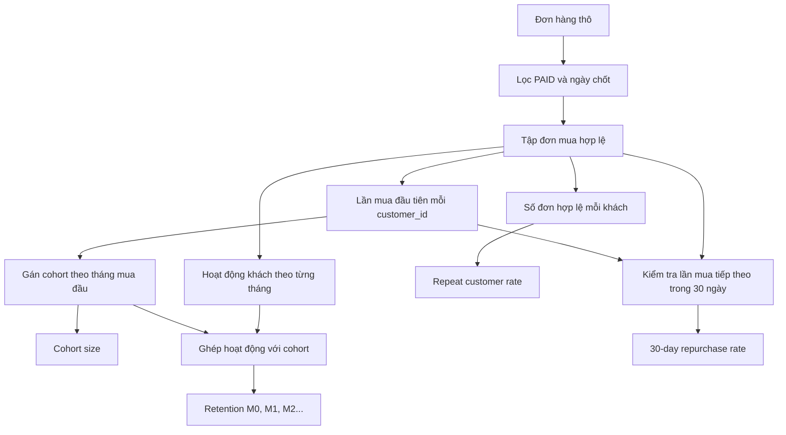

# Phân tích nhóm khách hàng và tỷ lệ quay lại

## 1. Bài toán: không chỉ đếm khách hàng đã mua hai lần

Một cửa hàng có hàng nghìn khách hàng. Nhóm phân tích muốn biết:

- Trong số những khách đã mua, **bao nhiêu người mua lần thứ hai**?
- Khách có **lần mua đầu tiên trong tháng 1** có quay lại mua ở tháng 2, tháng 3 hay tháng 4 không?
- Khách có đơn thứ hai **trong 30 ngày sau lần mua đầu** chiếm bao nhiêu phần trăm?
- Trong tháng này, người mua là **khách mới** hay **khách đã mua từ tháng trước**?
- Các cohort khách mới có đang cải thiện theo thời gian hay chỉ vì cohort cũ được quan sát lâu hơn?

Những câu hỏi có vẻ giống nhau nhưng **không có cùng định nghĩa chỉ số**. Một khách đặt hai đơn trong cùng ngày đã là khách **mua lặp lại** theo định nghĩa “có ít nhất hai đơn”, nhưng chưa chắc được tính là **quay lại trong tháng tiếp theo**. Một khách có lần mua đầu mới cách đây ba ngày chưa có cơ hội được quan sát đủ 30 ngày; tính họ vào mẫu số 30 ngày có thể làm giảm tỷ lệ một cách giả tạo.

Trong SQL, lời giải thường kết hợp:

- `GROUP BY` để tổng hợp đến **một hàng mỗi khách** hoặc **một hàng mỗi cohort**.
- `MIN` hoặc `ROW_NUMBER` để xác định **lần mua đầu tiên**.
- `DATE_TRUNC`/hàm ngày tháng để tạo cohort theo tuần, tháng hoặc quý.
- `COUNT(DISTINCT customer_id)` để đếm **khách duy nhất**, tránh một người có nhiều đơn làm tăng tỷ lệ.
- `JOIN`/CTE để gắn tháng hoạt động với cohort tháng đầu.
- `EXISTS` hoặc window function để xác định **lần mua thứ hai**.
- Cửa sổ quan sát cố định để so sánh các cohort công bằng.

Bài học triển khai một mẫu phân tích khách hàng hoàn chỉnh bằng **PostgreSQL**: bắt đầu từ dữ liệu mẫu có trạng thái đơn, đi tới bảng retention theo cohort, tỷ lệ mua lặp lại toàn tập, tỷ lệ 30 ngày, phân loại khách mới/khách cũ và những lưu ý triển khai thực tế.

---

## 2. Phân biệt các thuật ngữ nền tảng

| Khái niệm | Ý nghĩa | Ví dụ |
| --- | --- | --- |
| **Customer** | Một khách duy nhất theo khóa định danh được thống nhất | `customer_id = 1` |
| **First purchase** | Đơn mua **hợp lệ đầu tiên** của khách | Khách 1 mua ngày 05/01 |
| **Cohort** | Nhóm khách có chung thời điểm hoặc sự kiện bắt đầu | Cohort mua đầu tháng 01/2026 |
| **Repeat customer** | Khách có ít nhất **hai đơn mua hợp lệ**, theo định nghĩa đang chọn | Một khách đặt đơn 05/01 và 20/01 |
| **Repeat customer rate** | Số khách mua lặp lại / số khách thuộc tập đủ điều kiện | 7 khách mua lặp lại / 10 khách đã mua |
| **Retention tháng M1** | Trong cohort mua đầu tháng M0, tỷ lệ khách có hoạt động hợp lệ ở **tháng lịch tiếp theo** | Khách mua đầu tháng 01, có mua trong tháng 02 |
| **30-day repurchase rate** | Tỷ lệ khách có đơn mua **tiếp theo trong 30 ngày** sau lần đầu, tính trong các khách đã có đủ thời gian quan sát | Đơn thứ hai sau 15 ngày |
| **New customer tháng T** | Khách có **lần mua hợp lệ đầu tiên** trong tháng T | Mua đầu ngày 10/03 |
| **Returning customer tháng T** | Khách hoạt động ở tháng T nhưng đã mua lần đầu **trước tháng T** | Mua đầu tháng 01, tiếp tục mua tháng 03 |
| **Observation window** | Khoảng thời gian dữ liệu được phép sử dụng để tính chỉ số | Đến hết ngày 30/06/2026 |
| **Right censoring** | Chưa đủ thời gian quan sát phần tương lai cần thiết | Cohort tháng 06 chưa quan sát được tháng 07 |

**Lưu ý thuật ngữ:** Trong sản phẩm phân tích, “retention” đôi khi tính theo **đăng nhập**, **mở app**, **đặt đơn**, **đơn đã thanh toán** hoặc một hành vi khác. Bài này quy ước **hoạt động = phát sinh ít nhất một đơn `PAID` hợp lệ**. Nếu thay sự kiện hoạt động, cần đổi nguồn dữ liệu và diễn giải tên chỉ số.

## 3. Chốt định nghĩa trước khi viết SQL

Một báo cáo đáng tin cậy phải trả lời ít nhất sáu câu hỏi.

1. **Đơn nào hợp lệ?** Ở đây chỉ tính `order_status = 'PAID'`. Đơn `CANCELLED` và `REFUNDED` không được tính vào hành vi mua hợp lệ.
2. **Đơn vị khách hàng là gì?** Một `customer_id` nhất quán, không phải địa chỉ email hoặc số lần đăng nhập.
3. **Cohort bắt đầu từ sự kiện nào?** Ở đây từ **thời điểm mua `PAID` đầu tiên**, không phải ngày đăng ký tài khoản.
4. **Một tháng được tính thế nào?** Tháng lịch theo múi giờ nghiệp vụ. Ví dụ chính dùng cột `TIMESTAMP` đã chuẩn hóa về một múi giờ chung.
5. **Ngày chốt dữ liệu là gì?** Chọn cố định **30/06/2026** để mọi bảng kết quả trong bài có thể tái lập, không phụ thuộc ngày máy tính đang chạy.
6. **Có tính khách chưa đủ tuổi quan sát không?** Với chỉ số 30 ngày, chỉ tính những khách đã có đủ **30 ngày sau lần mua đầu**.

Không nên viết SQL xong rồi mới đặt tên tỷ lệ. Tên chỉ số, tử số, mẫu số, thời điểm chốt và quy tắc dữ liệu hợp lệ phải **được chốt trước**.

### 3.1. Sơ đồ luồng dữ liệu



Mỗi nhánh trả lời **một câu hỏi khác nhau**. Không nên dùng một chỉ số chung cho cả ba nhánh cuối.

---

## 4. Dữ liệu mẫu: 11 khách, nhiều nhịp mua hàng

Ta tạo hai bảng trên PostgreSQL.

```sql
CREATE TABLE cohort_customers (
    customer_id INTEGER PRIMARY KEY,
    customer_name VARCHAR(80) NOT NULL,
    signed_up_on DATE NOT NULL
);

CREATE TABLE cohort_orders (
    order_id INTEGER PRIMARY KEY,
    customer_id INTEGER NOT NULL
        REFERENCES cohort_customers(customer_id),
    ordered_at TIMESTAMP NOT NULL,
    amount NUMERIC(12, 2) NOT NULL CHECK (amount >= 0),
    order_status VARCHAR(20) NOT NULL
);
```

Thêm khách:

```sql
INSERT INTO cohort_customers
    (customer_id, customer_name, signed_up_on)
VALUES
    ( 1, 'An',    '2025-12-10'),
    ( 2, 'Bình',  '2026-01-10'),
    ( 3, 'Chi',   '2026-01-20'),
    ( 4, 'Dung',  '2026-01-30'),
    ( 5, 'Em',    '2026-02-01'),
    ( 6, 'Giang', '2026-02-11'),
    ( 7, 'Hòa',   '2026-03-01'),
    ( 8, 'Ích',   '2026-03-12'),
    ( 9, 'Khoa',  '2026-04-10'),
    (10, 'Lan',   '2026-04-12'),
    (11, 'Minh',  '2026-06-05');
```

Thêm đơn (mã đơn chỉ là khóa định danh; **không sử dụng mã đơn để suy đoán ngày mua**):

```sql
INSERT INTO cohort_orders
    (order_id, customer_id, ordered_at, amount, order_status)
VALUES
    -- Khách 1: có mua lặp lại ngay trong tháng 1;
    -- quay lại tháng 2 và tháng 4.
    ( 101,  1, '2026-01-05 09:00:00', 100, 'PAID'),
    ( 102,  1, '2026-01-20 10:00:00',  60, 'PAID'),
    ( 103,  1, '2026-02-10 11:00:00',  80, 'PAID'),
    ( 104,  1, '2026-04-03 12:00:00',  50, 'PAID'),

    -- Khách 2: lần mua thứ hai sau hơn 30 ngày.
    ( 201,  2, '2026-01-20 09:00:00', 200, 'PAID'),
    ( 202,  2, '2026-02-22 14:00:00',  50, 'PAID'),
    ( 203,  2, '2026-03-11 15:00:00',  60, 'PAID'),

    -- Khách 3: chỉ có một đơn PAID;
    -- đơn REFUNDED không được tính như một lần quay lại.
    ( 301,  3, '2026-01-31 16:00:00',  80, 'PAID'),
    ( 302,  3, '2026-02-15 09:00:00',  20, 'REFUNDED'),

    -- Khách 4: hai đơn tháng 2, một đơn tháng 4.
    ( 401,  4, '2026-02-02 08:00:00', 120, 'PAID'),
    ( 402,  4, '2026-02-15 18:00:00',  30, 'PAID'),
    ( 403,  4, '2026-04-01 12:00:00',  90, 'PAID'),

    -- Khách 5: mua cuối tháng 2 rồi đầu tháng 3;
    -- quay lại tiếp tháng 5.
    ( 501,  5, '2026-02-28 10:00:00', 150, 'PAID'),
    ( 502,  5, '2026-03-02 10:00:00', 100, 'PAID'),
    ( 503,  5, '2026-05-10 10:00:00',  70, 'PAID'),

    -- Khách 6: hai đơn cùng timestamp và một đơn sau đó,
    -- nhưng tất cả đều ở tháng đầu tiên.
    ( 601,  6, '2026-03-10 09:00:00', 200, 'PAID'),
    ( 602,  6, '2026-03-10 09:00:00',  50, 'PAID'),
    ( 603,  6, '2026-03-17 12:00:00',  50, 'PAID'),

    -- Khách 7: tháng 3 rồi quay lại tháng 4.
    ( 701,  7, '2026-03-28 08:00:00',  90, 'PAID'),
    ( 702,  7, '2026-04-20 13:00:00', 110, 'PAID'),

    -- Khách 8: một đơn PAID và một đơn bị hủy.
    ( 801,  8, '2026-04-10 10:00:00',  75, 'PAID'),
    ( 802,  8, '2026-05-14 09:00:00',  25, 'CANCELLED'),

    -- Khách 9: lần mua tiếp theo sau 31 ngày.
    ( 901,  9, '2026-05-05 09:00:00',  60, 'PAID'),
    ( 902,  9, '2026-06-05 09:00:00',  90, 'PAID'),

    -- Khách 10: chưa có đơn PAID.
    (1001, 10, '2026-04-16 08:00:00',  40, 'CANCELLED'),

    -- Khách 11: cohort tháng 6 còn rất mới
    -- tại thời điểm chốt 30/06.
    (1101, 11, '2026-06-20 10:00:00',  45, 'PAID');
```

### 4.1. Các trường hợp quan trọng

| Khách | Lần mua PAID đầu | Diễn biến | Ý nghĩa kiểm chứng |
| --- | --- | --- | --- |
| 1 — An | 05/01 | Tháng 1, 1, 2, 4 | Mua lặp lại trong M0 **và** quay lại M1/M3 |
| 2 — Bình | 20/01 | Tháng 1, 2, 3 | Retention M1 tốt nhưng lần mua thứ hai sau **33 ngày** |
| 3 — Chi | 31/01 | Một đơn PAID; một REFUNDED | Không phải repeat customer theo định nghĩa bài |
| 4 — Dung | 02/02 | Hai đơn tháng 2, quay lại tháng 4 | Mua lặp lại nhưng **retention M1 = 0** |
| 5 — Em | 28/02 | Tháng 2, 3, 5 | Đơn thứ hai chỉ cách hai ngày dù khác tháng |
| 6 — Giang | 10/03 | Ba đơn đều trong tháng 3 | Repeat customer nhưng **không quay lại M1** |
| 7 — Hòa | 28/03 | Tháng 3, 4 | Quay lại M1, trong 30 ngày |
| 8 — Ích | 10/04 | Một PAID, một CANCELLED | Không được tính quay lại vì đơn bị hủy |
| 9 — Khoa | 05/05 | Tháng 5, 6 | Mua lặp lại, nhưng cách **31 ngày** |
| 10 — Lan | Chưa có | Chỉ có CANCELLED | Không thuộc purchase cohort |
| 11 — Minh | 20/06 | Một PAID | Chưa đủ 30 ngày quan sát đến 30/06 |

### 4.2. Ngày chốt dùng trong toàn bài

Đặt quy ước:

```sql
WITH params AS (
    SELECT DATE '2026-06-30' AS as_of_date
)
SELECT as_of_date
FROM params;
```

Khi lọc cột `ordered_at` kiểu `TIMESTAMP`, muốn lấy **trọn ngày 30/06** nên dùng khoảng nửa mở:

```sql
ordered_at < TIMESTAMP '2026-07-01 00:00:00'
```

Không viết:

```sql
ordered_at <= TIMESTAMP '2026-06-30 00:00:00'
```

vì cách sau chỉ bao gồm đúng thời điểm đầu ngày 30/06, bỏ các đơn phát sinh phần còn lại của ngày.

---

## 5. Bước đầu tiên: tạo nguồn đơn hợp lệ

Mọi chỉ số sau phải sử dụng **cùng quy tắc đơn hợp lệ**. Đây là cách tránh trường hợp cohort được tính từ `PAID` nhưng hoạt động quay lại lại được đếm từ cả `CANCELLED`.

```sql
WITH params AS (
    SELECT DATE '2026-06-30' AS as_of_date
),
paid_orders AS (
    SELECT
        o.order_id,
        o.customer_id,
        o.ordered_at,
        o.amount
    FROM cohort_orders AS o
    CROSS JOIN params AS p
    WHERE o.order_status = 'PAID'
      AND o.ordered_at < p.as_of_date + INTERVAL '1 day'
)
SELECT
    COUNT(*) AS paid_order_count,
    COUNT(DISTINCT customer_id) AS paying_customers,
    SUM(amount) AS paid_amount
FROM paid_orders;
```

Kết quả của bộ dữ liệu mẫu:

| paid_order_count | paying_customers | paid_amount |
| ---: | ---: | ---: |
| 23 | 10 | 2010 |

Giải thích:

- Tổng bảng nguồn có **26** hàng đơn, nhưng chỉ **23** hàng là `PAID`.
- Có **11 khách đã đăng ký**, nhưng chỉ **10 khách có mua `PAID`**.
- Khách 10 có một đơn `CANCELLED`, không được coi là khách đã mua.
- Doanh thu minh họa `2010` là tổng `amount` của các đơn `PAID`.

**Chú ý nghiệp vụ:** Một hệ thống thật có thể phải xử lý hoàn tiền **một phần**, chargeback, đơn chưa hoàn tất, thanh toán thất bại hoặc tách đơn. Quy ước `PAID` ở đây chỉ là giả định để học SQL. Nếu hệ thống chỉ hoàn lại một phần tiền, việc loại cả đơn có trạng thái `REFUNDED` có thể không đúng với chỉ số *net revenue*; khi đó cần mô hình sự kiện tiền và định nghĩa riêng.

## 6. Chọn đúng đơn vị phân tích: customer grain

**Grain** là đơn vị mà **một hàng kết quả** đại diện.

| Grain | Một hàng đại diện cho | Dùng để |
| --- | --- | --- |
| Order grain | Một đơn hàng duy nhất (`order_id`) | Tìm thứ tự mua, số đơn và tổng tiền |
| Customer grain | Một khách duy nhất (`customer_id`) | Repeat customer rate |
| Customer-month grain | Một khách trong một tháng | Retention, khách mới/khách quay lại |
| Cohort-month grain | Một cohort ở một khoảng tháng kể từ lần mua đầu | Ma trận retention |
| Cohort grain | Một cohort | Cohort size và tỷ lệ mua lặp lại của cohort |

Nếu dùng `COUNT(*)` ở **order grain** để tính tỷ lệ **khách**, khách có nhiều đơn sẽ có trọng số lớn hơn khách chỉ mua một lần. Đây là lỗi thường gặp nhất trong phân tích hành vi khách hàng.

### 6.1. Kiểm tra số đơn theo khách

```sql
SELECT
    o.customer_id,
    COUNT(*) AS paid_order_count,
    SUM(o.amount) AS total_paid_amount
FROM cohort_orders AS o
WHERE o.order_status = 'PAID'
  AND o.ordered_at < TIMESTAMP '2026-07-01'
GROUP BY o.customer_id
ORDER BY o.customer_id;
```

Kết quả:

| customer_id | paid_order_count | total_paid_amount |
| ---: | ---: | ---: |
| 1 | 4 | 290 |
| 2 | 3 | 310 |
| 3 | 1 | 80 |
| 4 | 3 | 240 |
| 5 | 3 | 320 |
| 6 | 3 | 300 |
| 7 | 2 | 200 |
| 8 | 1 | 75 |
| 9 | 2 | 150 |
| 11 | 1 | 45 |

Đây là tập dữ liệu **một hàng trên mỗi khách đã mua**. Khách 10 không có hàng trong bảng vì không có đơn `PAID`.

---

## 7. Xác định lần mua đầu tiên bằng MIN

Để tạo cohort theo lần mua đầu, cần tính `first_paid_at` cho từng `customer_id`:

```sql
WITH paid_orders AS (
    SELECT customer_id, ordered_at
    FROM cohort_orders
    WHERE order_status = 'PAID'
      AND ordered_at < TIMESTAMP '2026-07-01'
)
SELECT
    customer_id,
    MIN(ordered_at) AS first_paid_at,
    DATE_TRUNC('month', MIN(ordered_at))::date AS cohort_month
FROM paid_orders
GROUP BY customer_id
ORDER BY customer_id;
```

Kết quả:

| customer_id | first_paid_at | cohort_month |
| ---: | --- | --- |
| 1 | 2026-01-05 09:00 | 2026-01-01 |
| 2 | 2026-01-20 09:00 | 2026-01-01 |
| 3 | 2026-01-31 16:00 | 2026-01-01 |
| 4 | 2026-02-02 08:00 | 2026-02-01 |
| 5 | 2026-02-28 10:00 | 2026-02-01 |
| 6 | 2026-03-10 09:00 | 2026-03-01 |
| 7 | 2026-03-28 08:00 | 2026-03-01 |
| 8 | 2026-04-10 10:00 | 2026-04-01 |
| 9 | 2026-05-05 09:00 | 2026-05-01 |
| 11 | 2026-06-20 10:00 | 2026-06-01 |

**`MIN(ordered_at)` xác định thời điểm đầu tiên**, không nhất thiết xác định `order_id` của lần mua đầu nếu hai đơn có cùng timestamp.

### 7.1. Nếu cần đúng một bản ghi “đơn đầu”

Dùng `ROW_NUMBER` với một khóa phụ duy nhất:

```sql
WITH paid_orders AS (
    SELECT
        order_id,
        customer_id,
        ordered_at,
        amount
    FROM cohort_orders
    WHERE order_status = 'PAID'
      AND ordered_at < TIMESTAMP '2026-07-01'
),
numbered AS (
    SELECT
        order_id,
        customer_id,
        ordered_at,
        amount,
        ROW_NUMBER() OVER (
            PARTITION BY customer_id
            ORDER BY ordered_at ASC, order_id ASC
        ) AS purchase_sequence
    FROM paid_orders
)
SELECT
    customer_id,
    order_id AS first_order_id,
    ordered_at AS first_paid_at,
    amount AS first_order_amount
FROM numbered
WHERE purchase_sequence = 1
ORDER BY customer_id;
```

Với khách 6, hai đơn `601` và `602` có **cùng thời điểm**, nên `order_id ASC` chọn `601` làm đơn đầu để có quy tắc nhất quán.

### 7.2. Vì sao không dùng MIN(order_id) để xác định ngày đầu?

Mã đơn có thể được tạo từ các nguồn khác nhau hoặc nhập hồi tố. Không có bảo đảm `order_id` nhỏ hơn thì `ordered_at` sớm hơn. Vì vậy, luôn chọn **cột thời gian nghiệp vụ được định nghĩa**, rồi dùng khóa phụ để xử lý đồng hạng.

---

## 8. Gán khách vào cohort

Cohort theo tháng mua đầu:

```sql
WITH first_purchases AS (
    SELECT
        customer_id,
        DATE_TRUNC('month', MIN(ordered_at))::date AS cohort_month
    FROM cohort_orders
    WHERE order_status = 'PAID'
      AND ordered_at < TIMESTAMP '2026-07-01'
    GROUP BY customer_id
)
SELECT
    cohort_month,
    COUNT(*) AS cohort_size
FROM first_purchases
GROUP BY cohort_month
ORDER BY cohort_month;
```

Kết quả:

| cohort_month | cohort_size |
| --- | ---: |
| 2026-01-01 | 3 |
| 2026-02-01 | 2 |
| 2026-03-01 | 2 |
| 2026-04-01 | 1 |
| 2026-05-01 | 1 |
| 2026-06-01 | 1 |

**Cohort size** là số khách **có lần mua đầu trong tháng đó**, không phải tổng đơn của tháng đó.

### 8.1. Cohort đăng ký khác cohort mua đầu

Nếu lấy:

```sql
DATE_TRUNC('month', signed_up_on)::date
```

từ `cohort_customers`, ta đang phân tích **registration cohort**. Nó có thể gồm cả khách 10, người chưa từng có đơn hợp lệ.

Nếu lấy:

```sql
DATE_TRUNC('month', MIN(ordered_at))::date
```

từ các đơn `PAID`, ta có **purchase cohort** — chỉ gồm khách đã mua. Chỉ số retention tạo từ hai định nghĩa **không thể so sánh trực tiếp** vì mẫu số và sự kiện bắt đầu khác nhau.

**Hỏi rõ:** “Nhóm khách hàng” là nhóm theo **ngày đăng ký**, **ngày mua đầu**, **nguồn acquisition**, **chiến dịch** hay **phân khúc giá trị**? Bài này sử dụng purchase cohort theo tháng.

## 9. Gắn mỗi đơn với cohort của khách

Cohort được xác định ở cấp khách, rồi gắn lại từng đơn để biết hoạt động diễn ra sau bao lâu.

```sql
WITH paid_orders AS (
    SELECT
        order_id,
        customer_id,
        ordered_at,
        amount
    FROM cohort_orders
    WHERE order_status = 'PAID'
      AND ordered_at < TIMESTAMP '2026-07-01'
),
first_purchases AS (
    SELECT
        customer_id,
        DATE_TRUNC('month', MIN(ordered_at))::date AS cohort_month
    FROM paid_orders
    GROUP BY customer_id
)
SELECT
    o.order_id,
    o.customer_id,
    f.cohort_month,
    DATE_TRUNC('month', o.ordered_at)::date AS activity_month,
    o.amount
FROM paid_orders AS o
JOIN first_purchases AS f
    ON f.customer_id = o.customer_id
ORDER BY o.customer_id, o.ordered_at, o.order_id;
```

Một số hàng quan trọng:

| customer_id | order_id | cohort_month | activity_month | amount |
| ---: | ---: | --- | --- | ---: |
| 1 | 101 | 2026-01-01 | 2026-01-01 | 100 |
| 1 | 102 | 2026-01-01 | 2026-01-01 | 60 |
| 1 | 103 | 2026-01-01 | 2026-02-01 | 80 |
| 1 | 104 | 2026-01-01 | 2026-04-01 | 50 |
| 4 | 401 | 2026-02-01 | 2026-02-01 | 120 |
| 4 | 402 | 2026-02-01 | 2026-02-01 | 30 |
| 4 | 403 | 2026-02-01 | 2026-04-01 | 90 |
| 6 | 601 | 2026-03-01 | 2026-03-01 | 200 |
| 6 | 602 | 2026-03-01 | 2026-03-01 | 50 |

Một khách có thể có **nhiều hàng trong cùng activity_month**. Chúng rất hữu ích để tính **số đơn** hoặc **doanh thu**, nhưng khi đo tỷ lệ khách quay lại cần **đếm khách duy nhất**.

---

## 10. Tạo customer-month: một khách hoạt động tối đa một lần mỗi tháng

Đây là bước bảo vệ chỉ số retention khỏi bị nhân bởi số đơn.

```sql
WITH paid_orders AS (
    SELECT
        customer_id,
        ordered_at
    FROM cohort_orders
    WHERE order_status = 'PAID'
      AND ordered_at < TIMESTAMP '2026-07-01'
)
SELECT DISTINCT
    customer_id,
    DATE_TRUNC('month', ordered_at)::date AS activity_month
FROM paid_orders
ORDER BY customer_id, activity_month;
```

Ví dụ kết quả của khách 1:

| customer_id | activity_month |
| ---: | --- |
| 1 | 2026-01-01 |
| 1 | 2026-02-01 |
| 1 | 2026-04-01 |

Dù khách 1 có **hai đơn trong tháng 1**, customer-month tháng 1 chỉ có **một hàng**.

Khách 6 có **ba đơn trong tháng 3** nhưng customer-month của họ chỉ có **một hàng tháng 3**. Điều này rất quan trọng: khách 6 được tính là **một khách hoạt động M0**, không phải ba khách.

### 10.1. DISTINCT và GROUP BY đều có thể tạo customer-month

Tương đương về tập khóa:

```sql
SELECT
    customer_id,
    DATE_TRUNC('month', ordered_at)::date AS activity_month
FROM cohort_orders
WHERE order_status = 'PAID'
  AND ordered_at < TIMESTAMP '2026-07-01'
GROUP BY
    customer_id,
    DATE_TRUNC('month', ordered_at)::date;
```

Nếu cần thêm số đơn/doanh thu trong tháng, dùng `GROUP BY` với các hàm tổng:

```sql
SELECT
    customer_id,
    DATE_TRUNC('month', ordered_at)::date AS activity_month,
    COUNT(*) AS orders_in_month,
    SUM(amount) AS amount_in_month
FROM cohort_orders
WHERE order_status = 'PAID'
  AND ordered_at < TIMESTAMP '2026-07-01'
GROUP BY
    customer_id,
    DATE_TRUNC('month', ordered_at)::date;
```

**Phân biệt:**

- `COUNT(*)` của bảng customer-month = số khách-tháng, **không phải** số đơn.
- `SUM(orders_in_month)` = số đơn.
- `COUNT(DISTINCT customer_id)` theo activity_month = số khách hoạt động trong tháng.

## 11. Chỉ số thứ nhất: Repeat customer rate

Định nghĩa trong bài:

\[
\text{Repeat customer rate} =
\frac{\text{Số khách có ít nhất 2 đơn PAID}}
     {\text{Số khách có ít nhất 1 đơn PAID}}
\times 100\%
\]

Đây là **tỷ lệ khách có mua lặp lại tính đến ngày chốt**, **không giới hạn** 30 ngày hoặc yêu cầu mua sang tháng sau.

### 11.1. SQL tính từng khách

```sql
WITH paid_orders AS (
    SELECT customer_id, order_id
    FROM cohort_orders
    WHERE order_status = 'PAID'
      AND ordered_at < TIMESTAMP '2026-07-01'
),
customer_stats AS (
    SELECT
        customer_id,
        COUNT(DISTINCT order_id) AS paid_order_count
    FROM paid_orders
    GROUP BY customer_id
)
SELECT
    customer_id,
    paid_order_count,
    CASE
        WHEN paid_order_count >= 2 THEN 1
        ELSE 0
    END AS is_repeat_customer
FROM customer_stats
ORDER BY customer_id;
```

Kết quả:

| customer_id | paid_order_count | is_repeat_customer |
| ---: | ---: | ---: |
| 1 | 4 | 1 |
| 2 | 3 | 1 |
| 3 | 1 | 0 |
| 4 | 3 | 1 |
| 5 | 3 | 1 |
| 6 | 3 | 1 |
| 7 | 2 | 1 |
| 8 | 1 | 0 |
| 9 | 2 | 1 |
| 11 | 1 | 0 |

Có **7 repeat customers** trên **10 paying customers**.

### 11.2. SQL tính tỷ lệ toàn tập

```sql
WITH customer_stats AS (
    SELECT
        customer_id,
        COUNT(*) AS paid_order_count
    FROM cohort_orders
    WHERE order_status = 'PAID'
      AND ordered_at < TIMESTAMP '2026-07-01'
    GROUP BY customer_id
)
SELECT
    COUNT(*) AS paying_customers,
    COUNT(*) FILTER (
        WHERE paid_order_count >= 2
    ) AS repeat_customers,
    ROUND(
        100.0 * COUNT(*) FILTER (
            WHERE paid_order_count >= 2
        ) / NULLIF(COUNT(*), 0),
        2
    ) AS repeat_customer_rate_pct
FROM customer_stats;
```

Kết quả:

| paying_customers | repeat_customers | repeat_customer_rate_pct |
| ---: | ---: | ---: |
| 10 | 7 | 70.00 |

`NULLIF(COUNT(*), 0)` tránh chia cho 0 nếu chưa có khách nào mua. Khi mẫu số bằng 0, tỷ lệ có thể trả `NULL` — nên hiển thị **N/A** thay vì tự khẳng định 0% nếu nghiệp vụ chưa quy định.

### 11.3. Vì sao không dùng số đơn làm mẫu số?

Trong bộ dữ liệu có **23 đơn PAID**, nhưng chỉ **10 khách mua**. Định nghĩa ở đây đo **tỷ lệ khách**, không đo **tỷ lệ đơn**.

Nếu định nghĩa riêng “tỷ lệ đơn mua lặp lại” là số đơn sau đơn đầu tiên của từng khách / tổng đơn, ta có:

- Mỗi khách đã mua có **một** đơn đầu: 10 đơn.
- Số đơn thứ hai trở đi: `23 - 10 = 13` đơn.
- Tỷ lệ đơn mua lặp lại theo định nghĩa đó: `13 / 23 ≈ 56,52%`.

Đây **không phải** repeat customer rate 70%. Không dùng hai tên thay thế nhau.

## 12. Repeat customer rate theo cohort

Có thể tính tỷ lệ đã từng mua lặp lại **riêng cho từng tháng mua đầu**, đến cùng một ngày chốt.

```sql
WITH paid_orders AS (
    SELECT customer_id, ordered_at, order_id
    FROM cohort_orders
    WHERE order_status = 'PAID'
      AND ordered_at < TIMESTAMP '2026-07-01'
),
customer_stats AS (
    SELECT
        customer_id,
        DATE_TRUNC('month', MIN(ordered_at))::date AS cohort_month,
        COUNT(DISTINCT order_id) AS paid_order_count
    FROM paid_orders
    GROUP BY customer_id
)
SELECT
    cohort_month,
    COUNT(*) AS cohort_size,
    COUNT(*) FILTER (
        WHERE paid_order_count >= 2
    ) AS repeat_customers,
    ROUND(
        100.0 * COUNT(*) FILTER (
            WHERE paid_order_count >= 2
        ) / NULLIF(COUNT(*), 0),
        2
    ) AS repeat_rate_pct
FROM customer_stats
GROUP BY cohort_month
ORDER BY cohort_month;
```

Kết quả:

| cohort_month | cohort_size | repeat_customers | repeat_rate_pct |
| --- | ---: | ---: | ---: |
| 2026-01-01 | 3 | 2 | 66.67 |
| 2026-02-01 | 2 | 2 | 100.00 |
| 2026-03-01 | 2 | 2 | 100.00 |
| 2026-04-01 | 1 | 0 | 0.00 |
| 2026-05-01 | 1 | 1 | 100.00 |
| 2026-06-01 | 1 | 0 | 0.00 |

### 12.1. Cảnh báo về so sánh các cohort có tuổi đời khác nhau

Cohort tháng 1 đã được quan sát gần sáu tháng, còn cohort tháng 6 mới được quan sát từ ngày 20/06 đến 30/06. Tỷ lệ 0% của cohort tháng 6 **không đủ căn cứ kết luận** chất lượng khách tháng 6 kém hơn.

Tỷ lệ “đã từng mua lại tính đến hôm nay” của cohort cũ **có nhiều thời gian tăng lên hơn**. Khi so cohort, cần dùng cửa sổ cố định như **30 ngày**, **60 ngày** hoặc so cùng chỉ số **M1, M2** ở những cohort đã đủ thời gian quan sát.

## 13. Chỉ số thứ hai: Retention theo tháng của cohort

Cohort retention theo tháng được hiểu:

- **M0:** tháng lịch có lần mua đầu.
- **M1:** tháng lịch ngay sau M0.
- **M2:** hai tháng lịch sau M0.
- **M3:** ba tháng lịch sau M0.
- ...

Với cohort `2026-01-01`:

| Tháng hoạt động | Chỉ số |
| --- | --- |
| Tháng 01/2026 | M0 |
| Tháng 02/2026 | M1 |
| Tháng 03/2026 | M2 |
| Tháng 04/2026 | M3 |

Công thức:

\[
\text{Retention}(c, m) =
\frac{\text{Số khách của cohort c có ít nhất 1 lần PAID ở tháng m}}
     {\text{Tổng số khách của cohort c}}
\times 100\%
\]

Đây là **retention theo từng khoảng**, không phải retention tích lũy.

### 13.1. Một khách có thể M1 = 0 nhưng M2 = 1

Khách 4 (Dung) mua trong tháng 2, không mua tháng 3, sau đó quay lại tháng 4.

Theo chỉ số **cấp khách**:

```text
Cohort: tháng 02
M0: 1 (có PAID tháng 02)
M1: 0 (không PAID tháng 03)
M2: 1 (có PAID tháng 04)
```

Một khách có thể “rơi” ở M1 và “quay lại” ở M2. Vì vậy retention theo từng khoảng **không bắt buộc giảm đều** theo thời gian.

Nếu muốn một chỉ số luôn không giảm như “đã mua lại ít nhất một lần đến hết M2”, đó là **cumulative repurchase**, không phải period retention.

### 13.2. Tháng lịch không phải 30 ngày

Khách 5 mua đầu ngày **28/02** và mua lại ngày **02/03**:

- Theo calendar-month retention: mua lại ở **M1**.
- Theo thời gian thực: đơn tiếp theo chỉ cách **2 ngày**.

Khách 2 mua đầu **20/01**, rồi mua lại **22/02**:

- Theo calendar-month retention: có hoạt động ở **M1**.
- Theo cửa sổ 30 ngày: đơn thứ hai sau **33 ngày**, **không** đạt điều kiện 30 ngày.

Vì vậy không thể thay `DATE_TRUNC('month', ...)` bằng “30 days” rồi vẫn gọi kết quả là cùng một chỉ số.

## 14. Tính month_index: khoảng cách tháng lịch

Trong PostgreSQL, dùng `DATE_TRUNC('month', timestamp)::date` để đưa thời điểm về đầu tháng.

Độ lệch tháng:

```sql
(
    (
        EXTRACT(YEAR FROM activity_month)::int
        - EXTRACT(YEAR FROM cohort_month)::int
    ) * 12
    +
    (
        EXTRACT(MONTH FROM activity_month)::int
        - EXTRACT(MONTH FROM cohort_month)::int
    )
) AS month_index
```

Ví dụ:

| cohort_month | activity_month | month_index |
| --- | --- | ---: |
| 2026-01-01 | 2026-01-01 | 0 |
| 2026-01-01 | 2026-02-01 | 1 |
| 2026-01-01 | 2026-04-01 | 3 |
| 2026-02-01 | 2026-03-01 | 1 |
| 2026-03-01 | 2026-04-01 | 1 |

### 14.1. Vì sao phải xét cả năm?

Sai lầm thường gặp là:

```sql
EXTRACT(MONTH FROM activity_month)
- EXTRACT(MONTH FROM cohort_month)
```

Nếu cohort tháng **12/2025** hoạt động ở **01/2026**, phép trừ tháng đơn giản trả `1 - 12 = -11` thay vì **M1**.

Công thức nhân **12 với chênh lệch năm** xử lý đúng việc chuyển năm.

### 14.2. Tránh dùng khoảng ngày chia 30 để tính month_index

Một cách dễ sai:

```sql
FLOOR((activity_date - first_purchase_date) / 30)
```

không tương đương calendar-month retention:

- Tháng 2 có thể có 28 hoặc 29 ngày.
- Tháng 3 có 31 ngày.
- Hai lần mua chỉ cách hai ngày vẫn có thể nằm ở hai tháng lịch khác nhau.

Hãy chọn một trong hai định nghĩa **tháng lịch** hoặc **số ngày từ sự kiện đầu**, rồi giữ nhất quán.

---

## 15. Truy vấn retention đầy đủ theo cohort và month_index

Truy vấn dưới đây tạo các thành phần:

1. `paid_orders`: chỉ đơn hợp lệ đến ngày chốt.
2. `first_purchases`: cohort của từng khách.
3. `cohort_sizes`: số khách trong mỗi cohort.
4. `customer_months`: một hàng mỗi khách hoạt động trong mỗi tháng.
5. `indexed_activity`: tính độ lệch tháng từ cohort.
6. `retained_counts`: đếm khách hoạt động ở từng M0/M1/M2...
7. `cohort_grid`: tạo các tháng **đã đến thời gian quan sát** để hiển thị cả những mức có **0 khách**, không tạo hàng cho tháng còn ở tương lai.

Trên PostgreSQL:

```sql
WITH
params AS (
    SELECT DATE '2026-06-30' AS as_of_date
),
paid_orders AS (
    SELECT
        o.order_id,
        o.customer_id,
        o.ordered_at,
        o.amount
    FROM cohort_orders AS o
    CROSS JOIN params AS p
    WHERE o.order_status = 'PAID'
      AND o.ordered_at < p.as_of_date + INTERVAL '1 day'
),
first_purchases AS (
    SELECT
        customer_id,
        DATE_TRUNC('month', MIN(ordered_at))::date AS cohort_month
    FROM paid_orders
    GROUP BY customer_id
),
cohort_sizes AS (
    SELECT
        cohort_month,
        COUNT(*) AS cohort_size
    FROM first_purchases
    GROUP BY cohort_month
),
customer_months AS (
    SELECT DISTINCT
        customer_id,
        DATE_TRUNC('month', ordered_at)::date AS activity_month
    FROM paid_orders
),
indexed_activity AS (
    SELECT
        f.cohort_month,
        cm.customer_id,
        (
            (
                EXTRACT(YEAR FROM cm.activity_month)::int
                - EXTRACT(YEAR FROM f.cohort_month)::int
            ) * 12
            +
            (
                EXTRACT(MONTH FROM cm.activity_month)::int
                - EXTRACT(MONTH FROM f.cohort_month)::int
            )
        ) AS month_index
    FROM first_purchases AS f
    JOIN customer_months AS cm
        ON cm.customer_id = f.customer_id
),
retained_counts AS (
    SELECT
        cohort_month,
        month_index,
        COUNT(DISTINCT customer_id) AS active_customers
    FROM indexed_activity
    GROUP BY cohort_month, month_index
),
cohort_grid AS (
    SELECT
        cs.cohort_month,
        cs.cohort_size,
        gs.month_index
    FROM cohort_sizes AS cs
    CROSS JOIN params AS p
    CROSS JOIN LATERAL GENERATE_SERIES(
        0,
        (
            (
                EXTRACT(YEAR FROM p.as_of_date)::int
                - EXTRACT(YEAR FROM cs.cohort_month)::int
            ) * 12
            +
            (
                EXTRACT(MONTH FROM p.as_of_date)::int
                - EXTRACT(MONTH FROM cs.cohort_month)::int
            )
        )
    ) AS gs(month_index)
)
SELECT
    g.cohort_month,
    g.cohort_size,
    g.month_index,
    COALESCE(r.active_customers, 0) AS active_customers,
    ROUND(
        100.0 * COALESCE(r.active_customers, 0)
        / NULLIF(g.cohort_size, 0),
        2
    ) AS retention_pct
FROM cohort_grid AS g
LEFT JOIN retained_counts AS r
    ON r.cohort_month = g.cohort_month
   AND r.month_index = g.month_index
ORDER BY g.cohort_month, g.month_index;
```

### 15.1. Một số hàng kết quả quan trọng

| cohort_month | cohort_size | month_index | active_customers | retention_pct |
| --- | ---: | ---: | ---: | ---: |
| 2026-01-01 | 3 | 0 | 3 | 100.00 |
| 2026-01-01 | 3 | 1 | 2 | 66.67 |
| 2026-01-01 | 3 | 2 | 1 | 33.33 |
| 2026-01-01 | 3 | 3 | 1 | 33.33 |
| 2026-01-01 | 3 | 4 | 0 | 0.00 |
| 2026-02-01 | 2 | 0 | 2 | 100.00 |
| 2026-02-01 | 2 | 1 | 1 | 50.00 |
| 2026-02-01 | 2 | 2 | 1 | 50.00 |
| 2026-02-01 | 2 | 3 | 1 | 50.00 |
| 2026-03-01 | 2 | 0 | 2 | 100.00 |
| 2026-03-01 | 2 | 1 | 1 | 50.00 |
| 2026-04-01 | 1 | 1 | 0 | 0.00 |
| 2026-05-01 | 1 | 1 | 1 | 100.00 |
| 2026-06-01 | 1 | 0 | 1 | 100.00 |

Khách 11 thuộc cohort tháng 6; tại ngày chốt, M1 của họ (tháng 7) **chưa tồn tại trong kết quả**. Nó không phải **0% retention**.

### 15.2. Vì sao cần cohort_grid?

Nếu chỉ `GROUP BY` các tháng có phát sinh đơn, những tổ hợp cohort-month **không có khách hoạt động** sẽ **không có hàng**.

Ví dụ cohort tháng 1 không có ai mua ở tháng 5 (M4). Nếu không sinh các tháng cần theo dõi, ta khó phân biệt:

- **Tháng đã qua, không ai hoạt động:** retention **0%**.
- **Tháng chưa đến:** retention **N/A**, chưa đủ quan sát.

`GENERATE_SERIES` giúp tạo đủ các mốc **đã đi tới tháng chốt**. Ở PostgreSQL, nó tạo các số nguyên từ 0 đến độ lệch tháng đã tính.

**Thận trọng:** Việc tháng đã bắt đầu không có nghĩa tháng đó **đã kết thúc**. Với ngày chốt 30/06, tháng 6 được xem là đã quan sát trọn ngày cuối; ở một báo cáo chốt giữa tháng, cần đánh dấu tháng hiện tại **month-to-date** hoặc chỉ so sánh các tháng đã hoàn tất.

## 16. Ma trận retention: nhìn theo hàng cohort và cột M0/M1/...

Từ truy vấn mục 15 có thể pivot kết quả để đọc như một bảng phân tích retention.

Với ngày chốt 30/06/2026:

| Cohort mua đầu | Số khách | M0 | M1 | M2 | M3 | M4 | M5 |
| --- | ---: | ---: | ---: | ---: | ---: | ---: | ---: |
| **01/2026** | 3 | 100% | 66,67% | 33,33% | 33,33% | 0% | 0% |
| **02/2026** | 2 | 100% | 50% | 50% | 50% | 0% | N/A |
| **03/2026** | 2 | 100% | 50% | 0% | 0% | N/A | N/A |
| **04/2026** | 1 | 100% | 0% | 0% | N/A | N/A | N/A |
| **05/2026** | 1 | 100% | 100% | N/A | N/A | N/A | N/A |
| **06/2026** | 1 | 100% | N/A | N/A | N/A | N/A | N/A |

### 16.1. Diễn giải cohort tháng 1

Có ba khách: **1, 2, 3**.

- **M0 / tháng 1:** cả ba có đơn đầu → `3/3 = 100%`.
- **M1 / tháng 2:** khách 1 và 2 mua → `2/3 = 66,67%`.
- **M2 / tháng 3:** chỉ khách 2 mua → `1/3 = 33,33%`.
- **M3 / tháng 4:** chỉ khách 1 mua → `1/3 = 33,33%`.
- **M4 / tháng 5:** không khách nào mua → `0%`.
- **M5 / tháng 6:** không khách nào mua → `0%`.

### 16.2. Diễn giải cohort tháng 2

Có hai khách: **4 và 5**.

- M0: cả hai mua.
- M1 / tháng 3: chỉ khách 5 mua → 50%.
- M2 / tháng 4: chỉ khách 4 mua → 50%.
- M3 / tháng 5: chỉ khách 5 mua → 50%.
- M4 / tháng 6: không ai mua → 0%.
- M5 / tháng 7: **chưa quan sát** → N/A.

M1, M2, M3 đều 50%, nhưng **không phải cùng một khách hoạt động ở cả ba tháng**.

### 16.3. Vì sao không nên cộng các tỷ lệ retention?

Nếu cộng `66,67% + 33,33% + 33,33%` của cohort tháng 1, ta không nhận được một “tỷ lệ khách quay lại tổng cộng” có ý nghĩa: khách 1 xuất hiện ở M1 và M3, khách 2 ở M1 và M2, nên hoạt động của cùng khách có thể được tính nhiều lần qua các cột.

Muốn tỷ lệ **đã từng quay lại** phải đếm số **khách phân biệt có ít nhất một đơn sau đơn đầu**. Đó là công thức repeat customer rate, không phải tổng các cột retention.

## 17. Pivot retention bằng SQL

Giả sử đã chạy logic của mục 15 dưới dạng CTE `retention_rows` có các cột:

```text
cohort_month, cohort_size, month_index,
active_customers, retention_pct
```

Ta có thể pivot bằng conditional aggregation:

```sql
-- retention_rows là CTE / view trung gian chứa
-- kết quả của truy vấn retention ở mục 15.
SELECT
    cohort_month,
    MAX(cohort_size) AS cohort_size,
    MAX(CASE WHEN month_index = 0 THEN retention_pct END) AS m0_pct,
    MAX(CASE WHEN month_index = 1 THEN retention_pct END) AS m1_pct,
    MAX(CASE WHEN month_index = 2 THEN retention_pct END) AS m2_pct,
    MAX(CASE WHEN month_index = 3 THEN retention_pct END) AS m3_pct,
    MAX(CASE WHEN month_index = 4 THEN retention_pct END) AS m4_pct,
    MAX(CASE WHEN month_index = 5 THEN retention_pct END) AS m5_pct
FROM retention_rows
GROUP BY cohort_month
ORDER BY cohort_month;
```

**Lưu ý thực thi:** đoạn trên là **bước SELECT phía sau**; muốn chạy nguyên câu, cần khai báo `retention_rows` bằng CTE bọc kết quả của mục 15, hoặc tạo một view thích hợp. Không có bảng `retention_rows` dựng sẵn trong bộ dữ liệu mẫu.

### 17.1. Vì sao để NULL cho kỳ chưa quan sát?

`MAX(CASE WHEN month_index = 5 THEN retention_pct END)` trả `NULL` khi **không có hàng tháng M5** cho cohort đó. Trong báo cáo, có thể hiển thị thành **N/A**.

Nếu viết:

```sql
COALESCE(
    MAX(CASE WHEN month_index = 5 THEN retention_pct END),
    0
)
```

thì N/A sẽ biến thành 0%, **gán nhầm một kỳ chưa đến thành một kỳ thất bại**.

Giữ `NULL` cho kỳ chưa đủ quan sát và `0` cho kỳ đã quan sát nhưng không có khách quay lại.

---

## 18. Chỉ số thứ ba: tỷ lệ mua lại trong 30 ngày

Định nghĩa:

> Trong các khách có lần mua đầu **đã cách ngày chốt ít nhất 30 ngày quan sát**, có bao nhiêu khách phát sinh **ít nhất một đơn PAID khác** trong **30 ngày kể từ thời điểm đơn đầu**?

Quy ước khoảng thời gian **nửa mở**:

```text
Lần mua đầu: first_paid_at

Khoảng tìm đơn kế tiếp:
[first_paid_at, first_paid_at + INTERVAL '30 days')

Có đơn khác trong khoảng đó → 30-day repurchaser.
```

Điều kiện đủ thời gian quan sát:

```text
first_paid_at + INTERVAL '30 days'
    <= as_of_exclusive
```

Trong bài, `as_of_exclusive = 2026-07-01 00:00:00`. Do đó khách mua đầu ngày 20/06 **chưa có đủ 30 ngày quan sát**.

### 18.1. Kết quả dự đoán trên dữ liệu mẫu

| Khách | Lần mua đầu | Lần mua thứ hai | Trong 30 ngày? | Đủ 30 ngày theo dõi? |
| --- | --- | --- | --- | --- |
| 1 | 05/01 | 20/01 | Có | Có |
| 2 | 20/01 | 22/02 | Không — sau 33 ngày | Có |
| 3 | 31/01 | Không có đơn PAID thứ hai | Không | Có |
| 4 | 02/02 | 15/02 | Có | Có |
| 5 | 28/02 | 02/03 | Có | Có |
| 6 | 10/03 | 10/03 (đơn khác, cùng timestamp) | Có | Có |
| 7 | 28/03 | 20/04 | Có | Có |
| 8 | 10/04 | Không có đơn PAID thứ hai | Không | Có |
| 9 | 05/05 | 05/06 | Không — sau 31 ngày | Có |
| 11 | 20/06 | Chưa có | Chưa kết luận | **Không** |

Trong **9 khách đủ điều kiện** có **5 khách** mua lại trong 30 ngày:

\[
\text{30-day repurchase rate} =
\frac{5}{9}\times100\%\approx55{,}56\%
\]

Khách 11 **không đưa vào mẫu số**, không bị gán “không quay lại”.

### 18.2. Vì sao khách 6 vẫn được tính?

Khách 6 có hai đơn `601` và `602` tại **cùng một timestamp**, nhưng chúng là **hai order_id khác nhau**. Theo định nghĩa “có đơn hợp lệ thứ hai trong 30 ngày”, đơn `602` vẫn là một lần mua khác.

Nếu sản phẩm định nghĩa “quay lại” là **một phiên mua khác nhau**, hoặc “phải quay lại sau tối thiểu 24 giờ”, cần sửa định nghĩa và điều kiện SQL. Một đơn hàng khác không nhất thiết đồng nghĩa một lần ghé thăm khác.

## 19. SQL tính 30-day repurchase rate

Để không nhầm thứ tự ở những đơn cùng thời điểm, ta dùng `ROW_NUMBER` theo **ordered_at và order_id**. Cột `purchase_sequence` xác định đơn thứ nhất, thứ hai, thứ ba... của mỗi khách.

```sql
WITH
params AS (
    SELECT
        TIMESTAMP '2026-07-01 00:00:00' AS as_of_exclusive
),
paid_orders AS (
    SELECT
        o.order_id,
        o.customer_id,
        o.ordered_at
    FROM cohort_orders AS o
    CROSS JOIN params AS p
    WHERE o.order_status = 'PAID'
      AND o.ordered_at < p.as_of_exclusive
),
numbered AS (
    SELECT
        order_id,
        customer_id,
        ordered_at,
        ROW_NUMBER() OVER (
            PARTITION BY customer_id
            ORDER BY ordered_at, order_id
        ) AS purchase_sequence
    FROM paid_orders
),
first_orders AS (
    SELECT
        customer_id,
        ordered_at AS first_paid_at
    FROM numbered
    WHERE purchase_sequence = 1
),
eligible_customers AS (
    SELECT
        f.customer_id,
        f.first_paid_at
    FROM first_orders AS f
    CROSS JOIN params AS p
    WHERE f.first_paid_at + INTERVAL '30 days'
          <= p.as_of_exclusive
),
flags AS (
    SELECT
        e.customer_id,
        CASE
            WHEN EXISTS (
                SELECT 1
                FROM numbered AS n
                WHERE n.customer_id = e.customer_id
                  AND n.purchase_sequence >= 2
                  AND n.ordered_at >= e.first_paid_at
                  AND n.ordered_at <
                      e.first_paid_at + INTERVAL '30 days'
            )
            THEN 1 ELSE 0
        END AS repurchased_within_30d
    FROM eligible_customers AS e
)
SELECT
    COUNT(*) AS eligible_customers,
    SUM(repurchased_within_30d) AS repurchasers_30d,
    ROUND(
        100.0 * SUM(repurchased_within_30d)
        / NULLIF(COUNT(*), 0),
        2
    ) AS repurchase_rate_30d_pct
FROM flags;
```

Kết quả:

| eligible_customers | repurchasers_30d | repurchase_rate_30d_pct |
| ---: | ---: | ---: |
| 9 | 5 | 55.56 |

### 19.1. Vì sao dùng EXISTS?

`EXISTS` kiểm tra **có ít nhất một đơn tiếp theo hợp lệ trong khoảng 30 ngày**. Nếu một khách có hai hoặc ba đơn trong khoảng, họ vẫn chỉ là **một khách mua lại**.

Nếu `JOIN` trực tiếp khách với mọi đơn mua tiếp theo và dùng `COUNT(*)`, khách có nhiều đơn có thể bị tính nhiều lần. `EXISTS` giúp diễn đạt đúng câu hỏi Boolean.

### 19.2. Vì sao cần purchase_sequence >= 2?

Nếu chỉ kiểm tra:

```sql
n.ordered_at >= e.first_paid_at
AND n.ordered_at < e.first_paid_at + INTERVAL '30 days'
```

thì **đơn đầu tiên của chính khách** cũng nằm trong khoảng, khiến mọi khách đủ tuổi đều bị đánh dấu mua lại. `purchase_sequence >= 2` loại đơn đầu.

### 19.3. Vì sao không chỉ dùng ngày thay cho timestamp?

Hai đơn có thể cùng ngày; việc tính 30 ngày từ **thời điểm** khác với từ **ngày lịch**. Phải chọn rõ:

- 30 × 24 giờ từ timestamp đầu; hoặc
- 30 ngày lịch tính từ ngày mua đầu; hoặc
- Khoảng “ngày 0 đến hết ngày 30”.

Bài này dùng **30 × 24 giờ theo `TIMESTAMP` đã chuẩn hóa**, và khoảng `[start, start + 30 days)`. Khác quy tắc biên sẽ cho khác kết quả với các đơn đúng sát mốc 30 ngày.

## 20. Retention M1 không đồng nghĩa mua lại trong 30 ngày

Xét ba khách:

| Khách | Mua đầu | Mua tiếp | M1 theo tháng lịch? | Trong 30 ngày? |
| --- | --- | --- | --- | --- |
| Khách 2 | 20/01 | 22/02 | Có | Không — 33 ngày |
| Khách 5 | 28/02 | 02/03 | Có | Có — 2 ngày |
| Khách 6 | 10/03 | 10/03 | Không có hoạt động tháng 4 | Có — đơn khác cùng ngày |

Vì vậy:

- **M1 retention** hỏi khách có đơn ở **tháng kế tiếp trên lịch** hay không.
- **30-day repurchase** hỏi có đơn khác trong **30 ngày kể từ sự kiện đầu** hay không.
- **Repeat customer rate** hỏi có ít nhất **hai đơn tính đến ngày chốt** hay không, không giới hạn thời gian.

Một dashboard phải ghi rõ tên chỉ số. Không nên ghi “tỷ lệ quay lại” mà không có định nghĩa sự kiện, khoảng thời gian và mẫu số.

## 21. Khách mới và khách quay lại theo từng tháng

Bài toán vận hành thường hỏi:

> Trong mỗi tháng, có bao nhiêu khách mua lần đầu và bao nhiêu khách đã mua từ các tháng trước quay lại?

Quy ước:

- **New buyer trong tháng T:** `cohort_month = T`.
- **Returning buyer trong tháng T:** `cohort_month < T` và có ít nhất một đơn `PAID` trong T.
- Một khách có **hai đơn trong tháng đầu** vẫn là **một new buyer**, không được chuyển thành returning buyer trong cùng tháng theo định nghĩa này.

### 21.1. SQL phân loại customer-month

```sql
WITH paid_orders AS (
    SELECT
        customer_id,
        ordered_at
    FROM cohort_orders
    WHERE order_status = 'PAID'
      AND ordered_at < TIMESTAMP '2026-07-01'
),
first_purchases AS (
    SELECT
        customer_id,
        DATE_TRUNC('month', MIN(ordered_at))::date AS cohort_month
    FROM paid_orders
    GROUP BY customer_id
),
customer_months AS (
    SELECT DISTINCT
        customer_id,
        DATE_TRUNC('month', ordered_at)::date AS activity_month
    FROM paid_orders
),
classified AS (
    SELECT
        cm.customer_id,
        cm.activity_month,
        f.cohort_month,
        CASE
            WHEN cm.activity_month = f.cohort_month
                THEN 'NEW'
            ELSE 'RETURNING'
        END AS customer_type
    FROM customer_months AS cm
    JOIN first_purchases AS f
        ON f.customer_id = cm.customer_id
)
SELECT
    activity_month,
    COUNT(*) AS active_buyers,
    COUNT(*) FILTER (
        WHERE customer_type = 'NEW'
    ) AS new_buyers,
    COUNT(*) FILTER (
        WHERE customer_type = 'RETURNING'
    ) AS returning_buyers,
    ROUND(
        100.0 * COUNT(*) FILTER (
            WHERE customer_type = 'RETURNING'
        ) / NULLIF(COUNT(*), 0),
        2
    ) AS returning_share_pct
FROM classified
GROUP BY activity_month
ORDER BY activity_month;
```

Kết quả:

| activity_month | active_buyers | new_buyers | returning_buyers | returning_share_pct |
| --- | ---: | ---: | ---: | ---: |
| 2026-01-01 | 3 | 3 | 0 | 0.00 |
| 2026-02-01 | 4 | 2 | 2 | 50.00 |
| 2026-03-01 | 4 | 2 | 2 | 50.00 |
| 2026-04-01 | 4 | 1 | 3 | 75.00 |
| 2026-05-01 | 2 | 1 | 1 | 50.00 |
| 2026-06-01 | 2 | 1 | 1 | 50.00 |

### 21.2. Diễn giải tháng 4

Có bốn khách `PAID` trong tháng 4:

- Khách 1: mua đầu tháng 1 → returning.
- Khách 4: mua đầu tháng 2 → returning.
- Khách 7: mua đầu tháng 3 → returning.
- Khách 8: mua đầu tháng 4 → new.

Vì vậy **3/4 = 75%** người mua hoạt động tháng 4 là người đã từng mua trước tháng đó.

**Chú ý:** 75% này là **tỷ trọng returning buyers trong những người mua của tháng 4**, không phải “75% khách tháng 3 quay lại tháng 4”. Hai mẫu số khác nhau.

### 21.3. Một khách không hoạt động nhiều tháng rồi quay lại vẫn là RETURNING

Khách 1 không mua tháng 3 nhưng có mua lại tháng 4. Theo định nghĩa **returning buyer trong tháng**, họ vẫn được tính là returning vì lần mua đầu nằm trước tháng 4.

Nếu muốn đếm **khách duy trì hoạt động liên tục từng tháng**, hoặc **khách bị tái kích hoạt sau N tháng vắng mặt**, cần thêm định nghĩa riêng:

- Consecutive retention.
- Reactivation.
- Win-back.
- Resurrection/churn theo sản phẩm.

Không nên gom tất cả vào một nhãn “quay lại” duy nhất.

---

## 22. Cohort retention và returning share: hai mẫu số khác nhau

Giả sử hỏi về tháng 4/2026.

**Returning share tháng 4:**

\[
\frac{\text{3 khách đã từng mua trước tháng 4 và mua trong tháng 4}}
     {\text{4 khách mua trong tháng 4}}
= 75\%
\]

**M1 retention của cohort tháng 3:**

\[
\frac{\text{1 khách cohort tháng 3 mua trong tháng 4}}
     {\text{2 khách mua đầu tháng 3}}
= 50\%
\]

Hai chỉ số không mâu thuẫn: chúng hỏi hai câu khác nhau.

| Chỉ số | Tập khách ở tử số | Tập khách ở mẫu số |
| --- | --- | --- |
| Repeat customer rate | Khách có từ hai đơn hợp lệ đến ngày chốt | Tất cả khách từng có một đơn hợp lệ |
| Cohort M1 retention | Khách của cohort có PAID ở tháng ngay sau M0 | Toàn bộ khách thuộc cohort đó |
| 30-day repurchase rate | Khách đủ tuổi theo dõi có đơn thứ hai trong 30 ngày | Khách đủ 30 ngày quan sát |
| Returning share tháng T | Người mua tháng T có lần đầu trước T | Tất cả người mua hoạt động trong tháng T |

### 22.1. Các chỉ số cần có nhãn đầy đủ

Trong một dashboard, nên dùng tên như:

- **Ever-repeat customers as of 2026-06-30**.
- **First purchase cohort — M1 purchase retention**.
- **30-day second-purchase rate — fully observed cohorts only**.
- **Returning buyer share of monthly active buyers**.

Những tên này dài hơn “retention” nhưng giảm nguy cơ đọc sai rất nhiều.

## 23. Retention theo tuần hoặc theo ngày

Không phải doanh nghiệp nào cũng phù hợp cohort tháng. Nếu chu kỳ mua hàng chỉ vài ngày, cohort tuần hoặc ngày có thể cho tín hiệu sớm hơn.

### 23.1. Cohort theo tuần

Trên PostgreSQL:

```sql
SELECT
    customer_id,
    DATE_TRUNC('week', MIN(ordered_at))::date AS cohort_week
FROM cohort_orders
WHERE order_status = 'PAID'
  AND ordered_at < TIMESTAMP '2026-07-01'
GROUP BY customer_id
ORDER BY customer_id;
```

PostgreSQL quy ước `DATE_TRUNC('week', ...)` bắt đầu tuần theo quy tắc ISO (thường từ thứ Hai). Một số DBMS hoặc hệ thống BI có quy tắc tuần bắt đầu Chủ nhật, hoặc dùng tuần tài chính khác.

### 23.2. Cohort theo ngày

```sql
SELECT
    customer_id,
    MIN(ordered_at)::date AS cohort_day
FROM cohort_orders
WHERE order_status = 'PAID'
  AND ordered_at < TIMESTAMP '2026-07-01'
GROUP BY customer_id;
```

Với cohort theo ngày, có thể đo khách hoạt động ở **D1, D7, D30** theo nghĩa ngày lịch kể từ ngày đầu.

Tuy nhiên, **D30 calendar retention** (chính xác hoạt động vào ngày thứ 30) vẫn khác với **có mua thêm một lần bất kỳ trong 30 ngày**.

### 23.3. Chọn độ hạt theo chu kỳ mua

- Sản phẩm giao đồ ăn/tiêu dùng nhanh: cohort tuần hoặc cửa sổ 7/14/30 ngày có thể hữu ích.
- Bán lẻ hàng tháng: cohort tháng.
- Dịch vụ mua lại mỗi quý/năm: cohort quý hoặc chu kỳ dài.
- B2B giá trị cao: “quay lại” có thể là gia hạn, mua mở rộng, hợp đồng thứ hai — không nhất thiết là đơn hàng tháng.

Chọn mốc theo **hành vi và tần suất kỳ vọng**, không chỉ do công cụ BI mặc định.

## 24. Cumulative repurchase theo cohort

Một cách khác là hỏi:

> Tính đến cuối tháng M2 kể từ lần mua đầu, đã có bao nhiêu khách trong cohort phát sinh ít nhất hai đơn hợp lệ?

Chỉ số này khác period retention:

- **Period retention M2:** có ít nhất một đơn **trong tháng M2**.
- **Cumulative repurchase by M2:** có **đơn thứ hai** vào **bất kỳ lúc nào từ lần đầu tới hết M2**.

Một khách mua hai đơn ngay trong M0 có:

- Cumulative repurchase at M0 = **1**.
- Period retention at M1 = **0** nếu không mua tháng tiếp theo.

### 24.1. SQL xác định tháng mua lần hai

```sql
WITH paid_orders AS (
    SELECT
        order_id,
        customer_id,
        ordered_at
    FROM cohort_orders
    WHERE order_status = 'PAID'
      AND ordered_at < TIMESTAMP '2026-07-01'
),
numbered AS (
    SELECT
        order_id,
        customer_id,
        ordered_at,
        ROW_NUMBER() OVER (
            PARTITION BY customer_id
            ORDER BY ordered_at, order_id
        ) AS purchase_sequence
    FROM paid_orders
),
first_second AS (
    SELECT
        customer_id,
        MIN(ordered_at) FILTER (
            WHERE purchase_sequence = 1
        ) AS first_paid_at,
        MIN(ordered_at) FILTER (
            WHERE purchase_sequence = 2
        ) AS second_paid_at
    FROM numbered
    GROUP BY customer_id
)
SELECT
    customer_id,
    DATE_TRUNC('month', first_paid_at)::date AS cohort_month,
    CASE
        WHEN second_paid_at IS NULL THEN NULL
        ELSE (
            (
                EXTRACT(YEAR FROM second_paid_at)::int
                - EXTRACT(YEAR FROM first_paid_at)::int
            ) * 12
            +
            (
                EXTRACT(MONTH FROM second_paid_at)::int
                - EXTRACT(MONTH FROM first_paid_at)::int
            )
        )
    END AS second_purchase_month_index
FROM first_second
ORDER BY customer_id;
```

Kết quả quan trọng:

| customer_id | cohort_month | second_purchase_month_index |
| ---: | --- | ---: |
| 1 | 2026-01-01 | 0 |
| 2 | 2026-01-01 | 1 |
| 3 | 2026-01-01 | `NULL` |
| 4 | 2026-02-01 | 0 |
| 5 | 2026-02-01 | 1 |
| 6 | 2026-03-01 | 0 |
| 7 | 2026-03-01 | 1 |
| 8 | 2026-04-01 | `NULL` |
| 9 | 2026-05-01 | 1 |
| 11 | 2026-06-01 | `NULL` |

### 24.2. Tính cumulative repurchase

Với cohort tháng 1:

- Đến hết M0, khách 1 đã có đơn thứ hai → `1/3 = 33,33%`.
- Đến hết M1, khách 2 cũng có đơn thứ hai → `2/3 = 66,67%`.
- Đến hết M2/M3, không có thêm khách đạt đơn thứ hai → vẫn 66,67%.

Nếu cùng cohort có khách đã mua đơn thứ hai, khách đó vẫn ở tử số của mọi mốc sau. Do đó cumulative repurchase **không giảm**, miễn quần thể và định nghĩa đơn hợp lệ không bị sửa hồi tố.

Nếu dữ liệu bị hủy/hoàn tiền và lịch sử được tính lại, số liệu của cohort quá khứ có thể bị điều chỉnh; cần quản lý version số liệu khi báo cáo.

## 25. Retention theo doanh thu: khác retention theo khách

Ngoài câu hỏi **bao nhiêu khách quay lại**, doanh nghiệp có thể hỏi **bao nhiêu doanh thu phát sinh từ cohort**.

Ví dụ tính doanh thu ở từng `cohort_month` và `activity_month`:

```sql
WITH paid_orders AS (
    SELECT customer_id, ordered_at, amount
    FROM cohort_orders
    WHERE order_status = 'PAID'
      AND ordered_at < TIMESTAMP '2026-07-01'
),
first_purchases AS (
    SELECT
        customer_id,
        DATE_TRUNC('month', MIN(ordered_at))::date AS cohort_month
    FROM paid_orders
    GROUP BY customer_id
)
SELECT
    f.cohort_month,
    DATE_TRUNC('month', o.ordered_at)::date AS activity_month,
    COUNT(DISTINCT o.customer_id) AS active_customers,
    COUNT(*) AS paid_orders,
    SUM(o.amount) AS revenue
FROM paid_orders AS o
JOIN first_purchases AS f
    ON f.customer_id = o.customer_id
GROUP BY
    f.cohort_month,
    DATE_TRUNC('month', o.ordered_at)::date
ORDER BY f.cohort_month, activity_month;
```

Lưu ý ở cùng bảng kết quả:

- `active_customers`: số khách duy nhất.
- `paid_orders`: số đơn, có thể lớn hơn số khách.
- `revenue`: tổng tiền đơn; khách nhiều đơn sẽ đóng góp nhiều tiền.

### 25.1. Revenue retention phải định nghĩa cụ thể

Trong SaaS/B2B, các thuật ngữ như **Gross Revenue Retention (GRR)** và **Net Revenue Retention (NRR)** thường dựa trên doanh thu định kỳ, mở rộng, thu hẹp và churn của một tập khách tại thời điểm gốc. Không nên lấy `SUM(amount)` của đơn bán lẻ rồi gọi ngay là NRR.

Với dữ liệu đơn hàng trong bài, ta có thể gọi rõ là **doanh thu của cohort ở tháng M1/M2** hoặc **cohort revenue by activity month**. Nếu muốn tỷ lệ, phải định nghĩa mẫu số, ví dụ doanh thu M1 / doanh thu M0 của cùng cohort; tỷ lệ này có thể **trên 100%** và không đo số khách quay lại.

### 25.2. LTV theo cohort cũng khác retention

`SUM(amount)` của một khách đến ngày chốt có thể dùng làm **observed customer spend**, nhưng không mặc nhiên là **lifetime value dự báo**. Cohort cũ đã có nhiều thời gian phát sinh doanh thu hơn cohort mới; muốn so sánh cần cùng thời gian sau acquisition hoặc một mô hình dự báo rõ ràng.

## 26. Tỷ lệ quay lại và phân khúc khách hàng

Sau khi tính các chỉ số, ta có thể tạo nhãn phân khúc để hỗ trợ chăm sóc khách.

Ví dụ một phân loại minh họa:

- **NEW_BUYER:** chỉ có một đơn `PAID` tính đến ngày chốt.
- **REPEAT_BUYER:** có từ hai đơn `PAID`.
- **NOT_CONVERTED:** chưa có đơn `PAID`.

```sql
WITH customer_stats AS (
    SELECT
        c.customer_id,
        c.customer_name,
        COUNT(o.order_id) AS paid_order_count
    FROM cohort_customers AS c
    LEFT JOIN cohort_orders AS o
        ON o.customer_id = c.customer_id
       AND o.order_status = 'PAID'
       AND o.ordered_at < TIMESTAMP '2026-07-01'
    GROUP BY c.customer_id, c.customer_name
)
SELECT
    customer_id,
    customer_name,
    paid_order_count,
    CASE
        WHEN paid_order_count = 0 THEN 'NOT_CONVERTED'
        WHEN paid_order_count = 1 THEN 'NEW_BUYER'
        ELSE 'REPEAT_BUYER'
    END AS buyer_segment
FROM customer_stats
ORDER BY customer_id;
```

Kết quả:

- `REPEAT_BUYER`: khách 1, 2, 4, 5, 6, 7, 9.
- `NEW_BUYER`: khách 3, 8, 11.
- `NOT_CONVERTED`: khách 10.

### 26.1. Vì sao dùng COUNT(o.order_id) thay COUNT(*)?

`LEFT JOIN` giữ khách 10 bằng một hàng **không có đơn khớp**, với các cột `o.*` là `NULL`. `COUNT(*)` có thể đếm hàng giữ chỗ đó thành 1, khiến khách chưa mua bị phân loại sai.

Vì `order_id` là khóa chính không `NULL` của đơn thật, `COUNT(o.order_id)` trả **0** cho khách chưa mua.

### 26.2. Tên NEW_BUYER cần được hiểu đúng

Trong bảng trên, `NEW_BUYER` nghĩa là “đến ngày chốt mới có **một đơn**”, **không phải** “khách phát sinh đơn đầu tiên trong tháng hiện tại”.

Một khách mua lần đầu từ tháng 1 và đến tháng 6 vẫn chỉ có một đơn cũng nằm trong `NEW_BUYER` theo định nghĩa trên.

Trong hệ thống thật, nên đặt tên rõ hơn như `ONE_TIME_BUYER` nếu muốn tránh nhầm với **monthly new buyer**.

## 27. Cách tính khách hàng “quay lại sau thời gian vắng mặt”

Một bài toán nâng cao là xác định **reactivated customer**:

> Khách mua tháng này, có từng mua trước đó, nhưng đã không mua trong **N tháng lịch liên tiếp** trước tháng hiện tại.

Ví dụ, giả sử định nghĩa “reactivated” là:

- Có đơn `PAID` trong tháng T.
- Có ít nhất một đơn `PAID` ở thời điểm trước T.
- Không có đơn `PAID` ở tháng T-1 và T-2.

Có thể dùng customer-month và `EXISTS`/`NOT EXISTS`:

```sql
WITH customer_months AS (
    SELECT DISTINCT
        customer_id,
        DATE_TRUNC('month', ordered_at)::date AS activity_month
    FROM cohort_orders
    WHERE order_status = 'PAID'
      AND ordered_at < TIMESTAMP '2026-07-01'
)
SELECT
    cm.customer_id,
    cm.activity_month
FROM customer_months AS cm
WHERE EXISTS (
    SELECT 1
    FROM customer_months AS older
    WHERE older.customer_id = cm.customer_id
      AND older.activity_month <
          cm.activity_month - INTERVAL '2 months'
)
AND NOT EXISTS (
    SELECT 1
    FROM customer_months AS recent
    WHERE recent.customer_id = cm.customer_id
      AND recent.activity_month >=
          cm.activity_month - INTERVAL '2 months'
      AND recent.activity_month < cm.activity_month
)
ORDER BY cm.activity_month, cm.customer_id;
```

Ở dữ liệu mẫu, khách 1 có hoạt động tháng 1, tháng 2 và tháng 4: họ **không** được coi là vắng hai tháng trước tháng 4 vì còn hoạt động tháng 2. Truy vấn trên chỉ minh họa logic “trước cửa sổ hai tháng có lịch sử, trong hai tháng sát trước không có hoạt động”.

**Đây là chỉ số bổ sung**, không thay cho repeat customer rate hoặc cohort retention. Định nghĩa reactivation có thể là 30/60/90 ngày theo lịch thực thay vì hai tháng lịch.

## 28. Cửa sổ quan sát và right censoring

Khi báo cáo cohort, phải phân biệt:

- **0%:** kỳ quan sát đã hoàn tất, không có khách đáp ứng hành vi.
- **N/A:** chưa đủ thời gian để quan sát kỳ đó.
- **Month-to-date:** kỳ đang diễn ra, mới có dữ liệu một phần.

Ví dụ theo ngày chốt:

| Cohort | M1 | Diễn giải |
| --- | --- | --- |
| 2026-04 | 0% | Tháng 5 đã đi qua, không khách cohort tháng 4 mua lại |
| 2026-05 | 100% | Tháng 6 đã quan sát đến ngày chốt, khách 9 có mua |
| 2026-06 | N/A | M1 rơi vào tháng 7, nằm sau ngày chốt 30/06 |

### 28.1. Với báo cáo chốt giữa tháng

Giả sử ngày chốt là **15/06**. Cohort tháng 5 có M1 = tháng 6, nhưng lúc đó M1 **chưa hoàn tất**. Nếu so M1 của cohort tháng 5 với M1 của cohort tháng 4 (tháng 5 đã hoàn tất), sự so sánh không công bằng.

Hai cách:

1. Chỉ dùng **những tháng M1 đã hoàn tất** để vẽ bảng retention chính thức.
2. Giữ kỳ chưa hoàn tất nhưng gắn nhãn **partial/MTD** và không so sánh trực tiếp với kỳ đủ tháng.

### 28.2. Với chỉ số 30 ngày

Khách mới mua lần đầu **20/06** không nên được gán là “không mua lại trong 30 ngày” tại **30/06**.

Công thức đủ tuổi:

```sql
first_paid_at + INTERVAL '30 days'
    <= as_of_exclusive
```

Dùng điều kiện này cho **mẫu số** của tỷ lệ 30 ngày.

### 28.3. Survivor bias và cắt tập khách

Không nên chỉ xét những khách **còn active ở kỳ cuối** rồi truy ngược để đo retention: cách này loại những khách đã rời bỏ khỏi cohort, khiến tỷ lệ cao giả tạo.

Mẫu số nên là **toàn bộ cohort đủ điều kiện**, được xác định bằng sự kiện mua đầu, chứ không chỉ những người quay lại hoặc có doanh thu gần đây.

---

## 29. Lọc trạng thái và hoàn tiền: rủi ro khi định nghĩa đơn hợp lệ

Trong dữ liệu thực, có thể tồn tại:

- `PENDING`: tạo đơn nhưng chưa thanh toán.
- `PAID`: đã thanh toán.
- `CANCELLED`: hủy trước hoặc sau khi tạo.
- `REFUNDED`: hoàn tiền toàn phần.
- `PARTIALLY_REFUNDED`: hoàn một phần.
- `CHARGEBACK`: hoàn tiền qua khiếu nại thanh toán.

Mẫu bài chỉ tính `PAID` để dễ học. Tuy nhiên, nếu doanh nghiệp:

1. Dựa vào ngày **đặt đơn** để ghi nhận hành vi mua.
2. Dựa vào ngày **thanh toán thành công** để ghi nhận chuyển đổi.
3. Ghi nhận hoàn tiền bằng **giao dịch âm** chứ không sửa status.
4. Có một đơn gồm nhiều thanh toán.
5. Cho phép sửa `ordered_at` hồi tố.

thì cùng một bảng `orders` có thể **không đủ** để định nghĩa chính xác số lần mua.

### 29.1. Một order_id không nhất thiết tương đương một lần mua thực sự

Một đơn có thể có nhiều dòng hàng, nhiều sự kiện thanh toán hoặc nhiều lần retry. Nếu JOIN `orders` với `order_items` rồi dùng `COUNT(*)`, số dòng sẽ tăng theo số sản phẩm.

Muốn đếm số đơn hợp lệ:

```sql
COUNT(DISTINCT o.order_id)
```

hoặc tạo một CTE một hàng mỗi order_id **trước khi** nối với bảng nhiều-nhiều.

### 29.2. Hoàn tiền có thể làm thay đổi lịch sử cohort

Nếu khách mua tháng 1, sau đó đơn đầu bị hoàn toàn và doanh nghiệp quyết định **loại đơn đó khỏi sự kiện mua hợp lệ**, tháng đầu của khách có thể dịch sang tháng 2.

Có hai chính sách cần phân biệt:

- **As-known-then:** giữ kết quả cohort theo kiến thức tại thời điểm chốt trước đây.
- **Restated historical:** tính lại cohort từ trạng thái dữ liệu mới nhất.

Không có một lựa chọn đúng cho mọi báo cáo. Điều quan trọng là chỉ rõ chính sách, tránh số liệu lịch sử thay đổi mà không giải thích.

### 29.3. Kết hợp trạng thái và ngày chốt cần nhất quán

Nếu đơn được thanh toán **sau ngày chốt** nhưng trạng thái hiện tại là `PAID`, việc lọc `ordered_at <= ngày chốt` mà không xét **paid_at** hoặc lịch sử status có thể “nhìn trước tương lai”.

Trong hệ thống có dữ liệu sự kiện, để tái lập chỉ số tại một thời điểm có thể cần:

- Thời điểm đơn tạo.
- Thời điểm thanh toán hoàn tất.
- Lịch sử chuyển trạng thái.
- Chính sách xử lý hoàn tiền.

Các ví dụ đơn giản trong bài giả định `order_status` đã là phân loại hợp lệ tại ngày chốt.

## 30. Khóa khách hàng: khách trùng ID và khách hợp nhất tài khoản

Tỷ lệ quay lại phụ thuộc trực tiếp vào khóa `customer_id`.

Ví dụ một người mua hai lần nhưng mỗi lần dùng một email/tài khoản khác nhau. Nếu coi đó là hai khách độc lập, repeat customer rate giảm vì hệ thống nhìn thấy hai người mua một lần.

Ngược lại, nếu hai người dùng chung tài khoản, hệ thống có thể coi hành vi của hai người là một repeat customer.

### 30.1. Quy tắc định danh cần được thống nhất

Có thể cần một **canonical_customer_id** được xử lý bởi quy trình identity resolution. Những điểm cần rõ:

- Một khách có thể có nhiều tài khoản không?
- Có mua không đăng nhập (*guest checkout*) không?
- Có thể hợp nhất hoặc tách khách không?
- Một doanh nghiệp B2B có nhiều người mua đại diện thì mẫu số là **account** hay **contact**?
- Khóa khách có ổn định khi dữ liệu nhập từ nhiều kênh không?

Không thể sửa lỗi định danh bằng `COUNT(DISTINCT email)` hoặc `COUNT(DISTINCT phone)` mà không xem chất lượng dữ liệu và chính sách riêng tư.

### 30.2. Một khách có thể có nhiều đơn cùng thời điểm

Dữ liệu mẫu có khách 6 đặt hai đơn cùng timestamp. Đó là lý do:

```sql
ROW_NUMBER() OVER (
    PARTITION BY customer_id
    ORDER BY ordered_at, order_id
)
```

dùng **order_id** để phá hòa. Không nên suy rằng hai đơn cùng timestamp là bản sao dữ liệu; cần kiểm tra `order_id` và cơ chế nhập liệu trước khi loại trùng.

## 31. Múi giờ: một giờ lệch có thể đổi cohort tháng

Giả sử đơn đặt lúc 23:30 UTC ngày 31/01, nhưng doanh nghiệp tính theo giờ Việt Nam (UTC+7); lúc đó đã là **06:30 ngày 01/02**.

Nếu phân cohort theo **UTC**, khách vào cohort tháng 1. Nếu phân theo **Asia/Ho_Chi_Minh**, khách vào cohort tháng 2.

### 31.1. Thống nhất múi giờ ở cả cohort và activity

Với PostgreSQL, nếu cột lưu kiểu `TIMESTAMPTZ`:

```sql
DATE_TRUNC(
    'month',
    ordered_at AT TIME ZONE 'Asia/Ho_Chi_Minh'
)::date
```

Ví dụ trên chuyển thời điểm sang giờ địa phương **trước khi cắt tháng**.

Dùng cách nhất quán cho:

- Thời điểm mua đầu.
- Tháng hoạt động.
- Ngày chốt dữ liệu.
- Ngày bắt đầu/kết thúc kỳ báo cáo.

Nếu bảng nguồn dùng `TIMESTAMP WITHOUT TIME ZONE` đã lưu giờ địa phương chuẩn, **không tự áp dụng thêm chuyển múi giờ lần thứ hai**.

### 31.2. 30 ngày theo thời gian tuyệt đối và 30 ngày lịch

Với múi giờ có chuyển giờ mùa hè, “30 ngày lịch địa phương” có thể khác “720 giờ thực”. Nếu đo một khoảng thời gian tuyệt đối, dùng kiểu thời gian và quy tắc chuyển đổi phù hợp; nếu đo kỳ lịch, dùng ngày địa phương nhất quán.

Ví dụ chính dùng `TIMESTAMP` trong một hệ quy chiếu thời gian thống nhất, nên sự khác biệt này không xuất hiện trong dữ liệu mẫu.

---

## 32. SQL động theo ngày chốt và báo cáo chạy định kỳ

Không nên hardcode ngày trong mã production nếu báo cáo chạy hằng ngày. Có thể nhận `as_of_date` từ tham số ứng dụng, công cụ ETL hoặc bảng cấu hình.

Ví dụ PostgreSQL:

```sql
WITH params AS (
    SELECT CAST(:as_of_date AS DATE) AS as_of_date
)
SELECT
    o.order_id,
    o.customer_id,
    o.ordered_at
FROM cohort_orders AS o
CROSS JOIN params AS p
WHERE o.order_status = 'PAID'
  AND o.ordered_at < p.as_of_date + INTERVAL '1 day';
```

`:as_of_date` là ký hiệu tham số minh họa của tầng ứng dụng/SQL client; không phải cú pháp placeholder chuẩn của mọi trình điều khiển. PostgreSQL driver có thể dùng `$1` hoặc API parameterization thích hợp.

### 32.1. Tránh dùng NOW() lặp lại để định nghĩa nhiều kỳ khác nhau

Nếu một báo cáo tính cohort size tại một mốc, nhưng 30-day repurchase tại một mốc khác, kết quả có thể không nhất quán.

Nên truyền **một mốc ngày chốt** cho tất cả CTE của báo cáo, hoặc dùng snapshot/transaction phù hợp. Trường hợp dữ liệu thay đổi trong lúc báo cáo chạy nhiều câu SQL, cần xét isolation level và snapshot của DBMS.

### 32.2. Cửa sổ chốt với hoạt động mới

Nếu chạy vào ngày 14/11 mà muốn báo cáo tháng 10 hoàn tất, đặt `as_of_date = 2026-10-31`. Không nhất thiết lấy ngày hiện tại làm mốc nếu mục tiêu là báo cáo **closed period**.

Trong bài, ngày 30/06/2026 được giữ cố định chỉ để ví dụ có thể tính tay.

## 33. Hiệu năng: lập kế hoạch cho dữ liệu lớn

Trên bảng có hàng trăm triệu đơn, việc tìm lần mua đầu, tạo customer-month và đếm DISTINCT theo cohort có thể tốn tài nguyên.

### 33.1. Chỉ mục gợi ý

Trên PostgreSQL, nếu các báo cáo thường dùng đơn `PAID` và đọc theo khách/thời gian:

```sql
CREATE INDEX idx_cohort_orders_paid_customer_time
ON cohort_orders (
    customer_id,
    ordered_at,
    order_id
)
WHERE order_status = 'PAID';
```

Chỉ mục một phần này có thể hỗ trợ việc tìm đơn hợp lệ theo khách và thời điểm. Tính hữu ích phụ thuộc phân phối dữ liệu, thống kê, kế hoạch và cách viết điều kiện truy vấn.

Nếu báo cáo chủ yếu lọc theo khoảng ngày trước rồi quét nhiều khách, có thể cân nhắc chỉ mục khác theo `ordered_at`. Không có một chỉ mục tối ưu cho mọi truy vấn cohort.

### 33.2. Materialize bảng trung gian theo grain rõ ràng

Trong hệ thống lớn, có thể có những bảng hoặc mô hình ETL:

```text
fact_paid_orders
  một hàng / order_id

dim_customer_first_purchase
  một hàng / customer_id
  first_paid_at
  cohort_month

fact_customer_month_activity
  một hàng / customer_id / activity_month

mart_cohort_retention
  một hàng / cohort_month / month_index
```

Mỗi bảng trung gian phải có **khóa duy nhất theo grain**. Nếu `fact_customer_month_activity` vô tình chứa nhiều hàng cho cùng khách-tháng, retention có thể bị đếm phồng khi dùng `COUNT(*)`.

### 33.3. Incremental update phức tạp khi đơn đến muộn

Nếu đơn mua đầu tháng 1 được đồng bộ muộn sau khi báo cáo đã gán khách vào cohort tháng 2, cần cập nhật lại **first purchase** và mọi hoạt động downstream.

Một quy trình incremental đúng thường cần chính sách xử lý:

- Late-arriving events.
- Backfills.
- Đổi trạng thái đơn.
- Hợp nhất khách.
- Làm mới các cohort bị ảnh hưởng.

Không nên chỉ append hàng mới vào bảng cohort mà không xét khả năng thay đổi **tháng mua đầu**.

### 33.4. Đo kế hoạch thực thi

Ví dụ PostgreSQL:

```sql
EXPLAIN
SELECT
    customer_id,
    MIN(ordered_at) AS first_paid_at
FROM cohort_orders
WHERE order_status = 'PAID'
  AND ordered_at < TIMESTAMP '2026-07-01'
GROUP BY customer_id;
```

Quan sát `EXPLAIN` giúp hiểu engine quét/chia nhóm/sắp thế nào. `EXPLAIN ANALYZE` thực sự chạy câu SQL, nên cần thực hiện cẩn thận trong môi trường an toàn.

## 34. Tính di động giữa các hệ quản trị SQL

Ý tưởng cohort analysis áp dụng rộng rãi, nhưng hàm ngày tháng và cú pháp aggregate có thể khác.

| Nhu cầu | PostgreSQL | MySQL 8+ | SQL Server | SQLite | Oracle |
| --- | --- | --- | --- | --- | --- |
| Lấy tháng từ timestamp | `DATE_TRUNC('month', ts)` | `DATE_FORMAT(ts, '%Y-%m-01')` hoặc hàm ngày phù hợp | `DATEFROMPARTS(YEAR(ts), MONTH(ts), 1)` | `DATE(ts, 'start of month')` | `TRUNC(ts, 'MM')` |
| Thứ tự mua | `ROW_NUMBER() OVER (...)` | Window function 8.0+ | `ROW_NUMBER() OVER (...)` | Window function phiên bản hỗ trợ | Analytic function |
| Đếm có điều kiện | `COUNT(*) FILTER (WHERE ...)` hoặc `SUM(CASE ...)` | `SUM(CASE ...)` | `SUM(CASE ...)` | `SUM(CASE ...)` / `FILTER` khi hỗ trợ | `SUM(CASE ...)` |
| Thêm 30 ngày | `ts + INTERVAL '30 days'` | `DATE_ADD(ts, INTERVAL 30 DAY)` | `DATEADD(day, 30, ts)` | `DATETIME(ts, '+30 days')` | Phép toán ngày/interval phù hợp |
| Sinh dãy tháng | `GENERATE_SERIES` | Recursive CTE hoặc bảng lịch | Bảng số/bảng lịch/recursive CTE | Recursive CTE | `CONNECT BY`/recursive query |
| Tính lệch tháng lịch | Năm × 12 + chênh tháng | `TIMESTAMPDIFF(MONTH,...)` chỉ sau khi chuẩn hóa đầu tháng | `DATEDIFF(month, ...)` trên đầu tháng | Tính year/month từ `STRFTIME` | `MONTHS_BETWEEN` trên đầu tháng |

### 34.1. SQL Server

SQL Server không dùng `DATE_TRUNC('month', ...)::date` theo cú pháp PostgreSQL cho các phiên bản cũ. Với một timestamp, có thể tạo đầu tháng:

```sql
-- SQL Server
DATEFROMPARTS(
    YEAR(ordered_at),
    MONTH(ordered_at),
    1
)
```

Sau khi có `cohort_month` và `activity_month` là ngày đầu tháng:

```sql
DATEDIFF(month, cohort_month, activity_month)
```

cho khoảng cách tháng lịch, không phải số ngày chia 30.

### 34.2. MySQL 8+

Ví dụ đầu tháng:

```sql
-- MySQL: ví dụ định dạng chuỗi YYYY-MM-01.
DATE_FORMAT(ordered_at, '%Y-%m-01')
```

Có thể `CAST(... AS DATE)` để dùng kiểu ngày thích hợp. Nếu dùng `TIMESTAMPDIFF(MONTH, cohort_month, activity_month)`, hãy bảo đảm hai giá trị **đã chuẩn hóa về đầu tháng** để không bị ảnh hưởng bởi ngày trong tháng.

### 34.3. SQLite

SQLite có hàm ngày tháng dạng chuỗi:

```sql
DATE(ordered_at, 'start of month')
```

Nếu cần tháng tương đối, có thể lấy năm/tháng qua `STRFTIME('%Y', ...)` và `STRFTIME('%m', ...)`, ép số rồi tính `12 × chênh năm + chênh tháng`.

### 34.4. Oracle

Oracle có:

```sql
TRUNC(ordered_at, 'MM')
```

để lấy đầu tháng. `MONTHS_BETWEEN` trên hai thời điểm đã chuẩn hóa về đầu tháng thường thích hợp hơn khi tính khoảng tháng nguyên; với cửa sổ 30 ngày, phải dùng quy tắc ngày/interval đúng kiểu dữ liệu.

### 34.5. Các hàm window và COUNT(DISTINCT)

Hầu hết hệ quản trị hiện đại hỗ trợ `ROW_NUMBER`, nhưng hỗ trợ `COUNT(DISTINCT ...) OVER (...)`, `FILTER`, `QUALIFY` hoặc sinh dãy có thể khác. Bộ truy vấn chính chọn `COUNT(DISTINCT customer_id)` **trong aggregate có GROUP BY**, không phụ thuộc vào việc DBMS có hỗ trợ `DISTINCT` trực tiếp trong window aggregate.

---

## 35. Các lỗi thường gặp khi đo tỷ lệ quay lại

| Lỗi | Hệ quả | Cách xử lý |
| --- | --- | --- |
| Đếm đơn thay vì khách | Khách mua nhiều lần bị tính nhiều lần | `COUNT(DISTINCT customer_id)` hoặc customer-month duy nhất |
| Lấy tất cả đơn, kể cả hủy | Cohort hoặc retention bị thổi phồng | Xác định đơn hợp lệ trước |
| Dùng ngày đăng ký trong khi báo cáo nói “first purchase” | Cohort bị gán sai tháng | `MIN(paid_at/ordered_at)` theo quy tắc nghiệp vụ |
| Lấy khách active ở kỳ cuối làm mẫu số | Survivor bias, retention cao giả | Mẫu số cố định theo cohort ban đầu |
| Coi mọi kỳ không có hàng là 0% | Gán N/A của tháng tương lai thành 0 | Tạo time grid và phân biệt kỳ quan sát |
| So M1 của cohort mới khi tháng M1 chưa hết | So sánh kỳ thiếu dữ liệu với kỳ hoàn tất | Đánh dấu MTD hoặc chỉ lấy kỳ đủ tháng |
| Dùng chênh lệch số tháng `MONTH(ts1)-MONTH(ts0)` | Sai khi qua năm mới | Nhân 12 với chênh lệch năm |
| Dùng ngày chênh / 30 thay calendar month | Sai ở ranh giới tháng | `DATE_TRUNC('month')` theo lịch |
| Coi khách mua hai đơn cùng tháng là retained M1 | Nhầm repeat với monthly retention | Kiểm tra activity_month = cohort_month + 1 |
| Đếm đơn đầu trong điều kiện “mua lại trong 30 ngày” | Mọi khách đủ tuổi đều thành repurchaser | Loại `purchase_sequence = 1` |
| Tính khách mới mua 10 ngày vào mẫu số 30-day rate | Tỷ lệ thấp do chưa đủ quan sát | Eligibility theo first_paid_at + 30 ngày |
| JOIN đơn với order_items rồi `COUNT(*)` | Một đơn thành nhiều hàng | Deduplicate theo order_id trước |
| Dùng `COALESCE(NULL, 0)` cho cả kỳ tương lai | Che mất sự khác biệt chưa quan sát | Giữ NULL/N/A |
| Dùng cùng tên “returning rate” cho hai định nghĩa | Người đọc so sánh sai tử/mẫu | Đặt tên cụ thể, ghi định nghĩa |
| Không chuẩn hóa múi giờ | Cohort tháng bị lệch ở ranh giới ngày | Quy đổi về múi giờ nghiệp vụ trước cắt tháng |
| Lọc dữ liệu nguồn chỉ từ đầu năm, rồi tính first purchase | Khách cũ bị coi nhầm là khách mới | Xem toàn bộ lịch sử mua trước ngày chốt |
| Sử dụng order_id làm đại diện thời gian | Mã đơn không chắc tăng theo ngày | `ORDER BY ordered_at, order_id` |
| Coi `SUM(DISTINCT amount)` là cách chống nhân hàng | Hai đơn khác nhau cùng số tiền bị loại | Xử lý đúng grain, không distinct tiền tùy tiện |

## 36. Checklist thiết kế dashboard cohort

Một dashboard thực tế nên trình bày rõ **định nghĩa** cạnh các số liệu, không chỉ có biểu đồ.

Gợi ý các trường/nhãn nên thể hiện:

- **Event definition:** `PAID order` hoặc sự kiện được chọn.
- **Customer identity:** khóa canonical_customer_id.
- **Cohort basis:** lần mua đầu theo múi giờ doanh nghiệp.
- **Cohort interval:** tháng/tuần/ngày.
- **As-of date:** thời điểm dữ liệu được chốt.
- **Cohort size:** số khách vào cohort.
- **Period retention:** M1, M2, M3, ...
- **Missing period:** hiển thị N/A/partial tách khỏi 0%.
- **Repeat customer rate:** ≥2 đơn PAID tính đến as-of.
- **Fixed-window repurchase:** ví dụ trong 30 ngày, loại khách chưa đủ tuổi quan sát.
- **New/returning mix:** phân loại mỗi customer-month.
- **Cohort revenue:** nếu cần, tách khỏi retention theo người.
- **Nguồn và refresh:** thời điểm đồng bộ/biến đổi dữ liệu.

Một dashboard đẹp nhưng không phân biệt **cohort size**, **denominator eligibility**, **kỳ chưa quan sát** và **sự kiện hợp lệ** vẫn có thể đưa ra quyết định sai.

---

## 37. Bài tập thực hành

Các bài dưới đây sử dụng hai bảng mẫu ở mục 4, lấy dữ liệu `PAID` trước `2026-07-01`, và mặc định **không tính các đơn CANCELLED/REFUNDED**.

### Bài 1. Đếm số khách đã mua và số đơn PAID

```sql
SELECT
    COUNT(*) AS paid_orders,
    COUNT(DISTINCT customer_id) AS paying_customers
FROM cohort_orders
WHERE order_status = 'PAID'
  AND ordered_at < TIMESTAMP '2026-07-01';
```

**Đáp án:** `23` đơn PAID và `10` khách mua.

### Bài 2. Tính repeat customer rate toàn tập

```sql
WITH per_customer AS (
    SELECT customer_id, COUNT(*) AS n
    FROM cohort_orders
    WHERE order_status = 'PAID'
      AND ordered_at < TIMESTAMP '2026-07-01'
    GROUP BY customer_id
)
SELECT
    COUNT(*) AS buyers,
    COUNT(*) FILTER (WHERE n >= 2) AS repeat_buyers,
    ROUND(
        100.0 * COUNT(*) FILTER (WHERE n >= 2)
        / NULLIF(COUNT(*), 0), 2
    ) AS pct
FROM per_customer;
```

**Đáp án:** `7/10 = 70%`.

### Bài 3. Tìm khách chưa từng mua hợp lệ

```sql
SELECT c.customer_id, c.customer_name
FROM cohort_customers AS c
WHERE NOT EXISTS (
    SELECT 1
    FROM cohort_orders AS o
    WHERE o.customer_id = c.customer_id
      AND o.order_status = 'PAID'
      AND o.ordered_at < TIMESTAMP '2026-07-01'
)
ORDER BY c.customer_id;
```

**Đáp án:** khách `10 — Lan`. Một đơn `CANCELLED` không được coi là PAID.

### Bài 4. Tính cohort size

```sql
WITH first_purchases AS (
    SELECT
        customer_id,
        DATE_TRUNC('month', MIN(ordered_at))::date AS cohort_month
    FROM cohort_orders
    WHERE order_status = 'PAID'
      AND ordered_at < TIMESTAMP '2026-07-01'
    GROUP BY customer_id
)
SELECT cohort_month, COUNT(*) AS cohort_size
FROM first_purchases
GROUP BY cohort_month
ORDER BY cohort_month;
```

**Đáp án:** tháng 1: 3; tháng 2: 2; tháng 3: 2; tháng 4: 1; tháng 5: 1; tháng 6: 1.

### Bài 5. Vì sao khách 6 có repeat rate nhưng M1 = 0?

**Câu hỏi:** Khách 6 có ba đơn `PAID` tháng 3, không có đơn tháng 4. Khách đó được tính vào repeat customer rate không? Có được tính vào M1 retention của cohort tháng 3 không?

**Đáp án:** Có, vì có từ hai đơn hợp lệ. Không, vì M1 là **tháng 4** và khách không có đơn trong tháng 4.

### Bài 6. Tính M1 retention cohort tháng 1

```sql
WITH first_purchases AS (
    SELECT
        customer_id,
        DATE_TRUNC('month', MIN(ordered_at))::date AS cohort_month
    FROM cohort_orders
    WHERE order_status = 'PAID'
      AND ordered_at < TIMESTAMP '2026-07-01'
    GROUP BY customer_id
)
SELECT
    COUNT(*) AS cohort_size,
    COUNT(*) FILTER (
        WHERE EXISTS (
            SELECT 1
            FROM cohort_orders AS o
            WHERE o.customer_id = f.customer_id
              AND o.order_status = 'PAID'
              AND o.ordered_at >= TIMESTAMP '2026-02-01'
              AND o.ordered_at <  TIMESTAMP '2026-03-01'
        )
    ) AS retained_m1
FROM first_purchases AS f
WHERE f.cohort_month = DATE '2026-01-01';
```

**Đáp án:** `cohort_size = 3`, `retained_m1 = 2`; tỷ lệ `66,67%`.

### Bài 7. Tính M1 retention cohort tháng 2

Cohort tháng 2 gồm khách 4 và 5. Khách nào mua tháng 3?

**Đáp án:** chỉ khách 5. Do đó M1 = `1/2 = 50%`. Khách 4 có đơn tiếp theo trong **tháng 2**, nhưng không mua tháng 3.

### Bài 8. Tính khách active và returning share của tháng 4

```sql
WITH first_purchases AS (
    SELECT
        customer_id,
        DATE_TRUNC('month', MIN(ordered_at))::date AS cohort_month
    FROM cohort_orders
    WHERE order_status = 'PAID'
      AND ordered_at < TIMESTAMP '2026-07-01'
    GROUP BY customer_id
),
april_buyers AS (
    SELECT DISTINCT customer_id
    FROM cohort_orders
    WHERE order_status = 'PAID'
      AND ordered_at >= TIMESTAMP '2026-04-01'
      AND ordered_at <  TIMESTAMP '2026-05-01'
)
SELECT
    COUNT(*) AS april_buyers,
    COUNT(*) FILTER (
        WHERE f.cohort_month < DATE '2026-04-01'
    ) AS returning_buyers
FROM april_buyers AS a
JOIN first_purchases AS f
    ON f.customer_id = a.customer_id;
```

**Đáp án:** 4 người mua, trong đó 3 returning → `75%`.

### Bài 9. 30-day repurchase có bằng M1 retention không?

**Câu hỏi:** Khách 2 mua đầu `20/01`, mua lại `22/02`. Khách 5 mua đầu `28/02`, mua lại `02/03`.

**Đáp án:**

- Khách 2: M1 **có**, 30 ngày **không** (33 ngày).
- Khách 5: M1 **có**, 30 ngày **có** (2 ngày).

Hai chỉ số có định nghĩa thời gian khác nhau.

### Bài 10. Vì sao loại khách 11 khỏi mẫu số 30 ngày?

**Câu hỏi:** Báo cáo chốt 30/06, khách 11 mới mua đầu 20/06. Có nên tính khách này là người “không quay lại trong 30 ngày” không?

**Đáp án:** Không. Khách mới được quan sát khoảng 10 ngày, chưa đủ 30 ngày. Phải loại khỏi **mẫu số eligible**, chứ không coi là thất bại.

### Bài 11. Tính tỷ lệ mua lại 30 ngày bằng tay

Có 9 khách đủ tuổi theo dõi: 1–9. Những khách có đơn thứ hai trong 30 ngày là `1, 4, 5, 6, 7`.

**Đáp án:** `5/9 ≈ 55,56%`.

### Bài 12. Phân biệt 0% và N/A

Với ngày chốt 30/06:

- Cohort tháng 4, M1 tháng 5, không ai mua.
- Cohort tháng 6, M1 tháng 7, chưa đến.

**Đáp án:** M1 của cohort tháng 4 là **0%**; M1 của cohort tháng 6 là **N/A**.

### Bài 13. Chống nhân khách khi một khách có nhiều đơn trong tháng

```sql
SELECT
    DATE_TRUNC('month', ordered_at)::date AS month_start,
    COUNT(*) AS orders,
    COUNT(DISTINCT customer_id) AS active_customers
FROM cohort_orders
WHERE order_status = 'PAID'
  AND ordered_at < TIMESTAMP '2026-07-01'
GROUP BY DATE_TRUNC('month', ordered_at)::date
ORDER BY month_start;
```

**Đáp án:**

| Tháng | orders | active_customers |
| --- | ---: | ---: |
| 01/2026 | 4 | 3 |
| 02/2026 | 5 | 4 |
| 03/2026 | 6 | 4 |
| 04/2026 | 4 | 4 |
| 05/2026 | 2 | 2 |
| 06/2026 | 2 | 2 |

**Lưu ý:** Với dữ liệu ở mục 4, số đơn `PAID` tháng 1 là 4 (`101,102,201,301`); tháng 2 là 5 (`103,202,401,402,501`); tháng 3 là **6** (`203,502,601,602,603,701`). Số đơn `PAID` tháng 4 là 4 (`104,403,702,801`), tháng 5 là 2 (`503,901`), tháng 6 là 2 (`902,1101`). Tổng số đơn là `4 + 5 + 6 + 4 + 2 + 2 = 23`; số khách hoạt động trong từng tháng có thể thấp hơn số đơn vì một khách đặt nhiều đơn.

### Bài 14. Cohort mua đầu hay cohort đăng ký?

**Câu hỏi:** Khách 1 đăng ký tháng 12/2025 nhưng mua PAID đầu tháng 1/2026; khách 10 đăng ký tháng 4/2026 nhưng chưa mua PAID.

**Đáp án:** Với **purchase cohort**, khách 1 thuộc tháng **01/2026**, khách 10 **không có purchase cohort**. Với **registration cohort**, khách 1 thuộc tháng **12/2025**, khách 10 thuộc tháng **04/2026**.

### Bài 15. Phân biệt tỷ lệ khách mua lại và tỷ lệ đơn mua lại

Trong dữ liệu mẫu có 10 paying customers và 23 paid orders; 7 khách có ít nhất hai đơn.

**Đáp án:**

- Repeat customer rate: `7/10 = 70%`.
- Tỷ lệ **đơn từ lần thứ hai trở đi** theo định nghĩa minh họa: `(23-10)/23 = 13/23 ≈ 56,52%`.

Hai tỷ lệ đều có thể hợp lệ, nhưng đo **hai đơn vị khác nhau**.

### Bài 16. Tìm cohort có tỷ lệ M1 cao nhất

Theo bảng retention mục 16, cohort nào có M1 cao nhất trong những cohort đã có M1?

**Đáp án:** Cohort **05/2026** có M1 = 100%, nhưng size chỉ **1 khách**. Chỉ số dễ biến động khi mẫu quá nhỏ; không nên kết luận cohort này tốt nhất trên cơ sở duy nhất một quan sát.

### Bài 17. Xử lý một đơn REFUNDED

Khách 3 có `PAID` tháng 1 và `REFUNDED` tháng 2. Theo quy ước bài, khách có retention M1 hay là repeat customer không?

**Đáp án:** Không. Chỉ có một đơn `PAID`; dòng `REFUNDED` bị loại khỏi tập sự kiện mua hợp lệ. Nếu sản phẩm dùng chính sách hoàn tiền khác, cần định nghĩa lại tập nguồn.

### Bài 18. Tạo doanh thu theo tháng

```sql
SELECT
    DATE_TRUNC('month', ordered_at)::date AS activity_month,
    COUNT(*) AS paid_orders,
    COUNT(DISTINCT customer_id) AS active_customers,
    SUM(amount) AS paid_amount
FROM cohort_orders
WHERE order_status = 'PAID'
  AND ordered_at < TIMESTAMP '2026-07-01'
GROUP BY DATE_TRUNC('month', ordered_at)::date
ORDER BY activity_month;
```

**Đáp án doanh thu theo tháng:** tháng 1 **440**, tháng 2 **430**, tháng 3 **550**, tháng 4 **325**, tháng 5 **130**, tháng 6 **135**; tổng toàn kỳ **2010**.

## 38. Mẫu truy vấn tổng hợp để tái sử dụng

Nếu cần một điểm bắt đầu đơn giản để tiếp tục mở rộng thành cohort report, có thể dùng CTE theo **customer grain**:

```sql
WITH
params AS (
    SELECT TIMESTAMP '2026-07-01 00:00:00'
        AS as_of_exclusive
),
paid_orders AS (
    SELECT
        o.order_id,
        o.customer_id,
        o.ordered_at,
        o.amount
    FROM cohort_orders AS o
    CROSS JOIN params AS p
    WHERE o.order_status = 'PAID'
      AND o.ordered_at < p.as_of_exclusive
),
customer_summary AS (
    SELECT
        customer_id,
        MIN(ordered_at) AS first_paid_at,
        DATE_TRUNC('month', MIN(ordered_at))::date AS cohort_month,
        COUNT(*) AS paid_order_count,
        SUM(amount) AS total_paid_amount
    FROM paid_orders
    GROUP BY customer_id
)
SELECT
    cohort_month,
    COUNT(*) AS cohort_size,
    COUNT(*) FILTER (
        WHERE paid_order_count >= 2
    ) AS repeat_customers,
    ROUND(
        100.0 * COUNT(*) FILTER (
            WHERE paid_order_count >= 2
        ) / NULLIF(COUNT(*), 0),
        2
    ) AS ever_repeat_pct,
    SUM(total_paid_amount) AS observed_cohort_revenue
FROM customer_summary
GROUP BY cohort_month
ORDER BY cohort_month;
```

Mẫu này tạo một bảng **một hàng mỗi cohort** với:

- `cohort_size`.
- `repeat_customers` tính đến ngày chốt.
- `ever_repeat_pct`.
- `observed_cohort_revenue` tính đến ngày chốt.

**Giới hạn:** Chỉ số `ever_repeat_pct` và doanh thu tính đến ngày chốt chịu ảnh hưởng của **tuổi cohort**. Để so sánh chất lượng cohort công bằng, tiếp tục xây **retention M1/M2** hoặc **cửa sổ cố định 30/60/90 ngày** theo các ví dụ trước.

## 39. Tổng kết: chọn đúng “tỷ lệ quay lại”

Một câu hỏi như “khách hàng có quay lại không?” cần được cụ thể hóa trước khi đưa lên dashboard:

| Câu hỏi thực sự | Chỉ số thích hợp |
| --- | --- |
| Trong những người từng mua, bao nhiêu người đã mua từ hai lần? | **Repeat customer rate** |
| Khách mua đầu trong tháng X có mua lại trong tháng X+1 không? | **Cohort M1 purchase retention** |
| Có mua đơn thứ hai trong vòng 30 ngày kể từ đơn đầu không? | **30-day repurchase rate**, đủ thời gian theo dõi |
| Trong người mua tháng T, bao nhiêu người là khách từng mua từ trước T? | **Returning buyer share** |
| Khách không mua trong nhiều tháng có trở lại tháng này không? | **Reactivation rate** theo định nghĩa nghỉ hoạt động |
| Khách của cohort đem lại bao nhiêu doanh thu ở M1/M2? | **Cohort revenue by period** |
| Sau M2 đã có bao nhiêu khách phát sinh đơn thứ hai? | **Cumulative repurchase by M2** |

Quy trình SQL có thể nhớ theo thứ tự:

1. **Lọc sự kiện mua hợp lệ** theo một ngày chốt nhất quán.
2. **Xác định khách hàng duy nhất** bằng khóa đáng tin cậy.
3. **Tìm lần mua đầu** của mỗi khách để gán cohort.
4. **Tạo customer-month** để hoạt động mỗi người được tính một lần trong tháng.
5. **Tính độ lệch M0/M1/M2** từ cohort, dùng năm × 12 + chênh tháng.
6. **Giữ mẫu số cohort cố định** và phân biệt 0% với kỳ N/A.
7. **Tính repeat customer rate riêng** từ số đơn theo khách.
8. **Tính 30-day rate riêng** và loại những khách chưa đủ thời gian quan sát.
9. **Ghi rõ định nghĩa chỉ số**, trạng thái đơn, múi giờ, ngày chốt và grain.
10. **Kiểm tra các trường hợp biên** như nhiều đơn trong cùng ngày, khách chưa mua, trả hàng, đồng hạng thời gian và cohort mới.

**Nguyên tắc cốt lõi:** Trong phân tích nhóm khách hàng, điều quyết định không chỉ là phép `JOIN` hay `COUNT`, mà là **ai thuộc mẫu số, sự kiện nào được coi là mua hợp lệ, khoảng thời gian nào được quan sát và một hàng đang đại diện cho một đơn hay một khách**. Khi các quy ước đó rõ ràng, SQL cohort và retention trở thành một hệ thống chỉ số có thể giải thích, kiểm chứng và sử dụng cho quyết định kinh doanh.
