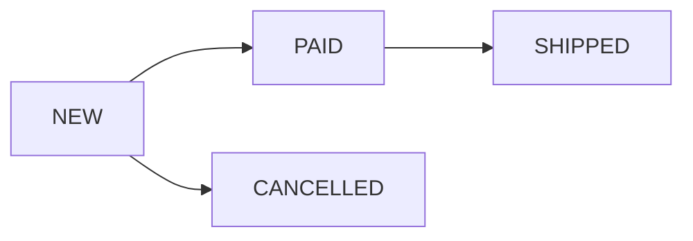

# RETURNING hoặc OUTPUT để kiểm tra dữ liệu thay đổi

## 1. Vì sao UPDATE/DELETE cần trả lại những hàng đã tác động?

Một câu lệnh thay đổi dữ liệu có thể thực thi thành công mà **không đụng tới hàng nào**, hoặc vô tình ảnh hưởng nhiều hàng hơn dự kiến.

Ví dụ:

```sql
UPDATE orders
SET status = 'PAID'
WHERE customer_id = 2;
```

Câu lệnh trên thiếu điều kiện trạng thái ban đầu. Nó có thể thay đổi cả những đơn đã giao, đã hủy hoặc không còn phù hợp. Ngay cả khi ứng dụng biết “2 rows affected”, con số đó **không cho biết hai đơn nào** được thay đổi.

Tương tự:

```sql
DELETE FROM orders
WHERE status = 'CANCELLED';
```

Nếu người vận hành xóa nhầm đơn, chỉ nhìn số hàng bị xóa sẽ khó xác định dữ liệu cần khôi phục.

Một số hệ quản trị SQL cung cấp cách **trả trực tiếp những hàng mà DML đã tác động**:

- **PostgreSQL:** mệnh đề `RETURNING`.
- **SQL Server:** mệnh đề `OUTPUT` và các bảng logic `INSERTED`, `DELETED`.
- **SQLite phiên bản hỗ trợ:** `RETURNING`.
- **Oracle:** dạng `RETURNING ... INTO` với biến nhận dữ liệu, có ngữ nghĩa sử dụng khác PostgreSQL.

Khi biết khai thác những khả năng này, ta có thể:

1. Biết **ID cụ thể** của những hàng vừa sửa hoặc xóa.
2. Xem **giá trị sau UPDATE**, hoặc **giá trị của hàng trước DELETE**.
3. Với SQL Server, nhận **giá trị trước và sau UPDATE trong cùng lệnh**.
4. Kiểm tra số hàng tác động so với kỳ vọng.
5. Thu thập dữ liệu cho audit/log hoặc sự kiện nghiệp vụ.
6. Giảm rủi ro của một lần `SELECT` riêng sau khi sửa dữ liệu.

Tuy nhiên, **trả được hàng không có nghĩa đã commit thành công**. Một câu `UPDATE ... RETURNING` có thể chạy trong transaction rồi bị `ROLLBACK`. Kết quả trả về phản ánh tác động của câu lệnh trong ngữ cảnh thực thi, không tự là bằng chứng dữ liệu đã được lưu bền vững.

**Mục tiêu bài học:** Viết và đọc chính xác `RETURNING`/`OUTPUT` cho `UPDATE` và `DELETE`; dùng kết quả để kiểm chứng, tránh bẫy số hàng, chọn đúng hình ảnh trước/sau, xử lý transaction và so sánh phương ngữ.

---

## 2. Ba mức cần phân biệt khi nói “đã thay đổi”

Một câu `UPDATE` có ba khái niệm dễ bị trộn:

| Khái niệm | Câu hỏi | Ví dụ |
| --- | --- | --- |
| **Hàng khớp điều kiện** | Những hàng nào thỏa `WHERE` để được xử lý bởi UPDATE? | Hai đơn `NEW` của khách 2 |
| **Giá trị thực sự khác đi** | Trước và sau có cột nào khác không? | `NEW` → `PAID`, hoặc `PAID` → `PAID` |
| **Thay đổi được commit** | Transaction chứa UPDATE đã kết thúc thành công chưa? | `COMMIT` thành công, không bị rollback |

Một `UPDATE` như:

```sql
UPDATE orders
SET status = status
WHERE order_id = 101;
```

vẫn có thể là một hàng **được UPDATE tác động** dù giá trị `status` không khác. Trong PostgreSQL, câu lệnh vẫn có thể trả hàng đó qua `RETURNING`. SQL Server cũng có thể tạo dữ liệu `OUTPUT` cho hàng được xử lý.

Do đó:

> **Số hàng UPDATE tác động không nhất thiết bằng số hàng có giá trị thật sự đổi.**

Nếu bài toán cần “chỉ đổi từ `NEW` sang `PAID`”, hãy đưa **trạng thái cũ kỳ vọng** vào `WHERE`; không suy ngược rằng bất kỳ hàng nào được trả về đều đã thay đổi một giá trị.

Một khái niệm nữa: `RETURNING`/`OUTPUT` cho biết kết quả của **câu lệnh DML**, nhưng không nhất thiết cho biết trạng thái cuối cùng sau tất cả tác động của **trigger, câu lệnh khác trong transaction hoặc thao tác đồng thời**. Phải hiểu thời điểm quan sát của từng DBMS.

## 3. Bộ dữ liệu mẫu để thực hành an toàn

Ví dụ chính sử dụng một bảng đơn hàng trong database **thử nghiệm**, không phải production.

### 3.1. PostgreSQL: tạo bảng

```sql
CREATE TABLE lesson_orders (
    order_id INTEGER PRIMARY KEY,
    customer_id INTEGER NOT NULL,
    status VARCHAR(16) NOT NULL
        CHECK (status IN (
            'NEW', 'PAID', 'SHIPPED', 'CANCELLED'
        )),
    amount NUMERIC(12, 2) NOT NULL
        CHECK (amount >= 0),
    updated_at TIMESTAMP NOT NULL
);
```

Thêm dữ liệu:

```sql
INSERT INTO lesson_orders (
    order_id, customer_id, status, amount, updated_at
)
VALUES
    (101, 1, 'NEW',       120, '2026-10-01 09:00:00'),
    (102, 1, 'PAID',      200, '2026-10-02 10:00:00'),
    (103, 2, 'NEW',       150, '2026-10-03 11:00:00'),
    (104, 2, 'NEW',       180, '2026-10-04 12:00:00'),
    (105, 3, 'SHIPPED',   300, '2026-10-05 13:00:00'),
    (106, 3, 'CANCELLED',  90, '2026-10-06 14:00:00'),
    (107, 4, 'NEW',        75, '2026-10-07 15:00:00');
```

Tập dữ liệu gốc:

| order_id | customer_id | status | amount | updated_at |
| ---: | ---: | --- | ---: | --- |
| 101 | 1 | NEW | 120 | 01/10/2026 |
| 102 | 1 | PAID | 200 | 02/10/2026 |
| 103 | 2 | NEW | 150 | 03/10/2026 |
| 104 | 2 | NEW | 180 | 04/10/2026 |
| 105 | 3 | SHIPPED | 300 | 05/10/2026 |
| 106 | 3 | CANCELLED | 90 | 06/10/2026 |
| 107 | 4 | NEW | 75 | 07/10/2026 |

Khi thực hiện bài tập, **mỗi ví dụ được hiểu là bắt đầu từ dữ liệu gốc**, trừ khi nói rõ các lệnh được chạy nối tiếp. Nhiều ví dụ dùng `BEGIN ... ROLLBACK` để có thể thử lại mà không cần nạp lại dữ liệu.

### 3.2. SQL Server: bảng tương đương

Trong SQL Server, `timestamp` **không phải kiểu thời gian ngày giờ** mà liên quan `rowversion`. Vì vậy ví dụ T-SQL dùng `datetime2`.

```sql
CREATE TABLE dbo.lesson_orders (
    order_id int NOT NULL PRIMARY KEY,
    customer_id int NOT NULL,
    status varchar(16) NOT NULL
        CHECK (status IN (
            'NEW', 'PAID', 'SHIPPED', 'CANCELLED'
        )),
    amount decimal(12,2) NOT NULL
        CHECK (amount >= 0),
    updated_at datetime2(0) NOT NULL
);
```

```sql
INSERT INTO dbo.lesson_orders (
    order_id, customer_id, status, amount, updated_at
)
VALUES
    (101, 1, 'NEW',       120, '2026-10-01T09:00:00'),
    (102, 1, 'PAID',      200, '2026-10-02T10:00:00'),
    (103, 2, 'NEW',       150, '2026-10-03T11:00:00'),
    (104, 2, 'NEW',       180, '2026-10-04T12:00:00'),
    (105, 3, 'SHIPPED',   300, '2026-10-05T13:00:00'),
    (106, 3, 'CANCELLED',  90, '2026-10-06T14:00:00'),
    (107, 4, 'NEW',        75, '2026-10-07T15:00:00');
```

**Quy tắc thực hành:** Không chạy mã DML minh họa trên bảng thật chỉ để xem kết quả. Dùng schema/database thử nghiệm, transaction và tài khoản có quyền phù hợp.

## 4. PostgreSQL: UPDATE ... RETURNING cơ bản

Giả sử yêu cầu:

> Chuyển hai đơn đang ở `NEW` của khách 2 sang `PAID`, rồi trả ID, trạng thái sau cập nhật và tiền đơn.

```sql
BEGIN;

UPDATE lesson_orders
SET
    status = 'PAID',
    updated_at = TIMESTAMP '2026-10-16 10:00:00'
WHERE customer_id = 2
  AND status = 'NEW'
RETURNING
    order_id,
    customer_id,
    status AS new_status,
    amount,
    updated_at;

ROLLBACK;
```

Phần `RETURNING` trả hai hàng, theo **tập giá trị** sau:

| order_id | customer_id | new_status | amount | updated_at |
| ---: | ---: | --- | ---: | --- |
| 103 | 2 | PAID | 150 | 16/10/2026 10:00 |
| 104 | 2 | PAID | 180 | 16/10/2026 10:00 |

**Thứ tự của hai hàng không được đảm bảo** nếu chỉ dựa vào `RETURNING` mà không có một lớp truy vấn có `ORDER BY`. Bảng trên sắp theo ID để dễ đọc.

### 4.1. Các phần cần đọc

```sql
UPDATE lesson_orders
SET status = 'PAID'
WHERE customer_id = 2
  AND status = 'NEW'
RETURNING order_id, status;
```

- `UPDATE lesson_orders`: bảng đích.
- `SET ...`: giá trị cần ghi.
- `WHERE ...`: **điều kiện chọn hàng được phép sửa**.
- `RETURNING ...`: cột và biểu thức muốn đọc từ các hàng DML đã tác động.

Trong PostgreSQL, `RETURNING` được viết **sau `WHERE`** của câu `UPDATE`.

### 4.2. Tại sao dùng RETURNING thay vì SELECT sau UPDATE?

Một `SELECT` riêng:

```sql
SELECT order_id, status
FROM lesson_orders
WHERE customer_id = 2;
```

có thể trả cả những hàng của khách 2 **không được UPDATE trong lần này** nếu dữ liệu có thêm trạng thái khác, hoặc phản ánh trạng thái sau các tác động khác.

`RETURNING` gắn với **chính tập hàng của lệnh UPDATE đó**. Nó trả đúng ID của những hàng mà câu lệnh đã xử lý, không phải mọi hàng tình cờ thỏa một bộ lọc ở thời điểm truy vấn sau.

### 4.3. RETURNING không tạo một bảng vĩnh viễn

Dữ liệu trả về có thể được ứng dụng đọc như một result set, nhưng nó **không tự lưu thành một bảng** để truy vấn ở một câu lệnh khác.

Nếu muốn sử dụng lại kết quả DML trong một câu SQL PostgreSQL, có thể dùng **data-modifying CTE** trong những trường hợp được hỗ trợ — trình bày ở phần sau.

---

## 5. RETURNING chỉ trả những hàng bị tác động

Ví dụ từ dữ liệu gốc:

```sql
UPDATE lesson_orders
SET status = 'PAID'
WHERE customer_id = 99
RETURNING order_id, status;
```

Không có khách 99 trong bảng đơn, nên:

- Câu lệnh thực thi hợp lệ.
- **Không có hàng nào được trả về.**
- Không có đơn nào bị sửa.

Đây **không phải lỗi SQL**. Nhưng trong nghiệp vụ “phải cập nhật đúng một đơn”, việc nhận 0 hàng là một **sự kiện ứng dụng cần xử lý**.

### 5.1. Không khớp và không đổi giá trị là hai chuyện

Xem:

```sql
-- Dữ liệu gốc: đơn 102 vốn đã là PAID.
UPDATE lesson_orders
SET status = 'PAID'
WHERE order_id = 102
RETURNING order_id, status;
```

Câu lệnh có thể trả:

| order_id | status |
| ---: | --- |
| 102 | PAID |

Dù giá trị `status` đã là `PAID` trước khi chạy.

Nếu chỉ muốn xử lý đơn mới:

```sql
UPDATE lesson_orders
SET status = 'PAID'
WHERE order_id = 102
  AND status = 'NEW'
RETURNING order_id, status;
```

Lần này **0 hàng**, vì trạng thái hiện tại không còn là `NEW`.

Do đó kết quả `RETURNING` thường trả lời:

> **Những hàng nào được câu DML này tác động?**

chứ **không tự trả lời**:

> **Có bao nhiêu giá trị cột thật sự khác nhau giữa trước và sau?**

### 5.2. Kiểm tra “thay đổi thật” bằng điều kiện khác giá trị

Trên PostgreSQL, có thể dùng `IS DISTINCT FROM` để so sánh cả trường hợp `NULL`:

```sql
UPDATE lesson_orders
SET status = 'PAID'
WHERE order_id = 102
  AND status IS DISTINCT FROM 'PAID'
RETURNING order_id, status;
```

Không có hàng nào được cập nhật nếu trạng thái đã là `PAID`.

`IS DISTINCT FROM` khác `<>` ở chỗ biểu thức có kết quả Boolean xác định ngay cả khi một vế là `NULL`. Trong bảng mẫu `status` không được `NULL`, nhưng với cột nullable, lựa chọn này giúp tránh `UNKNOWN` trong `WHERE`.

## 6. PostgreSQL: RETURNING nhiều cột và biểu thức

`RETURNING` không giới hạn một cột ID. Nó có thể chứa các cột và biểu thức được phép trong ngữ cảnh của câu lệnh.

Ví dụ, tăng tiền đơn của khách 1 thêm 10%:

```sql
BEGIN;

UPDATE lesson_orders
SET amount = ROUND(amount * 1.10, 2)
WHERE customer_id = 1
RETURNING
    order_id,
    amount AS updated_amount,
    amount * 0.05 AS five_percent_of_updated_amount;

ROLLBACK;
```

Giả sử dữ liệu gốc:

- Đơn 101: `120 → 132.00`.
- Đơn 102: `200 → 220.00`.

`RETURNING amount` phản ánh **giá trị sau cập nhật** trên PostgreSQL trong cách viết phổ biến này.

### 6.1. Không suy giá trị cũ từ biểu thức mới một cách tùy tiện

Nếu ta thấy:

```sql
SET amount = amount + 10
RETURNING amount, amount - 10 AS presumed_old_amount
```

thì `amount - 10` chỉ là **suy luận** dựa trên công thức của lệnh. Nó không phải một cơ chế old-row image tổng quát khi có trigger, làm tròn, điều kiện cập nhật phức tạp hoặc thay đổi cột khác.

Khi cần **giá trị trước và sau UPDATE thực sự**:

- SQL Server có `DELETED.column` và `INSERTED.column` trong `OUTPUT`.
- PostgreSQL cần xem khả năng OLD/NEW của **phiên bản đang dùng**, hoặc dùng trigger/audit phù hợp. Không coi tên `OLD`/`NEW` trong một trigger PL/pgSQL là cú pháp phổ quát của mọi lệnh `RETURNING`.
- Nếu chỉ cần xác thực business transition, có thể dùng `WHERE status = 'NEW'` và trả `status` sau UPDATE.

### 6.2. Tránh RETURNING * khi dữ liệu nhạy cảm

`RETURNING *` hữu ích khi học, nhưng trong ứng dụng thật có thể trả các cột như số điện thoại, địa chỉ, token, ghi chú nội bộ hoặc dữ liệu không cần dùng.

Ưu tiên:

```sql
RETURNING order_id, status, updated_at
```

thay vì:

```sql
RETURNING *
```

nếu ứng dụng chỉ cần nhận ID và trạng thái mới.

## 7. PostgreSQL: DELETE ... RETURNING lấy hàng trước khi xóa

Với `DELETE`, sau khi xóa hàng không còn tồn tại trong bảng đích. Đây là một trong những lý do `RETURNING` có giá trị cao.

Yêu cầu:

> Xóa những đơn `CANCELLED` đã ghi trong bộ dữ liệu thử và lưu lại ID, tiền, trạng thái cũ để kiểm tra.

```sql
BEGIN;

DELETE FROM lesson_orders
WHERE status = 'CANCELLED'
  AND updated_at < TIMESTAMP '2026-10-10 00:00:00'
RETURNING
    order_id,
    customer_id,
    status AS deleted_status,
    amount,
    updated_at;

ROLLBACK;
```

Kết quả từ dữ liệu gốc:

| order_id | customer_id | deleted_status | amount |
| ---: | ---: | --- | ---: |
| 106 | 3 | CANCELLED | 90 |

Đây là **giá trị của hàng bị xóa**, không phải một hàng còn tồn tại sau khi câu `DELETE` hoàn tất.

### 7.1. DELETE RETURNING giúp khôi phục dữ liệu thế nào?

Kết quả có thể giúp xác định:

- ID đã xóa.
- Các khóa tham chiếu.
- Một số giá trị cần cho audit.
- Bản ghi nào thực sự được xử lý.

Nhưng `RETURNING` **không tự tạo bản sao lưu bền vững**. Nếu dữ liệu cần phục hồi, phải thiết kế:

- Ghi vào bảng archive/audit phù hợp trong cùng transaction.
- Quy tắc retention/backup.
- Chính sách quyền và thời hạn lưu.

In kết quả ra console rồi đóng ứng dụng không phải một chiến lược khôi phục dữ liệu đáng tin cậy.

### 7.2. Một DELETE không khớp trả về tập rỗng

```sql
DELETE FROM lesson_orders
WHERE status = 'CANCELLED'
  AND order_id = 999
RETURNING order_id, status;
```

Không có hàng nào được trả về. Khi nghiệp vụ yêu cầu xóa đúng một đơn và nhận được 0 hàng, cần phân biệt “đơn đã bị xóa trước đó”, “sai ID”, “không đủ điều kiện” hoặc trạng thái đã thay đổi.

### 7.3. DELETE có rủi ro cao hơn UPDATE

Vì `DELETE` loại bỏ hàng khỏi bảng chính, nên trước khi xóa hàng thật cần cân nhắc:

- Ràng buộc khóa ngoại/cascade.
- Trigger và tác động liên quan.
- Yêu cầu pháp lý giữ dữ liệu.
- Soft delete thay vì hard delete.
- Sao lưu và chiến lược phục hồi.

`RETURNING` giúp quan sát, **không tự bảo đảm an toàn** cho một điều kiện `WHERE` sai.

## 8. PostgreSQL: INSERT ... RETURNING để lấy ID và giá trị mặc định

Dù tên bài thuộc nhóm “Cập nhật và xóa”, cần biết `RETURNING` còn đặc biệt hữu ích khi **thêm mới**.

Giả sử có bảng sự kiện nhận ID tự sinh:

```sql
CREATE TABLE lesson_order_events (
    event_id BIGINT GENERATED ALWAYS AS IDENTITY PRIMARY KEY,
    order_id INTEGER NOT NULL,
    event_type VARCHAR(30) NOT NULL,
    created_at TIMESTAMP NOT NULL DEFAULT CURRENT_TIMESTAMP
);
```

Thêm sự kiện rồi nhận giá trị do database tạo:

```sql
BEGIN;

INSERT INTO lesson_order_events (
    order_id, event_type
)
VALUES (103, 'PAYMENT_CONFIRMED')
RETURNING
    event_id,
    order_id,
    event_type,
    created_at;

ROLLBACK;
```

`RETURNING` cho phép ứng dụng nhận `event_id`, `created_at` mà **không phải tự đoán** ID vừa sinh.

### 8.1. Vì sao không dùng MAX(id)?

Cách:

```sql
SELECT MAX(event_id)
FROM lesson_order_events;
```

**không đáng tin cậy** để xác định ID vừa thêm trong môi trường nhiều người ghi đồng thời. Một giao dịch khác có thể đã chèn hàng mới.

`INSERT ... RETURNING event_id` gắn với **chính câu INSERT của ứng dụng**, là lựa chọn phù hợp hơn.

### 8.2. INSERT nhiều hàng

```sql
INSERT INTO lesson_order_events (order_id, event_type)
VALUES
    (103, 'PAYMENT_CONFIRMED'),
    (104, 'PAYMENT_CONFIRMED')
RETURNING event_id, order_id;
```

`RETURNING` có thể trả **nhiều hàng**, tương ứng các hàng vừa thêm. Không nên giả định thứ tự hàng trả về luôn trùng thứ tự `VALUES` nếu ứng dụng cần ghép bằng một định danh nghiệp vụ. Hãy dựa trên khóa được trả về.

## 9. UPDATE RETURNING và thao tác nhiều hàng

Giả sử cần đánh dấu mọi đơn `NEW` của khách 2 là `PAID`:

```sql
UPDATE lesson_orders
SET status = 'PAID'
WHERE customer_id = 2
  AND status = 'NEW'
RETURNING order_id, amount;
```

Số hàng kết quả = **2** với dữ liệu gốc.

Nếu quên điều kiện `customer_id = 2`:

```sql
UPDATE lesson_orders
SET status = 'PAID'
WHERE status = 'NEW'
RETURNING order_id, amount;
```

Sẽ tác động các đơn `101, 103, 104, 107` — **4 hàng**.

Nếu quên cả `WHERE`:

```sql
UPDATE lesson_orders
SET status = 'PAID'
RETURNING order_id, amount;
```

có thể tác động **toàn bộ 7 hàng** nếu ràng buộc khác không ngăn cản.

**Vì vậy số hàng trả về là một tín hiệu kiểm chứng, nhưng cần có cơ chế xử lý khi lệch kỳ vọng.** Chỉ xem kết quả rồi vẫn `COMMIT` không ngăn được lỗi nghiệp vụ.

## 10. SQL Server: OUTPUT thay cho RETURNING

SQL Server dùng `OUTPUT` để trả dữ liệu từ câu DML.

Hai bảng logic thường gặp:

- `INSERTED`: phiên bản hàng **sau thao tác INSERT/UPDATE** trong ngữ cảnh OUTPUT.
- `DELETED`: phiên bản hàng **trước thao tác DELETE/UPDATE** trong ngữ cảnh OUTPUT.

Với `UPDATE`, cả `INSERTED` và `DELETED` đều có thể được dùng để lấy **giá trị mới** và **giá trị cũ**.

### 10.1. Bảng ánh xạ hành động

| DML | `INSERTED` | `DELETED` |
| --- | --- | --- |
| `INSERT` | Hàng mới được thêm | Không có hàng cũ tương ứng |
| `UPDATE` | Giá trị sau cập nhật | Giá trị trước cập nhật |
| `DELETE` | Không có hàng sau xóa | Hàng trước khi xóa |

**Đặc biệt quan trọng:** Với các trigger `AFTER` trong SQL Server, `OUTPUT INSERTED...` phản ánh trạng thái sau câu DML cơ sở **trước những tác động tiếp theo của AFTER trigger**. Do đó không được coi nó là bằng chứng tuyệt đối về trạng thái cuối sau trigger hoặc sau cả transaction.

## 11. SQL Server: UPDATE ... OUTPUT với trạng thái cũ và mới

Trên bảng `dbo.lesson_orders` đã tạo trong mục 3.2:

```sql
BEGIN TRANSACTION;

UPDATE dbo.lesson_orders
SET
    status = 'PAID',
    updated_at = CONVERT(
        datetime2(0), '2026-10-16T10:00:00'
    )
OUTPUT
    DELETED.order_id,
    DELETED.status AS old_status,
    INSERTED.status AS new_status,
    DELETED.updated_at AS old_updated_at,
    INSERTED.updated_at AS new_updated_at
WHERE customer_id = 2
  AND status = 'NEW';

ROLLBACK TRANSACTION;
```

Các hàng được trả về:

| order_id | old_status | new_status | old_updated_at | new_updated_at |
| ---: | --- | --- | --- | --- |
| 103 | NEW | PAID | 03/10/2026 11:00 | 16/10/2026 10:00 |
| 104 | NEW | PAID | 04/10/2026 12:00 | 16/10/2026 10:00 |

**`OUTPUT` nằm sau phần `SET` và trước phần `WHERE` trong dạng UPDATE T-SQL này.**

### 11.1. PostgreSQL và SQL Server khác thế nào?

PostgreSQL ví dụ cơ bản:

```sql
UPDATE lesson_orders
SET status = 'PAID'
WHERE customer_id = 2
  AND status = 'NEW'
RETURNING order_id, status AS new_status;
```

SQL Server:

```sql
UPDATE dbo.lesson_orders
SET status = 'PAID'
OUTPUT
    DELETED.order_id,
    DELETED.status AS old_status,
    INSERTED.status AS new_status
WHERE customer_id = 2
  AND status = 'NEW';
```

Trong SQL Server, `DELETED` và `INSERTED` thể hiện trực tiếp **hai hình ảnh trước/sau của hàng UPDATE**, rất hữu ích cho audit và kiểm tra transition.

Với PostgreSQL, `RETURNING` truyền thống thường được dạy như kết quả **hàng sau UPDATE** và **hàng trước DELETE**; một số phiên bản mới mở rộng khả năng truy cập hình ảnh OLD/NEW. Cần kiểm tra **đúng phiên bản PostgreSQL** đang chạy trước khi dùng cú pháp old/new đặc thù, không copy nguyên `DELETED`/`INSERTED` của T-SQL sang PostgreSQL.

### 11.2. OUTPUT nhiều cột

```sql
UPDATE dbo.lesson_orders
SET amount = amount + 10
OUTPUT
    INSERTED.order_id,
    DELETED.amount AS old_amount,
    INSERTED.amount AS new_amount,
    INSERTED.amount - DELETED.amount AS amount_delta
WHERE order_id = 101;
```

Từ dữ liệu gốc:

| order_id | old_amount | new_amount | amount_delta |
| ---: | ---: | ---: | ---: |
| 101 | 120 | 130 | 10 |

Không phải tính ngược “giá trị cũ” từ số mới; `DELETED.amount` cung cấp trực tiếp giá trị trước của hàng UPDATE.

## 12. SQL Server: DELETE ... OUTPUT DELETED

Yêu cầu xóa đơn hủy:

```sql
BEGIN TRANSACTION;

DELETE FROM dbo.lesson_orders
OUTPUT
    DELETED.order_id,
    DELETED.customer_id,
    DELETED.status,
    DELETED.amount
WHERE status = 'CANCELLED'
  AND order_id = 106;

ROLLBACK TRANSACTION;
```

Kết quả:

| order_id | customer_id | status | amount |
| ---: | ---: | --- | ---: |
| 106 | 3 | CANCELLED | 90 |

Sau `DELETE` trong transaction, hàng 106 không còn trong bảng đích của giao dịch hiện tại; `OUTPUT DELETED...` trả giá trị **trước thao tác xóa**.

Nếu `ROLLBACK TRANSACTION`, hàng đó được khôi phục theo cơ chế transaction. Kết quả `OUTPUT` đã phát ra cho ứng dụng **không phải dấu hiệu đã commit**.

### 12.1. Không có hàng khớp

```sql
DELETE FROM dbo.lesson_orders
OUTPUT DELETED.order_id
WHERE order_id = 999;
```

Trả **0 hàng** khi không có đơn `999`.

Với nghiệp vụ “xóa một đơn xác định”, ứng dụng cần quyết định 0 hàng là trạng thái idempotent bình thường hay lỗi “đơn không tồn tại”.

## 13. SQL Server: INSERT ... OUTPUT INSERTED

Tạo một bảng có identity trong môi trường SQL Server thử nghiệm:

```sql
CREATE TABLE dbo.lesson_order_events (
    event_id bigint IDENTITY(1,1) PRIMARY KEY,
    order_id int NOT NULL,
    event_type varchar(30) NOT NULL,
    created_at datetime2(0) NOT NULL
        DEFAULT SYSDATETIME()
);
```

Chèn sự kiện:

```sql
BEGIN TRANSACTION;

INSERT INTO dbo.lesson_order_events (
    order_id, event_type
)
OUTPUT
    INSERTED.event_id,
    INSERTED.order_id,
    INSERTED.event_type,
    INSERTED.created_at
VALUES (103, 'PAYMENT_CONFIRMED');

ROLLBACK TRANSACTION;
```

`OUTPUT INSERTED.event_id` giúp nhận identity vừa được tạo bởi **chính câu INSERT**.

### 13.1. Identity và rollback

Một identity có thể **tiêu thụ số** dù transaction rollback; không được giả định identity tạo ra là dãy liên tục không có khoảng trống.

Cả PostgreSQL sequence/identity và SQL Server identity đều có những đặc điểm sinh số không nên bị nhầm với “số thứ tự giao dịch đã commit”.

### 13.2. OUTPUT và các câu có trigger

SQL Server có những giới hạn cụ thể nếu dùng `OUTPUT` **trực tiếp trả kết quả** trên bảng đích có enabled trigger cho hành động DML đó. Trong một số tình huống, cần dùng `OUTPUT ... INTO` thay vì trả trực tiếp cho client.

Không nên chỉ sao chép ví dụ `OUTPUT` trực tiếp vào bảng production có nhiều trigger mà không kiểm tra quy định của SQL Server và thực thi trong transaction an toàn.

---

## 14. SQL Server: OUTPUT ... INTO để giữ tập hàng thay đổi

`OUTPUT` có thể:

- Trả một result set cho ứng dụng.
- Hoặc **ghi các giá trị được trả vào một table variable/bảng đích phù hợp** bằng `OUTPUT ... INTO`.

Ví dụ muốn kiểm tra cả trạng thái cũ và mới của những đơn được chuyển:

```sql
DECLARE @changed TABLE (
    order_id int NOT NULL,
    old_status varchar(16) NOT NULL,
    new_status varchar(16) NOT NULL,
    amount decimal(12,2) NOT NULL
);

BEGIN TRANSACTION;

UPDATE dbo.lesson_orders
SET status = 'PAID'
OUTPUT
    DELETED.order_id,
    DELETED.status,
    INSERTED.status,
    INSERTED.amount
INTO @changed (
    order_id, old_status, new_status, amount
)
WHERE customer_id = 2
  AND status = 'NEW';

SELECT
    order_id,
    old_status,
    new_status,
    amount
FROM @changed
ORDER BY order_id;

ROLLBACK TRANSACTION;
```

Kết quả `SELECT` từ `@changed` cho hai đơn `103`, `104`.

### 14.1. Vì sao cần OUTPUT INTO?

- Dùng dữ liệu được DML tác động ở bước SQL tiếp theo.
- Kiểm tra số hàng bằng `SELECT COUNT(*) FROM @changed`.
- Tổng hợp delta cũ/mới.
- Trình bày kết quả có `ORDER BY` sau khi lưu.
- Tạo nguồn dữ liệu cho bước kiểm toán khi kiến trúc phù hợp.

### 14.2. Table variable không tương đương bảng audit bền vững

`@changed` là **table variable của T-SQL**, không phải bảng audit lâu dài được chia sẻ. SQL Server có quy tắc transaction đặc thù với table variable; thay đổi trên table variable **không bị rollback giống dữ liệu bảng giao dịch thông thường** trong nhiều trường hợp.

Do đó:

> Nếu sau `ROLLBACK` vẫn nhìn thấy các dòng trong `@changed`, điều đó **không chứng minh UPDATE đã commit**.

Đừng dùng dữ liệu còn trong table variable làm “bằng chứng đã lưu thành công”. Nó là **bản ghi kết quả quan sát**, không phải xác nhận transaction bền vững.

### 14.3. OUTPUT INTO không nhận mọi bảng đích tùy ý

SQL Server có giới hạn với đối tượng nhận `OUTPUT INTO`, ví dụ liên quan trigger, ràng buộc và một số loại đích. Nếu muốn đưa dữ liệu thẳng vào một bảng audit production, cần kiểm tra những giới hạn đó.

Một thiết kế khác là:

1. `OUTPUT INTO` table variable hoặc staging table phù hợp.
2. Kiểm tra số hàng và dữ liệu.
3. `INSERT` sang bảng audit với logic được quản lý.
4. `COMMIT` cả thay đổi nghiệp vụ lẫn audit trong một transaction.

Cách này cho phép tách trách nhiệm của DML và bảng audit, đồng thời thuận tiện đặt kiểm soát bổ sung.

## 15. Kiểm tra số hàng tác động và bảo vệ transaction

Một hệ thống nghiệp vụ có thể yêu cầu:

> Xác nhận thanh toán cho **đúng một** đơn ở trạng thái `NEW`.

Nếu `UPDATE` trả 0 hoặc nhiều hơn một hàng thì **không được commit tùy tiện**.

### 15.1. PostgreSQL: đọc số hàng RETURNING ở ứng dụng

Mẫu SQL:

```sql
BEGIN;

UPDATE lesson_orders
SET
    status = 'PAID',
    updated_at = CURRENT_TIMESTAMP
WHERE order_id = 103
  AND status = 'NEW'
RETURNING order_id, status;

-- Ứng dụng đọc số hàng và quyết định:
-- đúng 1 hàng, tiếp tục xử lý rồi COMMIT;
-- khác 1 hàng, ROLLBACK và báo lỗi nghiệp vụ.
```

Khi dùng driver:

1. Chạy câu `UPDATE ... RETURNING`.
2. Đọc **toàn bộ result set**.
3. Kiểm tra đúng số lượng kỳ vọng.
4. Chỉ sau khi mọi điều kiện đều đúng, `COMMIT`.
5. Nếu sai, `ROLLBACK`.

Không thể dùng riêng `RETURNING` như một ràng buộc tự động “cấm đổi nhiều hơn N hàng”.

### 15.2. SQL Server: @@ROWCOUNT

T-SQL cung cấp `@@ROWCOUNT` cho số hàng chịu ảnh hưởng bởi câu lệnh vừa thực hiện.

```sql
BEGIN TRANSACTION;

UPDATE dbo.lesson_orders
SET status = 'PAID'
WHERE order_id = 103
  AND status = 'NEW';

DECLARE @affected int = @@ROWCOUNT;

IF @affected <> 1
BEGIN
    ROLLBACK TRANSACTION;
    THROW 50001, 'Expected exactly one order', 1;
END;

COMMIT TRANSACTION;
```

**Quan trọng:** Phải lấy `@@ROWCOUNT` **ngay sau câu DML** vào biến. Các câu SQL khác có thể làm thay đổi giá trị của nó.

Nếu đồng thời cần dữ liệu cũ/mới, dùng `OUTPUT ... INTO @changed` rồi kiểm tra `COUNT(*)` của bảng nhận. Hãy kết hợp với xử lý lỗi transaction chuẩn của ứng dụng.

### 15.3. SQL Server: lưu OUTPUT rồi kiểm tra

```sql
DECLARE @changed TABLE (
    order_id int PRIMARY KEY,
    old_status varchar(16),
    new_status varchar(16)
);

BEGIN TRANSACTION;

UPDATE dbo.lesson_orders
SET status = 'PAID'
OUTPUT
    DELETED.order_id,
    DELETED.status,
    INSERTED.status
INTO @changed (
    order_id, old_status, new_status
)
WHERE order_id = 103
  AND status = 'NEW';

IF (SELECT COUNT(*) FROM @changed) <> 1
BEGIN
    ROLLBACK TRANSACTION;
    THROW 50002, 'Expected one changed row', 1;
END;

COMMIT TRANSACTION;
```

Ví dụ minh họa logic thành công; production còn cần `TRY/CATCH`, kiểm soát `XACT_STATE()`, xử lý deadlock và quản lý transaction của tầng ứng dụng.

## 16. RETURNING và OUTPUT có thay thế SELECT kiểm tra trước không?

Một quy trình vận hành đôi khi viết:

```text
SELECT ... WHERE ...
Xem vài hàng
UPDATE ... WHERE ...
SELECT ... WHERE ...
```

Cách này có lợi cho người vận hành hiểu phạm vi, nhưng **SELECT kiểm tra trước không khóa cố định trạng thái tương lai**. Giữa hai câu SQL, giao dịch khác có thể thay đổi dữ liệu.

### 16.1. Rủi ro kiểu TOCTOU

`TOCTOU` = *time of check to time of use*.

Ví dụ:

1. Giao dịch A đọc đơn 103 thấy `status = NEW`.
2. Giao dịch B chuyển đơn 103 sang `CANCELLED` và commit.
3. Giao dịch A chạy `UPDATE ... WHERE order_id = 103` mà không kiểm tra `status = NEW`.
4. A ghi đè trạng thái hủy thành `PAID`.

Việc A “đã kiểm tra trước” không đủ ngăn lỗi.

### 16.2. Đặt điều kiện kỳ vọng trong chính UPDATE

Viết:

```sql
UPDATE lesson_orders
SET status = 'PAID'
WHERE order_id = 103
  AND status = 'NEW'
RETURNING order_id, status;
```

Giờ câu DML chỉ tác động nếu đơn đang ở trạng thái được phép chuyển trong ngữ cảnh transaction của DBMS.

Nếu đơn không còn `NEW`, kết quả trả về **0 hàng**, ứng dụng có thể coi là xung đột hoặc thao tác đã được xử lý trước đó.

### 16.3. RETURNING không loại bỏ mọi race condition

`RETURNING` gắn với DML, nhưng:

- Các câu SQL khác trong transaction có thể vẫn phát sinh race.
- Isolation level và khóa ảnh hưởng tình huống đồng thời.
- Trigger, constraint và transaction có thể tác động thêm.
- Ứng dụng cần quyết định xử lý khi 0 hàng được cập nhật.

Vì vậy, đây là **một phần** của quy trình cập nhật an toàn, không phải thay thế toàn bộ transaction control.

---

## 17. Dùng RETURNING trong quy trình optimistic concurrency

**Optimistic concurrency control** cho phép ứng dụng sửa dữ liệu khi phiên bản hàng còn bằng phiên bản mà nó đã đọc.

Giả sử bảng có cột `version_no`:

```sql
ALTER TABLE lesson_orders
ADD COLUMN version_no INTEGER NOT NULL DEFAULT 1;
```

Trong ví dụ này, thao tác cập nhật yêu cầu:

- `order_id = 103`.
- `version_no = 1` (giá trị mà ứng dụng đã đọc).
- `status = 'NEW'`.

```sql
UPDATE lesson_orders
SET
    status = 'PAID',
    version_no = version_no + 1,
    updated_at = CURRENT_TIMESTAMP
WHERE order_id = 103
  AND version_no = 1
  AND status = 'NEW'
RETURNING
    order_id,
    status,
    version_no;
```

**Nếu thành công:** trả một hàng, `version_no = 2`.

**Nếu một giao dịch khác đã tăng version trước:** 0 hàng. Ứng dụng có thể đọc lại để xác định xung đột và yêu cầu người dùng thử lại.

### 17.1. RETURNING không tự tạo cơ chế version

Chính điều kiện:

```sql
WHERE version_no = :expected_version
```

và phép tăng:

```sql
SET version_no = version_no + 1
```

mới tạo chính sách optimistic locking. `RETURNING` chỉ giúp ứng dụng biết **đã ghi hàng nào và version mới là gì**.

### 17.2. Không dựa vào updated_at nếu không bảo đảm độ phân giải

Một số hệ thống dùng `updated_at` làm token optimistic lock. Cần cẩn thận với độ phân giải timestamp, clock, trigger và nhiều cập nhật cùng thời điểm. Một số nguyên version hoặc concurrency token được thiết kế riêng thường rõ ràng hơn.

Với SQL Server, kiểu `rowversion` là một lựa chọn concurrency token riêng (không phải thời gian thực); `OUTPUT INSERTED.rowversion_column` có thể trả token mới theo quy tắc T-SQL phù hợp.

## 18. Audit log: ghi nhận điều gì đã thay đổi?

Một log audit tối thiểu cho UPDATE thường cần:

- ID của hàng.
- Loại hành động: `UPDATE`/`DELETE`.
- Giá trị cũ nếu cần.
- Giá trị mới nếu có.
- Thời điểm.
- Người dùng hoặc dịch vụ thực hiện.
- Mã yêu cầu/transaction/correlation ID nếu thiết kế có.
- Lý do nghiệp vụ.

`RETURNING` và `OUTPUT` giúp **lấy dữ liệu hàng bị tác động**. Nhưng thiết kế audit còn phải bảo đảm **atomicity**: nghiệp vụ và audit cùng commit hoặc cùng rollback theo yêu cầu.

### 18.1. PostgreSQL: DELETE và chuyển sang bảng archive trong cùng câu

Tạo bảng archive mẫu:

```sql
CREATE TABLE lesson_deleted_orders (
    order_id INTEGER PRIMARY KEY,
    customer_id INTEGER NOT NULL,
    status VARCHAR(16) NOT NULL,
    amount NUMERIC(12,2) NOT NULL,
    deleted_at TIMESTAMP NOT NULL
);
```

Dùng **data-modifying CTE** trong PostgreSQL:

```sql
BEGIN;

WITH deleted AS (
    DELETE FROM lesson_orders
    WHERE order_id = 106
      AND status = 'CANCELLED'
    RETURNING
        order_id,
        customer_id,
        status,
        amount
)
INSERT INTO lesson_deleted_orders (
    order_id,
    customer_id,
    status,
    amount,
    deleted_at
)
SELECT
    order_id,
    customer_id,
    status,
    amount,
    CURRENT_TIMESTAMP
FROM deleted
RETURNING order_id, deleted_at;

ROLLBACK;
```

Ý nghĩa:

1. `DELETE` chỉ xóa các hàng được chọn.
2. `DELETE ... RETURNING` tạo luồng dữ liệu những hàng vừa xóa.
3. `INSERT ... SELECT FROM deleted` ghi chúng vào archive.
4. Tất cả nằm trong transaction và có thể rollback cùng nhau.

**Điểm mạnh:** không phải dựa vào hai câu “SELECT cũ rồi DELETE” tách rời để tìm lại hàng đã mất.

### 18.2. Data-modifying CTE là tính năng theo phương ngữ

Không được copy nguyên:

```sql
WITH deleted AS (
    DELETE ... RETURNING ...
)
INSERT ...
```

sang SQLite/MySQL/SQL Server và mặc định mọi hệ đều hiểu giống PostgreSQL.

PostgreSQL hỗ trợ DML trong `WITH` với những quy tắc và giới hạn riêng. SQLite có `RETURNING` nhưng không cho dùng một câu DML `... RETURNING` như nguồn bảng/CTE theo đúng cách của PostgreSQL.

### 18.3. Nếu archive bị lỗi thì sao?

Giả sử `INSERT INTO lesson_deleted_orders` vi phạm khóa chính, lỗi có thể làm câu lệnh/transaction không hoàn tất như mong muốn. Với thiết kế transaction đúng, dữ liệu xóa khỏi bảng chính không được commit độc lập trong khi archive thất bại.

Điều này là ưu điểm so với mô hình “xóa trước, sau đó thử ghi log ở một kết nối khác”.

## 19. SQL Server: audit OLD/NEW bằng OUTPUT INTO

T-SQL rất thuận tiện cho việc capture chuyển trạng thái:

```sql
DECLARE @audit_changes TABLE (
    order_id int,
    old_status varchar(16),
    new_status varchar(16),
    old_amount decimal(12,2),
    new_amount decimal(12,2)
);

BEGIN TRANSACTION;

UPDATE dbo.lesson_orders
SET status = 'PAID'
OUTPUT
    DELETED.order_id,
    DELETED.status,
    INSERTED.status,
    DELETED.amount,
    INSERTED.amount
INTO @audit_changes (
    order_id,
    old_status,
    new_status,
    old_amount,
    new_amount
)
WHERE customer_id = 2
  AND status = 'NEW';

SELECT *
FROM @audit_changes
ORDER BY order_id;

ROLLBACK TRANSACTION;
```

Kết quả minh họa:

| order_id | old_status | new_status | old_amount | new_amount |
| ---: | --- | --- | ---: | ---: |
| 103 | NEW | PAID | 150 | 150 |
| 104 | NEW | PAID | 180 | 180 |

Trong ví dụ, chỉ `status` đổi, `amount` giữ nguyên. Với SQL Server, `DELETED`/`INSERTED` giúp thấy rõ điều đó.

### 19.1. Cần bảng audit bền vững thì phải ghi riêng

Có thể thực hiện `INSERT INTO dbo.order_audit ... SELECT ... FROM @audit_changes` trong **cùng transaction**, với các cột actor, operation, timestamp và request ID thích hợp.

Chỉ có `@audit_changes` thì **chưa phải audit bền vững**, và việc dữ liệu đó còn sau `ROLLBACK` không đồng nghĩa thay đổi nghiệp vụ được commit.

### 19.2. Trường hợp cần audit đáng tin cậy ở cấp database

Nếu mọi đường ghi dữ liệu — ứng dụng, batch, admin, script — đều phải được log, có thể cần:

- Trigger được thiết kế cẩn thận.
- Temporal tables/audit feature của DBMS.
- Change Data Capture (CDC).
- Transactional outbox cho sự kiện sau commit.
- Quyền DML và chính sách log tập trung.

`OUTPUT` là công cụ quan sát/thu thập dữ liệu trong câu DML; không tự tạo **một chính sách audit toàn hệ thống**.

## 20. RETURNING, OUTPUT và soft delete

**Hard delete**:

```sql
DELETE FROM lesson_orders
WHERE order_id = 106
RETURNING order_id, status;
```

Hàng bị loại khỏi bảng.

**Soft delete**: thay vì xóa, đánh dấu:

```sql
-- PostgreSQL: giả sử bảng có cột deleted_at.
UPDATE lesson_orders
SET deleted_at = CURRENT_TIMESTAMP
WHERE order_id = 106
  AND deleted_at IS NULL
RETURNING order_id, deleted_at;
```

Với soft delete:

- Hàng vẫn tồn tại.
- Truy vấn bình thường phải lọc `WHERE deleted_at IS NULL` nếu cần dữ liệu còn hiệu lực.
- Có thể dùng `RETURNING` để biết hàng nào vừa được đánh dấu.
- Có thể phục hồi bằng UPDATE nếu quy tắc nghiệp vụ cho phép.

### 20.1. RETURNING không quyết định hard/soft

Đó là **hai lựa chọn thiết kế dữ liệu**, không phụ thuộc vào `RETURNING`. Dù dùng soft delete, vẫn có rủi ro sai `WHERE` và cập nhật quá nhiều hàng.

### 20.2. DELETE và ràng buộc cascade

Nếu xóa một hàng cha làm xóa các hàng con theo `ON DELETE CASCADE`, `DELETE ... RETURNING` của bảng cha thường trả **những hàng trực tiếp bị xóa khỏi bảng cha**, **không phải bảng chi tiết đầy đủ mọi hàng bị cascade**.

Muốn audit toàn bộ chuỗi xóa, cần thiết kế phù hợp với các bảng liên quan, trigger hoặc cơ chế log database. Đừng coi số hàng RETURNING của bảng cha là tổng số mọi hàng bị xóa trong toàn schema.

---

## 21. Cảnh báo quan trọng: OUTPUT và trigger trong SQL Server

SQL Server định nghĩa dữ liệu `INSERTED`/`DELETED` trong `OUTPUT` theo trạng thái của câu DML cơ sở, **trước các tác động của AFTER trigger**.

Ví dụ giả định:

1. `UPDATE` đặt `status = PAID`.
2. `OUTPUT INSERTED.status` trả `PAID`.
3. Một `AFTER UPDATE` trigger tiếp tục sửa cột khác, hoặc có logic nghiệp vụ khác.

Kết quả `OUTPUT` không nhất thiết phản ánh **mọi thay đổi cuối cùng** sau trigger.

### 21.1. OUTPUT trực tiếp có giới hạn với bảng có trigger

Khi bảng đích có enabled trigger cho hành động DML, SQL Server có thể không cho dùng `OUTPUT` **không kèm INTO** theo những quy tắc cụ thể.

Giải pháp thường là dùng `OUTPUT ... INTO` để capture vào một đích hợp lệ, nhưng vẫn phải hiểu rằng những giá trị capture là ảnh chụp ở **thời điểm OUTPUT được đánh giá**.

### 21.2. Không xem OUTPUT thành chứng cứ commit

SQL Server cũng cảnh báo rằng một câu DML dùng `OUTPUT` có thể trả hàng cho client **dù phát sinh lỗi và bị rollback** trong một số trường hợp.

Vì vậy ứng dụng:

- Phải kiểm tra **trạng thái thành công của câu DML**.
- Phải xử lý exception/transaction.
- Không dùng các hàng `OUTPUT` khi câu lệnh đã báo lỗi.
- Chỉ thực hiện hành động không thể đảo ngược (như gửi thông báo bên ngoài) theo chiến lược sau commit hoặc transactional outbox phù hợp.

### 21.3. PostgreSQL cũng cần transaction

Một `RETURNING` của PostgreSQL được ứng dụng nhận trước `COMMIT` không bảo đảm commit kế tiếp thành công. Lỗi constraint trì hoãn, conflict, mất kết nối hoặc rollback có thể ngăn thay đổi trở thành bền vững.

`RETURNING` và `OUTPUT` là dữ liệu từ DML, **không phải cam kết durability**.

## 22. Kiểm tra phạm vi bằng SELECT trước, nhưng UPDATE phải có WHERE đầy đủ

Một quy trình thực tế cho thao tác nhiều hàng:

**Bước 1 — Dự đoán tập đích:**

```sql
SELECT
    order_id,
    customer_id,
    status,
    amount
FROM lesson_orders
WHERE customer_id = 2
  AND status = 'NEW'
ORDER BY order_id;
```

Kết quả dự đoán từ dữ liệu gốc: đơn `103` và `104`.

**Bước 2 — Thực hiện DML và nhận đúng tập tác động:**

```sql
BEGIN;

UPDATE lesson_orders
SET status = 'PAID'
WHERE customer_id = 2
  AND status = 'NEW'
RETURNING order_id, status, amount;

ROLLBACK;
```

**Bước 3 — Đối chiếu:**

- Có đúng hai ID dự đoán không?
- Trạng thái mới có phù hợp không?
- Có hành vi concurrent khiến một hàng không còn khớp không?
- Transaction có được rollback nếu không đúng kỳ vọng không?

### 22.1. SELECT preview không thay cho constraint và điều kiện chuyển trạng thái

Tập đích ở `SELECT` là một quan sát tại thời điểm đọc. Nếu ứng dụng thật có concurrency, không được dựa vào preview để bỏ điều kiện `status = 'NEW'` trong `UPDATE`.

### 22.2. Khi cần khóa các hàng trước khi sửa

PostgreSQL có `SELECT ... FOR UPDATE` để khóa hàng trong transaction ở những tình huống phù hợp. SQL Server có những lock hints và transaction isolation tương ứng.

Dùng khóa có chủ đích để bảo vệ bất biến nghiệp vụ, nhưng không khóa diện rộng chỉ để “an tâm” vì có thể gây nghẽn, deadlock hoặc giảm throughput.

### 22.3. Kết quả DML không có thứ tự mặc định

Tập hàng `RETURNING` hoặc `OUTPUT` không có cam kết thứ tự phù hợp với `order_id` hay thứ tự dữ liệu vật lý.

Nếu cần hiển thị có thứ tự, có thể lưu kết quả vào bảng/CTE hợp lệ rồi **SELECT ORDER BY** ở lớp tiêu thụ, không đoán từ cách engine quét bảng.

## 23. PostgreSQL: sắp dữ liệu RETURNING bằng CTE

Ví dụ muốn nhận danh sách ID có thứ tự sau khi cập nhật:

```sql
BEGIN;

WITH changed AS (
    UPDATE lesson_orders
    SET
        status = 'PAID',
        updated_at = TIMESTAMP '2026-10-16 10:00:00'
    WHERE customer_id = 2
      AND status = 'NEW'
    RETURNING order_id, status, amount
)
SELECT
    order_id,
    status,
    amount
FROM changed
ORDER BY order_id;

ROLLBACK;
```

Ở đây:

- Câu `UPDATE ... RETURNING` xác định tập hàng thay đổi.
- CTE `changed` cung cấp các cột của kết quả DML cho `SELECT` cuối.
- `ORDER BY order_id` được áp dụng cho **result set trả về từ SELECT ngoài**.

Không phải mọi DBMS hỗ trợ **data-modifying CTE** kiểu này. Đây là mẫu PostgreSQL, không phải cú pháp SQL di động.

### 23.1. Không cố đặt ORDER BY trực tiếp vào RETURNING

Đừng viết một câu như:

```sql
-- Không phải cú pháp PostgreSQL:
UPDATE lesson_orders
SET status = 'PAID'
RETURNING order_id
ORDER BY order_id;
```

Nếu cần thứ tự, sử dụng một lớp truy vấn có `ORDER BY` thích hợp hoặc sắp ở ứng dụng.

## 24. SQL Server: sắp dữ liệu OUTPUT bằng SELECT sau đó

`OUTPUT INTO` kết hợp với table variable giúp sắp và tổng hợp kết quả.

```sql
DECLARE @changed TABLE (
    order_id int PRIMARY KEY,
    old_status varchar(16),
    new_status varchar(16)
);

BEGIN TRANSACTION;

UPDATE dbo.lesson_orders
SET status = 'PAID'
OUTPUT
    DELETED.order_id,
    DELETED.status,
    INSERTED.status
INTO @changed (
    order_id, old_status, new_status
)
WHERE customer_id = 2
  AND status = 'NEW';

SELECT
    order_id,
    old_status,
    new_status
FROM @changed
ORDER BY order_id;

ROLLBACK TRANSACTION;
```

Không dựa vào thứ tự hàng mà câu `UPDATE ... OUTPUT` trực tiếp phát ra. Thứ tự quan sát hoặc ghi vào table variable không phải thứ tự nghiệp vụ được bảo đảm.

## 25. UPDATE ... FROM: khi bảng nguồn có nhiều hàng khớp

Một mẫu phổ biến:

> Cập nhật trạng thái đơn dựa trên một bảng sự kiện thanh toán.

Giả sử có `payment_events`. Một đơn có thể có **nhiều sự kiện**: retry, callback, lịch sử trạng thái.

Nếu viết `UPDATE ... FROM payment_events` và một đơn khớp nhiều hàng nguồn, người viết dễ:

- Không nhận ra kết quả nối một-nhiều.
- Ghi một giá trị không xác định nếu `SET` lấy trực tiếp từ nhiều hàng nguồn.
- Nhầm số hàng JOIN với số đơn thực sự được UPDATE.

### 25.1. Chọn một khóa đích duy nhất hoặc dùng EXISTS

Nếu chỉ cần biết **có sự kiện thành công**:

```sql
-- PostgreSQL: giả định payment_events có
-- order_id và event_status.
UPDATE lesson_orders AS o
SET status = 'PAID'
WHERE o.status = 'NEW'
  AND EXISTS (
      SELECT 1
      FROM payment_events AS p
      WHERE p.order_id = o.order_id
        AND p.event_status = 'SUCCESS'
  )
RETURNING o.order_id, o.status;
```

`EXISTS` mô tả đúng yêu cầu “có ít nhất một sự kiện hợp lệ”, không bắt buộc chọn một hàng sự kiện cụ thể.

Nếu phải lấy giá trị từ `payment_events`, hãy bảo đảm nguồn cung cấp **đúng một hàng được chọn có chủ đích cho mỗi order_id**, ví dụ tổng hợp hoặc dùng `ROW_NUMBER` với thứ tự nhất quán.

### 25.2. RETURNING không phát hiện mọi vấn đề của JOIN

Nếu `UPDATE` đã nhận một giá trị tùy ý từ tập nguồn không xác định, `RETURNING` vẫn có thể trả hàng đã cập nhật và khiến kết quả trông hợp lý.

Cần thiết kế **đúng quan hệ nguồn–đích** trước; `RETURNING` chỉ là công cụ giúp quan sát kết quả câu lệnh.

### 25.3. SQL Server OUTPUT trong UPDATE JOIN

T-SQL hỗ trợ các dạng `UPDATE ... FROM` với cú pháp riêng:

```sql
-- SQL Server; giả định dbo.payment_events tồn tại.
UPDATE o
SET o.status = 'PAID'
OUTPUT
    DELETED.order_id,
    DELETED.status AS old_status,
    INSERTED.status AS new_status
FROM dbo.lesson_orders AS o
WHERE o.status = 'NEW'
  AND EXISTS (
      SELECT 1
      FROM dbo.payment_events AS p
      WHERE p.order_id = o.order_id
        AND p.event_status = 'SUCCESS'
  );
```

Điểm quan trọng ở đây là điều kiện `EXISTS`, không phải việc bắt buộc có `JOIN`. Dữ liệu của bảng nguồn phải được thiết kế để phép cập nhật có ý nghĩa xác định.

---

## 26. DELETE theo điều kiện liên quan: kết hợp EXISTS và RETURNING

Ví dụ bài toán:

> Xóa đơn bị hủy **chỉ khi không có giao dịch thanh toán thành công liên quan**.

Giả sử có bảng `payment_events` như trên:

```sql
-- PostgreSQL
DELETE FROM lesson_orders AS o
WHERE o.status = 'CANCELLED'
  AND NOT EXISTS (
      SELECT 1
      FROM payment_events AS p
      WHERE p.order_id = o.order_id
        AND p.event_status = 'SUCCESS'
  )
RETURNING
    o.order_id,
    o.customer_id,
    o.status,
    o.amount;
```

Ý nghĩa:

- `NOT EXISTS` xác định điều kiện nghiệp vụ.
- `DELETE` xóa các hàng phù hợp.
- `RETURNING` cho danh sách **đơn thực sự bị xóa**.

Không nên chuyển cơ học sang:

```sql
DELETE ... WHERE order_id NOT IN (
    SELECT order_id FROM payment_events
);
```

khi `payment_events.order_id` có thể `NULL`: `NOT IN` có những bẫy logic ba giá trị. `NOT EXISTS` thường rõ ràng hơn cho bài toán thiếu bản ghi liên quan.

## 27. Batch UPDATE/DELETE và giới hạn số hàng

Trong hệ thống lớn, cập nhật hoặc xóa hàng triệu dòng một lúc có thể tạo transaction dài, lock nhiều, log lớn và ảnh hưởng lưu lượng.

Một cách thường gặp là xử lý **theo lô**.

### 27.1. PostgreSQL: chọn tối đa N khóa trong CTE

Ví dụ chọn tối đa hai đơn `NEW` để chuyển `PAID` — chỉ là minh họa cú pháp, không phải quy trình nghiệp vụ thanh toán thực tế:

```sql
BEGIN;

WITH selected AS (
    SELECT order_id
    FROM lesson_orders
    WHERE status = 'NEW'
    ORDER BY order_id
    LIMIT 2
    FOR UPDATE SKIP LOCKED
)
UPDATE lesson_orders AS o
SET status = 'PAID'
FROM selected AS s
WHERE o.order_id = s.order_id
  AND o.status = 'NEW'
RETURNING o.order_id, o.status;

ROLLBACK;
```

Trong dữ liệu gốc, nếu không có tranh chấp khóa, nhóm khóa chọn là `101` và `103`.

`FOR UPDATE SKIP LOCKED` thường dùng trong những mô hình queue/worker phù hợp để bỏ qua các hàng đang bị khóa bởi transaction khác. Nhưng nó cũng có nghĩa **không bảo đảm luôn lấy hai ID nhỏ nhất nếu một số hàng đang bị khóa**.

### 27.2. Đừng hiểu RETURNING bảo đảm thứ tự lô

`ORDER BY order_id LIMIT 2` bên trong `selected` ảnh hưởng tập khóa được chọn. Nó **không bảo đảm thứ tự các hàng `RETURNING`** từ `UPDATE`.

Nếu cần thứ tự để hiển thị hoặc gửi file, tạo lớp `SELECT ORDER BY` sau đó.

### 27.3. Batch và idempotence

Nếu worker xử lý lại cùng lô:

- Điều kiện `status = 'NEW'` giúp tránh cập nhật lại những hàng đã `PAID`.
- `RETURNING` cho biết chính xác hàng nào được worker xử lý lần đó.
- Transaction và khóa cần được thiết kế để nhiều worker không xử lý trái ý định trên cùng một hàng.

Bản thân việc dùng `LIMIT` hoặc `TOP` không loại bỏ các vấn đề race/đảm bảo một lần xử lý.

## 28. Kiểm tra UPDATE có làm giá trị thay đổi hay không

Với SQL Server, `OUTPUT` cho cả old/new:

```sql
UPDATE dbo.lesson_orders
SET amount = amount
OUTPUT
    INSERTED.order_id,
    DELETED.amount AS old_amount,
    INSERTED.amount AS new_amount
WHERE order_id = 101;
```

Nếu không có trigger sửa `amount`, cả hai giá trị đều là `120`. Câu vẫn có thể xuất hiện trong tập `OUTPUT`.

### 28.1. PostgreSQL: tránh no-op ngay trong WHERE

```sql
UPDATE lesson_orders
SET amount = 120
WHERE order_id = 101
  AND amount IS DISTINCT FROM 120
RETURNING order_id, amount;
```

Từ dữ liệu gốc, trả **0 hàng**.

Nếu thay bằng `SET amount = 130` và `WHERE amount IS DISTINCT FROM 130`, sẽ trả một hàng với `amount = 130`.

### 28.2. NULL cần được xử lý đúng

Nếu cột có thể `NULL`:

```sql
WHERE some_column <> :new_value
```

không chọn hàng có `some_column = NULL` vì phép so sánh cho `UNKNOWN`.

PostgreSQL:

```sql
WHERE some_column IS DISTINCT FROM :new_value
```

là dạng so sánh NULL-safe thường phù hợp.

SQL Server 2022 trở lên có hỗ trợ `IS DISTINCT FROM`, nhưng ở những phiên bản cũ cần dùng điều kiện xử lý `NULL` tương đương.

---

## 29. Kiểm chứng transition của trạng thái nghiệp vụ

Một quy tắc nghiệp vụ có thể là:

```text
NEW -> PAID -> SHIPPED
  \-> CANCELLED

Không cho:
CANCELLED -> SHIPPED
SHIPPED -> NEW
```

Sơ đồ:



Một câu SQL chỉ dựa vào ID:

```sql
UPDATE lesson_orders
SET status = 'SHIPPED'
WHERE order_id = 106
RETURNING order_id, status;
```

có thể vi phạm ý định nghiệp vụ vì đơn 106 đang `CANCELLED`.

Thay bằng:

```sql
UPDATE lesson_orders
SET status = 'SHIPPED'
WHERE order_id = 106
  AND status = 'PAID'
RETURNING order_id, status;
```

trả **0 hàng** và không thực hiện chuyển trạng thái sai theo quy tắc đã chọn.

### 29.1. 0 hàng có thể có nhiều nguyên nhân

- ID không tồn tại.
- ID tồn tại nhưng trạng thái không phải `PAID`.
- Một giao dịch khác vừa đổi trạng thái.
- Dữ liệu đã được xử lý ở lần gọi trước.

Nếu ứng dụng phải phân biệt, có thể đọc thông tin hiện tại trong cùng chiến lược transaction và isolation phù hợp. Không nên sửa điều kiện `WHERE` rộng hơn chỉ vì một lần nhận 0 hàng.

### 29.2. Khi nào dùng constraint hay trigger?

`WHERE` của ứng dụng bảo vệ một đường cập nhật. Nhưng nếu nhiều ứng dụng có quyền ghi, quy tắc chuyển trạng thái phức tạp có thể cần thêm:

- Constraint phù hợp với các giá trị hợp lệ.
- Trigger hoặc stored procedure thực thi transition.
- Quyền ghi giới hạn.
- Cơ chế concurrency và audit.

`RETURNING` chỉ giúp thấy tác động của thao tác; **không tự thực thi sơ đồ trạng thái**.

## 30. Phân biệt RETURNING/OUTPUT với affected-row count

Ở các API database, có thể thấy:

- Số hàng bị tác động (*affected rows*).
- Result set chứa các hàng `RETURNING`/`OUTPUT`.
- Identity/generated key do driver cung cấp.
- Sự kiện commit/rollback.

Chúng liên quan nhưng không đồng nghĩa.

| Câu hỏi | Công cụ |
| --- | --- |
| Có bao nhiêu hàng bị lệnh tác động? | Affected-row count hoặc đếm hàng `RETURNING`/`OUTPUT` |
| Cụ thể những ID nào? | `RETURNING order_id` hoặc `OUTPUT INSERTED/DELETED.order_id` |
| Trạng thái trước UPDATE là gì? | `OUTPUT DELETED.status` (SQL Server); cơ chế old row/audit phù hợp DBMS |
| Trạng thái sau UPDATE là gì? | `RETURNING status` hoặc `OUTPUT INSERTED.status` |
| Hàng trước DELETE có những giá trị nào? | `DELETE ... RETURNING ...` hoặc `OUTPUT DELETED...` |
| Database đã commit chưa? | Kết quả transaction/commit, không chỉ dữ liệu DML trả về |
| Thao tác đã thỏa quy tắc kinh doanh chưa? | Điều kiện `WHERE`, constraint và kiểm tra ứng dụng |
| Có hiệu ứng trigger/cascade nào khác? | Chính sách trigger/cascade/audit, không chỉ số hàng cha |

### 30.1. Một SELECT sau UPDATE có thể vẫn hữu ích

Có thể cần truy vấn sau để:

- Xác minh trạng thái cuối sau các thao tác khác trong cùng transaction.
- Đọc dữ liệu liên quan từ nhiều bảng.
- Xác minh một bất biến tổng thể như tổng số dư.
- Đọc dữ liệu sau commit theo cơ chế consistency của hệ thống.

Nhưng `SELECT` đó phải được thiết kế đúng transaction/snapshot. `RETURNING` thường giảm nhu cầu đọc lại **chính hàng vừa sửa**, không thay mọi loại kiểm chứng.

## 31. JDBC: đọc kết quả UPDATE RETURNING trong Java

Trong Java dùng PostgreSQL JDBC, một câu `UPDATE ... RETURNING` có thể được đọc bằng `executeQuery()`, vì câu SQL trả result set.

Ví dụ minh họa:

```java
String sql = """
    UPDATE lesson_orders
    SET status = ?, updated_at = CURRENT_TIMESTAMP
    WHERE order_id = ?
      AND status = ?
    RETURNING order_id, status, updated_at
    """;

try (Connection connection = dataSource.getConnection()) {
    connection.setAutoCommit(false);

    try (PreparedStatement statement =
             connection.prepareStatement(sql)) {
        statement.setString(1, "PAID");
        statement.setInt(2, 103);
        statement.setString(3, "NEW");

        int returnedRows = 0;

        try (ResultSet rs = statement.executeQuery()) {
            while (rs.next()) {
                returnedRows++;
                long orderId = rs.getLong("order_id");
                String status = rs.getString("status");

                System.out.println(
                    "Changed order " + orderId
                    + " -> " + status
                );
            }
        }

        if (returnedRows != 1) {
            connection.rollback();
            throw new IllegalStateException(
                "Expected exactly one updated order"
            );
        }

        connection.commit();
    } catch (SQLException | RuntimeException ex) {
        try {
            connection.rollback();
        } catch (SQLException rollbackError) {
            ex.addSuppressed(rollbackError);
        }
        throw ex;
    }
}
```

### 31.1. Điểm quan trọng trong ví dụ JDBC

- `PreparedStatement` dùng placeholder `?` cho giá trị, không nối chuỗi đầu vào trực tiếp vào SQL.
- `setAutoCommit(false)` cho ứng dụng quyết định commit.
- `executeQuery()` dùng với câu PostgreSQL `UPDATE ... RETURNING`.
- Đọc **hết result set** và đếm hàng.
- Nếu không đúng một hàng, rollback.
- Nếu có lỗi SQL/runtime, rollback.
- Chỉ commit sau khi điều kiện kiểm tra đạt.

### 31.2. Đừng dùng executeUpdate tùy tiện rồi bỏ result set

Với một câu SQL trả `RETURNING`, cách driver xử lý `executeUpdate()` có thể khác và có thể không phù hợp nếu driver yêu cầu xử lý result set. Với PostgreSQL JDBC, mô hình đọc `RETURNING` bằng `executeQuery()` là rõ ràng.

Với SQL Server và `OUTPUT`, cần dùng API phù hợp với driver và dạng kết quả; một số câu T-SQL có trigger hoặc nhiều result set có thể cần xử lý theo `execute()`/`getResultSet()` và quy ước của driver.

### 31.3. Không gửi tác dụng phụ bên ngoài trước commit

Ví dụ không nên:

```text
UPDATE ... RETURNING
gửi email "Đơn đã thanh toán"
COMMIT
```

nếu email đã gửi nhưng `COMMIT` thất bại. Khi có hành động ngoài database, có thể dùng **transactional outbox** hoặc cơ chế phát sự kiện sau commit với retry/idempotency phù hợp.

---

## 32. So sánh phương ngữ SQL

Không nên copy `RETURNING` từ PostgreSQL sang SQL Server hoặc copy `OUTPUT INSERTED` sang MySQL rồi mong chạy được.

| Hệ quản trị | Cơ chế liên quan | Ghi chú |
| --- | --- | --- |
| **PostgreSQL** | `INSERT/UPDATE/DELETE ... RETURNING` | Trả các cột/biểu thức của hàng DML tác động; tính năng old/new phụ thuộc phiên bản |
| **SQL Server** | `OUTPUT INSERTED...`, `OUTPUT DELETED...`, `OUTPUT ... INTO` | Cú pháp T-SQL; truy cập trực tiếp hình ảnh cũ/mới cho UPDATE |
| **SQLite 3.35.0+** | `RETURNING` trong INSERT/UPDATE/DELETE | Có giới hạn riêng: không dùng DML RETURNING làm subquery/CTE như PostgreSQL |
| **Oracle Database** | `RETURNING ... INTO` | Trả giá trị vào biến/host variable hoặc PL/SQL, không giống result set PostgreSQL |
| **MySQL 8.0 / 8.4** | Không có mệnh đề `RETURNING` tổng quát tương đương PostgreSQL cho các DML thông dụng | Thường dùng affected rows, generated keys và đọc lại có transaction phù hợp |
| **MariaDB** | Hỗ trợ `RETURNING` cho một số DML theo phiên bản | Mức hỗ trợ khác MySQL và không đồng nhất giữa `INSERT`, `UPDATE`, `DELETE` |
| **Hệ khác** | Có thể có cơ chế lấy hàng trước/sau riêng | Kiểm tra tài liệu của đúng DBMS và phiên bản |

### 32.1. SQL standard và phương ngữ

Mục tiêu nghiệp vụ **“biết chính xác dữ liệu vừa thay đổi”** là phổ biến, nhưng từ khóa và cơ chế trả kết quả DML không giống nhau giữa các hệ.

Trong code dùng nhiều DBMS, nên tạo một lớp thao tác dữ liệu với **contract nghiệp vụ** rõ ràng, ví dụ:

```text
confirmPayment(orderId, expectedStatus)
    -> UPDATED(orderId, oldStatus, newStatus)
    -> NO_MATCH
    -> ERROR
```

Phần SQL có thể khác theo driver/dialect; lớp phía trên vẫn làm việc với những kết quả đã được định nghĩa.

## 33. SQLite: RETURNING giống ở đâu, khác ở đâu?

SQLite hỗ trợ `RETURNING` từ phiên bản **3.35.0**.

Ví dụ:

```sql
UPDATE lesson_orders
SET status = 'PAID'
WHERE customer_id = 2
  AND status = 'NEW'
RETURNING order_id, status;
```

Về ý tưởng, nó rất giống PostgreSQL: trả các hàng được DML tác động.

Xóa:

```sql
DELETE FROM lesson_orders
WHERE order_id = 106
RETURNING order_id, status, amount;
```

### 33.1. Không coi SQLite RETURNING là một nguồn bảng tùy ý

Không viết mẫu PostgreSQL:

```sql
WITH deleted AS (
    DELETE FROM lesson_orders
    WHERE order_id = 106
    RETURNING order_id
)
SELECT * FROM deleted;
```

rồi giả định SQLite chạy được. SQLite có giới hạn: `RETURNING` trên DML không được dùng như một truy vấn con/CTE trả bảng theo cơ chế PostgreSQL.

### 33.2. Thứ tự kết quả không được bảo đảm

Không dùng thứ tự `RETURNING` làm thứ tự công việc. Nếu cần sắp, ứng dụng đọc kết quả rồi sắp, hoặc dùng chiến lược phù hợp với DBMS.

### 33.3. AFTER trigger và giá trị trả về

SQLite có quy tắc riêng về kết quả `RETURNING` trước những thay đổi tiếp theo do AFTER trigger gây ra. Đừng xem kết quả ấy là bản chụp tuyệt đối của bảng sau khi toàn bộ trigger hoàn tất.

### 33.4. Lưu ý cú pháp bảng thử

SQLite không hỗ trợ đầy đủ mọi kiểu dữ liệu, `CHECK`, `TIMESTAMP` và cú pháp PostgreSQL theo cùng cách. Các ví dụ SQLite trong phần này minh họa **câu DML** trên một bảng `lesson_orders` đã được tạo tương thích với SQLite, không phải khẳng định có thể chạy nguyên đoạn DDL PostgreSQL mà không sửa.

## 34. Oracle: RETURNING ... INTO

Oracle Database có cú pháp **`RETURNING ... INTO`** trong các tình huống DML phù hợp. Thay vì trả result set trực tiếp như PostgreSQL, Oracle thường gán giá trị trả về vào **biến PL/SQL hoặc host variables**.

Ví dụ minh họa một hàng:

```sql
-- Oracle PL/SQL, giả sử bảng lesson_orders có
-- order_id, status.
DECLARE
    v_order_id lesson_orders.order_id%TYPE;
    v_status   lesson_orders.status%TYPE;
BEGIN
    UPDATE lesson_orders
    SET status = 'PAID'
    WHERE order_id = 103
      AND status = 'NEW'
    RETURNING order_id, status
    INTO v_order_id, v_status;

    DBMS_OUTPUT.PUT_LINE(
        'Updated: ' || v_order_id || ' -> ' || v_status
    );

    ROLLBACK;
END;
/
```

**Điểm cần hiểu:**

- `RETURNING order_id, status INTO ...` ghi giá trị vào biến.
- Với DML tác động **nhiều hàng**, phải dùng cơ chế phù hợp như `BULK COLLECT INTO` trong PL/SQL khi được hỗ trợ, không giả định biến scalar nhận nhiều hàng.
- Cú pháp Oracle có khác biệt về version, DML, kiểu đối tượng và số hàng.
- Khả năng hiển thị `DBMS_OUTPUT` phụ thuộc công cụ client bật chế độ đọc thông báo.

### 34.1. Oracle không dùng OUTPUT INSERTED/DELETED của SQL Server

`INSERTED`/`DELETED` là tên bảng logic trong ngữ cảnh T-SQL. Không copy hai tên này vào câu `RETURNING INTO` Oracle.

### 34.2. No-match trong Oracle cần kiểm tra rõ

Nếu `UPDATE`/`DELETE` không tác động hàng nào, cần xử lý bằng cơ chế kiểm tra số hàng như `SQL%ROWCOUNT` hoặc logic phù hợp trong PL/SQL. Không dựa vào một giá trị biến chưa được gán để kết luận đã cập nhật thành công.

## 35. MySQL: khi không có RETURNING phổ quát

Với MySQL phổ biến, một ứng dụng thường dùng:

- `UPDATE ... WHERE ...`.
- Affected-row count qua API/driver.
- `LAST_INSERT_ID()` hoặc generated keys API cho trường hợp thêm bản ghi.
- `SELECT` lại trong transaction nếu cần đọc trạng thái, với điều kiện khóa và isolation phù hợp.

Ví dụ:

```sql
START TRANSACTION;

UPDATE lesson_orders
SET status = 'PAID'
WHERE order_id = 103
  AND status = 'NEW';

-- Ứng dụng đọc affected-row count từ driver.
-- Nếu đúng kỳ vọng, có thể SELECT hàng trong
-- transaction để kiểm tra thêm.

SELECT order_id, status
FROM lesson_orders
WHERE order_id = 103;

-- COMMIT hoặc ROLLBACK tùy kết quả nghiệp vụ.
ROLLBACK;
```

### 35.1. Affected rows và changed rows có thể khác theo cấu hình

Trong MySQL, cách driver/connection báo số hàng **matched** hay số hàng **actually changed** có thể bị ảnh hưởng bởi tùy chọn client/protocol. Không nên lấy một con số rồi coi nó mặc nhiên đồng nghĩa chính xác với `RETURNING` của PostgreSQL.

Nếu cần kiểm tra chuyển trạng thái, điều kiện `WHERE status = 'NEW'` và transaction vẫn rất quan trọng.

### 35.2. MariaDB không phải MySQL cùng bộ cú pháp

MariaDB hỗ trợ `RETURNING` ở một số loại lệnh và phiên bản, nhưng mức hỗ trợ không nhất thiết bằng PostgreSQL hoặc bằng nhau giữa `INSERT`, `DELETE` và `UPDATE`.

Nếu ứng dụng hỗ trợ cả MySQL và MariaDB, phải xác minh riêng từng cú pháp, thay vì đoán theo tên họ hệ quản trị.

---

## 36. RETURNING/OUTPUT có thể trả nhiều hàng: đọc hết kết quả

Một lỗi ở tầng ứng dụng là giả định câu `UPDATE` chỉ trả một hàng, rồi dùng API đọc **hàng đầu tiên** và bỏ qua phần còn lại.

Ví dụ:

```sql
UPDATE lesson_orders
SET status = 'PAID'
WHERE customer_id = 2
  AND status = 'NEW'
RETURNING order_id, status;
```

Trả hai hàng `103` và `104`.

Nếu ứng dụng chỉ gọi `rs.next()` một lần, nó có thể bỏ sót đơn 104, dù cơ sở dữ liệu đã xử lý cả hai.

### 36.1. Đúng khi nghiệp vụ chỉ cho phép một hàng

Có thể:

- Dùng điều kiện khóa chính `order_id = ?`.
- Bổ sung trạng thái/version kỳ vọng.
- Đọc và kiểm tra đúng **một hàng**.
- Nếu số lượng khác kỳ vọng, rollback.

### 36.2. Đúng khi nghiệp vụ cho phép nhiều hàng

Có thể:

- Đọc toàn bộ result set.
- Đối chiếu số lượng với batch size/điều kiện nghiệp vụ.
- Lưu ID ở tầng ứng dụng hoặc bảng staging/audit phù hợp.
- Không giả định thứ tự.

### 36.3. Trường hợp trả 0 hàng

Đó là result set rỗng hợp lệ. Ứng dụng cần phân biệt:

- **No-op mong muốn:** câu lệnh idempotent, đã xử lý trước đó.
- **Not found:** khóa không tồn tại.
- **Conflict:** trạng thái/version không còn khớp.
- **Validation error:** điều kiện nghiệp vụ không đáp ứng.

`RETURNING`/`OUTPUT` cung cấp tín hiệu 0 hàng; cách diễn giải thuộc **contract nghiệp vụ**.

## 37. Thiết kế contract API dựa trên kết quả DML

Một service xác nhận đơn có thể dùng kiểu kết quả:

```text
ConfirmOrderResult

UPDATED
    order_id
    previous_status
    current_status
    version_no

NO_MATCH
    order_id
    reason_unknown_without_followup

FAILED
    error_code
    error_message
```

Nếu người dùng gọi cùng yêu cầu hai lần:

- Lần 1: `NEW -> PAID`, trả `UPDATED`.
- Lần 2: điều kiện `WHERE status = 'NEW'` không còn đúng, trả 0 hàng.

Hệ thống phải quyết định lần 2:

- Trả “đã xử lý” nếu `PAID` và idempotency key hợp lệ.
- Hay trả “conflict” nếu chỉ cho phép mỗi lần gọi chuyển trạng thái đúng một lần.

Không nên chỉ dựa vào `RETURNING` để đoán ý định người gọi. Một API đáng tin cậy thường cần **idempotency key, transaction, concurrency token và mã kết quả nghiệp vụ**.

## 38. Kiểm tra bảo mật và giới hạn dữ liệu trả về

Một câu:

```sql
DELETE FROM customers
WHERE ...
RETURNING *;
```

có thể vô tình trả dữ liệu cá nhân. Dù câu lệnh chỉ phục vụ audit, dữ liệu trả về có thể đi vào:

- Log ứng dụng.
- Console/terminal.
- Monitoring/tracing.
- Thông báo lỗi.
- Hệ thống message queue.

Chỉ trả những cột thực sự cần thiết, kiểm soát quyền đọc, che/giảm dữ liệu nhạy cảm và áp dụng chính sách retention.

### 38.1. RETURNING không vượt qua quyền dữ liệu

Quyền để chạy DML và quyền đọc các cột mà câu lệnh trả về có quy tắc cụ thể theo DBMS. Đặc biệt khi trả cột nhạy cảm, phải kiểm tra quyền của role thực thi và các policy liên quan.

### 38.2. Không đưa token/secret vào audit tùy tiện

Với audit log, ưu tiên:

- ID bản ghi.
- Tên cột thay đổi khi phù hợp.
- Hash/token được quản lý đúng nếu thật sự cần đối chiếu.
- Thời điểm và actor.

Không sao chép mật khẩu, access token hay toàn bộ thông tin cá nhân vào bảng audit chỉ vì `RETURNING *` thuận tiện.

## 39. Kiểm tra transaction với ROLLBACK: kịch bản thực hành chuẩn

Một cách thử DML ít rủi ro trong môi trường phát triển:

**PostgreSQL:**

```sql
BEGIN;

SELECT order_id, status
FROM lesson_orders
WHERE order_id IN (103, 104)
ORDER BY order_id;

UPDATE lesson_orders
SET status = 'PAID'
WHERE order_id IN (103, 104)
  AND status = 'NEW'
RETURNING order_id, status;

SELECT order_id, status
FROM lesson_orders
WHERE order_id IN (103, 104)
ORDER BY order_id;

ROLLBACK;

SELECT order_id, status
FROM lesson_orders
WHERE order_id IN (103, 104)
ORDER BY order_id;
```

**Kỳ vọng:**

1. Trước UPDATE: cả hai là `NEW`.
2. `RETURNING`: cả hai là `PAID`.
3. `SELECT` trong transaction: cả hai là `PAID`.
4. Sau `ROLLBACK`: cả hai trở lại `NEW`.

**SQL Server:**

```sql
BEGIN TRANSACTION;

UPDATE dbo.lesson_orders
SET status = 'PAID'
OUTPUT
    DELETED.order_id,
    DELETED.status AS old_status,
    INSERTED.status AS new_status
WHERE order_id IN (103, 104)
  AND status = 'NEW';

SELECT order_id, status
FROM dbo.lesson_orders
WHERE order_id IN (103, 104)
ORDER BY order_id;

ROLLBACK TRANSACTION;

SELECT order_id, status
FROM dbo.lesson_orders
WHERE order_id IN (103, 104)
ORDER BY order_id;
```

Đây là bài thực hành giúp phân biệt **kết quả của một DML** với **trạng thái dữ liệu đã commit**.

### 39.1. Đừng mặc định ROLLBACK luôn hoàn tác mọi tác dụng phụ

Những tác động ngoài database như gửi email, gọi API bên ngoài hoặc ghi log ra một hệ thống khác thường không bị `ROLLBACK` của database hoàn tác.

Sequence/identity có thể vẫn tiêu thụ giá trị. Một số cơ chế logging, thông báo hoặc đối tượng tạm có quy tắc riêng theo DBMS.

Vì vậy, transaction hữu ích nhưng cần xác định **phạm vi chính xác** các thao tác được rollback.

---

## 40. Các lỗi thường gặp và cách nhận biết

| Lỗi | Hậu quả | Hướng xử lý |
| --- | --- | --- |
| Quên `WHERE` | UPDATE/DELETE quá nhiều hàng | Kiểm tra điều kiện, transaction, kiểm soát số hàng |
| `WHERE` chỉ lọc ID, quên trạng thái kỳ vọng | Ghi đè một trạng thái không hợp lệ | Thêm điều kiện trạng thái/version |
| Coi có hàng `RETURNING` là đã commit | Kết luận sai khi transaction rollback | Xác minh commit thành công |
| Coi trả một hàng nghĩa là giá trị đã đổi | `SET col = col` vẫn có thể tác động hàng | Kiểm tra old/new hoặc điều kiện khác giá trị |
| Dùng `RETURNING *` mọi nơi | Lộ hoặc ghi log quá nhiều dữ liệu | Chỉ trả cột cần |
| Dùng `SELECT` sau UPDATE làm bằng chứng hàng đã tác động | Có thể đọc cả hàng ngoài phạm vi cập nhật | `RETURNING`/`OUTPUT` của chính DML |
| Chỉ đọc hàng đầu của result set | Bỏ sót những hàng được cập nhật khác | Đọc toàn bộ và kiểm tra cardinality |
| Giả định OUTPUT có thứ tự | Xử lý sai thứ tự công việc | `OUTPUT INTO` + `SELECT ORDER BY` |
| Copy `RETURNING` sang SQL Server | Sai cú pháp | Dùng `OUTPUT INSERTED/DELETED` |
| Copy `OUTPUT` sang PostgreSQL | Sai cú pháp | Dùng `RETURNING` phù hợp |
| Dùng `DELETED` trong PostgreSQL | Nhầm tên bảng logic T-SQL | Dùng khả năng old/new theo PostgreSQL/version hoặc audit |
| Bỏ qua trigger của SQL Server | OUTPUT không phản ánh mọi tác động cuối | Hiểu thời điểm OUTPUT và cơ chế trigger |
| Coi table variable còn hàng sau ROLLBACK là commit thành công | Diễn giải sai vòng đời biến | Theo dõi trạng thái transaction riêng |
| Dùng RETURNING cho audit nhưng không lưu | Mất dữ liệu khi result set bị bỏ | Ghi audit bền vững trong transaction |
| JOIN bảng nguồn có nhiều hàng/khóa | Kết quả UPDATE có thể không xác định | Deduplicate/chọn hàng nguồn theo rule |
| Coi 0 hàng là một lỗi SQL | Khó xử lý no-match/idempotence | Phân loại kết quả nghiệp vụ |
| Dùng MAX(id) để tìm ID vừa INSERT | Có rủi ro đồng thời | `INSERT ... RETURNING/OUTPUT` |
| Xóa bảng cha và tin RETURNING bao gồm mọi cascade | Thiếu dấu vết các bảng liên quan | Thiết kế audit toàn chuỗi xóa |
| Dùng OUTPUT trực tiếp trên bảng có enabled trigger không phù hợp | Có thể bị SQL Server từ chối | Kiểm tra hạn chế, dùng OUTPUT INTO khi phù hợp |
| Phát sự kiện bên ngoài trước COMMIT | Sự kiện xuất hiện dù transaction thất bại | Sau commit/outbox |
| Bỏ qua transaction khi cần đổi nhiều bảng | Mất tính nhất quán nghiệp vụ | Một transaction với audit/kiểm soát lỗi |

## 41. Bài tập thực hành và lời giải

Các bài tập dùng dữ liệu gốc mục 3, trừ khi có ghi chú. Cần thử trên **database luyện tập**. Những thao tác thay đổi nên đặt trong transaction và `ROLLBACK` để giữ dữ liệu gốc.

### Bài 1. UPDATE hai đơn của khách 2 và xem kết quả

**Yêu cầu:** chuyển các đơn `NEW` của khách 2 thành `PAID`, nhận `order_id`, `status` và `amount`.

```sql
BEGIN;

UPDATE lesson_orders
SET status = 'PAID'
WHERE customer_id = 2
  AND status = 'NEW'
RETURNING
    order_id,
    status,
    amount;

ROLLBACK;
```

**Đáp án:** đơn 103 (`150`) và 104 (`180`), cùng trạng thái mới `PAID`. Thứ tự hai hàng không được bảo đảm khi chỉ dùng `RETURNING`.

### Bài 2. Một UPDATE không khớp trả gì?

```sql
UPDATE lesson_orders
SET status = 'PAID'
WHERE order_id = 999
RETURNING order_id, status;
```

**Đáp án:** result set rỗng, **0 hàng**. Không có lỗi SQL chỉ vì không có hàng khớp.

### Bài 3. UPDATE giá trị giống hiện tại có được trả không?

```sql
UPDATE lesson_orders
SET status = 'PAID'
WHERE order_id = 102
RETURNING order_id, status;
```

**Đáp án:** có thể trả đơn 102 dù trạng thái đã là `PAID`. `RETURNING` cho biết hàng được DML tác động, không tự chứng minh giá trị thay đổi.

### Bài 4. Chặn cập nhật no-op

```sql
UPDATE lesson_orders
SET status = 'PAID'
WHERE order_id = 102
  AND status IS DISTINCT FROM 'PAID'
RETURNING order_id, status;
```

**Đáp án:** 0 hàng vì đơn đã `PAID`.

### Bài 5. DELETE đơn đã hủy nhưng giữ thông tin cũ

```sql
BEGIN;

DELETE FROM lesson_orders
WHERE order_id = 106
  AND status = 'CANCELLED'
RETURNING
    order_id,
    customer_id,
    status,
    amount;

ROLLBACK;
```

**Đáp án:** một hàng `(106, 3, CANCELLED, 90)`. Sau rollback, đơn 106 còn trong bảng thử.

### Bài 6. SQL Server: trả trạng thái trước và sau UPDATE

```sql
BEGIN TRANSACTION;

UPDATE dbo.lesson_orders
SET status = 'PAID'
OUTPUT
    DELETED.order_id,
    DELETED.status AS old_status,
    INSERTED.status AS new_status
WHERE order_id = 103
  AND status = 'NEW';

ROLLBACK TRANSACTION;
```

**Đáp án:** một hàng `(103, NEW, PAID)`.

### Bài 7. SQL Server: DELETE OUTPUT

```sql
BEGIN TRANSACTION;

DELETE FROM dbo.lesson_orders
OUTPUT
    DELETED.order_id,
    DELETED.amount
WHERE order_id = 106
  AND status = 'CANCELLED';

ROLLBACK TRANSACTION;
```

**Đáp án:** một hàng `(106, 90)`.

### Bài 8. Điều gì xảy ra nếu quên điều kiện khách?

Dữ liệu gốc có các đơn `NEW`: `101,103,104,107`.

```sql
UPDATE lesson_orders
SET status = 'PAID'
WHERE status = 'NEW'
RETURNING order_id;
```

**Đáp án:** có **4 ID** được trả về; yêu cầu “chỉ đổi hai đơn khách 2” đã bị vi phạm. `RETURNING` giúp quan sát hậu quả, nhưng không tự rollback nếu ứng dụng không kiểm tra.

### Bài 9. Tại sao MAX(order_id) không an toàn cho INSERT?

**Câu hỏi:** một ứng dụng INSERT một sự kiện, sau đó gọi `SELECT MAX(event_id)`. Có chắc đây là ID của sự kiện vừa thêm không?

**Đáp án:** không. Giao dịch khác có thể chèn sự kiện khác. Dùng `INSERT ... RETURNING event_id` trên PostgreSQL hoặc `OUTPUT INSERTED.event_id` trên SQL Server.

### Bài 10. Một hàng được RETURNING nhưng ROLLBACK sau đó

**Câu hỏi:** lệnh `UPDATE ... RETURNING` trả đơn 103 với `status=PAID`, rồi transaction rollback. Trạng thái lưu cuối là gì?

**Đáp án:** từ dữ liệu gốc, đơn 103 trở lại `NEW`. Kết quả RETURNING **không có nghĩa đã commit**.

### Bài 11. Đọc nhiều hàng ở JDBC

**Câu hỏi:** câu `UPDATE ... RETURNING` của khách 2 trả hai hàng. Java chỉ đọc `rs.next()` một lần rồi commit. Nguy cơ là gì?

**Đáp án:** ứng dụng bỏ sót đơn 104 trong kết quả dù database đã cập nhật cả hai. Phải đọc toàn bộ result set và kiểm tra số hàng đối với contract nghiệp vụ.

### Bài 12. Khác biệt giữa hàng UPDATE và giá trị thực đổi

```sql
-- SQL Server
UPDATE dbo.lesson_orders
SET amount = amount
OUTPUT
    DELETED.order_id,
    DELETED.amount AS before_amount,
    INSERTED.amount AS after_amount
WHERE order_id = 101;
```

**Đáp án:** có thể trả một hàng với cả `before_amount` và `after_amount` bằng 120. Câu UPDATE tác động hàng, nhưng tiền không đổi.

### Bài 13. Thiết kế UPDATE theo trạng thái kỳ vọng

**Yêu cầu:** chỉ chuyển đơn 105 sang `SHIPPED` nếu nó đang `PAID`.

```sql
UPDATE lesson_orders
SET status = 'SHIPPED'
WHERE order_id = 105
  AND status = 'PAID'
RETURNING order_id, status;
```

**Đáp án:** 0 hàng vì dữ liệu gốc của đơn 105 đã là `SHIPPED`. Không nên bỏ điều kiện `status = 'PAID'` chỉ để ép câu lệnh trả một hàng.

### Bài 14. So sánh audit DELETE và SELECT sau DELETE

**Câu hỏi:** Sau khi xóa đơn 106, `SELECT * FROM lesson_orders WHERE order_id=106` có thể trả dữ liệu của đơn bị xóa không?

**Đáp án:** trong cùng transaction sau DELETE, nó không thấy hàng 106 ở bảng đích. `DELETE ... RETURNING` hoặc `OUTPUT DELETED...` mới là cơ chế trực tiếp lấy dữ liệu hàng bị xóa trong thao tác.

### Bài 15. SQL Server OUTPUT INTO có phải đã commit không?

**Câu hỏi:** Sau một UPDATE trong transaction, `@changed` có hai hàng. Transaction rollback. Có thể dùng số hàng trong `@changed` làm chứng cứ đơn đã đổi thành công lâu dài không?

**Đáp án:** không. Table variable có quy tắc transaction riêng, và dữ liệu capture không phải xác nhận commit.

### Bài 16. Lấy danh sách RETURNING theo thứ tự ID

```sql
BEGIN;

WITH changed AS (
    UPDATE lesson_orders
    SET status = 'PAID'
    WHERE customer_id = 2
      AND status = 'NEW'
    RETURNING order_id, status
)
SELECT order_id, status
FROM changed
ORDER BY order_id;

ROLLBACK;
```

**Đáp án:** hai hàng `103`, `104` theo thứ tự tăng dần vì `ORDER BY` nằm ở `SELECT` ngoài, không phải do `RETURNING` tự có thứ tự.

### Bài 17. Đổi tiền và ghi delta trên SQL Server

```sql
BEGIN TRANSACTION;

UPDATE dbo.lesson_orders
SET amount = amount + 15
OUTPUT
    INSERTED.order_id,
    DELETED.amount AS before_amount,
    INSERTED.amount AS after_amount,
    INSERTED.amount - DELETED.amount AS delta
WHERE order_id = 101;

ROLLBACK TRANSACTION;
```

**Đáp án:** `(101, 120, 135, 15)`.

### Bài 18. DML có RETURNING có đủ thay thế audit không?

**Câu hỏi:** App chạy `DELETE ... RETURNING *` rồi ghi các hàng vào console. Đây đã là audit bền vững chưa?

**Đáp án:** chưa. Console/log có thể không được lưu, không gắn transaction, không có quyền và retention phù hợp. Cần bảng audit/archive hoặc cơ chế audit chuyên biệt được thiết kế.

### Bài 19. SQLite có dùng DELETE RETURNING trong CTE như PostgreSQL được không?

**Đáp án:** không theo cùng cú pháp/cơ chế. SQLite hỗ trợ `RETURNING` từ 3.35.0 nhưng không cho dùng DML RETURNING như một nguồn bảng CTE theo mẫu PostgreSQL. Cần chọn cách khác theo khả năng SQLite.

### Bài 20. Chọn đúng công cụ cho một yêu cầu

Ghép các yêu cầu với cơ chế SQL phù hợp:

| Yêu cầu | Hướng phù hợp |
| --- | --- |
| Nhận ID mới sau INSERT trong PostgreSQL | `INSERT ... RETURNING id` |
| Xem trạng thái cũ và mới của UPDATE trong SQL Server | `OUTPUT DELETED.status, INSERTED.status` |
| Lưu danh sách hàng đã DELETE sang archive cùng câu trên PostgreSQL | `WITH deleted AS (DELETE ... RETURNING ...) INSERT ...` |
| Đọc hàng cũ của DELETE trong SQL Server | `OUTPUT DELETED...` |
| Chỉ cập nhật nếu version chưa đổi | `WHERE version_no = expected` và kiểm tra kết quả |
| Biết transaction đã lưu bền vững chưa | Kết quả `COMMIT` và cơ chế transaction |
| Duy trì audit mọi đường ghi | Chính sách audit/trigger/CDC/outbox phù hợp, không chỉ RETURNING |

## 42. Quy trình thao tác an toàn có thể áp dụng ngay

Trước khi viết một câu `UPDATE` hoặc `DELETE` quan trọng, hãy tự hỏi:

1. **Khóa đích là gì?** Một `order_id` duy nhất hay một tập hàng theo điều kiện?
2. **Trạng thái cũ phải là gì?** Có cần `WHERE status = 'NEW'`/`version_no = ?` không?
3. **Số hàng kỳ vọng là bao nhiêu?** 0, 1, chính xác N hay tối đa N?
4. **Cần trả cột nào?** ID, trạng thái mới, tiền cũ/mới, updated_at, hay dữ liệu cho audit?
5. **Dùng DBMS nào?** PostgreSQL `RETURNING`, SQL Server `OUTPUT`, Oracle `RETURNING INTO`, SQLite phiên bản phù hợp?
6. **Có trigger/cascade không?** Kết quả DML có bao gồm những thay đổi phụ đó không?
7. **Đã bảo vệ transaction chưa?** Nếu số hàng sai hoặc bước audit thất bại, có rollback không?
8. **Có xử lý no-match/idempotence không?** 0 hàng phải được diễn giải thế nào?
9. **Có cần sắp kết quả không?** Nếu có, `SELECT ... ORDER BY` ở lớp tiêu thụ; đừng dựa vào thứ tự tự nhiên của OUTPUT/RETURNING.
10. **Có dữ liệu nhạy cảm không?** Không trả/ghi log `*` nếu không cần thiết.
11. **Có tác dụng phụ ngoài database không?** Tránh gửi sự kiện/email trước khi commit khi cần đảm bảo nhất quán.
12. **Sau commit cần xác minh gì thêm?** Có cần đọc trạng thái cuối, kiểm tra tổng/ràng buộc hay ghi log bền vững?

### Mẫu PostgreSQL để ghi nhớ

```sql
BEGIN;

UPDATE lesson_orders
SET status = 'PAID'
WHERE order_id = 103
  AND status = 'NEW'
RETURNING order_id, status, amount;

-- Kiểm tra result set và business rules.
-- COMMIT khi được phép; ROLLBACK nếu không.
ROLLBACK;
```

### Mẫu SQL Server để ghi nhớ

```sql
BEGIN TRANSACTION;

UPDATE dbo.lesson_orders
SET status = 'PAID'
OUTPUT
    DELETED.order_id,
    DELETED.status AS old_status,
    INSERTED.status AS new_status
WHERE order_id = 103
  AND status = 'NEW';

-- Kiểm tra kết quả và transaction outcome.
ROLLBACK TRANSACTION;
```

**Kết luận:** `RETURNING` và `OUTPUT` giúp nối **hành động thay đổi dữ liệu** với **những hàng cụ thể vừa bị tác động**. PostgreSQL thường dùng `UPDATE/DELETE ... RETURNING`; SQL Server dùng `OUTPUT INSERTED/DELETED` để thấy cả hình ảnh trước/sau ở UPDATE. Chúng đặc biệt hữu ích cho kiểm tra ID, số hàng, transition, audit và các quy trình cần phản hồi từ database. Nhưng một result set DML **không thay thế điều kiện `WHERE` đúng, constraint, transaction, xử lý đồng thời hoặc xác nhận `COMMIT`**. Thiết kế an toàn phải xem **đúng hàng, đúng trạng thái, đúng số lượng, đúng thời điểm quan sát và đúng vòng đời giao dịch**.
