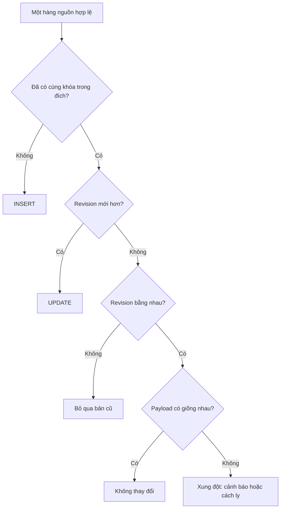

# Bài toán đồng bộ khi bản ghi có thể đã tồn tại

Dữ liệu đến từ API, tệp CSV, webhook hoặc công việc ETL không phải lúc nào cũng là đối tượng mới. Một khách hàng có thể được gửi lại nhiều lần, một sản phẩm đã có thể vừa thay đổi giá, hoặc một đơn hàng cũ có thể đến sau phiên bản mới. Nếu chỉ `INSERT`, hệ thống có thể tạo bản sao hoặc gặp lỗi khóa duy nhất; nếu luôn `UPDATE`, hệ thống có thể bỏ sót đối tượng chưa từng tồn tại.

Bài toán của chương **Upsert và MERGE** là **đối chiếu một tập nguồn với trạng thái hiện có ở bảng đích**, rồi quyết định ghi đúng hành động cho từng đối tượng:

- **Chưa có ở đích:** thêm bản ghi (`INSERT`).
- **Đã có và nguồn mới hơn:** cập nhật (`UPDATE`).
- **Đã có, không thay đổi:** giữ nguyên, tránh cập nhật thừa.
- **Đã có nhưng nguồn cũ hơn:** không ghi lùi trạng thái.
- **Cùng danh tính, cùng phiên bản, nội dung khác:** coi là xung đột cần điều tra.
- **Có ở đích, không có trong nguồn:** giữ nguyên với **delta**, hoặc cân nhắc vô hiệu hóa/xóa nếu nguồn là **full snapshot** đầy đủ, mới nhất và có thẩm quyền.

Bài này dùng PostgreSQL 15+ để thực hành cả `INSERT ... ON CONFLICT` và `MERGE`, đồng thời giải thích những quy tắc áp dụng được cho nhiều hệ quản trị SQL.

## 1. Đồng bộ không chỉ là câu lệnh INSERT

Giả sử bảng khách hàng hiện có:

```text
CRM / C-001 → An, 10 điểm, revision 1
CRM / C-002 → Binh, 20 điểm, revision 3
CRM / C-003 → Chi, 5 điểm, revision 1
```

Dữ liệu mới nhận:

```text
CRM / C-001 → An Nguyen, 12 điểm, revision 2
CRM / C-002 → Binh, 20 điểm, revision 3
CRM / C-004 → Em, 0 điểm, revision 1
CRM / C-005 → Hoa, 8 điểm, revision 1
```

Nếu chỉ chạy `INSERT` cả bốn hàng, C-001 và C-002 sẽ xung đột với khách đã có. Nếu chỉ chạy `UPDATE`, C-004 và C-005 không được tạo. Nếu xóa mọi hàng đích không nằm trong bốn hàng nguồn, C-003 bị mất dù có thể nguồn chỉ gửi thay đổi của một đợt.

**Đúng hay sai phụ thuộc vào hợp đồng nguồn**, không chỉ vào cú pháp SQL.

### 1.1. Sơ đồ quyết định



Hàng **chỉ có ở đích** được xét bằng một quyết định riêng khi đồng bộ full snapshot, không tự động thuộc các nhánh trên.

### 1.2. Các thuật ngữ

| Thuật ngữ | Giải thích |
| --- | --- |
| Source | Tập dữ liệu mới nhận, thường từ staging |
| Target | Bảng đích cần đồng bộ |
| Matched | Nguồn và đích có cùng khóa định danh |
| Not matched | Không có hàng đối ứng theo hướng so sánh được chỉ rõ |
| Upsert | Thêm nếu chưa có, cập nhật nếu đã có theo chính sách |
| MERGE | Câu SQL khai báo các nhánh hành động giữa nguồn và đích |
| Business key | Khóa xác định cùng một thực thể nghiệp vụ |
| Grain | Một hàng đại diện cho đối tượng hoặc sự kiện gì |
| Delta | Chỉ những bản ghi có thay đổi |
| Full snapshot | Toàn bộ các bản ghi thuộc phạm vi xác định tại một mốc |
| Revision | Phiên bản nguồn để xác định bản cập nhật mới hơn |
| Idempotency | Chạy lại cùng dữ liệu không làm thay đổi trạng thái ngoài chủ đích |

## 2. Khóa nghiệp vụ và phạm vi phải được xác định trước

Giả sử công ty có nhiều tenant và hai hệ CRM/POS. Cả hai hệ có thể phát mã `C-001`. Các hàng:

```text
Tenant 1 / CRM / C-001
Tenant 1 / POS / C-001
Tenant 2 / CRM / C-001
```

có thể là **ba đối tượng khác nhau**. Trong ví dụ, khóa nghiệp vụ là:

```text
(tenant_id, source_system, external_customer_id)
```

Mọi phép nối nhận diện bản ghi, ràng buộc duy nhất và điều kiện cập nhật phải dùng **đầy đủ bộ khóa đó**.

### 2.1. Khóa kỹ thuật không phải khóa nghiệp vụ

`customer_pk` tự sinh giúp các bảng con tham chiếu một hàng trong đích, nhưng không tự ngăn việc cùng khách được nạp thành hai hàng có hai khóa kỹ thuật khác nhau.

Thiết kế an toàn có cả:

```sql
customer_pk BIGINT GENERATED ALWAYS AS IDENTITY PRIMARY KEY,
UNIQUE (tenant_id, source_system, external_customer_id)
```

- `PRIMARY KEY` xác định hàng kỹ thuật.
- `UNIQUE` trên business key bảo vệ không có hai hàng đại diện cho một khách theo hợp đồng nguồn.

Email, tên người hoặc số điện thoại có thể thay đổi hay trùng nhau, nên hiếm khi là khóa ổn định phù hợp cho upsert khách hàng. Nếu không có khóa ổn định, phải giải quyết **đối sánh thực thể**, không thể trông chờ `MERGE` tự đoán hai người có phải một hay không.

### 2.2. Không thêm ngày nạp vào khóa để né conflict

Nếu khóa là `(tenant_id, external_customer_id, load_date)`, cùng khách được nạp ngày 01/06 và 02/06 sẽ trở thành **hai khóa khác nhau**. `load_date` thường là metadata của lô, không phải một phần danh tính khách.

## 3. Delta và full snapshot: khác biệt quyết định việc xóa

**Delta** chỉ mô tả các bản ghi nguồn có thay đổi. Không thấy C-003 trong delta không có nghĩa C-003 đã bị xóa. Với delta, thông thường:

- Khóa mới → chèn.
- Khóa cũ, revision mới → cập nhật.
- Khóa cũ, revision bằng/cũ → không cập nhật hoặc kiểm tra xung đột.
- Khóa không xuất hiện → giữ nguyên.
- Xóa chỉ khi có sự kiện xóa tường minh.

**Full snapshot** là một ảnh chụp đầy đủ trong một **phạm vi cụ thể**, chẳng hạn “toàn bộ khách CRM đang hoạt động của tenant 1 tại snapshot 10”. Nếu nguồn bảo đảm snapshot đầy đủ và mới nhất, không có C-003 có thể có nghĩa C-003 **không còn trong tập đang hoạt động**.

| Tình huống | Delta | Full snapshot hợp lệ |
| --- | --- | --- |
| Nguồn có khóa mới | INSERT | INSERT |
| Nguồn có bản mới hơn | UPDATE | UPDATE |
| Nguồn có bản không đổi | Giữ nguyên | Giữ nguyên |
| Đích có hàng không thấy ở nguồn | **Giữ nguyên** | Có thể vô hiệu hóa/xóa trong phạm vi |
| Nguồn tải thiếu trang hoặc bị cắt | Không được suy ra xóa | **Không** xử lý vắng mặt |
| Snapshot cũ đến sau snapshot mới | Không áp dụng như bản mới | Phải chặn áp dụng snapshot cũ |

**Không viết `DELETE`/`UPDATE inactive` dựa vào “vắng mặt ở nguồn” trước khi chứng minh nguồn là full snapshot đúng phạm vi và thứ tự.**

## 4. Tạo dữ liệu PostgreSQL có thể chạy lại

Các bảng dưới đây đều là **TEMP TABLE** để thực hành trong một phiên; dữ liệu cố định để có thể đối chiếu bằng tay.

### 4.1. Bảng đích với khóa unique

```sql
CREATE TEMP TABLE demo_customer_target_285 (
    customer_pk BIGINT GENERATED ALWAYS AS IDENTITY PRIMARY KEY,
    tenant_id INTEGER NOT NULL,
    source_system TEXT NOT NULL,
    external_customer_id TEXT NOT NULL,
    full_name TEXT NOT NULL,
    email TEXT,
    loyalty_points INTEGER NOT NULL CHECK (loyalty_points >= 0),
    source_revision INTEGER NOT NULL CHECK (source_revision >= 1),
    is_active BOOLEAN NOT NULL DEFAULT TRUE,
    created_at TIMESTAMPTZ NOT NULL DEFAULT CURRENT_TIMESTAMP,
    updated_at TIMESTAMPTZ NOT NULL DEFAULT CURRENT_TIMESTAMP,
    CONSTRAINT uq_demo_customer_business_285
        UNIQUE (tenant_id, source_system, external_customer_id),
    CONSTRAINT ck_demo_customer_key_nonempty_285
        CHECK (
            BTRIM(source_system) <> ''
            AND BTRIM(external_customer_id) <> ''
        )
);
```

Ràng buộc duy nhất khiến nhiều writer không thể ghi hai hàng mang cùng bộ khóa, kể cả khi các câu `SELECT` trước đó đồng thời thấy khóa chưa tồn tại.

### 4.2. Năm khách hàng ban đầu

```sql
INSERT INTO demo_customer_target_285 (
    tenant_id, source_system, external_customer_id,
    full_name, email, loyalty_points, source_revision, is_active
)
VALUES
    (1, 'CRM', 'C-001', 'An',    'an@example.test',    10, 1, TRUE),
    (1, 'CRM', 'C-002', 'Binh',  'binh@example.test',  20, 3, TRUE),
    (1, 'CRM', 'C-003', 'Chi',   'chi@example.test',    5, 1, TRUE),
    (2, 'CRM', 'C-001', 'Dung',  'dung@example.test',   7, 1, TRUE),
    (1, 'POS', 'C-001', 'Giang', 'giang@example.test', 30, 1, TRUE);
```

| Tenant | Nguồn | ID khách | Điểm | Revision | Active |
| ---: | --- | --- | ---: | ---: | --- |
| 1 | CRM | C-001 | 10 | 1 | TRUE |
| 1 | CRM | C-002 | 20 | 3 | TRUE |
| 1 | CRM | C-003 | 5 | 1 | TRUE |
| 1 | POS | C-001 | 30 | 1 | TRUE |
| 2 | CRM | C-001 | 7 | 1 | TRUE |

Đợt đồng bộ của bài **chỉ thuộc tenant 1 / CRM**. Hai hàng khác phạm vi phải giữ nguyên.

### 4.3. Bảng staging giữ cả bản sao của nguồn

```sql
CREATE TEMP TABLE demo_customer_stage_285 (
    batch_id INTEGER NOT NULL,
    source_row_no INTEGER NOT NULL,
    tenant_id INTEGER NOT NULL,
    source_system TEXT NOT NULL,
    external_customer_id TEXT NOT NULL,
    full_name TEXT NOT NULL,
    email TEXT,
    loyalty_points INTEGER NOT NULL CHECK (loyalty_points >= 0),
    source_revision INTEGER NOT NULL CHECK (source_revision >= 1),
    PRIMARY KEY (batch_id, source_row_no)
);
```

`(batch_id, source_row_no)` xác định **một hàng nhập**, không phải một khách hàng. Ta không đặt unique nghiệp vụ ở staging để có thể phát hiện bản sao và nhiều phiên bản trong cùng lô.

### 4.4. Batch 10

```sql
INSERT INTO demo_customer_stage_285 (
    batch_id, source_row_no, tenant_id, source_system,
    external_customer_id, full_name, email,
    loyalty_points, source_revision
)
VALUES
    (10, 1, 1, 'CRM', 'C-001', 'An Nguyen',
        'an.new@example.test', 12, 2),
    (10, 2, 1, 'CRM', 'C-002', 'Binh',
        'binh@example.test', 20, 3),
    (10, 3, 1, 'CRM', 'C-004', 'Em',
        'em@example.test', 0, 1),
    (10, 4, 1, 'CRM', 'C-004', 'Em',
        'em@example.test', 0, 1),
    (10, 5, 1, 'CRM', 'C-005', 'Hoa',
        'hoa@example.test', 8, 1),
    (10, 6, 1, 'CRM', 'C-002', 'Binh',
        'binh@example.test', 15, 2);
```

Batch 10 có **6 hàng nguồn**, nhưng chỉ **4 business key**:

| Khóa | Các hàng nguồn | Ý nghĩa |
| --- | --- | --- |
| C-001 | Hàng 1, rev 2 | Cập nhật mới |
| C-002 | Hàng 2 rev 3, hàng 6 rev 2 | Hai phiên bản; chọn rev 3 |
| C-004 | Hàng 3 và 4 cùng rev 1 | Bản sao hoàn toàn |
| C-005 | Hàng 5 rev 1 | Khóa mới |

## 5. Kiểm tra staging trước khi đồng bộ

### 5.1. Phát hiện khóa trùng trong một batch

```sql
SELECT
    tenant_id,
    source_system,
    external_customer_id,
    COUNT(*) AS source_rows,
    MIN(source_revision) AS oldest_revision,
    MAX(source_revision) AS newest_revision
FROM demo_customer_stage_285
WHERE batch_id = 10
GROUP BY tenant_id, source_system, external_customer_id
HAVING COUNT(*) > 1
ORDER BY external_customer_id;
```

Kết quả có **C-002 và C-004**. Bản sao cùng revision và hai phiên bản khác nhau là hai tình huống phải phân loại.

### 5.2. Cùng khóa và revision nhưng payload khác là xung đột

Một nguồn đảm bảo mỗi phiên bản của mỗi khách có một trạng thái xác định. Nếu hai hàng cùng khóa/revision nhưng khác tên, email hoặc điểm, không nên tùy tiện chọn hàng cuối:

```sql
SELECT
    a.external_customer_id,
    a.source_revision,
    a.source_row_no AS row_a,
    b.source_row_no AS row_b
FROM demo_customer_stage_285 AS a
JOIN demo_customer_stage_285 AS b
    ON a.batch_id = b.batch_id
   AND a.tenant_id = b.tenant_id
   AND a.source_system = b.source_system
   AND a.external_customer_id = b.external_customer_id
   AND a.source_revision = b.source_revision
   AND a.source_row_no < b.source_row_no
WHERE a.batch_id = 10
  AND ROW(a.full_name, a.email, a.loyalty_points)
      IS DISTINCT FROM
      ROW(b.full_name, b.email, b.loyalty_points);
```

Trong dữ liệu mẫu, kết quả **rỗng**; hai hàng C-004 giống hệt nhau. `IS DISTINCT FROM` có ích vì so sánh cả trường hợp một/both phía có `NULL` một cách xác định.

Nếu có kết quả, cần cách ly, báo lỗi hoặc áp dụng quy tắc ưu tiên đã được nguồn xác nhận. Không nên dùng `ROW_NUMBER` để âm thầm che dữ liệu mâu thuẫn.

### 5.3. Chọn một hàng trên mỗi khóa

```sql
CREATE TEMP TABLE demo_customer_ready_285 AS
WITH ranked AS (
    SELECT
        s.tenant_id,
        s.source_system,
        s.external_customer_id,
        s.full_name,
        s.email,
        s.loyalty_points,
        s.source_revision,
        ROW_NUMBER() OVER (
            PARTITION BY
                s.tenant_id,
                s.source_system,
                s.external_customer_id
            ORDER BY
                s.source_revision DESC,
                s.source_row_no DESC
        ) AS rn
    FROM demo_customer_stage_285 AS s
    WHERE s.batch_id = 10
      AND s.tenant_id = 1
      AND s.source_system = 'CRM'
)
SELECT
    tenant_id,
    source_system,
    external_customer_id,
    full_name,
    email,
    loyalty_points,
    source_revision
FROM ranked
WHERE rn = 1;

CREATE UNIQUE INDEX uq_demo_customer_ready_285
ON demo_customer_ready_285 (
    tenant_id, source_system, external_customer_id
);
```

`ROW_NUMBER` chọn revision cao nhất. `source_row_no DESC` chỉ giúp phá hòa xác định trong batch; nó **không tự chứng minh** hàng đến sau đúng hơn khi cùng revision. Kiểm tra mâu thuẫn ở phần trước vẫn cần thiết.

`ready` có bốn hàng:

| ID khách | Tên | Điểm | Revision |
| --- | --- | ---: | ---: |
| C-001 | An Nguyen | 12 | 2 |
| C-002 | Binh | 20 | 3 |
| C-004 | Em | 0 | 1 |
| C-005 | Hoa | 8 | 1 |

Unique index trên `ready` giúp đảm bảo không đưa hai hàng nguồn cùng khóa vào cùng một phép upsert/merge nhiều hàng.

## 6. Phân loại INSERT, UPDATE, UNCHANGED và STALE

Trước khi ghi, dùng `LEFT JOIN` để **quan sát** hành động dự kiến:

```sql
SELECT
    s.external_customer_id,
    s.source_revision AS incoming_revision,
    t.source_revision AS stored_revision,
    CASE
        WHEN t.customer_pk IS NULL THEN 'INSERT'
        WHEN s.source_revision > t.source_revision THEN 'UPDATE'
        WHEN s.source_revision < t.source_revision THEN 'STALE'
        WHEN ROW(s.full_name, s.email, s.loyalty_points)
             IS DISTINCT FROM
             ROW(t.full_name, t.email, t.loyalty_points)
            THEN 'CONFLICT_SAME_REVISION'
        ELSE 'UNCHANGED'
    END AS proposed_action
FROM demo_customer_ready_285 AS s
LEFT JOIN demo_customer_target_285 AS t
    ON t.tenant_id = s.tenant_id
   AND t.source_system = s.source_system
   AND t.external_customer_id = s.external_customer_id
ORDER BY s.external_customer_id;
```

Từ trạng thái ban đầu:

| ID khách | Revision nguồn | Revision đích | Phân loại |
| --- | ---: | ---: | --- |
| C-001 | 2 | 1 | UPDATE |
| C-002 | 3 | 3 | UNCHANGED |
| C-004 | 1 | `NULL` | INSERT |
| C-005 | 1 | `NULL` | INSERT |

Dùng `t.customer_pk IS NULL` để kiểm tra không matched vì khóa chính đích không `NULL` trên hàng thật.

**Bảng phân loại này chỉ là ảnh chụp tại thời điểm đọc.** Nó không bảo đảm trạng thái không thay đổi trước khi một worker khác ghi. Khi thực hiện, phải dựa trên unique constraint, transaction và xử lý xung đột nguyên tử.

## 7. Cách A: INSERT ... ON CONFLICT DO UPDATE

PostgreSQL hỗ trợ upsert theo khóa unique bằng `ON CONFLICT`. Đây là cách ngắn gọn khi cần “chưa có thì chèn, đã có thì cập nhật bản mới hơn”.

```sql
INSERT INTO demo_customer_target_285 AS t (
    tenant_id, source_system, external_customer_id,
    full_name, email, loyalty_points, source_revision
)
SELECT
    s.tenant_id, s.source_system, s.external_customer_id,
    s.full_name, s.email, s.loyalty_points, s.source_revision
FROM demo_customer_ready_285 AS s
WHERE TRUE
ON CONFLICT (
    tenant_id, source_system, external_customer_id
)
DO UPDATE SET
    full_name = EXCLUDED.full_name,
    email = EXCLUDED.email,
    loyalty_points = EXCLUDED.loyalty_points,
    source_revision = EXCLUDED.source_revision,
    is_active = TRUE,
    updated_at = CURRENT_TIMESTAMP
WHERE EXCLUDED.source_revision > t.source_revision
RETURNING
    tenant_id, source_system, external_customer_id,
    full_name, loyalty_points, source_revision;
```

Ở đây:

- `ON CONFLICT (...)` xác định ràng buộc/các cột dùng nhận diện khóa trùng.
- `EXCLUDED` là hàng **được đề xuất chèn**.
- `t` là hàng đã tồn tại trong bảng đích.
- `WHERE EXCLUDED.source_revision > t.source_revision` chỉ cập nhật khi bản nguồn mới hơn.
- `RETURNING` trong PostgreSQL trả các hàng **thực sự chèn hoặc cập nhật**, không trả hàng matched nhưng bỏ qua cập nhật.
- `WHERE TRUE` trong `INSERT ... SELECT` giúp tránh nhập nhằng cú pháp `ON` của phép nối với `ON CONFLICT`; nó không lọc hàng.

**Kết quả lần đầu:** C-001 được cập nhật; C-004 và C-005 được thêm; C-002 không đổi. `RETURNING` có **3 hàng** và bảng đích có **7 hàng**.

### 7.1. Chạy lại cùng nguồn

Khi chạy lại chính câu UPSERT:

- C-001 đã ở revision 2.
- C-002 đã ở revision 3.
- C-004 và C-005 đã ở revision 1.

Không có revision nào lớn hơn, nên nhánh UPDATE không được thực hiện và `RETURNING` trả **0 hàng**. Đó là hành vi **idempotent đối với trạng thái khách hàng** theo chính sách revision trong bài.

Tuy nhiên, một thao tác thử insert có thể vẫn tiêu hao giá trị identity/sequence hoặc tạo dấu vết ở một số thành phần kỹ thuật. Không dùng tính liên tục của ID tự tăng làm thước đo đúng/sai của upsert.

### 7.2. DO NOTHING khác DO UPDATE

Nếu chỉ cần ghi khi khóa chưa từng xuất hiện:

```sql
INSERT INTO demo_customer_target_285 (
    tenant_id, source_system, external_customer_id,
    full_name, email, loyalty_points, source_revision
)
SELECT
    tenant_id, source_system, external_customer_id,
    full_name, email, loyalty_points, source_revision
FROM demo_customer_ready_285
WHERE TRUE
ON CONFLICT (
    tenant_id, source_system, external_customer_id
)
DO NOTHING;
```

`DO NOTHING` **giữ nguyên** hàng đích ngay cả khi nguồn có revision mới hơn. Nó phù hợp với dữ liệu bất biến/first-write-wins, nhưng không phù hợp nếu phải áp dụng cập nhật hợp lệ như C-001.

### 7.3. Vì sao cần ràng buộc UNIQUE thật?

Một câu `INSERT ... SELECT ... WHERE NOT EXISTS` không đủ an toàn nếu chỉ dựa vào phép kiểm tra. Hai phiên cùng thấy chưa có C-004 rồi cùng chèn sẽ gây race condition.

`UNIQUE` bảo vệ định danh ở tầng database; `ON CONFLICT` cho PostgreSQL quy tắc ứng xử khi gặp xung đột ấy. Hai thành phần giải quyết hai vai trò khác nhau.

## 8. Cách B: MERGE với các nhánh MATCHED và NOT MATCHED

PostgreSQL 15+ hỗ trợ `MERGE`. Ví dụ dưới đây là **phương án thay thế** câu UPSERT ở phần 7. Nếu muốn so sánh kết quả lần đầu, hãy dùng lại trạng thái đích ban đầu của phần 4, thay vì chạy cả hai phương án liên tiếp trên bảng đã cập nhật.

```sql
MERGE INTO demo_customer_target_285 AS t
USING demo_customer_ready_285 AS s
ON (
    t.tenant_id = s.tenant_id
    AND t.source_system = s.source_system
    AND t.external_customer_id = s.external_customer_id
)
WHEN MATCHED
     AND s.source_revision > t.source_revision
THEN UPDATE SET
    full_name = s.full_name,
    email = s.email,
    loyalty_points = s.loyalty_points,
    source_revision = s.source_revision,
    is_active = TRUE,
    updated_at = CURRENT_TIMESTAMP
WHEN NOT MATCHED
THEN INSERT (
    tenant_id, source_system, external_customer_id,
    full_name, email, loyalty_points, source_revision
)
VALUES (
    s.tenant_id, s.source_system, s.external_customer_id,
    s.full_name, s.email, s.loyalty_points, s.source_revision
);
```

Đọc ý nghĩa:

1. `USING` chỉ tập nguồn đã chuẩn bị.
2. `ON` trả lời hai hàng có phải **cùng thực thể** không.
3. `WHEN MATCHED AND ...` chỉ cập nhật khi revision nguồn lớn hơn revision đích.
4. `WHEN NOT MATCHED` tạo khách chưa có.
5. Một hàng matched nhưng không thỏa điều kiện update có thể không bị thay đổi.

Kết quả nghiệp vụ từ trạng thái ban đầu cũng là: cập nhật C-001, thêm C-004/C-005, giữ C-002.

### 8.1. ON chỉ nên diễn tả khóa định danh

Một sai lầm:

```sql
-- KHÔNG NÊN: đưa điều kiện phiên bản vào ON.
ON (
    t.tenant_id = s.tenant_id
    AND t.source_system = s.source_system
    AND t.external_customer_id = s.external_customer_id
    AND s.source_revision > t.source_revision
)
```

Nếu nguồn cùng hoặc cũ hơn revision của đích, phép `ON` có thể không khớp, làm nguồn bị coi là **NOT MATCHED**, rồi nhánh `INSERT` thử tạo khóa đã tồn tại.

**ON phải trả lời “cùng đối tượng?”, còn điều kiện WHEN MATCHED phải trả lời “có nên cập nhật đối tượng đó?”** Không tùy tiện đưa `t.is_active` hay điều kiện trạng thái vào `ON` nếu đối tượng inactive vẫn là cùng khách theo khóa.

### 8.2. MERGE không tự xử lý hàng chỉ có ở đích

Câu `MERGE` trên xử lý hàng nguồn matched hoặc chưa có đích. Nó **chưa** làm gì với C-003, là hàng chỉ có trong đích.

Một số DBMS/phiên bản hỗ trợ nhánh xử lý hàng không có nguồn tương ứng; cú pháp khác nhau. Trong ví dụ PostgreSQL, ta dùng một bước `UPDATE ... NOT EXISTS` riêng và giới hạn chặt phạm vi snapshot.

### 8.3. MERGE không khử trùng nguồn

Nếu `USING` có nhiều hàng cùng khóa và cả hai tìm cách tác động lên một hàng đích, engine có thể từ chối thao tác nhiều lần trên cùng hàng. Vì vậy, `demo_customer_ready_285` phải được tạo với **một hàng trên mỗi business key** trước khi MERGE.

`MERGE` cũng không nên được mặc định là có cùng hành vi khi ghi tranh chấp như `ON CONFLICT` của PostgreSQL; các thao tác ghi đồng thời vẫn phải có unique constraint, xử lý lỗi và retry phù hợp.

## 9. Hàng chỉ còn ở đích: soft-delete có phạm vi

Giả sử batch 10 được xác nhận là **full snapshot mới nhất và đầy đủ** của **tenant 1 / CRM**. C-003 không có trong nguồn đã chuẩn bị. Quy tắc của bài là **vô hiệu hóa** nó, không xóa vật lý:

```sql
UPDATE demo_customer_target_285 AS t
SET
    is_active = FALSE,
    updated_at = CURRENT_TIMESTAMP
WHERE t.tenant_id = 1
  AND t.source_system = 'CRM'
  AND t.is_active = TRUE
  AND NOT EXISTS (
      SELECT 1
      FROM demo_customer_ready_285 AS s
      WHERE s.tenant_id = t.tenant_id
        AND s.source_system = t.source_system
        AND s.external_customer_id = t.external_customer_id
  );
```

Bước này cập nhật **chỉ C-003** trong trạng thái mẫu.

Điều kiện `t.tenant_id = 1` và `t.source_system = 'CRM'` phải áp dụng cho **bảng đích**. Nếu bỏ chúng, những khách ngoài phạm vi snapshot (tenant 2 hoặc POS) cũng có thể bị đánh dấu vắng mặt.

### 9.1. Không chạy với delta hoặc snapshot tải thiếu

Với nguồn là delta, một khóa không xuất hiện có thể **hoàn toàn không thay đổi**. Với snapshot thiếu một trang, hàng vắng mặt có thể vẫn đang tồn tại ở nguồn.

Vì vậy, chỉ áp dụng bước này khi:

- Nguồn xác nhận **toàn bộ phạm vi**.
- Tất cả trang/tệp đã đến và vượt kiểm tra toàn vẹn.
- Snapshot có thứ tự mới nhất theo quy tắc nguồn.
- Phạm vi tenant/source chính xác.
- Chính sách nghiệp vụ cho phép vô hiệu hóa vì vắng mặt.

Một snapshot rỗng chỉ có nghĩa “không có khách” khi nguồn xác nhận chính xác điều đó. Nó cũng có thể là kết quả của lỗi tải tệp.

### 9.2. Inactive khác DELETE vật lý

`is_active=FALSE` giữ khóa, quan hệ dữ liệu và lịch sử. `DELETE` có thể phá liên kết, gặp khóa ngoại hoặc làm mất thông tin cần kiểm toán.

Không nhất thiết đồng nhất “không có trong snapshot” với “đã bị xóa”. Có thể thêm trường `inactive_reason` hoặc `last_seen_snapshot_seq` để biểu diễn ý nghĩa chính xác.

## 10. Gói thao tác trong transaction

Một lần đồng bộ snapshot có thể cần cả:

1. Kiểm tra snapshot mới nhất và nguồn hợp lệ.
2. Upsert khách có mặt trong nguồn.
3. Vô hiệu hóa khách vắng mặt trong full snapshot.
4. Ghi watermark và số liệu đối soát.

Nếu upsert thành công nhưng xử lý vắng mặt lỗi, hệ thống có thể ở trạng thái nửa đồng bộ. Dùng transaction để giữ những bước cần nhất quán:

```sql
BEGIN;

-- Kiểm tra quyền áp dụng và watermark của snapshot.
-- UPSERT hoặc MERGE các khách từ tập ready.
-- Chỉ với full snapshot hợp lệ: vô hiệu hóa khách vắng mặt.
-- Ghi nhận snapshot hoàn thành và số liệu đối soát.

COMMIT;
```

Nếu một bước lỗi:

```sql
ROLLBACK;
```

Trong hệ thực, tải dữ liệu lớn vào staging có thể hoàn tất **trước transaction ngắn áp dụng thay đổi**. Không nên giữ transaction mở suốt thời gian chờ tải tệp từ mạng.

### 10.1. Transaction mẫu chạy được với ON CONFLICT

Nếu muốn thực hiện hai hành động chính trên bộ dữ liệu mẫu trong một transaction, từ trạng thái ban đầu hãy dùng:

```sql
BEGIN;

INSERT INTO demo_customer_target_285 AS t (
    tenant_id, source_system, external_customer_id,
    full_name, email, loyalty_points, source_revision
)
SELECT
    s.tenant_id, s.source_system, s.external_customer_id,
    s.full_name, s.email, s.loyalty_points, s.source_revision
FROM demo_customer_ready_285 AS s
WHERE TRUE
ON CONFLICT (
    tenant_id, source_system, external_customer_id
)
DO UPDATE SET
    full_name = EXCLUDED.full_name,
    email = EXCLUDED.email,
    loyalty_points = EXCLUDED.loyalty_points,
    source_revision = EXCLUDED.source_revision,
    is_active = TRUE,
    updated_at = CURRENT_TIMESTAMP
WHERE EXCLUDED.source_revision > t.source_revision;

-- Chỉ đúng nếu batch là full snapshot đầy đủ, mới nhất.
UPDATE demo_customer_target_285 AS t
SET
    is_active = FALSE,
    updated_at = CURRENT_TIMESTAMP
WHERE t.tenant_id = 1
  AND t.source_system = 'CRM'
  AND t.is_active = TRUE
  AND NOT EXISTS (
      SELECT 1
      FROM demo_customer_ready_285 AS s
      WHERE s.tenant_id = t.tenant_id
        AND s.source_system = t.source_system
        AND s.external_customer_id = t.external_customer_id
  );

COMMIT;
```

Đây là **transaction thực hành** giả định snapshot đã được kiểm tra và không có worker khác chạy song song trên cùng phạm vi. Phần tiếp theo sẽ bổ sung vấn đề snapshot cũ và ghi đồng thời cho quy trình sản xuất.

### 10.2. Trạng thái cuối mong đợi

```sql
SELECT
    tenant_id, source_system, external_customer_id,
    full_name, loyalty_points, source_revision, is_active
FROM demo_customer_target_285
ORDER BY tenant_id, source_system, external_customer_id;
```

| Tenant | Nguồn | Khách | Tên | Điểm | Revision | Active |
| ---: | --- | --- | --- | ---: | ---: | --- |
| 1 | CRM | C-001 | An Nguyen | 12 | 2 | TRUE |
| 1 | CRM | C-002 | Binh | 20 | 3 | TRUE |
| 1 | CRM | C-003 | Chi | 5 | 1 | FALSE |
| 1 | CRM | C-004 | Em | 0 | 1 | TRUE |
| 1 | CRM | C-005 | Hoa | 8 | 1 | TRUE |
| 1 | POS | C-001 | Giang | 30 | 1 | TRUE |
| 2 | CRM | C-001 | Dung | 7 | 1 | TRUE |

Sau đồng bộ có **7 hàng**, gồm **6 active** và **1 inactive**. C-003 vẫn còn để bảo toàn danh tính và lịch sử. Hai khách ngoài phạm vi không thay đổi.

Nếu chạy câu upsert ở phần 7 rồi chạy lại transaction mẫu, bảng đích vẫn hướng tới trạng thái này; nhưng để quan sát chính xác **3 thay đổi ở lần đầu**, chỉ nên chọn một đường thực thi từ trạng thái ban đầu.

## 11. Tại sao thứ tự snapshot phải được bảo vệ ở cấp lô?

Điều kiện `source_revision` trong `ON CONFLICT` bảo vệ **một khách** khỏi cập nhật cũ. Nhưng full snapshot chứa thêm một phép so sánh **tập khách hàng**, nên cần biết snapshot nào là mới nhất.

Giả sử:

```text
Snapshot 11 (mới): C-001, C-002, C-004, C-005, C-006
Snapshot 10 (cũ): C-001, C-002, C-004, C-005
```

Nếu snapshot 11 đã được áp dụng rồi worker khác chạy bước `NOT EXISTS` của snapshot 10, khách C-006 có thể bị đánh dấu inactive dù phiên bản mới nhất xác nhận khách đang tồn tại.

Đó là lỗi **ghi lùi trạng thái tập hợp**, không thể giải quyết chỉ bằng việc so sánh `source_revision` của các hàng **có mặt** trong nguồn.

### 11.1. Watermark theo tenant và source

Một thiết kế thường dùng bảng theo dõi sequence của snapshot đã áp dụng:

```sql
CREATE TEMP TABLE demo_sync_cursor_285 (
    tenant_id INTEGER NOT NULL,
    source_system TEXT NOT NULL,
    applied_snapshot_seq BIGINT NOT NULL,
    PRIMARY KEY (tenant_id, source_system)
);
```

Nguồn phải cung cấp `snapshot_seq` **tăng dần theo chính thứ tự snapshot được tạo**, không đơn thuần là số batch được đặt khi pipeline nhận tệp.

Một bước nhận quyền áp dụng snapshot 10:

```sql
INSERT INTO demo_sync_cursor_285 AS c (
    tenant_id,
    source_system,
    applied_snapshot_seq
)
VALUES (1, 'CRM', 10)
ON CONFLICT (tenant_id, source_system)
DO UPDATE SET
    applied_snapshot_seq = EXCLUDED.applied_snapshot_seq
WHERE
    EXCLUDED.applied_snapshot_seq > c.applied_snapshot_seq
RETURNING
    tenant_id,
    source_system,
    applied_snapshot_seq;
```

Ý nghĩa:

- Nếu chưa từng đồng bộ tenant 1 / CRM, tạo watermark 10.
- Nếu đã ở snapshot 9, cập nhật lên 10.
- Nếu đã ở snapshot 10 hoặc 11, không nhận lại snapshot 10; `RETURNING` trả **0 hàng**.

**Quan trọng:** bước này và toàn bộ thay đổi dữ liệu đích phải nằm **trong cùng transaction**. Chỉ thực thi UPSERT và bước vô hiệu hóa khi watermark đã được chấp nhận. Nếu một thao tác lỗi, rollback cả watermark và thay đổi dữ liệu.

Không dùng ví dụ riêng lẻ trên như một “đánh dấu hoàn thành” trước khi đồng bộ. Trong quy trình thật, ứng dụng hoặc stored procedure phải quyết định dựa trên `RETURNING` rồi commit/rollback nguyên khối; cần thiết kế khóa và retry nếu nhiều worker cùng xử lý một phạm vi.

### 11.2. Snapshot rỗng phải được xác minh

Nếu `ready` rỗng, `UPDATE ... NOT EXISTS` sẽ vô hiệu hóa **mọi khách active trong phạm vi**. Điều này chỉ hợp lệ nếu nguồn chứng minh snapshot hoàn chỉnh và thật sự không còn khách nào.

Trước bước áp dụng cần kiểm tra:

1. Manifest/tổng số trang, số tệp đã đủ.
2. Checksums hoặc dấu hiệu hoàn tất nếu có.
3. Phạm vi tenant/source chính xác.
4. Không có bản ghi khóa thiếu hoặc lỗi bị bỏ qua ngoài dự kiến.
5. Thứ tự snapshot mới hơn đã được xác minh.
6. Các quy tắc xóa/vô hiệu hóa đã được phê duyệt.

**Không được lấy “truy vấn staging trả 0 hàng” làm bằng chứng “nguồn có 0 đối tượng”.**

## 12. Bản ghi cũ đến muộn và cùng revision nhưng payload khác

Có hai kiểu bất thường khác nhau.

### 12.1. Bản cũ đến sau bản mới

Đích đang có:

```text
C-001: loyalty_points=12, revision=2
```

Một thông điệp đến muộn chứa:

```text
C-001: loyalty_points=10, revision=1
```

Câu `ON CONFLICT ... WHERE EXCLUDED.source_revision > t.source_revision` không cập nhật, nên đích không bị ghi lùi về 10. Đây là một đặc tính quan trọng của đồng bộ từ nguồn phát sự kiện theo kiểu at-least-once.

### 12.2. Revision bằng nhưng thông tin khác

Đích có C-001 revision 2, điểm 12; một bản nguồn cũng revision 2 nhưng điểm 99. Nếu chính sách chỉ cập nhật khi revision lớn hơn, câu lệnh sẽ **bỏ qua**, song đó chưa đủ để coi dữ liệu đúng.

Tìm các hàng mâu thuẫn cùng revision:

```sql
SELECT
    s.external_customer_id,
    s.source_revision,
    s.loyalty_points AS incoming_points,
    t.loyalty_points AS stored_points
FROM demo_customer_ready_285 AS s
JOIN demo_customer_target_285 AS t
    ON t.tenant_id = s.tenant_id
   AND t.source_system = s.source_system
   AND t.external_customer_id = s.external_customer_id
WHERE s.source_revision = t.source_revision
  AND ROW(s.full_name, s.email, s.loyalty_points)
      IS DISTINCT FROM
      ROW(t.full_name, t.email, t.loyalty_points)
ORDER BY s.external_customer_id;
```

Trong dữ liệu mẫu đã đồng bộ đúng, kết quả rỗng. Nếu có hàng, có thể phải:

- Ghi sự kiện vào bảng lỗi/quarantine.
- Đối chiếu hệ nguồn gốc.
- Đánh dấu batch chưa được hoàn tất.
- Không tự ý lấy “bản đến sau” làm đúng nếu nguồn chưa quy định.

### 12.3. Dùng thời gian nguồn khi không có revision?

`source_changed_at` đôi khi được dùng để xác định mới–cũ. Nhưng thời gian có thể trùng, đồng hồ máy nguồn lệch hoặc dữ liệu đến muộn. Nếu chọn:

```sql
WHERE EXCLUDED.source_changed_at > t.source_changed_at
```

thì phải có hợp đồng rằng timestamp đó phản ánh **thứ tự thay đổi đáng tin cậy của từng đối tượng**. Không lấy `received_at` hoặc `updated_at` của hệ đích làm phiên bản nguồn một cách tùy tiện.

## 13. Reactivation: khách vắng mặt rồi xuất hiện trở lại

Sau snapshot 10, C-003 được đánh dấu inactive. Giả sử snapshot 11 đầy đủ lại chứa C-003 với **cùng revision 1**. Điều kiện upsert:

```sql
WHERE EXCLUDED.source_revision > t.source_revision
```

không kích hoạt vì revision bằng nhau, nên **không tự bật lại `is_active`**.

Lý do: trạng thái **có mặt trong snapshot** và phiên bản **thuộc tính khách** là hai loại thông tin khác nhau. Khách có thể rời tập hoạt động rồi quay lại mà tên/email/điểm không đổi.

Nếu hợp đồng nghiệp vụ cho phép snapshot mới nhất quyết định tư cách hoạt động, có thể bổ sung bước kích hoạt lại các khóa có mặt trong **snapshot được chấp nhận** và revision bằng nhau:

```sql
-- Chỉ chạy với một snapshot mới nhất, đầy đủ và đã được chấp nhận.
UPDATE demo_customer_target_285 AS t
SET
    is_active = TRUE,
    updated_at = CURRENT_TIMESTAMP
FROM demo_customer_ready_285 AS s
WHERE t.tenant_id = s.tenant_id
  AND t.source_system = s.source_system
  AND t.external_customer_id = s.external_customer_id
  AND t.is_active = FALSE
  AND s.source_revision = t.source_revision;
```

Trong snapshot 10 hiện tại, C-003 không có ở `ready` nên bước này không thay đổi nó. Ví dụ chỉ minh họa cơ chế cho snapshot mới **có chứa lại khóa**.

Nếu nguồn có revision thấp hơn nhưng snapshot mới hơn, phải xác minh tính nhất quán của nguồn; không tự khôi phục hoặc ghi đè trường nghiệp vụ khi hai dấu hiệu về thứ tự mâu thuẫn.

**Bài học:** full snapshot cần theo dõi `last_seen_snapshot_seq`, trạng thái membership hoặc chính sách kích hoạt lại riêng; không nên gắn mọi thay đổi vào một cột revision của payload.

## 14. NULL trong dữ liệu đồng bộ: xóa giá trị hay không gửi giá trị?

Giả sử cột `email` đang là `'an@example.test'`, nhưng bản nguồn mới có `email = NULL`.

Có hai cách hiểu:

1. **Full replacement:** nguồn xác nhận khách không còn email. `NULL` nghĩa là **xóa giá trị email hiện có**.
2. **Partial patch:** nguồn không gửi trường email, còn một trường khác được cập nhật. `NULL` trong staging có thể chỉ là dấu hiệu **không có trường này trong payload**.

Hai ngữ nghĩa khác nhau, không thể dùng chung một câu UPDATE mà không định nghĩa hợp đồng.

### 14.1. Full replacement

Trong ví dụ upsert chính, ta viết:

```sql
email = EXCLUDED.email
```

Nếu nguồn có `email = NULL`, email của đích trở thành `NULL`. Điều này đúng nếu mỗi record nguồn là trạng thái **đầy đủ** được phép thay thế.

### 14.2. Partial patch

Đối với patch, cần lưu thêm cờ biểu thị **trường có được gửi hay không**, chẳng hạn `email_present`, chứ không dùng `NULL` để diễn đạt cả “không gửi” lẫn “xóa”:

```sql
-- Mẫu ý tưởng cho bảng stage có cột email_present:
UPDATE some_customer_target AS t
SET email =
    CASE
        WHEN s.email_present THEN s.email
        ELSE t.email
    END
FROM some_customer_patch_stage AS s
WHERE t.business_key = s.business_key;
```

Đây là **mẫu khái niệm**; hai bảng ở đoạn này không thuộc bộ dữ liệu thực hành. Khi `email_present=TRUE` và `s.email=NULL`, ta **chủ động xóa email**. Khi `email_present=FALSE`, giữ email cũ.

### 14.3. Vì sao COALESCE có thể sai?

```sql
email = COALESCE(EXCLUDED.email, t.email)
```

sẽ **không bao giờ cho phép xóa email thành NULL** nếu phía đích đang có giá trị. Cách này chỉ phù hợp khi nghiệp vụ khẳng định `NULL` luôn có nghĩa “không cập nhật”, không bao giờ có nghĩa “xóa thông tin”.

Để so sánh payload có thể `NULL`, dùng `IS DISTINCT FROM` thay vì `=` hoặc `<>` khi cần kết quả true/false xác định.

## 15. UNIQUE, NULL và chuẩn hóa khóa

### 15.1. UNIQUE với NULL không phải lúc nào cũng ngăn trùng

Trong PostgreSQL, unique thông thường coi các giá trị `NULL` là khác nhau để kiểm tra ràng buộc, nên có thể cho nhiều hàng cùng `NULL` ở thành phần khóa.

```sql
CREATE TEMP TABLE demo_nullable_key_285 (
    tenant_id INTEGER NOT NULL,
    external_id TEXT,
    UNIQUE (tenant_id, external_id)
);

INSERT INTO demo_nullable_key_285 VALUES
    (1, NULL),
    (1, NULL);
```

Hai hàng có thể được chấp nhận theo unique mặc định PostgreSQL. Nếu `external_id` là thành phần định danh **bắt buộc**, nên khai báo `NOT NULL` ngay từ đầu. PostgreSQL 15+ có `UNIQUE NULLS NOT DISTINCT` cho chính sách coi các `NULL` là không khác nhau, nhưng không phải lúc nào cũng phù hợp với nghiệp vụ; nhiều thực thể khác nhau có thể cùng thiếu ID.

### 15.2. Quy tắc viết hoa, khoảng trắng và collation

`'C-001'` và `' c-001 '` có thể là cùng mã nếu nguồn xác nhận bỏ khoảng trắng và không phân biệt hoa–thường, nhưng cũng có thể khác nếu mã phân biệt chính xác byte.

Đừng tùy tiện dùng:

```sql
UPPER(TRIM(external_customer_id))
```

nếu chưa xác minh hợp đồng. Chuẩn hóa sai có thể gộp hai khách thật thành một. Khi chuẩn hóa được yêu cầu, nên lưu cả **raw key** để kiểm toán và **canonical key** để tạo unique, nhất quán ở staging, phép nối và conflict target.

### 15.3. Soft-delete và khóa duy nhất

Nếu bảng giữ hàng inactive với cùng business key, unique toàn bảng sẽ không cho thêm “bản mới cùng khóa”. Đây thường là điều tốt nếu bản inactive vẫn đại diện **cùng thực thể** và phải được kích hoạt lại.

Một quy tắc khác là “chỉ duy nhất giữa hàng active”, có thể dùng partial unique index trong PostgreSQL:

```sql
-- Ví dụ DDL khái niệm cho bảng khác:
CREATE UNIQUE INDEX uq_active_customer
ON some_customers (tenant_id, external_id)
WHERE deleted_at IS NULL;
```

Nhưng điều đó cho phép nhiều hàng lịch sử có cùng khóa; khi đồng bộ, cần chính sách rõ ràng về **khôi phục hàng cũ hay tạo thực thể mới**, không chỉ thêm điều kiện vào index.

## 16. Tránh ghi đồng thời sai: kiểm tra trước không đủ

Một cách làm dễ thấy:

```sql
SELECT 1
FROM demo_customer_target_285
WHERE tenant_id = 1
  AND source_system = 'CRM'
  AND external_customer_id = 'C-004';
```

Nếu không có hàng, ứng dụng gửi `INSERT`. Nhưng hai worker có thể chạy cùng lúc:

```text
Worker A                          Worker B
-------------------------------   -------------------------------
SELECT: chưa thấy C-004           SELECT: chưa thấy C-004
Thử INSERT C-004                  Thử INSERT C-004
Một worker ghi thành công         Worker kia gặp unique conflict
```

Nếu không có `UNIQUE` đúng business key, cả hai có thể cùng ghi, tạo trùng. `WHERE NOT EXISTS` trong `INSERT ... SELECT` cũng không tự bảo vệ khỏi việc hai transaction đồng thời nhìn thấy “chưa có”.

### 16.1. ON CONFLICT và MERGE có cùng bảo đảm không?

Không mặc định. Trên PostgreSQL, `INSERT ... ON CONFLICT` được thiết kế để xử lý xung đột với một unique index phù hợp. `MERGE` dựa trên điều kiện `ON`, và trong một số cuộc đua ghi có thể gặp lỗi unique thay vì tự chuyển nhánh thành một cập nhật giống hệt upsert.

Do đó:

- Vẫn tạo unique constraint bảo vệ bảng.
- Chỉ dùng một hàng nguồn trên mỗi khóa.
- Thiết kế retry khi gặp lỗi đồng thời phù hợp.
- Không tự coi `MERGE` là “tuyệt đối nguyên tử cho mọi quy tắc nhiều bảng”.

### 16.2. Isolation và retry transaction

Hai transaction cập nhật một tập nhiều khách theo thứ tự khác nhau có thể gặp deadlock hoặc xung đột serialization, tùy mức cô lập và DBMS.

Khi cần retry, hãy retry **toàn bộ transaction**, không chỉ một statement ở giữa khi các statement phụ thuộc trạng thái nhau. Retry phải có giới hạn và chiến lược backoff; dữ liệu nguồn/khóa phải ổn định để lần thử lại không tạo tác dụng phụ ngoài dự kiến.

Đối với full snapshot cùng tenant/source, có thể cần serialize thao tác áp dụng snapshot bằng watermark/khóa phạm vi hợp lý, thay vì cho hai worker đồng thời vô hiệu hóa lẫn nhau.

## 17. MERGE có nhiều nguồn khớp một hàng đích

Giả sử một nguồn chưa khử trùng có hai hàng `C-004`. Nếu cả hai đều cố cập nhật cùng hàng đích bằng `MERGE`, DBMS có thể từ chối vì một hàng đích bị tác động nhiều lần. Với PostgreSQL `ON CONFLICT DO UPDATE` nhiều hàng nguồn trùng conflict target trong cùng câu lệnh cũng có thể gây lỗi không thể ảnh hưởng cùng hàng hai lần.

**Vì vậy bước chuẩn bị dữ liệu là một phần của thuật toán đồng bộ, không phải tối ưu tùy chọn.**

Có ba chính sách khác nhau:

| Tình huống trong staging | Cách xử lý thường phù hợp |
| --- | --- |
| Hai bản sao cùng khóa, cùng revision, cùng payload | Chọn một để ghi trạng thái hiện tại |
| Cùng khóa, revision khác nhau, nguồn bảo đảm thứ tự | Chọn revision mới nhất cho bảng trạng thái |
| Cùng khóa/revision, payload mâu thuẫn | Báo/quarantine, không chọn tùy tiện |
| Hai sự kiện khác nhau của cùng thực thể | Lưu theo `event_id` nếu mục tiêu là lịch sử sự kiện |
| Nhiều hàng dòng chi tiết của cùng đơn | Khóa theo `line_id` hoặc grain dòng, không gộp theo `order_id` |

Bảng trạng thái hiện tại và bảng nhật ký sự kiện có **grain khác nhau**. Chỉ vì hai sự kiện cùng `customer_id` không có nghĩa chúng là bản sao cần loại bỏ.

## 18. Không tạo “nhiều hàng matched” do JOIN nguồn sai

Ngay cả khi staging tự nó chỉ có một hàng cho mỗi business key, phép `JOIN` bổ sung trong `USING` có thể nhân hàng.

Ví dụ khách C-001 có ba số điện thoại ở bảng phụ. Nếu đưa:

```sql
-- Ví dụ cấu trúc, không chạy trên bộ bảng mẫu.
SELECT s.*
FROM stage_customer AS s
JOIN customer_phones AS p
    ON p.customer_id = s.customer_id;
```

vào `MERGE`, một hàng khách có thể nhân thành ba hàng nguồn. Muốn lọc “khách có số điện thoại”, có thể dùng `EXISTS`; nếu thật sự cần dữ liệu điện thoại, phải đưa nó về **một hàng trên mỗi khách** theo quy tắc rõ ràng trước khi đồng bộ.

Chỉ dùng `SELECT DISTINCT` để che lỗi nhân hàng không luôn đúng: hai bản ghi có giá trị khác nhau vẫn tồn tại, còn lựa chọn bỏ trường có thể làm mất thông tin. Cần xác định và bảo vệ grain trước.

## 19. Đồng bộ bảng cha và bảng con

Một đơn có thể có một hàng bảng `orders` nhưng nhiều hàng `order_items`. Nếu bảng đích phải đồng bộ cả hai:

- Bảng cha: business key thường là mã đơn trong phạm vi nguồn.
- Bảng con: business key cần thêm **mã dòng đơn** (`line_id`), không chỉ mã đơn.
- Thực hiện upsert bảng cha trước khi chèn hàng con nếu có khóa ngoại.
- Trong full snapshot các dòng của một đơn, có thể vô hiệu hóa/xóa **các dòng của đúng đơn ấy** không còn trong nguồn, không xóa dòng của mọi đơn khác.
- Thao tác cha/con nên nằm trong transaction bảo đảm tính nhất quán.

Nếu một đơn có ba dòng hàng và câu `JOIN` nhân `orders.total_amount` thành ba bản, `SUM(total_amount)` có thể bị tính gấp ba. Đây là lỗi **grain**, không phải lỗi của `SUM`.

### 19.1. Phạm vi xóa ở bảng con

Nếu batch chỉ đồng bộ đơn `ORD-1001`, bước xóa dòng thiếu phải giới hạn `order_id = ORD-1001`. Không được xóa tất cả dòng hàng trong database vắng mặt trong staging của **một đơn**.

Tư duy này giống hệt việc giới hạn tenant/source trong bước vô hiệu hóa khách.

## 20. Snapshot, tombstone và tránh hồi sinh dữ liệu cũ

Không phải lúc nào bản ghi vắng mặt trong snapshot đồng nghĩa một thao tác xóa. Một số hệ gửi **tombstone** hoặc sự kiện `DELETE` có revision riêng:

```text
tenant=1, source=CRM, customer=C-003
operation=DELETE, revision=7
```

Nếu xóa vật lý hàng đích, sau đó một sự kiện cũ revision 5 đến muộn có thể tạo khách lại vì unique key không còn tồn tại.

Có thể giữ một bản ghi tombstone hoặc trạng thái `deleted` kèm **revision lớn nhất đã thấy**, để sự kiện cũ không hồi sinh thực thể. Quyết định xóa vật lý, xóa mềm, hoặc giữ tombstone phụ thuộc yêu cầu lưu trữ, quyền riêng tư và hợp đồng nguồn.

Trong full snapshot, trạng thái **membership** có thể còn cần theo dõi phiên bản snapshot độc lập với revision của thuộc tính, như đã phân tích ở phần 13.

## 21. Xác minh kết quả bằng số liệu đối soát

Sau khi đồng bộ theo phần 10, chạy:

```sql
SELECT
    tenant_id,
    source_system,
    COUNT(*) AS total_rows,
    COUNT(*) FILTER (WHERE is_active) AS active_rows,
    COUNT(*) FILTER (WHERE NOT is_active) AS inactive_rows
FROM demo_customer_target_285
GROUP BY tenant_id, source_system
ORDER BY tenant_id, source_system;
```

Kết quả:

| Tenant | Nguồn | Tổng | Active | Inactive |
| ---: | --- | ---: | ---: | ---: |
| 1 | CRM | 5 | 4 | 1 |
| 1 | POS | 1 | 1 | 0 |
| 2 | CRM | 1 | 1 | 0 |

### 21.1. Kiểm tra ràng buộc khóa

```sql
SELECT
    tenant_id,
    source_system,
    external_customer_id,
    COUNT(*) AS copies
FROM demo_customer_target_285
GROUP BY tenant_id, source_system, external_customer_id
HAVING COUNT(*) > 1;
```

Kết quả mong đợi: **0 hàng**. Unique constraint bảo vệ điều này ở tầng ghi; truy vấn trên chỉ là công cụ đối soát.

### 21.2. Nguồn không khớp khóa nào ở đích?

```sql
SELECT s.external_customer_id
FROM demo_customer_ready_285 AS s
LEFT JOIN demo_customer_target_285 AS t
    ON t.tenant_id = s.tenant_id
   AND t.source_system = s.source_system
   AND t.external_customer_id = s.external_customer_id
WHERE t.customer_pk IS NULL
ORDER BY s.external_customer_id;
```

Sau một lần đồng bộ thành công, kết quả phải rỗng. Nhưng chỉ có khóa ở đích **chưa chứng minh** các giá trị thuộc tính/revision đã được cập nhật đúng. Cần thêm truy vấn so sánh payload và thống kê revision.

### 21.3. Số hàng không đồng nghĩa số thay đổi

Bảng số liệu ví dụ:

```text
Hàng staging batch 10:                 6
Khóa nghiệp vụ khác nhau trong batch:  4
Khóa mới:                              2
Khóa cập nhật:                         1
Khóa matched không đổi:                1
Khóa vắng mặt và bị vô hiệu hóa:        1
Hàng đích trước/sau:                   5 → 7
```

Số “6 hàng được nhận” không có nghĩa là “6 khách được tạo”. Với pipeline vận hành, nên lưu số hàng nhận/loại lỗi/khóa hợp lệ/insert/update/no-op/stale/deactivated cùng batch ID để truy vết.

### 21.4. Giám sát sự thay đổi bất thường

Nếu snapshot bình thường có hàng triệu khách nhưng bỗng chỉ còn vài trăm, đó có thể là snapshot bị lỗi. Một hệ thống tốt có thể đặt ngưỡng cảnh báo khi tỷ lệ khách bị vô hiệu hóa tăng đột biến, và yêu cầu xác nhận bổ sung trước khi commit thao tác xóa hàng loạt.

Ngưỡng phải dựa trên sản phẩm và dữ liệu thật; không áp đặt một tỷ lệ chung cho mọi nguồn.

## 22. Hiệu năng và tính ổn định của phép đồng bộ

### 22.1. Index trên business key

Unique constraint:

```sql
UNIQUE (tenant_id, source_system, external_customer_id)
```

thường có index hỗ trợ tìm hàng đích theo bộ khóa. Các truy vấn kiểm tra nguồn và đích cũng nên giữ điều kiện nối trên **cùng kiểu và cùng quy tắc chuẩn hóa**, tránh ép kiểu/biến đổi cột tùy tiện khiến database khó tận dụng index.

### 22.2. Kích thước batch

Một transaction nạp hàng triệu bản ghi có thể giữ khóa lâu và tạo lượng WAL/log lớn. Chia batch nhỏ hơn có thể phù hợp, nhưng với **full snapshot**, không được vô hiệu hóa hàng vắng mặt sau từng batch nhỏ. Chỉ xử lý vắng mặt **sau khi toàn bộ snapshot đã sẵn sàng và được xác minh**.

### 22.3. Ước tính tác động trước khi ghi

Truy vấn `CASE` phân loại ở phần 6 có thể hỗ trợ thống kê dự kiến:

```sql
WITH classified AS (
    SELECT
        CASE
            WHEN t.customer_pk IS NULL THEN 'INSERT'
            WHEN s.source_revision > t.source_revision THEN 'UPDATE'
            WHEN s.source_revision < t.source_revision THEN 'STALE'
            ELSE 'PRESENT_NOT_NEWER'
        END AS action
    FROM demo_customer_ready_285 AS s
    LEFT JOIN demo_customer_target_285 AS t
        ON t.tenant_id = s.tenant_id
       AND t.source_system = s.source_system
       AND t.external_customer_id = s.external_customer_id
)
SELECT action, COUNT(*) AS rows_count
FROM classified
GROUP BY action
ORDER BY action;
```

Chạy trước khi ghi để dự kiến tác động. Đây **không phải cam kết tuyệt đối** nếu có writer khác thay đổi đích giữa lúc phân loại và lúc áp dụng.

### 22.4. EXPLAIN và MERGE

PostgreSQL có thể dùng `EXPLAIN` để xem kế hoạch thực thi, nhưng `EXPLAIN ANALYZE` thực sự chạy câu lệnh. Đối với `INSERT`/`UPDATE`/`MERGE`, không nên dùng `EXPLAIN ANALYZE` trên production chỉ để “xem cho biết” vì nó có thể thay đổi dữ liệu.

Khi thử nghiệm an toàn trên dữ liệu tạm, có thể dùng transaction và rollback được kiểm soát, nhưng vẫn phải xét trigger và các side effect ngoài database.

## 23. So sánh cú pháp giữa các hệ quản trị SQL

Ý tưởng **khóa nghiệp vụ + unique + chính sách matched/not matched** là chung, nhưng cú pháp cụ thể khác nhau.

| Hệ quản trị | Phương pháp thường dùng | Lưu ý |
| --- | --- | --- |
| PostgreSQL | `INSERT ... ON CONFLICT`; `MERGE` từ phiên bản 15 | Xung đột unique của ON CONFLICT không mặc định có cùng ngữ nghĩa tranh chấp như MERGE |
| MySQL/InnoDB | `INSERT ... ON DUPLICATE KEY UPDATE` | Có thể phát hiện xung đột trên các unique khác nhau; không chọn conflict target hệt PostgreSQL |
| SQLite | `INSERT ... ON CONFLICT DO UPDATE` trên phiên bản hỗ trợ | Không nhầm `INSERT OR REPLACE` với UPDATE cùng hàng |
| SQL Server | `MERGE` hoặc transaction UPDATE/INSERT | Cần thiết kế khóa/isolation và xử lý race cẩn trọng |
| Oracle Database | `MERGE INTO ... USING ... ON ...` | Nguồn phải có quan hệ khớp ổn định; kiểm tra duplicate và ngữ nghĩa của phiên bản |

### 23.1. MySQL: ON DUPLICATE KEY UPDATE

```sql
-- MySQL, ví dụ cấu trúc, không chạy trên PostgreSQL:
INSERT INTO customers (
    tenant_id, external_customer_id, loyalty_points
)
VALUES (1, 'C-001', 12)
ON DUPLICATE KEY UPDATE
    loyalty_points = 12;
```

Cần xem phiên bản và cú pháp tham chiếu hàng mới khi thiết kế update có điều kiện. Với nhiều unique constraint, không mặc định khóa nào gây xung đột cũng là **business key cần đồng bộ**.

### 23.2. SQLite: ON CONFLICT

```sql
-- SQLite 3.24.0+; cấu trúc khái niệm:
INSERT INTO customers (
    tenant_id, external_customer_id, loyalty_points
)
VALUES (1, 'C-001', 12)
ON CONFLICT (tenant_id, external_customer_id)
DO UPDATE SET loyalty_points = excluded.loyalty_points;
```

`INSERT OR REPLACE` của SQLite có thể mang ngữ nghĩa xóa/chèn lại, ảnh hưởng khóa ngoại và trigger; không coi nó là bản dịch tương đương hoàn toàn của upsert cập nhật tại chỗ.

### 23.3. SQL Server: MERGE

```sql
-- SQL Server, ví dụ cấu trúc với các bảng đã tồn tại:
MERGE dbo.customers AS t
USING dbo.customer_stage AS s
ON (
    t.tenant_id = s.tenant_id
    AND t.external_customer_id = s.external_customer_id
)
WHEN MATCHED
     AND s.source_revision > t.source_revision
THEN UPDATE SET
    t.loyalty_points = s.loyalty_points,
    t.source_revision = s.source_revision
WHEN NOT MATCHED BY TARGET
THEN INSERT (
    tenant_id, external_customer_id,
    loyalty_points, source_revision
)
VALUES (
    s.tenant_id, s.external_customer_id,
    s.loyalty_points, s.source_revision
);
```

SQL Server hỗ trợ `WHEN NOT MATCHED BY SOURCE` ở những cấu trúc phù hợp, nhưng dùng nhánh xóa/vô hiệu hóa không có lọc đúng phạm vi có thể gây **thay đổi hàng loạt ngoài ý muốn**. Cần cân nhắc đặc tính đồng thời và hành vi cụ thể của phiên bản.

### 23.4. Oracle Database: MERGE

```sql
-- Oracle, ví dụ cấu trúc:
MERGE INTO customers t
USING customer_stage s
ON (
    t.tenant_id = s.tenant_id
    AND t.external_customer_id = s.external_customer_id
)
WHEN MATCHED THEN
    UPDATE SET
        t.loyalty_points = s.loyalty_points
    WHERE s.source_revision > t.source_revision
WHEN NOT MATCHED THEN
    INSERT (
        tenant_id, external_customer_id,
        loyalty_points, source_revision
    )
    VALUES (
        s.tenant_id, s.external_customer_id,
        s.loyalty_points, s.source_revision
    );
```

Các hạn chế cú pháp, vị trí điều kiện cập nhật và cơ chế khóa phụ thuộc Oracle/phiên bản. Khi chuyển hệ, không chỉ đổi tên từ khóa mà phải kiểm chứng cả xử lý nguồn trùng, `NULL`, transaction và tranh chấp.

## 24. Những lỗi phổ biến

| Sai lầm | Hậu quả | Cách xử lý |
| --- | --- | --- |
| Chọn khóa chỉ là external ID, bỏ tenant/source | Hai thực thể khác nhau bị gộp | Khóa ghép đúng phạm vi |
| Chỉ có surrogate primary key | Cùng thực thể được thêm nhiều lần | UNIQUE business key |
| Dùng `NOT EXISTS` để chống trùng nhưng không có UNIQUE | Hai worker cùng thấy chưa có | Ràng buộc unique và xử lý conflict |
| Dùng `DO NOTHING` cho dữ liệu có cập nhật | Bỏ qua bản mới hợp lệ | Upsert có điều kiện phiên bản |
| `DO UPDATE` vô điều kiện khi replay | Thay `updated_at`, trigger hoặc ghi lùi | Chặn bản cũ/bằng revision |
| Chọn hàng source cuối mà không kiểm tra | Che mâu thuẫn cùng revision | Quarantine và dedup có quy tắc |
| Đưa nhiều source rows khớp cùng target vào MERGE | Lỗi cardinality hoặc hành vi không xác định theo engine | Một hàng nguồn cho mỗi business key |
| Đưa revision vào `MERGE ON` | Hàng đã có bị coi là not matched | Đặt revision ở `WHEN MATCHED AND` |
| Xóa hàng đích vắng mặt trong delta | Mất dữ liệu hợp lệ | Chỉ xóa theo full snapshot được xác minh |
| Không giới hạn tenant/source khi xóa | Vô hiệu hóa dữ liệu ngoài phạm vi | Lọc đích theo scope |
| Chạy snapshot cũ sau snapshot mới | Vô hiệu hóa lại bản hợp lệ | Watermark theo snapshot nguồn |
| Không có cơ chế reactivation | Khách xuất hiện lại vẫn inactive | Tách membership và revision thuộc tính |
| Dùng `COALESCE(email_new,email_old)` vô điều kiện | Không thể chủ động xóa email | Phân biệt patch không có field và NULL thực |
| Để business key NULL | UNIQUE thông thường không bảo vệ như mong đợi | NOT NULL và kiểm tra nguồn |
| Nối staging với bảng phụ một-nhiều | Nhân hàng trước MERGE | Kiểm soát grain/EXISTS |
| Ghi cha thành công nhưng con lỗi | Trạng thái nhiều bảng không nhất quán | Transaction và khóa ngoại |
| Gọi API/email trực tiếp mỗi lần replay | Side effect lặp dù DB không trùng | Outbox/idempotency của hành động |
| Bỏ qua thay đổi từ nguồn khi cùng revision nhưng payload khác | Che xung đột dữ liệu | So sánh NULL-safe và cảnh báo |
| Lấy `MAX(id)` hoặc đếm khoảng trống sequence | Suy luận sai số bản ghi | Đối soát theo khóa nghiệp vụ |
| Dùng `MERGE` như giải pháp chống mọi race | Có thể vẫn gặp unique/deadlock | UNIQUE, isolation và retry |

## 25. Bài tập thực hành có đáp án

Các bài dưới dùng bộ bảng `demo_customer_target_285`, `demo_customer_stage_285` và `demo_customer_ready_285`, trừ khi nói rõ là ví dụ riêng.

### Bài 1 — Khóa nào xác định một khách?

Có ba dòng `(1,CRM,C-001)`, `(1,POS,C-001)` và `(2,CRM,C-001)`. Chúng có phải một khách không?

**Đáp án:** Không theo hợp đồng của bài. Khóa là `(tenant_id,source_system,external_customer_id)`, nên đây là ba khóa khác nhau.

### Bài 2 — Số hàng và số khóa trong batch 10

```sql
SELECT
    COUNT(*) AS source_rows,
    COUNT(DISTINCT (
        tenant_id, source_system, external_customer_id
    )) AS business_keys
FROM demo_customer_stage_285
WHERE batch_id = 10;
```

**Đáp án:** `source_rows=6`, `business_keys=4`. C-002 và C-004 mỗi khóa xuất hiện hai lần.

### Bài 3 — Vì sao C-002 không bị cập nhật?

Nguồn sẵn sàng có C-002 revision 3, đích đã có revision 3. Điều kiện `EXCLUDED.source_revision > t.source_revision` cho kết quả gì?

**Đáp án:** Sai, nên không UPDATE. Dữ liệu mẫu cùng revision cũng cùng nội dung nên giữ nguyên là đúng.

### Bài 4 — C-001 thuộc nhánh nào?

C-001 đã có revision 1, nguồn gửi revision 2 với 12 điểm và tên An Nguyen.

**Đáp án:** `MATCHED` rồi `UPDATE`; không thêm một customer_pk thứ hai.

### Bài 5 — Hai khách mới là ai?

**Đáp án:** C-004 và C-005 của tenant 1 / CRM. Sau khi đồng bộ, tổng số hàng đích tăng từ 5 lên 7.

### Bài 6 — C-003 có được xóa trong delta?

**Đáp án:** Không. Sự vắng mặt trong delta không chứng minh khách đã ngừng tồn tại. Chỉ khi full snapshot đủ điều kiện và chính sách cho phép mới thực hiện vô hiệu hóa.

### Bài 7 — Sau full snapshot, còn bao nhiêu khách active?

**Đáp án:** Tổng đích 7 khách, trong đó 6 active và C-003 inactive. Hai khách ở tenant 1/POS và tenant 2/CRM được giữ nguyên.

### Bài 8 — Sai lầm đặt revision trong ON

```sql
-- Chỉ minh họa sai lầm:
ON (
    t.external_customer_id = s.external_customer_id
    AND s.source_revision > t.source_revision
)
```

Vì sao có thể sai?

**Đáp án:** Khi revision bằng/cũ hơn, hàng đích đã có có thể bị xem là không matched, rồi nhánh INSERT thử chèn trùng. Thêm nữa đoạn ví dụ bỏ tenant/source nên khóa cũng quá hẹp.

### Bài 9 — Trùng nguồn cùng revision

C-004 xuất hiện hai lần hoàn toàn giống nhau. Điều gì xảy ra nếu đưa cả hai trực tiếp vào `ON CONFLICT DO UPDATE`?

**Đáp án:** Có thể gây lỗi do cùng một hàng đích bị tác động hơn một lần trong cùng câu lệnh. Phải chuẩn bị một hàng hợp lệ trên mỗi khóa trước khi ghi.

### Bài 10 — Cùng revision, payload mâu thuẫn

Hai hàng cùng C-004 revision 1 nhưng điểm lần lượt 0 và 9. Có thể chọn hàng có `source_row_no` lớn hơn không?

**Đáp án:** Chỉ nếu hợp đồng nguồn cho phép thứ tự đó giải quyết xung đột. Mặc định cần báo/quarantine vì cùng danh tính và revision nhưng trạng thái bất nhất.

### Bài 11 — NULL trong business key

Với unique thông thường trên PostgreSQL, `external_customer_id` cho phép `NULL` có thể xuất hiện ở nhiều hàng không?

**Đáp án:** Có. Vì là khóa bắt buộc, khai báo `NOT NULL` và kiểm tra dữ liệu từ nguồn.

### Bài 12 — NULL trong email có nghĩa gì?

Bản nguồn mới chứa `email=NULL`. Có nên dùng `email=COALESCE(EXCLUDED.email,t.email)`?

**Đáp án:** Chỉ nếu `NULL` có nghĩa “không gửi cập nhật email”. Nếu nguồn muốn **xóa email**, phải gán `NULL` và có cách phân biệt không gửi trường với gửi trường có giá trị NULL.

### Bài 13 — Replay snapshot cũ

Snapshot 11 thêm C-006. Sau đó snapshot 10 đến muộn không có C-006. Có nên chạy `UPDATE ... NOT EXISTS` của snapshot 10?

**Đáp án:** Không. Cần watermark/snapshot sequence để chặn snapshot cũ vô hiệu hóa hàng được snapshot mới xác nhận.

### Bài 14 — Khách inactive xuất hiện lại

C-003 đã inactive với revision 1. Snapshot mới có C-003 revision 1 với nội dung không đổi. Một câu chỉ UPDATE khi revision tăng có kích hoạt lại không?

**Đáp án:** Không. Membership trong snapshot là trạng thái khác với revision thuộc tính; nếu chính sách cho phép, cần bước reactivation có bảo vệ snapshot mới nhất.

### Bài 15 — Chỉ khớp bằng external ID

Tại sao điều kiện `t.external_customer_id=s.external_customer_id` có thể cập nhật sai khách?

**Đáp án:** Cùng mã có thể tồn tại ở tenant và hệ nguồn khác. Phải nối bằng đầy đủ business key.

### Bài 16 — Vì sao không dùng MERGE để thay thế toàn bộ kiểm tra?

**Đáp án:** `MERGE` không tự xác định khóa nghiệp vụ, không tự chọn bản nguồn mới nhất, không biết delta hay full snapshot, và không bảo đảm mọi chiến lược concurrency. Cần staging, unique, điều kiện version và transaction.

### Bài 17 — Bản cũ đến muộn

Đích có C-001 revision 4. Nguồn gửi revision 2. Khi dùng `ON CONFLICT ... WHERE EXCLUDED.source_revision > t.source_revision`, điều gì xảy ra?

**Đáp án:** Không cập nhật; dữ liệu không bị ghi lùi từ revision 4 về revision 2.

### Bài 18 — Một snapshot chỉ thuộc tenant 1 / CRM

Câu `UPDATE ... NOT EXISTS` không có lọc `t.tenant_id=1 AND t.source_system='CRM'` có vấn đề gì?

**Đáp án:** Có thể vô hiệu hóa tất cả khách của tenant khác hoặc hệ POS vì chúng không có trong snapshot tenant 1 / CRM. Phải giới hạn **phía đích** theo phạm vi ảnh chụp.

### Bài 19 — Một đơn có nhiều dòng chi tiết

Một đơn có ba `order_items`. Nếu `MERGE` khách/đơn trên nguồn nối với ba dòng này, có thể xảy ra điều gì?

**Đáp án:** Một khóa đích có ba hàng nguồn matched, có thể dẫn tới lỗi nhiều tác động hoặc nhân dữ liệu. Cần chuẩn hóa grain, upsert cha và con theo khóa riêng.

### Bài 20 — Retry sau khi commit

Một worker commit thành công nhưng mất kết nối trước khi báo hoàn tất; queue gửi lại batch. Để retry an toàn, cần gì?

**Đáp án:** Khóa nghiệp vụ và unique, quy tắc version/no-op, batch idempotency/watermark và kiểm soát side effect ngoài database. Việc database không tạo hàng trùng chưa bảo đảm email hoặc API ngoài không được gọi hai lần.

## 26. Checklist thiết kế đồng bộ

Trước khi triển khai, hãy trả lời những câu hỏi sau:

1. **Một hàng đích đại diện cho gì?** Khách hiện tại, đơn, dòng đơn hay sự kiện?
2. **Khóa nghiệp vụ đầy đủ là gì?** Có tenant, source, loại chứng từ hoặc namespace không?
3. **Khóa có ổn định không?** Có thể thay đổi hoặc tái sử dụng ID không?
4. **Đã có UNIQUE và NOT NULL chưa?** Có biết quy tắc `NULL`, collation và chuẩn hóa khóa không?
5. **Nguồn là delta hay full snapshot?** Nếu snapshot, phạm vi và điều kiện hoàn chỉnh là gì?
6. **Nguồn có thể có nhiều hàng cùng khóa không?** Nếu có, cần kiểm tra mâu thuẫn và chọn revision.
7. **Quy tắc thắng khi matched là gì?** Source revision, trạng thái, quyền sở hữu cột, hay quy tắc khác?
8. **Bản cũ đến muộn phải xử lý thế nào?** Không ghi lùi, nhưng vẫn cần ghi nhận lỗi nguồn nếu có.
9. **Cùng revision nhưng payload khác thì sao?** Không bỏ qua im lặng.
10. **NULL trong payload nghĩa là gì?** Giá trị phải xóa hay trường không có trong patch?
11. **Hàng chỉ có ở đích có bị xử lý không?** Chỉ khi full snapshot mới nhất và đúng phạm vi.
12. **Có kiểm soát snapshot sequence không?** Một lô cũ không được vô hiệu hóa thành viên của lô mới.
13. **Có trường hợp kích hoạt lại không?** Membership và version của thuộc tính có thể khác nhau.
14. **Có writer đồng thời không?** Dùng unique, isolation/retry và khóa phạm vi khi cần.
15. **Có nhiều bảng cha/con hoặc side effect ngoài DB không?** Cần transaction và idempotency bổ sung.
16. **Số hàng nguồn, khóa duy nhất, insert/update/no-op/inactive đã được đối soát chưa?**
17. **Đã thử các tình huống biên chưa?** Nguồn rỗng, khóa thiếu, trùng trong batch, stale, equal-revision conflict, snapshot cũ, tenant khác, retry.
18. **Cú pháp và hành vi DBMS thực tế đã được xác nhận chưa?** `MERGE`, `ON CONFLICT` và giới hạn đồng thời không hoàn toàn giống nhau.

## 27. Tổng kết

Khi bản ghi có thể đã tồn tại, **không nên nghĩ đồng bộ chỉ là “UPDATE nếu có, INSERT nếu không”**. Quy trình đúng bắt đầu bằng việc xác định danh tính, phạm vi và tính đầy đủ của nguồn; tiếp theo là xử lý trùng, phiên bản và xung đột; cuối cùng mới chọn `ON CONFLICT` hoặc `MERGE` để ghi đích.

**`ON CONFLICT` giúp thực thi insert-or-update dựa trên ràng buộc duy nhất; `MERGE` giúp biểu diễn các nhánh matched/not matched; còn khóa nghiệp vụ, transaction, snapshot sequence và chính sách xóa mới quyết định dữ liệu sau đồng bộ có thật sự đúng hay không.**

Một lần nạp lại phải có kết quả dự đoán được, một bản cũ không được ghi đè bản mới, và một snapshot thiếu dữ liệu không được âm thầm làm mất khách của toàn hệ thống.


