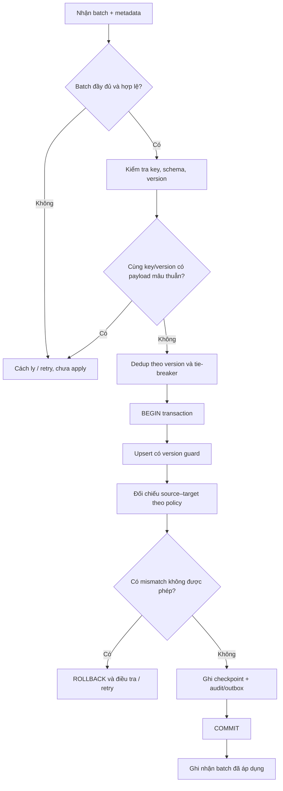

# Đồng bộ lặp an toàn và đối chiếu kết quả nguồn, đích

## 1. Tình huống thực tế: cùng một lô dữ liệu được gửi lại

Một hệ thống bán hàng nhận dữ liệu sản phẩm từ hệ thống quản lý kho. Mỗi vài phút, hệ thống nguồn gửi một **batch** chứa những sản phẩm mới hoặc sản phẩm vừa thay đổi. Dịch vụ đồng bộ ghi những bản ghi đó vào bảng sản phẩm ở hệ thống đích.

Nghe có vẻ đơn giản:

```text
Hệ thống nguồn
    │
    ├─ Batch B17: A01, B02, C03, E05, F06
    │
    ▼
Bộ lọc và kiểm tra nguồn
    │
    ▼
UPSERT / MERGE
    │
    ▼
Bảng sản phẩm ở đích
```

Nhưng khi triển khai, ta gặp một loạt câu hỏi:

- Batch `B17` chạy xong nhưng ứng dụng mất kết nối trước khi nhận xác nhận. Có thể **chạy lại B17** không?
- Nguồn gửi **nhiều bản ghi cho cùng một khóa** trong một batch. Bản nào được chọn?
- Một bản ghi cũ đến sau bản ghi mới. Làm sao tránh **ghi đè dữ liệu mới bằng dữ liệu cũ**?
- Nguồn gửi 5 sản phẩm nhưng đích có 6 sản phẩm. Có nên **xóa sản phẩm không xuất hiện trong batch** không?
- Lệnh `UPSERT` chạy thành công. Làm sao biết **nguồn và đích đã thống nhất** theo đúng quy tắc đồng bộ?
- Hai worker cùng đồng bộ một sản phẩm. Khóa duy nhất và transaction có đủ không?
- `MERGE` trả số lượng hàng tác động. Con số đó có chứng minh **mọi hàng đích đúng** không?

Bài học này giải quyết các câu hỏi bằng một quy trình có thể tái lập trên **PostgreSQL**, sau đó đối chiếu với **SQL Server, Oracle, MySQL và SQLite**.

Trọng tâm là **đồng bộ lặp an toàn (idempotent synchronization)** và **đối chiếu nguồn–đích (source–target reconciliation)**. `UPSERT` và `MERGE` là công cụ thực thi; tính đúng đắn còn phụ thuộc khóa, thứ tự phiên bản, phạm vi dữ liệu, transaction và cách so sánh kết quả.

---

## 2. Thuật ngữ và mục tiêu cần thống nhất

| Thuật ngữ | Ý nghĩa trong bài |
| --- | --- |
| **Source** / nguồn | Những thay đổi hoặc ảnh chụp dữ liệu từ hệ thống gửi |
| **Target** / đích | Bảng nhận dữ liệu, được các truy vấn ứng dụng sử dụng |
| **Batch** / lô | Một tập bản ghi được truyền và xử lý cùng một lần |
| **Business key** | Khóa xác định một thực thể nghiệp vụ, ví dụ `sku` |
| **Upsert** | Có khóa thì cập nhật, chưa có thì thêm mới, theo điều kiện đã định |
| **MERGE** | Câu SQL so khớp nguồn và đích, chọn các hành động như UPDATE/INSERT, đôi khi DELETE |
| **Idempotent** / lặp an toàn | Áp dụng lại cùng một đầu vào không làm thay đổi trạng thái đích sau lần áp dụng thành công đầu |
| **Deduplication** | Chọn đúng một bản ghi nguồn có ý nghĩa cho mỗi khóa đích trong một lần upsert |
| **Source version** | Thông tin thứ tự của thay đổi từ nguồn, ví dụ số phiên bản tăng dần trên từng khóa |
| **Stale event** | Bản ghi nguồn có phiên bản cũ hơn phiên bản đã có ở đích |
| **Reconciliation** | Đối chiếu trạng thái dự kiến và trạng thái thực tế để phát hiện thiếu, thừa hoặc khác giá trị |
| **Delta feed** | Nguồn chỉ gửi các bản ghi thay đổi |
| **Full snapshot** | Nguồn xác nhận có đủ tất cả khóa thuộc một phạm vi tại một thời điểm |
| **Tombstone** | Bản ghi thể hiện việc xóa, thường mang khóa và phiên bản để ngăn dữ liệu cũ tái xuất hiện |
| **Watermark** | Mốc sự kiện/batch/offset đã xử lý, dùng để tiếp tục đồng bộ theo chính sách |

### 2.1. Mô tả toán học của “chạy lại không đổi”

Gọi `T` là trạng thái đích, `S` là batch nguồn đã được chuẩn hóa, và `F(T,S)` là phép đồng bộ.

Ta muốn:

\[
F(F(T,S),S)=F(T,S).
\]

Nghĩa là **chạy cùng batch hai lần cho trạng thái cuối giống chạy một lần**.

Tuy nhiên cần xác định rõ ta đang so sánh cái gì:

- Nếu chỉ so cột nghiệp vụ, hai lần chạy có thể giống nhau.
- Nếu lần nào cũng ghi `updated_at = NOW()` hoặc sinh một bản ghi audit mới, **trạng thái tổng thể có thể vẫn thay đổi**.
- Nếu có email, webhook hoặc sự kiện ngoài database được gửi ở mỗi lần chạy, phép đồng bộ **chưa idempotent ở cấp hệ thống** dù bảng sản phẩm trông giống nhau.

Vì vậy, tính lặp an toàn có nhiều mức: **giá trị nghiệp vụ**, **metadata**, **audit/event** và **tác dụng phụ**.

## 3. UPSERT và MERGE khác điều gì với “UPDATE rồi INSERT”?

Một cách đồng bộ tự nhiên là:

```text
Nếu đã có khóa trong target:
    UPDATE
Nếu chưa có khóa:
    INSERT
```

Nhưng kiểm tra tồn tại rồi ghi ở **hai câu SQL riêng biệt** có thể gặp race:

1. Worker A kiểm tra `sku='E05'` chưa có.
2. Worker B cũng thấy `E05` chưa có.
3. Cả hai cố `INSERT`.
4. Một worker gặp lỗi vi phạm khóa duy nhất, hoặc có trùng dữ liệu nếu bảng không có unique constraint.

**UPSERT** giúp gộp logic chèn/cập nhật theo ràng buộc xung đột, ví dụ PostgreSQL:

```sql
INSERT INTO target (...)
VALUES (...)
ON CONFLICT (sku)
DO UPDATE SET ...;
```

**MERGE** thường so khớp toàn bộ tập nguồn với bảng đích:

```sql
MERGE INTO target AS t
USING source AS s
ON t.sku = s.sku
WHEN MATCHED THEN
    UPDATE SET ...
WHEN NOT MATCHED THEN
    INSERT (...) VALUES (...);
```

Hai cách vẫn **không tự giải quyết** bản ghi nguồn trùng, phiên bản đến sai thứ tự, sự kiện xóa, hay đối chiếu dữ liệu.

### 3.1. Quy tắc nền tảng

**Bảng đích phải có ràng buộc unique hoặc primary key trên khóa đồng bộ.**

Nếu `sku` là định danh sản phẩm, hãy khai báo:

```sql
sku TEXT PRIMARY KEY
```

hoặc unique constraint tương đương. Không thể tin rằng mã SQL ứng dụng sẽ luôn ngăn được hai hàng có cùng business key trong mọi trường hợp đồng thời.

---

## 4. Phân biệt batch delta và full snapshot trước khi đồng bộ

Đây là quyết định có thể ảnh hưởng trực tiếp tới dữ liệu bị xóa.

### 4.1. Delta feed

Nguồn nói:

> “Đây là những sản phẩm đã thay đổi kể từ mốc X.”

Nếu đích có một sản phẩm **không xuất hiện trong batch**, ta **không biết** sản phẩm đó đã bị xóa hay đơn giản là **không thay đổi**.

Với delta feed, thông thường:

- Khóa có trong nguồn → xét chèn/cập nhật/xóa theo sự kiện.
- Khóa chỉ có trong đích → **giữ nguyên**.
- Muốn xóa → nguồn phải gửi **sự kiện xóa rõ ràng**, thường có version.

### 4.2. Full snapshot

Nguồn nói:

> “Đây là **toàn bộ** sản phẩm thuộc cửa hàng X tại thời điểm chốt Y.”

Trong trường hợp này, khóa chỉ có ở đích **có thể** là ứng viên xóa hoặc vô hiệu hóa, **nhưng chỉ trong phạm vi snapshot được xác nhận là đầy đủ**.

Nếu snapshot bị truyền thiếu, truy vấn kiểu `WHEN NOT MATCHED BY SOURCE THEN DELETE` có thể xóa dữ liệu hợp lệ hàng loạt.

### 4.3. So sánh

| Tình huống | Delta feed | Full snapshot đã xác minh |
| --- | --- | --- |
| Khóa có ở nguồn và chưa có ở đích | INSERT | INSERT |
| Khóa có ở cả hai, nguồn mới hơn | UPDATE | UPDATE |
| Khóa có ở cả hai, nguồn cũ hơn | Bỏ qua hoặc báo xung đột theo chính sách | Cần xem phiên bản/snapshot, không mù quáng ghi đè |
| Khóa chỉ có ở đích | **Giữ nguyên** | Có thể xóa/vô hiệu hóa trong phạm vi đầy đủ |
| Batch thiếu một phần do lỗi truyền | Chỉ xử lý được phần nhận hợp lệ, kiểm soát offset | **Không được** coi là snapshot hoàn chỉnh |

Bộ dữ liệu chính trong bài là **delta batch**, không phải full snapshot.

---

## 5. Tạo bảng đích trên PostgreSQL

Tạo bảng sản phẩm trong **database thực hành riêng**:

```sql
CREATE TABLE demo_catalog (
    sku TEXT PRIMARY KEY,
    product_name TEXT NOT NULL,
    price NUMERIC(10, 2) NOT NULL CHECK (price >= 0),
    available_qty INTEGER NOT NULL CHECK (available_qty >= 0),
    source_version BIGINT NOT NULL CHECK (source_version >= 0)
);
```

Các cột:

- `sku`: business key duy nhất.
- `product_name`, `price`, `available_qty`: dữ liệu nghiệp vụ muốn đồng bộ.
- `source_version`: phiên bản thay đổi do hệ thống nguồn cung cấp.

**Giả định quan trọng:** `source_version` tăng đơn điệu **trên mỗi SKU** khi dữ liệu nghiệp vụ thay đổi. Nếu nguồn chỉ tạo timestamp không đáng tin cậy, version bị đặt lại hoặc phát hai payload khác nhau ở cùng version, cần một cơ chế thứ tự khác hoặc quy tắc xử lý xung đột bổ sung.

### 5.1. Dữ liệu đích trước đồng bộ

```sql
INSERT INTO demo_catalog (
    sku, product_name, price, available_qty, source_version
)
VALUES
    ('A01', 'Cà phê', 120.00, 10, 5),
    ('B02', 'Trà',     80.00, 20, 3),
    ('C03', 'Bánh',    45.00,  0, 7),
    ('D04', 'Sữa',     35.00, 15, 2);
```

Bảng đầu vào:

| sku | product_name | price | available_qty | source_version |
| --- | --- | ---: | ---: | ---: |
| A01 | Cà phê | 120 | 10 | 5 |
| B02 | Trà | 80 | 20 | 3 |
| C03 | Bánh | 45 | 0 | 7 |
| D04 | Sữa | 35 | 15 | 2 |

Có **4 sản phẩm ở đích**.

## 6. Tạo bảng staging chứa batch nguồn

Không nên upsert ngay những dòng vừa đọc từ file/queue nếu chưa kiểm tra tính hợp lệ và khóa trùng.

Tạo staging:

```sql
CREATE TABLE demo_source_stage (
    ingest_seq BIGINT PRIMARY KEY,
    batch_id TEXT NOT NULL,
    sku TEXT NOT NULL,
    product_name TEXT NOT NULL,
    price NUMERIC(10, 2) NOT NULL CHECK (price >= 0),
    available_qty INTEGER NOT NULL CHECK (available_qty >= 0),
    source_version BIGINT NOT NULL CHECK (source_version >= 0)
);
```

Nạp batch `B17`:

```sql
INSERT INTO demo_source_stage (
    ingest_seq,
    batch_id,
    sku,
    product_name,
    price,
    available_qty,
    source_version
)
VALUES
    (1, 'B17', 'A01', 'Cà phê',     125, 12, 6),
    (2, 'B17', 'B02', 'Trà',         80, 20, 3),
    (3, 'B17', 'C03', 'Bánh',        50,  2, 6),
    (4, 'B17', 'E05', 'Nước ép',     99,  3, 1),
    (5, 'B17', 'E05', 'Nước ép',    100,  4, 2),
    (6, 'B17', 'F06', 'Sô-cô-la',   70,  5, 1),
    (7, 'B17', 'A01', 'Cà phê',     125, 12, 6),
    (8, 'B17', 'A01', 'Cà phê',     130,  9, 4);
```

### 6.1. Nhìn vào tám hàng nguồn

| ingest_seq | sku | source_version | price | available_qty | Nhận xét |
| ---: | --- | ---: | ---: | ---: | --- |
| 1 | A01 | 6 | 125 | 12 | Phiên bản mới hơn đích |
| 2 | B02 | 3 | 80 | 20 | Giống đích |
| 3 | C03 | 6 | 50 | 2 | Cũ hơn phiên bản 7 ở đích |
| 4 | E05 | 1 | 99 | 3 | Bản cũ của sản phẩm mới |
| 5 | E05 | 2 | 100 | 4 | Bản mới nhất của E05 |
| 6 | F06 | 1 | 70 | 5 | Sản phẩm chưa có ở đích |
| 7 | A01 | 6 | 125 | 12 | Trùng chính xác payload phiên bản 6 |
| 8 | A01 | 4 | 130 | 9 | Sự kiện A01 cũ đến muộn |

Có **8 dòng nguồn** nhưng chỉ **5 SKU duy nhất**: `A01`, `B02`, `C03`, `E05`, `F06`.

Đích có `D04` nhưng `B17` không gửi `D04`. Vì đây là **delta batch**, `D04` phải được giữ lại.

### 6.2. Trạng thái đích đúng sau xử lý B17

| sku | Hành động mong muốn | price trước | price sau | version sau |
| --- | --- | ---: | ---: | ---: |
| A01 | UPDATE | 120 | 125 | 6 |
| B02 | Bỏ qua — bằng phiên bản, cùng payload | 80 | 80 | 3 |
| C03 | Bỏ qua — nguồn version 6 cũ hơn đích version 7 | 45 | 45 | 7 |
| D04 | Giữ nguyên — không xuất hiện trong delta batch | 35 | 35 | 2 |
| E05 | INSERT bản version 2 | Chưa có | 100 | 2 |
| F06 | INSERT | Chưa có | 70 | 1 |

Tổng cộng:

- **1 hàng UPDATE**: A01.
- **2 hàng INSERT**: E05, F06.
- **2 khóa có trong nguồn nhưng không cần ghi**: B02 và C03.
- **1 khóa chỉ có ở đích và được giữ**: D04.
- Số hàng trong đích: **4 → 6**.

Cần đối chiếu được những kết quả này, không chỉ xem câu SQL “chạy không lỗi”.

---

## 7. Bước 1 — Kiểm tra dữ liệu nguồn trước khi upsert

Đối với batch `B17`, kiểm tra số hàng và số khóa duy nhất:

```sql
SELECT
    batch_id,
    COUNT(*) AS raw_rows,
    COUNT(DISTINCT sku) AS distinct_skus
FROM demo_source_stage
WHERE batch_id = 'B17'
GROUP BY batch_id;
```

Kết quả:

| batch_id | raw_rows | distinct_skus |
| --- | ---: | ---: |
| B17 | 8 | 5 |

**Tám hàng không được hiểu thành tám SKU cần upsert.**

### 7.1. Liệt kê khóa trùng

```sql
SELECT
    sku,
    COUNT(*) AS source_rows,
    COUNT(DISTINCT source_version) AS distinct_versions
FROM demo_source_stage
WHERE batch_id = 'B17'
GROUP BY sku
HAVING COUNT(*) > 1
ORDER BY sku;
```

Kết quả:

| sku | source_rows | distinct_versions |
| --- | ---: | ---: |
| A01 | 3 | 2 |
| E05 | 2 | 2 |

### 7.2. Dữ liệu trùng cùng khóa và phiên bản nhưng khác payload

Một nguồn có thể gửi:

```text
SKU=A01, version=6, price=125
SKU=A01, version=6, price=999
```

Không có quy tắc nào trong `ON CONFLICT` tự biết giá nào đúng.

Với giả định **cùng khóa + cùng version phải có cùng payload**, hãy kiểm tra:

```sql
SELECT
    batch_id,
    sku,
    source_version,
    COUNT(*) AS source_rows,
    COUNT(DISTINCT ROW(
        product_name,
        price,
        available_qty
    )) AS distinct_payloads
FROM demo_source_stage
WHERE batch_id = 'B17'
GROUP BY batch_id, sku, source_version
HAVING COUNT(DISTINCT ROW(
    product_name,
    price,
    available_qty
)) > 1;
```

Bộ dữ liệu mẫu trả **0 hàng**: hai dòng A01 version 6 giống nhau.

Nếu truy vấn trả hàng, hãy **cách ly hoặc từ chối batch** theo chính sách dữ liệu; đừng tùy ý chọn dòng đến sau để che một xung đột phiên bản.

### 7.3. Kiểm tra các ràng buộc khác

Tùy nghiệp vụ, cần kiểm tra:

- `sku` trống hoặc chỉ toàn khoảng trắng.
- Giá/quantity ngoài miền hợp lệ.
- Mã tiền tệ hoặc đơn vị đo không nhất quán.
- SKU đã được ánh xạ sang mã canonical chưa.
- Tên sản phẩm có vượt giới hạn cột đích không.
- Nguồn thuộc đúng tenant/cửa hàng không.
- Batch có đủ các trang/bản tin theo metadata không.

Ràng buộc `NOT NULL`, `CHECK` và `PRIMARY KEY` của database là **lớp bảo vệ cuối**, không thay toàn bộ validation nghiệp vụ.

## 8. Bước 2 — Chọn một dòng nguồn cho mỗi khóa

Một cách phổ biến là dùng `ROW_NUMBER`:

```sql
WITH ranked AS (
    SELECT
        s.*,
        ROW_NUMBER() OVER (
            PARTITION BY s.sku
            ORDER BY
                s.source_version DESC,
                s.ingest_seq DESC
        ) AS rn
    FROM demo_source_stage AS s
    WHERE s.batch_id = 'B17'
)
SELECT
    sku,
    product_name,
    price,
    available_qty,
    source_version,
    ingest_seq
FROM ranked
WHERE rn = 1
ORDER BY sku;
```

Kết quả nguồn chuẩn hóa:

| sku | product_name | price | available_qty | source_version | ingest_seq |
| --- | --- | ---: | ---: | ---: | ---: |
| A01 | Cà phê | 125 | 12 | 6 | 7 |
| B02 | Trà | 80 | 20 | 3 | 2 |
| C03 | Bánh | 50 | 2 | 6 | 3 |
| E05 | Nước ép | 100 | 4 | 2 | 5 |
| F06 | Sô-cô-la | 70 | 5 | 1 | 6 |

### 8.1. Vì sao ORDER BY source_version trước ingest_seq?

`source_version` đại diện cho **thứ tự thay đổi nghiệp vụ**. `ingest_seq` chỉ là thứ tự ghi vào staging.

Ở A01, dòng 8 đến sau nhưng có version **4**, cũ hơn version **6** của dòng 1/7. Nếu chỉ lấy dòng có `ingest_seq` lớn nhất, ta sẽ chọn **bản cũ**, có thể ghi lùi giá 125 về 130 và tồn kho 12 về 9.

### 8.2. Vì sao vẫn có ingest_seq khi đã có version?

Nếu hai dòng cùng version và cùng payload, việc chọn một dòng bất kỳ không đổi giá trị nghiệp vụ. Nhưng với `ROW_NUMBER`, thêm một khóa phụ duy nhất giúp quá trình chọn **có thứ tự xác định**.

Ở đây `ingest_seq` không có nhiệm vụ giải quyết xung đột hai payload khác nhau cùng version. **Truy vấn kiểm tra ở mục 7.2 phải phát hiện xung đột đó trước.**

### 8.3. Trường hợp không có source_version đáng tin cậy

Nếu nguồn không cung cấp phiên bản, có thể phải dùng:

- Sequence/offset đơn điệu từ một stream bảo đảm thứ tự.
- Số thứ tự thay đổi từ CDC.
- Event timestamp cộng tie-breaker, **chỉ nếu** nguồn bảo đảm ý nghĩa thời gian.
- Quy tắc so sánh chuyên biệt cho từng thực thể.

`ingested_at` của hệ nhận không tự là thứ tự phiên bản nghiệp vụ: sự kiện cũ đến muộn có thể có thời điểm ingest mới hơn.

---

## 9. Bước 3 — Dùng PostgreSQL INSERT ... ON CONFLICT DO UPDATE

Trên PostgreSQL, ta có thể upsert nguồn đã deduplicate:

```sql
WITH ranked AS (
    SELECT
        s.*,
        ROW_NUMBER() OVER (
            PARTITION BY s.sku
            ORDER BY
                s.source_version DESC,
                s.ingest_seq DESC
        ) AS rn
    FROM demo_source_stage AS s
    WHERE s.batch_id = 'B17'
)
INSERT INTO demo_catalog AS t (
    sku,
    product_name,
    price,
    available_qty,
    source_version
)
SELECT
    r.sku,
    r.product_name,
    r.price,
    r.available_qty,
    r.source_version
FROM ranked AS r
WHERE r.rn = 1
ON CONFLICT (sku)
DO UPDATE SET
    product_name = EXCLUDED.product_name,
    price = EXCLUDED.price,
    available_qty = EXCLUDED.available_qty,
    source_version = EXCLUDED.source_version
WHERE t.source_version < EXCLUDED.source_version
RETURNING
    sku,
    product_name,
    price,
    available_qty,
    source_version;
```

Đây là truy vấn chính của bài. Nó chứa bốn lớp bảo vệ:

1. `ROW_NUMBER()` chọn **một dòng mỗi SKU** trong batch.
2. `ON CONFLICT (sku)` dựa vào **khóa duy nhất của bảng đích**.
3. `WHERE t.source_version < EXCLUDED.source_version` chỉ cho phép **nâng version**, không ghi lùi.
4. `RETURNING` cho danh sách hàng **thực sự được INSERT/UPDATE**.

Với dữ liệu gốc và batch B17, truy vấn trả **3 hàng** (thứ tự không được đảm bảo):

| sku | product_name | price | available_qty | source_version |
| --- | --- | ---: | ---: | ---: |
| A01 | Cà phê | 125 | 12 | 6 |
| E05 | Nước ép | 100 | 4 | 2 |
| F06 | Sô-cô-la | 70 | 5 | 1 |

### 9.1. EXCLUDED là gì?

Trong `ON CONFLICT DO UPDATE` của PostgreSQL, `EXCLUDED` chỉ **giá trị của hàng được đề xuất INSERT** nhưng đã gặp xung đột khóa.

Ví dụ:

```sql
price = EXCLUDED.price
```

lấy giá từ dòng nguồn đang được upsert, không phải giá cũ từ bảng `demo_catalog`.

### 9.2. t.source_version là gì?

Alias `t` được gán cho bảng đích:

```sql
INSERT INTO demo_catalog AS t ...
```

Ở mệnh đề:

```sql
WHERE t.source_version < EXCLUDED.source_version
```

- `t.source_version`: phiên bản **hiện có ở đích**.
- `EXCLUDED.source_version`: phiên bản **của dòng nguồn đề xuất chèn**.

Với A01: `5 < 6` → UPDATE.

Với B02: `3 < 3` là false → bỏ qua.

Với C03: `7 < 6` là false → giữ version 7 ở đích.

### 9.3. Vì sao B02/C03 không có trong RETURNING?

Những hàng gặp conflict nhưng **không thỏa điều kiện WHERE của DO UPDATE** không được cập nhật và **không nằm trong result set RETURNING**.

`RETURNING` có ba hàng **không có nghĩa nguồn chỉ có ba SKU**. Batch đã chuẩn hóa có năm SKU; hai SKU còn lại bị loại khỏi thao tác ghi theo quy tắc version.

### 9.4. Những hàng mới được INSERT như thế nào?

E05 và F06 chưa có trong đích nên đi theo nhánh **INSERT**, không chạy điều kiện `WHERE` của `DO UPDATE` (điều kiện ấy chỉ áp dụng khi xảy ra conflict).

**Ghi chú:** Một bản ghi mới từ nguồn vẫn cần validation, nhất là khi hệ thống có tombstone hoặc version toàn cục; việc “chưa có ở bảng sống” không đồng nghĩa chắc chắn chưa từng có.

## 10. Trạng thái đích sau lần đồng bộ đầu tiên

Sau câu upsert mục 9, nếu transaction commit thành công, truy vấn:

```sql
SELECT
    sku,
    product_name,
    price,
    available_qty,
    source_version
FROM demo_catalog
ORDER BY sku;
```

phải cho:

| sku | product_name | price | available_qty | source_version |
| --- | --- | ---: | ---: | ---: |
| A01 | Cà phê | 125 | 12 | 6 |
| B02 | Trà | 80 | 20 | 3 |
| C03 | Bánh | 45 | 0 | 7 |
| D04 | Sữa | 35 | 15 | 2 |
| E05 | Nước ép | 100 | 4 | 2 |
| F06 | Sô-cô-la | 70 | 5 | 1 |

Có **6 hàng**.

Hãy chú ý ba trường hợp:

- C03 vẫn có `price=45` dù batch chứa `price=50`, vì đích có version mới hơn.
- D04 vẫn tồn tại dù không có trong batch, vì batch là **delta**.
- E05 mang version **2**, không phải version 1, vì nguồn được deduplicate trước.

---

## 11. Chạy lại B17: phép thử idempotence

Giả sử dịch vụ đồng bộ bị timeout sau lần upsert đầu. Không rõ client đã nhận kết quả hay chưa. Hệ thống giao lại **cùng batch B17**.

Ta chạy lại **đúng câu SQL mục 9** trên bảng đích đã đồng bộ.

Lần thứ hai:

- A01 đích version 6, nguồn version 6 → không UPDATE.
- B02 đích version 3, nguồn version 3 → không UPDATE.
- C03 đích version 7, nguồn version 6 → không UPDATE.
- E05 đích version 2, nguồn version 2 → không UPDATE.
- F06 đích version 1, nguồn version 1 → không UPDATE.

**Kết quả:** `RETURNING` có **0 hàng** và trạng thái đích giữ nguyên.

Đây là phép thử quan trọng:

\[
F(F(T,B17),B17)=F(T,B17).
\]

### 11.1. 0 hàng ở lần chạy lại là kết quả tốt

Trong một pipeline có thể giao sự kiện **at least once**, replay được phép xảy ra. Nếu áp dụng cùng batch lần hai trả 0 hàng nhưng dữ liệu đã đúng, đó là **no-op kỳ vọng**, không phải lỗi tự động.

Tuy nhiên, 0 hàng cũng có thể do dữ liệu nguồn quá cũ, sai điều kiện hoặc sai batch. Phải kết hợp **đối chiếu trạng thái** để phân biệt.

### 11.2. Vì sao không SET updated_at = NOW() ở mỗi lần?

Một upsert không có điều kiện:

```sql
ON CONFLICT (sku) DO UPDATE SET
    price = EXCLUDED.price,
    synced_at = CURRENT_TIMESTAMP
```

có thể thay đổi `synced_at` trên **mọi lần replay**, ngay cả khi `price` không đổi.

Nếu mục tiêu idempotence bao gồm toàn bộ hàng, hãy tránh ghi lại metadata ở những lần no-op. Có thể:

- Chỉ UPDATE khi `source_version` tăng.
- Hoặc chỉ UPDATE khi payload thực sự thay đổi.
- Hoặc tách metadata “batch đã được nhìn thấy” khỏi metadata “bản ghi nghiệp vụ đã thay đổi”.

**Phân biệt:** `last_seen_at` của batch có thể cố ý thay đổi trên mỗi lần quan sát; lúc đó nó **không thuộc tập cột yêu cầu idempotence**, và phải mô tả rõ.

## 12. Phiên bản bằng nhau nhưng payload khác nhau

Điều kiện:

```sql
WHERE t.source_version < EXCLUDED.source_version
```

giúp bỏ qua các bản ghi cùng version.

Nhưng nếu nguồn gửi:

```text
Đích: A01 version 6, price 125
Nguồn: A01 version 6, price 999
```

thì kết quả sẽ **bỏ qua**, dù giá trị khác nhau.

Đây không phải lúc nào cũng là hành vi có thể chấp nhận. Nếu **source_version là phiên bản nội dung**, hai payload khác nhau cùng version báo hiệu **vi phạm hợp đồng dữ liệu**.

### 12.1. Kiểm tra xung đột cùng version giữa nguồn và đích

Dùng nguồn đã chuẩn hóa:

```sql
WITH ranked AS (
    SELECT
        s.*,
        ROW_NUMBER() OVER (
            PARTITION BY s.sku
            ORDER BY
                s.source_version DESC,
                s.ingest_seq DESC
        ) AS rn
    FROM demo_source_stage AS s
    WHERE s.batch_id = 'B17'
),
chosen AS (
    SELECT *
    FROM ranked
    WHERE rn = 1
)
SELECT
    s.sku,
    s.source_version,
    t.source_version AS target_version,
    s.product_name AS source_name,
    t.product_name AS target_name,
    s.price AS source_price,
    t.price AS target_price
FROM chosen AS s
JOIN demo_catalog AS t
    ON t.sku = s.sku
WHERE s.source_version = t.source_version
  AND ROW(
      s.product_name,
      s.price,
      s.available_qty
  ) IS DISTINCT FROM ROW(
      t.product_name,
      t.price,
      t.available_qty
  )
ORDER BY s.sku;
```

Sau đồng bộ đúng, truy vấn trả **0 hàng**.

Nếu có hàng, không nên tự nâng version hoặc ghi đè một cách âm thầm: cần xác định nguồn nào là **source of truth**, version có đáng tin cậy hay không và có cần báo lỗi dữ liệu.

### 12.2. So sánh NULL-safe

PostgreSQL `IS DISTINCT FROM` xử lý cả `NULL`, khác `<>` vốn cho `UNKNOWN` khi một vế là `NULL`.

Với nhiều cột, so sánh `ROW(...) IS DISTINCT FROM ROW(...)` rất hữu ích. Hãy bảo đảm kiểu dữ liệu tương thích; với JSON, floating point, chuỗi có chuẩn hóa/không chuẩn hóa hoặc kiểu dữ liệu phức tạp, có thể cần quy tắc so sánh riêng.

---

## 13. Phiên bản cũ đến sau phiên bản mới

Bản ghi C03 của batch `B17` có:

```text
Nguồn: version 6, price 50, quantity 2
Đích:  version 7, price 45, quantity 0
```

Nếu dùng upsert mù:

```sql
ON CONFLICT (sku) DO UPDATE SET
    price = EXCLUDED.price,
    available_qty = EXCLUDED.available_qty,
    source_version = EXCLUDED.source_version
```

thì C03 có thể bị **ghi lùi** về version 6.

Điều kiện bảo vệ:

```sql
WHERE t.source_version < EXCLUDED.source_version
```

tránh trường hợp đó khi version có nghĩa và tăng đơn điệu.

### 13.1. Timestamp không luôn đủ thay thế version

Nếu dựa vào:

```sql
WHERE t.updated_at < EXCLUDED.updated_at
```

mà `updated_at` do nhiều hệ thống với clock lệch nhau tạo, sự kiện cũ có thể trông như mới.

Nếu phiên bản dựa trên thời gian, cần hiểu:

- Được tạo tại nguồn hay lúc nhận?
- Có bảo đảm thứ tự khi đồng thời không?
- Độ phân giải đủ phân biệt hai thay đổi liên tiếp không?
- Có thể có cùng timestamp với payload khác nhau không?

Số thứ tự thay đổi **được cấp tại nguồn cho từng khóa** thường dễ diễn giải hơn một timestamp nhận dữ liệu tùy ý.

### 13.2. Version tăng trên từng khóa, không cần tăng toàn cục

A01 version 6 và E05 version 2 không có nghĩa A01 “mới hơn E05” trong toàn hệ thống. Chỉ nên so version **giữa hai bản của cùng một business key**, trừ khi nguồn công bố contract version toàn cục.

## 14. Vấn đề khó hơn: xóa rồi sự kiện cũ xuất hiện lại

Giả sử sản phẩm E05 bị xóa ở version 4 bằng lệnh:

```sql
DELETE FROM demo_catalog
WHERE sku = 'E05';
```

Sau đó batch cũ chứa E05 version 2 được phát lại.

Vì **không còn E05 ở đích**, `INSERT ... ON CONFLICT` sẽ **INSERT E05 version 2**. Sản phẩm đã xóa có thể **tái xuất hiện** (*resurrection*).

Điều kiện version trong nhánh `DO UPDATE` không giúp gì khi **không có hàng để conflict**.

### 14.1. Tombstone giải quyết điều gì?

Thay vì xóa mất mọi dấu vết, giữ một hàng có:

```text
sku = E05
source_version = 4
is_deleted = TRUE
```

Nếu replay E05 version 2, đích vẫn có version 4 nên sự kiện cũ bị bỏ qua.

Nếu nguồn gửi E05 version 5 với sự kiện “khôi phục/đăng bán lại”, hệ thống mới có thể chấp nhận nó theo chính sách đã định.

### 14.2. Bổ sung tombstone trong thiết kế

Ví dụ cấu trúc:

```sql
CREATE TABLE demo_catalog_with_tombstones (
    sku TEXT PRIMARY KEY,
    product_name TEXT,
    price NUMERIC(10,2),
    available_qty INTEGER,
    source_version BIGINT NOT NULL,
    is_deleted BOOLEAN NOT NULL DEFAULT FALSE,
    deleted_at TIMESTAMP
);
```

Một lệnh xử lý sự kiện có thể cập nhật `is_deleted` và `source_version` **nếu version nguồn lớn hơn**.

Tuy nhiên, một hàng đã xóa có thể không còn các trường `product_name`, `price` hoặc `available_qty`. Cần thiết kế schema/validation để xử lý đúng **payload của sự kiện xóa**, thay vì ép sự kiện xóa phải có các cột của sản phẩm còn sống.

### 14.3. Tombstone giữ bao lâu?

Không có đáp án chung:

- Nếu sự kiện cũ có thể replay vô thời hạn, xóa tombstone quá sớm có thể gây resurrection.
- Nếu hệ thống có một watermark/retention horizon bảo đảm không còn replay sự kiện trước mốc, có thể dọn tombstone theo quy tắc phù hợp.
- Nếu cần xóa dữ liệu cá nhân, chính sách giữ tombstone phải cân bằng giữa chống replay và yêu cầu pháp lý.

**Ý chính:** Idempotence của **INSERT/UPDATE** không tự bảo đảm idempotence của **chuỗi INSERT–DELETE–replay**.

---

## 15. Đối chiếu nguồn–đích phải bắt đầu từ một contract

Sau khi upsert, nhiều người viết:

```sql
SELECT COUNT(*) FROM demo_source_stage;
SELECT COUNT(*) FROM demo_catalog;
```

rồi so hai số. Điều đó thường **sai mức dữ liệu**:

- Staging có **8 dòng**, nhưng 5 khóa.
- Đích có **6 khóa**, vì còn D04 không xuất hiện trong delta.
- C03 có version nguồn thấp hơn đích nên **không nên** trùng payload nguồn.
- Chỉ **3** hàng thực sự được ghi trong lần chạy đầu.

Vì vậy không có mục tiêu “`COUNT(source) = COUNT(target)`” cho delta batch này.

### 15.1. Đối chiếu theo chính sách phiên bản

Với mỗi khóa nguồn đã chuẩn hóa:

1. **Đích thiếu khóa:** lỗi sau đồng bộ nếu dòng nguồn hợp lệ lẽ ra phải INSERT.
2. **Đích có version thấp hơn nguồn:** lỗi đồng bộ hoặc batch chưa áp dụng.
3. **Đích có version bằng nguồn nhưng payload khác:** xung đột dữ liệu.
4. **Đích có version bằng nguồn và payload giống:** khớp.
5. **Đích có version cao hơn nguồn:** chấp nhận **TARGET_NEWER** theo chính sách bỏ sự kiện cũ.

Khóa chỉ có ở đích, với một **delta batch**, thường là **TARGET_ONLY_EXPECTED**, không phải lỗi và không phải ứng viên xóa.

### 15.2. Phân biệt hai câu hỏi

- **“Batch đã áp dụng đúng chưa?”** → So theo version và quy tắc xử lý delta.
- **“Nguồn và đích có giống toàn bộ không?”** → Cần một **full snapshot nhất quán** hoặc nguồn có khả năng truy vấn đầy đủ tại cùng mốc.

Không nên dùng kết quả kiểm chứng batch delta để kết luận hai hệ thống đã đồng nhất tuyệt đối.

## 16. Phân loại sai khác cho từng khóa trong batch

Truy vấn PostgreSQL dưới đây tái dùng logic dedup và phân loại từng SKU ở nguồn:

```sql
WITH ranked AS (
    SELECT
        s.*,
        ROW_NUMBER() OVER (
            PARTITION BY s.sku
            ORDER BY
                s.source_version DESC,
                s.ingest_seq DESC
        ) AS rn
    FROM demo_source_stage AS s
    WHERE s.batch_id = 'B17'
),
chosen AS (
    SELECT
        sku,
        product_name,
        price,
        available_qty,
        source_version
    FROM ranked
    WHERE rn = 1
)
SELECT
    s.sku,
    s.source_version AS source_version,
    t.source_version AS target_version,
    CASE
        WHEN t.sku IS NULL
            THEN 'MISSING_TARGET'
        WHEN t.source_version < s.source_version
            THEN 'TARGET_STALE'
        WHEN t.source_version > s.source_version
            THEN 'TARGET_NEWER'
        WHEN ROW(
            t.product_name, t.price, t.available_qty
        ) IS DISTINCT FROM ROW(
            s.product_name, s.price, s.available_qty
        )
            THEN 'SAME_VERSION_DIFFERENT_DATA'
        ELSE 'MATCH'
    END AS reconciliation_status
FROM chosen AS s
LEFT JOIN demo_catalog AS t
    ON t.sku = s.sku
ORDER BY s.sku;
```

### 16.1. Kết quả sau lần đồng bộ đầu

| sku | source_version | target_version | reconciliation_status |
| --- | ---: | ---: | --- |
| A01 | 6 | 6 | MATCH |
| B02 | 3 | 3 | MATCH |
| C03 | 6 | 7 | TARGET_NEWER |
| E05 | 2 | 2 | MATCH |
| F06 | 1 | 1 | MATCH |

**Không có** `MISSING_TARGET`, `TARGET_STALE` hoặc `SAME_VERSION_DIFFERENT_DATA`.

### 16.2. Vì sao TARGET_NEWER không nhất thiết là lỗi?

C03 đã có version 7 trước khi chạy B17, còn B17 chỉ cung cấp version 6. Theo contract đã chọn, **đích mới hơn nguồn** là tình trạng bình thường khi sự kiện đến không theo thứ tự.

Nếu nghiệp vụ yêu cầu mọi bản ghi tại đích phải khớp đúng phiên bản của một snapshot đầy đủ tại một mốc, cách diễn giải có thể khác. Phải xác định trước **đích hay nguồn có quyền ưu tiên phiên bản** và phạm vi quan sát.

### 16.3. Cần báo lỗi nếu nào?

Trong chính sách này, các trạng thái đáng cảnh báo:

- `MISSING_TARGET`.
- `TARGET_STALE`.
- `SAME_VERSION_DIFFERENT_DATA`.

`TARGET_NEWER` có thể được ghi nhận như một **sự kiện nguồn cũ**, nhưng không tự là lỗi.

## 17. Đối chiếu cả những khóa chỉ có ở đích

Truy vấn `LEFT JOIN` từ nguồn chỉ nhìn thấy khóa có ở batch. Muốn kiểm tra **hai phía**, sử dụng `FULL OUTER JOIN`:

```sql
WITH ranked AS (
    SELECT
        s.*,
        ROW_NUMBER() OVER (
            PARTITION BY s.sku
            ORDER BY
                s.source_version DESC,
                s.ingest_seq DESC
        ) AS rn
    FROM demo_source_stage AS s
    WHERE s.batch_id = 'B17'
),
chosen AS (
    SELECT *
    FROM ranked
    WHERE rn = 1
)
SELECT
    COALESCE(s.sku, t.sku) AS sku,
    CASE
        WHEN s.sku IS NULL
            THEN 'TARGET_ONLY_EXPECTED_FOR_DELTA'
        WHEN t.sku IS NULL
            THEN 'MISSING_TARGET'
        WHEN t.source_version < s.source_version
            THEN 'TARGET_STALE'
        WHEN t.source_version > s.source_version
            THEN 'TARGET_NEWER'
        WHEN ROW(
            s.product_name, s.price, s.available_qty
        ) IS DISTINCT FROM ROW(
            t.product_name, t.price, t.available_qty
        )
            THEN 'SAME_VERSION_DIFFERENT_DATA'
        ELSE 'MATCH'
    END AS status
FROM chosen AS s
FULL OUTER JOIN demo_catalog AS t
    ON s.sku = t.sku
ORDER BY sku;
```

Kết quả sau đồng bộ:

| sku | status |
| --- | --- |
| A01 | MATCH |
| B02 | MATCH |
| C03 | TARGET_NEWER |
| D04 | TARGET_ONLY_EXPECTED_FOR_DELTA |
| E05 | MATCH |
| F06 | MATCH |

**Điểm quan trọng:** `D04` không bị coi là sai. Với batch delta, `D04` không xuất hiện vì không có thay đổi được gửi.

### 17.1. Không dùng FULL OUTER JOIN để quyết định DELETE vô điều kiện

`FULL OUTER JOIN` là một cách **quan sát quan hệ giữa hai tập**. Việc xử lý `t.sku IS NOT NULL AND s.sku IS NULL` phụ thuộc nguồn là full snapshot hay delta.

Một câu lệnh đối chiếu có thể đúng về SQL nhưng **sai chính sách đồng bộ** nếu biến mọi hàng chỉ có ở đích thành lệnh xóa.

---

## 18. Đếm trạng thái đối chiếu

Trong báo cáo vận hành, nên tổng hợp trạng thái thành các chỉ số:

| Trạng thái | Số khóa dự kiến sau B17 |
| --- | ---: |
| MATCH | 4 |
| TARGET_NEWER | 1 |
| TARGET_ONLY_EXPECTED_FOR_DELTA | 1 |
| MISSING_TARGET | 0 |
| TARGET_STALE | 0 |
| SAME_VERSION_DIFFERENT_DATA | 0 |
| **Tổng khóa ở hợp nhất nguồn–đích** | **6** |

Để có bảng đếm, có thể bọc truy vấn `FULL OUTER JOIN` mục 17 trong CTE:

```sql
-- Thay phần ... bằng toàn bộ SELECT phân loại ở mục 17.
WITH reconciliation AS (
    SELECT ...
)
SELECT
    status,
    COUNT(*) AS number_of_keys
FROM reconciliation
GROUP BY status
ORDER BY status;
```

Đây là **mẫu ghép truy vấn** chứ không phải một câu SQL hoàn chỉnh khi còn dấu `...`. Trong ứng dụng, dùng truy vấn mục 17 làm nguồn của CTE `reconciliation` rồi chạy `GROUP BY`.

### 18.1. Tại sao không chỉ báo “success = 3”?

`RETURNING` ở upsert đầu trả **3 hàng**. Điều đó cho biết có 3 hàng được ghi, nhưng không nói:

- Có dòng nguồn nào bị bỏ do version không?
- Có một khóa mới lẽ ra phải được chèn nhưng không?
- Có sai khác cùng version và payload không?
- Có sản phẩm chỉ ở đích nên giữ hay nên xóa?
- Batch nguồn có trùng/thiếu hàng không?

Một báo cáo đồng bộ tốt nên tách **số hàng nguồn**, **số khóa sau dedup**, **số INSERT/UPDATE**, **số no-op/stale**, **số lỗi đối chiếu** và **phạm vi snapshot**.

## 19. Đối chiếu bằng EXCEPT: khi nào phù hợp?

PostgreSQL có toán tử tập hợp `EXCEPT`:

```sql
SELECT sku, product_name, price, available_qty, source_version
FROM source_snapshot

EXCEPT

SELECT sku, product_name, price, available_qty, source_version
FROM target_snapshot;
```

Kết quả là các tuple ở **nguồn mà không có tuple tương đương trong đích**.

Đổi chiều để kiểm tra phía còn lại:

```sql
SELECT sku, product_name, price, available_qty, source_version
FROM target_snapshot

EXCEPT

SELECT sku, product_name, price, available_qty, source_version
FROM source_snapshot;
```

### 19.1. EXCEPT cần chạy hai chiều

Nếu chỉ chạy nguồn `EXCEPT` đích, ta phát hiện hàng nguồn thiếu/khác ở đích nhưng **không thấy hàng thừa chỉ có ở đích**.

Muốn xác nhận hai tập bằng nhau, cần hai hiệu tập đều rỗng, với **cùng schema cột, cùng phạm vi và cùng snapshot**.

### 19.2. Delta B17 không thể so EXCEPT trực tiếp với toàn target

Nếu so năm SKU của B17 với sáu SKU target sau upsert:

- D04 chỉ ở đích, là điều **được phép**.
- C03 version 6 ở nguồn, version 7 ở đích, là điều **được phép** theo policy version.

Vì thế hai tập **không bằng nhau theo phép so sánh giá trị tuyệt đối**, dù đồng bộ đúng.

Cần một phép đối chiếu **có ý nghĩa nghiệp vụ** như mục 16, hoặc xác định **full snapshot** thực sự trước khi dùng `EXCEPT` làm tiêu chí bằng nhau.

### 19.3. EXCEPT và dữ liệu trùng

`EXCEPT` mặc định thường dùng ngữ nghĩa **tập hợp**, loại bản sao của các hàng kết quả. PostgreSQL có `EXCEPT ALL` để xét cả số lần xuất hiện.

Nếu staging có hai dòng giống hệt nhau, `EXCEPT` có thể **che mất số lần trùng**. Vì vậy nên kiểm tra **độ duy nhất của khóa và số hàng** riêng, trước khi dùng so sánh set.

### 19.4. NULL trong so sánh tập

Các toán tử tập hợp có quy tắc so sánh và xử lý `NULL` riêng cho việc xác định hàng trùng. Không nên suy rằng `NULL = NULL` trong `WHERE` cũng có cùng ngữ nghĩa.

Nếu cần báo chính xác cột nào khác nhau, `FULL OUTER JOIN` kết hợp `IS DISTINCT FROM` thường dễ giải thích hơn.

## 20. Đối chiếu từng cột để điều tra nguyên nhân

Một nhãn `SAME_VERSION_DIFFERENT_DATA` hữu ích, nhưng để sửa lỗi cần biết cột nào khác.

Trên PostgreSQL:

```sql
WITH ranked AS (
    SELECT
        s.*,
        ROW_NUMBER() OVER (
            PARTITION BY s.sku
            ORDER BY s.source_version DESC, s.ingest_seq DESC
        ) AS rn
    FROM demo_source_stage AS s
    WHERE s.batch_id = 'B17'
),
chosen AS (
    SELECT *
    FROM ranked
    WHERE rn = 1
)
SELECT
    s.sku,
    s.source_version,
    t.source_version AS target_version,
    s.product_name IS DISTINCT FROM t.product_name
        AS name_differs,
    s.price IS DISTINCT FROM t.price
        AS price_differs,
    s.available_qty IS DISTINCT FROM t.available_qty
        AS qty_differs
FROM chosen AS s
JOIN demo_catalog AS t
    ON t.sku = s.sku
WHERE s.source_version = t.source_version
  AND (
      s.product_name IS DISTINCT FROM t.product_name
      OR s.price IS DISTINCT FROM t.price
      OR s.available_qty IS DISTINCT FROM t.available_qty
  )
ORDER BY s.sku;
```

Kết quả thường **rỗng** khi batch B17 đã được xử lý đúng.

### 20.1. Giá trị tiền, số thực và chuẩn hóa

Ví dụ bài dùng `NUMERIC(10,2)` để tránh một số vấn đề của floating point. Trong hệ thống thật:

- `100.0` và `100.00` có thể được coi như cùng giá trị tiền sau chuẩn hóa.
- Chuỗi có thể khác khoảng trắng, Unicode normalization hoặc chữ hoa/chữ thường.
- Giá trị `NULL` và chuỗi rỗng có thể mang ý nghĩa khác nhau.
- Timestamp cần thống nhất múi giờ và độ chính xác.
- JSON cần quy tắc so sánh/canonicalization.

Trước khi so nguồn–đích, cần định nghĩa **hàm chuẩn hóa tương đương** cho các cột, không chỉ dùng kiểm tra chuỗi byte thô.

---

## 21. Chụp bảng trước và sau để kiểm chứng hành động

Trong môi trường thử nghiệm, có thể giữ một bản sao của bảng đích **trước upsert** rồi so với bảng sau upsert.

PostgreSQL:

```sql
BEGIN;

CREATE TEMP TABLE demo_catalog_before
ON COMMIT DROP
AS
SELECT *
FROM demo_catalog;

-- Chạy câu UPSERT mục 9 ở đây.

SELECT
    COALESCE(b.sku, t.sku) AS sku,
    CASE
        WHEN b.sku IS NULL THEN 'INSERT'
        WHEN t.sku IS NULL THEN 'DELETE'
        WHEN ROW(
            b.product_name,
            b.price,
            b.available_qty,
            b.source_version
        ) IS DISTINCT FROM ROW(
            t.product_name,
            t.price,
            t.available_qty,
            t.source_version
        ) THEN 'UPDATE'
        ELSE 'UNCHANGED'
    END AS observed_change
FROM demo_catalog_before AS b
FULL OUTER JOIN demo_catalog AS t
    ON t.sku = b.sku
ORDER BY sku;

ROLLBACK;
```

**Cách sử dụng:** Bắt đầu từ dữ liệu gốc ở mục 5, tạo snapshot `demo_catalog_before`, chạy upsert một lần trong cùng transaction rồi chạy `SELECT` trên.

Kết quả mong muốn:

| sku | observed_change |
| --- | --- |
| A01 | UPDATE |
| B02 | UNCHANGED |
| C03 | UNCHANGED |
| D04 | UNCHANGED |
| E05 | INSERT |
| F06 | INSERT |

### 21.1. Vì sao đây là đối chiếu trạng thái, không phải audit tuyệt đối?

Phương pháp này thấy **sai khác giữa hai snapshot**. Nó không tự cho biết:

- Có câu lệnh UPDATE đã chạy nhưng gán giá trị y hệt không.
- Có trigger thay đổi rồi khôi phục giá trị không.
- Có thao tác khác trong cùng transaction sửa thêm dữ liệu không.

Do đó “`observed_change = UNCHANGED`” nghĩa là **trạng thái cuối bằng trước** theo những cột được so; không có nghĩa chắc chắn bảng không được engine truy cập hoặc ghi.

### 21.2. Kiểm tra đúng thời điểm

Muốn so **trước và sau của cùng một lần xử lý**, snapshot phải được chụp **trước** lần đó. Nếu chụp snapshot sau khi đã upsert thì chạy lại batch, kết quả tất cả là `UNCHANGED` — đúng cho phép thử replay nhưng không thể dùng để mô tả thay đổi của lần đầu.

### 21.3. Trong production dùng audit/event log có kiểm soát

Không nhất thiết chụp toàn bảng production chỉ để đo một batch nhỏ. Có thể:

- Ghi các khóa được xử lý và trạng thái trước/sau cần thiết.
- Dùng `RETURNING`, `OUTPUT` hoặc audit trigger phù hợp.
- Ghi log theo batch/key.
- Lưu snapshot hoặc checksum cho đúng phân vùng cần đối chiếu.

Cách làm phải phù hợp tải hệ thống và bảo mật.

## 22. PostgreSQL MERGE: cùng bài toán, cách biểu đạt khác

PostgreSQL **15 trở lên** hỗ trợ `MERGE` cho các tình huống phù hợp.

Với nguồn đã được deduplicate:

```sql
WITH ranked AS (
    SELECT
        s.*,
        ROW_NUMBER() OVER (
            PARTITION BY s.sku
            ORDER BY s.source_version DESC, s.ingest_seq DESC
        ) AS rn
    FROM demo_source_stage AS s
    WHERE s.batch_id = 'B17'
),
chosen AS (
    SELECT
        sku,
        product_name,
        price,
        available_qty,
        source_version
    FROM ranked
    WHERE rn = 1
)
MERGE INTO demo_catalog AS t
USING chosen AS s
ON t.sku = s.sku
WHEN MATCHED
     AND s.source_version > t.source_version
THEN UPDATE SET
    product_name = s.product_name,
    price = s.price,
    available_qty = s.available_qty,
    source_version = s.source_version
WHEN NOT MATCHED
THEN INSERT (
    sku, product_name, price, available_qty, source_version
)
VALUES (
    s.sku, s.product_name, s.price,
    s.available_qty, s.source_version
);
```

### 22.1. Hai nhánh chính

- `WHEN MATCHED ... THEN UPDATE`: khóa có ở cả nguồn và đích, **chỉ update nếu version nguồn mới hơn**.
- `WHEN NOT MATCHED THEN INSERT`: khóa ở nguồn không có tại đích, thêm mới.

Không có nhánh **xóa khóa đích vắng mặt trong nguồn**, vì `B17` là delta batch.

### 22.2. MERGE không tự lặp an toàn

Nếu bỏ điều kiện:

```sql
AND s.source_version > t.source_version
```

thì chạy lại `MERGE` có thể cập nhật hàng bằng giá trị cũ hoặc ghi đè metadata. Nếu nguồn chứa bản cũ, có thể ghi lùi dữ liệu.

**Tính lặp an toàn là đặc điểm của logic được thiết kế**, không phải tính chất tự động của từ khóa `MERGE`.

### 22.3. MERGE và ON CONFLICT không đồng nghĩa hoàn toàn

Ở PostgreSQL, `INSERT ... ON CONFLICT DO UPDATE` dùng unique constraint làm cơ sở xử lý conflict theo cơ chế riêng.

`MERGE` dựa trên kết quả ghép nguồn–đích và các nhánh hành động; hành vi khi có concurrent insert/unique conflict, các giới hạn và khả năng trả kết quả DML **không giống hệt ON CONFLICT**. Không thay câu này bằng câu kia chỉ vì cả hai có vẻ là “upsert”.

**Cần kiểm tra phiên bản PostgreSQL** nếu muốn dùng cú pháp `MERGE ... RETURNING` hoặc chỉ dấu hành động: hỗ trợ và giới hạn liên quan đã thay đổi qua các release. Ví dụ trên cố ý chỉ dùng các nhánh `MERGE` cơ bản.

---

## 23. Vì sao phải deduplicate trước MERGE?

Một lỗi điển hình là dùng trực tiếp tám dòng nguồn:

```sql
MERGE INTO demo_catalog AS t
USING demo_source_stage AS s
ON t.sku = s.sku
WHEN MATCHED THEN UPDATE SET
    price = s.price
WHEN NOT MATCHED THEN INSERT (...) VALUES (...);
```

Nguồn `B17` có ba dòng `A01` và hai dòng `E05`. Điều gì xảy ra khi:

- Một hàng đích khớp **nhiều hàng nguồn**?
- Một SKU mới có **hai dòng nguồn** đều đòi INSERT?

Tùy DBMS, `MERGE` có thể báo lỗi vì cố sửa một hàng đích nhiều lần, tạo conflict unique hoặc có hành vi không mong muốn theo điều kiện.

### 23.1. Quy tắc nên bảo đảm trước MERGE

**Một business key trong nguồn chuẩn hóa tương ứng tối đa một hàng nguồn ở một lần MERGE**.

Có thể kiểm tra:

```sql
WITH ranked AS (
    SELECT
        s.*,
        ROW_NUMBER() OVER (
            PARTITION BY s.sku
            ORDER BY s.source_version DESC, s.ingest_seq DESC
        ) AS rn
    FROM demo_source_stage AS s
    WHERE s.batch_id = 'B17'
),
chosen AS (
    SELECT *
    FROM ranked
    WHERE rn = 1
)
SELECT sku, COUNT(*) AS n
FROM chosen
GROUP BY sku
HAVING COUNT(*) > 1;
```

Kết quả mong muốn: **0 hàng**.

Trong production, có thể materialize `chosen` vào một bảng staging có **PRIMARY KEY(sku)** hoặc **PRIMARY KEY(batch_id, sku)** để database bảo vệ quy tắc này.

### 23.2. Không dùng DISTINCT vô điều kiện

`SELECT DISTINCT *` chỉ loại các dòng **giống nhau trên toàn bộ các cột được chọn**. Nếu một SKU có hai version hoặc hai giá, chúng vẫn là **hai hàng khác nhau**.

Việc deduplicate phải dựa trên:

- Business key.
- Quy tắc thứ tự sự kiện.
- Chính sách xử lý các payload cùng version nhưng khác nội dung.

`DISTINCT` không thay thế một chính sách chọn bản ghi mới nhất có thể giải thích.

## 24. SQL Server MERGE và OUTPUT $action

SQL Server có `MERGE` và khả năng `OUTPUT` để thu lại tác động của câu lệnh.

Giả sử đã có:

- `dbo.demo_catalog`: bảng đích với unique/primary key trên `sku`.
- `dbo.demo_stage_unique`: **bảng nguồn đã deduplicate**, đúng một hàng trên SKU và có các cột `sku`, `product_name`, `price`, `available_qty`, `source_version`.

Ví dụ T-SQL:

```sql
MERGE dbo.demo_catalog WITH (HOLDLOCK) AS t
USING dbo.demo_stage_unique AS s
ON t.sku = s.sku
WHEN MATCHED
     AND s.source_version > t.source_version
THEN UPDATE SET
    t.product_name = s.product_name,
    t.price = s.price,
    t.available_qty = s.available_qty,
    t.source_version = s.source_version
WHEN NOT MATCHED BY TARGET
THEN INSERT (
    sku, product_name, price, available_qty, source_version
)
VALUES (
    s.sku, s.product_name, s.price,
    s.available_qty, s.source_version
)
OUTPUT
    $action AS merge_action,
    INSERTED.sku AS sku_after,
    DELETED.source_version AS old_version,
    INSERTED.source_version AS new_version;
```

Các giá trị `$action` thường là `INSERT`, `UPDATE` hoặc `DELETE` đối với những nhánh thực sự được thực thi.

Với logic tương tự dữ liệu mẫu, lần đầu mong đợi:

- `A01` → `UPDATE`, version 5 → 6.
- `E05` → `INSERT`.
- `F06` → `INSERT`.
- B02/C03 bị bỏ qua, không có bản ghi `OUTPUT`.

### 24.1. Vì sao OUTPUT có ích cho đối chiếu?

`OUTPUT` có thể đưa vào một bảng nhận bằng `OUTPUT ... INTO` để:

- Đếm số INSERT/UPDATE/DELETE.
- Lưu khóa và version trước/sau.
- Đối chiếu số hành động với dự đoán.
- Gửi dữ liệu cho một bước audit trong transaction phù hợp.

Tuy nhiên, **OUTPUT không thay chứng cứ commit**. Các kết quả DML có thể được phát ra trước khi transaction hoàn tất, và trigger có thể làm trạng thái cuối thay đổi thêm.

### 24.2. Không coi HOLDLOCK là lời giải cho mọi tranh chấp

`WITH (HOLDLOCK)` có thể giúp bảo vệ một số race khi so khớp/chèn dưới điều kiện thích hợp, nhưng:

- Phụ thuộc unique index, transaction và phạm vi khóa.
- Có thể làm tăng chờ khóa/deadlock.
- Không tự sửa lỗi logic của nguồn trùng hoặc event cũ.
- Không làm mọi triển khai `MERGE` an toàn trên mọi bản SQL Server.

Với SQL Server, cần kiểm tra **phiên bản, bản vá và hướng dẫn vận hành**. Một số hệ thống chọn cách `UPDATE` và `INSERT` riêng trong transaction với locking/unique constraint/retry rõ ràng thay vì `MERGE` cho workload đồng thời phức tạp.

### 24.3. Không thêm DELETE khi nguồn chỉ là delta

Cần đặc biệt thận trọng với:

```sql
WHEN NOT MATCHED BY SOURCE THEN DELETE
```

Trong SQL Server, nhánh này có thể xóa những hàng đích vắng mặt trong nguồn `USING`. Nếu nguồn chỉ là B17, `D04` sẽ trở thành ứng viên xóa dù nó **không có gì thay đổi**.

Chỉ dùng dạng này trong một **full snapshot hoàn chỉnh**, đúng scope, đúng watermark và đã xác minh an toàn.

---

## 25. SQL Server: UPDATE rồi INSERT trong transaction

Không phải mọi hệ thống SQL Server đều muốn dùng `MERGE`. Một cách triển khai khác:

1. `UPDATE` những khóa đã có mà version nguồn mới hơn.
2. `INSERT` những khóa chưa có.
3. Dùng **unique constraint**, transaction, kiểm soát đồng thời và cơ chế retry phù hợp.

Mẫu T-SQL minh họa, với `dbo.demo_stage_unique` đã dedup:

```sql
BEGIN TRANSACTION;

UPDATE t
SET
    t.product_name = s.product_name,
    t.price = s.price,
    t.available_qty = s.available_qty,
    t.source_version = s.source_version
FROM dbo.demo_catalog AS t
JOIN dbo.demo_stage_unique AS s
    ON s.sku = t.sku
WHERE s.source_version > t.source_version;

INSERT INTO dbo.demo_catalog (
    sku, product_name, price, available_qty, source_version
)
SELECT
    s.sku, s.product_name, s.price,
    s.available_qty, s.source_version
FROM dbo.demo_stage_unique AS s
WHERE NOT EXISTS (
    SELECT 1
    FROM dbo.demo_catalog AS t WITH (UPDLOCK, HOLDLOCK)
    WHERE t.sku = s.sku
);

COMMIT TRANSACTION;
```

**Lưu ý:** Đây là mẫu học thuật; ứng dụng production cần xử lý lỗi với `TRY/CATCH`, `XACT_STATE()` và isolation/locking phù hợp. `UPDLOCK, HOLDLOCK` có thể giúp bảo vệ việc kiểm tra khóa vắng mặt khi dùng đúng index và transaction, nhưng vẫn cần xem execution plan và khả năng deadlock.

### 25.1. Điểm yếu nếu không có transaction hoặc khóa thích hợp

Hai worker có thể cùng quan sát một khóa vắng mặt rồi cùng INSERT. Unique constraint chặn việc tạo hai hàng trùng nhưng một worker có thể gặp lỗi. Hệ thống cần retry có kiểm soát, tránh mất batch.

### 25.2. Điểm mạnh của mẫu tách hai bước

- Dễ quan sát riêng số hàng UPDATE và INSERT.
- Có thể tinh chỉnh khóa/điều kiện cho từng nhánh.
- Tránh một số giới hạn/cảnh báo của `MERGE` trong môi trường SQL Server cụ thể.

### 25.3. Điểm cần trả giá

Hai câu DML phải được quản lý như **một đơn vị transaction**; nếu chỉ UPDATE rồi thất bại trước INSERT mà vẫn đánh dấu batch hoàn tất, đích sẽ ở trạng thái thiếu.

---

## 26. Oracle MERGE với điều kiện phiên bản

Oracle Database có `MERGE` để đồng bộ tập nguồn và bảng đích.

Giả sử bảng `source_unique` chứa một hàng mỗi SKU:

```sql
MERGE INTO demo_catalog t
USING source_unique s
ON (t.sku = s.sku)
WHEN MATCHED THEN
    UPDATE SET
        t.product_name = s.product_name,
        t.price = s.price,
        t.available_qty = s.available_qty,
        t.source_version = s.source_version
    WHERE s.source_version > t.source_version
WHEN NOT MATCHED THEN
    INSERT (
        sku,
        product_name,
        price,
        available_qty,
        source_version
    )
    VALUES (
        s.sku,
        s.product_name,
        s.price,
        s.available_qty,
        s.source_version
    );
```

**Chú ý cú pháp:** Oracle đặt điều kiện `WHERE` của nhánh UPDATE **sau danh sách SET** trong dạng MERGE này, khác cách đặt `WHEN MATCHED AND ...` thường thấy ở SQL Server/PostgreSQL.

### 26.1. Oracle cần nguồn xác định

Nếu cùng một khóa đích khớp nhiều hàng nguồn, Oracle có thể báo lỗi dạng `ORA-30926` trong các tình huống MERGE không xác định tập nguồn ổn định. Đừng dựa vào hành vi “chọn đại một hàng nguồn”.

### 26.2. Không cố UPDATE cột của điều kiện ON

Oracle có các giới hạn đối với việc cập nhật cột dùng để so khớp trong điều kiện `ON`. Với mô hình này, `sku` là business key và **không nên bị thay đổi trong MERGE**.

### 26.3. Kết quả DML và audit

Khả năng lấy danh sách hành động/giá trị old/new trực tiếp từ `MERGE` thay đổi theo DBMS và release. Nếu cần audit, hãy dùng công cụ được Oracle hỗ trợ ở phiên bản triển khai, như trigger/audit/logic transaction phù hợp. Không giả định cú pháp `OUTPUT $action` của SQL Server dùng được trên Oracle.

## 27. MySQL: ON DUPLICATE KEY UPDATE và giới hạn phiên bản

MySQL dùng dạng:

```sql
INSERT INTO demo_catalog (
    sku, product_name, price, available_qty, source_version
)
VALUES (
    'A01', 'Cà phê', 125, 12, 6
)
ON DUPLICATE KEY UPDATE
    product_name = 'Cà phê',
    price = 125,
    available_qty = 12,
    source_version = 6;
```

Dạng minh họa này **không có version guard**, nên **không dùng nguyên văn cho đồng bộ lặp an toàn** khi có sự kiện cũ.

### 27.1. Không thể copy WHERE của PostgreSQL sang đây

MySQL không có chính xác nhánh:

```sql
ON CONFLICT (...) DO UPDATE SET ...
WHERE target.version < excluded.version
```

như PostgreSQL.

Khi triển khai MySQL, có thể cần các biểu thức cập nhật có điều kiện, chẳng hạn logic `IF(incoming_version > existing_version, incoming_value, existing_value)` cho từng cột, hoặc một quy trình transaction có locking và kiểm tra version. Phải cẩn thận với **thứ tự đánh giá/ghi các cột**, để không làm thay đổi version trước khi các điều kiện trên cột khác được tính.

### 27.2. Nhiều unique key có thể gây xung đột khó hiểu

`ON DUPLICATE KEY UPDATE` phản ứng với xung đột trên unique key/primary key. Nếu bảng có **nhiều unique constraint khác nhau**, một INSERT có thể xung đột theo khóa không phải business key mà hệ đồng bộ kỳ vọng.

Cần thiết kế ràng buộc và quy tắc xử lý xung đột cẩn thận.

### 27.3. VALUES(col) và alias nguồn theo phiên bản MySQL

Các phiên bản MySQL mới đã thay đổi/khuyến nghị cách tham chiếu giá trị INSERT trong nhánh `ON DUPLICATE KEY UPDATE`; dạng `VALUES(col)` ở ngữ cảnh này đã bị đánh dấu deprecated trong các release MySQL 8.0 nhất định. Nếu viết SQL production, hãy dùng cú pháp tham chiếu hàng nguồn được **phiên bản MySQL triển khai** hỗ trợ.

### 27.4. REPLACE không phải UPSERT tương đương

`REPLACE INTO` trong MySQL có thể thực hiện logic **xóa hàng cũ rồi chèn hàng mới** khi xảy ra conflict. Điều này có thể ảnh hưởng:

- Khóa ngoại và trigger.
- Identity/auto-increment.
- Audit.
- Các cột không được cung cấp trong câu INSERT.

Không nên dùng `REPLACE` thay `ON DUPLICATE KEY UPDATE` chỉ vì thấy kết quả cuối cùng của vài cột giống nhau.

## 28. SQLite: UPSERT với ON CONFLICT và RETURNING

SQLite phiên bản hỗ trợ UPSERT có dạng tương tự PostgreSQL:

```sql
INSERT INTO demo_catalog (
    sku,
    product_name,
    price,
    available_qty,
    source_version
)
VALUES (
    'A01',
    'Cà phê',
    125,
    12,
    6
)
ON CONFLICT(sku) DO UPDATE SET
    product_name = excluded.product_name,
    price = excluded.price,
    available_qty = excluded.available_qty,
    source_version = excluded.source_version
WHERE excluded.source_version > demo_catalog.source_version
RETURNING sku, source_version;
```

Đoạn này minh họa SQLite trên một bảng đích đã tạo bằng kiểu dữ liệu/cú pháp phù hợp SQLite; không có nghĩa toàn bộ DDL PostgreSQL trước đó chạy nguyên vẹn trên SQLite.

### 28.1. Phiên bản SQLite

- SQLite **3.24.0+** hỗ trợ UPSERT.
- SQLite **3.35.0+** hỗ trợ `RETURNING`.

Nếu ứng dụng bundle bản SQLite cũ, cú pháp không nhất thiết khả dụng.

### 28.2. INSERT OR REPLACE khác UPSERT

`INSERT OR REPLACE` có những hành vi thay thế/xóa theo constraint conflict; không được mặc định nó giữ mọi tính chất của `ON CONFLICT DO UPDATE`.

### 28.3. Dữ liệu nguồn nhiều hàng vẫn cần dedup

Đừng coi việc có `ON CONFLICT` làm dữ liệu trùng trong staging trở nên vô hại. Hãy xác định một bản mới nhất/đúng nhất trên mỗi khóa trước khi áp dụng, để không có hai thay đổi cùng batch cạnh tranh giá trị.

---

## 29. Bảng đối chiếu cú pháp và năng lực

| Nhu cầu | PostgreSQL | SQL Server | Oracle | MySQL | SQLite |
| --- | --- | --- | --- | --- | --- |
| Upsert theo unique key | `INSERT ... ON CONFLICT` | `MERGE` hoặc UPDATE+INSERT | `MERGE` | `ON DUPLICATE KEY UPDATE` | `INSERT ... ON CONFLICT` |
| MERGE chuẩn theo tập nguồn | Có, từ PostgreSQL 15 | Có | Có | Không đồng nhất với `MERGE` trên các hệ kia | Không có `MERGE` lõi tương đương |
| Giữ phiên bản mới hơn | `DO UPDATE ... WHERE` | `WHEN MATCHED AND ...` hoặc UPDATE có điều kiện | `UPDATE ... WHERE` trong MERGE | Biểu thức/transaction có điều kiện | `DO UPDATE ... WHERE` |
| Trả hàng vừa thay đổi | `RETURNING` | `OUTPUT INSERTED/DELETED` | Tùy DML và release | Không có RETURNING DML tổng quát như PostgreSQL | `RETURNING` bản hỗ trợ |
| Đếm loại hành động MERGE | Phụ thuộc phiên bản/cơ chế | `OUTPUT $action` | Cơ chế audit/result phù hợp | Thường cần theo dõi riêng | Theo dõi riêng |
| Bảo vệ khóa trùng | Unique/primary key | Unique/primary key | Unique/primary key | Unique/primary key | Unique/primary key |
| Nguồn trùng khóa cần xử lý trước? | **Có** | **Có** | **Có** | **Có** | **Có** |

**Quy tắc di động:** Giữ nguyên **contract dữ liệu** và **quy tắc quyết định INSERT/UPDATE/IGNORE/DELETE**; thay cú pháp SQL theo hệ quản trị. Đừng coi hai câu lệnh tương tự nhau về bề ngoài là tương đương tuyệt đối khi chạy đồng thời.

## 30. Đồng bộ full snapshot: trường hợp được phép xóa hàng vắng mặt

Chỉ xét việc xóa khi có điều kiện:

- Nguồn là **full snapshot thật sự**.
- Snapshot có **scope** rõ ràng, ví dụ `tenant_id` hoặc `warehouse_id`.
- Đã xác nhận toàn bộ trang/file/partition được nhận.
- Có mốc nhất quán về thời điểm snapshot.
- Đích có cơ chế ngăn snapshot cũ xóa dữ liệu mới.
- Có backup/tombstone/audit và phương án phục hồi.

### 30.1. Ví dụ logic dùng bảng staging đã xác minh

Giả sử có bảng:

```text
full_snapshot_items
  snapshot_id
  tenant_id
  sku
  product_name
  price
  available_qty

full_snapshot_control
  snapshot_id
  tenant_id
  is_complete
  snapshot_version
```

Khi `is_complete = TRUE` và đã xác minh mọi dòng thuộc tenant, mới xem xét:

```sql
-- Ví dụ logic PostgreSQL; chỉ triển khai sau khi có
-- full_snapshot_items đã xác nhận đầy đủ.
DELETE FROM target_products AS t
WHERE t.tenant_id = :tenant_id
  AND EXISTS (
      SELECT 1
      FROM full_snapshot_control AS c
      WHERE c.snapshot_id = :snapshot_id
        AND c.tenant_id = t.tenant_id
        AND c.is_complete = TRUE
  )
  AND NOT EXISTS (
      SELECT 1
      FROM full_snapshot_items AS s
      WHERE s.snapshot_id = :snapshot_id
        AND s.tenant_id = t.tenant_id
        AND s.sku = t.sku
  );
```

`:tenant_id` và `:snapshot_id` là **placeholder của tầng ứng dụng**, không phải cú pháp tham số chạy trực tiếp trong mọi SQL client.

### 30.2. Vì sao điều kiện tenant_id quan trọng?

Nếu snapshot chỉ chứa sản phẩm của tenant A nhưng câu DELETE không lọc tenant, nó có thể xóa sản phẩm của **mọi tenant khác**.

Ngay cả khi có tenant filter, nếu snapshot thiếu trang và `is_complete` bị đánh dấu sai, vẫn có thể xóa dữ liệu hợp lệ của tenant A.

### 30.3. Version của snapshot cần ngăn xóa trạng thái mới

Một snapshot chụp ngày hôm qua có thể được đồng bộ chậm đến hôm nay, trong khi đích đã có thay đổi mới hơn. Xóa hàng chỉ vì nó vắng trong snapshot cũ là nguy hiểm.

Cần thiết kế version/watermark và giới hạn delete dựa trên **mốc snapshot**, ví dụ chỉ xóa/hủy hiệu lực những hàng **không mới hơn snapshot** theo contract cụ thể. Không có một điều kiện SQL tổng quát đúng cho mọi nguồn.

### 30.4. Khuyến nghị dùng soft delete/tombstone khi cần chống replay

Thay vì `DELETE` vật lý, có thể đánh dấu:

```sql
UPDATE target_products
SET is_deleted = TRUE,
    deleted_at = CURRENT_TIMESTAMP
WHERE ...;
```

đồng thời ghi version xóa. Như vậy những sự kiện cũ phát lại không thể dễ dàng hồi sinh hàng đã bị xóa.

Ví dụ code ở mục này mang tính **khung thiết kế**; những bảng `target_products`, `full_snapshot_items`, `full_snapshot_control` không thuộc bộ dữ liệu demo và phải được tạo tương ứng trước khi chạy.

---

## 31. Transaction: thay đổi dữ liệu và ghi checkpoint phải thống nhất

Giả sử worker đồng bộ B17 rồi ghi `sync_batches.status = 'APPLIED'`.

Một triển khai lỗi:

```text
1. Ghi bảng catalog
2. COMMIT catalog
3. Ghi batch status
4. Mất kết nối trước COMMIT trạng thái
```

Sau lỗi, hệ thống có thể không biết B17 đã áp dụng hay chưa. Nhờ upsert idempotent, chạy lại B17 **không phá dữ liệu**, nhưng vẫn cần checkpoint đúng để không xử lý đi xử lý lại vô hạn.

### 31.1. Đồng bộ trong một transaction

Mẫu tổng quát:

```sql
BEGIN;

-- 1. Khóa/đánh dấu batch theo protocol cụ thể.
-- 2. Kiểm tra batch đầy đủ và dữ liệu nguồn.
-- 3. Chạy upsert nguồn đã chuẩn hóa.
-- 4. Ghi audit/outbox/checkpoint liên quan.

COMMIT;
```

Nếu các bảng liên quan nằm **cùng database** và được quản lý trong một transaction, thao tác ghi target và checkpoint có thể commit/rollback cùng nhau.

### 31.2. Nếu nguồn và đích nằm ở hai database khác nhau?

Một transaction local ở đích **không tự bảo đảm atomicity** với offset đã commit ở Kafka, API nguồn hoặc database nguồn.

Giải pháp thường gồm:

- **At-least-once delivery** cộng với thao tác idempotent.
- Bảng checkpoint hoặc event ledger được ghi cùng transaction với target.
- Retry có backoff và phân loại lỗi.
- Outbox/inbox pattern khi cần đồng bộ tác dụng phụ.
- Phát lại từ watermark đủ an toàn để không bỏ sót sự kiện.

Không nên hứa “exactly once end-to-end” chỉ vì đã dùng `MERGE`.

## 32. Watermark và batch ledger

Một bảng kiểm soát có thể lưu:

```sql
CREATE TABLE demo_sync_batches (
    batch_id TEXT PRIMARY KEY,
    status TEXT NOT NULL,
    source_min_seq BIGINT,
    source_max_seq BIGINT,
    applied_at TIMESTAMP
);
```

Nhưng một `PRIMARY KEY(batch_id)` chỉ đảm bảo **một hàng batch ledger**, chưa tự làm mọi tác dụng phụ idempotent.

### 32.1. Những trạng thái thường gặp

```text
RECEIVED
   │
   ▼
VALIDATED
   │
   ▼
APPLYING
   │
   ▼
APPLIED
```

Khi lỗi, batch có thể chuyển sang `FAILED_RETRYABLE` hoặc `FAILED_DATA` tùy quy trình.

Các trạng thái này là **quy ước ứng dụng**, không phải tính năng SQL chuẩn. Chúng phải tương thích với transaction, khả năng retry và quy tắc sở hữu worker.

### 32.2. Đừng nâng watermark trước khi ghi thành công

Nếu hệ thống đánh dấu đã xử lý đến offset 500 **trước** khi commit những thay đổi của offset 490–500, một lần khởi động lại có thể **bỏ mất dữ liệu**.

An toàn hơn khi:

1. Áp dụng các event.
2. Ghi checkpoint tương ứng **trong cùng transaction ở đích**, nếu thiết kế cho phép.
3. Chỉ công bố đã xử lý xong sau commit.

### 32.3. Batch ID không thay source_version

`batch_id` giúp nhận biết lần truyền, nhưng **không luôn biểu diễn thứ tự thay đổi của từng SKU**.

Nếu B18 được gửi trước B17 do delay mạng, chưa chắc mọi dòng B18 đều mới hơn mọi dòng B17. `source_version` trên từng business key vẫn cần thiết để quyết định giá trị nào thắng.

---

## 33. Concurrency: hai worker xử lý cùng khóa

Giả sử hai worker đồng thời nhận:

```text
Worker A: A01 version 6
Worker B: A01 version 7
```

Kết quả mong muốn là **version 7**, bất kể worker nào đến trước.

Với PostgreSQL `ON CONFLICT DO UPDATE WHERE t.source_version < EXCLUDED.source_version`, unique index/khóa conflict và điều kiện version giúp hai lệnh xung đột được xử lý theo quy tắc phù hợp khi thực thi đồng thời.

Nhưng vẫn phải xem:

- Isolation level của transaction.
- Khóa và retry khi có serialization failure/deadlock.
- Các câu SQL khác cập nhật cùng hàng mà **không dùng version guard**.
- Thay đổi trên nhiều bảng cần bất biến chung.
- Việc giữ checkpoint/audit đúng với kết quả commit.

### 33.1. Unique constraint không ngăn ghi lùi dữ liệu

Primary key ngăn tạo hai hàng A01, nhưng không cấm một transaction đặt:

```text
source_version = 4
price = 130
```

đè lên version 7, **nếu câu UPDATE không có điều kiện**. Unique constraint bảo vệ **độ duy nhất**, còn version guard bảo vệ **thứ tự nội dung**.

### 33.2. Optimistic concurrency theo version

Điều kiện logic:

```sql
WHERE incoming.source_version > target.source_version
```

phù hợp khi nguồn cung cấp version đơn điệu.

Nếu cập nhật từ nhiều nguồn độc lập, mỗi nguồn có version riêng, một cột version có thể không đủ. Cần chính sách ownership/conflict resolution như:

- Nguồn A là chủ sở hữu một số cột.
- Vector clock hoặc version theo từng nguồn/cột.
- Logical sequence tập trung.
- Merge theo quy tắc nghiệp vụ cụ thể.

Không nên dùng `GREATEST(version_a, version_b)` rồi tin rằng dữ liệu ở mọi cột là đúng nếu không có contract rõ.

### 33.3. Retry không được tạo side effect trùng

Nếu upsert không đổi trạng thái nhưng ứng dụng vẫn gửi email “giá sản phẩm đã thay đổi” mỗi lần nhận B17, hệ thống không idempotent ở cấp nghiệp vụ.

Có thể sử dụng event ledger với unique key như `(event_id)` hoặc `(batch_id, sku, operation)`, hoặc outbox chỉ được sinh khi thao tác thực sự cần phát sự kiện. Kết quả đồng bộ và ghi ledger cần được ràng buộc transaction khi có thể.

## 34. Kiểm chứng bằng checksum/hash: tiện nhưng có giới hạn

Trên tập dữ liệu lớn, đối chiếu từng cột của hàng triệu khóa có thể tốn kém. Một số hệ thống dùng **hash của payload đã chuẩn hóa**.

Ví dụ ý tưởng:

```text
canonical_payload =
    sku | product_name | normalized_price |
    available_qty | source_version

payload_hash = SHA256(canonical_payload)
```

Sau đó so hash của nguồn và đích theo cùng khóa/version.

### 34.1. Điều kiện để hash có ý nghĩa

- Cùng thứ tự cột.
- Cùng cách mã hóa chuỗi.
- Cùng chuẩn hóa `NULL` và chuỗi rỗng.
- Cùng định dạng decimal và timezone.
- Cùng phiên bản thuật toán canonicalization.
- Không nối chuỗi mơ hồ (ví dụ `'ab'|'c'` và `'a'|'bc'` mà không có length-prefix).

### 34.2. Hash không thay điều tra sai khác

Một hash khác cho biết dữ liệu **có thể khác**, nhưng không chỉ rõ **cột nào khác**. Khi có mismatch, cần so chi tiết.

Hash bằng nhau giảm đáng kể khả năng sai khác nếu thuật toán và canonicalization được chọn đúng, nhưng **không phải bằng chứng toán học tuyệt đối** do va chạm hash vẫn có thể xảy ra. Cũng phải kiểm tra số khóa và miền dữ liệu được bao phủ.

### 34.3. Không dùng hash để thay version khi cập nhật trễ

Hash cho biết payload khác, **không cho biết payload nào mới hơn**.

Nếu A01 version 7 có hash X và version 6 có hash Y, không được chọn Y chỉ vì khác X. Cần version/order contract để xác định bản cập nhật thắng.

---

## 35. Đối chiếu số lượng, tổng tiền và tổng tồn kho

Một số chỉ tiêu tổng hợp giúp phát hiện lỗi nhanh:

```sql
SELECT
    COUNT(*) AS product_count,
    SUM(available_qty) AS total_available_qty,
    SUM(price) AS sum_catalog_prices
FROM demo_catalog;
```

Với dữ liệu đích sau B17:

| product_count | total_available_qty | sum_catalog_prices |
| ---: | ---: | ---: |
| 6 | 56 | 455 |

Nhưng các tổng này **không đủ xác nhận từng bản ghi đúng**.

### 35.1. Hai lỗi có thể triệt tiêu trong tổng

Ví dụ:

- A01 thiếu 5 sản phẩm.
- B02 thừa 5 sản phẩm.

`SUM(available_qty)` vẫn có thể đúng dù từng SKU sai. Vì vậy:

- Tổng hợp dùng để theo dõi bất thường.
- So sánh khóa và version dùng để đảm bảo coverage.
- So payload từng khóa/hash dùng để xác nhận nội dung.

### 35.2. Không so tổng giá của catalog với tổng doanh thu

`SUM(price)` trong bảng sản phẩm chỉ là tổng giá niêm yết của các SKU, **không phải doanh thu** hoặc giá trị tồn kho. Muốn giá trị tồn kho, có thể tính `SUM(price * available_qty)` nếu giá được định nghĩa phù hợp. Những đại lượng này không phải số liệu bắt buộc phải bằng tổng bên nguồn delta.

---

## 36. Quy tắc đối chiếu riêng cho delta và snapshot

| Kiểm tra | Delta batch | Full snapshot hoàn chỉnh |
| --- | --- | --- |
| Số dòng thô = số khóa? | Không nhất thiết; cần dedup | Cần kiểm tra source uniqueness theo scope |
| Khóa nguồn phải có ở đích sau apply? | Có, nếu bản ghi là upsert hợp lệ và chưa bị tombstone/version mới hơn loại bỏ | Có theo hợp đồng snapshot |
| Khóa chỉ có ở đích có sai không? | Thường **không** | Có thể là dư, tùy version/scope |
| Cột đích phải bằng payload nguồn cũ hơn? | **Không** nếu đích mới hơn | Cần xác định snapshot/version tại mốc nào |
| Missing key được phép DELETE? | **Không tự động** | Có điều kiện, sau xác minh completeness |
| Cần xác minh watermark? | Có, để tránh bỏ event | Có, để tránh áp snapshot thiếu/cũ |
| Phải phân biệt 0 thao tác và lỗi? | Có | Có |
| Cần phân biệt xóa với không đổi? | Có event/tombstone | Có danh sách đầy đủ đúng scope |

## 37. Những bẫy phổ biến của MERGE và UPSERT

### 37.1. Nguồn có hai hàng cho cùng business key

**Lỗi:** MERGE không xác định hoặc upsert nhiều lần cùng khóa.

**Giải pháp:** source validation, dedup theo version + tie-breaker, ràng buộc unique trong staging chuẩn hóa.

### 37.2. Chỉ dùng timestamp nhận dữ liệu làm thứ tự

**Lỗi:** sự kiện cũ đến muộn được coi là mới.

**Giải pháp:** version/CDC sequence từ nguồn theo contract.

### 37.3. UPDATE không có điều kiện version

**Lỗi:** replay hoặc sự kiện cũ ghi lùi giá trị.

**Giải pháp:** chỉ cập nhật nếu nguồn mới hơn; xử lý khác dữ liệu cùng version.

### 37.4. Tự xóa mọi khóa không có trong batch

**Lỗi:** delta feed biến thành lệnh xóa toàn bộ phần đích không thay đổi.

**Giải pháp:** chỉ delete trong snapshot đầy đủ, đúng scope và watermark.

### 37.5. Chỉ kiểm tra số hàng bị tác động

**Lỗi:** bỏ qua bản ghi bị skip, xung đột payload, khóa vắng mặt.

**Giải pháp:** reconciliation theo từng key/version + tổng hợp trạng thái.

### 37.6. Chạy lại làm thay đổi updated_at

**Lỗi:** nghiệp vụ giống nhưng metadata/audit thay đổi vô hạn.

**Giải pháp:** tránh no-op write hoặc phân biệt `last_seen_at` và `last_changed_at`.

### 37.7. Hard delete rồi replay insert cũ

**Lỗi:** bản ghi bị xóa sống lại.

**Giải pháp:** tombstone/version xóa và chính sách retention.

### 37.8. Checkpoint commit trước dữ liệu

**Lỗi:** skip event chưa được apply sau sự cố.

**Giải pháp:** commit target và checkpoint thống nhất, hoặc cơ chế at-least-once replay an toàn.

### 37.9. So EXCEPT hai phía ở phạm vi khác nhau

**Lỗi:** báo hàng thừa/thiếu giả.

**Giải pháp:** cùng snapshot, scope, canonicalization và chính sách version.

### 37.10. Tin MERGE an toàn hơn UPDATE/INSERT trong mọi DBMS

**Lỗi:** bỏ qua version, concurrency, hạn chế sản phẩm và bản vá.

**Giải pháp:** chọn cú pháp theo DBMS và workload, kiểm tra plan/locks/retry.

---

## 38. Quan sát và cảnh báo trong pipeline đồng bộ

Một dashboard đồng bộ nên tách bốn nhóm chỉ số.

### 38.1. Chất lượng nguồn

- `raw_rows`: số dòng batch nhận được.
- `distinct_keys`: số khóa duy nhất.
- `duplicate_rows`: số dòng lặp theo business key.
- `invalid_rows`: dữ liệu vi phạm schema/contract.
- `conflicting_same_version_keys`: cùng version, payload khác.
- `late_or_stale_events`: sự kiện có version thấp hơn đích.

### 38.2. Kết quả thao tác

- `inserted_keys`.
- `updated_keys`.
- `no_op_equal_version_keys`.
- `skipped_stale_keys`.
- `deleted_or_tombstoned_keys` — nếu có sự kiện xóa hợp lệ.
- `transaction_committed` và ID giao dịch/batch.

### 38.3. Kết quả đối chiếu

- `missing_target_keys`.
- `target_stale_keys`.
- `same_version_payload_conflicts`.
- `target_newer_keys`.
- `target_only_keys`, có diễn giải theo snapshot/delta.

### 38.4. Vận hành

- Thời gian apply batch.
- Độ trễ so với mốc nguồn.
- Số lần retry.
- Deadlock/serialization conflict.
- Lỗi unique constraint.
- Watermark đã commit.
- Số batch chờ xử lý/cách ly.

### 38.5. Đừng cộng nhầm các chỉ số khác grain

- `raw_rows` đếm **dòng staging**.
- `distinct_keys` đếm **business key**.
- `inserted_keys` đếm **đối tượng mới**.
- `updated_keys` đếm **đối tượng đã ghi**.
- `reconciliation_status` mô tả **trạng thái hiện tại của từng khóa**.

Các tổng trên có mẫu số và ý nghĩa khác nhau. Ví dụ B17 có `8 raw rows`, `5 distinct keys` và `3 writes` — cả ba con số đều đúng.

---

## 39. Phép thử SQL có thể tái lập: áp dụng rồi rollback

Trong môi trường học tập, có thể thử toàn bộ batch mà **không giữ thay đổi** bằng transaction.

### 39.1. Quy trình

1. Tạo bảng và dữ liệu gốc ở mục 5–6.
2. Bắt đầu transaction.
3. Chụp trạng thái đích trước lần áp dụng.
4. Chạy upsert mục 9.
5. Xem các hàng `RETURNING`.
6. Chạy truy vấn đối chiếu mục 16/17.
7. Chạy upsert **lần hai** trong cùng transaction.
8. Xác nhận lần hai trả **0 hàng** và bảng đích không đổi.
9. `ROLLBACK` để trở lại dữ liệu gốc.

### 39.2. Mẫu khung lệnh

```sql
BEGIN;

CREATE TEMP TABLE demo_catalog_before
ON COMMIT DROP
AS SELECT * FROM demo_catalog;

-- Chạy nguyên câu INSERT ... ON CONFLICT
-- ở mục 9. Lần đầu có 3 hàng RETURNING.

SELECT *
FROM demo_catalog
ORDER BY sku;

-- Chạy lại nguyên câu INSERT ... ON CONFLICT
-- ở mục 9. Lần hai không có hàng RETURNING.

SELECT *
FROM demo_catalog
ORDER BY sku;

ROLLBACK;
```

Các dòng comment yêu cầu người học **chèn nguyên câu SQL ở mục 9**; không phải một script “chạy một phát” hoàn toàn tự động.

### 39.3. Tại sao nên dùng ROLLBACK khi học?

`ROLLBACK` cho phép thử:

- Nhập batch mới.
- Cập nhật sai điều kiện để nhìn hậu quả.
- Thử replay.
- Kiểm tra xem snapshot/transaction hoạt động thế nào.

mà không phải xóa/tạo lại toàn bộ bảng mỗi lần.

**Chú ý:** Không phải mọi tác dụng phụ ngoài database được rollback, và sequence/identity có quy tắc riêng. Ví dụ không phát email hay webhook khi chỉ thử một giao dịch.

## 40. Bộ bài tập thực hành và lời giải

Dùng dữ liệu PostgreSQL ở mục 5–6. Trừ khi nói rõ, giả định bắt đầu từ **target gốc** và chưa chạy B17.

### Bài 1. Đếm số dòng và số SKU trong batch B17

```sql
SELECT
    COUNT(*) AS rows_in_batch,
    COUNT(DISTINCT sku) AS unique_skus
FROM demo_source_stage
WHERE batch_id = 'B17';
```

**Đáp án:** `rows_in_batch = 8`, `unique_skus = 5`.

### Bài 2. SKU nào có nhiều dòng nguồn?

```sql
SELECT sku, COUNT(*) AS n
FROM demo_source_stage
WHERE batch_id = 'B17'
GROUP BY sku
HAVING COUNT(*) > 1
ORDER BY sku;
```

**Đáp án:** A01 có **3**, E05 có **2**.

### Bài 3. Chọn phiên bản đúng của E05

Nguồn E05 có:

```text
version 1: price 99, available_qty 3
version 2: price 100, available_qty 4
```

**Đáp án:** chọn **version 2**, price **100**, available_qty **4**. Không chọn bản v1 chỉ vì nó đến trước.

### Bài 4. Tại sao không chọn ingest_seq lớn nhất của A01?

Nguồn A01 có dòng `ingest_seq = 8` với version **4**, còn dòng `ingest_seq = 7` có version **6**.

**Đáp án:** thứ tự nhận không phải thứ tự phiên bản nghiệp vụ. Chọn **version 6**.

### Bài 5. Tại sao phải kiểm tra payload khác nhau cùng version?

**Đáp án:** nếu cùng SKU/version nhưng có hai giá khác nhau, bản ghi không xác định được chỉ từ version. Để tránh che lỗi, phải báo conflict hoặc áp dụng quy tắc resolution được công bố.

### Bài 6. Dự đoán các hành động của UPSERT lần đầu

**Đáp án:**

- A01: UPDATE.
- B02: no-op bằng version.
- C03: bỏ sự kiện stale.
- E05: INSERT bản v2.
- F06: INSERT.
- D04: giữ nguyên vì là delta batch.

Có **3 write actions**.

### Bài 7. Chạy lại B17 sẽ có bao nhiêu hàng RETURNING?

**Đáp án:** **0 hàng** nếu lần đầu commit thành công và không có thay đổi khác xen giữa; trạng thái đích không đổi.

### Bài 8. Vì sao C03 không được ghi giá 50?

Đích có C03 version **7**, nguồn chỉ có version **6**.

**Đáp án:** điều kiện `t.source_version < EXCLUDED.source_version` sai, nên không ghi lùi.

### Bài 9. Vì sao D04 không được xóa?

**Đáp án:** batch B17 chỉ gửi những sản phẩm thay đổi. Không có D04 trong batch **không có nghĩa** D04 đã bị xóa ở nguồn.

### Bài 10. Tính số hàng sau upsert

Đích ban đầu có 4 SKU. Hai SKU mới là E05 và F06, không có delete.

**Đáp án:** **6 hàng**.

### Bài 11. Tính tổng số lượng tồn kho sau upsert

Các `available_qty` sau đồng bộ:

```text
A01=12, B02=20, C03=0,
D04=15, E05=4, F06=5
```

**Đáp án:** `12 + 20 + 0 + 15 + 4 + 5 = 56`.

### Bài 12. Phân biệt TARGET_NEWER và TARGET_STALE

**Tình huống A:** nguồn version 6, đích version 7.

**Tình huống B:** nguồn version 8, đích version 7.

**Đáp án:**

- A là `TARGET_NEWER`: có thể bỏ nguồn cũ.
- B là `TARGET_STALE`: nếu dữ liệu hợp lệ, upsert cần nâng đích lên version 8; sau apply mà còn stale là tín hiệu lỗi.

### Bài 13. Hai payload cùng version sau replay

Đích A01 version 6, price 125. Nguồn lại gửi A01 version 6, price 999.

**Đáp án:** không được coi là một sự kiện mới hơn. Theo contract version của bài, cần phát hiện **SAME_VERSION_DIFFERENT_DATA** và điều tra, thay vì ghi đè im lặng.

### Bài 14. Vì sao COUNT(source) khác COUNT(target) mà đồng bộ vẫn đúng?

**Đáp án:** staging có 8 dòng/5 SKU, đích có 6 SKU (gồm D04 vắng ở delta). Hai tập khác grain/phạm vi nên không cần bằng nhau.

### Bài 15. Dùng FULL OUTER JOIN cho kết quả nào?

**Câu hỏi:** sau B17, phân loại D04 ra sao?

**Đáp án:** `TARGET_ONLY_EXPECTED_FOR_DELTA` — không phải lỗi cần xóa.

### Bài 16. Có thể dùng EXCEPT một chiều để chứng minh hai tập bằng nhau không?

**Đáp án:** Không. Muốn so bằng nhau cần xét cả hai chiều (và số lần trùng khi cần), với phạm vi và snapshot tương ứng. Riêng delta B17 không thể so tuyệt đối với toàn target.

### Bài 17. Ghi updated_at mỗi lần replay có idempotent không?

**Đáp án:** Nếu updated_at thuộc trạng thái cần so, thì **không**: mỗi replay làm thay đổi cột. Chỉ đổi updated_at khi có thay đổi thực sự, hoặc định nghĩa lại trạng thái quan sát.

### Bài 18. Vì sao hard delete có thể gây resurrection?

**Đáp án:** sau khi xóa, khóa không còn ở đích; một sự kiện INSERT/UPSERT cũ có thể chèn lại vì không có conflict. Tombstone/version xóa giúp ngăn ghi lùi.

### Bài 19. Khi nào được dùng NOT MATCHED BY SOURCE DELETE?

**Đáp án:** Chỉ khi nguồn là **full snapshot đáng tin cậy**, đúng scope, được đánh dấu đầy đủ và có bảo vệ version/watermark. Không dùng cho một delta feed.

### Bài 20. MERGE với hai nguồn cùng SKU có an toàn không?

**Đáp án:** Không được giả định. Một hàng đích khớp hai hàng nguồn có thể gây lỗi hoặc hành vi không xác định theo DBMS. Phải dedup trước.

### Bài 21. Checkpoint ghi trước target

**Tình huống:** worker đánh dấu offset 500 đã xử lý rồi crash trước khi upsert dữ liệu offset 500.

**Đáp án:** có thể bỏ sót dữ liệu khi khởi động lại. Cần liên kết việc ghi target và checkpoint theo cơ chế transaction/at-least-once phù hợp.

### Bài 22. Hai worker cùng INSERT E05

**Câu hỏi:** bảng không có unique constraint thì điều gì nguy hiểm?

**Đáp án:** cả hai có thể chèn hai hàng E05, gây duplicate business key. Primary key/unique constraint là điều kiện bắt buộc; vẫn cần concurrency/retry policy.

### Bài 23. Có nên dùng batch_id thay source_version?

**Đáp án:** Không đủ. Batch ID nhận diện lô truyền; thứ tự batch không nhất thiết là thứ tự thay đổi của **từng SKU**.

### Bài 24. Đối chiếu như thế nào để kết luận B17 áp dụng đúng?

**Đáp án:** kiểm tra có đủ 5 khóa nguồn ở đích, không có `MISSING_TARGET`, `TARGET_STALE`, `SAME_VERSION_DIFFERENT_DATA`; chấp nhận C03 `TARGET_NEWER` và D04 `TARGET_ONLY_EXPECTED_FOR_DELTA`. Trên dữ liệu mẫu, target cuối là bảng sáu SKU ở mục 10.

### Bài 25. Đánh giá “3 rows affected = dữ liệu chính xác”

**Đáp án:** Không đủ. Số hàng tác động chỉ phản ánh ghi; không chứng minh payload từng khóa, đủ coverage, thứ tự version hay tính đúng của việc giữ/xóa hàng chỉ có ở đích. Cần reconciliation có tiêu chí rõ.

---

## 41. Ma trận kiểm thử cho pipeline đồng bộ

Một hệ thống nghiêm túc nên có các test case tối thiểu sau:

| Trường hợp | Đầu vào | Kỳ vọng |
| --- | --- | --- |
| New key | SKU chưa có, version hợp lệ | INSERT |
| Existing newer | Version nguồn lớn hơn đích | UPDATE |
| Same version, same payload | Bản gửi lại | No-op |
| Same version, different payload | Xung đột version | Cảnh báo/đưa vào khu cách ly |
| Older version | Event đến muộn | Giữ phiên bản mới ở đích |
| Duplicate same payload | Nhiều dòng nguồn giống nhau | Chọn một dòng, không nhân dữ liệu |
| Duplicate different versions | Cùng SKU v1/v2 | Chọn bản thắng theo version |
| Duplicate same version conflicting | Hai payload khác nhau | Từ chối/cách ly |
| Replayed full batch | B17 chạy lần hai | Trạng thái cuối không đổi |
| Concurrent workers | Cùng khóa khác version | Không duplicate, không ghi lùi |
| Partial delta | Khóa chỉ có ở target | Giữ nguyên |
| Complete full snapshot | Khóa thừa trong scope | Xử lý xóa/soft delete theo policy |
| Incomplete snapshot | Thiếu file/page | Không xóa vắng mặt |
| Delete event then stale replay | Đã xóa version cao | Không resurrect |
| Crash before commit | DML chưa commit | Retry có thể xử lý lại |
| Crash after commit before ack | Bị phát lại batch | No-op hoặc kết quả idempotent |
| Audit/outbox retry | Cùng event lặp | Không phát sự kiện bên ngoài hai lần nếu contract yêu cầu |
| NULL/định dạng | Giá trị có null, decimal/timezone | So sánh đúng sau chuẩn hóa |

**Mỗi test cần kiểm tra cả trạng thái bảng đích và kết quả đối chiếu**, không chỉ việc câu SQL trả exit code 0.

## 42. Quy trình thực tế đề xuất

Một pipeline đồng bộ theo batch có thể tổ chức:



Trong thiết kế thực tế, một số đối chiếu nặng có thể chạy **sau commit** để tránh transaction dài; khi đó phát hiện lỗi phải có quy trình sửa/chạy bù riêng. Sơ đồ trên thể hiện **một hướng logic**, không đòi mọi phép kiểm tra đều chạy trong một transaction lớn.

### 42.1. Contract tối thiểu trước khi chạy

Người xây dựng pipeline nên ghi rõ:

1. **Business key**: SKU có duy nhất trong tenant hay toàn hệ thống?
2. **Nguồn quyền lực**: cột nào do hệ thống nào sở hữu?
3. **Thứ tự thay đổi**: `source_version` hay CDC offset có bảo đảm gì?
4. **Bản trùng**: cùng key+version có được khác payload không?
5. **Dạng dữ liệu**: delta, full snapshot hay hỗn hợp?
6. **Chính sách xóa**: event xóa, tombstone hay snapshot reconciliation?
7. **Điều kiện cập nhật**: lớn hơn version, hay cùng version nhưng thay đổi cho phép?
8. **Scope**: tenant, warehouse, miền sản phẩm, partition nào?
9. **Transaction**: target, checkpoint, audit có commit cùng nhau không?
10. **Replay**: cùng batch áp dụng nhiều lần có những side effect nào?
11. **Reconciliation**: trạng thái nào là hợp lệ, trạng thái nào báo lỗi?
12. **Monitoring**: mismatch, stale, deadlock, retry và độ trễ được theo dõi ra sao?

### 42.2. Quy trình đối chiếu sau apply

Với **delta batch B17** của bài:

1. Kiểm tra **8 dòng nguồn**, **5 business keys**.
2. Kiểm tra không có **same-version conflicting payload**.
3. Chọn đúng bản mới nhất mỗi khóa.
4. Áp dụng upsert có điều kiện version.
5. Lần đầu thấy **A01 update; E05/F06 insert**.
6. Sau apply có **6 SKU ở target**.
7. Phân loại **4 MATCH**, **1 TARGET_NEWER**, **1 TARGET_ONLY_EXPECTED_FOR_DELTA**.
8. Không có trạng thái lỗi `MISSING_TARGET`, `TARGET_STALE`, `SAME_VERSION_DIFFERENT_DATA`.
9. Replay cùng batch → **0 hàng ghi thêm** và trạng thái bảng không đổi.
10. Chỉ đánh dấu batch thành công sau **commit**, với checkpoint/audit theo chính sách.

## 43. Tổng kết và bảng ghi nhớ nhanh

| Câu hỏi | Quy tắc cần nhớ |
| --- | --- |
| “UPSERT rồi thì chạy lại chắc chắn an toàn?” | **Không**; cần no-op/version guard và kiểm soát side effect |
| “Một SKU có nhiều dòng nguồn thì sao?” | Dedup có thứ tự xác định; báo lỗi nếu cùng version khác payload |
| “Bản nguồn mới hay cũ?” | So version theo business key |
| “Bản cũ đến sau?” | Không ghi lùi target |
| “Khóa không có trong delta?” | Giữ target, không tự DELETE |
| “Khóa vắng trong full snapshot?” | Chỉ xử lý sau xác nhận đầy đủ/scope/version |
| “Xóa rồi có thể bị reinsert?” | Có nếu không giữ tombstone hoặc dấu vết version |
| “RETURNING/OUTPUT đủ chứng minh đồng bộ?” | Không; cần kiểm tra trạng thái cuối và commit |
| “COUNT(source) phải bằng COUNT(target)?” | Chỉ khi grain/scope/định nghĩa thực sự tương đương |
| “MERGE tự bảo vệ concurrency?” | Không; unique constraint, isolation/lock/retry vẫn cần |
| “Hash giống nhau là đủ?” | Còn phải kiểm tra khóa, version, scope và canonicalization |
| “Watermark cần lưu lúc nào?” | Phù hợp trạng thái đã commit của target, tránh skip event |
| “Làm thế nào biết đã đồng bộ đúng?” | Reconcile từng key theo policy, phân biệt MATCH/STALE/NEWER/CONFLICT |

**Kết luận:** Đồng bộ dữ liệu bằng `UPSERT` hoặc `MERGE` không đơn giản là “có thì UPDATE, chưa có thì INSERT”. Một hệ thống có thể nhận lại cùng batch, nhận sự kiện sai thứ tự, có bản ghi trùng, bị ngắt giữa chừng hoặc nhận snapshot không đầy đủ. Muốn **đồng bộ lặp an toàn**, cần khóa duy nhất, nguồn chuẩn hóa theo một quy tắc xác định, version guard, transaction/checkpoint và xử lý sự kiện xóa phù hợp. Muốn **đối chiếu nguồn–đích đúng**, phải so theo **đúng grain, đúng phạm vi, đúng phiên bản và đúng loại nguồn**; phân biệt bản đích mới hơn, bản nguồn cũ, hàng thiếu, hàng thừa được phép và payload cùng phiên bản nhưng khác nhau. Khi hai nhóm nguyên tắc này được thiết kế rõ, việc retry không trở thành nguy cơ phá dữ liệu và báo cáo đồng bộ có thể giải thích, kiểm chứng và vận hành đáng tin cậy.
