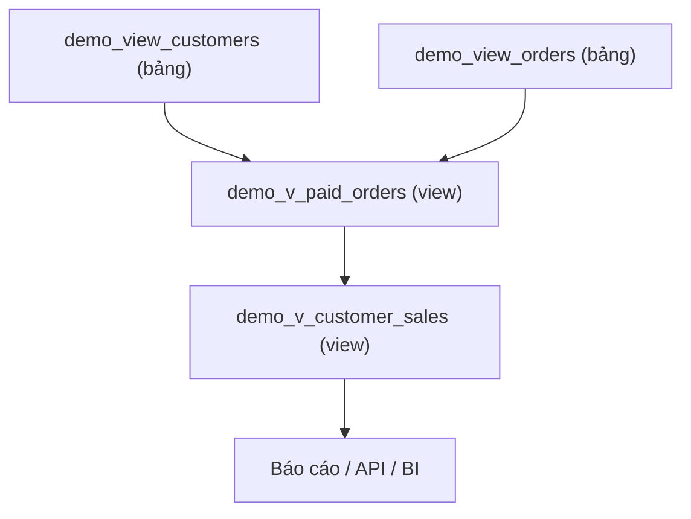

# Đặt tên cột, thay đổi định nghĩa và phụ thuộc của view

## 1. Tại sao tên cột của view là một phần của thiết kế hệ thống?

Giả sử ứng dụng đang đọc báo cáo đơn đã thanh toán:

```sql
SELECT
    order_id,
    customer_name,
    paid_amount
FROM v_paid_orders;
```

Một ngày, nhóm dữ liệu muốn đổi tên `paid_amount` thành `amount_paid`, bổ sung cột tháng thanh toán hoặc thay cách tính tổng doanh thu. Nếu chỉ nghĩ view là “một câu SELECT được lưu”, việc sửa có vẻ rất nhỏ. Nhưng các thành phần khác có thể đang phụ thuộc vào **tên cột, thứ tự cột, kiểu dữ liệu và ý nghĩa của giá trị**:

- Trang báo cáo truy vấn `paid_amount`.
- Một view tổng hợp khác dùng `SUM(paid_amount)`.
- API ánh xạ cột SQL sang thuộc tính trong Java.
- Một stored procedure sử dụng cấu trúc của view.
- Một role được cấp quyền `SELECT` trên view.
- Công cụ BI ghi nhớ metadata của các cột.

Vì vậy, sửa view có thể trở thành **thay đổi hợp đồng dữ liệu** (*data contract*), không chỉ là sửa câu SQL.

Bài học tập trung vào ba vấn đề gắn với nhau:

1. **Đặt tên cột của view:** dùng alias hoặc danh sách cột tường minh, tránh tên tự sinh và `SELECT *` thiếu kiểm soát.
2. **Thay đổi định nghĩa view:** biết lúc nào dùng `CREATE OR REPLACE VIEW`, `ALTER VIEW` hoặc tạo view phiên bản mới, và biết những thay đổi nào gây lỗi.
3. **Quản lý phụ thuộc:** xác định view đang tham chiếu bảng/view nào, ai đang dùng view, cách tránh làm hỏng view khác khi đổi schema hoặc xóa đối tượng.

Các ví dụ có thể chạy chính sử dụng **PostgreSQL**. Các mục cuối phân biệt SQL Server, MySQL, SQLite và Oracle, vì cùng mục tiêu sửa view nhưng cú pháp và khả năng bảo toàn phụ thuộc không hoàn toàn giống nhau.

---

## 2. View là gì và view lưu điều gì?

Một **view thông thường** là một đối tượng database có tên, được định nghĩa bởi truy vấn `SELECT`:

```sql
CREATE VIEW view_name AS
SELECT ...
FROM ...
WHERE ...;
```

Khi truy vấn view:

```sql
SELECT * FROM view_name;
```

database sử dụng định nghĩa view để tạo kết quả theo ngữ nghĩa của hệ quản trị.

### 2.1. View không phải bản sao dữ liệu cố định

Với **view thông thường**, nội dung kết quả thường phản ánh dữ liệu ở các bảng nền trong ngữ cảnh truy vấn/transaction. View không tự lưu một bản chụp tách biệt của mọi hàng.

Hình dung:

```text
Bảng khách hàng ─┐
                ├─► view đơn đã thanh toán ─► view doanh thu theo khách ─► báo cáo
Bảng đơn hàng ───┘
```

- Bảng nền lưu dữ liệu.
- View định nghĩa cách trình bày, lọc và kết hợp dữ liệu.
- View phía trên có thể tham chiếu **một view phía dưới**, tạo ra chuỗi phụ thuộc.

### 2.2. Khác gì bảng tạm hay materialized view?

| Đối tượng | Có lưu hàng kết quả riêng không? | Định nghĩa | Khi nguồn thay đổi |
| --- | --- | --- | --- |
| View thông thường | Không theo cơ chế vật chất hóa thông thường | `CREATE VIEW ... AS SELECT` | Truy vấn view sẽ sử dụng dữ liệu nguồn theo ngữ nghĩa thực thi |
| Temporary table | Có, trong phạm vi/session hoặc transaction theo DBMS | `CREATE TEMP TABLE ...` | Không tự đồng bộ nếu chưa có lệnh cập nhật bảng tạm |
| Materialized view | Có lưu kết quả đã vật chất hóa | Cú pháp DBMS riêng | Cần cơ chế refresh/maintenance tương ứng |
| Bảng trung gian ETL | Có | Bảng thông thường do pipeline ghi | Phụ thuộc quy trình nạp hoặc làm mới |

Bài này tập trung vào **view thông thường**. Không được áp dụng mọi kết luận về `CREATE OR REPLACE VIEW` cho **materialized view** mà không kiểm tra tính năng riêng của DBMS.

## 3. Bốn yếu tố tạo thành hợp đồng cột của view

Một cột view không chỉ có tên.

| Yếu tố | Ví dụ | Tại sao quan trọng? |
| --- | --- | --- |
| **Tên** | `paid_amount` | Truy vấn và ứng dụng tham chiếu theo tên |
| **Thứ tự** | Cột thứ tư | `SELECT *`, ánh xạ theo vị trí, `INSERT ... SELECT` có thể phụ thuộc |
| **Kiểu** | `NUMERIC(12,2)` | Driver, công thức và view phụ thuộc cần kiểu tương thích |
| **Ý nghĩa** | Chỉ tiền các đơn `PAID` | Không đổi tên nhưng đổi điều kiện lọc cũng có thể gây sai báo cáo |

Còn những yếu tố khác như tính nullable, độ chính xác, quyền đọc, collation và khả năng cập nhật view cũng có thể ảnh hưởng người dùng.

Ví dụ: đổi công thức từ **tổng đơn đã thanh toán** sang **tổng mọi đơn** mà giữ tên `total_paid` là thay đổi nguy hiểm, dù câu `CREATE OR REPLACE VIEW` có thể chạy thành công.

**Nguyên tắc:** Tính tương thích cú pháp không đồng nghĩa tính tương thích nghiệp vụ.

---

## 4. Bộ dữ liệu thực hành PostgreSQL

Tạo bảng trên **database học tập**, không chạy DDL minh họa trên bảng production.

### 4.1. Bảng khách hàng

```sql
CREATE TABLE demo_view_customers (
    customer_id INTEGER PRIMARY KEY,
    customer_name TEXT NOT NULL
);

INSERT INTO demo_view_customers (
    customer_id, customer_name
)
VALUES
    (1, 'An'),
    (2, 'Bình'),
    (3, 'Chi'),
    (4, 'Dung');
```

### 4.2. Bảng đơn hàng

```sql
CREATE TABLE demo_view_orders (
    order_id INTEGER PRIMARY KEY,
    customer_id INTEGER NOT NULL
        REFERENCES demo_view_customers(customer_id),
    ordered_at DATE NOT NULL,
    amount NUMERIC(12,2) NOT NULL,
    order_status TEXT NOT NULL
        CHECK (order_status IN ('NEW', 'PAID', 'CANCELLED'))
);

INSERT INTO demo_view_orders (
    order_id, customer_id, ordered_at,
    amount, order_status
)
VALUES
    (101, 1, DATE '2026-10-01', 200, 'PAID'),
    (102, 1, DATE '2026-10-02',  50, 'NEW'),
    (103, 2, DATE '2026-10-03', 300, 'PAID'),
    (104, 3, DATE '2026-10-04',  90, 'CANCELLED'),
    (105, 3, DATE '2026-10-05', 100, 'PAID'),
    (106, 2, DATE '2026-10-06',  50, 'PAID');
```

Dữ liệu gốc:

| order_id | customer_id | amount | order_status |
| ---: | ---: | ---: | --- |
| 101 | 1 | 200 | PAID |
| 102 | 1 | 50 | NEW |
| 103 | 2 | 300 | PAID |
| 104 | 3 | 90 | CANCELLED |
| 105 | 3 | 100 | PAID |
| 106 | 2 | 50 | PAID |

Khách Dung chưa có đơn nào. Các ví dụ có điều kiện `order_status='PAID'` sẽ lấy **bốn đơn**: 101, 103, 105, 106.

### 4.3. Quy ước đặt tên để tránh va chạm

Trong bài, bảng học tập có tiền tố `demo_view_` và view có tiền tố `demo_v_`. Ứng dụng thật nên dùng schema phù hợp (ví dụ `reporting`) và đặt tên biểu đạt ý nghĩa thay vì dựa riêng vào tiền tố.

Các lệnh sử dụng đối tượng ở **schema hiện tại** trong PostgreSQL. Nếu database có nhiều schema, nên dùng tên đầy đủ như `reporting.v_paid_orders` khi triển khai.

## 5. Tạo view thứ nhất bằng danh sách tên cột tường minh

```sql
CREATE VIEW demo_v_paid_orders (
    order_id,
    customer_id,
    customer_name,
    paid_amount
) AS
SELECT
    o.order_id,
    o.customer_id,
    c.customer_name,
    o.amount
FROM demo_view_orders AS o
JOIN demo_view_customers AS c
    ON c.customer_id = o.customer_id
WHERE o.order_status = 'PAID';
```

Phần:

```sql
demo_v_paid_orders (
    order_id,
    customer_id,
    customer_name,
    paid_amount
)
```

định nghĩa **tên các cột đầu ra của view**, theo đúng thứ tự các biểu thức trong `SELECT`.

Truy vấn:

```sql
SELECT
    order_id,
    customer_name,
    paid_amount
FROM demo_v_paid_orders
ORDER BY order_id;
```

Kết quả:

| order_id | customer_name | paid_amount |
| ---: | --- | ---: |
| 101 | An | 200 |
| 103 | Bình | 300 |
| 105 | Chi | 100 |
| 106 | Bình | 50 |

### 5.1. Tên gốc không nhất thiết là tên view

Bảng nguồn có cột `amount`. View đặt tên đầu ra là `paid_amount`.

Truy vấn sau hợp lệ:

```sql
SELECT paid_amount
FROM demo_v_paid_orders;
```

Nhưng:

```sql
-- Lỗi: view không có cột tên amount.
SELECT amount
FROM demo_v_paid_orders;
```

không hợp lệ với định nghĩa view hiện tại, dù bảng nền có `amount`.

**Tên cột được công bố bởi view là giao diện của view** đối với truy vấn phía ngoài.

### 5.2. Danh sách tên cột phải khớp số cột đầu ra

Nếu `SELECT` trả bốn biểu thức nhưng danh sách khai báo view chỉ có ba tên, hoặc nhiều hơn bốn tên, PostgreSQL sẽ không chấp nhận một định nghĩa không hợp lệ.

Trong các hệ hỗ trợ danh sách tên cột, cần bảo đảm:

- Mỗi biểu thức đầu ra có tên phù hợp.
- Tên đầu ra không trùng nhau trong cùng view theo quy tắc DBMS.
- Thứ tự tên và biểu thức trùng khớp với ý nghĩa nghiệp vụ.

## 6. Cách thứ hai: đặt alias ngay trong SELECT

Thay vì khai báo danh sách cột sau tên view, có thể đặt tên bằng `AS`:

```sql
CREATE VIEW demo_v_paid_orders_by_alias AS
SELECT
    o.order_id AS order_id,
    o.customer_id AS customer_id,
    c.customer_name AS customer_name,
    o.amount AS paid_amount
FROM demo_view_orders AS o
JOIN demo_view_customers AS c
    ON c.customer_id = o.customer_id
WHERE o.order_status = 'PAID';
```

Kết quả cột của `demo_v_paid_orders_by_alias` cũng là:

```text
order_id
customer_id
customer_name
paid_amount
```

### 6.1. Hai cách có thể dùng kết hợp

Ví dụ:

```sql
CREATE VIEW demo_v_column_names (
    order_key,
    buyer_key,
    display_name,
    money
) AS
SELECT
    o.order_id AS source_order_id,
    o.customer_id AS source_customer_id,
    c.customer_name,
    o.amount
FROM demo_view_orders AS o
JOIN demo_view_customers AS c
    ON c.customer_id = o.customer_id
WHERE o.order_status = 'PAID';
```

Ở PostgreSQL, danh sách tên cột của `CREATE VIEW` xác định tên đầu ra:

```text
order_key, buyer_key, display_name, money
```

Không phải `source_order_id` hay `source_customer_id`.

### 6.2. Nên chọn cách nào?

- **Alias trong SELECT:** tiện khi cần thể hiện cột nguồn nào được đổi tên và khi định nghĩa dài.
- **Danh sách ở CREATE VIEW:** tiện để nhìn ngay hợp đồng đầu ra; thường gặp trong DDL và migration.
- **Kết hợp cả hai:** được hỗ trợ nhưng nên tránh hai bộ tên trái ngược khó hiểu.

Trong code production, ưu tiên **tên rõ nghĩa, ổn định**. Đừng tạo hai tên mâu thuẫn mà chỉ một người viết view hiểu quy tắc ưu tiên.

## 7. Biểu thức tính toán cần tên ổn định

Xem:

```sql
SELECT
    customer_id,
    COUNT(*),
    SUM(amount)
FROM demo_view_orders
GROUP BY customer_id;
```

Trong một câu SELECT tương tác, biểu thức `COUNT(*)` có thể được client hiển thị với một tên mặc định. Nhưng nếu tạo view lâu dài, tên tự sinh hoặc tên dựa trên biểu thức là hợp đồng không đáng tin cậy giữa các DBMS.

Nên đặt tên:

```sql
CREATE VIEW demo_v_order_totals AS
SELECT
    customer_id,
    COUNT(*) AS order_count,
    SUM(amount) AS total_amount
FROM demo_view_orders
GROUP BY customer_id;
```

`order_count` và `total_amount` có nghĩa rõ hơn tên hàm tự động của engine.

### 7.1. Khi nào cần CAST?

Với PostgreSQL:

- `COUNT(*)` trả kiểu `BIGINT`.
- `SUM(NUMERIC)` trả `NUMERIC`.
- Một biểu thức `CASE` có thể được suy luận kiểu theo các nhánh.
- Giá trị literal như `NULL` không có kiểu nghiệp vụ rõ nếu không đặt trong ngữ cảnh phù hợp.

Nếu view là giao diện được nhiều ứng dụng sử dụng, nên xác định kiểu một cách có chủ đích khi cần:

```sql
CREATE VIEW demo_v_order_counts AS
SELECT
    customer_id,
    COUNT(*)::BIGINT AS order_count
FROM demo_view_orders
GROUP BY customer_id;
```

Không ép `COUNT(*)` sang `INTEGER` chỉ để “trông nhỏ gọn” nếu số hàng có thể vượt giới hạn kiểu integer.

### 7.2. Đổi kiểu sau khi triển khai có thể phá phụ thuộc

Một view đang công bố `total_amount NUMERIC` mà bị đổi thành `TEXT` có thể làm hỏng:

- `SUM(total_amount)` ở view phía trên.
- JDBC mapping sang `BigDecimal`.
- Các phép so sánh số.
- Biểu đồ/BI kỳ vọng dữ liệu số.

Nên xem kiểu đầu ra là thành phần của **hợp đồng schema**, không chỉ kết quả tình cờ của biểu thức.

---

## 8. Tạo view thứ hai phụ thuộc view thứ nhất

Ta tạo view tổng hợp doanh thu đã thanh toán theo khách:

```sql
CREATE VIEW demo_v_customer_sales (
    customer_id,
    customer_name,
    paid_order_count,
    total_paid
) AS
SELECT
    customer_id,
    customer_name,
    COUNT(*),
    SUM(paid_amount)
FROM demo_v_paid_orders
GROUP BY
    customer_id,
    customer_name;
```

Truy vấn:

```sql
SELECT *
FROM demo_v_customer_sales
ORDER BY customer_id;
```

Kết quả:

| customer_id | customer_name | paid_order_count | total_paid |
| ---: | --- | ---: | ---: |
| 1 | An | 1 | 200 |
| 2 | Bình | 2 | 350 |
| 3 | Chi | 1 | 100 |

Khách Dung không xuất hiện vì không có đơn `PAID`.

### 8.1. Sơ đồ phụ thuộc



Có **hai loại phụ thuộc** quan trọng:

1. **Phụ thuộc được database quản lý:** `demo_v_customer_sales` dùng `demo_v_paid_orders`, còn `demo_v_paid_orders` dùng hai bảng nền.
2. **Phụ thuộc bên ngoài database:** code Java, báo cáo, ứng dụng BI, ETL, tài liệu và truy vấn ad hoc.

Database thường có thể nhận biết loại thứ nhất rõ hơn loại thứ hai. Một `DROP VIEW` bị database ngăn vì còn view phụ thuộc **không có nghĩa** database biết tất cả ứng dụng ngoài đang dùng nó.

### 8.2. View phía trên phụ thuộc vào tên cột và kiểu

Định nghĩa `demo_v_customer_sales` dùng:

```sql
SUM(paid_amount)
```

Nếu tên `paid_amount` biến mất khỏi giao diện view bên dưới, việc viết lại/triển khai định nghĩa phía trên có thể thất bại.

Hệ quản trị có thể lưu cấu trúc tham chiếu nội bộ theo ID đối tượng/cột thay vì chỉ lưu chuỗi SQL; vì vậy một thao tác rename có thể được database cập nhật trong metadata mà **không tự sửa source code của ứng dụng**. Hai kiểu phụ thuộc này phải được xử lý riêng.

## 9. Đặt tên cột theo nguyên tắc dễ bảo trì

Tên cột view thường nên đáp ứng:

- **Đúng ý nghĩa:** `paid_amount` khác `gross_amount` hoặc `net_amount`.
- **Ổn định:** không thay chỉ vì thay cách viết câu SELECT.
- **Không mơ hồ:** dùng `customer_id` thay cho `id` nếu view kết hợp nhiều bảng.
- **Nhất quán:** cùng khái niệm được đặt cùng tên trong các view liên quan.
- **Có đơn vị/độ hạt khi cần:** `total_paid_vnd`, `month_start`, `paid_order_count`.
- **Hạn chế từ khóa SQL và tên cần quote:** tránh rắc rối do `order`, `group`, khoảng trắng.
- **Không che giấu thay đổi ngữ nghĩa:** nếu đã đổi từ tổng PAID sang tổng mọi trạng thái, tên cũ `total_paid` có thể sai.

### 9.1. Dùng dấu nháy kép trong PostgreSQL

Ví dụ:

```sql
CREATE VIEW demo_v_case_sensitive AS
SELECT
    customer_id AS "CustomerID",
    customer_name AS "Customer Name"
FROM demo_view_customers;
```

Khi truy vấn phải dùng:

```sql
SELECT "CustomerID", "Customer Name"
FROM demo_v_case_sensitive;
```

Tên không quote trên PostgreSQL thường được gập thành chữ thường. `CustomerID` không quote có thể được hiểu khác `"CustomerID"`.

Các tên như `customer_id` hoặc `customer_name` thường dễ dùng hơn cho Java, BI và SQL nhiều DBMS.

### 9.2. Alias không đổi tên cột ở bảng nguồn

```sql
SELECT o.amount AS paid_amount
FROM demo_view_orders AS o;
```

không hề đổi tên cột `amount` của bảng `demo_view_orders`. Nó chỉ tạo **tên đầu ra của biểu thức** ở cấp SELECT hoặc view tương ứng.

---

## 10. Vì sao không nên dùng SELECT * trong định nghĩa view dài hạn?

Cách viết:

```sql
CREATE VIEW demo_v_all_orders AS
SELECT *
FROM demo_view_orders;
```

rất nhanh khi thử nghiệm. Nhưng trong một view được sử dụng lâu dài, nó có vấn đề:

1. **Không thể hiện hợp đồng cột** một cách rõ ràng trong source code.
2. Việc đổi schema bảng nền có thể ảnh hưởng metadata khác nhau theo DBMS.
3. Thứ tự cột có thể trở thành một phụ thuộc khó thấy.
4. Dễ kéo theo cột không cần thiết hoặc nhạy cảm.
5. Những thay đổi có thể tác động cách driver/BI lập bản đồ các cột.
6. Khó kiểm soát kiểu và tên cột theo chính sách versioning.

### 10.1. PostgreSQL: dấu * được giải quyết khi tạo view

Ví dụ thử trong transaction:

```sql
BEGIN;

CREATE VIEW demo_v_star_test AS
SELECT *
FROM demo_view_orders;

ALTER TABLE demo_view_orders
ADD COLUMN internal_note TEXT;

SELECT column_name, ordinal_position
FROM information_schema.columns
WHERE table_name = 'demo_v_star_test'
ORDER BY ordinal_position;

ROLLBACK;
```

Trong PostgreSQL, các cột đầu ra của một view được thiết lập ở lúc tạo view. Việc thêm `internal_note` vào bảng nền **không tự làm view vừa tạo xuất hiện thêm cột ấy**.

Quy tắc này không nên được khái quát nguyên văn cho mọi DBMS. Ví dụ SQL Server có vấn đề **metadata của view không schema-bound cần refresh** sau thay đổi bảng nền.

### 10.2. Viết danh sách cột tường minh

Tốt hơn:

```sql
CREATE VIEW demo_v_orders_public AS
SELECT
    order_id,
    customer_id,
    ordered_at,
    amount,
    order_status
FROM demo_view_orders;
```

Khi bảng nguồn có thêm cột nội bộ, giao diện view vẫn cố ý chỉ gồm các cột công khai.

### 10.3. SELECT * của người dùng view khác SELECT * trong định nghĩa

```sql
SELECT * FROM demo_v_paid_orders;
```

ở lúc truy vấn là cách đọc tất cả cột **mà view hiện công bố**. Nó không gây ra chính xác cùng loại rủi ro như `CREATE VIEW ... AS SELECT *`, nhưng ứng dụng phụ thuộc vào số lượng/thứ tự cột vẫn có thể bị ảnh hưởng khi view được mở rộng.

Ở các API/ứng dụng dài hạn, thường nên chọn **cột cần dùng** thay vì dựa trên `SELECT *`.

## 11. Tìm hiểu CREATE OR REPLACE VIEW trên PostgreSQL

Khi cần cập nhật câu SELECT của view hiện có, PostgreSQL cung cấp:

```sql
CREATE OR REPLACE VIEW view_name AS
SELECT ...;
```

Nếu view chưa tồn tại, lệnh tạo mới. Nếu view đã tồn tại, PostgreSQL cố thay **quy tắc SELECT của view** trong giới hạn bảo toàn giao diện các cột đã công bố.

Điểm rất quan trọng trong PostgreSQL:

> Các cột đã có của view mới phải giữ **cùng tên, cùng thứ tự và cùng kiểu dữ liệu**; có thể **bổ sung cột mới ở cuối**.

Do đó `CREATE OR REPLACE VIEW` không phải cơ chế thay cấu trúc cột hoàn toàn tự do.

### 11.1. Thay đổi được phép: sửa điều kiện hoặc biểu thức nhưng giữ cột

Ví dụ sửa phép lọc theo một điều kiện nghiệp vụ mới mà vẫn giữ bốn cột cũ:

```sql
CREATE OR REPLACE VIEW demo_v_paid_orders (
    order_id,
    customer_id,
    customer_name,
    paid_amount
) AS
SELECT
    o.order_id,
    o.customer_id,
    c.customer_name,
    o.amount
FROM demo_view_orders AS o
JOIN demo_view_customers AS c
    ON c.customer_id = o.customer_id
WHERE o.order_status = 'PAID'
  AND o.amount > 0;
```

Câu này giữ tên/thứ tự/kiểu các cột đầu ra. Dữ liệu mẫu vẫn cho bốn đơn đã thanh toán.

Tuy nhiên, **đổi điều kiện lọc vẫn có thể đổi ý nghĩa hoặc số hàng** của view. Cần thông báo/kiểm tra với bên tiêu thụ, không chỉ dựa vào SQL được chấp nhận.

### 11.2. Bảo toàn object tốt hơn DROP rồi CREATE

Trong PostgreSQL, `CREATE OR REPLACE VIEW` đối với một view đang tồn tại thường giữ danh tính đối tượng, chủ sở hữu và các quyền đã cấp của view tốt hơn việc xóa rồi tạo lại.

Nếu `DROP VIEW` rồi `CREATE VIEW`:

- Các view phụ thuộc có thể bị chặn hoặc bị xóa khi CASCADE.
- Object identity thay đổi.
- Grants, ownership và metadata cần được xét/tạo lại.
- Các ứng dụng đang chạy có thể gặp khoảng thời gian đối tượng không tồn tại nếu triển khai thiếu transaction.

Vì vậy, ưu tiên `CREATE OR REPLACE VIEW` khi thay đổi **tương thích theo quy tắc PostgreSQL**.

---

## 12. Thêm cột mới ở cuối view trên PostgreSQL

Bắt đầu từ `demo_v_paid_orders` có bốn cột:

```text
order_id
customer_id
customer_name
paid_amount
```

Muốn thêm năm mua hàng `paid_year`. Viết:

```sql
CREATE OR REPLACE VIEW demo_v_paid_orders AS
SELECT
    o.order_id,
    o.customer_id,
    c.customer_name,
    o.amount AS paid_amount,
    EXTRACT(YEAR FROM o.ordered_at)::INTEGER AS paid_year
FROM demo_view_orders AS o
JOIN demo_view_customers AS c
    ON c.customer_id = o.customer_id
WHERE o.order_status = 'PAID';
```

Cột mới được thêm **sau bốn cột cũ**.

Truy vấn:

```sql
SELECT
    order_id,
    paid_amount,
    paid_year
FROM demo_v_paid_orders
ORDER BY order_id;
```

Kết quả:

| order_id | paid_amount | paid_year |
| ---: | ---: | ---: |
| 101 | 200 | 2026 |
| 103 | 300 | 2026 |
| 105 | 100 | 2026 |
| 106 | 50 | 2026 |

### 12.1. View phụ thuộc vẫn hoạt động

`demo_v_customer_sales` chỉ sử dụng các cột cũ: `customer_id`, `customer_name`, `paid_amount`. Thêm `paid_year` ở cuối không buộc nó phải thay đổi định nghĩa.

```sql
SELECT *
FROM demo_v_customer_sales
ORDER BY customer_id;
```

vẫn cho An 200, Bình 350, Chi 100.

### 12.2. Vì sao thêm cột giữa danh sách nguy hiểm?

Giả sử cố tạo định nghĩa mới theo thứ tự:

```text
order_id
customer_id
paid_year        ← chen vào vị trí thứ ba
customer_name
paid_amount
```

Trên PostgreSQL, `CREATE OR REPLACE VIEW` không chấp nhận thay thế tùy tiện thứ tự/tên/kiểu các cột đã tồn tại như vậy.

Ngay cả trên DBMS cho phép thay đổi hình dạng view linh hoạt hơn, code dùng `SELECT *` hoặc đọc cột theo vị trí có thể bị hỏng.

### 12.3. Thêm cột có hoàn toàn không phá vỡ hợp đồng?

**Không hẳn.** Mặc dù là thay đổi *additive* ở SQL schema, một client có thể:

- Mong đúng bốn cột.
- Map kết quả theo vị trí.
- Gửi toàn bộ `SELECT *` vào một cấu trúc cố định.
- So sánh schema response từng cột.

Vì vậy, ngay cả thay đổi được database cho phép vẫn nên có kiểm tra tương thích phía ứng dụng.

## 13. Đổi tên cột của view trên PostgreSQL

Giả sử muốn đổi `paid_amount` thành `amount_paid`.

Một lỗi dễ gặp là thử thay tên trong `CREATE OR REPLACE VIEW`:

```sql
-- Không phải cách PostgreSQL dùng để đổi tên
-- cột đã tồn tại của view.
CREATE OR REPLACE VIEW demo_v_paid_orders AS
SELECT
    o.order_id,
    o.customer_id,
    c.customer_name,
    o.amount AS amount_paid,
    EXTRACT(YEAR FROM o.ordered_at)::INTEGER AS paid_year
FROM demo_view_orders AS o
JOIN demo_view_customers AS c
    ON c.customer_id = o.customer_id
WHERE o.order_status = 'PAID';
```

Vì cột cũ ở vị trí thứ tư tên `paid_amount`, PostgreSQL sẽ phản đối thay đổi tên cột đã có trong `CREATE OR REPLACE VIEW`.

### 13.1. Dùng ALTER VIEW ... RENAME COLUMN

PostgreSQL hỗ trợ:

```sql
ALTER VIEW demo_v_paid_orders
RENAME COLUMN paid_amount TO amount_paid;
```

Đây là **thao tác đổi tên cột công bố bởi view**, không phải đổi tên `amount` ở bảng nguồn.

### 13.2. Thử đổi tên mà không giữ thay đổi

Nếu muốn thử trong môi trường học tập:

```sql
BEGIN;

ALTER VIEW demo_v_paid_orders
RENAME COLUMN paid_amount TO amount_paid;

SELECT order_id, amount_paid
FROM demo_v_paid_orders
ORDER BY order_id;

ROLLBACK;
```

Sau `ROLLBACK`, tên `paid_amount` được giữ như trước.

### 13.3. Điều gì xảy ra với các view phụ thuộc?

PostgreSQL có hệ thống phụ thuộc đối tượng và tham chiếu cột nội bộ. Những view đã được database phân giải phụ thuộc vào cột đó **có thể tiếp tục hoạt động sau thao tác rename được hỗ trợ**, và định nghĩa được deparse có thể phản ánh tên mới.

Tuy nhiên:

- Một câu SQL **bên ngoài database** vẫn ghi `SELECT paid_amount FROM demo_v_paid_orders` sẽ lỗi sau khi rename.
- Script tạo lại view phụ thuộc có thể chứa tên cũ và cần cập nhật.
- ORM, API, BI hoặc query cache có thể dựa vào tên cũ.
- Một ứng dụng ghi lại tên cột trong JSON hoặc cấu hình không được database tự sửa.

**Vì vậy, database cho phép RENAME không đồng nghĩa migration an toàn với tất cả người dùng.**

## 14. Đổi kiểu cột hoặc thứ tự cột của view

Giả sử `paid_amount` hiện có kiểu `NUMERIC(12,2)`. Muốn chuyển thành `TEXT` để hiển thị có dấu phân cách:

```sql
-- Minh họa thay đổi KHÔNG tương thích
-- với CREATE OR REPLACE VIEW trên PostgreSQL.
CREATE OR REPLACE VIEW demo_v_paid_orders AS
SELECT
    o.order_id,
    o.customer_id,
    c.customer_name,
    o.amount::TEXT AS paid_amount,
    EXTRACT(YEAR FROM o.ordered_at)::INTEGER AS paid_year
FROM demo_view_orders AS o
JOIN demo_view_customers AS c
    ON c.customer_id = o.customer_id
WHERE o.order_status = 'PAID';
```

Trên PostgreSQL, thay kiểu của cột đã có bằng `CREATE OR REPLACE VIEW` sẽ không được chấp nhận như một thay đổi bảo toàn giao diện.

### 14.1. Vì sao đổi NUMERIC thành TEXT là thay đổi lớn?

View tổng hợp phía trên dùng:

```sql
SUM(paid_amount)
```

`SUM(TEXT)` không có cùng ý nghĩa với `SUM(NUMERIC)` và có thể lỗi. API đang đọc `BigDecimal` cũng có thể không xử lý kiểu mới.

Nếu chỉ muốn **định dạng hiển thị**, thường nên để `NUMERIC` ở lớp dữ liệu và định dạng ở ứng dụng hoặc cung cấp **cột hiển thị bổ sung**.

### 14.2. Thay đổi kiểu của cột bảng nền cũng có thể bị chặn

PostgreSQL theo dõi phụ thuộc giữa view và cột bảng. Một lệnh:

```sql
ALTER TABLE demo_view_orders
ALTER COLUMN amount TYPE TEXT;
```

có thể bị từ chối vì `amount` đang được view tham chiếu.

Không nên dùng `CASCADE`/xóa view để né kiểm tra phụ thuộc mà chưa có kế hoạch migration.

### 14.3. Cách an toàn hơn cho thay đổi không tương thích

Tạo **view phiên bản mới** với kiểu/ý nghĩa mới, chuyển client sang phiên bản mới rồi chỉ loại bỏ view cũ sau khi kiểm tra không còn phụ thuộc.

---

## 15. Tạo view phiên bản v1/v2 để giữ tương thích

Một chiến lược migration phổ biến:

- Giữ `v_paid_orders_v1` ổn định.
- Tạo `v_paid_orders_v2` với các cột hoặc ý nghĩa mới.
- Cấp quyền và chuyển từng nhóm client.
- Chỉ ngừng v1 sau khi tất cả phụ thuộc đã được xử lý.

Ví dụ trong bộ dữ liệu:

```sql
CREATE VIEW demo_v_paid_orders_v2 AS
SELECT
    o.order_id,
    o.customer_id,
    c.customer_name,
    o.amount AS amount_paid,
    DATE_TRUNC(
        'month', o.ordered_at::TIMESTAMP
    )::DATE AS paid_month
FROM demo_view_orders AS o
JOIN demo_view_customers AS c
    ON c.customer_id = o.customer_id
WHERE o.order_status = 'PAID';
```

View mới công bố:

```text
order_id
customer_id
customer_name
amount_paid
paid_month
```

Trong khi `demo_v_paid_orders` hiện tại vẫn công bố `paid_amount` và `paid_year`.

### 15.1. Vì sao tạo v2 giúp giảm rủi ro?

Một client cũ:

```sql
SELECT paid_amount
FROM demo_v_paid_orders;
```

vẫn hoạt động.

Một client mới:

```sql
SELECT amount_paid, paid_month
FROM demo_v_paid_orders_v2;
```

sử dụng hợp đồng mới.

Nếu sửa ngay view cũ, mọi client có thể phải thay trong cùng thời điểm triển khai. Dùng v2 cho phép **migration theo giai đoạn**.

### 15.2. Migration không chỉ là CREATE VIEW

Cần thực hiện:

1. Tạo view v2 với tên và kiểu rõ ràng.
2. Kiểm tra kết quả và quyền truy cập.
3. Cập nhật view, API, BI, procedure và job sử dụng v1.
4. Theo dõi các truy vấn còn truy cập v1.
5. Xác nhận không còn phụ thuộc cần giữ.
6. Lập kế hoạch drop v1 và phương án phục hồi.

**Không thể tin rằng chỉ cần chạy `CREATE VIEW v2` là hoàn tất migration.**

### 15.3. Có thể tạo alias tương thích tạm thời

Nếu chỉ đổi tên cột, v2 đôi khi có thể công bố cả tên cũ và tên mới:

```sql
CREATE VIEW demo_v_paid_orders_bridge AS
SELECT
    order_id,
    customer_id,
    customer_name,
    paid_amount,
    paid_amount AS amount_paid
FROM demo_v_paid_orders;
```

Cách này giúp client chuyển dần nhưng làm tăng số cột và có thể kéo dài “nợ kỹ thuật” nếu không có thời hạn bỏ tên cũ.

---

## 16. DROP VIEW và hệ thống phụ thuộc PostgreSQL

Giả sử muốn xóa `demo_v_paid_orders` trong khi `demo_v_customer_sales` vẫn tham chiếu tới nó.

Trên PostgreSQL:

```sql
DROP VIEW demo_v_paid_orders;
```

thường bị từ chối vì còn view phụ thuộc. Mặc định hành vi tương ứng với **`RESTRICT`**.

### 16.1. RESTRICT: ngăn xóa khi có phụ thuộc

```sql
DROP VIEW demo_v_paid_orders RESTRICT;
```

Ý nghĩa: xóa view chỉ khi không có những phụ thuộc khiến việc xóa bị cấm.

Đây là một **lớp bảo vệ database** chống xóa nhầm chuỗi view.

### 16.2. CASCADE: có thể xóa view phụ thuộc

```sql
-- CẢNH BÁO: Không chạy trên đối tượng thật
-- nếu chưa kiểm kê và đồng ý xóa phụ thuộc.
DROP VIEW demo_v_paid_orders CASCADE;
```

`CASCADE` có thể kéo theo việc xóa `demo_v_customer_sales` và những đối tượng tiếp tục phụ thuộc vào chuỗi đó.

**CASCADE không chỉ là tùy chọn “bỏ qua lỗi”.** Nó thay đổi phạm vi đối tượng bị xóa.

### 16.3. IF EXISTS không giải quyết phụ thuộc

```sql
DROP VIEW IF EXISTS demo_v_paid_orders;
```

`IF EXISTS` giúp tránh lỗi khi **view không tồn tại**. Nó **không** có nghĩa có thể tự bỏ qua các phụ thuộc của một view **đang tồn tại**.

### 16.4. Không “drop rồi dựng lại” nếu có cách tương thích

Nếu chỉ thay nội dung SELECT mà giữ nguyên giao diện cột, hãy ưu tiên `CREATE OR REPLACE VIEW`.

Nếu thay giao diện không tương thích, cân nhắc v2 và migration theo giai đoạn. Chỉ dùng DROP/CREATE khi đã hiểu đầy đủ các đối tượng liên quan và quyền cần khôi phục.

## 17. Phụ thuộc trực tiếp và phụ thuộc gián tiếp

Xét sơ đồ:

```text
demo_view_orders
       |
       v
demo_v_paid_orders
       |
       v
demo_v_customer_sales
       |
       v
report_monthly_sales (giả định)
```

- `demo_v_paid_orders` phụ thuộc **trực tiếp** vào `demo_view_orders`.
- `demo_v_customer_sales` phụ thuộc **trực tiếp** vào `demo_v_paid_orders`.
- `demo_v_customer_sales` phụ thuộc **gián tiếp** vào `demo_view_orders`.
- Báo cáo bên ngoài có thể phụ thuộc vào cột của `demo_v_customer_sales` nhưng database không biết được toàn bộ code báo cáo.

### 17.1. Thay đổi có thể lan theo nhiều tầng

Nếu cột `amount` của bảng đơn bị đổi kiểu:

1. `demo_v_paid_orders` có thể bị chặn thay đổi hoặc cần tái tạo.
2. `demo_v_customer_sales` phụ thuộc vào giá trị `paid_amount` ở view thứ nhất.
3. Các báo cáo tính `total_paid` có thể phải cập nhật.
4. Driver Java/BI có thể nhận kiểu mới.

Vì vậy, một migration nên xem **đồ thị phụ thuộc**, không chỉ tên view đang sửa.

### 17.2. Không phải phụ thuộc nào cũng lộ ra bằng system catalog

Một ứng dụng có thể xây SQL động:

```java
String sql =
    "SELECT paid_amount FROM demo_v_paid_orders WHERE order_id = ?";
```

Database không thể liệt kê mọi chuỗi SQL nằm trong source code, file cấu hình, báo cáo hay cache ngoài DB.

Cần kết hợp:

- Catalog metadata.
- Source code search.
- Inventory báo cáo/BI.
- Query logging/telemetry phù hợp.
- Thông báo thay đổi và migration plan.

---

## 18. Xem định nghĩa view trên PostgreSQL

Dùng `pg_get_viewdef` để lấy phần SELECT mà PostgreSQL lưu cho view:

```sql
SELECT pg_get_viewdef(
    'demo_v_paid_orders'::regclass,
    TRUE
) AS view_sql;
```

Trong PostgreSQL, `regclass` giúp tham chiếu đối tượng theo tên và giải quyết thành object ID theo `search_path` hiện tại.

### 18.1. Xem thông tin cột trong information_schema

```sql
SELECT
    table_schema,
    table_name,
    ordinal_position,
    column_name,
    data_type,
    is_nullable
FROM information_schema.columns
WHERE table_name = 'demo_v_paid_orders'
ORDER BY
    table_schema,
    ordinal_position;
```

Truy vấn trả các cột mà catalog công bố, bao gồm tên, thứ tự và kiểu.

### 18.2. Xem những view đang có

```sql
SELECT
    table_schema,
    table_name,
    view_definition
FROM information_schema.views
WHERE table_name LIKE 'demo_v_%'
ORDER BY table_schema, table_name;
```

Cần nhớ rằng các view trong `information_schema` có thể phụ thuộc **quyền của người đang truy vấn**; không phải role nào cũng nhìn thấy toàn bộ object hoặc định nghĩa.

### 18.3. Đừng dựa vào SHOW CREATE VIEW như cú pháp PostgreSQL

PostgreSQL không dùng `SHOW CREATE VIEW name` theo kiểu MySQL. Dùng `pg_get_viewdef`, catalog hoặc công cụ như `\d+`/`\sv` của `psql` tùy nhu cầu.

---

## 19. Truy dấu phụ thuộc view trong PostgreSQL

PostgreSQL lưu định nghĩa view và quan hệ phụ thuộc thông qua các catalog như `pg_class`, `pg_rewrite` và `pg_depend`.

Một truy vấn minh họa các quan hệ mà **view đang tham chiếu trực tiếp**:

```sql
SELECT DISTINCT
    dependent_ns.nspname AS view_schema,
    dependent_view.relname AS view_name,
    referenced_ns.nspname AS referenced_schema,
    referenced_relation.relname AS referenced_object
FROM pg_rewrite AS rewrite_rule
JOIN pg_class AS dependent_view
    ON dependent_view.oid = rewrite_rule.ev_class
JOIN pg_namespace AS dependent_ns
    ON dependent_ns.oid = dependent_view.relnamespace
JOIN pg_depend AS dependency
    ON dependency.objid = rewrite_rule.oid
JOIN pg_class AS referenced_relation
    ON referenced_relation.oid = dependency.refobjid
JOIN pg_namespace AS referenced_ns
    ON referenced_ns.oid = referenced_relation.relnamespace
WHERE dependent_view.relkind = 'v'
  AND dependency.deptype = 'n'
  AND referenced_relation.oid <> dependent_view.oid
  AND dependent_view.relname LIKE 'demo_v_%'
ORDER BY
    view_schema,
    view_name,
    referenced_schema,
    referenced_object;
```

Kết quả mong muốn sẽ chứa những quan hệ như:

```text
demo_v_paid_orders     -> demo_view_orders
demo_v_paid_orders     -> demo_view_customers
demo_v_customer_sales  -> demo_v_paid_orders
demo_v_paid_orders_v2  -> demo_view_orders
demo_v_paid_orders_v2  -> demo_view_customers
```

### 19.1. Đây là ví dụ catalog, không phải đồ thị phụ thuộc đầy đủ tuyệt đối

- Truy vấn lọc view thông thường bằng `relkind='v'`, chưa bao gồm mọi loại đối tượng.
- Một view có thể tham chiếu function, type hoặc đối tượng khác.
- Với dependency ở mức cột, dữ liệu catalog cần được hiểu cùng `refobjsubid`.
- Một số dependency là nội bộ/auto và có ý nghĩa khác `deptype='n'`.
- Không liệt kê client SQL nằm ngoài database.

Nếu cần phân tích sâu cho migration production, nên dùng các công cụ dependency analysis được kiểm thử trên **đúng phiên bản PostgreSQL**, không coi một truy vấn catalog mẫu là inventory đầy đủ.

### 19.2. information_schema.view_column_usage

PostgreSQL có metadata thông tin về cột được view sử dụng:

```sql
SELECT
    view_schema,
    view_name,
    table_schema,
    table_name,
    column_name
FROM information_schema.view_column_usage
WHERE view_name = 'demo_v_paid_orders'
ORDER BY table_schema, table_name, column_name;
```

Danh sách quan sát có thể bị giới hạn bởi quyền và cách chuẩn `information_schema` biểu diễn các đối tượng. Khi cần xem phụ thuộc view-on-view hoặc chain phức tạp, catalog đặc thù DBMS có thể cần thiết.

## 20. Đổi tên cột bảng nền: điều gì xảy ra với view?

Giả sử bảng nguồn có:

```text
demo_view_orders.amount
```

và view công bố:

```text
demo_v_paid_orders.paid_amount
```

Nếu đổi tên **cột bảng nền**:

```sql
BEGIN;

ALTER TABLE demo_view_orders
RENAME COLUMN amount TO gross_amount;

SELECT
    order_id,
    paid_amount
FROM demo_v_paid_orders
ORDER BY order_id;

SELECT pg_get_viewdef(
    'demo_v_paid_orders'::regclass,
    TRUE
);

ROLLBACK;
```

Trong PostgreSQL, những phụ thuộc đã được lưu theo metadata đối tượng/cột có thể tiếp tục hoạt động với tên cột nguồn mới. View vẫn công bố `paid_amount` vì đó là **tên cột của view**, không tự đổi theo tên bảng nền.

### 20.1. Vì sao vẫn phải kiểm tra migration?

- SQL bên ngoài view vẫn có thể tham chiếu `demo_view_orders.amount` bằng tên cũ.
- Function viết SQL động có thể dùng chuỗi tên cũ.
- Ứng dụng có thể đọc trực tiếp bảng nguồn.
- Migration tương lai có thể chứa DDL/SELECT dùng tên cũ.

Một lần `ALTER TABLE ... RENAME COLUMN` được PostgreSQL hỗ trợ không có nghĩa mọi code trong hệ thống đã được cập nhật.

### 20.2. Đổi tên và đổi kiểu là hai mức thay đổi

Đổi tên thường có thể được database xử lý thông qua metadata phụ thuộc.

Đổi **kiểu** hoặc xóa cột được view tham chiếu có thể bị chặn, vì định nghĩa hoặc hợp đồng cột sẽ không còn hợp lệ. Không nên suy từ trường hợp rename rằng mọi ALTER TABLE đều an toàn.

---

## 21. Thay công thức nhưng giữ nguyên kiểu cột

Giả sử muốn loại các đơn có `amount = 0` mà vẫn giữ bốn cột cũ và một cột năm đã thêm.

```sql
CREATE OR REPLACE VIEW demo_v_paid_orders AS
SELECT
    o.order_id,
    o.customer_id,
    c.customer_name,
    o.amount AS paid_amount,
    EXTRACT(YEAR FROM o.ordered_at)::INTEGER AS paid_year
FROM demo_view_orders AS o
JOIN demo_view_customers AS c
    ON c.customer_id = o.customer_id
WHERE o.order_status = 'PAID'
  AND o.amount > 0;
```

Về **hợp đồng cấu trúc**, các cột giữ nguyên tên, thứ tự và kiểu.

Nhưng về **hợp đồng dữ liệu**, view đã thay điều kiện: đơn `PAID` có số tiền 0 sẽ bị loại.

### 21.1. Cần phân biệt ba kiểu thay đổi

| Kiểu thay đổi | Ví dụ | Tác động |
| --- | --- | --- |
| **Không đổi giao diện** | Viết lại JOIN tương đương | Thường không cần client đổi SQL; vẫn cần xác minh kết quả |
| **Đổi ngữ nghĩa nhưng giữ giao diện** | Bổ sung bộ lọc `amount > 0` | Rủi ro sai số liệu, dù DBMS chấp nhận |
| **Đổi giao diện** | Đổi tên/kiểu/xóa cột | Rủi ro lỗi query và mapping |

### 21.2. View không phải cách giấu thay đổi nghiệp vụ

Một tên như `v_paid_orders` đã ngầm hứa “đơn PAID”. Nếu thay định nghĩa để bao gồm `NEW` mà không đổi tên hoặc thông báo, báo cáo sử dụng view sẽ có thể sai dù ứng dụng không báo lỗi.

Mỗi thay đổi view quan trọng nên có:

- Mô tả công thức trước/sau.
- Những chỉ số bị ảnh hưởng.
- Người dùng phụ thuộc.
- Kế hoạch triển khai và rollback.
- Kiểm tra kết quả trên dữ liệu mẫu và dữ liệu thực tế phù hợp.

---

## 22. Khi cần loại bỏ một cột đã công bố

PostgreSQL không cho dùng `CREATE OR REPLACE VIEW` để tùy tiện **bỏ một cột giữa danh sách** đã có.

Ví dụ view đang có:

```text
order_id
customer_id
customer_name
paid_amount
paid_year
```

Không thể đơn giản thay bằng một định nghĩa chỉ còn:

```text
order_id
customer_id
paid_amount
```

và mong PostgreSQL giữ các phụ thuộc như cũ.

### 22.1. Lựa chọn A: duy trì cột cũ một thời gian

Nếu cột không còn được khuyến khích sử dụng, có thể:

- Giữ cột để bảo toàn giao diện.
- Đánh dấu deprecated trong tài liệu.
- Ngăn client mới phụ thuộc.
- Chọn thời hạn deprecation và theo dõi truy vấn.

Không nên đổi nội dung cột thành giá trị giả hoặc `NULL` mà không đánh giá tác động nghiệp vụ.

### 22.2. Lựa chọn B: tạo v2 không có cột đó

```sql
CREATE VIEW demo_v_paid_minimal_v2 AS
SELECT
    order_id,
    customer_id,
    paid_amount
FROM demo_v_paid_orders;
```

Client mới dùng v2; client cũ dùng view hiện tại.

### 22.3. Lựa chọn C: migration thay thế có kiểm soát

Nếu bắt buộc giữ tên view cũ và thay cấu trúc không tương thích, cần kế hoạch cho toàn bộ dependency graph và object privileges, thường bao gồm thay hoặc dựng lại những view phụ thuộc đúng thứ tự trong transaction/phát hành có kiểm soát.

**Không dùng `DROP ... CASCADE` một cách tự động** chỉ để một lệnh CREATE VIEW chạy được.

## 23. Thứ tự triển khai theo đồ thị phụ thuộc

Giả sử có các tầng:

```text
tables
  └── v_paid_orders
        └── v_customer_sales
              └── v_sales_dashboard
```

Khi **tạo mới** toàn bộ:

1. Tạo bảng.
2. Tạo `v_paid_orders`.
3. Tạo `v_customer_sales`.
4. Tạo `v_sales_dashboard`.

Khi thay đổi cấu trúc **không tương thích**, việc triển khai phải xét các phụ thuộc theo chiều ngược khi tháo gỡ, rồi theo chiều phụ thuộc khi dựng lại — nhưng điều đó không đồng nghĩa lúc nào cũng cần drop đối tượng.

### 23.1. Phương án ưu tiên: expand → migrate → contract

```text
EXPAND
  tạo view/cột mới mà không phá cũ
       │
       ▼
MIGRATE
  chuyển view phụ thuộc, API, BI, jobs
       │
       ▼
CONTRACT
  xóa/đổi những thành phần cũ sau kiểm kê
```

Cách này giảm yêu cầu mọi client phải đổi trong một thời điểm duy nhất.

### 23.2. Trường hợp cập nhật tương thích

Nếu chỉ thêm một cột ở **cuối** view PostgreSQL và giữ tất cả cột cũ, `CREATE OR REPLACE VIEW` có thể là đủ về mặt DDL của database. Nhưng vẫn nên kiểm tra client nào dùng `SELECT *` hoặc mapping theo vị trí.

### 23.3. Trường hợp logic phức tạp cần thay nguyên chuỗi

Hãy chuẩn bị:

- Danh sách DDL các view cần sửa.
- Dependency order.
- Quyền/owner cần giữ.
- Kết quả đối chiếu trước và sau.
- Kế hoạch rollback.
- Cơ chế khóa hoặc thời gian triển khai tránh xung đột.
- Test các truy vấn ứng dụng quan trọng.

---

## 24. Transaction và rollback cho thay đổi view

PostgreSQL hỗ trợ nhiều thao tác DDL view trong transaction.

Ví dụ thử đổi tên:

```sql
BEGIN;

ALTER VIEW demo_v_paid_orders
RENAME COLUMN paid_amount TO amount_paid;

SELECT order_id, amount_paid
FROM demo_v_paid_orders
ORDER BY order_id;

ROLLBACK;
```

Sau rollback, view trở về tên cột cũ trong transaction đã được hoàn tác.

### 24.1. Vì sao rollback DDL có ích?

- Thử trước tác động của DDL lên view phụ thuộc.
- Kiểm tra kết quả mà không giữ thay đổi.
- Triển khai nhóm DDL như một đơn vị trong những trường hợp DBMS hỗ trợ.
- Hạn chế việc để schema ở trạng thái chỉ mới đổi được một phần khi có lỗi.

### 24.2. Không phải DDL DBMS nào cũng rollback như PostgreSQL

Oracle và MySQL có các quy tắc commit/implicit commit của DDL khác PostgreSQL; SQL Server và SQLite cũng có cách xử lý transaction cụ thể.

Không nên copy một script migration PostgreSQL gồm `BEGIN`/`ROLLBACK` sang hệ khác và khẳng định mọi thay đổi CREATE/ALTER VIEW có thể hoàn tác nguyên vẹn.

### 24.3. Transaction không thay thế hợp đồng API

Ngay cả khi tất cả DDL được commit nguyên khối, một ứng dụng đã triển khai với tên cột cũ **vẫn có thể lỗi sau commit**. Transaction bảo vệ tính nhất quán của các thao tác database, không tự cập nhật phần mềm bên ngoài.

## 25. View và quyền truy cập: vì sao DROP/CREATE có thêm rủi ro?

Một view có thể là giao diện được cấp quyền cho nhóm báo cáo.

Ví dụ PostgreSQL, giả sử role `report_reader` đã tồn tại:

```sql
GRANT SELECT ON demo_v_paid_orders TO report_reader;
```

Câu này là **minh họa**, không chạy nếu role chưa tồn tại.

### 25.1. CREATE OR REPLACE và DROP/CREATE không tương đương về quyền

Với PostgreSQL:

- `CREATE OR REPLACE VIEW` thay định nghĩa phù hợp, thường giữ object và các grants.
- `DROP VIEW` xóa object; khi tạo lại, phải xem xét owner, grants và các metadata liên quan.
- Một view phiên bản mới cần **được cấp quyền riêng** phù hợp.

### 25.2. Quyền trên view không tự có nghĩa quyền trên mọi bảng nền

Tùy DBMS và cơ chế bảo mật của view, việc truy cập view có thể diễn ra theo quyền của owner/definer/invoker và chính sách RLS.

Trong PostgreSQL hiện đại có các tùy chọn như `security_invoker` cho view theo phiên bản, nhưng chúng có ngữ nghĩa cụ thể và không phải mọi view mặc nhiên hoạt động như nhau.

**Không dùng view như một ranh giới bảo mật tuyệt đối** chỉ dựa vào việc giấu tên bảng nền. Cần kiểm tra quyền, RLS, hàm được gọi, security settings và tình huống có thể lọc dữ liệu.

### 25.3. Thêm cột nhạy cảm có thể mở rộng dữ liệu công bố

Nếu một view báo cáo đang được cấp `SELECT` cho nhiều người, việc thêm cột `customer_email` hoặc `internal_note` có thể làm tăng bề mặt dữ liệu được đọc.

Ngay cả một thay đổi *additive* về schema cũng cần đánh giá **quyền và bảo mật**, không chỉ tính tương thích.

---

## 26. View thông thường có thể cập nhật được không?

Một số view đơn giản có thể hỗ trợ `INSERT`, `UPDATE` hoặc `DELETE` trực tiếp theo quy tắc DBMS, đặc biệt khi map rõ tới một bảng nguồn.

Nhưng view tổng hợp:

```sql
CREATE VIEW demo_v_customer_sales AS
SELECT
    customer_id,
    customer_name,
    COUNT(*) AS paid_order_count,
    SUM(paid_amount) AS total_paid
FROM demo_v_paid_orders
GROUP BY customer_id, customer_name;
```

không phải một view có thể cập nhật tùy ý như bảng. Vì một hàng tổng hợp đại diện cho nhiều đơn, database không biết `UPDATE total_paid = 500` phải phân bổ xuống những đơn nào.

### 26.1. Sửa định nghĩa có thể làm đổi khả năng DML của view

Nếu một view đơn giản từng tự cập nhật được, rồi định nghĩa thêm:

- `GROUP BY`.
- `DISTINCT`.
- Tập hợp nhiều bảng qua JOIN.
- Aggregate.
- Các cấu trúc khác theo quy tắc DBMS.

thì nó có thể không còn tự cập nhật được.

Đây cũng là một loại **phụ thuộc hành vi**: ứng dụng có thể từng ghi qua view, không chỉ đọc.

### 26.2. Trigger thay thế thao tác theo DBMS

Một số hệ hỗ trợ `INSTEAD OF` trigger hoặc cơ chế tương tự để định nghĩa thao tác DML trên view phức tạp.

Không nên mặc định một view có JOIN/aggregate sẽ tự cho phép UPDATE chỉ vì cú pháp `CREATE OR REPLACE VIEW` thành công. Phải kiểm tra tính updatable của view sau mỗi thay đổi liên quan.

## 27. Materialized view và bảng trung gian có cách thay đổi riêng

Giả sử thay vì view thông thường, ta cần kết quả được lưu sẵn để giảm chi phí truy vấn:

```sql
CREATE MATERIALIZED VIEW demo_mv_customer_sales AS
SELECT
    customer_id,
    COUNT(*) AS paid_order_count,
    SUM(paid_amount) AS total_paid
FROM demo_v_paid_orders
GROUP BY customer_id;
```

Ở PostgreSQL, materialized view là một đối tượng **khác view thông thường**.

### 27.1. Đổi dữ liệu nguồn không tự làm dữ liệu materialized view mới ngay

Nếu sau đó thêm một đơn `PAID` vào bảng nền:

```sql
INSERT INTO demo_view_orders (
    order_id, customer_id, ordered_at,
    amount, order_status
)
VALUES (107, 1, DATE '2026-10-07', 20, 'PAID');
```

truy vấn `demo_v_paid_orders` sẽ nhìn thấy đơn mới theo ngữ nghĩa view thường.

Nhưng `demo_mv_customer_sales` không tự nhận dữ liệu mới cho đến khi được làm mới theo cơ chế DBMS, ví dụ:

```sql
REFRESH MATERIALIZED VIEW demo_mv_customer_sales;
```

Nếu chỉ thực hành, hãy đặt INSERT trong transaction hoặc dọn dữ liệu mẫu để các kết quả bảng trước không bị thay đổi ngoài ý muốn.

### 27.2. Không dùng CREATE OR REPLACE VIEW để sửa materialized view

Đây là hai loại đối tượng khác nhau. PostgreSQL không có một lệnh `CREATE OR REPLACE MATERIALIZED VIEW` hoàn toàn giống khả năng thay SELECT của view thường.

Việc sửa schema hoặc SELECT của materialized view có thể yêu cầu tạo đối tượng mới, refresh, lập chỉ mục, grants và chuyển người sử dụng.

### 27.3. Bảng trung gian ETL không tự cập nhật khi thay view

```sql
CREATE TEMP TABLE demo_temp_sales AS
SELECT *
FROM demo_v_customer_sales;
```

Bảng tạm lưu **kết quả tại lúc tạo/nạp**. Nếu thay định nghĩa của `demo_v_customer_sales`, những hàng đã tồn tại ở `demo_temp_sales` không tự thay đổi.

Khi quản lý phụ thuộc, cần phân biệt:

- **Phụ thuộc schema/query** của view.
- **Phụ thuộc quy trình nạp** của bảng trung gian.
- **Phụ thuộc refresh** của materialized view.

---

## 28. SQL Server: CREATE OR ALTER VIEW và metadata

SQL Server hỗ trợ `CREATE OR ALTER VIEW` trong các phiên bản phù hợp (từ SQL Server 2016 SP1).

Ví dụ T-SQL, giả định đã có bảng `dbo.orders` với các cột `order_id`, `amount`, `status`:

```sql
CREATE OR ALTER VIEW dbo.v_paid_orders AS
SELECT
    o.order_id,
    o.amount AS paid_amount
FROM dbo.orders AS o
WHERE o.status = 'PAID';
```

### 28.1. SQL Server dùng batch cho CREATE VIEW

Trong nhiều môi trường T-SQL, `CREATE VIEW`/`CREATE OR ALTER VIEW` phải là câu đầu tiên trong một batch. SQL Server Management Studio thường dùng:

```sql
GO
CREATE OR ALTER VIEW dbo.v_paid_orders AS
SELECT
    o.order_id,
    o.amount AS paid_amount
FROM dbo.orders AS o
WHERE o.status = 'PAID';
GO
```

**`GO` không phải lệnh T-SQL của database engine**; đó là batch separator do một số client/công cụ xử lý. Không gửi `GO` nguyên văn qua JDBC rồi giả định driver hiểu.

### 28.2. SQL Server có danh sách tên cột ở CREATE VIEW

Có thể viết:

```sql
CREATE OR ALTER VIEW dbo.v_paid_orders (
    order_id,
    paid_amount
) AS
SELECT
    o.order_id,
    o.amount
FROM dbo.orders AS o
WHERE o.status = 'PAID';
```

Các tên đầu ra được xác định theo danh sách tường minh.

### 28.3. SQL Server có giới hạn thay đổi khác PostgreSQL

Không suy rằng SQL Server sẽ từ chối/cho phép những thay đổi kiểu, tên hoặc thứ tự cột **đúng như PostgreSQL**. `ALTER VIEW`/`CREATE OR ALTER VIEW` có ngữ nghĩa riêng và có thể ảnh hưởng metadata, quyền, kế hoạch thực thi và **index trên indexed view**.

Đặc biệt, `ALTER VIEW` trên một **indexed view** có thể dẫn tới việc các index của view bị drop theo quy tắc SQL Server. Đây là lý do cần kế hoạch triển khai khác với view thường.

## 29. SQL Server: SCHEMABINDING để bảo vệ phụ thuộc

SQL Server hỗ trợ `WITH SCHEMABINDING` để ràng buộc schema của view với các đối tượng nền.

Ví dụ, giả định bảng `dbo.orders` có cấu trúc phù hợp:

```sql
CREATE VIEW dbo.v_paid_orders_guarded
WITH SCHEMABINDING
AS
SELECT
    o.order_id,
    o.amount AS paid_amount
FROM dbo.orders AS o
WHERE o.status = 'PAID';
```

Với `SCHEMABINDING`, SQL Server có thể **chặn một số thay đổi schema nền** làm định nghĩa view không còn hợp lệ.

### 29.1. Các điều kiện cần nhớ

Trong các trường hợp phù hợp:

- Tên đối tượng nền thường cần đầy đủ hai phần `schema.object`.
- Không dùng `SELECT *` trong định nghĩa schema-bound view.
- Việc đổi hoặc xóa cột được view dùng có thể bị chặn.
- Indexed views còn có các điều kiện chặt hơn về định nghĩa, session settings và index.

`SCHEMABINDING` không phải một lệnh “làm view chạy nhanh”. Nó chủ yếu làm **bảo vệ hợp đồng phụ thuộc schema** trong những trường hợp hỗ trợ.

### 29.2. Chỉnh view schema-bound cần kế hoạch

Nếu cần đổi cột nền, có thể phải thay hoặc gỡ ràng buộc của view theo một migration có kiểm soát. Không nên chỉ tắt schemabinding rồi sửa bảng khi chưa biết view khác hoặc client nào phụ thuộc.

---

## 30. SQL Server: sp_refreshview và dependency metadata

Với **view không schema-bound**, SQL Server có thể giữ metadata cần làm mới sau khi cấu trúc bảng nền đổi.

Một công cụ liên quan:

```sql
EXEC sys.sp_refreshview N'dbo.v_paid_orders';
```

`sp_refreshview` dùng để cập nhật metadata của view theo định nghĩa hiện có trong những tình huống phù hợp.

### 30.1. Refresh metadata không phải đổi logic của view

`sp_refreshview` **không tự viết lại một định nghĩa SELECT sai nghiệp vụ**. Nó cũng không phải cách an toàn phổ quát để đổi tên/kiểu cột có phụ thuộc.

Nên sử dụng khi đã biết schema thay đổi và cần làm mới metadata của view không schema-bound, theo hướng dẫn phiên bản SQL Server.

### 30.2. Xem định nghĩa

```sql
SELECT
    OBJECT_SCHEMA_NAME(object_id) AS schema_name,
    name,
    definition
FROM sys.sql_modules
JOIN sys.views
    ON sys.sql_modules.object_id = sys.views.object_id
WHERE name = N'v_paid_orders';
```

Quyền xem định nghĩa có thể giới hạn kết quả của người đang truy vấn.

### 30.3. Xem phụ thuộc SQL Server

```sql
SELECT
    OBJECT_SCHEMA_NAME(referencing_id) AS referencing_schema,
    OBJECT_NAME(referencing_id) AS referencing_object,
    referenced_schema_name,
    referenced_entity_name
FROM sys.sql_expression_dependencies
WHERE referencing_id = OBJECT_ID(N'dbo.v_paid_orders');
```

Đây là ví dụ về **phụ thuộc được ghi nhận trong database**. SQL động, đối tượng ngoài DB và một số tham chiếu không thể phân giải chắc chắn có thể không được biểu diễn đầy đủ.

Có thể dùng thêm `sys.dm_sql_referencing_entities` hoặc `sys.dm_sql_referenced_entities` khi phù hợp quyền và loại module.

## 31. MySQL: CREATE OR REPLACE VIEW và ALTER VIEW

MySQL hỗ trợ:

```sql
CREATE OR REPLACE VIEW v_paid_orders AS
SELECT
    order_id,
    amount AS paid_amount
FROM orders
WHERE status = 'PAID';
```

và các dạng `ALTER VIEW ... AS SELECT` theo cú pháp MySQL.

Có thể đặt danh sách cột tường minh:

```sql
CREATE OR REPLACE VIEW v_paid_orders (
    order_id,
    paid_amount
) AS
SELECT
    order_id,
    amount
FROM orders
WHERE status = 'PAID';
```

### 31.1. Không áp dụng nguyên giới hạn PostgreSQL

MySQL có quy tắc thay định nghĩa view riêng. Không giả định `CREATE OR REPLACE VIEW` của MySQL giới hạn thêm cột chỉ ở cuối giống PostgreSQL.

Tuy nhiên, một thay đổi được MySQL chấp nhận vẫn có thể phá:

- Truy vấn view phụ thuộc.
- Stored procedure.
- ORM/BI.
- Các ứng dụng đọc tên hoặc thứ tự cột.

### 31.2. Xem định nghĩa và metadata

```sql
SHOW CREATE VIEW v_paid_orders;
```

Hoặc đọc `INFORMATION_SCHEMA.VIEWS` và `INFORMATION_SCHEMA.COLUMNS`, tùy quyền.

### 31.3. SQL SECURITY và quyền

MySQL có các lựa chọn như `SQL SECURITY DEFINER` hoặc `SQL SECURITY INVOKER` cho view.

Khi `CREATE OR REPLACE` hoặc chuyển view sang schema/owner khác, cần kiểm tra:

- Định danh definer.
- Quyền truy cập bảng nguồn.
- Quyền của client.
- Cách môi trường quản lý tài khoản triển khai.

Một migration “chạy đúng query” nhưng sai definer/privileges vẫn có thể làm view không thể sử dụng.

---

## 32. SQLite: CREATE VIEW nhưng không có ALTER VIEW tổng quát

SQLite hỗ trợ `CREATE VIEW`:

```sql
CREATE VIEW v_paid_orders AS
SELECT
    order_id,
    amount AS paid_amount
FROM orders
WHERE status = 'PAID';
```

Trong các phiên bản SQLite đủ mới, có thể khai báo danh sách tên cột:

```sql
CREATE VIEW v_paid_orders (
    order_id,
    paid_amount
) AS
SELECT order_id, amount
FROM orders
WHERE status = 'PAID';
```

### 32.1. Không dùng CREATE OR REPLACE VIEW như PostgreSQL

SQLite không có cú pháp `CREATE OR REPLACE VIEW` tổng quát giống PostgreSQL/MySQL và không có `ALTER VIEW ... AS SELECT`.

Để thay định nghĩa, thường cần:

1. Xác định những đối tượng phụ thuộc.
2. Lưu định nghĩa cũ để rollback/migration.
3. `DROP VIEW` view cũ.
4. `CREATE VIEW` với định nghĩa mới.
5. Kiểm tra lại các view phụ thuộc và truy vấn ứng dụng.

Trên SQLite, có thể đặt thao tác DDL này trong transaction ở môi trường và điều kiện phù hợp:

```sql
BEGIN TRANSACTION;

DROP VIEW IF EXISTS v_paid_orders;

CREATE VIEW v_paid_orders AS
SELECT
    order_id,
    amount AS paid_amount
FROM orders
WHERE status = 'PAID';

COMMIT;
```

**Đây là ví dụ tái tạo cùng giao diện**, giả sử bảng `orders` tồn tại. Nếu thay cấu trúc cột trong lúc còn view khác tham chiếu tên cũ, những view đó có thể lỗi; SQLite không cung cấp hệ thống bảo vệ dependency graph giống PostgreSQL `DROP ... RESTRICT/CASCADE` cho mọi trường hợp.

### 32.2. Xem câu SQL của view

```sql
SELECT
    name,
    sql
FROM sqlite_schema
WHERE type = 'view'
  AND name = 'v_paid_orders';
```

Kiểm tra cột:

```sql
PRAGMA table_info('v_paid_orders');
```

### 32.3. Tránh phụ thuộc vào tên cột tự sinh

SQLite đặc biệt khuyến nghị đặt alias hoặc danh sách tên cột rõ ràng thay vì dựa vào tên kết quả tự động từ biểu thức. Đây là một nguyên tắc rất phù hợp với mục tiêu bảo trì view trong bài.

---

## 33. Oracle: CREATE OR REPLACE VIEW và phụ thuộc

Oracle Database có:

```sql
CREATE OR REPLACE VIEW v_paid_orders (
    order_id,
    paid_amount
) AS
SELECT
    order_id,
    amount
FROM orders
WHERE status = 'PAID';
```

Thay đổi định nghĩa view có thể làm những đối tượng phụ thuộc cần được **kiểm tra tính hợp lệ hoặc recompile** theo cơ chế Oracle.

### 33.1. Xem phụ thuộc Oracle

Có thể truy vấn các view metadata như:

```sql
SELECT
    name,
    type,
    referenced_owner,
    referenced_name,
    referenced_type
FROM user_dependencies
WHERE name = 'V_PAID_ORDERS';
```

Đối với đối tượng nhìn thấy ở schema khác, có thể dùng `ALL_DEPENDENCIES` theo quyền.

Tên object không quote trong Oracle thường được lưu/hiển thị dưới dạng chữ hoa trong data dictionary. Do đó ví dụ lọc `'V_PAID_ORDERS'`.

### 33.2. Xem định nghĩa

Có thể dùng `USER_VIEWS` hoặc:

```sql
SELECT DBMS_METADATA.GET_DDL(
    'VIEW', 'V_PAID_ORDERS'
) AS ddl
FROM dual;
```

Quyền truy cập và tên schema/object phải phù hợp.

### 33.3. Đối tượng invalid

Sau một số thay đổi schema, view hoặc các module phụ thuộc có thể ở trạng thái **INVALID**. Oracle có cơ chế compile/revalidation, nhưng việc compile lại không tự sửa một tham chiếu cột đã bị xóa hoặc thay đổi không tương thích.

### 33.4. DDL và transaction

Oracle thường có **implicit commit** liên quan nhiều câu DDL. Không giả định có thể bọc mọi `CREATE OR REPLACE VIEW` bằng `BEGIN/ROLLBACK` như PostgreSQL để hoàn tác nguyên vẹn.

---

## 34. So sánh nhanh các DBMS

| Nhu cầu | PostgreSQL | SQL Server | MySQL | SQLite | Oracle |
| --- | --- | --- | --- | --- | --- |
| Tạo view | `CREATE VIEW` | `CREATE VIEW` | `CREATE VIEW` | `CREATE VIEW` | `CREATE VIEW` |
| Thay định nghĩa khi view tồn tại | `CREATE OR REPLACE VIEW` với giới hạn cột cũ | `CREATE OR ALTER VIEW`/`ALTER VIEW` | `CREATE OR REPLACE VIEW`/`ALTER VIEW` | Thường `DROP` + `CREATE` | `CREATE OR REPLACE VIEW` |
| Danh sách tên cột tường minh | Có | Có | Có | Có ở phiên bản hỗ trợ | Có |
| Đổi tên cột view | `ALTER VIEW ... RENAME COLUMN` | Thường sửa định nghĩa/metadata theo công cụ phù hợp | Sửa định nghĩa view | Tái tạo view | Sửa định nghĩa view theo khả năng |
| Ngăn thay đổi bảng nền làm hỏng view | Dependency tracking | `SCHEMABINDING` | Ràng buộc/tính hợp lệ tùy tính năng | Ít bảo vệ đồ thị phụ thuộc hơn | Dependency/invalid/recompile |
| Xem định nghĩa | `pg_get_viewdef` | `sys.sql_modules` | `SHOW CREATE VIEW` | `sqlite_schema` | `USER_VIEWS`/`DBMS_METADATA` |
| Xem phụ thuộc | `pg_depend`/catalog | `sys.sql_expression_dependencies` | `INFORMATION_SCHEMA` và công cụ phù hợp | Phân tích SQL trong `sqlite_schema` | `USER_DEPENDENCIES`/`ALL_DEPENDENCIES` |
| DDL rollback như PostgreSQL | Có với nhiều DDL view | Theo quy tắc T-SQL | Không giả định tương đương | Transaction DDL khi phù hợp | Nhiều DDL có implicit commit |

**Không coi bảng này là giấy phép sao chép cú pháp máy móc.** Khi triển khai, luôn kiểm tra tài liệu DBMS **và phiên bản đang chạy** cho các cú pháp, giới hạn và quyền cụ thể.

## 35. Phụ thuộc tới ứng dụng Java và API

Một lớp Java đọc view qua JDBC:

```java
String sql = """
    SELECT order_id, customer_name, paid_amount
    FROM demo_v_paid_orders
    WHERE order_id = ?
    """;

try (PreparedStatement ps = connection.prepareStatement(sql)) {
    ps.setInt(1, 101);

    try (ResultSet rs = ps.executeQuery()) {
        if (rs.next()) {
            long orderId = rs.getLong("order_id");
            String customerName =
                rs.getString("customer_name");
            BigDecimal amount =
                rs.getBigDecimal("paid_amount");

            System.out.println(
                orderId + " / " + customerName + " / " + amount
            );
        }
    }
}
```

Nếu database đổi `paid_amount` thành `amount_paid`:

- Câu `SELECT paid_amount` không còn hợp lệ.
- `rs.getBigDecimal("paid_amount")` cũng không còn đúng nếu câu SQL mới không trả alias cũ.
- Các mapper/DTO có thể hỏng khi tên cột đổi.
- Một báo cáo không bị database trực tiếp quản lý vẫn có thể lỗi.

### 35.1. Alias tại truy vấn client là giải pháp chuyển tiếp

Nếu database mới dùng `amount_paid` nhưng Java chưa đổi mapper, ứng dụng tạm thời có thể truy vấn:

```sql
SELECT
    order_id,
    customer_name,
    amount_paid AS paid_amount
FROM demo_v_paid_orders_v2
WHERE order_id = ?;
```

Nó cung cấp lại tên `paid_amount` ở **result set của câu SQL client**. Đây là một cách chuyển tiếp, nhưng phải kiểm soát thời hạn và không lạm dụng để che các thay đổi ngữ nghĩa khác.

### 35.2. Mapping theo vị trí càng dễ bị ảnh hưởng

Mã:

```java
BigDecimal amount = rs.getBigDecimal(4);
```

dựa trên **vị trí cột thứ tư**. Khi đổi thứ tự hoặc thêm cột trước vị trí đó (ở các DBMS cho phép), ứng dụng có thể đọc nhầm cột mà không báo lỗi rõ ràng.

Truy vấn chọn cột tường minh và mapper theo tên ổn định thường an toàn hơn.

### 35.3. API JSON cũng là hợp đồng

Nếu tầng Java trả:

```json
{
  "orderId": 101,
  "paidAmount": 200.00
}
```

thì việc đổi tên cột database có thể không buộc API đổi key JSON, nếu tầng mapping chủ động duy trì hợp đồng. Đừng để tên schema SQL tự động quyết định thay đổi API công khai mà không có versioning.

---

## 36. Kiểm kê phụ thuộc trước một migration quan trọng

Nên thu thập cả **phụ thuộc trong database** và **người tiêu thụ ngoài database**.

### 36.1. Trong database

- View nào tham chiếu view cần đổi?
- Function/stored procedure nào sử dụng view hoặc cột của view?
- Có materialized view cần refresh/rebuild không?
- Có bảng trung gian nào được nạp từ view không?
- Có indexed view/schema-bound view theo DBMS không?
- Có view dùng trong trigger, policy hoặc quyền truy cập không?
- Có đối tượng đang INVALID không?

### 36.2. Ngoài database

- Java/JDBC/ORM repositories.
- SQL embedded trong code hoặc file cấu hình.
- BI dashboards và semantic models.
- ETL/ELT jobs.
- Ad hoc query thường dùng.
- Báo cáo xuất file/CSV.
- Các hệ thống downstream đọc schema bằng introspection.
- API/export nhận tên, thứ tự và kiểu cột.

### 36.3. Khi chưa kiểm kê được hoàn toàn

Không nên vội thay cấu trúc của view dùng lâu dài. Có thể:

1. Giữ view cũ.
2. Tạo view v2.
3. Thu thập telemetry truy vấn hợp lệ.
4. Thông báo thời hạn deprecation.
5. Chuyển client từng nhóm.
6. Xóa view cũ khi đủ bằng chứng.

## 37. Những lỗi thường gặp

| Lỗi | Vì sao nguy hiểm | Hướng xử lý |
| --- | --- | --- |
| Dùng `CREATE VIEW ... AS SELECT *` trong view lâu dài | Hợp đồng cột không tường minh; dễ bị ảnh hưởng metadata | Liệt kê cột cần công bố |
| Dựa vào tên tự sinh của `COUNT(*)`/biểu thức | Không ổn định/khó sử dụng | Đặt alias rõ ràng |
| Đổi alias trong `CREATE OR REPLACE VIEW` PostgreSQL để rename cột cũ | Vi phạm quy tắc tên/thứ tự cột cũ | `ALTER VIEW ... RENAME COLUMN` hoặc v2 |
| Chèn cột mới vào giữa view PostgreSQL | Phá cấu trúc cột đã công bố | Thêm ở cuối hoặc tạo v2 |
| Đổi kiểu NUMERIC thành TEXT trong view cũ | View phụ thuộc và mapper có thể lỗi | Giữ kiểu dữ liệu, thêm cột hoặc v2 |
| Thay logic nhưng giữ tên chỉ số cũ | SQL chạy được nhưng số liệu sai nghĩa | Đánh giá data contract, versioning |
| Dùng `DROP VIEW ... CASCADE` để né lỗi phụ thuộc | Có thể xóa nhiều view khác | Kiểm kê đồ thị, ưu tiên migration tương thích |
| Nghĩ `IF EXISTS` bỏ qua mọi lỗi DROP | Không giải quyết phụ thuộc đang tồn tại | Xem RESTRICT/CASCADE |
| Tin database tìm được mọi client | Code/BI ngoài DB không được catalog quản lý đầy đủ | Inventory ngoài database |
| Dùng `ALTER TABLE` đổi kiểu/xóa cột mà không kiểm tra view | Có thể bị chặn hoặc làm invalid view | Kiểm tra phụ thuộc trước |
| Đổi tên cột nguồn rồi nghĩ API tự đổi theo | Rename nội bộ không sửa câu SQL Java | Migration client riêng |
| Dùng `sp_refreshview` để “sửa” SELECT sai | Chỉ refresh metadata phù hợp, không sửa logic | Thay định nghĩa đúng |
| Không xét SCHEMABINDING/indexed view SQL Server | DDL có thể bị chặn hoặc mất index | Kiểm tra trước khi ALTER |
| Copy `CREATE OR REPLACE VIEW` vào SQLite | Sai cú pháp | DROP/CREATE có transaction và kế hoạch dependency |
| Tạo view v2 nhưng quên GRANT | Client không có quyền | Cấp quyền theo role và kiểm tra |
| Thêm cột nhạy cảm vào view báo cáo | Có thể lộ dữ liệu | Review security/data exposure |
| Nhầm view thường với materialized view | Không hiểu refresh/staleness | Quản lý từng loại object |
| Tin DDL transaction sửa được mọi client | Commit atomic không cập nhật code bên ngoài | Expand–migrate–contract |
| Dùng SELECT * trong JDBC mapper theo vị trí | Dễ đọc sai khi schema đổi | Chọn cột tường minh, map theo tên |
| Không giữ định nghĩa cũ để rollback | Khó khôi phục sau deployment lỗi | Version DDL và migration scripts |

---

## 38. Bài tập thực hành có lời giải

Các bài tập dưới đây sử dụng bộ dữ liệu PostgreSQL ở mục 4. Với các bài có `ALTER` hoặc `DROP`, hãy thử trong transaction và rollback nếu chỉ thực hành. Sau mục 12, `demo_v_paid_orders` được giả định đã có thêm cột `paid_year`.

### Bài 1. Tạo view chỉ lấy đơn PAID

**Yêu cầu:** Đặt tên cột `order_id`, `customer_id`, `paid_amount`.

```sql
CREATE VIEW demo_v_paid_simple (
    order_id,
    customer_id,
    paid_amount
) AS
SELECT
    order_id,
    customer_id,
    amount
FROM demo_view_orders
WHERE order_status = 'PAID';
```

**Đáp án:** bốn hàng 101, 103, 105, 106. View công bố `paid_amount` chứ không công bố `amount`.

### Bài 2. Đặt alias cho biểu thức

**Yêu cầu:** Tổng tiền mỗi khách, tên cột phải là `total_paid`.

```sql
CREATE VIEW demo_v_totals_practice AS
SELECT
    customer_id,
    SUM(amount) AS total_paid
FROM demo_view_orders
WHERE order_status = 'PAID'
GROUP BY customer_id;
```

**Đáp án:** khách 1 có 200, khách 2 có 350, khách 3 có 100.

### Bài 3. Vì sao không chọn amount từ view paid orders?

```sql
SELECT amount
FROM demo_v_paid_orders;
```

**Đáp án:** không có cột `amount` ở giao diện view. Cột được đặt tên `paid_amount`. Phải truy vấn `SELECT paid_amount ...` hoặc thay đổi hợp đồng view có kế hoạch.

### Bài 4. Đếm số cột của view

```sql
SELECT
    COUNT(*) AS column_count
FROM information_schema.columns
WHERE table_name = 'demo_v_paid_orders';
```

**Đáp án:** sau mục 12, view có **5 cột**. Nếu chưa chạy bước thêm `paid_year`, nó có 4 cột. Để chính xác với môi trường nhiều schema, lọc thêm `table_schema`.

### Bài 5. Thêm cột năm ở cuối

```sql
CREATE OR REPLACE VIEW demo_v_paid_orders AS
SELECT
    o.order_id,
    o.customer_id,
    c.customer_name,
    o.amount AS paid_amount,
    EXTRACT(YEAR FROM o.ordered_at)::INTEGER AS paid_year
FROM demo_view_orders AS o
JOIN demo_view_customers AS c
    ON c.customer_id = o.customer_id
WHERE o.order_status = 'PAID';
```

**Đáp án:** `paid_year` là cột thứ năm; các cột cũ giữ tên, kiểu và thứ tự.

### Bài 6. Đổi tên cột `paid_amount`

```sql
BEGIN;

ALTER VIEW demo_v_paid_orders
RENAME COLUMN paid_amount TO amount_paid;

SELECT order_id, amount_paid
FROM demo_v_paid_orders
ORDER BY order_id;

ROLLBACK;
```

**Đáp án:** trong transaction, view công bố `amount_paid`. Sau rollback, view vẫn công bố `paid_amount`.

### Bài 7. Vì sao CREATE OR REPLACE không thích hợp để đổi tên cột cũ?

**Đáp án:** PostgreSQL yêu cầu các cột đã tồn tại trong view sau khi replace giữ nguyên tên, thứ tự và kiểu. Dùng `ALTER VIEW ... RENAME COLUMN` cho thao tác rename, nhưng vẫn cần cập nhật client bên ngoài.

### Bài 8. Thử lấy tổng doanh thu từ view phụ thuộc

```sql
SELECT
    customer_id,
    customer_name,
    paid_order_count,
    total_paid
FROM demo_v_customer_sales
ORDER BY customer_id;
```

**Đáp án:** An `(1,200)`, Bình `(2,350)`, Chi `(1,100)`. Dung không xuất hiện vì không có đơn PAID.

### Bài 9. DROP một view còn phụ thuộc sẽ thế nào?

```sql
DROP VIEW demo_v_paid_orders RESTRICT;
```

**Đáp án:** PostgreSQL sẽ từ chối nếu còn `demo_v_customer_sales` hoặc các đối tượng khác phụ thuộc. Không nên khắc phục bằng `CASCADE` nếu chưa chấp thuận phạm vi xóa.

### Bài 10. Vì sao SELECT * trong định nghĩa view nên tránh?

**Đáp án:** không nêu rõ schema công bố, phụ thuộc vào ngữ nghĩa metadata của DBMS và dễ gây rủi ro khi bảng nền thêm/đổi cột. Liệt kê tên và alias rõ ràng hơn.

### Bài 11. Tạo v2 thay cho đổi tên trực tiếp

```sql
CREATE VIEW demo_v_paid_amount_v2 AS
SELECT
    order_id,
    customer_id,
    customer_name,
    paid_amount AS amount_paid
FROM demo_v_paid_orders;
```

**Đáp án:** view mới có tên cột `amount_paid`, view cũ vẫn có `paid_amount`. Client có thể chuyển dần.

### Bài 12. Xem SELECT được lưu của view

```sql
SELECT pg_get_viewdef(
    'demo_v_paid_orders'::regclass,
    TRUE
);
```

**Đáp án:** PostgreSQL trả định nghĩa SELECT của view, có thể được trình bày lại với alias, schema và cách định dạng khác câu nguồn ban đầu.

### Bài 13. Đổi tên bảng nguồn có tự đổi tên cột view?

**Câu hỏi:** đổi `demo_view_orders.amount` thành `gross_amount`. Cột công bố của view là `paid_amount` có tự đổi thành `gross_amount` không?

**Đáp án:** không. Cột đầu ra của view là hợp đồng riêng. PostgreSQL có thể duy trì tham chiếu nội bộ tới cột nguồn đã đổi tên, nhưng client dùng tên cột bảng nền vẫn cần cập nhật.

### Bài 14. View bình thường có dữ liệu cũ sau UPDATE không?

**Câu hỏi:** UPDATE đơn 101 từ 200 lên 250 rồi đọc `demo_v_paid_orders` trong cùng transaction. View thông thường có tự giữ giá trị 200 cũ không?

**Đáp án:** không có cơ chế snapshot vật chất hóa riêng của view thường. Truy vấn view có thể nhìn thấy giá trị mới theo ngữ nghĩa transaction/isolation. Nếu dùng materialized view chưa refresh, tình huống sẽ khác.

### Bài 15. SQL Server cần gì khi thay đổi metadata bảng nền?

**Đáp án:** với view không schema-bound, có thể cần `sys.sp_refreshview` sau thay đổi metadata ảnh hưởng đến view, theo hướng dẫn SQL Server. Nó không thay thế việc sửa SQL định nghĩa và kiểm tra nghiệp vụ.

### Bài 16. SQLite thay view thế nào?

**Đáp án:** SQLite không có `CREATE OR REPLACE VIEW` hay `ALTER VIEW ... AS SELECT` tổng quát như PostgreSQL. Thường cần DROP/CREATE trong transaction phù hợp và rà soát view phụ thuộc.

### Bài 17. Vấn đề của DROP/CREATE với quyền

**Câu hỏi:** một role chỉ có quyền `SELECT` trên view cũ. Nếu drop view rồi tạo lại dưới cùng tên, có chắc role vẫn đọc được không?

**Đáp án:** không được giả định. Cần xem grants, owner và tính năng DBMS; ưu tiên thay định nghĩa tương thích bằng công cụ giữ object khi có thể, hoặc cấp lại quyền cho view mới.

### Bài 18. Phát hiện phụ thuộc theo hai hướng

**Yêu cầu:** trước khi xóa `demo_v_paid_orders`, cần biết những gì?

**Đáp án:** cả **nguồn mà view dùng** (bảng orders/customers), **view phía trên đang dùng nó** (`demo_v_customer_sales`), và các client bên ngoài. Catalog chỉ phát hiện được một phần đồ thị toàn hệ thống.

### Bài 19. Đổi SUM sang chuỗi hiển thị có an toàn không?

**Câu hỏi:** thay `paid_amount NUMERIC` bằng `paid_amount TEXT` trong view cũ mà không tạo v2.

**Đáp án:** trên PostgreSQL `CREATE OR REPLACE VIEW` không chấp nhận thay kiểu cột cũ. Ngoài ra view `SUM(paid_amount)` và mapper `BigDecimal` có thể hỏng. Định dạng ở ứng dụng hoặc tạo hợp đồng mới.

### Bài 20. Chọn chiến lược migration

**Tình huống:** API A dùng `paid_amount`, báo cáo B dùng `demo_v_customer_sales`, ứng dụng C muốn `amount_paid` và thêm `paid_month`.

**Đáp án:** tạo v2 có `amount_paid` và `paid_month`, giữ v1 cho A/B, cấp quyền và kiểm tra kết quả v2, chuyển client dần, rồi ngừng v1 khi không còn phụ thuộc. Đây là **expand–migrate–contract**, không phải xóa view cũ ngay.

---

## 39. Quy trình thay đổi view an toàn trong một dự án thực tế

Một migration view nên thực hiện theo thứ tự sau:

1. **Xác định mục tiêu:** đổi tên, thêm cột, đổi kiểu, đổi điều kiện lọc hay thay nguồn?
2. **Ghi hợp đồng hiện tại:** tên, thứ tự, kiểu, nullability, ý nghĩa cột và quyền truy cập.
3. **Phân loại thay đổi:** tương thích cấu trúc, thay ý nghĩa hay không tương thích schema?
4. **Kiểm kê phụ thuộc trong DB:** view-on-view, function, procedure, schema binding, materialized view.
5. **Kiểm kê client:** Java, API, BI, ETL, báo cáo, SQL động.
6. **Chọn chiến lược DDL:** `CREATE OR REPLACE`/`ALTER` nếu phù hợp; v2 nếu không tương thích.
7. **Tránh SELECT * trong định nghĩa:** công bố cột rõ ràng.
8. **Kiểm tra quyền/bảo mật:** owner, grants, security mode, RLS, cột nhạy cảm.
9. **Kiểm tra thay đổi ở môi trường thử nghiệm:** truy vấn view trực tiếp và view phụ thuộc.
10. **Chuẩn bị migration có thứ tự:** các bước tạo/mở rộng, chuyển client, loại bỏ phần cũ.
11. **Chuẩn bị rollback:** DDL cũ, quyền, thời điểm, chiến lược giữ v1.
12. **Triển khai theo đặc điểm DBMS:** chú ý transaction DDL, batch, metadata refresh và invalid objects.
13. **Quan sát sau triển khai:** truy vấn lỗi, số hàng bất thường, metadata mapping và phụ thuộc chưa chuyển.
14. **Chỉ xóa view cũ khi đủ bằng chứng:** không dùng CASCADE như một lối tắt.

### 39.1. Đối chiếu đầu ra trước và sau

Nếu thay đổi chỉ là tối ưu truy vấn nhưng **không đổi ý nghĩa**, nên so:

- Số hàng.
- Khóa định danh của hàng.
- Các cột giá trị quan trọng.
- Kiểu/độ chính xác.
- Trường hợp `NULL`.
- Kết quả của view tổng hợp phía trên.

Nếu thay đổi **có chủ ý đổi ý nghĩa**, kết quả khác nhau có thể là đúng; khi đó test cần thể hiện quy tắc nghiệp vụ mới thay vì ép hai tập bằng nhau.

### 39.2. Đừng quên những khách/nhóm không có dữ liệu

Bộ dữ liệu mẫu có khách Dung chưa có đơn. `demo_v_customer_sales` không trả Dung vì xây từ view các đơn PAID.

Nếu một phiên bản mới muốn **trả cả khách chưa mua với tổng bằng 0**, đó không phải chỉ là đổi tên cột — là thay đổi **số hàng và phạm vi dữ liệu**. Nên cân nhắc tên view/phiên bản và thông báo tới client.

## 40. Bảng ghi nhớ nhanh

| Câu hỏi | Trả lời ngắn |
| --- | --- |
| Cột view có bắt buộc cùng tên cột bảng nguồn? | **Không**; dùng alias hoặc danh sách tên cột |
| Đặt tên cho `SUM`/`COUNT` để làm gì? | Tạo hợp đồng đầu ra rõ nghĩa, ổn định |
| `CREATE VIEW ... AS SELECT *` có nên dùng lâu dài? | Thường **không**; nên liệt kê cột |
| PostgreSQL `CREATE OR REPLACE VIEW` đổi tên cột cũ được không? | **Không theo cách đổi alias**; dùng `ALTER VIEW ... RENAME COLUMN` |
| PostgreSQL có thêm cột mới không? | Có, thêm **ở cuối** và giữ tên/thứ tự/kiểu cột cũ |
| PostgreSQL có đổi kiểu cột cũ bằng OR REPLACE không? | Không |
| View phụ thuộc có thể ngăn DROP không? | Có, với `RESTRICT` trong PostgreSQL |
| `CASCADE` có an toàn để né lỗi phụ thuộc không? | Không; có thể xóa đối tượng khác |
| Database có tự biết Java/BI đang dùng view không? | Không đầy đủ |
| Muốn đổi schema lớn mà ít phá client? | Tạo v2, chuyển dần, rồi ngừng v1 |
| Xem định nghĩa PostgreSQL? | `pg_get_viewdef` |
| Xem phụ thuộc PostgreSQL? | `pg_depend`/`pg_rewrite`/catalog, kết hợp inventory |
| SQL Server làm mới metadata view? | `sp_refreshview` cho tình huống phù hợp |
| SQL Server chặn thay đổi bảng nền? | `WITH SCHEMABINDING` |
| SQLite sửa định nghĩa view thế nào? | Thường DROP/CREATE có kế hoạch phụ thuộc |
| Materialized view có tự cập nhật kết quả không? | Phụ thuộc refresh/maintenance; khác view thường |
| Thêm cột là luôn không phá vỡ API? | Không; còn `SELECT *`, mapping vị trí, quyền và kiểu |

**Kết luận:** Khi xây view, hãy xem **tên, thứ tự, kiểu và ý nghĩa cột** là một hợp đồng. PostgreSQL cho phép sửa định nghĩa bằng `CREATE OR REPLACE VIEW` khi các cột cũ vẫn tương thích, hỗ trợ đổi tên cột qua `ALTER VIEW` và quản lý phụ thuộc giữa các đối tượng; các DBMS khác có cú pháp và mức bảo vệ khác nhau. Trước khi đổi một view được sử dụng rộng rãi, cần kiểm kê cả **view phụ thuộc, bảng nền, quyền truy cập và ứng dụng bên ngoài**. Nếu cần thay đổi không tương thích, chiến lược **tạo view mới, chuyển client rồi loại bỏ view cũ** thường đáng tin cậy hơn việc xóa và dựng lại hàng loạt. Một view có thể thay SELECT rất nhanh, nhưng thay **hợp đồng dữ liệu** phải được quản lý như một migration có kế hoạch.
