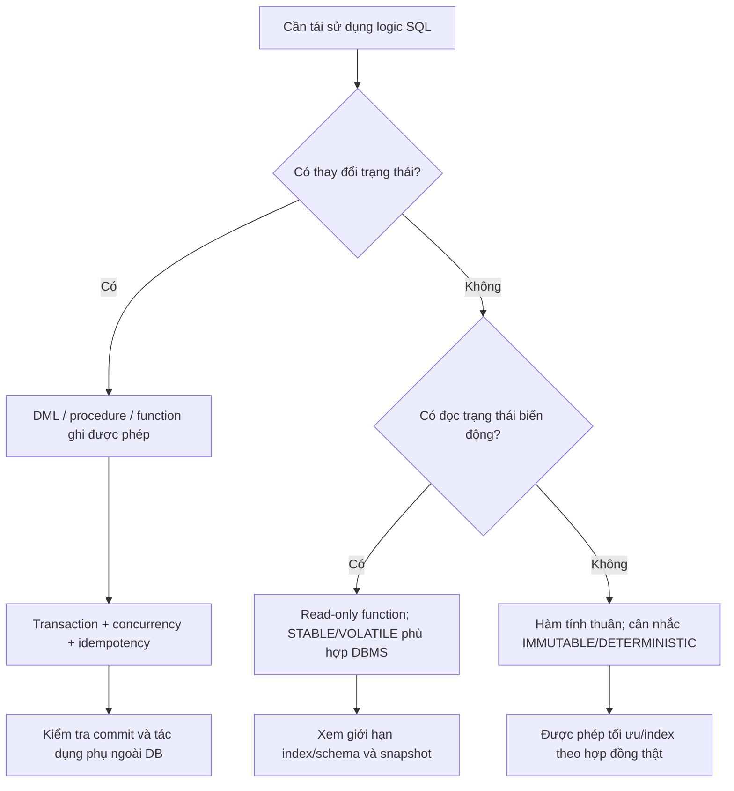

# Hàm có tác dụng phụ, tính xác định và giới hạn sử dụng

## 1. Bối cảnh: một hàm SQL không nhất thiết chỉ tính toán

Trong chương **Thủ tục và hàm**, ta thường thấy các lời gọi như:

```sql
SELECT calculate_discount(200000, 0.10);
```

Một hàm kiểu này có thể đơn giản là nhận tham số, tính toán và trả kết quả. Nhưng cũng có những hàm đọc bảng, đọc thời gian hiện tại, sinh số ngẫu nhiên, tăng sequence, ghi log hoặc cập nhật dữ liệu.

Hai lời gọi nhìn khá giống nhau:

```sql
SELECT calculate_discount(200000, 0.10);

SELECT mark_order_paid(101);
```

nhưng bản chất rất khác:

- `calculate_discount` chỉ cần tính từ đầu vào.
- `mark_order_paid` có thể **thay đổi trạng thái đơn hàng**, tạo bản ghi audit và chịu tác động của transaction.

Nếu không phân biệt, người viết SQL dễ gặp các lỗi:

- Gọi hàm ghi dữ liệu trong một câu `SELECT` tưởng là chỉ đọc.
- Gắn nhãn `IMMUTABLE` hoặc `DETERMINISTIC` cho hàm có kết quả thay đổi theo thời gian.
- Tin rằng database sẽ gọi hàm đúng một lần cho mỗi hàng.
- Tạo index trên một biểu thức mà kết quả phụ thuộc trạng thái bên ngoài.
- Lưu/cached một kết quả đã không còn đúng.
- Phát sinh nhiều log, gửi thông báo trùng khi truy vấn bị chạy lại.
- Mang cú pháp và quy tắc hàm của PostgreSQL sang SQL Server, Oracle hoặc MySQL dù các hệ có giới hạn khác nhau.

Bài này giải thích **tác dụng phụ**, **tính xác định**, **mức biến động (volatility)** và **giới hạn nơi được dùng hàm**, với ví dụ thực hành trên PostgreSQL và phần đối chiếu những DBMS khác.

**Điểm cốt lõi:** Hàm có tác dụng phụ, hàm không xác định, hàm phụ thuộc dữ liệu bảng và hàm không được phép dùng trong một ngữ cảnh SQL là những khái niệm liên quan nhưng **không đồng nghĩa**.

---

## 2. Bốn khái niệm cần phân biệt ngay từ đầu

### 2.1. Hàm thuần (*pure function*)

Hàm thuần, theo cách hiểu lý tưởng trong lập trình, có hai tính chất:

1. Kết quả chỉ phụ thuộc vào các tham số đầu vào đã xác định.
2. Khi chạy không làm thay đổi trạng thái bên ngoài có thể quan sát được.

Ví dụ về ý tưởng:

```text
multiply(5, 3) -> 15
multiply(5, 3) -> 15
```

Một phép tính nhân số bình thường không ghi bảng, không tăng counter và không đọc đồng hồ hệ thống.

### 2.2. Hàm có tác dụng phụ (*side effect*)

Tác dụng phụ là thay đổi trạng thái hoặc hành vi quan sát được ngoài giá trị trả về, ví dụ:

- `INSERT`, `UPDATE`, `DELETE` trên một bảng.
- Ghi bảng nhật ký/audit.
- Gọi `nextval` để tiêu thụ một giá trị sequence.
- Gửi thông báo qua cơ chế bên ngoài nếu DBMS/extension cho phép.
- Thay đổi trạng thái phiên hoặc tương tác với một tài nguyên ngoài transaction theo cơ chế đặc biệt.

Ví dụ: `mark_order_paid(101)` vừa trả `TRUE` vừa chuyển đơn 101 từ `NEW` sang `PAID`.

### 2.3. Tính xác định (*determinism*)

Trong cách diễn đạt thông thường, hàm xác định là hàm cho **cùng kết quả với cùng đầu vào trong những điều kiện được xác định**.

Ví dụ:

```text
price_with_vat(100) -> 110
price_with_vat(100) -> 110
```

Ngược lại:

```sql
SELECT random();
```

có thể cho những kết quả khác nhau dù không có tham số.

Nhưng cần hỏi: **Điều kiện được cố định là gì?**

- Nếu hàm đọc bảng, kết quả có thể thay khi dữ liệu bảng đổi.
- Nếu hàm đọc thời gian, kết quả có thể thay dù tham số giống nhau.
- Nếu kết quả phụ thuộc múi giờ, collation hoặc cấu hình phiên, “cùng tham số” chưa đủ.
- Nếu hàm có tác dụng phụ và đọc lại trạng thái do chính nó sửa, kết quả các lần gọi có thể khác.

Các hệ quản trị định nghĩa và sử dụng khái niệm deterministic/volatility **khác nhau**, nên không gắn nhãn chỉ theo trực giác.

### 2.4. Tính lặp an toàn (*idempotence*)

Một thao tác idempotent khi lặp lại không làm thay đổi **trạng thái cuối cần quan sát** sau lần áp dụng thành công đầu:

\[
f(f(s))=f(s)
\]

trong mô hình hàm biến đổi trạng thái `s`.

Ví dụ:

```sql
UPDATE orders
SET status = 'PAID'
WHERE order_id = 101
  AND status = 'NEW';
```

Lần đầu có thể đổi `NEW → PAID`, lần thứ hai không có hàng khớp. Nếu không sinh tác dụng phụ trùng ở nơi khác, kết quả trạng thái nghiệp vụ có thể lặp an toàn.

**Idempotent không đồng nghĩa deterministic hoặc pure.** Một lệnh UPDATE có thể idempotent về trạng thái cuối nhưng vẫn **có tác dụng phụ** ở lần đầu.

---

## 3. Bảng so sánh: hàm nào thuộc nhóm nào?

| Ví dụ | Đọc trạng thái bên ngoài? | Có thể thay đổi trạng thái? | Kết quả có thể khác dù tham số giống? |
| --- | --- | --- | --- |
| `abs(-5)` | Không đáng kể | Không | Không theo hợp đồng toán học |
| `price * 1.10` với số chính xác | Không | Không | Không nếu quy tắc tính và kiểu được giữ |
| Đọc số dư từ bảng | Có | Không | Có, khi bảng đổi |
| Lấy thời gian hiện tại | Có, đồng hồ/transaction | Không trực tiếp | Có theo mốc thời gian |
| `random()` | Có, nguồn sinh ngẫu nhiên | Có thể thay trạng thái bộ sinh nội bộ | Có |
| `nextval(sequence)` | Có | **Có**, tiêu thụ sequence | Có |
| Ghi audit log | Có thể | **Có** | Tùy giá trị trả và trạng thái |
| `UPDATE ... RETURNING` | Có | **Có** | Tùy dữ liệu đích |
| Hàm đặt trạng thái `PAID` có guard | Có | **Có** | Lần đầu và lần sau có thể trả khác nhau |

Bảng này mô tả **hành vi**, chưa phải nhãn cú pháp của một hệ quản trị cụ thể.

### 3.1. Một hàm chỉ đọc bảng vẫn không nhất thiết IMMUTABLE

Ví dụ:

```sql
SELECT get_order_status(101);
```

Không có `INSERT` hoặc `UPDATE` trong thân hàm, nhưng nếu ai đó sửa đơn 101, lần gọi sau có thể trả giá trị mới.

**Không có tác dụng phụ không đủ để suy ra kết quả bất biến.**

### 3.2. Một hàm trả cùng một giá trị vẫn có thể có tác dụng phụ

Tưởng tượng:

```text
increment_counter_and_return_true() -> TRUE
increment_counter_and_return_true() -> TRUE
```

Giá trị trả đều là `TRUE` nhưng counter đã tăng hai lần. Không được đánh giá tính an toàn chỉ từ giá trị trả về.

## 4. Bộ dữ liệu thực hành PostgreSQL

Những ví dụ chính sử dụng **PostgreSQL** và được thiết kế cho một database thử nghiệm.

### 4.1. Tạo bảng đơn hàng

```sql
CREATE TABLE lesson_fn_orders (
    order_id INTEGER PRIMARY KEY,
    customer_id INTEGER NOT NULL,
    status TEXT NOT NULL
        CHECK (status IN ('NEW', 'PAID', 'CANCELLED')),
    amount NUMERIC(12, 2) NOT NULL
        CHECK (amount >= 0)
);

INSERT INTO lesson_fn_orders (
    order_id, customer_id, status, amount
)
VALUES
    (101, 1, 'NEW',       120.00),
    (102, 1, 'PAID',      200.00),
    (103, 2, 'NEW',        80.00),
    (104, 3, 'CANCELLED',  40.00);
```

Trạng thái gốc:

| order_id | customer_id | status | amount |
| ---: | ---: | --- | ---: |
| 101 | 1 | NEW | 120 |
| 102 | 1 | PAID | 200 |
| 103 | 2 | NEW | 80 |
| 104 | 3 | CANCELLED | 40 |

### 4.2. Tạo bảng audit

```sql
CREATE TABLE lesson_fn_audit (
    audit_id BIGINT GENERATED ALWAYS AS IDENTITY PRIMARY KEY,
    order_id INTEGER NOT NULL,
    event_type TEXT NOT NULL,
    created_at TIMESTAMPTZ NOT NULL
        DEFAULT clock_timestamp()
);
```

Một hàng audit ghi nhận một sự kiện. `audit_id` được cấp tự động, `created_at` lấy thời điểm database thực hiện default.

**Lưu ý thực hành:** Các ví dụ thay đổi dữ liệu bên dưới thường dùng `BEGIN ... ROLLBACK` để không làm hỏng tập dữ liệu gốc. Nếu đã chạy `COMMIT` ở một ví dụ trước, hãy chuẩn bị lại dữ liệu hoặc điều chỉnh kết quả mong đợi.

---

## 5. Hàm thuần: một ví dụ IMMUTABLE trong PostgreSQL

Định nghĩa hàm tính tổng tiền sau VAT 10% từ tham số đầu vào:

```sql
CREATE OR REPLACE FUNCTION lesson_price_with_vat(
    p_amount NUMERIC
)
RETURNS NUMERIC
LANGUAGE sql
IMMUTABLE
STRICT
AS $$
    SELECT ROUND(p_amount * 1.10, 2);
$$;
```

Dùng:

```sql
SELECT
    lesson_price_with_vat(100.00) AS result_1,
    lesson_price_with_vat(100.00) AS result_2;
```

Kết quả:

| result_1 | result_2 |
| ---: | ---: |
| 110.00 | 110.00 |

### 5.1. Vì sao ví dụ này phù hợp IMMUTABLE?

Trong phạm vi kiểu `NUMERIC` và công thức được định nghĩa:

- Hàm chỉ đọc tham số `p_amount`.
- Không truy vấn bảng.
- Không đọc thời gian hiện tại.
- Không gọi sequence hay hàm random.
- Không phụ thuộc biến cấu hình phiên theo ý nghĩa công thức.
- Không sửa dữ liệu hoặc trạng thái bên ngoài.

Với cùng giá trị `NUMERIC`, kết quả theo phép tính này ổn định.

### 5.2. STRICT là gì?

Trong PostgreSQL, `STRICT` (tương ứng `RETURNS NULL ON NULL INPUT`) báo rằng hàm **trả NULL nếu có tham số NULL**, không cần thực hiện thân hàm trong trường hợp đó theo hợp đồng.

```sql
SELECT lesson_price_with_vat(NULL);
```

Kết quả là `NULL`.

**STRICT không đồng nghĩa IMMUTABLE.** Một hàm `STRICT` vẫn có thể `VOLATILE` nếu có side effect với các tham số không NULL.

### 5.3. Chú ý kiểu dữ liệu

Ở ví dụ này, tham số và kết quả là `NUMERIC`. Nếu thay bằng số thực dấu phẩy động, vấn đề làm tròn và biểu diễn nhị phân cần được xem xét riêng.

“Deterministic” không có nghĩa mọi kiểu số đều biểu diễn chính xác từng số thập phân, mà nghĩa cùng đầu vào theo hợp đồng sẽ có kết quả phù hợp.

## 6. Hàm chỉ đọc bảng: STABLE là lựa chọn thích hợp hơn

Định nghĩa hàm đọc trạng thái một đơn:

```sql
CREATE OR REPLACE FUNCTION lesson_get_order_status(
    p_order_id INTEGER
)
RETURNS TEXT
LANGUAGE sql
STABLE
AS $$
    SELECT o.status
    FROM lesson_fn_orders AS o
    WHERE o.order_id = p_order_id;
$$;
```

Truy vấn:

```sql
SELECT
    lesson_get_order_status(101) AS order_status;
```

Từ dữ liệu gốc, kết quả là `NEW`.

### 6.1. Vì sao không IMMUTABLE?

Giả sử transaction khác đã commit:

```sql
UPDATE lesson_fn_orders
SET status = 'PAID'
WHERE order_id = 101;
```

Lần đọc ở một câu lệnh sau có thể trả `PAID`. Hàm có cùng tham số `101` nhưng phụ thuộc **trạng thái của bảng**.

Nhãn `STABLE` của PostgreSQL có quy tắc quan sát dữ liệu trong **một câu lệnh gọi**, nhưng không hứa dữ liệu bảng giữ nguyên trong mọi transaction tương lai.

### 6.2. STABLE không phải chỉ là “chạy ít lần”

`STABLE` là lời cam kết về đặc tính kết quả và cách thực thi theo snapshot trong một câu SQL. Optimizer có thể khai thác cam kết đó, nhưng không có nghĩa người viết được dựa vào một **số lần gọi cố định** hoặc một cơ chế cache phổ quát.

### 6.3. Hàm chỉ đọc vẫn có giới hạn sử dụng

Một hàm đọc bảng:

- Có thể đòi quyền `SELECT`.
- Có thể chịu tác động của RLS/quyền khi chạy.
- Không phải là bất biến giữa các câu lệnh.
- Thường không phù hợp làm biểu thức index đòi `IMMUTABLE`.

Truy vấn trực tiếp bảng với JOIN đôi khi dễ tối ưu hơn việc giấu lookup trong một hàm scalar gọi theo hàng.

---

## 7. Hàm có tác dụng phụ: VOLATILE và thay đổi dữ liệu

Tạo hàm chuyển một đơn từ `NEW` sang `PAID` và ghi audit khi thực sự chuyển:

```sql
CREATE OR REPLACE FUNCTION lesson_mark_paid(
    p_order_id INTEGER
)
RETURNS BOOLEAN
LANGUAGE plpgsql
VOLATILE
AS $$
DECLARE
    v_changed INTEGER;
BEGIN
    UPDATE lesson_fn_orders
    SET status = 'PAID'
    WHERE order_id = p_order_id
      AND status = 'NEW';

    GET DIAGNOSTICS v_changed = ROW_COUNT;

    IF v_changed = 1 THEN
        INSERT INTO lesson_fn_audit (
            order_id, event_type
        )
        VALUES (
            p_order_id, 'MARK_PAID'
        );

        RETURN TRUE;
    END IF;

    RETURN FALSE;
END;
$$;
```

### 7.1. Tác dụng phụ nằm ở đâu?

Hàm không chỉ tính một Boolean:

1. `UPDATE lesson_fn_orders` thay đổi dữ liệu.
2. `GET DIAGNOSTICS ... ROW_COUNT` lấy số hàng do câu UPDATE vừa tác động.
3. Nếu đúng một hàng, `INSERT lesson_fn_audit` ghi thêm một sự kiện.
4. Hàm trả `TRUE` khi chuyển trạng thái thành công hoặc `FALSE` khi không có hàng phù hợp.

### 7.2. Thử hàm trong transaction

```sql
BEGIN;

SELECT lesson_mark_paid(101) AS first_call;

SELECT
    order_id, status
FROM lesson_fn_orders
WHERE order_id = 101;

SELECT
    order_id, event_type
FROM lesson_fn_audit
ORDER BY audit_id;

ROLLBACK;
```

Trong transaction, lần gọi đầu từ dữ liệu gốc:

- `first_call = TRUE`.
- Đơn 101 có `status = 'PAID'`.
- Bảng audit có thêm một sự kiện `MARK_PAID` cho đơn 101.

Sau `ROLLBACK`, thay đổi hàng ở bảng đơn và hàng audit trong transaction được hoàn tác.

### 7.3. Gọi lại trong cùng transaction

```sql
BEGIN;

SELECT lesson_mark_paid(101) AS first_call;
SELECT lesson_mark_paid(101) AS second_call;

SELECT COUNT(*) AS audit_events_in_tx
FROM lesson_fn_audit
WHERE order_id = 101
  AND event_type = 'MARK_PAID';

ROLLBACK;
```

Nếu bắt đầu từ dữ liệu gốc:

| first_call | second_call | audit_events_in_tx |
| --- | --- | ---: |
| TRUE | FALSE | 1 |

Lần thứ hai không còn hàng `status = 'NEW'` để cập nhật.

### 7.4. Tính lặp an toàn có giới hạn

Với thiết kế này, gọi lại hai lần liên tiếp trên cùng đơn không tạo hai event `MARK_PAID` khi trạng thái đã chuyển. Nhưng đây là **idempotence theo trạng thái và cửa sổ nghiệp vụ**, không phải bảo đảm cho mọi tình huống:

- Nếu người khác chuyển đơn `PAID → NEW` rồi gọi lại, hàm có thể ghi event mới.
- Nếu các side effect ngoài DB được thêm vào, có thể không rollback được.
- Nếu yêu cầu một event duy nhất cho **một yêu cầu nghiệp vụ** xuyên suốt retry, thường cần thêm idempotency key/unique constraint.

---

## 8. PostgreSQL: IMMUTABLE, STABLE, VOLATILE là hợp đồng với optimizer

PostgreSQL có ba mức **volatility** trong định nghĩa function:

| Nhãn | Cam kết chính | Ví dụ ý tưởng |
| --- | --- | --- |
| `IMMUTABLE` | Với cùng tham số, kết quả không đổi trong phạm vi hợp đồng; không phụ thuộc trạng thái database/phiên có thể thay đổi | Phép tính thuần trên `NUMERIC` |
| `STABLE` | Với cùng tham số trong **một câu lệnh gọi**, kết quả không thay đổi theo mô hình quan sát của PostgreSQL; không ghi dữ liệu | Đọc bảng qua snapshot của statement; `now()` |
| `VOLATILE` | Không hứa giá trị ổn định giữa những lần đánh giá; có thể có side effect | `random()`, `clock_timestamp()`, `nextval()`, hàm UPDATE |

### 8.1. Mặc định là VOLATILE

Nếu không khai báo nhãn volatility, PostgreSQL mặc định function là `VOLATILE`.

Điều này **an toàn hơn một lời cam kết sai**, nhưng có thể hạn chế những tối ưu mà engine được phép thực hiện cho hàm thực sự thuần.

### 8.2. Nhãn không phải công cụ “tăng tốc” tùy tiện

Nếu một hàm đọc đồng hồ hệ thống mà bị khai báo `IMMUTABLE` để hy vọng nhanh hơn, optimizer có thể giả định sai rằng kết quả **có thể cố định**. Query có thể trả kết quả bất ngờ, đặc biệt qua prepared/cached plans.

**Chọn nhãn theo sự thật về hành vi hàm; không chọn nhãn để ép optimizer.**

### 8.3. Không có nhãn PURE phổ quát trong SQL

PostgreSQL dùng các nhãn volatility; SQL Server, MySQL, Oracle và SQLite lại có những cơ chế khác. Không nên tìm một từ khóa `PURE` chung cho mọi database rồi giả định tính năng tương đương.

---

## 9. VOLATILE không nhất thiết có INSERT/UPDATE/DELETE

Một hàm **không ghi bảng** vẫn có thể `VOLATILE`.

Ví dụ:

```sql
SELECT random();
```

hoặc:

```sql
SELECT clock_timestamp();
```

Hai hàm không cần ghi vào bảng `lesson_fn_orders` nhưng kết quả có thể thay giữa những lần gọi, kể cả trong cùng câu lệnh.

### 9.1. Hàm sinh ngẫu nhiên

```sql
SELECT
    random() AS random_1,
    random() AS random_2;
```

Hai giá trị có thể khác nhau. Không suy rằng kết quả sẽ giống nhau vì “cùng SELECT, không tham số”.

### 9.2. Hàm thời gian hiện tại

```sql
SELECT
    clock_timestamp() AS time_1,
    clock_timestamp() AS time_2;
```

`clock_timestamp()` là `VOLATILE` trong PostgreSQL: nó trả thời điểm đồng hồ hiện tại khi được đánh giá, có thể thay ngay giữa các biểu thức trong một câu SQL.

### 9.3. Không có side effect dữ liệu không đồng nghĩa deterministic

Một hàm quan sát trạng thái bên ngoài như đồng hồ là ví dụ rất rõ:

- Có thể không sửa dữ liệu người dùng.
- Vẫn không có kết quả cố định chỉ từ tham số.
- Không phù hợp làm biểu thức `IMMUTABLE`.

---

## 10. PostgreSQL: now(), statement_timestamp() và clock_timestamp()

Ba khái niệm thời gian thường bị trộn lẫn.

```sql
BEGIN;

SELECT
    now() AS tx_time,
    transaction_timestamp() AS same_tx_time,
    statement_timestamp() AS stmt_time,
    clock_timestamp() AS wall_clock_time;

SELECT
    now() AS tx_time_again,
    statement_timestamp() AS new_stmt_time,
    clock_timestamp() AS wall_clock_again;

ROLLBACK;
```

### 10.1. now() và transaction_timestamp()

Trong PostgreSQL, `now()` tương đương `transaction_timestamp()`: trả mốc **bắt đầu transaction**.

Trong một transaction đang mở, hai câu `SELECT now()` ở hai thời điểm khác nhau vẫn có thể trả cùng mốc transaction.

`now()` được phân loại `STABLE`, **không phải `IMMUTABLE`**.

### 10.2. statement_timestamp()

`statement_timestamp()` trả thời điểm bắt đầu **câu lệnh hiện tại** theo ngữ nghĩa PostgreSQL.

Nó có thể khác giữa hai câu SQL trong cùng transaction, và ổn định theo mốc câu lệnh tương ứng.

### 10.3. clock_timestamp()

`clock_timestamp()` phản ánh đồng hồ thực tại lúc được đánh giá, nên có thể thay ngay trong cùng một lệnh.

### 10.4. Múi giờ ảnh hưởng biểu diễn

`TIMESTAMPTZ` có thể được hiển thị khác nhau theo `TimeZone` của session. Việc thấy một biểu diễn ngày giờ khác không nhất thiết nghĩa thời điểm tuyệt đối đã đổi.

Nếu muốn hàm `IMMUTABLE` chuyển timestamp thành chuỗi theo múi giờ của session, phải xem xét kỹ: phụ thuộc `TimeZone` khiến kết quả không chỉ là hàm của tham số timestamp.

### 10.5. Không đánh dấu ngày hiện tại là bất biến

Ví dụ **sai về thiết kế**:

```sql
-- Không dùng trong thực tế:
CREATE FUNCTION lesson_bad_today()
RETURNS DATE
LANGUAGE sql
IMMUTABLE
AS $$
    SELECT CURRENT_DATE;
$$;
```

Ngày hiện tại đổi theo thời gian và phụ thuộc ngữ cảnh phiên. Khai báo `IMMUTABLE` là đưa ra lời hứa sai với optimizer.

Đoạn này chỉ dùng để **nhận diện lỗi**, không phải mã cần triển khai.

## 11. Sequence: side effect không giống UPDATE thông thường

PostgreSQL:

```sql
CREATE SEQUENCE lesson_fn_ticket_seq
START WITH 1;
```

Gọi:

```sql
SELECT nextval('lesson_fn_ticket_seq');
```

`nextval` lấy giá trị tiếp theo từ sequence và làm trạng thái sequence tiến lên.

### 11.1. Tại sao nextval là VOLATILE?

Với cùng tham số là tên sequence, những lần gọi liên tiếp có thể trả:

```text
1
2
3
...
```

Nó có **tác dụng phụ** lên sequence và không trả cùng kết quả mỗi lần.

### 11.2. ROLLBACK không hoàn tác số đã cấp

Ví dụ:

```sql
BEGIN;
SELECT nextval('lesson_fn_ticket_seq');
ROLLBACK;
```

Giá trị sequence đã tiêu thụ **không được trả lại** chỉ vì transaction rollback. Gọi `nextval` lần sau có thể nhận số lớn hơn.

### 11.3. Hậu quả nghiệp vụ

- ID sinh từ sequence/identity không phải dãy tuyệt đối liên tục.
- Không dùng sequence như số thứ tự giao dịch thành công không có khoảng trống.
- Không coi mọi side effect của hàm đều được rollback giống hàng trong bảng.
- Nếu cần số chứng từ liên tục theo quy tắc pháp lý, phải thiết kế quy trình cấp số chuyên biệt.

### 11.4. Tính xác định của biểu thức có sequence

```sql
SELECT nextval('lesson_fn_ticket_seq') + 100;
```

vẫn không bất biến, dù phép cộng 100 là thuần. **Cả biểu thức phụ thuộc vào thành phần VOLATILE.**

---

## 12. Vì sao PostgreSQL không cho hàm STABLE/IMMUTABLE ghi SQL?

Một hàm `STABLE` hoặc `IMMUTABLE` được khai báo là không thay đổi database theo mô hình thực thi của PostgreSQL.

Ví dụ cố gán:

```sql
-- Chỉ để nhận diện thiết kế sai:
CREATE FUNCTION lesson_bad_counter()
RETURNS INTEGER
LANGUAGE plpgsql
STABLE
AS $$
BEGIN
    UPDATE lesson_fn_orders
    SET amount = amount + 1
    WHERE order_id = 101;

    RETURN 1;
END;
$$;
```

Với function SQL/PLpgSQL thông thường, PostgreSQL có cơ chế ngăn những câu lệnh SQL ghi dữ liệu được thực hiện trong function không phải `VOLATILE`. Lỗi có thể xuất hiện **khi thực thi** hàm, không nhất thiết khi chạy `CREATE FUNCTION`.

### 12.1. Đừng thử lách bằng nhãn sai

Nếu thân hàm cần ghi:

```sql
VOLATILE
```

là nhãn phù hợp trong PostgreSQL. Nhưng việc một function **được phép ghi** không có nghĩa nên gọi nó trong mọi `SELECT`.

### 12.2. Extension hoặc ngôn ngữ khác đòi đánh giá riêng

Những ràng buộc do engine áp dụng có thể phụ thuộc ngôn ngữ của function và cơ chế ngoại vi. Đừng cho rằng PostgreSQL tự chứng minh mọi function C/extension từ bên ngoài **thực sự không có tác dụng phụ** chỉ vì nó được gắn nhãn `IMMUTABLE`.

**Nhãn là một hợp đồng mà người viết function phải chịu trách nhiệm.**

## 13. Snapshot của STABLE và VOLATILE trong PostgreSQL

PostgreSQL còn dùng volatility để xác định cách SQL bên trong function quan sát dữ liệu.

Khái quát với các function SQL/PLpgSQL:

- `STABLE`/`IMMUTABLE` thực hiện các truy vấn đọc theo snapshot của câu lệnh gọi theo quy tắc PostgreSQL.
- `VOLATILE` có khả năng lấy snapshot mới cho những lệnh SQL nó thực hiện, giúp quan sát thay đổi theo ngữ cảnh thực thi.

### 13.1. STABLE có nghĩa gì khi bảng đang được cập nhật?

Giả sử một câu SQL gọi `lesson_get_order_status(101)` nhiều lần. PostgreSQL được phép dựa trên cam kết `STABLE` rằng hàm không quan sát một trạng thái thay đổi tùy ý **trong cùng một statement** theo cách một hàm VOLATILE có thể.

Nhưng sau khi transaction khác commit và một statement mới bắt đầu, hàm đọc bảng có thể trả trạng thái mới.

### 13.2. STABLE không phải transaction-level cache

Tên “stable” dễ khiến người học nghĩ:

> “Cùng transaction thì hàm STABLE chắc luôn trả cùng kết quả.”

Không nên dùng suy luận đó làm hợp đồng tổng quát. `STABLE` về cơ bản gắn với **một câu lệnh**, còn `now()` giữ mốc transaction là **hành vi riêng của hàm thời gian này**.

### 13.3. Isolation level vẫn quan trọng

Trong `REPEATABLE READ` hoặc `SERIALIZABLE`, chính sách snapshot của transaction có thể khác `READ COMMITTED`. Khi nói hàm có thể thấy dữ liệu mới, phải tính tới isolation và thời điểm các transaction commit.

Vì vậy volatility **không thay thế hiểu biết về MVCC/transaction isolation**.

---

## 14. Bộ tối ưu hóa có thể làm gì với hàm IMMUTABLE?

Khi function thật sự `IMMUTABLE` và được gọi bằng các đối số hằng, PostgreSQL có thể tính trước (*constant folding*) ở giai đoạn lập kế hoạch:

```sql
SELECT lesson_price_with_vat(100.00);
```

Optimizer có thể thay lời gọi bằng một biểu thức hoặc hằng tương đương trong plan.

Đây là một trong những lợi ích của khai báo đúng.

### 14.1. Lời hứa sai tạo kết quả cũ khó hiểu

Giả sử một function phụ thuộc cấu hình/timezone nhưng bị gắn `IMMUTABLE`. Nếu prepared statement có kế hoạch được tái sử dụng, giá trị đã được tính và cố định sai có thể tồn tại lâu hơn người viết dự kiến.

Người dùng sẽ hỏi:

> “Tại sao tôi đổi session setting rồi chạy lại mà vẫn nhận kết quả cũ?”

Nguyên nhân có thể nằm ở **nhãn volatility sai**, không phải chỉ ở transaction.

### 14.2. IMMUTABLE không có nghĩa database luôn cache kết quả

`IMMUTABLE` cho phép optimizer thực hiện một số tối ưu, nhưng **không hứa một bảng memoization cho mọi tham số**.

Hàm có thể được gọi nhiều lần nếu plan hoặc ngữ cảnh yêu cầu. Không nên dùng nhãn này để dự đoán chính xác số lần thực thi.

### 14.3. Không đánh dấu IMMUTABLE để đánh lừa index

Ví dụ một hàm lấy tỷ giá ngoại tệ từ bảng:

```sql
-- Ý tưởng sai:
-- get_exchange_rate(currency_code)
-- đọc bảng tỷ giá nhưng bị đánh dấu IMMUTABLE.
```

Khi tỷ giá đổi, index hoặc kết quả được tối ưu/cached dựa trên giả định bất biến có thể không còn đúng.

Hãy thiết kế hàm theo đúng phụ thuộc thực tế, hoặc đưa tỷ giá/phiên bản tỷ giá thành dữ liệu đầu vào rõ ràng.

## 15. Tính xác định và môi trường: các bẫy tinh vi

### 15.1. Time zone

Biểu thức chuyển `TIMESTAMPTZ` sang ngày tại session time zone có thể khác giữa các session. Một function dùng ngầm `TimeZone` không bất biến chỉ bởi timestamp đầu vào.

### 15.2. Locale và collation

Thao tác so sánh/biến đổi chuỗi có thể chịu tác động của collation, locale hoặc phiên bản thư viện xử lý ngôn ngữ. Nếu index chứa kết quả được tạo dưới collation/version cũ, một lần nâng cấp collation có thể yêu cầu thao tác bảo trì như `REINDEX` theo hướng dẫn DBMS.

### 15.3. Cấu hình phiên

Một function đọc `current_setting(...)` phụ thuộc cấu hình session. Trả cùng giá trị ở môi trường dev **không chứng minh** nó bất biến ở mọi session.

### 15.4. Bảng tra cứu

Hàm “chỉ SELECT một bảng” phụ thuộc dữ liệu bảng. Nó không `IMMUTABLE` nếu bảng có thể thay, ngay cả khi thay đổi rất hiếm.

### 15.5. Nguồn bên ngoài

Một hàm gọi API qua extension, đọc file hoặc dịch vụ ngoài database có phụ thuộc không nằm trong tham số SQL. Nhãn `IMMUTABLE` thường không phù hợp nếu nguồn đó có thể đổi.

### 15.6. Hàm giả định cố định một năm

Ví dụ tính tiền thuế với tỷ lệ 10% có thể là hàm thuần nếu **tỷ lệ được coi là một phần công thức cố định**. Nhưng khi luật thuế thay đổi, logic cần versioning hoặc tham số `tax_rate` rõ ràng thay vì âm thầm đổi ý nghĩa mà vẫn coi dữ liệu đã lập index là vĩnh viễn đúng.

---

## 16. Giới hạn quan trọng: hàm trong index biểu thức PostgreSQL

PostgreSQL cho phép **expression index**:

```sql
CREATE INDEX lesson_fn_vat_idx
ON lesson_fn_orders (
    lesson_price_with_vat(amount)
);
```

Vì `lesson_price_with_vat` được khai báo `IMMUTABLE` đúng nghĩa, biểu thức có thể phù hợp với yêu cầu của index.

### 16.1. Vì sao index cần biểu thức bất biến?

Index lưu khóa được tính từ dữ liệu ở hàng. Nếu chỉ cần thời gian trôi đi hoặc bảng khác thay đổi mà **khóa index phải đổi**, nhưng PostgreSQL không biết lúc nào cập nhật index, cấu trúc index có thể không phản ánh đúng ý nghĩa biểu thức.

Ví dụ không an toàn:

```sql
-- Không triển khai:
-- CREATE INDEX ... ON orders (get_current_exchange_rate(currency));
```

nếu `get_current_exchange_rate` đọc bảng tỷ giá có thể thay.

### 16.2. Hàm STABLE thường không đủ

Với PostgreSQL, function dùng trong expression index phải đạt yêu cầu `IMMUTABLE`. Chỉ `STABLE` không phải hợp đồng đủ mạnh cho khóa index.

### 16.3. Tạo được index không chứng minh index được sử dụng

Ngay cả khi function hợp lệ, optimizer có thể chọn `Seq Scan` do bảng nhỏ hoặc query không phù hợp biểu thức index.

Dùng `EXPLAIN` để kiểm tra plan, nhưng **không đổi nhãn volatility chỉ vì index chưa được chọn**.

### 16.4. Bảo trì khi thay thân hàm IMMUTABLE

Nếu thay định nghĩa một function đã được dùng để tính khóa expression index, những giá trị khóa đã lưu có thể trở nên cũ so với logic mới. Cần có kế hoạch **rebuild/REINDEX** và triển khai an toàn khi thay đổi ngữ nghĩa function.

`CREATE OR REPLACE FUNCTION` không tự có nghĩa mọi khóa index phụ thuộc đã được tính lại.

## 17. Partial index và generated column cũng có giới hạn

### 17.1. Partial index predicate

PostgreSQL hỗ trợ:

```sql
CREATE INDEX lesson_fn_new_orders_idx
ON lesson_fn_orders(order_id)
WHERE status = 'NEW';
```

Predicate chỉ dựa vào dữ liệu hàng và toán tử phù hợp.

Nhưng một predicate như:

```sql
-- Ý tưởng không hợp lệ/không an toàn:
-- WHERE due_date < CURRENT_DATE
```

không có tính bất biến cần thiết: một hàng có thể “quá hạn” chỉ vì sang ngày mới, dù không có thao tác UPDATE nào để cập nhật membership của index.

### 17.2. Stored generated column

Trong PostgreSQL, biểu thức cho generated column có các giới hạn bao gồm yêu cầu sử dụng **hàm bất biến** đối với các thành phần tính giá trị.

Ví dụ trên một bảng phù hợp:

```sql
ALTER TABLE lesson_fn_orders
ADD COLUMN amount_with_vat NUMERIC
GENERATED ALWAYS AS (
    lesson_price_with_vat(amount)
) STORED;
```

Giá trị phụ thuộc `amount` của chính hàng, không đọc đồng hồ hoặc bảng tỷ giá khác.

### 17.3. Không đưa hàm ghi dữ liệu vào generated column

Một hàm cập nhật bảng audit hoặc sinh số mới không phải biểu thức bất biến an toàn cho generated column.

Đừng dùng generated column như cơ chế giấu side effect; hãy dùng trigger/procedure/transaction có chủ đích nếu cần hành động ghi.

## 18. CHECK constraint và default: yêu cầu không giống nhau

### 18.1. CHECK constraint nên biểu diễn bất biến của hàng

Ví dụ:

```sql
CHECK (amount >= 0)
```

là điều kiện dựa vào giá trị hàng.

PostgreSQL **giả định điều kiện CHECK sẽ có cùng kết quả cho cùng giá trị hàng**. Dùng một function đổi theo thời gian hoặc đọc bảng khác trong CHECK là thiết kế không an toàn; thay đổi bên ngoài không tự tái kiểm tra tất cả hàng đã ghi.

Ví dụ ý tưởng sai:

```sql
-- Không dùng CHECK (amount <= get_current_credit_limit(customer_id))
-- nếu get_current_credit_limit đọc bảng hạn mức biến động.
```

Nếu hạn mức đổi, database không tự biết phải rà lại mọi hàng trước đây.

### 18.2. DEFAULT có thể cần hàm không bất biến

Ngược lại, default được **đánh giá khi tạo hàng**, nên việc lấy thời điểm hoặc sinh ID có thể phù hợp:

```sql
created_at TIMESTAMPTZ DEFAULT clock_timestamp()
```

hoặc sequence/identity theo khả năng DBMS.

Điều đó không biến `clock_timestamp()` thành `IMMUTABLE`; chỉ là **ngữ cảnh DEFAULT cho phép loại hành vi này**.

### 18.3. Phân biệt cột lưu một thời điểm với cột “hiện đang quá hạn”

- `created_at`: thời điểm sự kiện khi INSERT; phù hợp để lưu.
- `is_overdue_today`: thay đổi khi đồng hồ/ngày đổi; nếu muốn luôn chính xác có thể cần tính lúc đọc hoặc quy trình refresh, không giả định generated column bất biến có thể tự đổi qua nửa đêm.

---

## 19. Hàm gọi trong SELECT: không được dựa vào số lần đánh giá

Hãy phân biệt:

```sql
SELECT lesson_price_with_vat(amount)
FROM lesson_fn_orders;
```

với:

```sql
SELECT lesson_mark_paid(order_id)
FROM lesson_fn_orders;
```

Câu thứ nhất là tính toán thuần theo hàng.

Câu thứ hai **có thể thay đổi bảng trong quá trình SELECT**.

### 19.1. Bộ tối ưu hóa có quyền thay đổi cách đánh giá biểu thức

Ở các query phức tạp, database có thể:

- Đẩy/biến đổi điều kiện.
- Không đánh giá những biểu thức không cần cho kết quả cuối.
- Gọi biểu thức tại những node/khoảng thời gian khác dự đoán trực giác.
- Tái sắp JOIN.
- Rút gọn hoặc tính trước hàm được khai báo phù hợp.
- Dùng parallel execution khi function/operator cho phép.

Volatility hạn chế một số phép tối ưu, nhưng **không nên dựa vào một lời hứa “mỗi hàng đúng một lần” cho mọi cấu trúc SELECT/WHERE/JOIN/LIMIT**.

### 19.2. Ví dụ chống chỉ định: ghi audit trong WHERE

```sql
-- KHÔNG nên dùng để ghi audit:
SELECT order_id
FROM lesson_fn_orders
WHERE lesson_mark_paid(order_id);
```

Một WHERE nên dùng để **lọc theo điều kiện**, không phải làm giao thức thay đổi trạng thái nhiều hàng thông qua side effect.

### 19.3. ORDER BY/LIMIT không phải hợp đồng gọi function

```sql
-- KHÔNG dùng như protocol ghi đúng N đơn:
SELECT lesson_mark_paid(order_id)
FROM lesson_fn_orders
ORDER BY order_id
LIMIT 1;
```

Trong một câu đơn giản, bạn có thể nhìn thấy một lời gọi, nhưng không nên biến các quy tắc evaluation của một dạng plan thành **cam kết xử lý nghiệp vụ chính xác một lần** cho mọi lần tối ưu/thay đổi query.

Nếu cần xử lý đúng N hàng, hãy dùng câu DML với điều kiện, khóa, transaction và kiểm tra `RETURNING`.

### 19.4. Cẩn thận với phép tính làm mất giá trị trả về

Một hàm có side effect không nên bị gọi chỉ để ghi log mà người đọc không sử dụng kết quả của nó. SQL có thể thay đổi cách xử lý biểu thức không cần thiết theo cấu trúc truy vấn và quy tắc optimizer.

Thiết kế side effect thành **thao tác DML rõ ràng**, không phụ thuộc vào cách engine đánh giá một biểu thức phụ.

---

## 20. CASE, AND/OR và thứ tự đánh giá

Một hiểu lầm thường gặp là dùng:

```sql
WHERE check_permission(user_id)
  AND do_side_effect(order_id)
```

rồi kỳ vọng `check_permission` chắc chắn luôn được gọi **trước**, nếu false thì `do_side_effect` chắc chắn không chạy theo ý định của người viết.

Trong SQL, optimizer có thể biến đổi và sắp lại các điều kiện theo những quy tắc của DBMS. Đừng coi thứ tự viết `AND`/`OR` là một giao thức side effect.

### 20.1. CASE giúp biểu diễn nhánh, nhưng không giải quyết giao thức ghi

```sql
SELECT CASE
    WHEN status = 'NEW' THEN 'CAN_PAY'
    ELSE 'SKIP'
END
FROM lesson_fn_orders;
```

`CASE` rất phù hợp để **tính giá trị** theo điều kiện.

Nhưng việc đưa một function ghi vào nhánh `THEN` không tự giải quyết các vấn đề:

- Nhiều hàng.
- Retry.
- Transaction.
- Concurrent updates.
- Query được biến đổi/cached.
- Các trường hợp biểu thức được đánh giá khi lập kế hoạch.

PostgreSQL có những chi tiết đánh giá `CASE`, constant folding và aggregate ở thời điểm khác nhau; không nên dùng `CASE` như sự thay thế cho transaction/business operation rõ ràng.

### 20.2. Cách đúng cho “chỉ cập nhật đơn đang NEW”

```sql
UPDATE lesson_fn_orders
SET status = 'PAID'
WHERE order_id = 101
  AND status = 'NEW'
RETURNING order_id, status;
```

Đây là một phép thay đổi dữ liệu **tường minh**, có điều kiện rõ ràng và kết quả trả trực tiếp những hàng được tác động.

---

## 21. DML tường minh thường tốt hơn hàm ghi dữ liệu trong SELECT

Yêu cầu:

> Chuyển những đơn `NEW` của khách 1 sang `PAID`, đồng thời ghi audit cho đúng các đơn được chuyển.

PostgreSQL có thể dùng data-modifying CTE:

```sql
BEGIN;

WITH changed AS (
    UPDATE lesson_fn_orders
    SET status = 'PAID'
    WHERE customer_id = 1
      AND status = 'NEW'
    RETURNING order_id
)
INSERT INTO lesson_fn_audit (
    order_id, event_type
)
SELECT
    order_id, 'MARK_PAID'
FROM changed
RETURNING order_id, event_type;

ROLLBACK;
```

Từ dữ liệu gốc, chỉ đơn `101` được đổi; đơn `102` đã là `PAID` nên không bị cập nhật hoặc ghi thêm audit.

### 21.1. Ưu điểm so với SELECT function

- Câu `UPDATE` thể hiện rõ tác dụng phụ.
- `WHERE` xác định tập hàng được phép chuyển.
- `RETURNING` cung cấp đúng những hàng được UPDATE.
- `INSERT` audit chỉ nhận những ID thực sự được chuyển.
- Transaction có thể commit/rollback cả hai tác động cùng nhau.
- Không dựa vào việc function trong biểu thức SELECT được gọi N lần.

### 21.2. Không phải mọi trường hợp đều cần bỏ function

Hàm `VOLATILE` có thể hợp lý cho một **API database rõ ràng**: ví dụ `lesson_mark_paid(101)` encapsulate quy tắc, kiểm tra trạng thái và audit.

Điểm cần tránh là sử dụng function có side effect như một **biểu thức lọc/sắp xếp/tổng hợp** khi yêu cầu nghiệp vụ cần kiểm soát tác động chính xác.

### 21.3. Không copy data-modifying CTE sang mọi DBMS

Cú pháp `WITH changed AS (UPDATE ... RETURNING ...) INSERT ...` ở trên là mẫu PostgreSQL. SQL Server có `OUTPUT ... INTO`, các hệ khác có khả năng DML-returning khác nhau.

---

## 22. Function khác procedure ở đâu?

Một function thường được thiết kế để **trả một giá trị hoặc tập giá trị**, có thể được gọi trong những ngữ cảnh biểu thức mà DBMS hỗ trợ.

Một **stored procedure** thường biểu diễn **một thao tác có chủ đích**, được gọi qua cú pháp riêng như `CALL` hoặc `EXEC`.

Tuy nhiên, không có ranh giới tuyệt đối chung cho mọi hệ:

- PostgreSQL cho phép function `VOLATILE` thay đổi dữ liệu.
- SQL Server hạn chế T-SQL user-defined function thay đổi trạng thái database.
- MySQL stored function có những khả năng và hạn chế ghi khác.
- Oracle có function/procedure nhưng việc gọi function có side effect từ SQL bị hạn chế theo ngữ cảnh.

### 22.1. PostgreSQL procedure đơn giản

```sql
CREATE OR REPLACE PROCEDURE lesson_cancel_order(
    p_order_id INTEGER
)
LANGUAGE plpgsql
AS $$
BEGIN
    UPDATE lesson_fn_orders
    SET status = 'CANCELLED'
    WHERE order_id = p_order_id
      AND status = 'NEW';
END;
$$;
```

Gọi:

```sql
BEGIN;

CALL lesson_cancel_order(103);

SELECT order_id, status
FROM lesson_fn_orders
WHERE order_id = 103;

ROLLBACK;
```

Từ dữ liệu gốc, đơn 103 thành `CANCELLED` trong transaction rồi trở lại `NEW` sau rollback.

### 22.2. Procedure không gọi như scalar function

```sql
-- Không đúng cách gọi procedure PostgreSQL:
SELECT lesson_cancel_order(103);
```

Procedure được gọi bằng `CALL`, không phải biểu thức trả giá trị thông thường.

### 22.3. Transaction control trong procedure có điều kiện

PostgreSQL có những khả năng transaction control trong procedure ở **ngữ cảnh CALL phù hợp** và kèm hạn chế. Không phải procedure nào cũng có thể `COMMIT`/`ROLLBACK` tùy ý, đặc biệt khi đã nằm trong transaction block do caller quản lý hoặc chịu các điều kiện định nghĩa/gọi khác.

Ví dụ `lesson_cancel_order` không tự commit; caller quyết định transaction.

**Chọn procedure không tự động cho phép bỏ qua kiểm soát transaction.**

---

## 23. Side effect và transaction: điều gì rollback được?

Trong PostgreSQL, các thao tác SQL thông thường trên bảng trong cùng transaction có thể rollback:

```sql
BEGIN;

SELECT lesson_mark_paid(101);

SELECT status
FROM lesson_fn_orders
WHERE order_id = 101;

ROLLBACK;
```

Sau rollback, trạng thái đơn 101 trong bảng trở lại như trước, nếu chưa có thay đổi khác ngoài transaction.

### 23.1. Không phải tác dụng phụ nào cũng thuộc transaction

Ví dụ:

- `nextval` tiêu thụ sequence và không trả lại số khi rollback.
- Gọi API ngoài database hoặc gửi email có thể không được rollback.
- Ghi log ở một hệ thống khác theo kết nối độc lập có vòng đời riêng.
- Một số cơ chế extension/ngôn ngữ thủ tục có transaction hoặc resource semantics khác.

### 23.2. RETURN TRUE không có nghĩa đã commit

`lesson_mark_paid` có thể trả `TRUE` trước khi transaction gọi nó `COMMIT`.

Nếu caller sau đó `ROLLBACK`, thay đổi trên bảng bị hoàn tác. **Kết quả function phản ánh lời gọi, không tự xác nhận durability.**

### 23.3. Không gửi sự kiện bên ngoài trước khi commit

Quy trình nguy hiểm:

```text
1. UPDATE đơn -> PAID
2. Gửi email "đã thanh toán"
3. COMMIT database thất bại
```

Email đã gửi trong khi trạng thái database không được commit.

Có thể dùng **transactional outbox** hoặc phát sự kiện sau commit với retry/idempotency. Đừng giấu lệnh gửi email trong hàm SQL rồi nghĩ rollback đã bao phủ nó.

## 24. Tác dụng phụ và xử lý lỗi

Một function có thể thay đổi nhiều bảng rồi gặp lỗi.

Với PostgreSQL, khi một câu lệnh hoặc transaction thất bại, cần hiểu cơ chế rollback và exception.

### 24.1. Ví dụ về tính nguyên tử mong muốn

`lesson_mark_paid` làm hai việc:

1. UPDATE đơn.
2. INSERT audit.

Nếu `INSERT audit` lỗi và ngoại lệ không được xử lý theo cách nuốt lỗi, cả hoạt động trong câu lệnh/function chịu quy tắc lỗi và rollback của transaction. Đừng cố commit một UPDATE đã làm trong trạng thái lỗi mà không xử lý đúng.

### 24.2. Bắt lỗi rồi im lặng rất nguy hiểm

Một thiết kế kiểu:

```text
UPDATE order
TRY INSERT audit
ON ERROR: ignore
RETURN TRUE
```

có thể khiến nghiệp vụ ghi thành công nhưng audit thiếu mà caller không biết.

Nếu audit bắt buộc, hãy để lỗi được truyền ra hoặc xử lý bằng một chính sách retry/cách ly rõ ràng trong transaction.

### 24.3. EXCEPTION block có ngữ nghĩa transaction riêng

Trong PL/pgSQL, block có `EXCEPTION` sử dụng các cơ chế subtransaction theo quy tắc PostgreSQL. Nếu bắt và xử lý lỗi, những thay đổi trong block lỗi có thể được rollback ở cấp tương ứng, còn biến local có quy tắc riêng.

Không nên viết logic kiểm soát tiền/số dư phức tạp mà không hiểu chi tiết vùng rollback của exception.

---

## 25. Concurrency: hàm ghi dữ liệu vẫn cần khóa và điều kiện

Giả sử hai worker cùng gọi:

```sql
SELECT lesson_mark_paid(101);
```

Điều kiện:

```sql
WHERE order_id = p_order_id
  AND status = 'NEW'
```

là một cách bảo vệ chuyển trạng thái. Khi hai transaction cùng UPDATE cùng hàng, PostgreSQL sử dụng cơ chế khóa và kiểm tra điều kiện cập nhật theo isolation tương ứng.

Không nên thay bằng:

```text
SELECT status
Nếu NEW:
    UPDATE WHERE order_id = ...
```

mà bỏ điều kiện trạng thái ở chính câu UPDATE, vì trạng thái có thể đã đổi giữa lúc đọc và lúc ghi.

### 25.1. Một số hàng ghi không chứng minh bất biến liên bảng

Nếu thao tác chuyển tiền giữa hai tài khoản, không chỉ cần “cập nhật một hàng”. Còn cần:

- Khóa các hàng liên quan.
- Không để số dư âm theo quy tắc.
- Ghi bút toán.
- Kiểm soát transaction/isolation.
- Retry khi deadlock/serialization failure.

Đặt thao tác vào function `VOLATILE` không tự làm nó an toàn về concurrency.

### 25.2. Chặn no-op ở WHERE

```sql
UPDATE lesson_fn_orders
SET status = 'PAID'
WHERE order_id = 101
  AND status = 'NEW';
```

Nếu đã `PAID`, câu lệnh không ghi lại giá trị y hệt. Điều này cũng giúp giảm audit/trigger ngoài ý muốn so với:

```sql
UPDATE lesson_fn_orders
SET status = 'PAID'
WHERE order_id = 101;
```

### 25.3. Kết quả 0 hàng có nhiều ý nghĩa

Khi không có hàng UPDATE:

- Đơn không tồn tại.
- Đơn đã PAID.
- Đơn bị CANCELLED.
- Một giao dịch khác đã đổi trạng thái.

Ứng dụng cần định nghĩa cách phân loại `NO_MATCH`, `ALREADY_DONE` hoặc `CONFLICT` nếu nghiệp vụ yêu cầu. Boolean của ví dụ `lesson_mark_paid` cố ý chỉ trả “đã thực hiện chuyển trạng thái hay chưa”.

---

## 26. Idempotence của hàm có tác dụng phụ và retry

Nhiều hệ thống giao request hoặc message theo cơ chế **at least once**, tức cùng thao tác có thể được gửi lại.

### 26.1. Hàm cập nhật có guard

`lesson_mark_paid(101)` không tạo hai lần chuyển `NEW → PAID` nếu không có thao tác khác ở giữa. Đây là tính lặp an toàn có điều kiện của trạng thái đơn.

### 26.2. Hàm ghi log vô điều kiện

Một hàm kiểu:

```text
write_audit("payment-confirmed", order_id)
```

nếu cứ được gọi là `INSERT` log, thì retry có thể tạo log trùng. Việc hàm luôn trả `TRUE` không ngăn side effect trùng.

### 26.3. Idempotency key

Một thiết kế có thể có bảng:

```sql
CREATE TABLE lesson_fn_request_keys (
    request_id TEXT PRIMARY KEY,
    order_id INTEGER NOT NULL,
    processed_at TIMESTAMPTZ NOT NULL
        DEFAULT CURRENT_TIMESTAMP
);
```

Khóa duy nhất trên `request_id` giúp nhận diện **cùng một yêu cầu** được replay. Nhưng cần đưa việc ghi key và thay đổi nghiệp vụ vào **cùng transaction** với quy tắc “nhận key rồi áp dụng DML” phù hợp.

Chỉ thêm một bảng request_id **không tự** xử lý những trường hợp:

- Lần đầu ghi key thành công nhưng UPDATE thất bại ngoài transaction.
- Hai request khác ID nhưng cùng mục tiêu.
- Một request ID bị dùng cho hai payload khác nhau.
- Một side effect ngoài DB đã xảy ra trước khi lỗi.

### 26.4. Tính xác định, idempotent và exactly-once

- **Deterministic:** tính chất giá trị kết quả.
- **Idempotent:** tính chất trạng thái sau khi lặp một thao tác.
- **Exactly-once:** tính chất cấp hệ thống/giao thức xử lý cần cơ chế tương ứng.

Không thể suy từ một nhãn `IMMUTABLE`/`VOLATILE` sang bảo đảm exactly-once của pipeline.

---

## 27. Hàm có tác dụng phụ trong trigger

Trigger là một ngữ cảnh **có chủ đích** để chạy logic phản ứng với thao tác trên bảng.

Ví dụ ý tưởng:

```text
UPDATE orders
  |
  +--> AFTER UPDATE trigger
           |
           +--> INSERT audit
```

Trong PostgreSQL, hàm trigger thường được định nghĩa dạng `RETURNS trigger`, sử dụng `NEW`/`OLD` và được gọi bởi cơ chế trigger, không phải scalar function thông thường.

### 27.1. Trigger có thể phù hợp cho audit tập trung

Nếu mọi đường ghi qua database đều cần audit, trigger có thể đảm bảo những thay đổi không chỉ đến từ một ứng dụng cụ thể.

Tuy nhiên, trigger còn phải xử lý:

- UPDATE nhiều hàng.
- Thay đổi no-op.
- Recursive trigger.
- Bulk load.
- Thứ tự trigger.
- Rollback và performance.
- Quyền và khả năng truy dấu.

### 27.2. Trigger không làm side effect “biến mất”

Việc giấu thao tác audit trong trigger có thể khiến một câu `UPDATE` tưởng đơn giản tốn thêm thời gian hoặc tạo thêm lock.

Khi điều tra plan/hiệu năng, phải tính công việc của trigger và các thao tác phát sinh, không chỉ query SELECT/UPDATE bề mặt.

### 27.3. Không dùng trigger để phát email không kiểm soát

Tác dụng phụ ngoài DB có thể khó rollback, gây timeout, retry và gửi trùng. Dùng transactional outbox/worker phát sự kiện thường rõ ràng hơn khi cần đảm bảo sau commit.

---

## 28. Hàm trong WHERE, JOIN, GROUP BY, ORDER BY: giới hạn thiết kế

Một function **thuần** được dùng trong biểu thức SQL thường tự nhiên:

```sql
SELECT
    order_id,
    lesson_price_with_vat(amount) AS gross_amount
FROM lesson_fn_orders
ORDER BY gross_amount DESC;
```

Nhưng nếu thay function tính toán bằng function ghi audit, hành vi trở nên khó dự đoán về số lần gọi và chi phí.

### 28.1. WHERE

```sql
WHERE lesson_price_with_vat(amount) > 100
```

là điều kiện tính toán (có thể được tối ưu bằng expression index phù hợp).

### 28.2. JOIN

```sql
JOIN rules AS r
  ON normalize_code(o.code) = r.code
```

là trường hợp có thể hợp lý khi `normalize_code` thật sự thuần và đúng ngữ nghĩa. Nhưng biểu thức trong điều kiện JOIN có thể gọi nhiều lần tùy thuật toán join; function có side effect là ý tưởng nguy hiểm.

### 28.3. GROUP BY

```sql
GROUP BY normalize_code(o.code)
```

có thể dùng hàm tạo khóa nhóm. Nếu hàm trả khác nhau giữa các lần đánh giá cho cùng mã, kết quả nhóm trở nên không đáng tin cậy theo yêu cầu nghiệp vụ.

### 28.4. ORDER BY

```sql
ORDER BY random()
```

cố ý dùng hàm không xác định để tạo thứ tự ngẫu nhiên theo ngữ nghĩa truy vấn. Nó có thể tốn chi phí trên nhiều hàng và không tạo phân trang ổn định.

`ORDER BY` là nơi hợp lý cho một số hàm VOLATILE chỉ **đọc/sinh giá trị** theo mục tiêu, nhưng không nên biến nó thành vị trí thực hiện UPDATE/INSERT ẩn.

### 28.5. DISTINCT và expression evaluation

`DISTINCT`/`GROUP BY` loại trùng theo giá trị biểu thức được tính trong plan; với một function phụ thuộc side effect, kết quả và số lần đánh giá có thể không phản ánh ý định “mỗi hàng nguồn một lần ghi”.

---

## 29. Hiệu năng: function scalar gọi theo hàng có thể đắt

Ví dụ:

```sql
SELECT
    order_id,
    lesson_get_order_status(order_id)
FROM lesson_fn_orders;
```

Hàm `lesson_get_order_status` lại truy vấn `lesson_fn_orders` theo từng `order_id`. Trên bảng lớn, một dạng triển khai có thể gây nhiều lần lookup.

### 29.1. SQL set-based thường rõ hơn

Nếu chỉ cần đọc trạng thái đã có trong bảng:

```sql
SELECT order_id, status
FROM lesson_fn_orders;
```

rõ ràng và không cần gọi function lookup lại chính hàng.

Nếu trạng thái nằm bảng khác, một `JOIN` với điều kiện thích hợp có thể giúp optimizer thấy toàn bộ quan hệ và chọn plan tốt hơn.

### 29.2. Inlining không phải cam kết phổ quát

PostgreSQL có thể inline một số SQL function khi đủ điều kiện; SQL Server có scalar UDF inlining trong những trường hợp phù hợp. Nhưng không phải function nào cũng được inline.

Đừng dùng giả định “mọi function sẽ được optimizer biến thành JOIN” để bỏ đo hiệu năng.

### 29.3. Side effect cản trở tối ưu

Một function VOLATILE có tác dụng phụ hạn chế khả năng biến đổi/caching an toàn mà optimizer có thể áp dụng, và có thể làm query khó parallel hoặc khó phân tích hơn.

Tuy nhiên chi phí chính cần được đo:

- Số lần thực thi.
- Truy vấn SQL bên trong.
- Lock và WAL/log.
- Network/extension calls.
- Số hàng và transaction duration.

### 29.4. EXPLAIN ANALYZE có thể kích hoạt side effect

```sql
EXPLAIN ANALYZE
SELECT lesson_mark_paid(101);
```

trong PostgreSQL **thực sự chạy SELECT**; vì function ghi dữ liệu, câu này có thể UPDATE và INSERT audit.

Chỉ xem plan dự đoán bằng `EXPLAIN` nếu không muốn thực thi. Khi thử nghiệm actual plan phải dùng database/thao tác được phép, transaction và hiểu giới hạn rollback.

---

## 30. Parallel safety khác volatility

Trong PostgreSQL, bên cạnh `IMMUTABLE/STABLE/VOLATILE` còn có thuộc tính:

- `PARALLEL SAFE`.
- `PARALLEL RESTRICTED`.
- `PARALLEL UNSAFE`.

Chúng trả lời **hàm có thể chạy an toàn trong worker song song không**, không phải cùng câu hỏi với volatility.

### 30.1. Ví dụ một hàm thuần đơn giản

Một hàm tính toán thuần có thể thích hợp với `PARALLEL SAFE` nếu thực sự đáp ứng yêu cầu an toàn, ví dụ không dựa vào trạng thái chỉ hợp lệ ở leader, không ghi dữ liệu, không dùng sequence hay tài nguyên không được phép ở worker.

### 30.2. Hàm ghi dữ liệu phải được phân loại đúng

Function có lệnh ghi, dùng sequence hoặc tương tác trạng thái không an toàn cho worker thường không phù hợp để tuyên bố `PARALLEL SAFE`.

### 30.3. Mặc định của user-defined function

Trong PostgreSQL, các function do người dùng định nghĩa không tự được coi là parallel-safe. Phải khai báo có cơ sở khi đủ điều kiện.

**Không gắn `PARALLEL SAFE` để ép query song song khi chưa hiểu side effect và ngữ cảnh worker.**

### 30.4. Một hàm IMMUTABLE cũng chưa chắc PARALLEL SAFE

Tính bất biến về **giá trị trả** không tự đảm bảo function an toàn trong mọi ngữ cảnh thực thi song song, nhất là với function/extension đặc thù.

---

## 31. Giới hạn quyền và SECURITY DEFINER

Một function có side effect có thể chạy với quyền của người gọi hoặc của chủ sở hữu theo cơ chế DBMS.

PostgreSQL có:

- `SECURITY INVOKER`: áp dụng ngữ cảnh quyền người gọi (mặc định đối với function thông thường).
- `SECURITY DEFINER`: chạy với quyền chủ sở hữu function theo quy tắc PostgreSQL.

### 31.1. Vì sao SECURITY DEFINER nhạy cảm?

Một function cho phép người dùng ít quyền gọi để thực hiện một thao tác được kiểm soát có thể hữu ích. Nhưng nếu thân hàm dùng tên đối tượng không được kiểm soát hoặc SQL động, kẻ gọi có thể tìm cách lợi dụng môi trường phân giải tên để làm function chạy logic không mong muốn với quyền cao hơn.

### 31.2. Quy tắc thiết kế

- Chỉ dùng `SECURITY DEFINER` khi có nhu cầu thật.
- Dùng schema-qualified names trong SQL quan trọng.
- Đặt `search_path` an toàn cho function, tránh schema mà caller có thể tùy ý tạo đối tượng.
- Kiểm soát `GRANT EXECUTE`.
- Validate tham số và chống SQL injection khi có dynamic SQL.
- Cấp cho owner **quyền tối thiểu** phù hợp.
- Rà soát RLS và các policy liên quan.

### 31.3. Ví dụ quyền EXECUTE

Nếu role `app_writer` đã tồn tại:

```sql
REVOKE ALL ON FUNCTION lesson_mark_paid(INTEGER)
FROM PUBLIC;

GRANT EXECUTE
ON FUNCTION lesson_mark_paid(INTEGER)
TO app_writer;
```

Không chạy `GRANT` nguyên văn nếu role chưa có hoặc không phù hợp mô hình phân quyền của database.

### 31.4. Một function đọc cũng có thể lộ dữ liệu

Hàm `STABLE` đọc bảng nhạy cảm, nếu chạy với đặc quyền khác người gọi và trả dữ liệu mà caller bình thường không đọc được, cũng là vấn đề bảo mật.

**Không có side effect không đồng nghĩa không có rủi ro bảo mật.**

---

## 32. Xem volatility và đặc tính function trong PostgreSQL

PostgreSQL lưu metadata trong các catalog như `pg_proc` và `pg_namespace`.

### 32.1. Liệt kê function demo

```sql
SELECT
    p.proname AS function_name,
    pg_get_function_identity_arguments(p.oid) AS arguments,
    CASE p.provolatile
        WHEN 'i' THEN 'IMMUTABLE'
        WHEN 's' THEN 'STABLE'
        WHEN 'v' THEN 'VOLATILE'
    END AS volatility,
    p.proisstrict AS is_strict,
    p.prosecdef AS security_definer,
    p.proparallel AS parallel_flag
FROM pg_proc AS p
JOIN pg_namespace AS n
    ON n.oid = p.pronamespace
WHERE n.nspname = current_schema()
  AND p.proname LIKE 'lesson_%'
ORDER BY p.proname;
```

Trong PostgreSQL:

| `provolatile` | Ý nghĩa |
| --- | --- |
| `i` | IMMUTABLE |
| `s` | STABLE |
| `v` | VOLATILE |

Với `proparallel`, các mã có ý nghĩa riêng cho parallel safety; không nên đọc `proparallel` như một nhãn volatility khác.

### 32.2. Xem DDL function

```sql
SELECT pg_get_functiondef(
    'lesson_mark_paid(integer)'::regprocedure
);
```

`regprocedure` giúp phân biệt function overload theo danh sách kiểu tham số. Cần dùng đúng schema nếu môi trường có nhiều schema/function trùng tên.

### 32.3. Xem tại psql

Trong `psql`, các lệnh mô tả function như `\df+` có thể cung cấp thông tin liên quan.

Đây là lệnh của client `psql`, không phải cú pháp SQL gửi trực tiếp qua JDBC.

### 32.4. Metadata không chứng minh thân hàm đúng

Nếu thấy `provolatile='i'`, nghĩa là function **được khai báo** IMMUTABLE. Catalog không thay thế việc hiểu phụ thuộc và side effect thật của implementation.

---

## 33. SQL Server: user-defined function có giới hạn ghi dữ liệu

SQL Server có **scalar UDF** và **table-valued function**, nhưng các T-SQL user-defined functions bị giới hạn rõ hơn PostgreSQL khi muốn thay đổi trạng thái database.

### 33.1. Function thường dành cho tính toán/đọc được cho phép

Ví dụ T-SQL:

```sql
CREATE FUNCTION dbo.lesson_price_with_vat (
    @amount DECIMAL(12,2)
)
RETURNS DECIMAL(12,2)
WITH SCHEMABINDING
AS
BEGIN
    RETURN ROUND(@amount * 1.10, 2);
END;
```

Gọi:

```sql
SELECT dbo.lesson_price_with_vat(100.00);
```

Trong SQL Server, `SCHEMABINDING` liên quan đến việc ràng buộc schema và xác định một số thuộc tính của UDF, nhưng **không tự chứng minh** một function bất biến trong mọi nghĩa.

### 33.2. Không thực hiện UPDATE/INSERT bảng người dùng tùy ý trong T-SQL UDF

Ý tưởng:

```sql
-- Không phải T-SQL UDF hợp lệ:
CREATE FUNCTION dbo.mark_paid (@id int)
RETURNS bit
AS
BEGIN
    UPDATE dbo.orders
    SET status = 'PAID'
    WHERE order_id = @id;

    RETURN 1;
END;
```

T-SQL function thường không được thực hiện kiểu tác dụng phụ **thay đổi trạng thái database** như vậy.

### 33.3. Một số hàm builtin bị hạn chế trong UDF

SQL Server còn có giới hạn với những toán tử/hàm có side effect hoặc được phân loại là không được gọi trực tiếp trong T-SQL UDF, ví dụ một số hàm sinh giá trị như `NEWID` hoặc các hàm bị liệt kê là side-effecting theo phiên bản.

Không suy từ việc `GETDATE` không xác định rằng nó nhất thiết bị cấm ở mọi dạng UDF, hoặc từ việc một builtin có mặt trong SELECT rằng nó dùng được ở mọi UDF.

### 33.4. Dùng stored procedure cho thao tác ghi

Ví dụ T-SQL, giả định bảng `dbo.orders` có `order_id` và `status`:

```sql
CREATE PROCEDURE dbo.usp_mark_paid
    @order_id INT
AS
BEGIN
    SET NOCOUNT ON;

    UPDATE dbo.orders
    SET status = 'PAID'
    WHERE order_id = @order_id
      AND status = 'NEW';

    SELECT @@ROWCOUNT AS changed_rows;
END;
```

Gọi:

```sql
EXEC dbo.usp_mark_paid @order_id = 101;
```

Cần thiết kế transaction, kiểm tra lỗi và audit cho quy trình thực tế. `@@ROWCOUNT` nên được đọc ngay sau DML, trước các câu SQL khác có thể ghi đè giá trị.

### 33.5. Truy vấn có index/computed column

SQL Server có những yêu cầu riêng về tính xác định, precision, ownership, SCHEMABINDING và các tùy chọn SET với computed column/indexed view.

Không sao chép quy tắc `IMMUTABLE` của PostgreSQL thành một từ khóa trong SQL Server.

---

## 34. SQL Server: deterministic và nondeterministic functions

SQL Server phân loại các hàm builtin và user-defined theo khả năng trả cùng kết quả dưới những điều kiện nhất định.

Ví dụ:

- Phép tính số học thuần thường có tính xác định theo hợp đồng.
- `GETDATE()` phụ thuộc thời gian nên không deterministic.
- `NEWID()` sinh UUID mới nên không deterministic.
- Những phép chuyển đổi ngày/chuỗi có thể phụ thuộc style, collation, settings hoặc loại đầu vào.

### 34.1. Metadata deterministic cho UDF

Với function phù hợp, có thể kiểm tra một thuộc tính của đối tượng:

```sql
SELECT OBJECTPROPERTY(
    OBJECT_ID(N'dbo.lesson_price_with_vat'),
    'IsDeterministic'
) AS is_deterministic;
```

Ý nghĩa và điều kiện để nhận `1`/`0` phụ thuộc quy tắc SQL Server, ví dụ với T-SQL UDF, `SCHEMABINDING` là một yếu tố quan trọng.

### 34.2. Deterministic không có nghĩa “được phép ghi”

Ngay cả nếu một thao tác về mặt toán học có thể lặp lại cùng kết quả, SQL Server vẫn áp dụng **các ràng buộc ngữ cảnh UDF**. Không thể dùng tính deterministic để lách hạn chế UPDATE trong UDF.

### 34.3. Scalar UDF inlining

Một số phiên bản SQL Server có tối ưu scalar UDF inlining cho những function đủ điều kiện. Điều này có thể cải thiện hiệu năng, nhưng không nên dựa vào “một lần gọi vật lý” để thực hiện side effect, và không phải mọi UDF đều inline được.

---

## 35. MySQL: DETERMINISTIC và đặc tính SQL DATA

MySQL có các từ khóa trong định nghĩa stored function/procedure như:

- `DETERMINISTIC`.
- `NOT DETERMINISTIC`.
- `NO SQL`.
- `CONTAINS SQL`.
- `READS SQL DATA`.
- `MODIFIES SQL DATA`.

### 35.1. Hàm tính toán thuần

Ví dụ MySQL:

```sql
DELIMITER //

CREATE FUNCTION lesson_price_with_vat(
    p_amount DECIMAL(12,2)
)
RETURNS DECIMAL(12,2)
DETERMINISTIC
NO SQL
BEGIN
    RETURN ROUND(p_amount * 1.10, 2);
END//

DELIMITER ;
```

`DELIMITER` là lệnh của một số MySQL client để thay đổi cách phân tách câu lệnh; **không phải từ khóa SQL của server** dùng trực tiếp trong mọi JDBC statement.

### 35.2. DETERMINISTIC là lời khai báo, không phải phép chứng minh

MySQL không tự kiểm chứng đầy đủ rằng thân hàm được đánh dấu `DETERMINISTIC` thực sự trả cùng kết quả cho cùng tham số trong mọi ngữ cảnh.

Khai báo sai có thể gây vấn đề về kỳ vọng tối ưu, replication và cách áp dụng các chính sách liên quan.

### 35.3. Các khai báo mức truy cập dữ liệu khác với determinism

| Khai báo MySQL | Mục đích mô tả |
| --- | --- |
| `NO SQL` | Khai báo routine không chứa câu SQL liên quan |
| `READS SQL DATA` | Khai báo routine đọc dữ liệu SQL |
| `MODIFIES SQL DATA` | Khai báo routine sửa dữ liệu SQL |
| `CONTAINS SQL` | Khai báo routine có các câu SQL nhưng không đọc/ghi dữ liệu theo loại phân biệt này |

Các đặc tính ấy nói về **hành vi truy cập dữ liệu**, không nhất thiết quyết định hàm deterministic hay không.

### 35.4. Stored function MySQL có thể ghi dữ liệu nhưng có giới hạn

Khác SQL Server T-SQL UDF, MySQL stored function có thể có tình huống được phép sửa dữ liệu theo những quy tắc riêng.

Tuy nhiên, MySQL có các giới hạn đáng nhớ:

- Stored function không được thực hiện transaction control như `COMMIT`/`ROLLBACK` theo cách tùy ý.
- Không được phát result set từ các câu `SELECT` không có `INTO` trong stored function theo kiểu procedure.
- Không được sửa một bảng đang được dùng bởi câu SQL đã gọi function trong những tình huống bị hạn chế.
- Có những giới hạn về prepared/dynamic SQL và các câu lệnh được phép trong routine tùy loại.
- Binary logging/replication có thể yêu cầu những khai báo/quyền bổ sung để tránh replay không an toàn.

**Vì vậy MySQL cho phép nhiều hơn SQL Server ở một số điểm không có nghĩa nó là PostgreSQL với cú pháp khác.**

### 35.5. Binary logging và tính xác định

Một routine không deterministic hoặc có side effect có thể ảnh hưởng an toàn của **statement-based replication**.

Khi thiết kế replication, cần hiểu binlog format, chính sách routine, và cơ chế logging của phiên bản MySQL. Không đánh dấu `DETERMINISTIC` sai chỉ để vượt một yêu cầu tạo function.

### 35.6. Procedure vẫn hữu ích cho workflow ghi

Nếu nghiệp vụ cần nhiều bước DML, kiểm soát lỗi, transaction và kết quả, stored procedure thường là lựa chọn dễ giải thích hơn việc giấu thay đổi bên trong một biểu thức SELECT.

---

## 36. Oracle: DETERMINISTIC không được Oracle chứng minh giúp bạn

Oracle có cú pháp `DETERMINISTIC` cho function theo ngữ cảnh hỗ trợ.

Ví dụ ý tưởng PL/SQL:

```sql
CREATE OR REPLACE FUNCTION lesson_price_with_vat(
    p_amount IN NUMBER
)
RETURN NUMBER
DETERMINISTIC
IS
BEGIN
    RETURN ROUND(p_amount * 1.10, 2);
END;
/
```

### 36.1. Trách nhiệm của người khai báo

Oracle dựa vào lời khai báo `DETERMINISTIC` theo những cơ chế tối ưu/functional index nhất định; nó không chứng minh đầy đủ thân hàm thật sự deterministic.

Một function dùng `SYSDATE`, `SYSTIMESTAMP`, sequence, bảng tra cứu thay đổi hoặc trạng thái phiên không nên bị tùy tiện gắn nhãn deterministic.

### 36.2. Function-based indexes

Oracle có function-based index và các yêu cầu liên quan tính deterministic của biểu thức do người dùng định nghĩa. Khai báo sai có thể làm index phản ánh giá trị không còn phù hợp với ngữ nghĩa hiện tại.

### 36.3. Function có DML khi được gọi từ SELECT

Trong Oracle, function PL/SQL thực hiện DML khi được gọi từ một câu `SELECT` thông thường có thể bị từ chối bởi các quy tắc của Oracle, ví dụ lỗi liên quan **không được thực hiện DML trong query**.

Một function có thể thực hiện thao tác DML trong ngữ cảnh được phép khác, nhưng không nên xem “định nghĩa được function” là đảm bảo nó có thể ghi dữ liệu từ mọi `SELECT`.

### 36.4. Autonomous transaction là ngoại lệ cần thận trọng

Oracle có cơ chế `PRAGMA AUTONOMOUS_TRANSACTION` trong PL/SQL, cho phép một vùng thực thi có transaction độc lập theo điều kiện hỗ trợ.

Nếu dùng để ghi audit trong một function được gọi từ query, phải hiểu rằng transaction độc lập **có thể commit ngay cả khi transaction bên ngoài rollback**. Nó không phải cách đơn giản để “lách” giới hạn với side effect mà vẫn giữ tính nguyên tử.

### 36.5. RESULT_CACHE không đồng nghĩa DETERMINISTIC

Oracle có cơ chế result cache với quy tắc và điều kiện riêng. Đánh dấu deterministic không tự nghĩa kết quả được cache theo cùng cách hoặc vô thời hạn.

Hãy kiểm tra ngữ cảnh dependency/invalidation và phiên bản Oracle trước khi dựa vào cache cho dữ liệu có thể thay đổi.

---

## 37. SQLite: deterministic user-defined functions

SQLite cho phép ứng dụng đăng ký user-defined functions (UDF) với những cờ đặc tính phù hợp.

Ví dụ Python sử dụng thư viện `sqlite3` làm cầu nối gọi SQLite:

```python
import sqlite3

connection = sqlite3.connect(":memory:")

def price_with_vat(amount):
    if amount is None:
        return None
    return round(amount * 1.10, 2)

connection.create_function(
    "price_with_vat",
    1,
    price_with_vat,
    deterministic=True
)

value = connection.execute(
    "SELECT price_with_vat(?)",
    (100.0,)
).fetchone()[0]

print(value)
```

Ví dụ minh họa cơ chế khai báo; việc dùng số `float` trong Python không thích hợp làm mô hình tiền tệ chính xác cho production nếu cần làm tròn decimal chặt chẽ.

### 37.1. SQLite dùng deterministic flag ở đâu?

SQLite hạn chế các hàm không deterministic trong các tình huống schema cần kết quả ổn định, như:

- Biểu thức `CHECK` constraint.
- Predicate của partial index.
- Biểu thức của expression index.
- Biểu thức của generated column.

Trong các trường hợp yêu cầu, một UDF do ứng dụng tạo phải được đánh dấu phù hợp **và thực sự giữ đúng hợp đồng**.

### 37.2. Gắn cờ sai có thể ảnh hưởng dữ liệu/index

Nếu UDF phụ thuộc thời gian hoặc một bảng/cache bên ngoài nhưng bị khai báo deterministic, index/biểu thức lưu trữ có thể không còn chính xác khi kết quả thay đổi.

Cờ `deterministic=True` không biến thân Python thành hàm thuần.

### 37.3. Không coi deterministic là memoization bảo đảm

SQLite có thể tối ưu theo đặc tính deterministic, nhưng không có lời hứa phổ quát rằng mọi kết quả cùng tham số sẽ được tính đúng một lần và cache tự động cho tất cả cấu trúc query.

### 37.4. SQLite không có stored procedure kiểu PostgreSQL

Cách tạo hàm và thao tác side effect trong SQLite thường đi qua API của ứng dụng, trigger và câu DML riêng. Không copy nguyên `CREATE FUNCTION ... LANGUAGE plpgsql` vào SQLite.

---

## 38. Bảng so sánh giới hạn giữa các hệ quản trị

| Vấn đề | PostgreSQL | SQL Server | MySQL | Oracle | SQLite |
| --- | --- | --- | --- | --- | --- |
| Nhãn tính chất hàm | `IMMUTABLE/STABLE/VOLATILE` | Deterministic metadata, SCHEMABINDING và quy tắc UDF | `DETERMINISTIC/NOT DETERMINISTIC` và SQL DATA characteristics | `DETERMINISTIC`, các cơ chế PL/SQL/result cache riêng | Deterministic flag khi đăng ký UDF |
| Function ghi bảng | Có thể với `VOLATILE` và ngữ cảnh thích hợp | T-SQL UDF hạn chế thay đổi trạng thái database | Có thể trong những trường hợp, kèm giới hạn | Có thể trong ngữ cảnh PL/SQL phù hợp; gọi từ SQL bị hạn chế | Tùy cơ chế callback/extension, không có stored function SQL giống PostgreSQL |
| Procedure cho DML | `CREATE PROCEDURE ... CALL` | `CREATE PROCEDURE ... EXEC` | `CREATE PROCEDURE ... CALL` | `CREATE PROCEDURE`/PLSQL call | Không có stored procedure lõi tương đương |
| Hàm trong index biểu thức | Yêu cầu bất biến phù hợp | Quy tắc computed/indexed view và deterministic | Quy tắc generated columns/index tùy version | Function-based index yêu cầu thuộc tính phù hợp | Deterministic-only trong ngữ cảnh schema bị giới hạn |
| Hàm đọc bảng là immutable? | Không, thường `STABLE`/`VOLATILE` | Phụ thuộc metadata và điều kiện | Không tự deterministic vì chỉ đọc | Không tự deterministic vì chỉ đọc | Không nên đánh dấu deterministic nếu phụ thuộc bảng biến động |
| Side effect và rollback | Bảng theo transaction; sequence là ngoại lệ | Theo transaction/side effect cụ thể | Theo storage engine/routine/transaction | Theo transaction; autonomous transaction độc lập | Theo transaction/callback ngoại vi |
| Hàm bị gọi bao lần trong SELECT | Không dùng làm protocol side effect | Không dùng làm protocol side effect | Không dùng làm protocol side effect | Không dùng làm protocol side effect | Không dùng làm protocol side effect |

**Không có một bộ cú pháp và giới hạn dùng chung cho mọi hệ.** Trước khi viết function production, hãy xem tài liệu của **DBMS, phiên bản, ngôn ngữ function và ngữ cảnh gọi cụ thể**.

## 39. Khi nào nên dùng function, procedure, trigger hoặc câu DML trực tiếp?

| Nhu cầu | Thường phù hợp với |
| --- | --- |
| Tính số tiền sau VAT từ tham số | Hàm thuần/biểu thức SQL |
| Chuẩn hóa một mã định danh | Hàm thuần được khai báo đúng tính xác định |
| Đọc trạng thái đơn bằng khóa | SELECT trực tiếp hoặc read-only function nếu có lý do |
| Chuyển đơn NEW → PAID | UPDATE có WHERE guard, có thể encapsulate bằng procedure/function phù hợp DBMS |
| Chuyển trạng thái và ghi audit trong một transaction | DML `RETURNING/OUTPUT` hoặc procedure/trigger có kiểm soát |
| Audit mọi đường ghi vào bảng | Trigger/audit feature phù hợp |
| Tạo mã mới từ sequence | Sequence/identity với hiểu biết về gap/rollback |
| Phát email sau đơn được thanh toán | Outbox/worker sau commit thay vì function gọi ngoài bất chấp rollback |
| Làm index trên biểu thức tính toán | Hàm thật sự bất biến theo yêu cầu DBMS |
| Hiển thị thời gian hiện tại | Hàm thời gian đúng ngữ nghĩa, không gắn nhãn immutable |
| Quy trình nhiều bảng, nhiều bước, có xử lý lỗi | Stored procedure hoặc application service với transaction |

### 39.1. Không có lựa chọn tốt nhất cho mọi bài toán

Nếu một phép tính thuần được dùng ở hàng triệu dòng, việc đưa logic vào hàm có thể tăng tính tái sử dụng nhưng cũng cần đo performance.

Nếu nghiệp vụ ghi dữ liệu phức tạp, procedure hữu ích nhưng không thay thế điều kiện khóa, kiểm tra số hàng và transaction.

Nếu audit là bắt buộc cho mọi nguồn ghi, trigger có thể giúp nhưng cần quản lý side effect và chi phí.

---

## 40. Những anti-pattern phổ biến

### 40.1. Đánh dấu IMMUTABLE vì muốn tạo index

**Sai:** Function đọc bảng tỷ giá nhưng bị khai báo IMMUTABLE để PostgreSQL chấp nhận expression index.

**Nguy cơ:** Giá trị index có thể cũ khi tỷ giá thay.

**Thay thế:** Thiết kế dữ liệu đầu vào/version tỷ giá và quy trình index phù hợp.

### 40.2. Dùng SELECT để cập nhật qua function

**Sai:** `SELECT mark_paid(order_id) FROM orders WHERE ...` làm batch update.

**Nguy cơ:** Evaluation count/order, retry và side effect khó kiểm soát.

**Thay thế:** `UPDATE ... WHERE ... RETURNING` hoặc procedure.

### 40.3. Tin STABLE nghĩa là cache mãi trong transaction

**Sai:** Hàm đọc bảng được coi là không đổi mãi vì khai báo STABLE.

**Nguy cơ:** Hiểu sai ngữ nghĩa snapshot và thời điểm câu lệnh.

**Thay thế:** Đọc tài liệu volatility và isolation đúng phiên bản.

### 40.4. Dùng random làm khóa nhóm nghiệp vụ

**Sai:** Kết quả từ random được dùng như một khóa định danh ổn định.

**Nguy cơ:** Cùng thực thể có thể nhận nhiều khóa, báo cáo không tái lập.

**Thay thế:** Dùng khóa nghiệp vụ/ID được cấp theo cơ chế phù hợp.

### 40.5. Coi rollback hoàn tác sequence

**Sai:** Dựa vào ID sinh sequence không có khoảng trống khi transaction thất bại.

**Nguy cơ:** Kỳ vọng số thứ tự sai.

**Thay thế:** Phân biệt sequence với cơ chế cấp số chứng từ theo yêu cầu riêng.

### 40.6. Bắt lỗi audit rồi tiếp tục trả thành công

**Sai:** UPDATE thành công nhưng audit lỗi bị nuốt.

**Nguy cơ:** Dữ liệu thiếu dấu vết.

**Thay thế:** Transaction và chính sách lỗi rõ ràng.

### 40.7. Đánh dấu deterministic sai ở MySQL/Oracle/SQLite

**Sai:** Function đọc thời gian/bảng nhưng khai báo deterministic.

**Nguy cơ:** Optimizer/index/cache/replication đưa ra giả định không đúng.

**Thay thế:** Chỉ khai báo sau khi hiểu đầy đủ phụ thuộc.

### 40.8. Không xét quyền của SECURITY DEFINER

**Sai:** Function có quyền mạnh dùng search_path không an toàn hoặc để ai cũng EXECUTE.

**Nguy cơ:** Lộ hoặc sửa dữ liệu vượt phạm vi.

**Thay thế:** Schema-qualify, search_path an toàn, cấp quyền tối thiểu.

### 40.9. Dùng scalar function để truy vấn lại bảng theo từng hàng

**Sai:** Một SELECT trên 1 triệu hàng gọi lookup function có SQL truy vấn khác cho mỗi hàng theo plan.

**Nguy cơ:** Nhiều lần truy cập lặp, khó tối ưu.

**Thay thế:** JOIN/set-based query khi phù hợp và đo EXPLAIN.

### 40.10. Thay nội dung function IMMUTABLE mà quên index

**Sai:** Đổi công thức tính trong function có expression index nhưng không xem giá trị index đã lưu.

**Nguy cơ:** Index phản ánh logic cũ.

**Thay thế:** Lập kế hoạch REINDEX/rebuild và migration kiểm soát.

### 40.11. Phát side effect ngoài DB trước COMMIT

**Sai:** Gửi webhook trong khi transaction còn có thể rollback.

**Nguy cơ:** Hệ ngoài thấy sự kiện không tồn tại ở database.

**Thay thế:** Outbox và publish sau commit.

### 40.12. Nhầm deterministic với idempotent

**Sai:** Function trả `TRUE` hai lần nên được coi là chạy lại an toàn.

**Nguy cơ:** Audit/counter có thể tăng hai lần.

**Thay thế:** Kiểm tra **trạng thái và side effect**, không chỉ giá trị trả.

---

## 41. Bài tập thực hành có hướng dẫn và lời giải

Các bài tập PostgreSQL sử dụng bảng và function trong mục 4–7. Những câu thay đổi dữ liệu nên đặt trong transaction và rollback để có thể thử lại từ dữ liệu gốc.

### Bài 1. Phân loại hàm tính VAT

```sql
SELECT lesson_price_with_vat(200.00);
```

**Đáp án:** Hàm tính thuần theo `NUMERIC` và hệ số cố định, được khai báo `IMMUTABLE`. Kết quả là `220.00`.

### Bài 2. Hàm đọc trạng thái đơn

```sql
SELECT lesson_get_order_status(101);
```

**Đáp án:** Từ dữ liệu gốc, trả `NEW`. Hàm `STABLE` vì đọc trạng thái bảng; nó không immutable trên mọi câu lệnh tương lai.

### Bài 3. Hàm ghi dữ liệu thuộc nhóm nào?

```sql
SELECT lesson_mark_paid(101);
```

**Đáp án:** Function `VOLATILE` có side effect: UPDATE đơn và có thể INSERT audit. Không phải một phép SELECT chỉ đọc.

### Bài 4. Gọi lại hai lần

```sql
BEGIN;
SELECT lesson_mark_paid(101);
SELECT lesson_mark_paid(101);
ROLLBACK;
```

**Đáp án:** Từ dữ liệu gốc, lần đầu `TRUE`, lần hai `FALSE` theo điều kiện `status = 'NEW'`. Hai lần không tạo hai event trong ví dụ nếu không có thao tác đổi trạng thái xen giữa.

### Bài 5. Cùng tham số, kết quả hàm đọc bảng có luôn giống?

**Câu hỏi:** `lesson_get_order_status(101)` gọi trước và sau khi một transaction khác commit UPDATE.

**Đáp án:** Không nhất thiết giống. Tính ổn định trong một câu lệnh của PostgreSQL không hứa bất biến qua mọi câu lệnh/transaction.

### Bài 6. Phân loại random()

```sql
SELECT random();
```

**Đáp án:** `VOLATILE`. Nó không trả cùng kết quả bất biến từ một tập tham số cố định.

### Bài 7. So now() và clock_timestamp()

**Câu hỏi:** Trong cùng transaction, gọi hai lần cách nhau vài giây. Giá trị nào có thể giữ mốc transaction, giá trị nào phản ánh đồng hồ tại lần đánh giá?

**Đáp án:** `now()`/`transaction_timestamp()` giữ mốc transaction; `clock_timestamp()` có thể thay theo thời gian thực.

### Bài 8. Sequence có rollback số đã cấp?

```sql
BEGIN;
SELECT nextval('lesson_fn_ticket_seq');
ROLLBACK;
```

**Đáp án:** Không. Sequence không trả lại số chỉ vì transaction rollback.

### Bài 9. Có được khai báo IMMUTABLE cho hàm CURRENT_DATE?

**Đáp án:** Không đúng về hành vi. Ngày hiện tại thay đổi theo thời gian và ngữ cảnh; nhãn bất biến là lời hứa sai.

### Bài 10. Hàm có side effect có thể dùng trong expression index không?

**Đáp án:** Không theo yêu cầu bất biến của PostgreSQL. Function ghi dữ liệu hoặc đọc trạng thái biến động không phù hợp làm khóa expression index.

### Bài 11. Tạo index hợp lệ cho hàm thuần

```sql
CREATE INDEX lesson_fn_vat_practice_idx
ON lesson_fn_orders (
    lesson_price_with_vat(amount)
);
```

**Đáp án:** Hàm VAT được khai báo và thiết kế `IMMUTABLE`, nên thỏa yêu cầu volatility của biểu thức index. DBMS có dùng index ở một query cụ thể hay không vẫn phụ thuộc plan.

### Bài 12. Vì sao CHECK không nên đọc bảng hạn mức?

**Đáp án:** Hạn mức có thể thay đổi mà hàng đã chèn không bị UPDATE, nên database không tự tái kiểm tra CHECK trên mọi hàng đã tồn tại. CHECK nên mô tả bất biến của giá trị hàng.

### Bài 13. Một cột DEFAULT có dùng clock_timestamp() được không?

**Đáp án:** Có thể, vì default được đánh giá khi tạo hàng theo cơ chế DBMS. Không có nghĩa `clock_timestamp()` là immutable.

### Bài 14. Chọn cách cập nhật nhiều đơn

**Yêu cầu:** Chuyển mọi đơn `NEW` của khách 1 thành `PAID` và lấy danh sách ID.

```sql
BEGIN;

UPDATE lesson_fn_orders
SET status = 'PAID'
WHERE customer_id = 1
  AND status = 'NEW'
RETURNING order_id, status;

ROLLBACK;
```

**Đáp án:** Một hàng cho đơn `101`. Không cần dùng function side effect trong SELECT.

### Bài 15. Lưu audit cho đúng những hàng UPDATE

```sql
BEGIN;

WITH changed AS (
    UPDATE lesson_fn_orders
    SET status = 'PAID'
    WHERE customer_id = 2
      AND status = 'NEW'
    RETURNING order_id
)
INSERT INTO lesson_fn_audit(order_id, event_type)
SELECT order_id, 'MARK_PAID'
FROM changed
RETURNING order_id, event_type;

ROLLBACK;
```

**Đáp án:** Một event cho đơn `103` từ dữ liệu gốc. UPDATE và audit có thể rollback trong cùng transaction.

### Bài 16. Function trả TRUE có chứng minh COMMIT chưa?

**Đáp án:** Không. Transaction chứa function có thể rollback; giá trị trả không phải xác nhận durability.

### Bài 17. SQL Server T-SQL UDF có UPDATE bảng được không?

**Đáp án:** Không được thay đổi trạng thái bảng người dùng theo kiểu UDF thông thường. Dùng stored procedure hoặc DML trực tiếp với transaction.

### Bài 18. MySQL DETERMINISTIC có được engine chứng minh?

**Đáp án:** Không tự kiểm chứng đầy đủ. Người viết phải đảm bảo contract; còn các khai báo `READS SQL DATA`/`MODIFIES SQL DATA` mô tả mức tương tác SQL, không đồng nghĩa hoàn toàn với determinism.

### Bài 19. Oracle function có DML được gọi từ SELECT có luôn hợp lệ không?

**Đáp án:** Không. Oracle có hạn chế với DML trong function gọi từ SQL query; autonomous transaction là cơ chế riêng, có rủi ro về commit độc lập.

### Bài 20. SQLite deterministic flag đảm bảo điều gì?

**Đáp án:** Đó là khai báo để SQLite có thể sử dụng function trong những ngữ cảnh schema cần kết quả ổn định và áp dụng một số tối ưu. Nó **không kiểm chứng thân Python/UDF thực sự thuần**, cũng không bảo đảm mọi lần gọi được cache.

### Bài 21. Phân biệt idempotent và deterministic

**Tình huống:** Function ghi `status='PAID'` với điều kiện `status='NEW'`. Lần đầu trả TRUE, lần sau FALSE.

**Đáp án:** Thao tác có thể idempotent về trạng thái cuối nhưng function không phải deterministic vì kết quả phụ thuộc trạng thái bảng và có side effect.

### Bài 22. Bẫy với ORDER BY random()

```sql
SELECT order_id
FROM lesson_fn_orders
ORDER BY random()
LIMIT 2;
```

**Đáp án:** Thứ tự kết quả có thể thay giữa các lần chạy; query không có thứ tự ổn định. Đây có thể là chủ ý lấy ngẫu nhiên, nhưng không thích hợp cho phân trang tái lập.

### Bài 23. Hàm đọc bảng có phù hợp với index expression?

**Tình huống:** `get_customer_segment(customer_id)` đọc bảng phân khúc hiện tại.

**Đáp án:** Không nên khai báo IMMUTABLE nếu bảng phân khúc có thể đổi. Một expression index dựa trên lời hứa bất biến sai có thể không còn đúng khi nguồn dữ liệu thay.

### Bài 24. Thay công thức của hàm IMMUTABLE

**Câu hỏi:** Một expression index dùng `lesson_price_with_vat(amount)`. Sau đó đổi công thức VAT. Cần lưu ý điều gì?

**Đáp án:** Index đã lưu có thể phản ánh công thức cũ. Cần migration và rebuild/REINDEX phù hợp, không chỉ `CREATE OR REPLACE FUNCTION`.

### Bài 25. Hàm có side effect và EXPLAIN ANALYZE

```sql
EXPLAIN ANALYZE
SELECT lesson_mark_paid(101);
```

**Đáp án:** Trong PostgreSQL, `EXPLAIN ANALYZE` thực thi query và có thể kích hoạt UPDATE/audit bên trong function. Không chạy trên production với ý định “chỉ xem” plan.

### Bài 26. Quản lý quyền function ghi

**Câu hỏi:** Một function `SECURITY DEFINER` có quyền UPDATE bảng nhạy cảm. Những biện pháp nào cần kiểm tra?

**Đáp án:** Quyền owner tối thiểu, `GRANT EXECUTE`, schema-qualified objects, `search_path` an toàn, validation tham số, SQL injection/RLS và khả năng audit thao tác.

### Bài 27. Hàm thuần mà bị khai báo VOLATILE

**Câu hỏi:** Function chỉ tính `a+b` nhưng không khai báo volatility, PostgreSQL mặc định là gì? Có ảnh hưởng gì?

**Đáp án:** Mặc định `VOLATILE`. Kết quả logic vẫn là phép tính, nhưng optimizer có thể không áp dụng các tối ưu mà một khai báo `IMMUTABLE` đúng đắn cho phép.

### Bài 28. Hàm STABLE dùng trong generated column?

**Câu hỏi:** Function trả hạn mức hiện tại bằng cách đọc bảng, được khai báo `STABLE`. Có nên dùng nó trong generated column PostgreSQL lưu dữ liệu?

**Đáp án:** Không. Biểu thức generated column có yêu cầu bất biến, và hạn mức đọc từ bảng khác có thể thay mà hàng hiện tại không được ghi lại.

### Bài 29. Cùng kết quả nhưng counter tăng

**Tình huống:**

```text
f() -> TRUE, counter 1
f() -> TRUE, counter 2
```

**Đáp án:** Kết quả trả trùng không chứng minh hàm không có side effect. Không thể dùng giá trị TRUE để kết luận hệ thống idempotent.

### Bài 30. Chọn công cụ cho ba yêu cầu

| Yêu cầu | Lựa chọn có cơ sở |
| --- | --- |
| Tính VAT từ amount đầu vào | Hàm thuần, `IMMUTABLE` nếu đúng hợp đồng |
| Xác nhận thanh toán và ghi audit | UPDATE/RETURNING, procedure hoặc function VOLATILE có transaction rõ |
| Gửi webhook sau khi trạng thái đã commit | Transactional outbox/worker sau commit |

---

## 42. Quy trình thiết kế một function SQL trước khi triển khai

Trước khi tạo một function, hãy tự trả lời:

1. **Đầu vào là gì?** Có cung cấp đủ dữ liệu để tính kết quả hay function cần đọc trạng thái bên ngoài?
2. **Giá trị trả là gì?** Đơn giá trị, tập hàng, số lượng hàng đã cập nhật hay trạng thái nghiệp vụ?
3. **Có side effect không?** UPDATE/INSERT/DELETE, sequence, log, network, session state?
4. **Cùng tham số trong cùng statement có cùng kết quả không?**
5. **Cùng tham số ở transaction khác có thể khác không?**
6. **Có phụ thuộc thời gian, timezone, collation, bảng tra cứu hoặc cấu hình không?**
7. **Đang dùng DBMS nào và phiên bản nào?**
8. **Những ngữ cảnh nào cần gọi hàm?** SELECT, WHERE, JOIN, index, generated column, CHECK, DEFAULT, trigger hay procedure?
9. **Nhãn deterministic/volatility được phép và đúng không?**
10. **Optimizer có thể inline, fold, cache hoặc đánh giá theo cách khác không?**
11. **Có cần bảo đảm số lần thực hiện không?** Nếu có, nên dùng DML/transaction và idempotency protocol thay vì biểu thức SQL tùy ý.
12. **Side effect có rollback được không?**
13. **Có vấn đề concurrency/lock/version không?**
14. **Có cần audit hoặc outbox không?**
15. **Có yêu cầu quyền cao hơn caller không?** Nếu có, quản lý SECURITY DEFINER/EXECUTE permissions.
16. **Tác động hiệu năng thế nào khi gọi trên nhiều hàng?**
17. **Nếu đổi thân hàm, có index hoặc kết quả lưu/cached nào cần rebuild không?**
18. **Nếu chạy lại sau timeout, trạng thái và side effects có an toàn không?**

### 42.1. Mẫu quyết định đơn giản



Sơ đồ là hướng dẫn thiết kế, không phải phép chuyển trực tiếp giữa các DBMS.

---

## 43. Bảng ghi nhớ nhanh

| Câu hỏi | Trả lời |
| --- | --- |
| Hàm không INSERT/UPDATE có chắc deterministic? | **Không**; có thể đọc thời gian, random hoặc bảng |
| Hàm trả cùng giá trị có chắc không có side effect? | **Không**; có thể ghi log/counter |
| PostgreSQL default volatility là gì? | `VOLATILE` |
| Hàm thuần theo tham số trên PostgreSQL nên cân nhắc gì? | `IMMUTABLE` khi hợp đồng thật sự đúng |
| Hàm chỉ đọc bảng có thể là gì? | Thường `STABLE` hoặc `VOLATILE` tùy hành vi |
| Hàm có DML trong PostgreSQL nên là gì? | `VOLATILE` |
| `now()` của PostgreSQL có bất biến mãi không? | Không, giữ mốc transaction; không `IMMUTABLE` |
| `clock_timestamp()` là gì? | `VOLATILE`, quan sát đồng hồ thực |
| `nextval()` có tác dụng phụ không? | Có, tiêu thụ sequence, không rollback số đã cấp |
| Expression index PostgreSQL cần gì? | Biểu thức/hàm đáp ứng yêu cầu `IMMUTABLE` |
| STABLE có đủ cho stored generated column không? | Không theo yêu cầu biểu thức generated column PostgreSQL |
| Hàm trong WHERE có chắc được gọi đúng một lần/hàng? | Không nên dùng làm giao thức side effect |
| SELECT function ghi có an toàn như SELECT đọc không? | Không; có thể thực hiện DML |
| SQL Server T-SQL UDF có UPDATE bảng người dùng không? | Bị hạn chế; thường dùng procedure |
| MySQL DETERMINISTIC có tự được kiểm tra đầy đủ không? | Không; là lời khai báo của tác giả routine |
| Oracle function có DML khi được gọi từ SELECT được không? | Bị giới hạn; cần hiểu ngữ cảnh |
| SQLite deterministic UDF có được dùng trong index không? | Có trong trường hợp và phiên bản phù hợp, nếu hợp đồng thật sự đúng |
| IMMUTABLE có đồng nghĩa idempotent? | Không |
| Function trả TRUE có đồng nghĩa transaction đã commit? | Không |
| Side effect ngoài database có rollback cùng SQL không? | Không nên giả định |
| Function có đặc quyền cao cần gì? | Quyền tối thiểu, kiểm soát EXECUTE/search_path, audit |
| Thay thân function dùng bởi index cần gì? | Xem xét REINDEX/rebuild và migration |

**Kết luận:** Khi học **thủ tục và hàm** trong SQL, không thể xem mọi function như một công thức toán học đơn giản. Có hàm thuần, hàm chỉ đọc trạng thái, hàm phụ thuộc thời gian/ngẫu nhiên và hàm thật sự thay đổi dữ liệu. PostgreSQL dùng `IMMUTABLE`, `STABLE` và `VOLATILE` để truyền những cam kết quan trọng cho optimizer và cơ chế thực thi; các hệ quản trị khác dùng quy tắc và giới hạn riêng. Chọn nhãn sai có thể làm hỏng giả định về index, generated column, cache và kết quả truy vấn. Giấu side effect trong `SELECT` còn có thể tạo lỗi về số lần thực hiện, retry, quyền và transaction. Cách thiết kế đáng tin cậy là **phân loại đúng hành vi của hàm, dùng DML/procedure rõ ràng cho nghiệp vụ ghi, kiểm soát commit và idempotency, đồng thời chỉ khai báo tính xác định khi có cơ sở vững chắc**.
