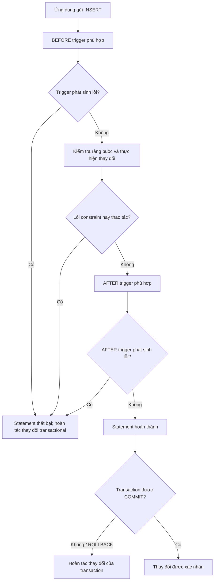

# Phát sinh lỗi, rollback và tương tác với ràng buộc

Một trigger trong SQL không chỉ có thể tự động ghi lịch sử, chuẩn hóa dữ liệu hay cập nhật bảng liên quan. Nó còn có thể **từ chối một thao tác** bằng cách phát sinh lỗi. Khi đó, người học cần hiểu ba lớp quy tắc đang phối hợp:

1. **Câu lệnh DML** mà ứng dụng gửi tới database, ví dụ `INSERT`, `UPDATE` hoặc `DELETE`.
2. **Trigger** được kích hoạt bởi câu lệnh, có thể kiểm tra `NEW`/`OLD`, ghi bảng khác hoặc phát sinh lỗi.
3. **Ràng buộc** của database như `NOT NULL`, `CHECK`, `UNIQUE`, `PRIMARY KEY` và `FOREIGN KEY`, có nhiệm vụ bảo vệ tính hợp lệ của trạng thái dữ liệu.

Nếu một trigger phát sinh lỗi giữa lúc cập nhật nhiều hàng, những hàng đã được xử lý trước đó có còn tồn tại không? Một bản ghi audit được trigger tạo có còn không? Lỗi do trigger có khác lỗi do `CHECK` hay `FOREIGN KEY` khi xét rollback? Nếu ràng buộc được trì hoãn tới `COMMIT`, kết quả sẽ thế nào?

Bài học trong chương **Trigger** của module Database SQL làm rõ các vấn đề đó. Phần thực hành dùng **PostgreSQL** vì hỗ trợ cả trigger row/statement, `RAISE EXCEPTION` trong PL/pgSQL, `SAVEPOINT`, ràng buộc `DEFERRABLE` và *constraint trigger*. Các DBMS khác có cú pháp và mức hỗ trợ riêng, được đối chiếu ở cuối.

**Tư tưởng trung tâm:** trigger chạy trong ngữ cảnh giao dịch của câu lệnh gọi nó. Trong PostgreSQL, nếu một lỗi không được xử lý làm câu lệnh thất bại, các thay đổi có tính giao dịch do câu lệnh và các trigger của nó thực hiện sẽ bị hoàn tác. Không có chuyện một trigger tự động tạo một “giao dịch con độc lập” rồi giữ lại những cập nhật đã thực hiện khi câu lệnh cha thất bại.

## 1. Ba tầng kiểm soát tính hợp lệ

Xét lệnh:

```sql
INSERT INTO orders (order_id, customer_id, amount, status)
VALUES (101, 1, 120, 'new');
```

Một hệ thống có thể kiểm tra:

| Tầng | Ví dụ | Điểm mạnh | Giới hạn |
| --- | --- | --- | --- |
| Ứng dụng | Không cho nhập số tiền âm trong form | Thông báo sớm, UX tốt | Không bảo vệ dữ liệu từ tất cả client nếu có đường ghi khác |
| Ràng buộc database | `CHECK (amount > 0)`, `FOREIGN KEY` | Bảo vệ dữ liệu ở ngay tầng database, kể cả khi nhiều ứng dụng ghi | Không biểu diễn dễ mọi quy tắc có chuyển trạng thái hay kiểm tra nhiều bảng |
| Trigger | Từ chối chuyển trạng thái `paid → new`, tạo audit | Có thể xét `OLD`/`NEW` và phối hợp nhiều thao tác | Phức tạp, phụ thuộc engine, có thể gây chi phí/điểm bất ngờ |

Ba tầng có thể cùng tồn tại. Tuy nhiên, nếu một quy tắc có thể biểu diễn gọn bằng **ràng buộc khai báo**, thường nên ưu tiên ràng buộc đó.

Ví dụ:

```sql
amount NUMERIC(12,2) NOT NULL CHECK (amount > 0)
```

rõ ràng và thường an toàn hơn một trigger tự viết chỉ để kiểm tra `NEW.amount > 0`. Database có thể hiểu và thực thi ràng buộc theo các cơ chế nội bộ, còn trigger là mã thủ tục do người phát triển phải bảo trì.

Trigger phù hợp hơn với các quy tắc như:

- Không cho đổi trạng thái từ `paid` về `new`.
- Chuẩn hóa một giá trị đầu vào trước khi lưu, nếu hợp đồng nghiệp vụ cho phép.
- Ghi bản ghi audit cùng giao dịch.
- Phản ứng với sự kiện trên bảng mà câu SQL khai báo không mô tả trực tiếp được.

## 2. Trigger chạy vào lúc nào?

Trong PostgreSQL có các thời điểm quan trọng:

- `BEFORE`: trước thao tác hàng tương ứng.
- `AFTER`: sau khi thao tác hàng đã được xử lý, theo cơ chế trigger của PostgreSQL.
- `INSTEAD OF`: thường được dùng cho thao tác trên view, thực thi logic thay thế.

Còn có hai cấp độ:

- `FOR EACH ROW`: thực thi một lần cho **mỗi hàng bị tác động**.
- `FOR EACH STATEMENT`: thực thi theo **câu lệnh**, kể cả khi câu lệnh ảnh hưởng 0 hàng, với các điều kiện áp dụng theo loại trigger.

### 2.1. Luồng khái niệm của một INSERT



Sơ đồ giúp học luồng, **không phải danh sách tuyệt đối của mọi bước nội bộ**. PostgreSQL có nhiều loại constraint, trigger, cơ chế kiểm tra sau câu lệnh và deferred trigger. Đặc biệt, `FOREIGN KEY` và một số ràng buộc có thể được kiểm tra thông qua các trigger nội bộ, còn ràng buộc `DEFERRABLE` có thể chờ tới cuối transaction.

Kết luận không thay đổi: **một câu lệnh chỉ được coi là thành công khi toàn bộ các điều kiện cần thiết của thời điểm đó đã hoàn tất**; giao dịch chỉ được commit khi những điều kiện còn trì hoãn cũng hợp lệ.

### 2.2. BEFORE ROW trigger có thể sửa NEW

Với `INSERT` hoặc `UPDATE` trong PostgreSQL:

```sql
-- Bên trong một BEFORE ROW trigger:
NEW.some_column := ...;
RETURN NEW;
```

`RETURN NEW` cho phép hàng tiếp tục được xử lý với giá trị mới. Nếu một `BEFORE ROW` trigger trả `NULL`, nó có thể **bỏ qua thao tác cho hàng đó**. Đây là hành vi khác hoàn toàn với phát sinh lỗi và có thể khiến câu DML “thành công” nhưng bỏ qua hàng, nên cần sử dụng thận trọng.

Với `DELETE`, biến hàng liên quan là `OLD`; một `BEFORE DELETE` trigger thường trả `OLD` để cho phép xóa.

Với `AFTER ROW` trigger, giá trị trả về của trigger function bị bỏ qua. Một function thường trả `NULL` để thể hiện rằng nó không thay thế hàng dữ liệu, nhưng **`RAISE EXCEPTION` trong AFTER trigger vẫn có thể làm cả câu lệnh thất bại**.

### 2.3. Không dựa vào thứ tự các trigger để sửa logic lỗi

Một bảng có thể có nhiều trigger cùng sự kiện và cùng thời điểm. PostgreSQL thực thi những trigger cùng loại trong thứ tự theo tên, nhưng không nên xây dựng nghiệp vụ phụ thuộc vào “trigger audit đã chắc chắn commit trước trigger kiểm tra” — cả hai vẫn thuộc transaction.

Khi có ràng buộc nội bộ, `BEFORE`/`AFTER`, statement trigger và deferred trigger, thứ tự quan sát có thể phức tạp. Tập trung vào **bất biến cuối cùng và tính nguyên tử**, không vào giả định rằng có thể “ghi trước để giữ lại” dữ liệu audit trong chính transaction khi một lỗi xảy ra sau.

## 3. Thiết lập bộ dữ liệu PostgreSQL để thực hành

Các ví dụ dùng schema riêng `demo_trigger_356`. **Chỉ chạy trên database học tập hoặc sandbox**, không chạy trong production hay schema dùng chung.

### 3.1. Tạo schema và bảng customers

```sql
CREATE SCHEMA demo_trigger_356;

CREATE TABLE demo_trigger_356.customers (
    customer_id INTEGER PRIMARY KEY,
    customer_name TEXT NOT NULL,
    customer_state TEXT NOT NULL
        CHECK (customer_state IN ('active', 'blocked'))
);

INSERT INTO demo_trigger_356.customers (
    customer_id, customer_name, customer_state
)
VALUES
    (1, 'An', 'active'),
    (2, 'Binh', 'blocked');
```

Bảng có hai khách; trạng thái `blocked` chỉ phục vụ minh họa khả năng mở rộng quy tắc nghiệp vụ, chưa được dùng làm ràng buộc ngăn tạo đơn trong ví dụ chính.

### 3.2. Tạo bảng orders với các constraint khai báo

```sql
CREATE TABLE demo_trigger_356.orders (
    order_id INTEGER PRIMARY KEY,
    customer_id INTEGER NOT NULL,
    amount NUMERIC(12, 2) NOT NULL,
    order_state TEXT NOT NULL DEFAULT 'new',
    note TEXT NOT NULL DEFAULT '',
    created_at TIMESTAMPTZ NOT NULL DEFAULT CURRENT_TIMESTAMP,

    CONSTRAINT fk_demo356_order_customer
        FOREIGN KEY (customer_id)
        REFERENCES demo_trigger_356.customers(customer_id),

    CONSTRAINT ck_demo356_order_amount
        CHECK (amount > 0),

    CONSTRAINT ck_demo356_order_state
        CHECK (order_state IN ('new', 'paid', 'void'))
);
```

Các quy tắc bảo vệ:

- `PRIMARY KEY(order_id)`: không được có hai đơn cùng ID.
- `NOT NULL`: không được bỏ trống khóa khách, số tiền hoặc trạng thái.
- `FOREIGN KEY`: mỗi `customer_id` của đơn phải tham chiếu khách hợp lệ.
- `CHECK (amount > 0)`: số tiền dương.
- `CHECK (order_state IN (...))`: trạng thái thuộc tập giá trị cho phép.

Đặc biệt, `CHECK` trên số tiền và trạng thái là **ràng buộc khai báo**, không cần trigger tương ứng.

### 3.3. Tạo bảng audit

```sql
CREATE TABLE demo_trigger_356.order_audit (
    audit_id BIGINT GENERATED ALWAYS AS IDENTITY PRIMARY KEY,
    order_id INTEGER NOT NULL,
    action_name TEXT NOT NULL,
    old_state TEXT,
    new_state TEXT,
    old_amount NUMERIC(12,2),
    new_amount NUMERIC(12,2),
    logged_at TIMESTAMPTZ NOT NULL DEFAULT CURRENT_TIMESTAMP
);
```

Bảng audit không dùng `FOREIGN KEY` sang orders để có thể ghi nhật ký cho cả một thao tác `DELETE` thành công. Những bản ghi audit vẫn nằm trong **cùng transaction** với thao tác thay đổi đơn khi được ghi bởi trigger.

**Không dùng `audit_id` tăng liên tục như bằng chứng mọi sự kiện đều commit thành công.** Sequence/identity trong PostgreSQL không đảm bảo không có khoảng trống khi transaction rollback.

## 4. BEFORE trigger phát sinh lỗi có thông điệp

Ta muốn thêm quy tắc ví dụ:

- Một đơn không được có `amount > 1000` trong API thực hành này.
- Không cho chuyển trạng thái đơn từ `paid` trở lại `new`.

Đây là **quy tắc riêng của bộ dữ liệu mẫu**, không phải quy tắc chung của SQL hoặc mọi hệ thống thương mại điện tử.

### 4.1. Tạo trigger function

```sql
CREATE OR REPLACE FUNCTION demo_trigger_356.validate_order()
RETURNS TRIGGER
LANGUAGE plpgsql
AS $$
BEGIN
    IF NEW.amount > 1000 THEN
        RAISE EXCEPTION USING
            ERRCODE = 'P0001',
            MESSAGE = 'ORDER_AMOUNT_LIMIT_EXCEEDED',
            DETAIL = format(
                'order_id=%s, amount=%s, max_allowed=1000',
                NEW.order_id, NEW.amount
            ),
            HINT = 'Chia nhỏ giao dịch hoặc dùng quy trình phê duyệt riêng.';
    END IF;

    IF TG_OP = 'UPDATE'
       AND OLD.order_state = 'paid'
       AND NEW.order_state = 'new'
    THEN
        RAISE EXCEPTION USING
            ERRCODE = 'P0001',
            MESSAGE = 'PAID_ORDER_CANNOT_RETURN_TO_NEW',
            DETAIL = format('order_id=%s', NEW.order_id);
    END IF;

    RETURN NEW;
END;
$$;
```

Trong function:

- `NEW` là hàng dự định được lưu sau `INSERT` hoặc `UPDATE`.
- `OLD` có sẵn khi `TG_OP='UPDATE'`.
- `TG_OP` cho biết loại thao tác.
- `RAISE EXCEPTION` phát sinh lỗi, khiến luồng xử lý hiện tại không tiếp tục bình thường.
- `ERRCODE='P0001'` là SQLSTATE mặc định thường được dùng cho lỗi PL/pgSQL do `RAISE EXCEPTION` không chỉ định mã khác.
- `MESSAGE`, `DETAIL`, `HINT` giúp caller hiểu và xử lý lỗi.

Ở bài mẫu, logic trước `IF TG_OP='UPDATE'` tránh sử dụng `OLD` trong trường hợp `INSERT`.

### 4.2. Gắn BEFORE ROW trigger

```sql
CREATE TRIGGER trg_demo356_validate_order
BEFORE INSERT OR UPDATE
ON demo_trigger_356.orders
FOR EACH ROW
EXECUTE FUNCTION demo_trigger_356.validate_order();
```

Bây giờ mọi `INSERT`/`UPDATE` đơn đều đi qua function. Với `DELETE`, trigger validation này không được gọi.

**Vì sao dùng BEFORE?** Ta muốn từ chối sớm một hàng không hợp lệ mà không cần thực hiện thao tác ghi hàng đó. Dù vậy, “sớm” không mang nghĩa các thao tác trước đó trong cùng statement được giữ lại: nếu một hàng khiến statement lỗi, PostgreSQL hoàn tác các thay đổi có tính giao dịch của **toàn bộ statement**.

### 4.3. Vì sao không chọn AFTER để kiểm tra thay đổi trạng thái?

`AFTER` cũng có thể phát sinh lỗi và rollback. Nhưng khi quy tắc chỉ cần xét `OLD`/`NEW` của một hàng, `BEFORE ROW` thường diễn đạt rõ việc **từ chối trước khi lưu**.

Ngược lại, `AFTER` thích hợp để ghi audit, duy trì bảng liên quan hoặc kiểm tra những điều kiện cần biết kết quả đã xử lý. Chọn thời điểm trigger dựa vào ý nghĩa công việc, không phải vì tin rằng AFTER trigger sẽ commit độc lập.

## 5. AFTER trigger ghi audit rồi vẫn có thể gây rollback

Ta sẽ thêm trigger audit cho `INSERT`, `UPDATE` và `DELETE`. Để thử việc lỗi phát sinh **sau khi đã ghi audit**, ví dụ cố ý có marker `note='SIMULATE_AFTER_ERROR'`: nếu marker này xuất hiện trong hàng mới, function ghi audit rồi phát sinh lỗi.

Marker chỉ phục vụ **thực nghiệm rollback**; không nên đưa cơ chế giả lập lỗi bằng ghi chú vào ứng dụng production.

### 5.1. Tạo audit function

```sql
CREATE OR REPLACE FUNCTION demo_trigger_356.audit_order()
RETURNS TRIGGER
LANGUAGE plpgsql
AS $$
BEGIN
    IF TG_OP = 'INSERT' THEN
        INSERT INTO demo_trigger_356.order_audit (
            order_id, action_name, new_state, new_amount
        )
        VALUES (
            NEW.order_id, TG_OP, NEW.order_state, NEW.amount
        );

    ELSIF TG_OP = 'UPDATE' THEN
        INSERT INTO demo_trigger_356.order_audit (
            order_id, action_name,
            old_state, new_state, old_amount, new_amount
        )
        VALUES (
            NEW.order_id, TG_OP,
            OLD.order_state, NEW.order_state,
            OLD.amount, NEW.amount
        );

    ELSIF TG_OP = 'DELETE' THEN
        INSERT INTO demo_trigger_356.order_audit (
            order_id, action_name, old_state, old_amount
        )
        VALUES (
            OLD.order_id, TG_OP, OLD.order_state, OLD.amount
        );
    END IF;

    IF TG_OP IN ('INSERT', 'UPDATE')
       AND NEW.note = 'SIMULATE_AFTER_ERROR'
    THEN
        RAISE EXCEPTION USING
            ERRCODE = 'P0001',
            MESSAGE = 'SIMULATED_AFTER_TRIGGER_FAILURE',
            DETAIL = format('order_id=%s', NEW.order_id);
    END IF;

    RETURN NULL;
END;
$$;
```

### 5.2. Gắn AFTER ROW trigger

```sql
CREATE TRIGGER trg_demo356_audit_order
AFTER INSERT OR UPDATE OR DELETE
ON demo_trigger_356.orders
FOR EACH ROW
EXECUTE FUNCTION demo_trigger_356.audit_order();
```

Với câu `INSERT` thành công, audit function thêm một hàng. Với `UPDATE` thành công, thêm một hàng mang trạng thái cũ/mới. Với `DELETE` thành công, thêm audit của hàng đã bị xóa.

Trong `AFTER ROW` trigger, `RETURN NULL` không có nghĩa bỏ qua thao tác đơn; giá trị trả về bị bỏ qua.

### 5.3. Một INSERT hợp lệ

```sql
INSERT INTO demo_trigger_356.orders (
    order_id, customer_id, amount, order_state, note
)
VALUES (101, 1, 120, 'new', 'Đơn mẫu');

SELECT order_id, customer_id, amount, order_state
FROM demo_trigger_356.orders
ORDER BY order_id;
```

Kết quả có một đơn 101, số tiền 120.

```sql
SELECT
    order_id,
    action_name,
    old_state,
    new_state,
    old_amount,
    new_amount
FROM demo_trigger_356.order_audit
ORDER BY audit_id;
```

Một hàng audit cho `order_id=101` với `action_name='INSERT'` và `new_amount=120`. Nếu dùng client autocommit, câu `INSERT` đã commit khi thành công; nếu đang trong transaction tường minh, audit cũng chỉ được xác nhận khi transaction đó commit.

### 5.4. UPDATE hợp lệ có audit

```sql
UPDATE demo_trigger_356.orders
SET amount = 130,
    order_state = 'paid'
WHERE order_id = 101;
```

Câu này thành công vì không vượt 1000 và không chuyển `paid → new`. Audit ghi sự kiện `UPDATE` với `old_amount=120`, `new_amount=130`, `old_state='new'`, `new_state='paid'`.

Bây giờ bảng orders có đơn 101 ở trạng thái `paid` và amount 130.

## 6. Lỗi CHECK, FOREIGN KEY, UNIQUE và lỗi từ trigger

Bộ dữ liệu đã có đủ bốn nguồn lỗi khác nhau. Các ví dụ dưới đây được **chạy riêng lẻ**, mỗi ví dụ cố ý phát sinh lỗi; không copy tất cả vào một transaction mà không xử lý rollback.

### 6.1. Lỗi CHECK

```sql
-- CỐ Ý LỖI: amount phải dương.
INSERT INTO demo_trigger_356.orders (
    order_id, customer_id, amount, order_state
)
VALUES (201, 1, 0, 'new');
```

PostgreSQL từ chối vì `ck_demo356_order_amount`. `0 > 0` là sai.

Nếu `BEFORE trigger` không tự phát sinh lỗi, DBMS vẫn kiểm tra `CHECK` và từ chối hàng. Không cần một trigger khác chỉ để tự thực thi chính điều kiện `CHECK(amount>0)`.

### 6.2. Lỗi FOREIGN KEY

```sql
-- CỐ Ý LỖI: chưa tồn tại customer_id = 999.
INSERT INTO demo_trigger_356.orders (
    order_id, customer_id, amount, order_state
)
VALUES (202, 999, 50, 'new');
```

Vì `customers` không có customer 999, ràng buộc `fk_demo356_order_customer` từ chối thao tác.

Trong PostgreSQL, FK có thể sử dụng các trigger ràng buộc nội bộ để bảo vệ tính tham chiếu. Nếu audit trigger có kịp chạy trước thời điểm phát hiện lỗi FK trong một trường hợp thực thi cụ thể, **hàng audit được ghi trong cùng statement vẫn sẽ rollback** khi statement không thành công. Không dựa vào thứ tự nội bộ để giữ audit của thay đổi không được commit.

### 6.3. Lỗi PRIMARY KEY / UNIQUE

```sql
-- CỐ Ý LỖI: order_id=101 đã tồn tại.
INSERT INTO demo_trigger_356.orders (
    order_id, customer_id, amount, order_state
)
VALUES (101, 1, 50, 'new');
```

`PRIMARY KEY(order_id)` yêu cầu định danh duy nhất. SQLSTATE của `unique_violation` trong PostgreSQL là `23505`.

### 6.4. Lỗi do BEFORE trigger

```sql
-- CỐ Ý LỖI: 1500 vượt giới hạn 1000 của trigger mẫu.
INSERT INTO demo_trigger_356.orders (
    order_id, customer_id, amount, order_state
)
VALUES (203, 1, 1500, 'new');
```

Dữ liệu này **không vi phạm `CHECK(amount>0)`**, nhưng bị trigger `validate_order()` từ chối với thông điệp `ORDER_AMOUNT_LIMIT_EXCEEDED`.

Ví dụ cho thấy cùng một thao tác có thể hợp lệ theo mọi constraint đơn giản mà vẫn vi phạm một quy tắc trigger.

### 6.5. Lỗi do quy tắc chuyển trạng thái

Đơn 101 hiện đang `paid`. Thử:

```sql
-- CỐ Ý LỖI: không cho chuyển paid trở lại new.
UPDATE demo_trigger_356.orders
SET order_state = 'new'
WHERE order_id = 101;
```

`CHECK(order_state IN (...))` **cho phép giá trị `new`**; nhưng trigger biết `OLD.order_state='paid'` và `NEW.order_state='new'`, nên phát sinh lỗi.

Hàng 101 vẫn ở trạng thái `paid` sau rollback của statement.

### 6.6. Mã SQLSTATE thường cần biết

| SQLSTATE PostgreSQL | Tên lỗi thường gặp | Ví dụ |
| --- | --- | --- |
| `23502` | `not_null_violation` | Thiếu cột bắt buộc |
| `23503` | `foreign_key_violation` | Tham chiếu customer chưa tồn tại |
| `23505` | `unique_violation` | Trùng `order_id` |
| `23514` | `check_violation` | `amount <= 0` vi phạm CHECK |
| `P0001` | `raise_exception` | Trigger chủ động `RAISE EXCEPTION` |
| `40001` | `serialization_failure` | Giao dịch cần retry do xung đột serializable |
| `40P01` | `deadlock_detected` | Database phát hiện vòng chờ khóa |
| `25P02` | `in_failed_sql_transaction` | Tiếp tục SQL trong transaction PostgreSQL đã lỗi |

Không phải mọi lỗi `P0001` đều là cùng một lỗi nghiệp vụ. Nếu ứng dụng cần phân loại, nên thiết kế thông điệp/mã lỗi ổn định và phân biệt SQLSTATE, tên constraint, vị trí lỗi khi phù hợp. Không dùng so sánh chuỗi thông báo được dịch/định dạng ngẫu nhiên làm cơ chế duy nhất.

## 7. Khi một hàng trong INSERT nhiều hàng lỗi, điều gì xảy ra?

Giả sử cần chèn hai đơn trong **cùng một statement**:

```sql
-- CỐ Ý LỖI: hàng thứ hai bị trigger từ chối.
INSERT INTO demo_trigger_356.orders (
    order_id, customer_id, amount, order_state
)
VALUES
    (211, 1, 60,   'new'),
    (212, 1, 1500, 'new');
```

Hàng 211 hợp lệ; hàng 212 vi phạm giới hạn của trigger. Kết quả trong PostgreSQL:

- Statement **thất bại toàn bộ**.
- Không giữ lại đơn 211 chỉ vì nó có thể đã được xử lý trước đơn 212.
- Không có đơn 212.
- Mọi hàng audit transactional được tạo cho statement này đều không được commit.
- Nếu transaction bao ngoài không bắt/khôi phục lỗi, transaction chuyển sang trạng thái lỗi, cần rollback hoặc quay lại savepoint thích hợp.

Đây là **tính nguyên tử của một SQL statement**. Không được coi `INSERT ... VALUES (...), (...)` là một vòng lặp các INSERT tự commit từng hàng.

### 7.1. Kiểm tra sau câu lệnh lỗi

Trong một client psql có autocommit, mỗi statement là transaction riêng; sau lỗi bạn có thể chạy:

```sql
SELECT order_id
FROM demo_trigger_356.orders
WHERE order_id IN (211, 212)
ORDER BY order_id;
```

Kết quả **0 hàng**.

Nếu bạn đang trong `BEGIN` tường minh, sau lỗi PostgreSQL thường yêu cầu `ROLLBACK` trước khi SELECT khác:

```sql
ROLLBACK;

SELECT order_id
FROM demo_trigger_356.orders
WHERE order_id IN (211, 212);
```

Kết quả vẫn **0 hàng**.

### 7.2. Có thể BEFORE trigger đã chạy cho hàng 211 hay chưa?

Thứ tự xử lý nội bộ, trigger và kiểm tra ràng buộc của nhiều hàng có các chi tiết phụ thuộc statement và kế hoạch; không nên viết ứng dụng dựa vào việc hàng 211 chắc chắn “đã chạy trước” hàng 212 trong mọi tình huống.

Điều cần bảo đảm là: **không một thay đổi transactional nào từ statement thất bại được giữ lại**.

## 8. AFTER trigger ghi audit rồi phát sinh lỗi: cả hai đều rollback

Ta đã lập trình marker `SIMULATE_AFTER_ERROR` trong `audit_order()`. Thử:

```sql
-- CỐ Ý LỖI SAU KHI INSERT audit.
INSERT INTO demo_trigger_356.orders (
    order_id, customer_id, amount, order_state, note
)
VALUES
    (221, 1, 80, 'new', 'SIMULATE_AFTER_ERROR');
```

Về mặt logic:

1. BEFORE trigger thấy amount 80 hợp lệ, không phản đối.
2. Hàng orders được xử lý.
3. AFTER trigger chèn một dòng vào `order_audit`.
4. AFTER trigger phát sinh `RAISE EXCEPTION`.
5. Cả thao tác thêm orders và thêm audit trong statement bị rollback.

Sau khi xử lý transaction bị lỗi, kiểm tra:

```sql
SELECT *
FROM demo_trigger_356.orders
WHERE order_id = 221;

SELECT *
FROM demo_trigger_356.order_audit
WHERE order_id = 221;
```

Cả hai đều **không có hàng được commit**.

### 8.1. Hai hàng, lỗi ở AFTER trigger của một hàng

```sql
-- CỐ Ý LỖI:
INSERT INTO demo_trigger_356.orders (
    order_id, customer_id, amount, order_state, note
)
VALUES
    (222, 1, 40, 'new', 'Bình thường'),
    (223, 1, 70, 'new', 'SIMULATE_AFTER_ERROR');
```

Ngay cả nếu audit của 222 và 223 đã được chèn khi trigger lần lượt thực thi, một lỗi từ AFTER trigger làm **cả statement** thất bại. Đơn 222 không được giữ riêng.

### 8.2. Vì sao audit của thao tác thất bại không được giữ?

Audit ghi bằng `INSERT` vào một bảng PostgreSQL thường, trong cùng transaction. Khi rollback, cả hai thay đổi có tính giao dịch cùng bị hoàn tác.

Điều này **tốt cho audit các thay đổi đã commit**, vì bảng audit không bị nhiễm các hàng mô tả cập nhật chưa thực sự tồn tại.

Nếu nghiệp vụ cần **ghi nhận mọi lần thử thất bại**, kể cả khi transaction dữ liệu rollback, hãy dùng hệ thống log ứng dụng, dịch vụ/đường ghi độc lập có chủ đích hoặc cơ chế quan sát phù hợp. Không thể chỉ chèn một hàng vào bảng audit cùng transaction rồi kỳ vọng nó sống sót qua rollback của transaction đó.

## 9. Statement rollback và transaction rollback là hai phạm vi khác nhau

Ta cần phân biệt:

- **Rollback tác động của statement thất bại**: các thay đổi do statement đó tạo ra không được giữ.
- **Rollback toàn bộ transaction**: hoàn tác tất cả những thay đổi transactional trong transaction chưa commit.
- **Rollback tới savepoint**: chỉ hoàn tác các thay đổi sau savepoint và giữ công việc trước đó trong transaction, nếu thao tác khôi phục hợp lệ.
- **Commit**: xác nhận thay đổi sau khi mọi kiểm tra cần thiết, kể cả ràng buộc trì hoãn, thành công.

### 9.1. Một transaction có hai statement, statement thứ hai lỗi

Ví dụ:

```sql
BEGIN;

INSERT INTO demo_trigger_356.orders (
    order_id, customer_id, amount, order_state
)
VALUES (231, 1, 40, 'new');

-- CỐ Ý LỖI:
INSERT INTO demo_trigger_356.orders (
    order_id, customer_id, amount, order_state
)
VALUES (232, 1, 1500, 'new');

-- Không thể tiếp tục giao dịch PostgreSQL thông thường sau lỗi.
ROLLBACK;
```

Lệnh INSERT 231 **đã thành công tạm thời trong transaction**, nhưng chưa commit. Khi statement 232 lỗi, transaction PostgreSQL ở trạng thái thất bại. Sau `ROLLBACK`, cả đơn 231 lẫn 232 đều không còn.

Nếu thay `ROLLBACK` bằng một `COMMIT` đơn giản trong tình huống transaction đã thất bại của PostgreSQL, database không thể commit những thay đổi chưa xử lý lỗi; không được hiểu “COMMIT sau lỗi” là cách giữ lại đơn 231.

### 9.2. Điều gì xảy ra nếu cứ SELECT sau khi statement lỗi?

Trong transaction bị lỗi:

```text
ERROR: current transaction is aborted,
commands ignored until end of transaction block
SQLSTATE 25P02
```

Đây là một hành vi rất thường gặp ở PostgreSQL. Cần `ROLLBACK` hoặc sử dụng savepoint được tạo **trước statement lỗi** để khôi phục phạm vi phù hợp.

### 9.3. Autocommit ảnh hưởng phạm vi lỗi

Khi client/driver ở autocommit, mỗi statement có thể được thực thi và commit như một transaction riêng:

```text
INSERT đơn 241 hợp lệ → statement commit
INSERT đơn 242 lỗi    → chỉ statement này thất bại
```

Đơn 241 đã commit **không bị rollback** vì một statement khác ở transaction sau bị lỗi.

Vì vậy, cùng hai lệnh `INSERT` nhưng **đặt hay không đặt trong `BEGIN...COMMIT`** có thể thay đổi phạm vi công việc được giữ khi lệnh sau thất bại. Đừng chỉ nhìn từng dòng SQL mà bỏ qua ranh giới giao dịch của client.

### 9.4. Xóa một đơn rồi rollback

Với đơn 101 đã có:

```sql
BEGIN;

DELETE FROM demo_trigger_356.orders
WHERE order_id = 101;

-- Trong transaction này, hàng 101 đã bị xóa và audit DELETE được ghi.
ROLLBACK;
```

Sau rollback, đơn 101 vẫn tồn tại và audit DELETE vừa tạo không còn. Đây là cách minh họa rằng trigger audit không có commit riêng.

## 10. SAVEPOINT: giữ phần công việc trước lỗi

`SAVEPOINT` là điểm đánh dấu bên trong một transaction. Nếu statement sau đó thất bại, có thể rollback về điểm này và tiếp tục công việc trước đó.

### 10.1. Ví dụ phục hồi khỏi lỗi trigger

```sql
BEGIN;

INSERT INTO demo_trigger_356.orders (
    order_id, customer_id, amount, order_state
)
VALUES (301, 1, 50, 'new');

SAVEPOINT before_risky_insert;

-- CỐ Ý LỖI: amount vượt giới hạn trigger.
INSERT INTO demo_trigger_356.orders (
    order_id, customer_id, amount, order_state
)
VALUES (302, 1, 2000, 'new');

-- Sau lỗi, quay lại savepoint.
ROLLBACK TO SAVEPOINT before_risky_insert;

INSERT INTO demo_trigger_356.orders (
    order_id, customer_id, amount, order_state
)
VALUES (303, 1, 70, 'new');

RELEASE SAVEPOINT before_risky_insert;

COMMIT;
```

Kết quả sau commit:

- Đơn **301 có**.
- Đơn **302 không có**.
- Đơn **303 có**.
- Audit tương ứng cho 301 và 303 có; audit của 302 không có.

`ROLLBACK TO SAVEPOINT` khôi phục trạng thái của transaction đến điểm trước insert 302, **không tự kết thúc toàn bộ transaction**. Sau đó transaction có thể tiếp tục.

### 10.2. SAVEPOINT không phải một commit độc lập

`RELEASE SAVEPOINT` **không commit** công việc nằm trong savepoint. Nếu chạy `ROLLBACK` toàn transaction sau khi release, mọi thay đổi chưa commit, kể cả đơn 301/303, đều bị hoàn tác.

SAVEPOINT bảo vệ **phạm vi có thể quay lui**, không tạo một transaction có độ bền độc lập.

### 10.3. Savepoint lồng nhau

```sql
BEGIN;

SAVEPOINT sp_outer;
-- Công việc A

SAVEPOINT sp_inner;
-- Công việc B

ROLLBACK TO SAVEPOINT sp_inner;
-- Hoàn tác B, giữ A.

RELEASE SAVEPOINT sp_inner;
RELEASE SAVEPOINT sp_outer;

COMMIT;
```

Đây là ví dụ khung cú pháp; các chú thích không thực hiện DML. Khi thiết kế pipeline, dùng savepoint có chủ đích cho những phần có thể chấp nhận thất bại riêng, không phải để tự động bỏ qua mọi vi phạm dữ liệu mà không báo.

### 10.4. Tiếp tục sau lỗi có phù hợp nghiệp vụ không?

Không phải lúc nào cũng nên giữ đơn 301 và 303 nếu đơn 302 lỗi. Nếu một batch phải **được áp dụng đầy đủ hoặc không áp dụng**, điều đúng là rollback toàn transaction và báo batch thất bại.

SAVEPOINT phù hợp khi hợp đồng nghiệp vụ **cho phép bỏ qua những hàng riêng lẻ** và có cơ chế báo cáo hàng bị từ chối. Nếu cần atomicity của cả batch, không dùng savepoint để che dữ liệu lỗi.

## 11. PL/pgSQL EXCEPTION: khôi phục bằng subtransaction nội bộ

Trong một khối PL/pgSQL có phần `EXCEPTION`, PostgreSQL sử dụng cơ chế subtransaction để rollback những thay đổi persistent được thực hiện **bên trong khối đó** khi có lỗi được bắt.

### 11.1. Ví dụ DO block bắt lỗi riêng

```sql
DO $$
BEGIN
    BEGIN
        INSERT INTO demo_trigger_356.orders (
            order_id, customer_id, amount, order_state
        )
        VALUES (321, 1, 1500, 'new');

    EXCEPTION
        WHEN SQLSTATE 'P0001' THEN
            RAISE NOTICE
                'Đơn 321 bị từ chối theo quy tắc trigger';
    END;

    INSERT INTO demo_trigger_356.orders (
        order_id, customer_id, amount, order_state
    )
    VALUES (322, 1, 80, 'new');
END;
$$;
```

Nếu dùng client autocommit và không có lỗi khác:

- Thao tác insert 321 bị trigger từ chối và phần thay đổi trong khối có `EXCEPTION` bị rollback.
- `RAISE NOTICE` thông báo nhưng **không phải `RAISE EXCEPTION`**, nên không làm chính DO statement thất bại.
- Lệnh insert 322 sau khối xử lý vẫn được thực hiện.
- Khi transaction chứa DO statement commit, đơn 322 và audit tương ứng được lưu.

### 11.2. Vì sao dùng SQLSTATE cụ thể?

`WHEN SQLSTATE 'P0001'` bắt những lỗi có SQLSTATE này, có thể gồm nhiều thông điệp trigger khác nhau trong ví dụ. Trong một API thực tế, tốt hơn là phát mã lỗi riêng có ý nghĩa và phân biệt loại lỗi ở tầng gọi theo hợp đồng đã định nghĩa.

Bắt mọi lỗi bằng `WHEN OTHERS` rồi coi như “không có vấn đề” nguy hiểm: có thể nuốt lỗi trùng khóa, FK, hỏng giả định nghiệp vụ hoặc lỗi lập trình.

### 11.3. Điều gì bị rollback trong khối EXCEPTION?

Những thay đổi bảng thực hiện trong khối `BEGIN ... EXCEPTION` bị rollback khi phần bảo vệ lỗi được kích hoạt. **Biến PL/pgSQL** có thể vẫn giữ giá trị đã được gán trước khi lỗi tùy ngữ nghĩa của khối; đừng lẫn trạng thái biến trong function với dữ liệu đã được commit trong database.

`RAISE NOTICE` không ghi một hàng audit transactional độc lập. Thông báo tới client hoặc log server không tương đương một bản ghi bền vững có giao dịch riêng.

### 11.4. EXCEPTION không phải quyền COMMIT bên trong trigger

Trigger function trong PostgreSQL không được tự tiện `COMMIT` hoặc `ROLLBACK` transaction bao ngoài. Một khối `EXCEPTION` tạo phạm vi xử lý lỗi **nội bộ**; nó không phải một transaction tự commit độc lập.

Nếu muốn ứng dụng lựa chọn “tiếp tục hay rollback cả batch”, quyết định nên được thiết kế ở tầng transaction caller hoặc thủ tục được phép quản lý transaction trong những ngữ cảnh PostgreSQL hỗ trợ, không phải cố COMMIT bên trong trigger.

## 12. ROLLBACK của audit, sequence và tác dụng phụ bên ngoài

Không phải mọi thứ xảy ra khi trigger chạy đều có khả năng rollback như hàng trong bảng PostgreSQL.

### 12.1. Ghi bảng thông thường có tính giao dịch

```sql
INSERT INTO demo_trigger_356.order_audit (...);
```

Nếu được thực hiện bởi trigger trong transaction và transaction rollback, hàng audit rollback cùng dữ liệu nghiệp vụ.

Đó là quy tắc giúp bảo đảm audit của **các thay đổi đã commit** không bị sai lệch bởi những câu lệnh thất bại.

### 12.2. Sequence và identity có thể bị nhảy số

`audit_id` là identity dùng sequence. Một insert audit có thể sử dụng giá trị tiếp theo của sequence **dù statement về sau lỗi**.

Sau đó, các audit ID có thể có khoảng trống:

```text
audit_id: 1, 2, 5, 8, ...
```

Điều này không nhất thiết có nghĩa audit bị xóa trái phép. Trong PostgreSQL, sequence không phải cơ chế đánh số liên tục có rollback.

**Không dùng số ID sequence để suy ra chính xác số lần transaction thành công hoặc số hàng đã commit.**

### 12.3. Gửi email, gọi HTTP hoặc ghi ra hệ thống ngoài

Nếu một trigger (trực tiếp hoặc gián tiếp qua extension) kích hoạt tác dụng phụ ra hệ thống ngoài, ví dụ gửi email hoặc gọi HTTP, việc database `ROLLBACK` **không đảm bảo** hệ thống ngoài có thể hủy side effect đó.

```text
BEGIN
  INSERT order
  trigger gọi API gửi email
  trigger khác phát lỗi
ROLLBACK database
  → order không tồn tại
  → email có thể đã gửi
```

Đây là một thiết kế nguy hiểm. Nên sử dụng mô hình **transactional outbox**:

1. Ghi order và một hàng outbox trong **cùng transaction**.
2. Chỉ sau commit, một worker độc lập đọc outbox để gọi dịch vụ ngoài.
3. Worker dùng idempotency key và cơ chế retry vì gửi thông điệp cũng có thể thất bại hoặc bị thực hiện lặp.

Nếu transaction rollback, cả order lẫn outbox row rollback, nên worker không thấy sự kiện chưa được xác nhận.

### 12.4. NOTIFY trong PostgreSQL có tính gắn với commit

`NOTIFY` trong PostgreSQL được giao cho listener sau khi transaction phát thông báo **commit**; nếu transaction rollback, thông báo từ transaction đó không được giao theo cách một notification đã commit.

Điều này hữu ích nhưng **không biến NOTIFY thành hàng đợi bền vững**. Listener có thể mất kết nối; payload/kênh có giới hạn. Với tác vụ tài chính/đơn hàng cần khôi phục, nên lưu sự kiện trong bảng outbox hoặc hệ thống hàng đợi bền vững phù hợp.

### 12.5. Ghi log của lỗi cần bảo vệ riêng

Một ứng dụng cần lưu cả **những nỗ lực bị từ chối** có thể ghi log sau khi nhận lỗi và rollback transaction, hoặc gửi thông tin tới một hệ thống quan sát riêng được thiết kế để nhận lỗi. Điều này khác với audit về **dữ liệu đã thay đổi thành công**.

Phân biệt hai yêu cầu:

| Loại log | Mục tiêu | Gợi ý thiết kế |
| --- | --- | --- |
| Audit thay đổi đã commit | Ai đã sửa gì và từ giá trị nào sang giá trị nào | Audit table trong cùng transaction |
| Log thao tác thất bại | Lý do và ngữ cảnh một lệnh bị từ chối | Log ứng dụng/đường ghi riêng có kiểm soát |
| Sự kiện gửi hệ ngoài | Kích hoạt dịch vụ sau commit | Transactional outbox + worker |
| Metrics vận hành | Đếm lỗi/trễ mà không sửa nghiệp vụ | Monitoring/telemetry độc lập |

Không dùng một bảng audit transactional duy nhất để giải quyết tất cả bốn mục tiêu mà không phân tích rollback.
## 13. Trigger và ràng buộc nào kiểm tra trước, kiểm tra sau?

Khi một hàng bị `INSERT` hoặc `UPDATE`, PostgreSQL có thể phải thực hiện trigger người dùng và nhiều kiểm tra nội bộ.

Một sơ đồ thực dụng:

| Thành phần | Mục đích | Khi lỗi |
| --- | --- | --- |
| `BEFORE ROW` trigger | Điều chỉnh `NEW` hoặc từ chối sớm | `RAISE EXCEPTION` khiến statement thất bại |
| `NOT NULL` và `CHECK` | Bảo vệ thuộc tính hàng theo ràng buộc khai báo | Statement bị từ chối |
| `PRIMARY KEY` / `UNIQUE` | Bảo vệ tính duy nhất | Statement bị từ chối; nếu deferrable có thể kiểm tra ở thời điểm trì hoãn |
| `FOREIGN KEY` | Bảo vệ tham chiếu cha–con | Có thể lỗi tại statement hoặc lúc kiểm tra deferred |
| `AFTER ROW` trigger | Audit, phản ứng sau thao tác trên hàng | Lỗi cũng khiến statement thất bại |
| `AFTER STATEMENT` trigger | Phản ứng với toàn câu lệnh | Lỗi làm statement thất bại |
| Deferred constraints / constraint triggers | Kiểm tra ràng buộc vào mốc sau | Có thể làm `SET CONSTRAINTS IMMEDIATE` hoặc `COMMIT` thất bại |

**Không đọc bảng như một lịch sự kiện cố định** của tất cả trigger/ràng buộc. PostgreSQL có ràng buộc được triển khai bằng trigger nội bộ, trigger bị hoãn, trigger thay đổi `NEW` và những trường hợp DML phức tạp.

### 13.1. Không có quy tắc "trigger luôn thắng constraint"

Với đơn `amount=0`, trigger của bài không báo lỗi vì `0 > 1000` sai, nhưng `CHECK(amount>0)` báo lỗi.

Với đơn `amount=1500`, `CHECK(amount>0)` không phản đối, nhưng trigger báo lỗi.

Với một đơn thiếu khách `customer_id=999`, FK báo lỗi. Trong một statement đồng thời vi phạm nhiều quy tắc, **lỗi đầu tiên được báo có thể phụ thuộc vào chi tiết thực thi**, không nên coi thứ tự lỗi là giao diện nghiệp vụ được cam kết.

### 13.2. CHECK với NULL

Một điểm thường bị bỏ qua: theo ngữ nghĩa SQL, `CHECK` chấp nhận biểu thức có kết quả **TRUE hoặc UNKNOWN (NULL)**. Vì vậy:

```sql
CHECK (amount > 0)
```

**không tự cấm amount là NULL**. Trong bảng mẫu, ta có thêm:

```sql
amount NUMERIC(12,2) NOT NULL
```

để bảo vệ trường bắt buộc.

Tương tự, ràng buộc `UNIQUE` thông thường trong PostgreSQL có các quy tắc riêng với `NULL`. Nếu cột thật sự là phần của khóa định danh bắt buộc, `NOT NULL` giúp tránh trạng thái mơ hồ; PostgreSQL còn hỗ trợ `NULLS NOT DISTINCT` khi chủ đích coi NULL như bằng nhau cho unique.

### 13.3. BEFORE trigger có thể chuẩn hóa trước khi CHECK

Để xem cơ chế này mà không ảnh hưởng bảng orders:

```sql
CREATE TABLE demo_trigger_356.product_codes (
    product_id INTEGER PRIMARY KEY,
    sku TEXT NOT NULL UNIQUE,
    CONSTRAINT ck_demo356_sku_normalized
        CHECK (sku = UPPER(BTRIM(sku)))
);

CREATE OR REPLACE FUNCTION demo_trigger_356.normalize_product_sku()
RETURNS TRIGGER
LANGUAGE plpgsql
AS $$
BEGIN
    NEW.sku := UPPER(BTRIM(NEW.sku));
    RETURN NEW;
END;
$$;

CREATE TRIGGER trg_demo356_normalize_sku
BEFORE INSERT OR UPDATE
ON demo_trigger_356.product_codes
FOR EACH ROW
EXECUTE FUNCTION demo_trigger_356.normalize_product_sku();
```

Thử:

```sql
INSERT INTO demo_trigger_356.product_codes (product_id, sku)
VALUES (1, ' ab-01 ');

SELECT * FROM demo_trigger_356.product_codes;
-- sku đã được chuẩn hóa thành AB-01.
```

`BEFORE ROW` trigger sửa `NEW.sku` trước khi hàng được kiểm tra/lưu với `CHECK` và `UNIQUE` tương ứng.

Tiếp tục:

```sql
-- CỐ Ý LỖI unique: sau chuẩn hóa cùng sku AB-01.
INSERT INTO demo_trigger_356.product_codes (product_id, sku)
VALUES (2, 'Ab-01');
```

Trigger chuẩn hóa thành `AB-01`; `UNIQUE(sku)` từ chối. **Trigger không thay thế constraint**: một lớp chuẩn hóa dữ liệu, lớp còn lại bảo đảm không trùng khóa sau chuẩn hóa.

**Cảnh báo:** Quy tắc viết hoa/cắt khoảng trắng chỉ đúng khi hợp đồng mã SKU cho phép. Không tự chuẩn hóa những ID phân biệt hoa–thường. Với hệ đa ngôn ngữ, collation và quy tắc Unicode cũng cần được xác định rõ.

## 14. DEFERRABLE: khi constraint có thể đợi tới cuối transaction

Một số ràng buộc không cần được kiểm tra đầy đủ ngay khi mỗi statement hoàn thành. Điều này hữu ích khi một transaction phải thực hiện nhiều thao tác trung gian mà trạng thái **cuối transaction** mới đầy đủ.

Ví dụ muốn thêm một nhân viên tham chiếu bộ phận số 10, nhưng cùng transaction lại chèn nhân viên trước rồi mới chèn bộ phận.

### 14.1. Ràng buộc FK thường kiểm tra sớm

Nếu tạo FK mặc định không trì hoãn:

```sql
CREATE TABLE demo_trigger_356.departments_immediate (
    department_id INTEGER PRIMARY KEY
);

CREATE TABLE demo_trigger_356.members_immediate (
    member_id INTEGER PRIMARY KEY,
    department_id INTEGER NOT NULL
        REFERENCES demo_trigger_356.departments_immediate(department_id)
);
```

Lệnh:

```sql
-- CỐ Ý LỖI nếu department 10 chưa có.
INSERT INTO demo_trigger_356.members_immediate
    (member_id, department_id)
VALUES (1, 10);
```

bị từ chối vì bảng bộ phận chưa có khóa 10, dù ứng dụng có ý định chèn bộ phận ở statement tiếp theo.

Có thể sửa bằng việc chèn bộ phận **trước** nhân viên. Nhiều mô hình ứng dụng nên chọn thứ tự ghi hợp lệ này thay vì dùng deferred constraint không cần thiết.

### 14.2. FK DEFERRABLE INITIALLY DEFERRED

Tạo một cặp bảng khác:

```sql
CREATE TABLE demo_trigger_356.departments_deferred (
    department_id INTEGER PRIMARY KEY,
    department_name TEXT NOT NULL
);

CREATE TABLE demo_trigger_356.members_deferred (
    member_id INTEGER PRIMARY KEY,
    department_id INTEGER NOT NULL,
    CONSTRAINT fk_demo356_member_department
        FOREIGN KEY (department_id)
        REFERENCES demo_trigger_356.departments_deferred(department_id)
        DEFERRABLE INITIALLY DEFERRED
);
```

Bây giờ:

```sql
BEGIN;

INSERT INTO demo_trigger_356.members_deferred (
    member_id, department_id
)
VALUES (1, 10);

-- Tạm thời trong transaction chưa có department 10.
INSERT INTO demo_trigger_356.departments_deferred (
    department_id, department_name
)
VALUES (10, 'Kỹ thuật');

COMMIT;
```

Transaction **commit thành công**: tại mốc kiểm tra deferred, department 10 đã tồn tại.

### 14.3. Nếu quên chèn hàng cha thì COMMIT thất bại

```sql
BEGIN;

INSERT INTO demo_trigger_356.members_deferred (
    member_id, department_id
)
VALUES (2, 20);

-- CỐ Ý LỖI LÚC COMMIT: department 20 không tồn tại.
COMMIT;
```

Statement `INSERT` có thể hoàn thành vì FK đang ở chế độ deferred, nhưng `COMMIT` không thể xác nhận transaction vi phạm FK. Transaction thất bại và **member 2 không được commit**.

Đây là khác biệt quan trọng giữa:

- “`INSERT` chưa báo lỗi”.
- “Dữ liệu hợp lệ để `COMMIT`”.

**Thành công của một statement không luôn đồng nghĩa transaction chắc chắn commit**, nhất là khi còn kiểm tra deferred.

### 14.4. SET CONSTRAINTS IMMEDIATE buộc kiểm tra sớm

`SET CONSTRAINTS` có thể điều khiển những constraint được khai báo `DEFERRABLE` trong transaction:

```sql
BEGIN;

INSERT INTO demo_trigger_356.members_deferred
    (member_id, department_id)
VALUES (3, 30);

SAVEPOINT before_check;

-- CỐ Ý LỖI: FK pending tham chiếu department 30 chưa có.
SET CONSTRAINTS ALL IMMEDIATE;

-- Khôi phục phần thử kiểm tra để tiếp tục.
ROLLBACK TO SAVEPOINT before_check;

INSERT INTO demo_trigger_356.departments_deferred
    (department_id, department_name)
VALUES (30, 'Tài chính');

COMMIT;
```

Khi chuyển từ deferred sang immediate, PostgreSQL kiểm tra những thay đổi đang chờ; nếu không hợp lệ, `SET CONSTRAINTS ... IMMEDIATE` có thể báo lỗi tại chỗ. `SAVEPOINT` cho phép khôi phục từ lỗi để hoàn thành transaction.

Ở ví dụ này, sau rollback về savepoint, FK lại ở trạng thái deferred của transaction, nên chèn department 30 rồi commit thành công.

**Không phải mọi constraint đều chuyển được thành deferred.** `SET CONSTRAINTS ALL DEFERRED` chỉ có tác dụng với những constraint phù hợp đã khai báo `DEFERRABLE`.

### 14.5. Các loại constraint có thể deferred trong PostgreSQL

| Loại ràng buộc | Có thể DEFERRABLE ở PostgreSQL? | Ghi chú |
| --- | --- | --- |
| `FOREIGN KEY` | Có | `NO ACTION` phù hợp cơ chế trì hoãn; `RESTRICT` có hạn chế về thời điểm kiểm tra |
| `UNIQUE` | Có trong cấu hình constraint phù hợp | Có hệ quả cho `ON CONFLICT` và chi phí kiểm tra |
| `PRIMARY KEY` | Có trong cấu hình constraint phù hợp | Không mặc định mọi khóa chính là deferred |
| `EXCLUDE` | Có | Hữu ích với điều kiện loại trừ đặc thù |
| `CHECK` | Không | Không biến CHECK thành deferred bằng `SET CONSTRAINTS` |
| `NOT NULL` | Không theo cách constraint DEFERRABLE này | Không thể chèn NULL rồi sửa sau với mong đợi nó được trì hoãn |
| Constraint trigger do người dùng tạo | Có nếu khai báo phù hợp | Có thể dùng `DEFERRABLE INITIALLY DEFERRED` |

Cần xem cú pháp và giới hạn của **phiên bản PostgreSQL thực tế**, đặc biệt khi chuyển mẫu sang DBMS khác.

### 14.6. NO ACTION và RESTRICT không đồng nghĩa hoàn toàn khi trì hoãn

Với khóa ngoại, hành vi `NO ACTION` có thể cho phép kiểm tra tham chiếu được trì hoãn nếu constraint được khai báo deferrable. `RESTRICT` biểu diễn chính sách từ chối hành động tham chiếu ngay trong những ngữ cảnh phù hợp, không có cùng khả năng trì hoãn của `NO ACTION`.

Đừng chỉ thấy “cả hai thường từ chối xóa hàng cha đang được tham chiếu” rồi cho rằng chúng hoàn toàn tương đương khi cần transaction tạm thời chưa hợp lệ.

## 15. Constraint trigger: trigger có thể được trì hoãn

PostgreSQL cho phép một loại trigger đặc biệt:

```sql
CREATE CONSTRAINT TRIGGER ...
AFTER ...
ON ...
DEFERRABLE INITIALLY DEFERRED
FOR EACH ROW
EXECUTE FUNCTION ...;
```

Đây là **constraint trigger**, khác với trigger thường ở khả năng trì hoãn thời điểm thực thi. Trong PostgreSQL, loại này là `AFTER ROW` trên bảng thường theo điều kiện hỗ trợ.

### 15.1. Ví dụ quy tắc ít nhất một bác sĩ trực

Tạo bảng:

```sql
CREATE TABLE demo_trigger_356.doctor_shifts (
    doctor_id INTEGER PRIMARY KEY,
    on_call BOOLEAN NOT NULL
);

INSERT INTO demo_trigger_356.doctor_shifts (
    doctor_id, on_call
)
VALUES (10, TRUE), (20, TRUE);
```

Quy tắc nghiệp vụ:

> Trong bảng phân công ví dụ này, sau mỗi transaction cập nhật, phải còn **ít nhất một bác sĩ** có `on_call=TRUE`.

Một `CHECK` thông thường trên từng hàng không thể trực tiếp kiểm tra tổng số hàng thỏa điều kiện trong bảng.

### 15.2. Viết function kiểm tra

```sql
CREATE OR REPLACE FUNCTION demo_trigger_356.ensure_doctor_on_call()
RETURNS TRIGGER
LANGUAGE plpgsql
AS $$
BEGIN
    IF NOT EXISTS (
        SELECT 1
        FROM demo_trigger_356.doctor_shifts
        WHERE on_call
    ) THEN
        RAISE EXCEPTION USING
            ERRCODE = 'P0001',
            MESSAGE = 'AT_LEAST_ONE_DOCTOR_MUST_BE_ON_CALL';
    END IF;

    RETURN NULL;
END;
$$;
```

### 15.3. Gắn constraint trigger trì hoãn

```sql
CREATE CONSTRAINT TRIGGER trg_demo356_at_least_one_oncall
AFTER INSERT OR UPDATE OR DELETE
ON demo_trigger_356.doctor_shifts
DEFERRABLE INITIALLY DEFERRED
FOR EACH ROW
EXECUTE FUNCTION demo_trigger_356.ensure_doctor_on_call();
```

Giả sử một transaction chỉ đổi người trực:

```sql
BEGIN;

UPDATE demo_trigger_356.doctor_shifts
SET on_call = FALSE
WHERE doctor_id = 10;

UPDATE demo_trigger_356.doctor_shifts
SET on_call = TRUE
WHERE doctor_id = 20;

COMMIT;
```

Trạng thái cuối vẫn có người trực, nên không vi phạm. Giả sử một transaction khác thử tắt cả hai:

```sql
BEGIN;

UPDATE demo_trigger_356.doctor_shifts
SET on_call = FALSE;

-- CỐ Ý LỖI ở thời điểm kiểm tra deferred:
COMMIT;
```

Khi constraint trigger được thực thi và không thấy bác sĩ nào còn trực, nó phát sinh lỗi. Transaction không được commit; trạng thái trước đó vẫn được giữ.

### 15.4. Constraint trigger không tự bảo đảm an toàn đồng thời

Đây là **giới hạn rất quan trọng**.

Giả sử hai transaction cùng đọc bảng có A và B đều trực:

```text
T1                              T2
------------------------------  ------------------------------
Đọc: A, B đều trực              Đọc: A, B đều trực
UPDATE A = FALSE                UPDATE B = FALSE
Tại kiểm tra, T1 có thể thấy B   Tại kiểm tra, T2 có thể thấy A
vẫn TRUE theo snapshot hợp lệ    vẫn TRUE theo snapshot hợp lệ
COMMIT                           COMMIT
```

Ở mức cô lập/chiến lược khóa không đủ, mỗi transaction có thể thấy hàng của transaction kia chưa bị thay đổi hoặc chưa commit tại lúc kiểm tra. Cả hai có thể vượt qua một trigger chỉ dùng `SELECT NOT EXISTS`, khiến trạng thái cuối **không còn ai trực**.

Một trigger kiểm tra aggregate **không tự biến phép kiểm tra thành bất biến an toàn giữa nhiều transaction**.

Đối với quy tắc toàn tập như thế này, cần thiết kế thêm:

- `SERIALIZABLE` cùng xử lý lỗi serialization và retry toàn transaction khi phù hợp.
- Khóa một hàng/đối tượng đại diện cho nhóm trước khi quyết định, để các writer cùng nhóm serialize.
- Ràng buộc khai báo ở mô hình dữ liệu thay thế nếu có thể.
- Quy trình giao dịch nhất quán mà mọi đường ghi bắt buộc tuân theo.

**Không dùng constraint trigger tự viết chỉ vì “đến COMMIT mới kiểm tra” rồi bỏ qua cuộc đua ghi đồng thời.**

### 15.5. WHEN của constraint trigger không được hoãn theo cùng cách

Với constraint trigger có `WHEN (...)` trong PostgreSQL, điều kiện `WHEN` được đánh giá tại thời điểm sự kiện hàng phát sinh; nếu đúng, sự kiện trigger mới được xếp để thực thi ở thời điểm deferred.

Vì vậy, đừng giả định toàn bộ biểu thức `WHEN` cũng được đánh giá lại ở commit theo trạng thái cuối. Với quy tắc cần kiểm tra **trạng thái cuối cùng của cả bảng**, logic kiểm tra nên nằm trong function chạy khi trigger được gọi, đồng thời giải quyết vấn đề concurrency.

### 15.6. Trigger có thể chạy nhiều lần trong một transaction

Constraint trigger `FOR EACH ROW` có thể được xếp cho nhiều hàng/sự kiện. Một transaction cập nhật 1.000 hàng có thể có rất nhiều lời gọi kiểm tra, đặc biệt khi kiểm tra lại toàn bảng mỗi lần.

Do đó, constraint trigger không phải cách miễn phí để kiểm tra những aggregate lớn. Cần cân nhắc chi phí, cơ chế đồng thời và việc tối ưu cách kiểm tra theo nhóm.

## 16. Ràng buộc nào nên là declarative, quy tắc nào nên là trigger?

Ví dụ:

| Quy tắc | Lựa chọn ưu tiên | Lý do |
| --- | --- | --- |
| `amount > 0` | `CHECK` và `NOT NULL` | Chỉ phụ thuộc một hàng, dễ khai báo |
| `order_id` duy nhất | `PRIMARY KEY` / `UNIQUE` | Database đảm bảo tính duy nhất trước tranh chấp ghi |
| `customer_id` tồn tại ở customers | `FOREIGN KEY` | Database quản lý tham chiếu và khóa liên quan |
| Trạng thái thuộc tập cố định | `CHECK` hoặc kiểu phù hợp | Không cần thủ tục |
| Không cho `paid → new` | `BEFORE UPDATE` trigger hoặc điều kiện DML/stored procedure phù hợp | Cần so sánh `OLD` và `NEW` |
| Ghi audit thay đổi đã commit | `AFTER` trigger cùng transaction, hoặc CDC có hợp đồng tương ứng | Gắn với các thay đổi được commit |
| Ít nhất một bác sĩ trong nhóm trực | Ràng buộc/mô hình đồng thời chuyên biệt, có thể phối hợp constraint trigger | Quy tắc nhiều hàng, cần chống race |
| Chỉ phát email sau khi order commit | Outbox và worker | Side effect ngoài DB không tự rollback |
| Chặn dữ liệu từ một API cụ thể | Validation ở API cộng ràng buộc DB | Nghiệp vụ có thể khác theo nguồn |
| Quy định phiên bản nguồn không được giảm | `UPDATE ... WHERE version < incoming`, UNIQUE và transaction phù hợp | Kiểm tra–ghi nguyên tử thường tốt hơn trigger chỉ SELECT trước |

### 16.1. Lỗi kiểm tra trước khi ghi không thay thế UNIQUE

Cách kiểm tra bằng trigger:

```sql
-- Ví dụ ý tưởng KHÔNG nên dùng để bảo đảm duy nhất.
IF EXISTS (
    SELECT 1
    FROM demo_trigger_356.orders
    WHERE order_id = NEW.order_id
) THEN
    RAISE EXCEPTION 'Duplicate order';
END IF;
```

không đủ để ngăn hai transaction đồng thời cùng thấy “chưa có order” rồi cùng chèn.

`PRIMARY KEY` / `UNIQUE` có cơ chế xử lý tranh chấp khóa và phải là hàng rào bảo vệ định danh. Trigger có thể thêm thông báo nghiệp vụ, nhưng không nên thay thế unique constraint.

### 16.2. Kiểm tra dữ liệu tham chiếu bằng SELECT không thay thế FK

Một trigger tự:

```sql
SELECT 1 FROM customers WHERE customer_id = NEW.customer_id;
```

có thể gặp cuộc đua với transaction khác xóa hoặc thay đổi customer. `FOREIGN KEY` tích hợp cơ chế kiểm tra và khóa cần thiết theo DBMS, thường đáng tin cậy hơn cho tính toàn vẹn tham chiếu.

### 16.3. Không dùng AFTER trigger để tự sửa một row vừa ghi

Trong PostgreSQL, `AFTER` trigger không thay thế trực tiếp hàng đã xử lý bằng `RETURN NEW`. Nếu cần chỉnh giá trị của chính hàng đang insert/update, thường dùng `BEFORE ROW` để sửa `NEW`, tránh phát sinh một `UPDATE` thứ hai không cần thiết.

Một AFTER trigger tự `UPDATE` lại chính bảng đang kích hoạt có nguy cơ **trigger recursion**, vòng lặp, audit thừa và chi phí khóa. Nếu thật sự cần cập nhật bảng cùng hoặc bảng khác, phải có điều kiện dừng và phân tích thứ tự/đồng thời.

## 17. ON CONFLICT và MERGE tương tác với trigger thế nào?

### 17.1. PostgreSQL UPSERT có thể kích hoạt nhiều đường trigger

Với:

```sql
INSERT INTO demo_trigger_356.orders (
    order_id, customer_id, amount, order_state
)
VALUES (101, 1, 140, 'paid')
ON CONFLICT (order_id)
DO UPDATE SET
    amount = EXCLUDED.amount,
    order_state = EXCLUDED.order_state;
```

Do 101 đã tồn tại, PostgreSQL đi vào nhánh `DO UPDATE`.

Trong PostgreSQL, `INSERT ... ON CONFLICT DO UPDATE` có thể làm các **row-level BEFORE INSERT** trigger xử lý hàng được đề xuất chèn và sau đó các **row-level BEFORE UPDATE** trigger xử lý hàng xung đột. Giá trị được điều chỉnh bởi BEFORE INSERT trigger có thể ảnh hưởng `EXCLUDED`.

Vì vậy, **không tự tin rằng một câu UPSERT chỉ kích hoạt duy nhất một loại trigger**. Điều này quan trọng khi BEFORE trigger chuẩn hóa khóa, tự tăng một trường đếm hoặc phát sinh side effect.

Trong bộ ví dụ, `validate_order()` kiểm tra amount 140 hợp lệ, và `audit_order()` ghi audit của hành động UPDATE thực sự theo ngữ nghĩa trigger. Nếu một trigger phát sinh lỗi, upsert thất bại và các thay đổi transactional không được giữ.

### 17.2. DO NOTHING không có nghĩa mọi trigger đều không chạy

Một `INSERT ... ON CONFLICT DO NOTHING` có thể vẫn liên quan đến `BEFORE INSERT` trigger cho hàng được đề xuất chèn, trước khi xung đột được xử lý. Do đó, không nên sử dụng việc “trigger BEFORE đã chạy” làm bằng chứng hàng chắc chắn được chèn.

Nếu muốn audit những thay đổi **đã thực sự được lưu**, dùng sự kiện phù hợp sau thao tác và kiểm tra kết quả commit; không đếm số lần gọi BEFORE trigger như số insert thành công.

### 17.3. MERGE có nhiều nhánh hành động

`MERGE` có thể lựa chọn `INSERT`, `UPDATE` hoặc `DELETE` theo điều kiện khớp. Các trigger statement/row có thể được kích hoạt theo hành động và theo quy tắc DBMS/phiên bản; không nên suy ra chúng hoàn toàn giống `INSERT...ON CONFLICT`.

Nếu một nhánh `MERGE` gây lỗi ràng buộc hoặc trigger, thao tác `MERGE` không được phép để lại một tập thay đổi transactional nửa vời. Tính nguyên tử của statement vẫn là yêu cầu cốt lõi.

### 17.4. DEFERRABLE UNIQUE và ON CONFLICT

Trong PostgreSQL, unique constraint **deferrable** không thể được dùng làm *conflict arbiter* cho `INSERT ... ON CONFLICT DO UPDATE` theo cách dùng một unique index non-deferrable thông thường.

Đây là một lý do cần chọn chính sách unique cẩn thận: hỗ trợ trì hoãn kiểm tra khóa và cơ chế UPSERT theo khóa có giới hạn tương tác. Không thay đổi tất cả unique constraints thành `DEFERRABLE` mà không kiểm tra luồng UPSERT/MERGE đang dùng.

## 18. DELETE, CASCADE và TRUNCATE có thể đi qua đường trigger khác nhau

### 18.1. DELETE thường kích hoạt DELETE trigger

Trong bộ dữ liệu, `audit_order()` có nhánh `TG_OP='DELETE'`. Ví dụ:

```sql
BEGIN;

DELETE FROM demo_trigger_356.orders
WHERE order_id = 101;

-- Audit DELETE được ghi tạm trong cùng transaction.
ROLLBACK;
```

Sau rollback, đơn 101 vẫn còn, audit DELETE của transaction đó không tồn tại.

### 18.2. ON DELETE CASCADE có thể gây DML lên bảng con

Nếu một FK được khai báo `ON DELETE CASCADE`, xóa một hàng cha có thể khiến DBMS tự xóa các hàng con. Trong PostgreSQL, các thay đổi bảng con do hành động tham chiếu có thể kích hoạt những trigger phù hợp trên bảng con.

Nếu trigger ở bảng con phát sinh lỗi, thao tác xóa cha có thể thất bại và các thay đổi transactional bị rollback.

**Đừng nghĩ xóa một hàng cha chỉ chạm đúng một bảng.** Tùy FK và trigger, một statement có thể lan qua nhiều quan hệ.

Bảng mẫu `orders` hiện dùng FK không khai báo CASCADE. Vì vậy, không lấy ví dụ `ON DELETE CASCADE` này làm kết quả tự động của chính schema trên.

### 18.3. TRUNCATE không tương đương DELETE từng hàng

Trong PostgreSQL, `TRUNCATE` có loại trigger riêng:

```sql
CREATE TRIGGER some_trigger
AFTER TRUNCATE ON some_table
FOR EACH STATEMENT
EXECUTE FUNCTION some_trigger_function();
```

Đây là **ví dụ cấu trúc**, không chạy trên schema bài học vì `some_table` và function chưa được tạo.

`TRUNCATE` **không kích hoạt các trigger `ON DELETE FOR EACH ROW`** như thể nó lần lượt xóa mỗi hàng. Vì vậy, một cơ chế audit chỉ lắng nghe DELETE row-level có thể không theo dõi `TRUNCATE`. Cần kiểm soát quyền sử dụng TRUNCATE và thiết kế audit đúng những con đường thay đổi dữ liệu được cho phép.

### 18.4. Thao tác bulk load cũng cần hiểu trigger

Khi ứng dụng nạp dữ liệu bằng một phương thức bulk tương ứng `INSERT`, trigger có thể được thực thi theo quy tắc engine. Nhưng đừng giả định tất cả công cụ import, replication, chế độ session hoặc quyền quản trị đều đi qua cùng một đường trigger thông thường.

Trong PostgreSQL, các thiết lập về firing mode/replication role có thể ảnh hưởng trigger nào được kích hoạt. Với quy tắc toàn vẹn bắt buộc, ưu tiên constraint và kiểm soát quyền thay vì chỉ trông chờ một trigger tự viết không bao giờ bị vô hiệu hóa.

## 19. Lỗi trong trigger statement-level và nhiều hàng

Row-level trigger chạy cho từng hàng. Statement-level trigger chạy theo câu lệnh, có thể được dùng để tổng hợp tác động của một đợt DML.

### 19.1. FOR EACH STATEMENT không có nghĩa "chỉ khi có hàng"

Ví dụ PostgreSQL:

```sql
CREATE OR REPLACE FUNCTION demo_trigger_356.notice_order_update()
RETURNS TRIGGER
LANGUAGE plpgsql
AS $$
BEGIN
    RAISE NOTICE 'Statement UPDATE được gửi tới orders';
    RETURN NULL;
END;
$$;

CREATE TRIGGER trg_demo356_notice_update
AFTER UPDATE
ON demo_trigger_356.orders
FOR EACH STATEMENT
EXECUTE FUNCTION demo_trigger_356.notice_order_update();
```

Sau đó:

```sql
UPDATE demo_trigger_356.orders
SET amount = amount
WHERE order_id = -999;
```

Không có hàng nào khớp `-999`, nhưng statement-level UPDATE trigger vẫn có thể phát thông báo `NOTICE` vì câu lệnh UPDATE đã được thực thi.

Một `NOTICE` không khiến transaction thất bại. Nếu function thay `RAISE NOTICE` bằng `RAISE EXCEPTION`, statement sẽ thất bại dù không có hàng nào được cập nhật.

### 19.2. Statement trigger có thể làm rollback toàn bộ batch

Nếu `AFTER STATEMENT` trigger kiểm tra/tổng hợp và sau đó phát sinh lỗi, nó có thể làm rollback những hàng đã được statement tác động trước đó.

Điều này phù hợp với tính nguyên tử của statement. Không nên cho rằng “statement trigger chạy sau nên row updates đã chốt”.

### 19.3. Transition tables cho batch logic

PostgreSQL hỗ trợ một số loại `AFTER` trigger tham chiếu tập hàng mới/cũ của câu lệnh thông qua **transition relations**, chẳng hạn `REFERENCING NEW TABLE AS ...` trong những hình dạng trigger được hỗ trợ.

Chúng có thể giúp xử lý logic theo lô thay vì một truy vấn riêng cho từng hàng:

```sql
-- Ví dụ cấu trúc: function phải được viết đúng theo nghiệp vụ và đã tồn tại.
CREATE TRIGGER trg_example_batch
AFTER INSERT ON some_table
REFERENCING NEW TABLE AS new_rows
FOR EACH STATEMENT
EXECUTE FUNCTION process_batch_function();
```

Khung trên không chạy trực tiếp vì bảng và function chỉ là placeholders. Khi áp dụng thật, cần kiểm tra giới hạn transition relations, lựa chọn row/statement level và cấu trúc SQL của PostgreSQL/phiên bản đang dùng.

Dùng statement-level logic có thể giảm một số vòng lặp row-by-row nhưng vẫn phải xử lý đúng grain, concurrency và rollback.

## 20. Trigger đệ quy và lỗi dây chuyền

Trigger A có thể thay đổi bảng B; trigger B lại thay đổi bảng A.

```text
UPDATE bảng A
  → trigger A UPDATE bảng B
      → trigger B UPDATE bảng A
          → trigger A ...
```

Nếu không có điểm dừng, có thể gặp recursion không mong muốn, lỗi giới hạn độ sâu stack hoặc khóa phức tạp.

**Không sửa bằng cách nuốt mọi exception** để truy vấn “cứ chạy”. Nên xem lại thiết kế:

- Có thể dùng `BEFORE ROW` để thay đổi `NEW` thay vì UPDATE lại chính hàng?
- Có thể tính giá trị phát sinh bằng view/generated expression thay vì trigger cập nhật qua lại?
- Trigger chỉ chạy khi cột liên quan thực sự thay đổi được không?
- Có khóa/điều kiện dừng xác định?
- Có thể duy trì số liệu tổng hợp ở một quy trình nghiệp vụ duy nhất thay vì nhiều trigger ngầm?

### 20.1. UPDATE không đổi giá trị vẫn có thể kích hoạt trigger

```sql
UPDATE demo_trigger_356.orders
SET amount = amount
WHERE order_id = 101;
```

Về dữ liệu nghiệp vụ, `amount` không đổi. Nhưng câu `UPDATE` tác động tới hàng nên trigger UPDATE có thể chạy và ghi audit thêm.

Nếu muốn audit **chỉ khi dữ liệu có ý nghĩa đổi**, một phương án PostgreSQL là điều kiện `WHEN` trên trigger hoặc kiểm tra trong function:

```sql
IF ROW(OLD.order_state, OLD.amount)
   IS DISTINCT FROM
   ROW(NEW.order_state, NEW.amount)
THEN
    -- Ghi audit khi thuộc tính được theo dõi thực sự đổi.
END IF;
```

`IS DISTINCT FROM` cho so sánh an toàn khi có `NULL`. Với các bảng mà nullability/loại cột khác, cần chọn đúng thuộc tính đáng audit.

Không tự động thay đổi trigger audit mẫu trong lúc đang làm các thí nghiệm nếu muốn đối chiếu chính xác số hàng audit của ví dụ; đây là hướng thiết kế khi triển khai thật.

### 20.2. UPDATE OF chỉ xét danh sách cột của statement

Một trigger `BEFORE UPDATE OF amount` trong PostgreSQL chỉ được xét khi `amount` thuộc danh sách cột chỉ định trong statement theo quy tắc tương ứng; không nên cho rằng nó chắc chắn chạy khi một trigger BEFORE khác sửa `NEW.amount` mà câu UPDATE ban đầu không nhắc tới `amount`.

Nếu quy tắc bất biến thật sự phụ thuộc giá trị hàng sau thay đổi, cần chọn hình dạng trigger/constraint phù hợp và kiểm chứng các đường cập nhật thực tế.

## 21. Hai transaction đồng thời: trigger SELECT không tự khóa được một bất biến

Đây là một trong những điểm khó nhất khi viết trigger.

Giả sử có một bảng giới hạn tổng tiền của các đơn đang chờ:

```text
Khách A có hạn mức: 1.000
Tổng các đơn pending hiện có: 800
Hai giao dịch cùng muốn thêm đơn pending 150
```

Một trigger đơn giản:

```sql
-- Pseudocode trong trigger:
SELECT SUM(amount)
FROM orders
WHERE customer_id = NEW.customer_id
  AND order_state = 'new';
```

rồi từ chối nếu tổng cộng đơn mới vượt 1.000 nghe có vẻ hợp lý. Nhưng hai transaction có thể cùng nhìn thấy tổng 800, mỗi bên thấy thêm 150 vẫn <= 1.000, rồi cả hai cùng commit. Tổng thực trở thành **1.100**, vượt giới hạn.

### 21.1. Vì sao transaction isolation quan trọng?

Nếu hai transaction không khóa/chặn được quyết định của nhau, kết quả đọc `SUM` ở mỗi bên không nhất thiết phản ánh thay đổi chưa commit của bên kia.

Điều kiện `SELECT SUM(...)` trong trigger không tự biến tập đơn thành một tài nguyên được khóa theo customer để serialize các writer.

### 21.2. Các hướng thiết kế an toàn hơn

Tùy nghiệp vụ và DBMS:

- **Một hàng tổng hạn mức** theo customer và một `UPDATE ... WHERE remaining >= amount` nguyên tử, kiểm tra số hàng được cập nhật.
- Khóa hàng customer/limit đại diện bằng `SELECT ... FOR UPDATE` trước khi tính và ghi, miễn là **mọi writer cùng tuân thủ** quy tắc khóa.
- `SERIALIZABLE` với retry toàn transaction cho các kiểm tra phụ thuộc nhiều hàng.
- Bảng reservation/ledger có ràng buộc hoặc cơ chế kiểm soát đồng thời riêng.
- Bảo đảm kiểm tra và cập nhật diễn ra trong **cùng transaction** và dưới chính sách thống nhất.

Đối với tiền hoặc tồn kho, một trigger tùy ý chỉ đọc aggregate rồi `RAISE EXCEPTION` không đủ làm bằng chứng an toàn dưới concurrency. Phải thử bằng **hai kết nối độc lập** với các lịch thực thi đồng thời.

### 21.3. Deadlock và retry

Một trigger cập nhật thêm các bảng liên quan có thể làm thứ tự khóa khó dự đoán. Nếu hai transaction khóa các tài nguyên theo thứ tự đối nghịch, có thể gặp deadlock, thường SQLSTATE `40P01` ở PostgreSQL.

Cần:

- Giữ transaction ngắn.
- Chọn thứ tự khóa nhất quán khi có thể.
- Tối ưu truy vấn trong trigger để tránh quét/khóa không cần thiết.
- Retry toàn bộ transaction có giới hạn đối với lỗi đồng thời thích hợp.
- Không retry lỗi validation cố định như `23514` hay `P0001` chỉ bằng cách lặp lại cùng dữ liệu vô hạn.

### 21.4. ROLLBACK không giải phóng mọi side effect ngoài DB

Ngay cả khi deadlock khiến một transaction bị hủy, một email đã gửi hoặc một HTTP call đã được thực hiện có thể vẫn tồn tại. Đây là lý do tránh side effect ngoài database trong trigger và dùng outbox sau commit.

## 22. Xử lý lỗi trigger từ Java JDBC

Trong Java, trigger và constraint phát sinh lỗi tại database; driver JDBC nhận thông tin lỗi và chuyển thành `SQLException` (hoặc lớp con phù hợp).

Ứng dụng không cần tự gọi trigger: chỉ gửi `INSERT`, `UPDATE`, `DELETE`; database sẽ kích hoạt trigger khi điều kiện áp dụng thỏa.

### 22.1. Ví dụ transaction Java có rollback

```java
import java.math.BigDecimal;
import java.sql.Connection;
import java.sql.PreparedStatement;
import java.sql.SQLException;
import javax.sql.DataSource;

public class OrderWriter {
    private final DataSource ds;

    public OrderWriter(DataSource ds) {
        this.ds = ds;
    }

    public void createOrder(
            int orderId, int customerId, BigDecimal amount
    ) throws SQLException {
        try (Connection conn = ds.getConnection()) {
            conn.setAutoCommit(false);

            String sql = """
                INSERT INTO demo_trigger_356.orders (
                    order_id, customer_id, amount, order_state
                )
                VALUES (?, ?, ?, 'new')
                """;

            try (PreparedStatement ps = conn.prepareStatement(sql)) {
                ps.setInt(1, orderId);
                ps.setInt(2, customerId);
                ps.setBigDecimal(3, amount);
                ps.executeUpdate();

                conn.commit();
            } catch (SQLException error) {
                try {
                    conn.rollback();
                } catch (SQLException rollbackError) {
                    error.addSuppressed(rollbackError);
                }
                throw error;
            }
        }
    }
}
```

Ví dụ dùng Java text block (Java 15+) cho câu SQL. Nếu dùng phiên bản Java cũ, thay chuỗi bằng nối string thông thường.

Hành vi:

- Khi amount hợp lệ và FK/unique hợp lệ, statement tạo order và audit, commit cả hai.
- Khi trigger phát sinh `ORDER_AMOUNT_LIMIT_EXCEEDED`, `executeUpdate()` ném lỗi; ứng dụng rollback transaction.
- Nếu transaction có các statement thành công trước đó trên cùng connection, rollback cũng hoàn tác chúng.
- `SQLException` phải được truyền hoặc chuyển thành lỗi nghiệp vụ có kiểm soát, không bị nuốt.

### 22.2. SQLSTATE giúp phân loại

```java
static String classify(SQLException e) {
    String state = e.getSQLState();

    if ("23505".equals(state)) {
        return "DUPLICATE_KEY";
    }
    if ("23503".equals(state)) {
        return "MISSING_REFERENCE";
    }
    if ("23514".equals(state)) {
        return "CHECK_VIOLATION";
    }
    if ("23502".equals(state)) {
        return "REQUIRED_FIELD_MISSING";
    }
    if ("P0001".equals(state)) {
        return "BUSINESS_TRIGGER_ERROR";
    }
    if ("40001".equals(state) || "40P01".equals(state)) {
        return "RETRYABLE_TRANSACTION_CONFLICT";
    }
    return "DATABASE_ERROR";
}
```

Đây là một bộ phân loại đơn giản cho PostgreSQL, không phải danh sách toàn diện. Một trigger có thể cố ý dùng SQLSTATE khác; một ứng dụng nên có **hợp đồng mã lỗi ổn định** thay vì phụ thuộc duy nhất vào nội dung message.

Không tự động trả về mọi `DETAIL` và `HINT` từ database cho người dùng cuối: chúng có thể chứa định danh nội bộ hoặc dữ liệu nhạy cảm. Hãy ánh xạ sang thông báo phù hợp và ghi log có kiểm soát.

### 22.3. Không retry mọi lỗi

`23505` có thể là trùng dữ liệu hợp lệ hoặc tranh chấp cần idempotency; không nên retry mù quáng cùng `INSERT` nếu khóa đã tồn tại.

`23503` và `23514` thường yêu cầu sửa dữ liệu hoặc thứ tự thao tác. `P0001` ở bài mẫu là từ chối theo quy tắc nghiệp vụ.

`40001` và `40P01` là những lỗi có thể xem xét **retry toàn transaction** với số lần thử hữu hạn và backoff, vì khi retry phải đọc lại trạng thái và chạy lại logic nghiệp vụ.

### 22.4. JDBC Savepoint

```java
import java.sql.Connection;
import java.sql.Savepoint;
import java.sql.SQLException;

// Giả sử conn đã setAutoCommit(false) và transaction đang mở:
Savepoint sp = conn.setSavepoint("before_optional_step");

try {
    // Một thao tác SQL tùy chọn có thể bị trigger từ chối.
    // executeOptionalInsert(conn);
    conn.releaseSavepoint(sp);
} catch (SQLException ex) {
    conn.rollback(sp);
    // Chỉ tiếp tục khi nghiệp vụ cho phép bỏ qua bước tùy chọn.
}
```

Đây là mẫu điều khiển giao dịch, chưa chứa implementation `executeOptionalInsert`. Việc `rollback(sp)` giữ công việc trước savepoint trong transaction, nhưng **không commit** công việc đó; caller phải quyết định commit/rollback sau cùng.

Trong connection pool, cần hoàn tất transaction và trả connection về pool sạch. Không giả định đóng connection luôn khôi phục mọi session setting trong mọi driver/pool.
## 23. Cách kiểm tra trigger và ràng buộc đang tồn tại trong PostgreSQL

Khi một câu `INSERT` bất ngờ báo lỗi, cần biết lỗi đến từ đâu. Với môi trường có nhiều trigger do nhiều nhóm tạo, việc đọc trực tiếp thông điệp mà không xem schema có thể khiến chẩn đoán sai.

### 23.1. Xem trigger của bảng orders

```sql
SELECT
    t.tgname AS trigger_name,
    pg_get_triggerdef(t.oid) AS trigger_definition,
    t.tgenabled AS enabled_state
FROM pg_trigger AS t
WHERE t.tgrelid = 'demo_trigger_356.orders'::regclass
  AND NOT t.tgisinternal
ORDER BY t.tgname;
```

`pg_trigger` là catalog PostgreSQL. `NOT t.tgisinternal` lọc trigger nội bộ của engine, giúp tập trung vào trigger do người dùng khai báo.

Trạng thái `tgenabled` cần được giải thích theo quy tắc PostgreSQL, nhất là khi liên quan chế độ replication/session. Không nên tùy tiện sửa/bật-tắt trigger chỉ vì thấy nó gây lỗi: có thể nó đang bảo vệ một quy tắc quan trọng.

### 23.2. Xem các constraint của bảng

```sql
SELECT
    conname,
    contype,
    condeferrable,
    condeferred,
    pg_get_constraintdef(oid) AS definition
FROM pg_constraint
WHERE conrelid = 'demo_trigger_356.orders'::regclass
ORDER BY conname;
```

Ở bảng orders của bộ ví dụ, bạn có thể thấy các constraint primary key, foreign key và check. `condeferrable` và `condeferred` giúp xác định những ràng buộc có thể bị hoãn hoặc mặc định kiểm tra deferred.

Một `NOT NULL` cổ điển của PostgreSQL có thể được biểu diễn ở metadata cột và các catalog có sự thay đổi giữa phiên bản; đừng dùng duy nhất `pg_constraint` như một danh sách đầy đủ mọi quy tắc của cột cho mọi phiên bản.

### 23.3. Đọc lỗi theo tên constraint

PostgreSQL thường cung cấp thông tin SQLSTATE, tên constraint, tên bảng và chi tiết lỗi qua driver/protocol. Nếu báo `fk_demo356_order_customer`, có thể tìm ngay ràng buộc trong schema và kiểm tra khách tham chiếu.

Với `RAISE EXCEPTION` tự viết, ứng dụng nên quy định mã lỗi/mô tả ổn định. Trigger mẫu dùng các `MESSAGE` khác nhau dưới SQLSTATE `P0001`; nếu ứng dụng cần phân loại chính xác, có thể quy định SQLSTATE custom riêng hoặc một cơ chế trả mã nghiệp vụ được quản lý tập trung.

### 23.4. Khi nào dùng EXPLAIN với trigger?

`EXPLAIN (ANALYZE, BUFFERS)` có thể hiển thị thông tin về thời gian trigger khi đo một số câu DML PostgreSQL.

Tuy nhiên:

> **`EXPLAIN ANALYZE` thực sự chạy statement**.

Do đó, đừng thực hiện `EXPLAIN ANALYZE INSERT/UPDATE/DELETE` trên production chỉ để quan sát. Nó có thể chèn/sửa/xóa dữ liệu, gọi trigger, tạo audit và gây side effect. Chỉ dùng trên môi trường thử nghiệm hoặc theo quy trình transaction/safety đã thiết kế.

Một câu `EXPLAIN` **không có `ANALYZE`** cung cấp kế hoạch dự đoán mà không cần thực thi DML như khi đo runtime, nhưng không có số lần trigger thực tế và thời gian thực thi tương ứng.

## 24. So sánh phát sinh lỗi trong trigger giữa các DBMS

Ý tưởng “trigger phát sinh lỗi thì thao tác DML có thể bị từ chối” tồn tại trên nhiều hệ quản trị, nhưng cú pháp, cấp độ trigger, quy tắc rollback và thời điểm kiểm tra constraint khác nhau.

### 24.1. PostgreSQL: RAISE EXCEPTION

Trong PL/pgSQL:

```sql
IF NEW.amount > 1000 THEN
    RAISE EXCEPTION USING
        ERRCODE = 'P0001',
        MESSAGE = 'ORDER_AMOUNT_LIMIT_EXCEEDED';
END IF;
```

PostgreSQL có `BEFORE`/`AFTER` triggers, `FOR EACH ROW`/`FOR EACH STATEMENT`, `SAVEPOINT`, PL/pgSQL `EXCEPTION` và constraint triggers có thể deferred.

Trong transaction tường minh, một lỗi statement không được xử lý thường làm transaction rơi vào trạng thái **aborted** cho đến khi rollback hoặc khôi phục đúng savepoint.

### 24.2. MySQL / InnoDB: SIGNAL SQLSTATE

Ví dụ cú pháp MySQL cho trigger trước khi chèn:

```sql
-- MySQL, chạy trong client hỗ trợ DELIMITER.
DELIMITER //

CREATE TRIGGER trg_check_amount
BEFORE INSERT ON orders
FOR EACH ROW
BEGIN
    IF NEW.amount > 1000 THEN
        SIGNAL SQLSTATE '45000'
            SET MESSAGE_TEXT = 'ORDER_AMOUNT_LIMIT_EXCEEDED';
    END IF;
END//

DELIMITER ;
```

`SIGNAL SQLSTATE '45000'` thường được dùng cho lỗi do ứng dụng định nghĩa.

Với bảng sử dụng engine có transaction như **InnoDB**, thao tác DML và thay đổi tương ứng trong transaction được xử lý theo cơ chế rollback của engine. Nhưng MySQL từng hỗ trợ các engine không có transaction với hậu quả khác nhau; không được suy rộng bảo đảm atomicity của InnoDB sang mọi bảng/engine.

MySQL có trigger `FOR EACH ROW`, không có cùng bộ trigger `FOR EACH STATEMENT` như PostgreSQL cho các sự kiện DML thông thường. Cần thiết kế mã trigger theo nhiều hàng một cách phù hợp với engine.

### 24.3. SQL Server: inserted/deleted và THROW

Trong SQL Server, DML trigger thường được viết theo **cấp statement**, sử dụng các bảng logic `inserted` và `deleted` có thể chứa **nhiều hàng**.

```sql
-- SQL Server, cấu trúc minh họa; bảng dbo.orders phải tồn tại.
CREATE TRIGGER dbo.trg_check_amount
ON dbo.orders
AFTER INSERT, UPDATE
AS
BEGIN
    SET NOCOUNT ON;

    IF EXISTS (
        SELECT 1
        FROM inserted
        WHERE amount > 1000
    )
    BEGIN
        THROW 50001, 'ORDER_AMOUNT_LIMIT_EXCEEDED', 1;
    END
END;
```

`THROW` làm phát sinh lỗi; hành vi transaction phụ thuộc ngữ cảnh, thiết lập và đặc tính SQL Server. Trong trigger SQL Server, cần hiểu cả `XACT_ABORT`, mức transaction và xử lý lỗi; không dùng nguyên mã PostgreSQL `RAISE EXCEPTION`.

**Lỗi phổ biến:** viết trigger SQL Server bằng cách lấy một biến scalar từ `inserted` rồi giả định mỗi statement chỉ ảnh hưởng đúng một hàng. Một statement có thể chèn/cập nhật cả ngàn hàng, nên cần kiểm tra **tập hàng**.

### 24.4. Oracle Database: RAISE_APPLICATION_ERROR

Trong Oracle PL/SQL:

```sql
-- Oracle, bảng orders cần tồn tại.
CREATE OR REPLACE TRIGGER trg_check_amount
BEFORE INSERT OR UPDATE ON orders
FOR EACH ROW
BEGIN
    IF :NEW.amount > 1000 THEN
        RAISE_APPLICATION_ERROR(
            -20001,
            'ORDER_AMOUNT_LIMIT_EXCEEDED'
        );
    END IF;
END;
/
```

Oracle có `:NEW` và `:OLD` trong row trigger, và `RAISE_APPLICATION_ERROR` hỗ trợ mã lỗi ứng dụng trong phạm vi quy định.

Một rủi ro riêng của Oracle row-level trigger là lỗi **mutating table** trong những tình huống trigger đọc/sửa cùng bảng đang bị thay đổi (ví dụ `ORA-04091`), do đó không thể chuyển nguyên mô hình trigger truy vấn bảng chính từ PostgreSQL sang Oracle mà không thiết kế lại.

Oracle còn có khái niệm autonomous transaction. Ghi log bằng autonomous transaction có thể tồn tại độc lập với rollback của DML cha; đây là một **sự khác biệt có chủ đích**, không phải cách audit mặc định an toàn. Nếu dùng, phải xử lý tính nhất quán giữa log thao tác thử và dữ liệu thực sự commit.

### 24.5. SQLite: RAISE(ABORT), FAIL, ROLLBACK, IGNORE

SQLite có cách phát sinh lỗi từ trigger:

```sql
-- SQLite, bảng orders phải tồn tại.
CREATE TRIGGER trg_check_amount
BEFORE INSERT ON orders
FOR EACH ROW
WHEN NEW.amount > 1000
BEGIN
    SELECT RAISE(ABORT, 'ORDER_AMOUNT_LIMIT_EXCEEDED');
END;
```

SQLite phân biệt một số hành vi:

| Dạng RAISE SQLite | Ý nghĩa điển hình |
| --- | --- |
| `RAISE(ABORT, 'message')` | Hủy statement và hoàn tác thay đổi của statement đó, giữ các statement đã thành công trước đó trong transaction |
| `RAISE(FAIL, 'message')` | Dừng statement với lỗi nhưng có thể giữ những thay đổi trước điểm lỗi trong cùng statement, theo cơ chế SQLite |
| `RAISE(ROLLBACK, 'message')` | Phát lỗi và rollback transaction |
| `RAISE(IGNORE)` | Bỏ qua thao tác theo ngữ nghĩa đặc thù, không coi là cùng một lỗi abort |

Chính vì vậy, không thể lấy kết luận PostgreSQL “mọi lỗi từ trigger làm toàn statement atomic rollback” rồi áp dụng y nguyên cho mọi kiểu `RAISE` của SQLite. `FAIL` và `IGNORE` có mục đích khác `ABORT`.

Khi chuyển hệ quản trị, phải kiểm tra cụ thể **những thay đổi nào bị hoàn tác và những thay đổi nào còn lại**, đặc biệt với batch nhiều hàng.

### 24.6. Bảng tóm tắt

| Hệ | Cơ chế lỗi trigger phổ biến | Điều cần lưu ý |
| --- | --- | --- |
| PostgreSQL | `RAISE EXCEPTION` (PL/pgSQL) | Transaction failed state, savepoints, deferrable constraints |
| MySQL/InnoDB | `SIGNAL SQLSTATE` | Hành vi rollback gắn với engine transactional |
| SQL Server | `THROW`, T-SQL DML trigger | Statement-level, bảng `inserted/deleted` nhiều hàng, transaction context |
| Oracle | `RAISE_APPLICATION_ERROR` | Row triggers, mutating-table restrictions, autonomous transaction là ngoại lệ riêng |
| SQLite | `RAISE(ABORT/FAIL/ROLLBACK/IGNORE)` | Mỗi biến thể có phạm vi rollback/skip khác nhau |

**Không đánh đồng syntax, transaction semantics và error codes của các hệ chỉ vì đều gọi là trigger.**

## 25. Tình huống kiểm thử để tự quan sát lỗi và rollback

Bài thực hành nên thử những trường hợp này trên database sandbox. Một số câu dưới đây **cố ý báo lỗi**; cần sử dụng autocommit hoặc `ROLLBACK`/`ROLLBACK TO SAVEPOINT` trước khi chạy trường hợp kế tiếp nếu đang mở transaction.

| # | Tác vụ | Kết quả mong đợi |
| ---: | --- | --- |
| 1 | INSERT đơn 101 amount 120 | Thành công, có audit INSERT |
| 2 | UPDATE đơn 101 từ 120 lên 130 và `paid` | Thành công, có audit UPDATE |
| 3 | INSERT đơn amount 0 | Lỗi CHECK, không thêm đơn |
| 4 | INSERT đơn customer 999 | Lỗi FK, không thêm đơn |
| 5 | INSERT trùng order_id 101 | Lỗi unique/PK |
| 6 | INSERT đơn amount 1500 | Lỗi BEFORE trigger |
| 7 | UPDATE `paid → new` | Lỗi BEFORE trigger |
| 8 | INSERT một hàng note `SIMULATE_AFTER_ERROR` | AFTER audit rồi lỗi; cả order và audit rollback |
| 9 | INSERT hai hàng cùng statement, một hàng lỗi | Cả statement thất bại |
| 10 | Hai INSERT khác statement trong một transaction, statement sau lỗi | Transaction không tự commit phần trước; cần rollback/savepoint |
| 11 | SAVEPOINT trước INSERT lỗi | Có thể quay lại savepoint, giữ công việc trước đó |
| 12 | DO block có `EXCEPTION` bắt `P0001` | Khối bị lỗi rollback nội bộ; công việc sau khối có thể tiếp tục |
| 13 | Deferred FK: chèn con rồi chèn cha trong transaction | COMMIT thành công |
| 14 | Deferred FK: chèn con thiếu cha rồi COMMIT | Lỗi ở COMMIT; con không được lưu |
| 15 | Deferred constraint trigger tắt hết on-call | COMMIT bị từ chối trong thử nghiệm một transaction |
| 16 | Hai transaction cùng làm quy tắc nhiều hàng | Cần chứng minh cơ chế khóa/serializable chống race |
| 17 | Gọi lại transaction đã lỗi mà không rollback | PostgreSQL báo `25P02` |
| 18 | DELETE thành công rồi ROLLBACK | Hàng và audit trở về trạng thái trước transaction |
| 19 | UPDATE không đổi giá trị | Trigger UPDATE vẫn có thể chạy, cần lọc nếu không muốn audit thừa |
| 20 | `ON CONFLICT DO UPDATE` | Hiểu đường BEFORE INSERT/UPDATE và audit đúng nhánh đã áp dụng |

### 25.1. Đối soát đơn và audit đã commit

Sau các bước thành công, có thể xem:

```sql
SELECT
    order_id,
    customer_id,
    amount,
    order_state
FROM demo_trigger_356.orders
ORDER BY order_id;

SELECT
    audit_id,
    order_id,
    action_name,
    old_state,
    new_state,
    old_amount,
    new_amount
FROM demo_trigger_356.order_audit
ORDER BY audit_id;
```

Không nên hardcode số lượng audit cuối cùng khi học viên có thể chạy lại một lệnh `UPDATE`, vì trigger vẫn có thể tạo thêm sự kiện audit. Hãy so sánh **hành động nào đã commit** với bản ghi audit tương ứng.

### 25.2. Kiểm tra dữ liệu bị từ chối không còn

```sql
SELECT order_id
FROM demo_trigger_356.orders
WHERE order_id IN (
    201, 202, 203, 211, 212,
    221, 222, 223, 232, 302, 321
)
ORDER BY order_id;
```

Nếu chỉ chạy các kịch bản lỗi/rollback được chỉ dẫn (không sửa chúng thành một thử nghiệm khác), kết quả mong đợi là **0 hàng**. Đơn 231 cũng không còn nếu transaction ở phần 9.1 đã rollback toàn bộ.

### 25.3. Có thể giữ đơn nào từ các trường hợp hợp lệ?

Nếu chạy tuần tự các ví dụ thành công:

- Đơn 101 tồn tại, `amount=130` và `order_state='paid'`, trừ khi bạn tiếp tục chạy UPSERT ở phần 17.1 làm amount thành 140.
- Đơn 301 và 303 tồn tại sau transaction savepoint.
- Đơn 322 tồn tại sau `DO` có exception handler.
- Các đơn 211/212, 221/222/223 không tồn tại vì những statement đó đã lỗi.

Các câu kiểm tra nên được hiểu **phụ thuộc vào những ví dụ bạn thực sự đã chạy**, không phải một trạng thái cố định bất biến cho tất cả cách thực hành.

## 26. Bài tập có đáp án

### Bài 1 — Ràng buộc nào nên dùng?

Cột `amount` bắt buộc và phải lớn hơn 0. Nên viết trigger hay constraint khai báo?

**Đáp án:** Dùng `NOT NULL` kết hợp `CHECK(amount > 0)`. Trigger không cần thiết chỉ để lặp lại điều kiện đơn giản ấy.

### Bài 2 — Đơn âm hoặc 0

`INSERT` một đơn `amount=0` trong bảng mẫu. Trigger giới hạn 1000 có phát lỗi trước không? Ai từ chối?

**Đáp án:** Điều kiện trigger `0 > 1000` không đúng; `CHECK(amount>0)` từ chối statement với lỗi check violation.

### Bài 3 — Tham chiếu khách chưa tồn tại

`INSERT` đơn mới cho `customer_id=999` và amount 50. Kết quả?

**Đáp án:** Vi phạm `FOREIGN KEY` vì customer 999 chưa tồn tại. Statement không chèn đơn.

### Bài 4 — Trùng khóa đơn

Hai lần INSERT cùng `order_id=101` thì ràng buộc nào bảo vệ? Có thể chỉ dùng trigger SELECT để thay thế?

**Đáp án:** `PRIMARY KEY`/`UNIQUE` bảo vệ. Trigger chỉ `SELECT` trước khi ghi có nguy cơ race condition dưới concurrency, không thay unique constraint.

### Bài 5 — Trigger từ chối amount 1500

`CHECK(amount>0)` có cho phép 1500 không? Tại sao vẫn lỗi?

**Đáp án:** CHECK cho phép, nhưng BEFORE trigger quy định giới hạn amount 1000 và chủ động `RAISE EXCEPTION`.

### Bài 6 — Quy tắc chuyển trạng thái

Đơn 101 có `order_state='paid'`. Lệnh UPDATE chuyển về `new` vi phạm CHECK trạng thái không?

**Đáp án:** Không, `new` thuộc tập giá trị CHECK cho phép. Nó vi phạm quy tắc chuyển trạng thái trong BEFORE trigger vì `OLD='paid'` và `NEW='new'`.

### Bài 7 — Multi-row INSERT có một hàng lỗi

Một statement chèn 211 amount 60 và 212 amount 1500. Đơn 211 có được giữ không?

**Đáp án:** Không trong PostgreSQL: statement thất bại nên những thay đổi transactional của toàn statement bị rollback.

### Bài 8 — AFTER trigger đã ghi audit

AFTER trigger chèn audit rồi phát `RAISE EXCEPTION`. Audit có còn sau rollback không?

**Đáp án:** Không. Audit là một INSERT vào bảng thường trong cùng transaction, nên rollback cùng đơn.

### Bài 9 — Tại sao audit ID có khoảng trống?

Một statement thử chèn audit rồi rollback. Lần sau audit_id nhảy từ 2 lên 4. Có phải mất bản ghi đã commit không?

**Đáp án:** Không nhất thiết. Sequence/identity PostgreSQL không được hoàn tác như dữ liệu bảng, nên việc dùng số thứ tự có thể tạo khoảng trống.

### Bài 10 — Transaction nhiều statement

Trong `BEGIN`, INSERT 231 thành công, INSERT 232 bị trigger từ chối, rồi `ROLLBACK`. 231 có tồn tại không?

**Đáp án:** Không. Nó chưa commit và bị rollback cùng toàn transaction.

### Bài 11 — SAVEPOINT

`INSERT 301`; `SAVEPOINT`; INSERT 302 lỗi; `ROLLBACK TO SAVEPOINT`; INSERT 303; `COMMIT`. Những đơn nào tồn tại?

**Đáp án:** 301 và 303; 302 không tồn tại.

### Bài 12 — RELEASE SAVEPOINT

Sau khi `RELEASE SAVEPOINT`, nếu transaction bao ngoài `ROLLBACK` thì các thay đổi sau savepoint có được giữ không?

**Đáp án:** Không. RELEASE không phải COMMIT độc lập.

### Bài 13 — RAISE NOTICE và RAISE EXCEPTION

Khác nhau thế nào trong PL/pgSQL?

**Đáp án:** `RAISE NOTICE` phát thông báo nhưng không tự báo lỗi làm dừng transaction. `RAISE EXCEPTION` phát lỗi; nếu không được xử lý thích hợp, statement thất bại.

### Bài 14 — DO block có EXCEPTION

Khối trong `DO` bắt lỗi P0001 khi thử insert 321, sau đó insert 322 thành công. Vì sao 322 có thể tồn tại còn 321 không?

**Đáp án:** Khối có EXCEPTION dùng subtransaction rollback các thay đổi trong khối bị lỗi, rồi PL/pgSQL tiếp tục đoạn sau nếu handler xử lý lỗi. 322 được chèn trong phần tiếp theo và có thể commit.

### Bài 15 — Có thể COMMIT trong trigger không?

Một trigger phát sinh lỗi muốn ghi audit lỗi rồi `COMMIT` riêng hàng audit. Có nên làm như vậy?

**Đáp án:** Trong PostgreSQL trigger không được tự tiện commit transaction bao ngoài. Muốn log cả thao tác thất bại, dùng đường log phù hợp độc lập hoặc application logging; audit trong cùng transaction sẽ rollback.

### Bài 16 — FK DEFERRABLE

`members_deferred` có FK `DEFERRABLE INITIALLY DEFERRED`. Chèn member tham chiếu department 10, sau đó chèn department 10, rồi COMMIT. Có hợp lệ không?

**Đáp án:** Có. Trạng thái tham chiếu hợp lệ tại mốc kiểm tra deferred cuối transaction.

### Bài 17 — Thiếu hàng cha tại COMMIT

Chèn member tham chiếu department 20 chưa tồn tại, không chèn department 20 rồi COMMIT. Lỗi phát ở đâu?

**Đáp án:** Có thể phát tại `COMMIT` do FK deferred chưa thỏa; transaction không được commit, member không còn.

### Bài 18 — CHECK có thể deferred không?

Muốn chèn amount âm rồi sửa thành dương trước COMMIT, có thể dùng `SET CONSTRAINTS ALL DEFERRED` để trì hoãn `CHECK(amount>0)` ở PostgreSQL không?

**Đáp án:** Không. PostgreSQL không hỗ trợ CHECK deferrable theo cơ chế này. Cần thay đổi quy trình để mỗi statement thỏa constraint, hoặc thiết kế staging riêng.

### Bài 19 — Constraint trigger kiểm tra toàn bảng

Một constraint trigger deferred chỉ kiểm tra `EXISTS(on_call=TRUE)` ở cuối transaction. Có đảm bảo không bao giờ còn 0 bác sĩ trực khi hai transaction chạy song song không?

**Đáp án:** Không tự đảm bảo. Có thể có write skew/race; cần serialization/khóa đại diện hoặc thiết kế bất biến khác, cùng chính sách retry.

### Bài 20 — Nhiều row triggers trong UPSERT

PostgreSQL `INSERT ... ON CONFLICT DO UPDATE` có thể chạy `BEFORE INSERT` rồi `BEFORE UPDATE` cho cùng hàng khi có xung đột không?

**Đáp án:** Có thể. Không đếm lời gọi BEFORE trigger như số insert thực sự đã commit; cần xét nhánh upsert thực tế và tính nguyên tử.

### Bài 21 — DO NOTHING và trigger

`ON CONFLICT DO NOTHING` đảm bảo mọi BEFORE trigger hoàn toàn không chạy với hàng xung đột chứ?

**Đáp án:** Không. BEFORE INSERT row trigger có thể đã được gọi trước khi xác định cách giải quyết conflict; không dựa vào nó làm bằng chứng hàng đã ghi.

### Bài 22 — Truncate và DELETE audit

`TRUNCATE` có kích hoạt mọi `AFTER DELETE FOR EACH ROW` trigger ở PostgreSQL không?

**Đáp án:** Không. PostgreSQL có loại trigger `ON TRUNCATE` ở cấp statement. Cần kiểm soát quyền TRUNCATE và mô hình audit riêng nếu cho phép sử dụng.

### Bài 23 — Trigger UPDATE chạy khi giá trị không đổi

`UPDATE orders SET amount=amount WHERE order_id=101` có thể tạo audit UPDATE không?

**Đáp án:** Có. UPDATE row trigger có thể chạy dù giá trị không đổi. Nếu muốn audit chỉ những thay đổi thật, kiểm tra `OLD` và `NEW` bằng `IS DISTINCT FROM` hoặc điều kiện phù hợp.

### Bài 24 — Side effect ngoài DB

Trigger gọi API gửi email rồi một constraint khác làm statement rollback. Email có chắc được thu hồi không?

**Đáp án:** Không. Transaction database không tự rollback side effect ngoài DB. Dùng transactional outbox và worker gửi sau commit.

### Bài 25 — Phân biệt lỗi có thể retry

Hai lỗi: `23514` (CHECK) và `40001` (serialization failure). Có nên retry cả hai y hệt nhau?

**Đáp án:** Không. `23514` thường đòi sửa dữ liệu; `40001` có thể retry toàn transaction có giới hạn với việc đọc lại dữ liệu và xử lý concurrency.

### Bài 26 — MySQL SIGNAL

MySQL dùng gì để báo lỗi nghiệp vụ từ trigger?

**Đáp án:** Một dạng phổ biến là `SIGNAL SQLSTATE '45000' SET MESSAGE_TEXT=...` trong trigger, với quy tắc transaction phụ thuộc engine như InnoDB.

### Bài 27 — SQL Server inserted table

Trong SQL Server, bảng logic `inserted` của DML trigger có thể chứa nhiều hàng không?

**Đáp án:** Có. Trigger thường chạy theo statement, nên phải kiểm tra toàn tập `inserted`; không tự giả định một hàng.

### Bài 28 — SQLite RAISE(FAIL) và RAISE(ABORT)

Hai dạng có cùng hiệu ứng rollback statement trong SQLite không?

**Đáp án:** Không hoàn toàn. `ABORT` hoàn tác thay đổi của statement; `FAIL` có thể giữ các thay đổi đã xảy ra trước điểm lỗi trong cùng statement. Không lấy ngữ nghĩa PostgreSQL áp cho mọi kiểu RAISE SQLite.

### Bài 29 — Trigger bị lỗi nhưng có CHECK hợp lệ

Một hàng hợp lệ theo CHECK, FK, UNIQUE nhưng trigger chủ động `RAISE EXCEPTION`. Có được commit nếu không xử lý lỗi không?

**Đáp án:** Không. Hợp lệ theo các constraint khai báo chưa đủ nếu trigger còn áp dụng quy tắc từ chối. Lỗi không được xử lý khiến statement thất bại.

### Bài 30 — Bảo vệ hạn mức của nhiều đơn

Hai transaction cùng kiểm tra `SUM(amount)` của các đơn pending bằng trigger rồi chèn một đơn mới. Vì sao chỉ `SELECT SUM` có thể không đủ?

**Đáp án:** Hai transaction có thể đọc cùng snapshot trước thay đổi của nhau, rồi cùng chèn và vượt hạn mức. Cần khóa/giữ một hàng tổng, UPDATE có điều kiện nguyên tử, hoặc `SERIALIZABLE` với retry và thiết kế đồng bộ phù hợp.

## 27. Checklist thiết kế trigger an toàn

Trước khi sử dụng trigger để phát sinh lỗi hoặc ghi thêm dữ liệu, hãy xác nhận:

1. **Quy tắc có thể là constraint khai báo không?** Ưu tiên PK, UNIQUE, FK, NOT NULL, CHECK khi phù hợp.
2. **Trigger dùng đúng BEFORE/AFTER/INSTEAD OF?** Xác định cần sửa `NEW`, kiểm tra hay ghi audit.
3. **FOR EACH ROW hay FOR EACH STATEMENT?** Đừng giả định DML chỉ có một hàng.
4. **Trigger trả đúng giá trị không?** BEFORE ROW thường phải trả `NEW`/`OLD` khi tiếp tục; AFTER return value bị bỏ qua.
5. **Lỗi có SQLSTATE/mã nghiệp vụ rõ không?** Không chỉ dựa vào chuỗi thông báo.
6. **Lỗi của một hàng có làm cả statement thất bại không?** Hiểu ngữ nghĩa DBMS đang chạy.
7. **Transaction có cần atomicity toàn lô không?** Không tự bỏ qua hàng lỗi bằng savepoint nếu nghiệp vụ yêu cầu cả lô.
8. **Khi nào nên SAVEPOINT?** Chỉ để khôi phục phần công việc được phép thất bại riêng.
9. **Khối EXCEPTION có bắt quá rộng không?** Không nuốt lỗi hệ thống hoặc vi phạm constraint.
10. **Audit có phải chỉ ghi thay đổi đã commit không?** Nếu cần log thất bại, tách đường ghi.
11. **Có side effect ngoài database không?** Tránh gọi email/HTTP trực tiếp trước commit; cân nhắc outbox.
12. **Sequence có được hiểu đúng không?** Khoảng trống ID không chứng minh mất dữ liệu.
13. **Có DEFERRABLE constraint nào không?** Phân biệt kiểm tra tại statement và tại COMMIT.
14. **SET CONSTRAINTS có tác dụng đúng loại constraint không?** CHECK/NOT NULL không deferred theo PostgreSQL.
15. **Constraint trigger kiểm tra nhiều hàng có chống race không?** Chỉ trì hoãn kiểm tra không đủ đảm bảo đồng thời.
16. **Unique/FK có đang bị thay bằng trigger SELECT không?** Điều này có thể tạo race và giảm tính toàn vẹn.
17. **Có UPDATE/DELETE lan truyền qua FK CASCADE không?** Kiểm tra các trigger trên bảng con.
18. **Có đường ghi TRUNCATE, COPY, replication hoặc công cụ bulk không?** Xem trigger nào thực sự chạy.
19. **ON CONFLICT/MERGE có thể kích hoạt những nhánh trigger nào?** Không đếm trigger gọi là số hàng commit.
20. **Trigger có đệ quy/cập nhật lại bảng đang kích hoạt không?** Cần điều kiện dừng rõ.
21. **UPDATE không đổi dữ liệu có gây audit thừa không?** So sánh OLD/NEW khi cần.
22. **Trigger gây quét bảng lớn từng hàng không?** Cân nhắc statement-level, index, batch processing.
23. **Những đường ghi có quyền tắt/bỏ qua trigger đã được kiểm soát chưa?**
24. **Log/DETAIL có lộ dữ liệu nhạy cảm không?** Phân quyền và lọc thông điệp cho client.
25. **Đã thử ít nhất hai transaction đồng thời với quy tắc nhiều hàng chưa?**
26. **Đã kiểm thử rollback của order, audit và deferred constraint chưa?**
27. **Mọi đường gọi từ ứng dụng có rollback/commit rõ ràng không?** JDBC/pool phải trả connection sạch.
28. **Có kế hoạch retry lỗi serialization/deadlock, không retry vô hạn lỗi dữ liệu không?**
29. **Đã hiểu khác biệt trigger/rollback của DBMS khác chưa?** Không dịch cú pháp mà bỏ qua ngữ nghĩa.
30. **Đã ghi rõ giới hạn nghiệp vụ trong tài liệu chưa?** Một trigger không phải giải pháp vạn năng cho mọi tính toàn vẹn.

## 28. Dọn dẹp môi trường thực hành

Sau khi hoàn tất thí nghiệm, có thể xóa schema riêng của bài **chỉ trên database sandbox đã tạo nó**:

```sql
DROP SCHEMA demo_trigger_356 CASCADE;
```

`CASCADE` xóa các đối tượng phụ thuộc trong schema, gồm bảng, function và trigger tương ứng. **Không chạy** nếu schema đã được dùng chung hoặc chứa dữ liệu ngoài bài học. Nếu muốn giữ dữ liệu để thử lại, không cần dọn ngay.

## 29. Tổng kết

Một trigger có thể **phát sinh lỗi ở BEFORE hoặc AFTER**, nhưng lỗi không được xử lý đều có thể khiến câu DML thất bại. Những thay đổi transactional của statement — kể cả các hàng audit do trigger thêm — **không tự sống sót qua rollback**. Muốn giữ công việc trước một thao tác lỗi trong PostgreSQL, phải thiết kế transaction với `SAVEPOINT` hoặc khối PL/pgSQL `EXCEPTION` đúng phạm vi; nếu cả batch là một đơn vị nghiệp vụ bất khả phân, hãy rollback toàn batch.

Ràng buộc `NOT NULL`, `CHECK`, `UNIQUE` và `FOREIGN KEY` nên bảo vệ những quy tắc cơ bản ở tầng database. Một số ràng buộc có thể `DEFERRABLE`, nghĩa là lỗi chỉ xuất hiện khi kiểm tra cuối transaction; **`COMMIT` vẫn có thể thất bại dù các statement trước đó chưa báo lỗi**. Constraint trigger có thể kiểm tra trạng thái cuối theo một thời điểm phù hợp, nhưng **không tự giải quyết race condition giữa các transaction**.

Thiết kế trigger đáng tin cậy đòi hỏi hiểu đồng thời **thời điểm kích hoạt, nguồn lỗi, phạm vi rollback, độ trễ constraint, khóa và side effect ngoài DB**. Ưu tiên constraint khai báo cho tính toàn vẹn cốt lõi, dùng trigger cho quy tắc thật sự cần thủ tục, và luôn kiểm tra kịch bản lỗi bằng transaction thực tế thay vì chỉ thử đường thành công.


