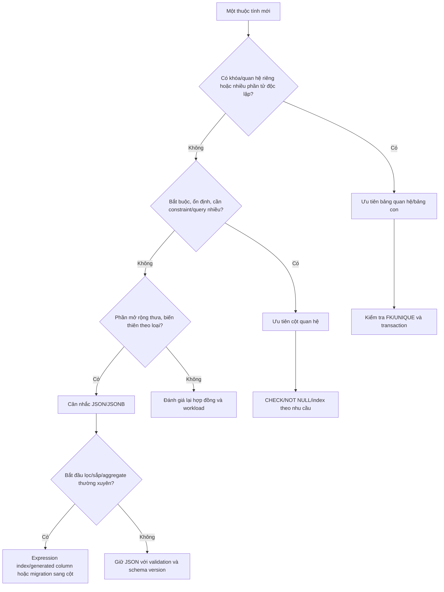

# Lựa chọn giữa cột quan hệ và dữ liệu bán cấu trúc

## 1. Bài toán: một bảng sản phẩm nhưng mỗi loại có thuộc tính khác nhau

Một cửa hàng có nhiều nhóm sản phẩm:

- **Giày:** cỡ EU, chất liệu, chống nước, mục đích sử dụng.
- **Máy tính:** RAM, dung lượng lưu trữ, kích thước màn hình, cổng kết nối.
- **Bàn làm việc:** chiều rộng, chiều sâu, chiều cao, chất liệu.

Mọi sản phẩm đều có những thông tin chung: mã sản phẩm (SKU), tên, loại, giá và số lượng tồn kho.

Có hai cực đoan khi lưu dữ liệu:

**Cách A — đưa mọi thuộc tính vào cột quan hệ:**

```text
products
  sku
  category
  product_name
  price
  stock_qty
  shoe_size_eu
  waterproof
  laptop_ram_gb
  laptop_storage_gb
  desk_width_cm
  desk_height_cm
  ...
```

Khi có thêm loại hàng, bảng có thể phải bổ sung rất nhiều cột không áp dụng cho đa số sản phẩm.

**Cách B — để tất cả trong JSON:**

```json
{
  "sku": "SNEAK-42",
  "category": "shoes",
  "product_name": "Giày chạy đen 42",
  "price": 1200000,
  "stock_qty": 8,
  "size_eu": 42,
  "waterproof": true
}
```

Cách B linh hoạt về cấu trúc, nhưng nếu toàn bộ dữ liệu nằm trong một tài liệu JSON, việc bảo vệ khóa duy nhất, giá không âm, số lượng tồn kho hợp lệ, tham chiếu giữa bảng và hiệu năng của những truy vấn quan trọng có thể khó hơn.

Phương án thứ ba thường thực tế hơn:

```text
products
  product_id      INTEGER PRIMARY KEY
  sku             TEXT UNIQUE NOT NULL
  category        TEXT NOT NULL
  product_name    TEXT NOT NULL
  price           NUMERIC NOT NULL
  stock_qty       INTEGER NOT NULL
  attributes      JSONB NOT NULL
```

Ở đây, **thuộc tính cốt lõi có cấu trúc quan hệ**; những thuộc tính biến thiên theo loại hàng nằm trong **dữ liệu bán cấu trúc**.

Bài học này không cổ vũ việc luôn dùng JSON hay luôn tạo cột riêng. Mục tiêu là biết **quyết định loại dữ liệu nào nên nằm ở đâu, tại sao, và hệ quả khi truy vấn hoặc mở rộng hệ thống**.

---

## 2. Dữ liệu quan hệ và dữ liệu bán cấu trúc là gì?

### 2.1. Cột quan hệ

Với một bảng SQL truyền thống:

```sql
CREATE TABLE sample_products (
    product_id INTEGER PRIMARY KEY,
    sku TEXT UNIQUE NOT NULL,
    price NUMERIC(12,2) NOT NULL,
    stock_qty INTEGER NOT NULL
);
```

Mỗi cột có tên, kiểu và các ràng buộc được công bố ở schema.

Ví dụ:

- `price` là số có độ chính xác thập phân.
- `stock_qty` là số nguyên.
- `sku` là duy nhất.
- `product_id` định danh một hàng.

Database hiểu các thuộc tính ở mức schema, giúp hỗ trợ **ràng buộc, index, JOIN, thống kê và công cụ phát triển**.

### 2.2. Dữ liệu bán cấu trúc

Một giá trị JSON có thể chứa object, array, string, number, boolean và `null`:

```json
{
  "color": "black",
  "size_eu": 42,
  "waterproof": true,
  "tags": ["running", "outdoor"]
}
```

Các khóa trong JSON không nhất thiết được khai báo thành những cột cố định trong bảng. Hai hàng có thể mang hai tập khóa khác nhau:

```json
{"size_eu": 42, "waterproof": true}
```

```json
{"ram_gb": 16, "storage_gb": 512}
```

JSON thường được gọi là dữ liệu **bán cấu trúc** vì vẫn có cấu trúc nội tại, nhưng cấu trúc đó có thể khác giữa từng tài liệu hoặc từng hàng.

### 2.3. Bán cấu trúc không đồng nghĩa không có schema

Một ứng dụng có thể yêu cầu:

```text
Nếu category = shoes:
    size_eu phải là số nguyên dương
    waterproof phải là boolean

Nếu category = laptops:
    ram_gb phải là số nguyên dương
    storage_gb phải là số nguyên dương
```

Đó vẫn là **schema nghiệp vụ**, dù không được khai báo hoàn toàn bằng các cột SQL thông thường.

Với JSON, schema có thể được kiểm soát bằng kết hợp:

- Validation trong ứng dụng/API.
- `CHECK` và các biểu thức JSON trong database.
- JSON Schema hoặc cơ chế kiểm tra tương đương ở tầng phù hợp.
- Versioning của cấu trúc payload.
- Kiểm thử dữ liệu và giám sát sai khác.

**Không có cột cố định không có nghĩa dữ liệu được phép tùy tiện.**

---

## 3. Bốn lựa chọn mô hình phổ biến

| Mô hình | Ví dụ | Phù hợp khi |
| --- | --- | --- |
| Cột quan hệ trực tiếp | `price NUMERIC`, `stock_qty INTEGER` | Thuộc tính ổn định, quan trọng, truy vấn nhiều, cần constraint/index |
| Bảng con quan hệ | `product_variants(product_id, size, stock_qty)` | Thuộc tính có nhiều giá trị hoặc cần khóa ngoại, uniqueness, JOIN |
| Cột JSON/JSONB | `attributes JSONB` | Thuộc tính khác nhau theo loại, thưa, thay đổi linh hoạt |
| Mô hình kết hợp | Cột chung + JSONB + bảng con | Vừa cần tính linh hoạt, vừa cần toàn vẹn dữ liệu cốt lõi |

Một lựa chọn khác là mô hình **EAV** (*entity–attribute–value*) với nhiều hàng dạng `entity_id, attribute_name, attribute_value`. Nó hữu ích ở một số tình huống nhưng có đánh đổi riêng, sẽ phân tích ở phần sau.

### 3.1. Không có mô hình tốt nhất cho mọi ứng dụng

Một hệ thống đọc 100 lần/giây theo `sku` và thường xuyên lọc theo `price` có thể hưởng lợi rõ rệt khi hai trường này là cột quan hệ.

Một hệ thống chỉ hiển thị chi tiết riêng của 200 loại sản phẩm, mỗi loại có bộ thuộc tính khác nhau, có thể lưu phần mô tả đặc thù trong JSON.

Nếu dữ liệu biến thiên nhưng có các ràng buộc liên quan giữa nhiều hàng, một bảng con quan hệ thường rõ hơn một array JSON.

### 3.2. Quyết định theo hành vi sử dụng, không theo định dạng đầu vào

API gửi JSON không bắt buộc database phải lưu nguyên JSON.

Ví dụ API:

```json
{
  "sku": "SNEAK-42",
  "price": 1200000,
  "attributes": {
    "size_eu": 42,
    "color": "black"
  }
}
```

Ứng dụng có thể ánh xạ `sku` và `price` vào cột quan hệ, còn `attributes` vào JSONB. **Định dạng giao tiếp và mô hình lưu trữ là hai quyết định khác nhau.**

## 4. Ma trận quyết định nhanh

| Câu hỏi | Nghiêng về cột/bảng quan hệ | Nghiêng về JSON |
| --- | --- | --- |
| Có bắt buộc phải tồn tại với mọi hàng? | Thường có | Thường không |
| Cần `NOT NULL`, `UNIQUE`, `FOREIGN KEY` trực tiếp? | Rất phù hợp | Cần cơ chế bổ sung/phức tạp hơn |
| Thường dùng trong `WHERE`, `JOIN`, `GROUP BY`? | Thường có lợi | Có thể, nhưng cần thiết kế query/index riêng |
| Kiểu dữ liệu và ý nghĩa ổn định? | Phù hợp | Không phải lý do chính để dùng JSON |
| Chỉ áp dụng cho một số loại thực thể? | Bảng con hoặc cột riêng vẫn có thể tốt | Phù hợp khi ít truy vấn và nhiều biến thể |
| Thay đổi liên tục theo từng loại hàng? | Migration lặp lại có thể tốn kém | Tăng linh hoạt |
| Cần kiểm soát cập nhật đồng thời từng thuộc tính? | Cột/bảng con rõ ràng hơn | Có thể tăng tranh chấp nếu chung một hàng lớn |
| Có array/object lồng nhau nhỏ mang tính mô tả? | Cần nhiều bảng nếu chuẩn hóa hết | JSON thường tự nhiên |
| Là danh sách thực thể có khóa riêng, được truy vấn độc lập? | **Bảng con** | Thường không nên nhét hết vào array |
| Cần tối ưu analytics trên hàng triệu bản ghi? | Cột có kiểu rõ và schema ổn định thường thuận lợi | Có thể trích xuất/đưa dữ liệu sang cột hoặc kho phân tích |
| Có dữ liệu cần bảo vệ quyền theo từng trường? | Cột/bảng có thể dễ phân quyền hơn | Quyền theo key JSON thường khó hơn |

**Nguyên tắc khởi đầu:** Dữ liệu quan trọng cho tính toàn vẹn và truy vấn cốt lõi ưu tiên quan hệ; những thuộc tính mở rộng linh hoạt ưu tiên bán cấu trúc nếu lợi ích lớn hơn chi phí kiểm soát.

---

## 5. Chuẩn bị bộ dữ liệu PostgreSQL có thể thực hành

Các ví dụ chính sử dụng **PostgreSQL** với kiểu `JSONB`.

Chạy trên database học tập, không trên bảng thật.

### 5.1. Tạo bảng sản phẩm

```sql
CREATE TABLE lesson_products (
    product_id INTEGER PRIMARY KEY,
    sku TEXT NOT NULL UNIQUE,
    category TEXT NOT NULL
        CHECK (category IN ('shoes', 'laptops', 'furniture')),
    product_name TEXT NOT NULL,
    price NUMERIC(12,2) NOT NULL CHECK (price >= 0),
    stock_qty INTEGER NOT NULL CHECK (stock_qty >= 0),
    attributes JSONB NOT NULL DEFAULT '{}'::jsonb,
    CONSTRAINT attributes_is_object
        CHECK (jsonb_typeof(attributes) = 'object')
);
```

Hai lớp cấu trúc cùng tồn tại:

- Cột `sku`, `price`, `stock_qty` được database kiểm soát bằng kiểu/ràng buộc rõ.
- Cột `attributes` chấp nhận **các khóa khác nhau giữa các hàng**, nhưng mỗi giá trị phải là một JSON object.

### 5.2. Nạp sáu sản phẩm

```sql
INSERT INTO lesson_products (
    product_id, sku, category, product_name,
    price, stock_qty, attributes
)
VALUES
    (
        101, 'SNEAK-42', 'shoes', 'Giày chạy đen 42',
        1200000, 8,
        '{
          "color": "black",
          "size_eu": 42,
          "material": "mesh",
          "waterproof": true,
          "tags": ["running", "outdoor"]
        }'::jsonb
    ),
    (
        102, 'SNEAK-40', 'shoes', 'Giày chạy trắng 40',
        1050000, 12,
        '{
          "color": "white",
          "size_eu": 40,
          "material": "mesh",
          "waterproof": false,
          "tags": ["running"]
        }'::jsonb
    ),
    (
        103, 'BOOT-42', 'shoes', 'Ủng leo núi đen 42',
        1850000, 3,
        '{
          "color": "black",
          "size_eu": 42,
          "material": "leather",
          "waterproof": true,
          "tags": ["outdoor", "hiking"],
          "warranty_months": 12
        }'::jsonb
    ),
    (
        201, 'LAP-14', 'laptops', 'Laptop 14 inch',
        18500000, 5,
        '{
          "color": "silver",
          "ram_gb": 16,
          "storage_gb": 512,
          "screen_inches": 14.0,
          "ports": ["usb-c", "hdmi"]
        }'::jsonb
    ),
    (
        202, 'LAP-16', 'laptops', 'Laptop 16 inch',
        24500000, 2,
        '{
          "color": "black",
          "ram_gb": 32,
          "storage_gb": 1024,
          "screen_inches": 16.0,
          "ports": ["usb-c", "hdmi"],
          "warranty_months": 24
        }'::jsonb
    ),
    (
        301, 'DESK-120', 'furniture', 'Bàn làm việc 120 cm',
        2850000, 7,
        '{
          "color": "oak",
          "material": "wood",
          "dimensions": {
            "width_cm": 120,
            "depth_cm": 60,
            "height_cm": 75
          },
          "warranty_months": null
        }'::jsonb
    );
```

### 5.3. Bảng tổng quan

| product_id | sku | category | price | stock_qty | Thuộc tính mở rộng tiêu biểu |
| ---: | --- | --- | ---: | ---: | --- |
| 101 | SNEAK-42 | shoes | 1.200.000 | 8 | size_eu=42; waterproof=true |
| 102 | SNEAK-40 | shoes | 1.050.000 | 12 | size_eu=40; waterproof=false |
| 103 | BOOT-42 | shoes | 1.850.000 | 3 | size_eu=42; warranty_months=12 |
| 201 | LAP-14 | laptops | 18.500.000 | 5 | ram_gb=16; storage_gb=512 |
| 202 | LAP-16 | laptops | 24.500.000 | 2 | ram_gb=32; storage_gb=1024 |
| 301 | DESK-120 | furniture | 2.850.000 | 7 | dimensions.width_cm=120 |

Dữ liệu mẫu có ba nhóm: **3 giày, 2 laptop, 1 bàn**.

### 5.4. Vì sao price và stock_qty không nằm trong JSON?

Vì các trường này:

- Có nghĩa chung trên mọi sản phẩm.
- Thường dùng để lọc, sắp xếp hoặc tính toán.
- Cần kiểu số và ràng buộc không âm.
- Có thể cập nhật thường xuyên.
- Là một phần hợp đồng nghiệp vụ và báo cáo.

Ngược lại, cỡ giày `size_eu` không có nghĩa tự nhiên với bàn làm việc hoặc laptop.

---

## 6. Truy vấn dữ liệu quan hệ: SQL ngắn và có kiểu rõ

Lấy sản phẩm có giá từ 2 triệu trở lên:

```sql
SELECT
    sku,
    category,
    price
FROM lesson_products
WHERE price >= 2000000
ORDER BY price;
```

Kết quả gồm:

| sku | category | price |
| --- | --- | ---: |
| DESK-120 | furniture | 2.850.000 |
| LAP-14 | laptops | 18.500.000 |
| LAP-16 | laptops | 24.500.000 |

Vì `price` là `NUMERIC(12,2)`:

- So sánh là phép so sánh số.
- Có thể tạo B-tree index nếu workload yêu cầu.
- Không cần ép từ chuỗi JSON ở mỗi lần truy vấn.
- Có thể khai báo `CHECK(price >= 0)`.
- Driver Java thường đọc dưới dạng `BigDecimal` phù hợp.

### 6.1. Vì sao không lưu price dưới dạng chuỗi JSON?

JSON:

```json
{"price": "2000000"}
```

khác JSON:

```json
{"price": 2000000}
```

Giá trị thứ nhất là **string**, giá trị thứ hai là **number**. Nếu đọc thành văn bản để so, thứ tự từ điển không tương đương thứ tự số.

Ví dụ:

```text
"100" < "20"  -- có thể đúng khi so chữ
100 > 20      -- đúng khi so số
```

Với trường tiền quan trọng, kiểu `NUMERIC` quan hệ giúp tránh một lớp lỗi dữ liệu và chuyển kiểu không cần thiết.

## 7. Đọc thuộc tính JSONB bằng -> và ->>

PostgreSQL có hai toán tử rất phổ biến:

| Toán tử | Trả về | Ví dụ |
| --- | --- | --- |
| `->` | Giá trị dạng `JSONB` | `attributes -> 'size_eu'` |
| `->>` | Giá trị dạng `TEXT` | `attributes ->> 'size_eu'` |

Truy vấn:

```sql
SELECT
    sku,
    attributes -> 'size_eu' AS size_as_json,
    attributes ->> 'size_eu' AS size_as_text
FROM lesson_products
WHERE category = 'shoes'
ORDER BY product_id;
```

Các giá trị cùng mang ý nghĩa 42 hoặc 40, nhưng kiểu kết quả khác nhau:

- `size_as_json` là `JSONB` chứa một số JSON.
- `size_as_text` là `TEXT` như `'42'`.

### 7.1. Cẩn thận khi so sánh số

Không nên:

```sql
WHERE attributes ->> 'size_eu' >= '42'
```

nếu mục tiêu là so kích thước **theo số**. Đây là biểu thức so chuỗi theo collation.

Với dữ liệu đã được kiểm soát là số nguyên:

```sql
SELECT sku
FROM lesson_products
WHERE category = 'shoes'
  AND (attributes ->> 'size_eu')::INTEGER >= 42
ORDER BY sku;
```

Kết quả: `BOOT-42` và `SNEAK-42`.

### 7.2. Ép kiểu có thể phát sinh lỗi

Nếu JSON chứa:

```json
{"size_eu": "XL"}
```

thì:

```sql
(attributes ->> 'size_eu')::INTEGER
```

có thể lỗi chuyển kiểu.

Giải pháp không phải “nhắm mắt ép kiểu” mà là:

- Kiểm tra cấu trúc dữ liệu từ lúc ghi.
- Phân biệt size số EU với size chữ S/M/L.
- Đặt kiểu thuộc tính rõ theo category.
- Khi quy mô lớn, cân nhắc đưa thuộc tính được lọc thường xuyên ra cột có kiểu xác định.

## 8. Đọc JSON lồng nhau và array

Bàn `DESK-120` có object:

```json
{
  "dimensions": {
    "width_cm": 120,
    "depth_cm": 60,
    "height_cm": 75
  }
}
```

Lấy chiều rộng:

```sql
SELECT
    sku,
    attributes #>> '{dimensions,width_cm}' AS width_text,
    (attributes #>> '{dimensions,width_cm}')::INTEGER
        AS width_cm
FROM lesson_products
WHERE category = 'furniture';
```

Kết quả:

| sku | width_text | width_cm |
| --- | --- | ---: |
| DESK-120 | 120 | 120 |

### 8.1. #> và #>>

- `#>` truy cập theo đường dẫn và trả `JSONB`.
- `#>>` truy cập theo đường dẫn và trả `TEXT`.

Đường dẫn `'{dimensions,width_cm}'` đi qua object `dimensions` rồi tới khóa `width_cm`.

### 8.2. Array JSON

Giày 101 có:

```json
"tags": ["running", "outdoor"]
```

Lấy phần tử đầu:

```sql
SELECT
    sku,
    attributes -> 'tags' ->> 0 AS first_tag
FROM lesson_products
WHERE product_id = 101;
```

Kết quả là `running`.

### 8.3. Array mô tả khác danh sách thực thể

Một array `tags` có thể phù hợp nếu chỉ là danh sách nhãn hiển thị hoặc lọc.

Nhưng một array chứa **đơn hàng, chi tiết đơn hàng, giao dịch, người được cấp quyền** hoặc **tồn kho riêng cho từng biến thể** thường có nhu cầu khóa, ràng buộc, cập nhật và JOIN độc lập. Khi đó một **bảng con quan hệ** có thể là lựa chọn tốt hơn.

---

## 9. Lọc JSON bằng containment @>

PostgreSQL `JSONB` có toán tử `@>`: JSON bên trái **chứa cấu trúc/giá trị JSON ở bên phải** theo quy tắc containment.

Tìm sản phẩm màu đen:

```sql
SELECT sku, category
FROM lesson_products
WHERE attributes @> '{"color": "black"}'::jsonb
ORDER BY sku;
```

Kết quả:

| sku | category |
| --- | --- |
| BOOT-42 | shoes |
| LAP-16 | laptops |
| SNEAK-42 | shoes |

Có **3 sản phẩm màu đen**.

### 9.1. Lọc theo thuộc tính của một category

```sql
SELECT sku
FROM lesson_products
WHERE category = 'shoes'
  AND attributes @> '{"waterproof": true}'::jsonb
ORDER BY sku;
```

Kết quả: `BOOT-42` và `SNEAK-42`.

### 9.2. Lọc array theo phần tử

```sql
SELECT sku
FROM lesson_products
WHERE attributes @> '{"tags": ["outdoor"]}'::jsonb
ORDER BY sku;
```

Kết quả: `BOOT-42` và `SNEAK-42`.

Ở đây `@>` kiểm tra containment JSON, không phải phép tìm chuỗi con trên toàn bộ JSON được in ra.

### 9.3. Tại sao containment hữu ích?

Nó mô tả được một phần cấu trúc JSON mà không phải trích tất cả giá trị ra cột riêng, và trên PostgreSQL có thể được hỗ trợ bằng **GIN index** cho những truy vấn phù hợp.

Tuy nhiên, `@>` không thay mọi phép so sánh:

- Khoảng số lớn hơn/nhỏ hơn vẫn cần cách truy cập số hợp lý.
- Sắp xếp theo cột JSON cần chuyển kiểu và có thể cần expression index.
- Ràng buộc liên bảng vẫn không tự xuất hiện.

## 10. Kiểm tra khóa JSON có tồn tại hay không

PostgreSQL hỗ trợ toán tử `?` trên `JSONB` để kiểm tra khóa ở **mức trên cùng** của một JSON object (hoặc phần tử string theo ngữ nghĩa phù hợp của đối tượng).

Ví dụ:

```sql
SELECT sku
FROM lesson_products
WHERE attributes ? 'warranty_months'
ORDER BY sku;
```

Kết quả:

```text
BOOT-42
DESK-120
LAP-16
```

Có **3 sản phẩm có khóa** `warranty_months`.

### 10.1. Tồn tại không có nghĩa giá trị khác null

Bàn `DESK-120` chứa:

```json
"warranty_months": null
```

Khóa vẫn **tồn tại**, nên `attributes ? 'warranty_months'` trả true.

### 10.2. Tìm những sản phẩm không có khóa

```sql
SELECT sku
FROM lesson_products
WHERE NOT (attributes ? 'warranty_months')
ORDER BY sku;
```

Kết quả:

```text
LAP-14
SNEAK-40
SNEAK-42
```

Có **3 sản phẩm thiếu hẳn khóa**.

### 10.3. Không áp dụng ? cho mọi mức lồng nhau

`attributes ? 'width_cm'` không tìm sâu vào `dimensions` của bàn. Nếu muốn biết khóa đó ở trong `dimensions`:

```sql
SELECT sku
FROM lesson_products
WHERE (attributes -> 'dimensions') ? 'width_cm';
```

Với dữ liệu mẫu, trả `DESK-120`.

**Phải hiểu đường dẫn và mức của JSON**, không cho rằng tìm key là tự duyệt đệ quy mọi object.

## 11. Phân biệt JSON null, SQL NULL và khóa thiếu

Đây là một trong những lý do dữ liệu bán cấu trúc đòi hỏi mô hình hóa cẩn thận.

Ba trường hợp khác nhau:

**A. Khóa không tồn tại**

```json
{"color": "black"}
```

**B. Khóa tồn tại nhưng giá trị là JSON null**

```json
{"color": "black", "warranty_months": null}
```

**C. Cột SQL attributes tự nó là SQL NULL**

```sql
-- Không xảy ra trong lesson_products vì attributes NOT NULL.
UPDATE some_table
SET attributes = NULL;
```

### 11.1. Kết quả các biểu thức PostgreSQL

| Điều kiện | Khóa thiếu | Khóa có JSON null |
| --- | --- | --- |
| `attributes ? 'warranty_months'` | false | true |
| `attributes -> 'warranty_months' IS NULL` | true | false |
| `attributes ->> 'warranty_months' IS NULL` | true | true |
| `jsonb_typeof(attributes -> 'warranty_months') = 'null'` | Không true | true |

Lý do:

- `->` trả **SQL NULL** khi không tìm thấy khóa.
- Với khóa có JSON `null`, `->` trả một giá trị `JSONB` chứa JSON null.
- `->>` chuyển sang `TEXT`, khiến JSON null và khóa thiếu đều có thể hiển thị thành SQL NULL.
- `jsonb_typeof` giúp nhận diện kiểu JSON của giá trị đã truy cập.

### 11.2. Truy vấn minh họa đầy đủ

```sql
SELECT
    sku,
    attributes ? 'warranty_months' AS key_exists,
    attributes -> 'warranty_months' IS NULL
        AS key_missing,
    jsonb_typeof(
        attributes -> 'warranty_months'
    ) = 'null' AS is_json_null
FROM lesson_products
ORDER BY sku;
```

Kết quả diễn giải:

- `BOOT-42`, `LAP-16`: khóa có giá trị số.
- `DESK-120`: khóa có giá trị JSON null.
- `SNEAK-42`, `SNEAK-40`, `LAP-14`: khóa không tồn tại.

Cột `is_json_null` có thể là SQL NULL cho trường hợp khóa thiếu, vì `jsonb_typeof(SQL NULL)` trả SQL NULL. Khi cần Boolean rõ ràng, dùng `COALESCE(..., FALSE)`.

### 11.3. Đừng tự coi cả ba trường hợp giống nhau

Trong một số ứng dụng:

- **Thiếu khóa:** chưa có dữ liệu hoặc không áp dụng.
- **JSON null:** bên gửi xác nhận giá trị chưa biết.
- **SQL NULL của cột:** toàn bộ tài liệu không tồn tại/không được nạp.

Nếu không có quy tắc rõ, báo cáo dễ diễn giải sai số lượng sản phẩm có bảo hành.

---

## 12. Ràng buộc quan hệ bảo vệ dữ liệu cốt lõi

Các ràng buộc trong bảng mẫu:

```sql
sku TEXT NOT NULL UNIQUE
price NUMERIC(12,2) NOT NULL CHECK (price >= 0)
stock_qty INTEGER NOT NULL CHECK (stock_qty >= 0)
```

giúp database từ chối những thao tác như:

```sql
-- Sai: trùng SKU có sẵn
INSERT INTO lesson_products (...)
VALUES (..., 'SNEAK-42', ...);

-- Sai: giá âm
UPDATE lesson_products
SET price = -100
WHERE product_id = 101;

-- Sai: tồn kho âm
UPDATE lesson_products
SET stock_qty = -5
WHERE product_id = 101;
```

Hai ví dụ `INSERT ...` chứa dấu `...` ở trên là **minh họa ý tưởng lỗi**, không phải script hoàn chỉnh. Ví dụ `UPDATE` có thể chạy để quan sát ràng buộc trong database học tập, nhưng nên dùng transaction và hiểu cách xử lý lỗi.

### 12.1. Tại sao không nên giấu SKU trong JSON?

Nếu chỉ có:

```json
{"sku": "SNEAK-42"}
```

thì một ràng buộc `UNIQUE(sku)` thông thường không tồn tại trừ khi bạn chủ động trích giá trị ra biểu thức/generated column và tạo unique index phù hợp.

Cột quan hệ đơn giản hơn cho **định danh chính của thực thể**.

### 12.2. Tại sao không nên giấu foreign key trong JSON?

Giả sử sản phẩm thuộc một nhà cung cấp:

```sql
supplier_id INTEGER REFERENCES suppliers(supplier_id)
```

là quan hệ được database kiểm soát.

Nếu chỉ lưu:

```json
{"supplier_id": 5001}
```

thì database không tự coi khóa JSON đó là **foreign key**. Bạn phải bổ sung cơ chế liên kết/validation phức tạp hơn nếu muốn đảm bảo nhà cung cấp tồn tại.

**Khóa và quan hệ thực thể thường là lý do rất mạnh để dùng mô hình quan hệ.**

## 13. Có thể kiểm soát cấu trúc JSON trong database không?

Có. PostgreSQL cho phép dùng các biểu thức JSON trong `CHECK`.

Giả sử với giày, nghiệp vụ yêu cầu có `size_eu` và giá trị phải là JSON number.

```sql
ALTER TABLE lesson_products
ADD CONSTRAINT shoes_need_numeric_size
CHECK (
    category <> 'shoes'
    OR (
        attributes ? 'size_eu'
        AND jsonb_typeof(attributes -> 'size_eu') = 'number'
    )
);
```

Với bộ dữ liệu mẫu, ba sản phẩm giày đều có `size_eu` là JSON number.

### 13.1. Vì sao kiểm tra cả tồn tại và kiểu?

Nếu chỉ viết:

```sql
CHECK (
    jsonb_typeof(attributes -> 'size_eu') = 'number'
)
```

khi khóa thiếu, biểu thức có thể cho **SQL NULL**. Trong SQL, `CHECK` thông thường chấp nhận kết quả **TRUE hoặc UNKNOWN**, chỉ từ chối `FALSE`.

Do đó, nếu muốn bắt buộc khóa tồn tại, phải kiểm tra tồn tại rõ ràng hoặc dùng biểu thức tạo ra FALSE khi thiếu.

### 13.2. Thêm ràng buộc chống nước cho giày

```sql
ALTER TABLE lesson_products
ADD CONSTRAINT shoes_need_boolean_waterproof
CHECK (
    category <> 'shoes'
    OR (
        attributes ? 'waterproof'
        AND jsonb_typeof(attributes -> 'waterproof') = 'boolean'
    )
);
```

Ví dụ `waterproof` là JSON boolean:

```json
{"waterproof": true}
```

khác chuỗi JSON:

```json
{"waterproof": "true"}
```

### 13.3. CHECK không thay schema validation tổng thể

Khi có hàng trăm loại sản phẩm và hàng nghìn thuộc tính, một danh sách `CHECK` khổng lồ có thể khó bảo trì.

Có thể phân chia:

- Database kiểm tra những bất biến quan trọng.
- Application/API validation kiểm tra schema theo category/version.
- Pipeline giám sát các khóa sai kiểu/không hợp lệ.
- Những thuộc tính cốt lõi được đưa thành cột hoặc bảng con quan hệ.

Không nên phụ thuộc hoàn toàn vào validation ứng dụng nếu nhiều hệ thống khác cũng có quyền ghi trực tiếp vào database.

---

## 14. Khi nào nên đưa một thuộc tính JSON thành cột?

Giả sử ban đầu `color` chỉ hiển thị trên trang chi tiết. Sau này trang tìm kiếm có bộ lọc màu dùng liên tục:

```sql
WHERE category = 'shoes'
  AND attributes ->> 'color' = 'black'
```

Tới lúc này cần đánh giá:

- Có cần query theo màu thường xuyên không?
- Có cần INDEX?
- Màu có cùng ý nghĩa giữa các category không?
- Có cần `NOT NULL` hoặc vocabulary giới hạn không?
- Có cần reporting/grouping theo màu không?
- Có cần tìm kiếm đa điều kiện, phân trang, thống kê chính xác không?
- Mỗi sản phẩm có một màu hay có nhiều biến thể màu?

### 14.1. Ba hướng lựa chọn

**Giữ trong JSONB + expression index**

Phù hợp nếu dữ liệu vẫn chủ yếu là thuộc tính mở rộng, nhưng cần tìm kiếm nhanh.

**Đưa thành cột quan hệ**

Phù hợp khi thuộc tính đã trở thành tiêu chí lõi, được dùng rộng rãi và cần ràng buộc rõ.

**Tách thành bảng con**

Phù hợp khi một sản phẩm có **nhiều màu/cỡ độc lập**, mỗi biến thể có SKU, giá hoặc tồn kho riêng.

### 14.2. Không tạo cột riêng cho mọi khóa JSON một cách máy móc

Một khóa có mặt trong 95% dữ liệu nhưng không được truy vấn độc lập có thể vẫn hợp lý trong JSON. Ngược lại một khóa chỉ có trong 5% sản phẩm nhưng được truy vấn rất thường xuyên vẫn có thể đáng tạo index hoặc bảng chuyên biệt.

**Tần suất và loại truy vấn quan trọng hơn chỉ tỷ lệ khóa xuất hiện.**

## 15. B-tree index trên cột quan hệ

Nếu workload thường lọc sản phẩm theo category và giá:

```sql
CREATE INDEX lesson_products_category_price_idx
ON lesson_products(category, price);
```

Truy vấn:

```sql
SELECT sku, price
FROM lesson_products
WHERE category = 'shoes'
  AND price >= 1200000
ORDER BY price;
```

Từ dữ liệu mẫu, sản phẩm phù hợp là `SNEAK-42` và `BOOT-42`, sắp theo giá tăng.

### 15.1. Không bảo đảm optimizer dùng index với bảng nhỏ

Bảng demo chỉ có sáu hàng. PostgreSQL có thể chọn `Seq Scan`, và đó có thể là lựa chọn hợp lý.

Dùng:

```sql
EXPLAIN (ANALYZE, BUFFERS)
SELECT sku, price
FROM lesson_products
WHERE category = 'shoes'
  AND price >= 1200000
ORDER BY price;
```

để xem kế hoạch và phép đo. Đừng kết luận “index không có tác dụng” chỉ vì một bảng cực nhỏ dùng sequential scan.

### 15.2. Index có chi phí bảo trì

Mỗi index có thể tăng:

- Dung lượng lưu trữ.
- Chi phí `INSERT`.
- Chi phí `UPDATE` trên các cột được index.
- Chi phí bảo trì và WAL/I/O.

Chỉ mục phải phục vụ truy vấn thực tế, không phải tạo cho mọi cột.

---

## 16. GIN index cho JSONB

PostgreSQL có thể dùng **GIN index** cho những thao tác JSONB nhất định.

```sql
CREATE INDEX lesson_products_attrs_gin_idx
ON lesson_products
USING GIN (attributes);
```

Truy vấn:

```sql
SELECT sku
FROM lesson_products
WHERE attributes @> '{"color": "black"}'::jsonb
ORDER BY sku;
```

có thể tận dụng GIN index nếu optimizer đánh giá phù hợp.

### 16.1. GIN phù hợp với những điều kiện nào?

Với operator class JSONB mặc định `jsonb_ops`, những thao tác như **containment** và kiểm tra key có thể được hỗ trợ, tùy operator cụ thể và query shape.

Ví dụ:

```sql
WHERE attributes @> '{"waterproof": true}'::jsonb
```

hoặc:

```sql
WHERE attributes ? 'warranty_months'
```

### 16.2. GIN không tự làm mọi JSON query nhanh

Ví dụ:

```sql
WHERE (attributes ->> 'size_eu')::INTEGER >= 42
```

là so sánh khoảng số sau ép kiểu. Một GIN index thông thường trên toàn bộ `attributes` không tự biến thao tác đó thành B-tree range scan trên số nguyên.

Nếu lọc khoảng số thường xuyên, cân nhắc **expression index** hoặc cột được trích xuất.

### 16.3. jsonb_ops và jsonb_path_ops

PostgreSQL có các operator class GIN đáng biết:

- `jsonb_ops`: khả năng hỗ trợ nhiều operator, bao gồm kiểm tra key như `?`.
- `jsonb_path_ops`: có thể nhỏ/hiệu quả hơn cho một số containment/JSONPath workload nhưng **không hỗ trợ tất cả operator** của `jsonb_ops`, chẳng hạn toán tử key-exists `?`.

Ví dụ:

```sql
CREATE INDEX lesson_products_attrs_path_idx
ON lesson_products
USING GIN (attributes jsonb_path_ops);
```

Không nên tạo đồng thời nhiều GIN index lớn chỉ để thử tùy ý. Chọn operator class dựa trên **các kiểu truy vấn thực tế** và đo trước/sau.

### 16.4. JSONB index có thể lớn

Khi mỗi tài liệu JSON chứa nhiều key/value và array, GIN index có thể có chi phí dung lượng và ghi đáng kể. Nếu chỉ truy vấn `color`, một expression index trên màu có thể gọn hơn GIN toàn bộ tài liệu.

## 17. Expression index cho một thuộc tính JSON

Giả sử `color` được dùng làm bộ lọc phổ biến:

```sql
CREATE INDEX lesson_products_color_expr_idx
ON lesson_products ((attributes ->> 'color'));
```

Truy vấn:

```sql
SELECT sku
FROM lesson_products
WHERE attributes ->> 'color' = 'black'
ORDER BY sku;
```

Có thể dùng B-tree expression index khi optimizer chọn.

### 17.1. Index số cho size_eu

Vì schema giày đã được kiểm soát:

```sql
CREATE INDEX lesson_products_shoe_size_idx
ON lesson_products (
    ((attributes ->> 'size_eu')::INTEGER)
)
WHERE category = 'shoes'
  AND jsonb_typeof(attributes -> 'size_eu') = 'number';
```

Đây là **partial expression index**: chỉ chứa sản phẩm giày có thuộc tính size dạng number theo predicate.

Một truy vấn có điều kiện tương ứng:

```sql
SELECT sku
FROM lesson_products
WHERE category = 'shoes'
  AND jsonb_typeof(attributes -> 'size_eu') = 'number'
  AND (attributes ->> 'size_eu')::INTEGER >= 42;
```

### 17.2. Lưu ý bảo vệ dữ liệu

Expression index có phép cast sẽ thất bại nếu giá trị được index không chuyển được sang kiểu đích. Một JSON number quá lớn cũng có thể vượt giới hạn `INTEGER`.

Nếu dữ liệu đầu vào không được kiểm soát, cần kiểm tra phạm vi, kiểu và quy tắc chuyển đổi trước khi dùng expression index.

### 17.3. Index cần khớp biểu thức và predicate

Một index trên:

```sql
(attributes ->> 'color')
```

không nhất thiết giúp truy vấn dùng một biểu thức khác, ví dụ `LOWER(attributes ->> 'color')`, theo cùng cách. Nếu yêu cầu tìm kiếm case-insensitive, có thể cần expression index đúng biểu thức, collation hoặc phương án thiết kế khác.

---

## 18. Generated column: cầu nối JSON với cột truy vấn

Khi một thuộc tính JSON trở nên quan trọng, đôi khi chưa cần chuyển hẳn nó thành nguồn dữ liệu độc lập. Có thể tạo **generated column** được tính từ JSON.

Ví dụ PostgreSQL:

```sql
ALTER TABLE lesson_products
ADD COLUMN color_search TEXT
GENERATED ALWAYS AS (
    attributes ->> 'color'
) STORED;
```

Truy vấn:

```sql
SELECT sku, color_search
FROM lesson_products
WHERE color_search = 'black'
ORDER BY sku;
```

Kết quả: `BOOT-42`, `LAP-16`, `SNEAK-42`.

### 18.1. Lợi ích

- Một giá trị được trích xuất có tên và kiểu rõ.
- Câu truy vấn đơn giản hơn.
- Có thể lập index trên cột nếu thích hợp.
- Không cần ứng dụng tự cập nhật hai giá trị giống nhau khi generated column được DBMS quản lý.

### 18.2. Đánh đổi

- Stored generated column chiếm dung lượng.
- Định nghĩa biểu thức chịu các giới hạn của PostgreSQL, như yêu cầu dùng biểu thức/hàm bất biến phù hợp.
- Bổ sung cột có thể kéo theo công việc tính dữ liệu và thay đổi schema.
- Không thay nhu cầu xác nhận giá trị trong JSON có kiểu/ý nghĩa hợp lệ.
- Tính năng và giới hạn của generated column khác nhau giữa các DBMS.

### 18.3. Khi nào nên chuyển hẳn thành cột gốc?

Nếu `color` đã là phần thiết yếu của hợp đồng dữ liệu, có yêu cầu cập nhật riêng, ràng buộc mạnh hoặc được dùng ở hầu hết query, cột `color` quan hệ **làm nguồn sự thật** có thể rõ ràng hơn.

Không giữ hai bản sao writable `attributes.color` và `color` cùng lúc mà không có quy tắc đồng bộ. **Hai nguồn sự thật gây ra sai khác dữ liệu**.

## 19. JSON không thay quan hệ một-nhiều

Giả sử sản phẩm giày có nhiều biến thể cỡ và mỗi biến thể có tồn kho riêng:

```json
{
  "variants": [
    {"size_eu": 40, "stock_qty": 12},
    {"size_eu": 41, "stock_qty": 9},
    {"size_eu": 42, "stock_qty": 8}
  ]
}
```

Nhìn gọn, nhưng một biến thể có thể cần:

- SKU riêng.
- Khóa duy nhất theo sản phẩm + cỡ.
- Điều kiện tồn kho không âm.
- Lịch sử nhập/xuất kho.
- Khóa/transaction riêng khi bán.
- Tham chiếu từ chi tiết đơn hàng.
- Truy vấn “biến thể cỡ 42 còn hàng ở kho nào?”.

Lúc này nên cân nhắc bảng con:

```sql
CREATE TABLE lesson_product_variants (
    variant_id BIGINT PRIMARY KEY,
    product_id INTEGER NOT NULL
        REFERENCES lesson_products(product_id),
    size_eu INTEGER NOT NULL CHECK (size_eu > 0),
    stock_qty INTEGER NOT NULL CHECK (stock_qty >= 0),
    UNIQUE (product_id, size_eu)
);
```

### 19.1. Vì sao bảng con rõ hơn?

- Mỗi biến thể là một hàng có **khóa chính**.
- Database kiểm soát `UNIQUE(product_id, size_eu)`.
- Có thể dùng `FOREIGN KEY` từ bảng khác.
- Cập nhật một biến thể không cần sửa toàn bộ JSON của sản phẩm.
- Query và index theo size/stock có thể rõ ràng hơn.

### 19.2. Array JSON vẫn phù hợp khi nào?

Nếu `tags` chỉ là vài nhãn mô tả và không có bảng nghiệp vụ tham chiếu từng tag, array JSON có thể đủ đơn giản.

**Quy tắc hữu ích:** Khi phần tử của array có danh tính, vòng đời, quyền hoặc ràng buộc độc lập, hãy xem nó là **thực thể quan hệ** trước khi quyết định nhét vào JSON.

---

## 20. Mô hình EAV: linh hoạt nhưng có giá phải trả

EAV lưu thuộc tính ở từng hàng:

```sql
CREATE TABLE lesson_product_attributes_eav (
    product_id INTEGER NOT NULL
        REFERENCES lesson_products(product_id),
    attribute_name TEXT NOT NULL,
    value_text TEXT,
    PRIMARY KEY (product_id, attribute_name)
);
```

Ví dụ:

| product_id | attribute_name | value_text |
| ---: | --- | --- |
| 101 | color | black |
| 101 | size_eu | 42 |
| 101 | material | mesh |
| 201 | ram_gb | 16 |
| 201 | storage_gb | 512 |

### 20.1. Ưu điểm

- Có thể thêm tên thuộc tính mới mà không ALTER bảng.
- Có thể truy vấn/đếm các thuộc tính dưới dạng hàng.
- Có thể tham chiếu một bảng định nghĩa thuộc tính để quản lý metadata.

### 20.2. Nhược điểm

Nếu mọi giá trị được lưu trong `value_text`:

- Cỡ giày và RAM đều thành chuỗi.
- Khó đặt `CHECK` kiểu theo từng thuộc tính.
- Query nhiều thuộc tính cần nhiều JOIN hoặc pivot.
- Khó viết constraint liên quan giữa các cột thuộc tính.
- Dữ liệu dễ bị sai kiểu nếu không có bảng metadata/validation mạnh.

Ví dụ lọc giày màu đen và cỡ 42 có thể phải tự JOIN EAV hai lần theo tên thuộc tính thay vì đọc cột `color` và `size_eu`.

### 20.3. EAV không mặc nhiên tốt hơn JSON

EAV hữu ích khi metadata thuộc tính cũng là thực thể cần quản lý, có schema động được định nghĩa chặt hoặc cần query ở mức thuộc tính.

Nhưng nếu chỉ cần giữ một nhóm thuộc tính phụ cho mỗi sản phẩm và hiển thị lại, JSONB thường tự nhiên hơn.

### 20.4. Không chọn EAV chỉ vì sợ ALTER TABLE

Trong một hệ thống có ít thuộc tính lõi ổn định, mô hình quan hệ với migration rõ ràng thường dễ bảo trì hơn một EAV quá tổng quát.

---

## 21. JSONB có thể cập nhật từng thuộc tính, nhưng vẫn là một giá trị cột

Đổi màu của sản phẩm 101:

```sql
BEGIN;

UPDATE lesson_products
SET attributes = jsonb_set(
    attributes,
    '{color}',
    '"navy"'::jsonb,
    TRUE
)
WHERE product_id = 101
RETURNING
    sku,
    attributes ->> 'color' AS new_color;

ROLLBACK;
```

Kết quả trong transaction: `SNEAK-42` có `new_color = navy`.

### 21.1. Các thành phần của jsonb_set

```sql
jsonb_set(
    target_jsonb,
    path,
    replacement_jsonb,
    create_if_missing
)
```

- `target_jsonb`: tài liệu cần sửa.
- `path`: đường tới khóa hoặc phần tử.
- `replacement_jsonb`: **giá trị JSON**, không phải chuỗi SQL thông thường.
- `create_if_missing`: cho phép tạo phần tử cuối trong một số trường hợp thích hợp.

### 21.2. Sửa JSON là một UPDATE trên hàng

Từ góc nhìn SQL, database vẫn thực hiện `UPDATE` của hàng chứa cột `attributes`. Việc sửa một key nhỏ không có nghĩa PostgreSQL có thể thay đổi vài byte bên trong JSONB mà không có chi phí tạo phiên bản hàng/MVCC/WAL/index.

Với tài liệu lớn và cập nhật thường xuyên:

- Write amplification có thể tăng.
- WAL và lưu trữ tăng.
- Các index liên quan có thể phải bảo trì.
- Hai thao tác lên hai key khác nhau của **cùng một hàng** vẫn có thể tranh chấp row lock.

### 21.3. Khi nào nên tách bảng?

Nếu một phần dữ liệu rất hay cập nhật (ví dụ tồn kho) trong khi phần mô tả JSON rất lớn và ít thay, nên lưu phần hay cập nhật ở **cột/bảng quan hệ riêng**. Bộ dữ liệu mẫu đã đặt `stock_qty` thành cột vì lý do này.

## 22. Thêm và xóa khóa JSONB

### 22.1. Thêm khóa ở mức trên cùng

```sql
BEGIN;

UPDATE lesson_products
SET attributes = attributes
    || '{"origin_country": "VN"}'::jsonb
WHERE product_id = 101
RETURNING attributes;

ROLLBACK;
```

Toán tử `||` trên JSONB có thể hợp nhất object ở **mức trên cùng** theo quy tắc PostgreSQL; khi khóa trùng, giá trị phù hợp ở toán hạng bên phải có thể thay giá trị cũ.

### 22.2. Không nhầm shallow merge với deep merge

Giả sử có:

```json
{
  "dimensions": {
    "width_cm": 120,
    "height_cm": 75
  }
}
```

Nếu ghép với:

```json
{
  "dimensions": {
    "width_cm": 140
  }
}
```

bằng `||`, object `dimensions` bên phải có thể **thay toàn bộ object bên trái**, chứ không tự giữ `height_cm`.

Nếu muốn sửa một key sâu cụ thể, dùng `jsonb_set` với đường dẫn.

### 22.3. Sửa key lồng nhau

```sql
BEGIN;

UPDATE lesson_products
SET attributes = jsonb_set(
    attributes,
    '{dimensions,width_cm}',
    '140'::jsonb,
    FALSE
)
WHERE product_id = 301
RETURNING
    attributes #>> '{dimensions,width_cm}' AS width_cm;

ROLLBACK;
```

Kết quả trong transaction: `140`.

Cần có object cha `dimensions` tồn tại phù hợp. Tham số cho phép tạo khóa không tự bảo đảm toàn bộ đường dẫn trung gian được tạo trong mọi cấu trúc thiếu cha.

### 22.4. Xóa khóa

```sql
BEGIN;

UPDATE lesson_products
SET attributes = attributes - 'warranty_months'
WHERE product_id = 301
RETURNING
    attributes ? 'warranty_months' AS still_exists;

ROLLBACK;
```

Kết quả `still_exists = false` trong transaction.

### 22.5. Xóa khóa và đặt JSON null không giống nhau

- `attributes - 'warranty_months'`: bỏ hẳn khóa.
- `jsonb_set(..., 'null'::jsonb, ...)`: giữ khóa, đặt JSON null.

Hai lựa chọn có ý nghĩa nghiệp vụ khác và ảnh hưởng các truy vấn kiểm tra key.

---

## 23. Cập nhật JSON và vấn đề lost update

Giả sử hai dịch vụ cùng đọc một JSON:

```json
{"color":"black","material":"mesh"}
```

Dịch vụ A muốn đổi `color`, dịch vụ B muốn đổi `material`.

Nếu cả hai:

1. Đọc toàn bộ JSON ở thời điểm ban đầu.
2. Tự tạo một JSON mới trong ứng dụng.
3. Ghi `UPDATE ... SET attributes = :whole_document`.

thì có nguy cơ một dịch vụ **ghi đè thay đổi của dịch vụ kia** nếu không có cơ chế concurrency phù hợp.

### 23.1. Sửa theo đường dẫn trong SQL giúp tránh một số lỗi

Dạng:

```sql
UPDATE lesson_products
SET attributes = jsonb_set(
    attributes, '{color}', '"navy"'::jsonb, TRUE
)
WHERE product_id = 101;
```

đọc giá trị `attributes` hiện có trong câu `UPDATE` và sửa một path, có thể giảm nguy cơ ghi đè cả tài liệu cũ so với cách client gửi toàn bộ JSON không còn mới.

Nhưng còn cần xét transaction isolation, lock, retry và trạng thái nghiệp vụ.

### 23.2. Optimistic locking bằng version

Có thể thêm:

```sql
ALTER TABLE lesson_products
ADD COLUMN row_version BIGINT NOT NULL DEFAULT 1;
```

Khi cập nhật từ client đã đọc `row_version=1`:

```sql
UPDATE lesson_products
SET
    attributes = jsonb_set(
        attributes,
        '{color}',
        '"navy"'::jsonb,
        TRUE
    ),
    row_version = row_version + 1
WHERE product_id = 101
  AND row_version = 1
RETURNING row_version;
```

Nếu hàng đã được cập nhật bởi một giao dịch khác và version không còn là 1, câu lệnh trả **0 hàng**. Ứng dụng đọc lại rồi quyết định retry/merge theo chính sách.

### 23.3. JSON không tự mang ý nghĩa phiên bản

Hai tài liệu JSON có cùng key không cho biết tài liệu nào mới hơn. Version/watermark/idempotency cần được thiết kế như một phần của hợp đồng đồng bộ, không thể suy chỉ từ việc JSON khác nhau.

## 24. Truy vấn tổng hợp: khi JSON làm SQL phức tạp hơn

Đếm sản phẩm theo category:

```sql
SELECT
    category,
    COUNT(*) AS product_count
FROM lesson_products
GROUP BY category
ORDER BY category;
```

Kết quả:

| category | product_count |
| --- | ---: |
| furniture | 1 |
| laptops | 2 |
| shoes | 3 |

Với `category` là cột quan hệ, thống kê và aggregation rõ ràng.

### 24.1. Tổng hợp theo thuộc tính JSON

Đếm giày theo màu:

```sql
SELECT
    attributes ->> 'color' AS color,
    COUNT(*) AS product_count
FROM lesson_products
WHERE category = 'shoes'
GROUP BY attributes ->> 'color'
ORDER BY color;
```

Kết quả:

| color | product_count |
| --- | ---: |
| black | 2 |
| white | 1 |

SQL vẫn làm được. Nhưng nếu màu bị lưu thành:

```text
black
Black
BLACK
đen
```

và nghiệp vụ coi chúng giống nhau, cần **quy tắc chuẩn hóa** hoặc bảng danh mục màu thay vì chỉ GROUP BY chuỗi thô.

### 24.2. Lỗi kiểu khi aggregate số JSON

Với laptop, trung bình RAM:

```sql
SELECT
    AVG((attributes ->> 'ram_gb')::NUMERIC) AS avg_ram_gb
FROM lesson_products
WHERE category = 'laptops';
```

Kết quả: `24`.

Điều kiện để truy vấn đáng tin:

- Tất cả laptop có `ram_gb` với giá trị số hợp lệ.
- Không có kiểu `"16 GB"` hoặc `"unknown"` gây lỗi ép kiểu.
- Ý nghĩa của giá trị thống nhất (GB, không lẫn MB).

Nếu trường này là chiều phân tích quan trọng, đưa ra **cột hoặc generated column có kiểu rõ** có thể giảm độ phức tạp.

---

## 25. Khi JSONB khiến thống kê và kế hoạch truy vấn khó hơn

PostgreSQL có thống kê cho các cột quan hệ và khả năng sử dụng index cho JSONB, nhưng việc ước lượng cardinality của một biểu thức JSON tùy ý có thể khó hơn cột có kiểu/schema rõ.

Ví dụ:

```sql
SELECT sku
FROM lesson_products
WHERE attributes ->> 'color' = 'black';
```

Nếu dữ liệu lớn, cần xác định:

- Bao nhiêu hàng có key `color`?
- Màu `black` phổ biến tới mức nào?
- Query có lọc thêm `category` không?
- Có expression index và statistics phù hợp không?
- Thống kê có đại diện các loại sản phẩm khác nhau không?

### 25.1. Kiểm chứng bằng EXPLAIN

```sql
EXPLAIN (ANALYZE, BUFFERS)
SELECT sku
FROM lesson_products
WHERE category = 'shoes'
  AND attributes ->> 'color' = 'black';
```

Đọc:

- Loại scan.
- Estimated rows so với actual rows.
- Index Cond/Filter.
- Buffers và thời gian.

Trên bảng sáu hàng, `Seq Scan` có thể hợp lý; không dùng dữ liệu demo để khẳng định một index chắc chắn nhanh hơn.

### 25.2. Khi nào index toàn JSON không đủ?

Nếu hệ thống cần:

```text
Tìm tất cả giày màu black, cỡ >= 42,
giá từ 1.000.000 đến 2.000.000,
sắp xếp theo giá và phân trang.
```

thì workload kết hợp:

- Điều kiện category/price quan hệ.
- Điều kiện màu và cỡ trích JSON.
- So sánh khoảng và sắp theo giá.

Một GIN index duy nhất trên `attributes` không tự giải quyết tối ưu toàn bộ pipeline. Cần thử nghiệm index kết hợp, expression index, generated column hoặc đưa thuộc tính quan trọng thành cột.

### 25.3. Đừng đánh giá mô hình chỉ trên một query

JSONB có thể đáp ứng tốt vài truy vấn đơn lẻ nhưng tạo chi phí ở update, analytics và index size. Cột quan hệ cũng có chi phí migration và schema cứng.

Cần đánh giá **tập workload**, không chỉ một phép lọc demo.

## 26. Dùng JSONB để giữ metadata thưa và thay đổi thường xuyên về schema

Một trường hợp phù hợp:

```json
{
  "marketing_badge": "new-season",
  "eco_label": "recycled-material",
  "display_notes": [
    "Đóng gói không dùng nhựa",
    "Bảo quản nơi khô ráo"
  ]
}
```

Nếu:

- Không phải mọi sản phẩm có các trường này.
- Ít dùng cho JOIN hoặc constraint.
- Cấu trúc được thay theo chiến dịch.
- Chủ yếu hiển thị trên trang chi tiết.
- Dữ liệu có kích thước vừa phải.

thì JSONB có thể giúp giảm các lần ALTER TABLE cho những trường mô tả nhỏ.

### 26.1. Vẫn cần giới hạn kích thước và loại nội dung

Một JSON quá lớn hoặc không kiểm soát có thể:

- Tăng storage và băng thông.
- Tăng chi phí parse/serialize.
- Làm UPDATE đắt hơn.
- Gây khó khăn khi đọc log và debug.
- Trộn dữ liệu nhạy cảm vào trường metadata được cấp quyền rộng.

Không nên coi cột JSON như kho chứa vô hạn cho mọi payload từ API.

### 26.2. Đừng nhét file/binary lớn vào JSON

Hình ảnh, video, PDF và blob lớn thường nên được lưu qua cơ chế object storage hoặc column type phù hợp, cùng metadata/đường tham chiếu có quyền truy cập thích hợp.

JSON mô tả nội dung và địa chỉ tham chiếu có thể hữu ích, nhưng không nhất thiết là nơi lưu toàn bộ dữ liệu nhị phân.

---

## 27. JSON Schema và version của cấu trúc thuộc tính

Giả sử bản đầu của thuộc tính laptop:

```json
{
  "ram_gb": 16,
  "storage_gb": 512
}
```

Về sau muốn bổ sung:

```json
{
  "ram_gb": 16,
  "storage_gb": 512,
  "cpu": {
    "vendor": "Example",
    "cores": 8
  }
}
```

Không cần thêm một cột SQL mới mỗi lần, nhưng phải kiểm soát phiên bản và tương thích.

### 27.1. Có thể đặt version trong cột quan hệ

```sql
ALTER TABLE lesson_products
ADD COLUMN attributes_schema_version INTEGER
NOT NULL DEFAULT 1;
```

Khi thay định nghĩa cấu trúc, có thể tăng version theo quy tắc.

### 27.2. Hợp đồng của version

Cần biết:

- Version 1 yêu cầu các key nào?
- Version 2 thêm/bỏ/đổi kiểu key nào?
- Client cũ có đọc được v2 không?
- Client mới xử lý v1 thế nào?
- Có bước migration/backfill cho dữ liệu cũ không?

Chỉ thêm một số version mà không có schema và kiểm tra đi kèm **không tự làm dữ liệu hợp lệ**.

### 27.3. Chính sách cho key lạ

Hai lựa chọn phổ biến:

- **Open schema:** cho phép key mới, nhưng kiểm soát tên, giới hạn kích thước và loại dữ liệu chung.
- **Closed schema:** chỉ cho phép những key đã đăng ký cho category/version.

Không có lựa chọn tốt nhất tuyệt đối. Với hệ thống thanh toán/y tế/quản trị rủi ro, một hợp đồng đóng hoặc schema chặt thường đáng cân nhắc hơn. Với metadata giao diện, hợp đồng mở có thể linh hoạt.

### 27.4. Chuẩn hóa key

Các key:

```text
ram_gb
RAM_GB
ramGb
memory
```

có thể nói về cùng thông số nhưng tạo dữ liệu khó truy vấn. Cần quy tắc naming và migration; JSON linh hoạt không nên biến thành nhiều cách viết cho cùng ý nghĩa.

## 28. Quy trình chuyển một thuộc tính JSON thành cột quan hệ

Giả sử `color` ban đầu là JSON nhưng nay trở thành tiêu chí tìm kiếm và thống kê quan trọng.

Một migration an toàn có thể theo hướng **expand → backfill → switch → contract**.

### Bước 1 — Thêm cột mới

```sql
ALTER TABLE lesson_products
ADD COLUMN color TEXT;
```

### Bước 2 — Backfill từ JSON

```sql
UPDATE lesson_products
SET color = attributes ->> 'color'
WHERE color IS NULL;
```

Với dữ liệu mẫu, sáu hàng đều có `color` nên cột mới được điền giá trị.

### Bước 3 — Đối chiếu dữ liệu

```sql
SELECT
    product_id,
    sku,
    color,
    attributes ->> 'color' AS json_color
FROM lesson_products
WHERE color IS DISTINCT FROM attributes ->> 'color';
```

Kết quả đúng sau backfill trên dữ liệu mẫu: **0 hàng**.

### Bước 4 — Chuyển ứng dụng sang cột mới

Ứng dụng nên được cập nhật sao cho chỉ có **một nguồn sự thật**. Có thể có giai đoạn dual-write được kiểm soát hoặc cơ chế generated column/trigger thích hợp, nhưng phải có đối chiếu và kế hoạch chuyển tiếp.

### Bước 5 — Ràng buộc và index nếu cần

Ví dụ:

```sql
CREATE INDEX lesson_products_category_color_idx
ON lesson_products(category, color);
```

Chỉ thêm `NOT NULL`/vocabulary check khi đã xác định quy tắc áp dụng cho tất cả hàng và kiểm tra dữ liệu cũ.

### Bước 6 — Dọn key JSON hoặc giữ compatibility

Sau khi client đã chuyển và không còn phụ thuộc, có thể xóa key `color` khỏi JSON để tránh sao chép:

```sql
UPDATE lesson_products
SET attributes = attributes - 'color'
WHERE attributes ? 'color';
```

**Không chạy bước dọn trước khi kiểm kê client** còn đọc `attributes.color`.

### 28.1. Vì sao không ALTER rồi xóa ngay?

Trong triển khai nhiều phiên bản ứng dụng đang chạy đồng thời, client cũ có thể vẫn mong key JSON. Nếu xóa trước, API có thể lỗi trong khoảng chuyển tiếp.

### 28.2. Khi nào dùng generated column thay migration hoàn toàn?

Nếu vẫn muốn nguồn sự thật là JSON nhưng cần truy vấn/index thuận tiện, generated column phù hợp trong một số DBMS và điều kiện. Nếu muốn validation, update và hợp đồng mạnh ở cấp cột, migration cột gốc có thể tốt hơn.

---

## 29. Quy tắc đối chiếu khi chuyển từ JSON sang quan hệ

Không chỉ đếm số hàng:

```sql
SELECT COUNT(*) FROM lesson_products;
```

vì hai mô hình có thể có cùng số hàng mà khác giá trị.

Nên kiểm tra từng khóa:

```sql
SELECT
    sku,
    color,
    attributes ->> 'color' AS json_color
FROM lesson_products
WHERE color IS DISTINCT FROM attributes ->> 'color'
ORDER BY sku;
```

### 29.1. Phân biệt missing và explicit null khi backfill

Nếu thuộc tính không có khóa:

```json
{}
```

và thuộc tính có:

```json
{"color": null}
```

thì `attributes->>'color'` thường trả SQL NULL trong cả hai trường hợp. Nếu nghiệp vụ cần giữ sự khác biệt, không thể chỉ lưu một cột `color TEXT NULL` mà không có metadata bổ sung.

Có thể cần:

- Cột trạng thái như `color_known` hoặc `color_state`.
- Bảng nguồn dữ liệu có provenance.
- Quy tắc chuẩn hóa “khóa thiếu = chưa thu thập”, “JSON null = xác nhận không biết”.

### 29.2. Loại dữ liệu cần được chuyển chính xác

Nếu JSON chứa số thập phân, boolean hoặc timestamp:

- Chọn kiểu SQL đúng.
- Xử lý các giá trị không chuyển được.
- Xác định timezone và đơn vị.
- Đối chiếu sau chuyển.
- Chỉ thêm `NOT NULL`/`CHECK` khi dữ liệu đáp ứng.

### 29.3. Chuyển schema không chỉ là chuyển bytes

Một JSON array gồm nhiều biến thể có thể phải chuyển thành **nhiều hàng bảng con**, không phải một cột TEXT. Khi đó phải đối chiếu theo khóa biến thể, số hàng, uniqueness và tồn kho, không chỉ theo product_id.

## 30. Khi nào nên chuyển từ cột quan hệ sang JSON?

Chiều ngược lại cũng có thể hợp lý.

Giả sử bảng có nhiều cột mô tả hiếm dùng:

```text
marketing_badge
legacy_label
campaign_title
display_notes
optional_certification
...
```

Nếu những cột này:

- Chỉ dùng cho nhóm sản phẩm nhỏ.
- Chủ yếu hiển thị, ít join/filter.
- Tăng thay đổi theo chiến dịch.
- Không có ràng buộc mạnh ở database.
- Không cần phân quyền riêng.

có thể cân nhắc gom chúng vào `attributes` hoặc một cột `display_metadata JSONB`.

### 30.1. Không gom dữ liệu chỉ để giảm số cột

Giảm số cột của bảng không phải mục tiêu tự thân. Cần cân nhắc:

- Query hiện tại.
- DDL/migration đang gây vấn đề gì?
- Index và ràng buộc có bị mất không?
- Dữ liệu có bị trùng key không?
- Những client nào đang truy cập cột cũ?
- Cập nhật có tạo write amplification không?
- Schema động có thực sự đem lại lợi ích?

### 30.2. Tách JSON theo miền trách nhiệm

Đôi khi một cột `attributes` chung bị trộn quá nhiều loại dữ liệu. Có thể tách:

```text
technical_specs JSONB
display_metadata JSONB
integration_payload JSONB
```

nếu ba nhóm có vòng đời, quyền truy cập và tần suất cập nhật khác nhau.

Tuy nhiên, việc tách quá nhiều JSON nhỏ cũng có thể gây phức tạp. Thiết kế nên dựa vào **ranh giới nghiệp vụ và workload**.

---

## 31. Bảo mật: JSON có thể vô tình trở thành nơi chứa dữ liệu nhạy cảm

Giả sử API cho phép gửi bất kỳ key nào:

```json
{
  "color": "black",
  "internal_supplier_cost": 750000,
  "customer_phone": "..."
}
```

Nếu ứng dụng chỉ định trả `attributes` nguyên vẹn cho người dùng, một trường nhạy cảm được thêm sau này có thể **lộ dữ liệu**.

### 31.1. Cột quan hệ giúp nhìn rõ phạm vi dữ liệu

Với cột riêng, việc cấp quyền hoặc chọn cột trong câu query có thể minh bạch hơn:

```sql
SELECT sku, product_name, price
FROM lesson_products;
```

Thay vì:

```sql
SELECT attributes
FROM lesson_products;
```

rồi trông chờ phía client lọc mọi key nhạy cảm.

### 31.2. Quyền ở mức cột không tự thành quyền ở mức khóa JSON

Một role được quyền đọc cột `attributes` có thể đọc toàn bộ những key trong giá trị cột, trừ khi có cơ chế bảo vệ phù hợp.

Nếu dữ liệu cần phân quyền theo field, có thể phải:

- Tách cột hoặc bảng theo quyền.
- Tạo view công khai chỉ lộ thuộc tính được phép.
- Áp dụng chính sách RLS/column privilege phù hợp.
- Mã hóa/giảm dữ liệu nhạy cảm theo thiết kế.
- Đảm bảo API không trả nguyên payload nội bộ.

### 31.3. JSON không phải kho cất giữ bí mật

Không đặt mật khẩu, token truy cập hoặc bí mật vận hành trong JSON chỉ vì schema linh hoạt. Dữ liệu nhạy cảm cần kho, chính sách quyền và vòng đời riêng.

### 31.4. Chống JSON path injection

Khi xây query JSON động từ input người dùng, nên dùng tham số và whitelist đường dẫn/field được phép thay vì nối trực tiếp một đoạn SQL/JSONPath không tin cậy.

Không dùng việc tham số hóa **giá trị lọc** để bỏ qua validation của **tên cột, toán tử và đường dẫn** do người dùng kiểm soát.

## 32. JSONB và toàn vẹn dữ liệu liên bảng

Một hệ thống bán hàng có:

```text
customers
orders
order_items
products
suppliers
warehouses
```

Những quan hệ này có khóa và vòng đời rõ. Chúng thường nên dùng bảng quan hệ với `PRIMARY KEY`, `FOREIGN KEY` và các ràng buộc phù hợp.

### 32.1. Vì sao không lưu toàn bộ order_items thành một array JSON?

Có thể cần:

- Ràng buộc mỗi order item tham chiếu sản phẩm tồn tại.
- Giá/thuế tại thời điểm mua.
- Tổng số lượng, hoàn trả từng item.
- Lịch sử giao hàng.
- Báo cáo sản phẩm bán chạy.
- Khóa độc lập khi xử lý trả hàng.
- Index theo product_id.

Một bảng `order_items` thường mô tả được những yêu cầu đó bằng SQL trực tiếp hơn.

### 32.2. JSON là phần mở rộng, không thay khóa ngoại

Một dòng sản phẩm vẫn có thể chứa `attributes` cho những thông số kỹ thuật không liên quan tới bảng khác.

Điều quan trọng là **không nhầm tính linh hoạt của thuộc tính với việc bỏ mô hình quan hệ của thực thể**.

### 32.3. Audit và lịch sử thay đổi

Nếu doanh nghiệp cần biết giá sản phẩm thay đổi từ 1.200.000 sang 1.300.000 lúc nào, chỉ có JSON hiện tại không đủ. Cần thiết kế lịch sử/audit/version riêng. JSON có thể chứa metadata bổ sung của sự kiện, nhưng không tự lưu được lịch sử theo thời gian.

---

## 33. MySQL: JSON là kiểu cột riêng, nhưng cú pháp khác PostgreSQL

MySQL 8.0/8.4 hỗ trợ kiểu `JSON` với các hàm truy cập.

Ví dụ ý tưởng MySQL trên bảng sản phẩm tương đương:

```sql
CREATE TABLE product_mysql (
    product_id INT PRIMARY KEY,
    sku VARCHAR(60) NOT NULL UNIQUE,
    price DECIMAL(12,2) NOT NULL,
    attributes JSON NOT NULL
);
```

Lấy màu:

```sql
SELECT
    sku,
    JSON_UNQUOTE(
        JSON_EXTRACT(attributes, '$.color')
    ) AS color
FROM product_mysql;
```

### 33.1. MySQL JSON_EXTRACT không có cùng kiểu kết quả như SQLite

`JSON_EXTRACT` của MySQL trả giá trị theo ngữ nghĩa JSON của MySQL; `JSON_UNQUOTE` chuyển giá trị chuỗi JSON sang chuỗi SQL thông thường.

MySQL cũng có toán tử đường dẫn như `->` và `->>` trong những phiên bản phù hợp. Nhưng **không copy PostgreSQL `@>` hoặc `?` sang MySQL** mà kỳ vọng cùng cách hoạt động.

### 33.2. JSON path

Đường dẫn:

```text
$.color
$.dimensions.width_cm
```

là cách diễn đạt phổ biến trong MySQL. Không giống cú pháp path array `'{dimensions,width_cm}'` của PostgreSQL.

### 33.3. Index dữ liệu JSON trên MySQL

MySQL có thể sử dụng **generated column** hoặc functional index theo phiên bản và biểu thức phù hợp để phục vụ các field JSON thường được truy vấn.

Cần chú ý:

- Kiểu dữ liệu của giá trị trích.
- Collation.
- Giới hạn index cho chuỗi.
- JSON array/multi-valued index có điều kiện và giới hạn riêng.
- Chi phí ghi và thống kê.

Không có một GIN index với operator class `jsonb_ops` giống PostgreSQL.

### 33.4. Giữ cột quan hệ cho trường cốt lõi

`sku`, `price` và các khóa ngoại vẫn có lợi khi lưu dưới dạng cột quan hệ, dù MySQL có JSON native.

---

## 34. SQL Server: JSON_VALUE, OPENJSON và kiểu lưu trữ

Trong nhiều triển khai SQL Server trước các khả năng JSON native mới của các phiên bản gần đây, JSON được lưu trong kiểu chuỗi như `NVARCHAR(MAX)` rồi truy cập bằng các hàm JSON.

Ví dụ T-SQL:

```sql
CREATE TABLE dbo.product_sqlserver (
    product_id INT PRIMARY KEY,
    sku NVARCHAR(60) NOT NULL UNIQUE,
    price DECIMAL(12,2) NOT NULL,
    attributes NVARCHAR(MAX) NOT NULL,
    CONSTRAINT CK_product_attributes_json
        CHECK (ISJSON(attributes) = 1)
);
```

Lấy màu:

```sql
SELECT
    sku,
    JSON_VALUE(attributes, '$.color') AS color
FROM dbo.product_sqlserver;
```

### 34.1. JSON_VALUE và JSON_QUERY

- `JSON_VALUE` thường lấy scalar theo path.
- `JSON_QUERY` dùng để lấy object/array theo khả năng và ngữ nghĩa T-SQL.
- `OPENJSON` có thể biến array/object thành tập hàng để truy vấn quan hệ.
- `JSON_MODIFY` cho phép sửa giá trị theo JSON path.

### 34.2. Tạo cột tính toán để index

Một mẫu thường gặp:

```sql
ALTER TABLE dbo.product_sqlserver
ADD color_search AS
    JSON_VALUE(attributes, '$.color');

CREATE INDEX IX_product_color_search
ON dbo.product_sqlserver(color_search);
```

Ở production, cần kiểm tra giới hạn kích thước key, kiểu/collation, tính xác định, khả năng index computed column và những quy tắc đặc thù phiên bản SQL Server.

### 34.3. SQL Server mới có khả năng JSON thay đổi theo phiên bản

Một số bản SQL Server mới đưa ra khả năng JSON native hoặc mở rộng tính năng. Vì thế không nên khẳng định rằng **mọi phiên bản SQL Server mãi mãi chỉ có NVARCHAR**, hoặc mọi bản đều hỗ trợ cùng loại JSON index.

Hãy xác minh edition/version thực tế trước khi chọn DDL.

### 34.4. JSON không thay constraint của thực thể

Dù dùng JSON_VALUE hay OPENJSON, khóa như `sku` và số tiền `price` thường vẫn đáng giữ thành cột typed.

---

## 35. SQLite: JSON functions và JSONB có ý nghĩa riêng

SQLite hỗ trợ các hàm JSON như `json_extract`, `json_set` và `json_valid` trong các phiên bản phù hợp.

Ví dụ:

```sql
CREATE TABLE product_sqlite (
    product_id INTEGER PRIMARY KEY,
    sku TEXT NOT NULL UNIQUE,
    price NUMERIC NOT NULL,
    attributes TEXT NOT NULL
        CHECK (json_valid(attributes))
);
```

Đọc màu:

```sql
SELECT
    sku,
    json_extract(attributes, '$.color') AS color
FROM product_sqlite;
```

### 35.1. Kết quả scalar khác MySQL

Với một path lấy scalar, `json_extract` của SQLite thường trả giá trị SQL tương ứng (ví dụ TEXT cho JSON string), không giống hoàn toàn kiểu giá trị JSON trả bởi hàm cùng tên trên MySQL.

Khi chuyển mã SQL giữa hai DBMS, cần kiểm tra **kiểu trả về** và trường hợp JSON null/missing.

### 35.2. SQLite JSONB không phải PostgreSQL JSONB

SQLite có một định dạng **JSONB nội bộ** ở các phiên bản mới hơn (từ SQLite 3.45.0). Đây **không phải cùng định dạng nhị phân hay cùng bộ operator** với PostgreSQL JSONB.

Không sao chép raw JSONB bytes giữa hai DBMS như một định dạng lưu trữ có thể đọc trực tiếp.

### 35.3. Index theo giá trị JSON

SQLite có **expression index** và generated columns theo phiên bản phù hợp. Ví dụ index biểu thức:

```sql
CREATE INDEX idx_product_color_sqlite
ON product_sqlite(
    json_extract(attributes, '$.color')
);
```

Hiệu quả phụ thuộc biểu thức query, dữ liệu, thống kê và plan. Có thể xem bằng `EXPLAIN QUERY PLAN`.

### 35.4. Ràng buộc JSON

`CHECK(json_valid(attributes))` giúp chống chuỗi JSON không hợp lệ, nhưng không tự bắt buộc `size_eu` là số hoặc `price` là tiền không âm. Cần validation theo schema và giữ các cột quan hệ thích hợp.

---

## 36. Oracle: JSON_VALUE, JSON_TABLE và kiểm soát schema

Oracle Database hỗ trợ chức năng JSON; hình thức lưu trữ có thể là văn bản, nhị phân hoặc kiểu JSON native tùy phiên bản/thiết kế.

Ví dụ truy vấn:

```sql
SELECT
    sku,
    JSON_VALUE(attributes, '$.color') AS color
FROM products;
```

### 36.1. JSON_TABLE để đưa JSON thành dữ liệu dạng cột/hàng

Một ví dụ khung:

```sql
SELECT
    p.sku,
    j.ram_gb
FROM products p,
     JSON_TABLE(
         p.attributes,
         '$'
         COLUMNS (
             ram_gb NUMBER PATH '$.ram_gb'
         )
     ) j
WHERE p.category = 'laptops';
```

`JSON_TABLE` cung cấp cơ chế ánh xạ dữ liệu JSON vào quan hệ theo cách Oracle hỗ trợ.

### 36.2. Kiểm soát tính hợp lệ

Ở các phiên bản/cách lưu JSON dạng chuỗi, Oracle có ràng buộc `IS JSON` và các khả năng validation theo phiên bản. Native JSON trong phiên bản hỗ trợ cũng có quy tắc riêng.

### 36.3. Index và search

Oracle có các khả năng function-based index, JSON search index hoặc lựa chọn chuyên biệt theo release. Không áp dụng nguyên `USING GIN (attributes)` của PostgreSQL.

### 36.4. Lựa chọn mô hình vẫn dựa trên nghiệp vụ

Dù engine cung cấp nhiều hàm JSON, những thực thể có khóa, constraint và quan hệ giữa bảng vẫn thường dễ quản lý ở mô hình quan hệ.

---

## 37. Bảng so sánh các DBMS khi lưu bán cấu trúc

| Vấn đề | PostgreSQL | MySQL | SQL Server | SQLite | Oracle |
| --- | --- | --- | --- | --- | --- |
| Kiểu lưu JSON phổ biến | `JSON`, `JSONB` | `JSON` | Chuỗi JSON ở nhiều bản; khả năng native tùy bản mới | TEXT, JSONB nội bộ ở bản hỗ trợ | JSON/text/binary tùy release |
| Đọc scalar | `->>`, `#>>` | `JSON_UNQUOTE(JSON_EXTRACT(...))`, operator hỗ trợ | `JSON_VALUE` | `json_extract` | `JSON_VALUE` |
| Đọc object/array | `->`, `#>` và hàm JSONB | `JSON_EXTRACT` | `JSON_QUERY`, `OPENJSON` | Các hàm JSON | `JSON_QUERY`, `JSON_TABLE` |
| Lọc containment | `@>` | Các hàm JSON riêng | `JSON_VALUE`/`OPENJSON` và biểu thức | Hàm JSON/query riêng | JSON_EXISTS và công cụ JSON |
| Index cho field JSON | GIN, expression index, generated column | Generated/functional index và khả năng khác theo version | Computed column/index; JSON index tùy bản | Expression index/generated column | Function-based/JSON search index theo bản |
| Kiểm tra JSON hợp lệ | Kiểu JSON/JSONB, constraint | Kiểu JSON native | `ISJSON` ở dạng lưu chuỗi | `json_valid` | `IS JSON` hoặc kiểu native theo phiên bản |
| Khác biệt đáng nhớ | `JSONB` có toán tử/index riêng | `JSON_EXTRACT` trả JSON | Hàm theo JSON path, metadata/index khác | JSONB không tương thích PostgreSQL | JSON_TABLE và phiên bản ảnh hưởng lớn |

**Không có một cú pháp JSON SQL duy nhất hoạt động giống nhau trên mọi DBMS.** Các khái niệm **khóa quan hệ, JSON path, null/missing, ép kiểu và index** vẫn cần được chuyển đổi có chủ đích.

## 38. Chọn mô hình theo các tình huống thường gặp

### 38.1. Tài khoản người dùng

Các trường:

```text
user_id, email, password_hash,
created_at, account_status
```

thường nên là cột quan hệ có ràng buộc, phân quyền và truy vấn rõ.

Phần tùy chọn như theme giao diện hoặc bố cục dashboard có thể lưu trong JSON nếu cấu trúc linh hoạt và không cần constraint liên bảng.

**Không đặt password_hash vào JSON có thể trả tùy ý cho client.**

### 38.2. Sản phẩm nhiều danh mục

- SKU, category, price, stock: cột quan hệ.
- Thông số đặc thù từng loại: JSONB nếu phù hợp.
- Biến thể có tồn kho và SKU riêng: bảng con.
- Tag đơn giản: JSON array hoặc bảng quan hệ tùy nhu cầu tìm kiếm và quản lý tag.

### 38.3. Đơn hàng và thanh toán

- ID đơn, khách, tiền, trạng thái, thời điểm: cột quan hệ.
- Order items: bảng con.
- Payload phản hồi từ cổng thanh toán: có thể giữ JSON để audit/tích hợp, **nhưng** các trường nghiệp vụ cần đối chiếu và unique constraint phải được trích ra cột phù hợp.
- Dữ liệu thẻ/thanh toán nhạy cảm có chính sách riêng, không đổ nguyên payload vào JSON không kiểm soát.

### 38.4. Event log hoặc webhook inbound

- `event_id`, `source`, `received_at`, `event_type`, `processing_status`: cột quan hệ.
- `payload`: JSON để bảo toàn thông điệp đầu vào theo yêu cầu.
- Những field dùng lọc/đối chiếu nhiều có thể được trích thành cột.

Đây là ví dụ mạnh của **mô hình kết hợp**.

### 38.5. Telemetry và thông số từ thiết bị

Các thiết bị có thể phát tập thuộc tính khác nhau:

```json
{"temperature_c": 28.3, "humidity_pct": 65}
```

```json
{"battery_v": 3.7, "signal_dbm": -74}
```

JSON phù hợp ở lớp nhận dữ liệu thô. Nhưng những metric cần tính trung bình/percentile ở quy mô lớn thường cần schema phân tích có kiểu đơn vị và thời gian rõ hơn.

### 38.6. Cấu hình người dùng

Những tùy chọn như ngôn ngữ, theme, số hàng mỗi trang có thể phù hợp trong JSON khi hiếm khi được JOIN và thay đổi linh hoạt.

Nhưng **quyền truy cập, role, tenant ownership** nên có mô hình quan hệ và kiểm soát chặt. Không tin một JSON tùy chỉnh phía client để xác định quyền trong hệ thống.

---

## 39. Anti-pattern: đưa cả bản ghi quan hệ vào một JSON lớn

Một thiết kế thường thấy:

```sql
CREATE TABLE everything (
    id BIGINT PRIMARY KEY,
    document JSONB NOT NULL
);
```

rồi lưu:

```json
{
  "customer": {"id": 1, "name": "An"},
  "order": {"id": 101, "amount": 1200000},
  "items": [
    {"product_id": 101, "qty": 2},
    {"product_id": 202, "qty": 1}
  ],
  "payment": {
    "status": "PAID"
  }
}
```

Không phải lúc nào cũng sai — có những workload document-centric cần giữ snapshot nguyên thông điệp. Nhưng với nghiệp vụ bán hàng quan hệ, nó có thể làm khó:

- Khóa và uniqueness.
- Foreign key.
- Cập nhật từng order item.
- Đối chiếu tồn kho.
- Báo cáo tổng hợp.
- Đồng bộ dữ liệu đã thay đổi.
- Tránh sao chép thông tin khách giữa các đơn.
- Phân quyền theo field.

### 39.1. JSON không phải cách thay chuẩn hóa không có hậu quả

Nếu tên khách được nhúng vào hàng nghìn tài liệu, đổi tên khách có thể đòi cập nhật nhiều tài liệu hoặc chấp nhận chúng là **snapshot lịch sử**. Cần định nghĩa rõ liệu dữ liệu được nhúng là:

- Bản sao có thể cũ nhưng được chủ ý giữ.
- Giá trị lịch sử tại thời điểm sự kiện.
- Hay dữ liệu hiện tại phải luôn đồng bộ với bảng nguồn.

Không có quy tắc ấy, denormalization dễ gây sai khác.

### 39.2. Document snapshot là trường hợp hợp lệ

Ví dụ hóa đơn lưu **địa chỉ giao hàng tại thời điểm đặt hàng** có thể cố ý snapshot dữ liệu thay vì JOIN sang địa chỉ khách hiện tại.

Nhưng vẫn có thể lưu order_id, customer_id, số tiền và trạng thái bằng cột quan hệ, còn snapshot địa chỉ/hóa đơn được thiết kế riêng phù hợp yêu cầu kiểm toán.

---

## 40. Chọn mô hình theo hiệu năng đọc và ghi

| Đặc điểm workload | Rủi ro khi dùng quá nhiều JSON | Rủi ro khi dùng quá nhiều cột/bảng quan hệ |
| --- | --- | --- |
| Đọc sản phẩm theo SKU | Dễ phải extract nhiều field từ JSON | Thường ít rủi ro với cột cốt lõi |
| Lọc nhiều thuộc tính động | GIN/expression index có thể phức tạp | Có thể cần nhiều cột sparse/bảng EAV nhiều JOIN |
| Báo cáo số lớn | Cast, schema drift, missing/null, thống kê khó | JOIN/tổng hợp nhiều bảng có chi phí |
| Cập nhật một field rất thường xuyên | Có thể tạo phiên bản lại tài liệu/hàng JSON lớn | Cập nhật cột/bảng con có thể rõ hơn |
| Thay schema tùy chọn thường xuyên | JSON linh hoạt | Migration lặp nhiều |
| Quan hệ và khóa ngoại | Khó kiểm soát qua key JSON | Mô hình tự nhiên |
| Dữ liệu hiếm/không ổn định | JSON phù hợp | Nhiều cột NULL hoặc bảng mở rộng |
| Bảo mật theo field | Có thể khó cấp quyền riêng key | Cột/bảng dễ làm ranh giới hơn |
| Tồn kho/giá thay đổi đồng thời | Giữ trong JSON lớn tăng tranh chấp row | Cột/bảng chuyên biệt dễ quản lý |
| Phân tích kiểu dữ liệu chặt | Cần validation và chuyển kiểu | Typed columns thuận lợi |

### 40.1. Đo bằng workload đại diện

Không thể kết luận `JSONB` chậm hơn cột quan hệ một lượng cố định chỉ từ kiến trúc.

Hiệu năng phụ thuộc:

- Số hàng.
- Kích thước JSON.
- Kích thước và loại index.
- Selectivity.
- Tần suất cập nhật.
- Chi phí parser/extraction.
- Cache, I/O và CPU.
- Số truy vấn đồng thời.
- DBMS/phiên bản và query plan.

Đo `EXPLAIN (ANALYZE, BUFFERS)`, thời gian cập nhật, kích thước index và tác động workload ghi trong môi trường tương ứng.

### 40.2. Cột quan hệ cũng không miễn phí

Quá nhiều cột, bảng con, JOIN hoặc migration cũng gây chi phí. Mục tiêu là **mô hình dễ kiểm soát và hiệu quả trong bối cảnh nghiệp vụ**, không phải cực đoan “không JSON” hay “mọi thứ JSON”.

---

## 41. Quy trình ra quyết định thiết kế thực tế

Một quy trình có thể áp dụng khi thêm thuộc tính mới vào hệ thống.

### Bước 1 — Xác định ngữ nghĩa

Ví dụ: `warranty_months` nghĩa là số tháng bảo hành của sản phẩm, không phải “nội dung giới thiệu bảo hành”.

Hỏi:

- Kiểu số nào?
- Có thể null không?
- Mọi category đều có không?
- Đơn vị là tháng hay ngày?
- Có version theo thời điểm mua không?

### Bước 2 — Xác định ràng buộc

- Bắt buộc có?
- Giá trị phải không âm?
- Có danh sách giá trị hợp lệ?
- Có unique?
- Có tham chiếu bảng khác?

### Bước 3 — Xác định kiểu truy cập

- Chỉ hiển thị?
- Tìm kiếm theo equality?
- Lọc khoảng?
- `ORDER BY`?
- `GROUP BY`?
- JOIN?
- Cập nhật thường xuyên?
- Cần báo cáo dữ liệu lịch sử?

### Bước 4 — Chọn cách lưu

- Cột quan hệ.
- Bảng con.
- JSONB.
- Generated column/expression index.
- Mô hình kết hợp.

### Bước 5 — Xác định validation và quyền

- Kiểu dữ liệu.
- Ràng buộc database.
- Schema version.
- Quyền truy cập.
- Kiểm tra null/missing.
- Chuẩn hóa dữ liệu.

### Bước 6 — Kiểm chứng với dữ liệu thật

- Test query.
- Test cập nhật đồng thời.
- Index plan và storage.
- Backfill/migration nếu thay mô hình.
- Đối chiếu trước/sau.
- Khả năng rollback.

### 41.1. Sơ đồ lựa chọn



Sơ đồ là **hướng dẫn suy nghĩ**, không phải thuật toán tự quyết định schema đúng cho mọi hệ thống.

---

## 42. Bài tập thực hành và lời giải

Các bài PostgreSQL dùng bảng `lesson_products` đã tạo ở mục 5. Mỗi bài thay đổi dữ liệu nên chạy trong transaction và rollback nếu cần giữ trạng thái gốc.

### Bài 1. Đếm sản phẩm theo category

```sql
SELECT category, COUNT(*) AS n
FROM lesson_products
GROUP BY category
ORDER BY category;
```

**Đáp án:** furniture=1, laptops=2, shoes=3.

### Bài 2. Tìm sản phẩm giá từ 2 triệu

```sql
SELECT sku, price
FROM lesson_products
WHERE price >= 2000000
ORDER BY price;
```

**Đáp án:** DESK-120, LAP-14, LAP-16 theo giá tăng.

### Bài 3. Lấy cỡ giày dạng số

```sql
SELECT
    sku,
    (attributes ->> 'size_eu')::INTEGER AS size_eu
FROM lesson_products
WHERE category = 'shoes'
ORDER BY sku;
```

**Đáp án:** BOOT-42=42, SNEAK-40=40, SNEAK-42=42.

### Bài 4. Tìm giày chống nước

```sql
SELECT sku
FROM lesson_products
WHERE category = 'shoes'
  AND attributes @> '{"waterproof": true}'::jsonb
ORDER BY sku;
```

**Đáp án:** BOOT-42 và SNEAK-42.

### Bài 5. Tìm hàng màu đen

```sql
SELECT sku
FROM lesson_products
WHERE attributes @> '{"color": "black"}'::jsonb
ORDER BY sku;
```

**Đáp án:** BOOT-42, LAP-16, SNEAK-42.

### Bài 6. Kiểm tra array tags

```sql
SELECT sku
FROM lesson_products
WHERE attributes @> '{"tags": ["outdoor"]}'::jsonb
ORDER BY sku;
```

**Đáp án:** BOOT-42 và SNEAK-42.

### Bài 7. Đọc chiều rộng bàn

```sql
SELECT
    sku,
    (attributes #>> '{dimensions,width_cm}')::INTEGER
        AS width_cm
FROM lesson_products
WHERE category = 'furniture';
```

**Đáp án:** DESK-120 có `width_cm=120`.

### Bài 8. Đếm những hàng có khóa warranty_months

```sql
SELECT COUNT(*) AS n
FROM lesson_products
WHERE attributes ? 'warranty_months';
```

**Đáp án:** **3 hàng** (BOOT-42, LAP-16, DESK-120), dù DESK-120 có JSON null.

### Bài 9. Đếm khóa warranty_months bị thiếu

```sql
SELECT COUNT(*) AS n
FROM lesson_products
WHERE NOT (attributes ? 'warranty_months');
```

**Đáp án:** **3 hàng** (SNEAK-42, SNEAK-40, LAP-14).

### Bài 10. Tìm JSON null rõ ràng

```sql
SELECT sku
FROM lesson_products
WHERE jsonb_typeof(
    attributes -> 'warranty_months'
) = 'null';
```

**Đáp án:** DESK-120. Khác với những hàng thiếu hẳn khóa.

### Bài 11. Điều gì xảy ra nếu dùng ->> IS NULL?

```sql
SELECT sku
FROM lesson_products
WHERE attributes ->> 'warranty_months' IS NULL
ORDER BY sku;
```

**Đáp án:** **4 hàng**: DESK-120 và ba hàng thiếu khóa. `->>` không phân biệt được hai trường hợp đó khi chỉ kiểm tra `IS NULL`.

### Bài 12. Tính RAM trung bình của laptop

```sql
SELECT
    AVG((attributes ->> 'ram_gb')::NUMERIC)
        AS avg_ram_gb
FROM lesson_products
WHERE category = 'laptops';
```

**Đáp án:** `(16 + 32) / 2 = 24` GB.

### Bài 13. Thêm một key mô tả

```sql
BEGIN;

UPDATE lesson_products
SET attributes = attributes
    || '{"marketing_badge": "new"}'::jsonb
WHERE product_id = 101
RETURNING sku, attributes ->> 'marketing_badge';

ROLLBACK;
```

**Đáp án:** trong transaction, `SNEAK-42` có `marketing_badge = new`; sau rollback, dữ liệu gốc được giữ.

### Bài 14. Đổi màu bằng jsonb_set

```sql
BEGIN;

UPDATE lesson_products
SET attributes = jsonb_set(
    attributes, '{color}', '"navy"'::jsonb, TRUE
)
WHERE product_id = 101
RETURNING sku, attributes ->> 'color';

ROLLBACK;
```

**Đáp án:** trong transaction, màu là `navy`.

### Bài 15. Xóa một khóa nhưng không xóa cả JSON

```sql
BEGIN;

UPDATE lesson_products
SET attributes = attributes - 'warranty_months'
WHERE product_id = 301
RETURNING attributes ? 'warranty_months';

ROLLBACK;
```

**Đáp án:** trả false; các key khác như `dimensions` vẫn còn.

### Bài 16. Vì sao price nên là cột?

**Đáp án:** Giá là dữ liệu cốt lõi, cần kiểu số chính xác, `CHECK` không âm, điều kiện khoảng, sắp xếp, chỉ mục và thống kê. Nhét price vào JSON khiến những nhu cầu này khó quản lý hơn.

### Bài 17. Tags nên lưu JSON hay bảng con?

**Tình huống:** tags chỉ là một vài nhãn tìm kiếm/hiển thị, không có thuộc tính hoặc quyền riêng.

**Đáp án:** Array JSONB có thể phù hợp. Nếu tag là thực thể được quản lý trung tâm, có thống kê, quyền hoặc quan hệ nhiều-nhiều phức tạp, bảng `tags` và `product_tags` có thể tốt hơn.

### Bài 18. Variants có tồn kho riêng nên lưu ở đâu?

**Tình huống:** giày có mỗi cỡ một SKU, số lượng, giá và lịch sử đặt hàng riêng.

**Đáp án:** ưu tiên bảng con quan hệ với khóa chính, unique constraint và foreign key, không chỉ một array JSON.

### Bài 19. GIN có giải quyết mọi điều kiện JSON không?

**Đáp án:** Không. GIN hỗ trợ những operator/JSON path phù hợp; so sánh khoảng sau ép số và sắp xếp có thể cần expression index/cột có kiểu riêng.

### Bài 20. Một index JSONB có được optimizer dùng trên sáu hàng không?

**Đáp án:** không được đảm bảo. Seq Scan có thể rẻ hơn trên bảng rất nhỏ. Cần đo bằng `EXPLAIN` và dữ liệu đại diện.

### Bài 21. Thiết kế schema validation cho giày

**Yêu cầu:** giày phải có `size_eu` là JSON number.

```sql
ALTER TABLE lesson_products
ADD CONSTRAINT shoes_size_practice
CHECK (
    category <> 'shoes'
    OR (
        attributes ? 'size_eu'
        AND jsonb_typeof(attributes -> 'size_eu') = 'number'
    )
);
```

**Đáp án:** kết hợp key existence và kiểm tra kiểu, tránh việc `CHECK` với UNKNOWN vô tình cho phép khóa thiếu.

### Bài 22. Backfill color thành cột

```sql
ALTER TABLE lesson_products
ADD COLUMN color TEXT;

UPDATE lesson_products
SET color = attributes ->> 'color';

SELECT COUNT(*) AS mismatches
FROM lesson_products
WHERE color IS DISTINCT FROM attributes ->> 'color';
```

**Đáp án:** `mismatches = 0` với dữ liệu mẫu. Trong hệ thống thực cần quản lý migration và những writer đồng thời trước khi bỏ key cũ.

### Bài 23. Vì sao hai nguồn sự thật nguy hiểm?

**Tình huống:** cột `color='black'` nhưng `attributes.color='white'`.

**Đáp án:** truy vấn theo hai đường trả kết quả mâu thuẫn. Chọn một nguồn sự thật hoặc generated/dual-write có đối chiếu trong giai đoạn chuyển tiếp.

### Bài 24. EAV có thay thế JSON hoàn toàn không?

**Đáp án:** Không. EAV thuận lợi khi metadata thuộc tính được quản lý như hàng, nhưng có thể khó xử lý kiểu giá trị, constraint và JOIN nhiều thuộc tính. JSON phù hợp cho tài liệu thuộc tính; quan hệ phù hợp cho khóa và ràng buộc mạnh.

### Bài 25. So sánh NULL và missing khi migration

**Câu hỏi:** chuyển `attributes->>'warranty_months'` sang một cột SQL nullable. Có còn biết ban đầu là khóa thiếu hay JSON null không?

**Đáp án:** không, nếu chỉ lưu giá trị SQL NULL. Cần metadata hoặc quy tắc chuẩn hóa bổ sung nếu sự khác nhau quan trọng.

### Bài 26. SQL Server và MySQL có dùng @> như PostgreSQL không?

**Đáp án:** Không dùng máy móc. SQL Server thường dùng `JSON_VALUE`/`OPENJSON`; MySQL có `JSON_EXTRACT`/hàm tương ứng. Các operator, kiểu trả và index khác nhau.

### Bài 27. SQLite JSONB có đọc như PostgreSQL JSONB không?

**Đáp án:** Không. Đây là hai dạng/triển khai nội bộ khác nhau; JSONB SQLite không tương thích nhị phân hay đầy đủ operator PostgreSQL.

### Bài 28. Thiết kế payload webhook

**Yêu cầu:** nhận nhiều loại webhook với cấu trúc khác nhau, cần idempotency theo event ID và tìm các event thất bại.

**Đáp án:** lưu `event_id` unique, `source`, `received_at`, `processing_status` thành cột quan hệ; lưu payload JSON với validation, quyền và retention phù hợp. Không giấu event_id/status quan trọng trong payload tùy ý.

### Bài 29. So sánh hai hướng cập nhật

**Câu hỏi:** vì sao gửi lại toàn bộ JSON từ client có thể gây lost update khi hai dịch vụ sửa hai khóa?

**Đáp án:** client có thể ghi đè tài liệu đã cũ. Sửa path trong một UPDATE database, transaction và version guard giúp quản lý tranh chấp, nhưng phải kiểm thử concurrency thực tế.

### Bài 30. Chọn thiết kế cho bộ sản phẩm hỗn hợp

**Yêu cầu:** hệ thống có giày, laptop và bàn; cần lọc giá, quản lý tồn kho, nhưng mỗi nhóm có thông số rất khác nhau.

**Đáp án gợi ý:** cột `sku/category/price/stock_qty` là quan hệ; `attributes JSONB` giữ thông số đặc thù có kiểm tra schema theo category; các biến thể và quan hệ cần định danh riêng dùng bảng con. Trích các key được truy vấn thường xuyên thành cột/index khi workload chứng minh cần.

---

## 43. Checklist trước khi quyết định lưu một trường vào JSON

Trước khi thêm một key mới vào `attributes`, hãy tự hỏi:

1. **Trường có nghĩa chung cho mọi hàng không?**
2. **Nó có phải khóa định danh hoặc foreign key không?**
3. **Có cần NOT NULL, UNIQUE, CHECK hoặc ràng buộc liên bảng không?**
4. **Có nhiều phần tử với vòng đời/khóa riêng không?**
5. **Có dùng trong WHERE/GROUP BY/ORDER BY/JOIN thường xuyên không?**
6. **Có so sánh khoảng số hoặc thời gian không?**
7. **Kiểu và đơn vị có ổn định không?**
8. **Nếu key thiếu, có khác gì JSON null không?**
9. **Dữ liệu có thể lẫn string/number/boolean không?**
10. **Có quy tắc chuẩn hóa tên key và giá trị không?**
11. **Có kiểm tra schema theo category/version không?**
12. **Có dữ liệu nhạy cảm hoặc cần phân quyền theo field không?**
13. **JSON có thể lớn tới mức nào?**
14. **Thuộc tính có bị cập nhật rất thường xuyên không?**
15. **Có nhiều writer cùng cập nhật tài liệu không?**
16. **Đã dự tính index và đo query plan chưa?**
17. **Có cần lịch sử/audit không?**
18. **Có kế hoạch trích thành cột trong tương lai không?**
19. **Các DBMS mục tiêu có hỗ trợ toán tử/hàm cần dùng không?**
20. **Có thể đối chiếu dữ liệu khi migration hay không?**

Nếu nhiều câu trả lời nghiêng về khóa, ràng buộc và query lõi, **cột/bảng quan hệ** là phương án cần ưu tiên đánh giá.

Nếu nhiều câu trả lời cho thấy thuộc tính thưa, chỉ dùng mô tả và thay đổi linh hoạt, **JSON** là ứng viên phù hợp, với validation và bảo mật tương xứng.

---

## 44. Tổng kết

| Tình huống | Lựa chọn thường có cơ sở |
| --- | --- |
| SKU, khóa chính, tenant ID | Cột quan hệ với ràng buộc |
| Giá bán, số lượng tồn kho, trạng thái đơn | Cột quan hệ có kiểu chính xác và CHECK |
| Đơn hàng có nhiều dòng hàng | Bảng con quan hệ với FK |
| Giày có nhiều biến thể, mỗi biến thể có tồn kho | Bảng product_variants |
| Thông số kỹ thuật khác nhau theo loại sản phẩm | JSONB hoặc bảng phụ theo loại |
| Tags mô tả đơn giản | JSON array có thể phù hợp |
| Thuộc tính JSON được tìm kiếm thường xuyên | Expression/GIN index, generated column hoặc trích thành cột |
| Payload webhook nhiều dạng | JSON cho payload, cột quan hệ cho event ID/status |
| Dữ liệu JSON lớn, hay cập nhật một vài key | Cân nhắc tách cột/bảng để giảm chi phí ghi |
| Cần ràng buộc liên thực thể | Bảng quan hệ |
| JSON thiếu key và JSON null có ý nghĩa khác | Thiết kế validation/trạng thái rõ ràng |
| Cần đổi mô hình sau khi hệ thống chạy | Expand–backfill–switch–contract, có đối chiếu |
| Cần hỗ trợ nhiều DBMS | Trừu tượng hóa query/validation theo dialect, không sao chép operator |

**Kết luận:** Cột quan hệ và dữ liệu bán cấu trúc giải quyết **hai nhóm nhu cầu khác nhau**. Cột quan hệ giúp định nghĩa những dữ liệu cốt lõi bằng kiểu, khóa, ràng buộc, phép JOIN và chỉ mục rõ ràng. JSON/JSONB đem lại tính linh hoạt khi các thuộc tính thưa, thay đổi theo từng loại và không cần luôn xuất hiện trong schema cố định. Mô hình tốt thường là **kết hợp có chủ đích**: dùng quan hệ cho danh tính, tiền, trạng thái, tồn kho và các quan hệ giữa thực thể; dùng JSON cho phần mở rộng phù hợp; tách bảng con cho những giá trị có vòng đời hoặc khóa riêng. Quan trọng nhất là đánh giá theo **ngữ nghĩa nghiệp vụ, tính toàn vẹn, cách truy vấn, tần suất cập nhật, bảo mật, khả năng mở rộng và chi phí migration**, chứ không theo sở thích một định dạng lưu trữ.
