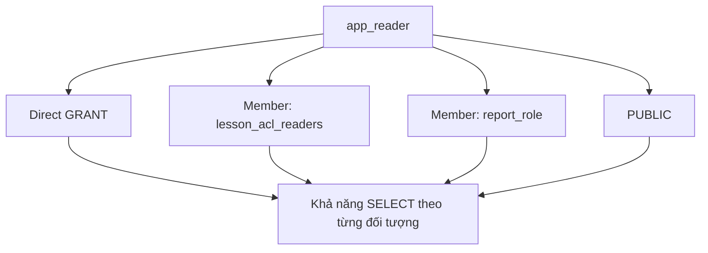

# GRANT, REVOKE và phạm vi quyền trên đối tượng

## 1. Vì sao truy vấn đúng vẫn có thể bị từ chối?

Giả sử hệ thống có một bảng đơn hàng:

```sql
SELECT order_id, total_amount
FROM sales.orders;
```

Một tài khoản quản trị chạy được, nhưng tài khoản ứng dụng báo lỗi tương tự:

```text
permission denied for schema sales
```

hoặc:

```text
permission denied for table orders
```

Đây không nhất thiết là lỗi cú pháp. **Quyền truy cập dữ liệu** là một phần thiết kế SQL an toàn.

Một hệ thống điển hình có những nhóm người dùng khác nhau:

- **Nhân viên báo cáo:** đọc đơn đã thanh toán, không được sửa đơn.
- **Dịch vụ cập nhật trạng thái:** đổi `order_status` theo nghiệp vụ, không được sửa `total_amount`.
- **Dịch vụ tạo đơn:** thêm đơn hàng, không được `TRUNCATE` cả bảng.
- **Người quản lý schema:** tạo hoặc thay đổi đối tượng.
- **Nhóm kiểm toán:** đọc dữ liệu/hệ thống được chỉ định, không có quyền ghi.

Nếu mọi nhóm đều đăng nhập bằng tài khoản chủ sở hữu bảng hoặc được `GRANT ALL`, chỉ một câu SQL nhầm cũng có thể gây thiệt hại lớn.

Bài học này giải thích cách dùng **`GRANT` và `REVOKE`** để mô hình hóa các quyền đó, đặc biệt là **phạm vi quyền trên từng đối tượng**.

Ví dụ chạy chính dùng **PostgreSQL**. Các phần cuối đối chiếu MySQL, SQL Server, Oracle và SQLite, bởi vì cú pháp, role và cơ chế quyền của những hệ quản trị này không hoàn toàn giống nhau.

**Điểm cần nhớ trước tiên:** Có quyền trên một bảng không đồng nghĩa có quyền trên toàn database; có quyền truy cập schema không đồng nghĩa được đọc mọi bảng; và `REVOKE` một đường cấp quyền không nhất thiết làm tài khoản mất quyền nếu vẫn còn đường khác.

---

## 2. GRANT và REVOKE trả lời những câu hỏi nào?

### 2.1. GRANT: cấp một quyền cụ thể

Dạng khái quát:

```sql
GRANT privilege
ON object
TO principal;
```

Ví dụ PostgreSQL:

```sql
GRANT SELECT
ON TABLE sales.orders
TO report_reader;
```

Lệnh nói rằng role `report_reader` được cấp quyền `SELECT` trên đối tượng bảng `sales.orders`.

### 2.2. REVOKE: thu hồi một quyền đã cấp

Dạng khái quát:

```sql
REVOKE privilege
ON object
FROM principal;
```

Ví dụ:

```sql
REVOKE SELECT
ON TABLE sales.orders
FROM report_reader;
```

Lệnh thu hồi một grant theo phạm vi đã chỉ định. Nó **không bảo đảm** người dùng mất khả năng đọc nếu vẫn còn quyền qua role khác, `PUBLIC`, quyền sở hữu hoặc cơ chế đặc biệt của DBMS.

### 2.3. Ba thành phần của một quyền

| Thành phần | Câu hỏi | Ví dụ |
| --- | --- | --- |
| **Principal** | Ai được phép? | Role `report_reader` |
| **Privilege** | Được làm gì? | `SELECT`, `UPDATE`, `EXECUTE` |
| **Securable/object** | Trên đối tượng nào? | Bảng `sales.orders` |

Một chính sách quyền đầy đủ có thể cần thêm **phạm vi cột**, **đường kế thừa role**, **quyền cấp lại**, **row-level security** và **điều kiện ứng dụng**.

### 2.4. Quyền là khả năng, không phải nghĩa vụ

`GRANT DELETE ON orders` cho phép thực hiện thao tác xóa khi các điều kiện khác cho phép. Nó không tự chạy DELETE.

Ngược lại, nếu đã được cấp quyền, một chương trình có lỗi vẫn có thể gửi câu DELETE nguy hiểm. Vì vậy **cấp đúng quyền tối thiểu** quan trọng không kém kiểm tra SQL ở ứng dụng.

---

## 3. Phân biệt người dùng, role, owner và PUBLIC

Những tên này gần nhau nhưng không đồng nhất.

### 3.1. User và role trong PostgreSQL

PostgreSQL sử dụng hệ thống **role** thống nhất.

- Role có thuộc tính `LOGIN` có thể đóng vai trò tài khoản đăng nhập nếu được cấu hình xác thực.
- Role `NOLOGIN` thường được dùng làm nhóm quyền.
- Một role có thể là thành viên của role khác.
- Role có thể sở hữu đối tượng database.

Ví dụ:

```sql
CREATE ROLE lesson_acl_readers NOLOGIN;
CREATE ROLE lesson_acl_status_editors NOLOGIN;
CREATE ROLE lesson_acl_demo_login LOGIN;
```

Những câu này cần tài khoản có **đặc quyền tạo role phù hợp**. Role `lesson_acl_demo_login` chưa được cung cấp mật khẩu; việc đăng nhập thực tế phải được cấu hình an toàn theo cơ chế xác thực của môi trường.

### 3.2. Owner là chủ sở hữu đối tượng

Người tạo bảng thường trở thành owner, trừ khi có cơ chế tạo đối tượng hoặc chuyển quyền sở hữu khác.

Owner có khả năng quản lý đối tượng theo quy tắc DBMS và không nên được coi chỉ là một người nhận grant thông thường.

Ví dụ: thay định nghĩa bảng, xóa bảng hoặc quản lý grant thường là vấn đề **ownership/quyền quản trị**, không chỉ `SELECT`.

### 3.3. PUBLIC trong PostgreSQL

`PUBLIC` là nhóm ngầm đại diện **tất cả các role** trong phạm vi PostgreSQL. Nó **không** phải một user do bạn tạo để đăng nhập.

Ví dụ:

```sql
GRANT SELECT
ON TABLE sales.public_catalog
TO PUBLIC;
```

có thể cho phép mọi role có các điều kiện truy cập còn lại đọc bảng đó, kể cả role mới tạo sau này.

**Không dùng `PUBLIC` để diễn đạt “nhóm báo cáo”**. Nếu chỉ nhóm báo cáo được đọc, hãy tạo role dành riêng.

### 3.4. Role NOLOGIN vẫn nhận quyền được

```sql
GRANT SELECT
ON TABLE sales.orders
TO lesson_acl_readers;
```

Role `lesson_acl_readers` không cần trực tiếp đăng nhập. Tài khoản ứng dụng có thể nhận quyền thông qua membership theo quy tắc PostgreSQL.

---

## 4. Phạm vi đối tượng: một quyền ở đâu thì có hiệu lực ở đó

Trên PostgreSQL, các loại đối tượng có những privilege riêng.

| Đối tượng | Quyền thường gặp | Ý nghĩa minh họa |
| --- | --- | --- |
| **Database** | `CONNECT`, `CREATE`, `TEMPORARY` | Kết nối database, tạo schema hoặc tạo đối tượng tạm theo điều kiện |
| **Schema** | `USAGE`, `CREATE` | Tra cứu/truy cập đối tượng qua schema, tạo đối tượng trong schema |
| **Table** | `SELECT`, `INSERT`, `UPDATE`, `DELETE`, `TRUNCATE`, `REFERENCES`, `TRIGGER` | Đọc/ghi/khai thác bảng theo quyền |
| **View** | Thường `SELECT`, và quyền DML nếu view hỗ trợ | Đọc kết quả view, không mặc nhiên được đọc bảng nền |
| **Sequence** | `USAGE`, `SELECT`, `UPDATE` | Sử dụng/đọc/thay trạng thái sequence theo quy tắc PostgreSQL |
| **Function** | `EXECUTE` | Gọi function |
| **Procedure** | `EXECUTE` | Gọi procedure |
| **Type/domain** | `USAGE` | Sử dụng kiểu theo quyền DBMS |
| **Schema/table khác** | Các quyền của chính đối tượng đó | Không tự được cấp chỉ vì thuộc cùng database |

Danh sách trên là các quyền tiêu biểu, không phải toàn bộ bảng quyền cho mọi phiên bản PostgreSQL.

### 4.1. Có quyền database không có nghĩa có quyền bảng

```sql
GRANT CONNECT
ON DATABASE shop_db
TO report_reader;
```

chỉ giải quyết một phần điều kiện kết nối database. Nó **không tự cấp** `SELECT` trên bảng `sales.orders`.

### 4.2. Có quyền schema không có nghĩa có quyền bảng

```sql
GRANT USAGE
ON SCHEMA sales
TO report_reader;
```

giúp role có khả năng truy cập tên đối tượng trong schema theo quy tắc quyền, nhưng **không tự cho phép SELECT mọi bảng trong sales**.

### 4.3. Có quyền bảng nhưng thiếu USAGE trên schema

```sql
GRANT SELECT
ON TABLE sales.orders
TO report_reader;
```

nếu role chưa được `USAGE` trên `sales`, câu:

```sql
SELECT * FROM sales.orders;
```

có thể vẫn bị từ chối ở bước truy cập schema.

**Hai lớp quyền phải được xét cùng nhau**, bên cạnh quyền kết nối database và các điều kiện còn lại.

---

## 5. Chuỗi điều kiện để đọc một bảng PostgreSQL

Một ứng dụng đọc `sales.orders` thường cần các lớp sau:

```text
Tài khoản có thể kết nối database?
             │
             ▼
Có quyền CONNECT hoặc đường quyền tương đương?
             │
             ▼
Có USAGE trên schema sales?
             │
             ▼
Có SELECT trên bảng/các cột cần đọc?
             │
             ▼
Có RLS/policy hoặc cơ chế bảo mật nào giới hạn hàng?
             │
             ▼
Query chạy trong transaction và ngữ cảnh hiện tại
```

### 5.1. Đừng nhầm quyền và cơ chế xác thực

- **Authentication:** người dùng là ai, đăng nhập có thành công không?
- **Authorization:** principal đã xác thực có được làm thao tác này không?

`GRANT CONNECT` không tạo mật khẩu, không cấp token và không thay cấu hình xác thực của PostgreSQL.

### 5.2. Không phải tất cả lớp trên đều nằm trong một GRANT

Một lỗi thực tế:

> “Đã GRANT SELECT rồi sao ứng dụng vẫn báo permission denied?”

Có thể vì:

- Thiếu `USAGE` schema.
- Cấp quyền cho nhầm role.
- Role đăng nhập không kế thừa/không kích hoạt membership theo phiên bản và cấu hình.
- Ứng dụng kết nối sang database khác.
- Object cùng tên nhưng khác schema.
- Hàm, sequence hoặc đối tượng phụ có quyền riêng.
- RLS không cho thấy hàng mà ứng dụng mong đợi.
- Thực tế lỗi xảy ra trong function, trigger hoặc view phụ thuộc.

Đọc **đúng thông báo lỗi và ngữ cảnh kết nối** trước khi mở rộng quyền tùy tiện.

---

## 6. Bộ dữ liệu thực hành PostgreSQL

Tất cả ví dụ chính dùng schema `lesson_acl` để tránh trùng bảng của ứng dụng thật.

> Chỉ chạy trên **database học tập**. Tạo role, thay đổi grants và thử quyền có thể yêu cầu owner hoặc tài khoản quản trị. Không triển khai các role demo lên production mà chưa có quy trình phê duyệt.

### 6.1. Tạo schema riêng

```sql
CREATE SCHEMA lesson_acl;
```

Người tạo schema cần có quyền phù hợp; thông thường tài khoản đang chạy sẽ là owner.

### 6.2. Bảng khách hàng

```sql
CREATE TABLE lesson_acl.customers (
    customer_id INTEGER PRIMARY KEY,
    full_name TEXT NOT NULL,
    email TEXT NOT NULL UNIQUE
);
```

`email` là ví dụ về dữ liệu không nên tự động lộ cho mọi nhóm báo cáo.

### 6.3. Bảng đơn hàng

```sql
CREATE TABLE lesson_acl.orders (
    order_id INTEGER PRIMARY KEY,
    customer_id INTEGER NOT NULL
        REFERENCES lesson_acl.customers(customer_id),
    order_status TEXT NOT NULL
        CHECK (order_status IN ('NEW','PAID','CANCELLED')),
    total_amount NUMERIC(12,2) NOT NULL
        CHECK (total_amount >= 0)
);
```

### 6.4. Nạp dữ liệu mẫu

```sql
INSERT INTO lesson_acl.customers
    (customer_id, full_name, email)
VALUES
    (1, 'An',   'an@example.invalid'),
    (2, 'Bình', 'binh@example.invalid'),
    (3, 'Chi',  'chi@example.invalid');

INSERT INTO lesson_acl.orders
    (order_id, customer_id, order_status, total_amount)
VALUES
    (101, 1, 'PAID',      200.00),
    (102, 1, 'NEW',       100.00),
    (103, 2, 'PAID',      300.00),
    (104, 2, 'CANCELLED',  50.00),
    (105, 3, 'PAID',       90.00);
```

Bảng đơn:

| order_id | customer_id | order_status | total_amount |
| ---: | ---: | --- | ---: |
| 101 | 1 | PAID | 200 |
| 102 | 1 | NEW | 100 |
| 103 | 2 | PAID | 300 |
| 104 | 2 | CANCELLED | 50 |
| 105 | 3 | PAID | 90 |

Có **5 đơn**, trong đó **3 đơn PAID**. Tổng tiền các đơn PAID là **590**.

### 6.5. Tạo view báo cáo

```sql
CREATE VIEW lesson_acl.v_paid_orders AS
SELECT
    o.order_id,
    o.customer_id,
    o.total_amount
FROM lesson_acl.orders AS o
WHERE o.order_status = 'PAID';
```

View công bố **ba cột**, không công bố `order_status` và không đọc bảng `customers`. Nó chỉ trả các đơn PAID:

| order_id | customer_id | total_amount |
| ---: | ---: | ---: |
| 101 | 1 | 200 |
| 103 | 2 | 300 |
| 105 | 3 | 90 |

View giúp xây một **giao diện đọc giới hạn**. Tuy nhiên việc che cột/hàng còn phụ thuộc cấu hình bảo mật view, ownership và RLS của DBMS; không được xem mọi view là ranh giới bảo mật tuyệt đối trong mọi tình huống.

---

## 7. Tạo các nhóm quyền và tài khoản demo

Trong môi trường đã có quyền tạo role phù hợp:

```sql
CREATE ROLE lesson_acl_readers NOLOGIN;

CREATE ROLE lesson_acl_status_editors NOLOGIN;

CREATE ROLE lesson_acl_demo_login LOGIN;
```

Không tạo mật khẩu bằng cách chèn secret production vào một script được commit lên Git.

### 7.1. Role nhóm và role đăng nhập khác nhiệm vụ

`lesson_acl_readers` đại diện **bộ quyền đọc báo cáo**.

`lesson_acl_status_editors` đại diện **bộ quyền cập nhật trạng thái đơn**.

`lesson_acl_demo_login` đại diện tài khoản có thể đăng nhập sau khi cấu hình xác thực. Nó chưa cần mang quyền nghiệp vụ trực tiếp.

### 7.2. Gán tài khoản vào nhóm

```sql
GRANT lesson_acl_readers
TO lesson_acl_demo_login;
```

Đây là **GRANT role membership**, không phải GRANT SELECT trên một bảng.

Khả năng role member tự động sử dụng quyền hay có thể `SET ROLE` phụ thuộc các tùy chọn membership như `INHERIT` và `SET` ở những phiên bản PostgreSQL hỗ trợ, cùng thuộc tính/cấu hình role.

### 7.3. Vì sao dùng nhóm quyền?

Khi có 200 tài khoản báo cáo, ta có thể:

1. Cấp quyền lên nhóm `lesson_acl_readers`.
2. Gán 200 tài khoản làm thành viên nhóm.
3. Đổi chính sách nhóm một cách tập trung.

Không phải lặp lại mọi `GRANT SELECT` cho từng tài khoản riêng lẻ.

### 7.4. Membership không tự đồng nghĩa quyền quản lý nhóm

Được dùng quyền của một role khác không nhất thiết cho phép **cấp role đó cho người khác**. Quyền quản lý membership là một khả năng riêng, thường liên quan `ADMIN OPTION` hoặc đặc quyền quản trị.

---

## 8. Cấp USAGE cho schema trước khi truy cập đối tượng

```sql
GRANT USAGE
ON SCHEMA lesson_acl
TO lesson_acl_readers;

GRANT USAGE
ON SCHEMA lesson_acl
TO lesson_acl_status_editors;
```

Đây là bước cần thiết cho các ví dụ phía dưới khi nhóm truy cập đối tượng bằng tên đầy đủ `lesson_acl.object`.

### 8.1. USAGE không phải CREATE

```sql
GRANT USAGE ON SCHEMA lesson_acl
TO lesson_acl_readers;
```

không cho nhóm tự:

```sql
CREATE TABLE lesson_acl.new_table (...);
```

Muốn tạo đối tượng trong schema, cần quyền `CREATE` phù hợp, hoặc quyền owner/quản trị tương ứng.

### 8.2. Vì sao hạn chế CREATE trên schema quan trọng?

Quyền tạo đối tượng trên schema có thể ảnh hưởng:

- Tên đối tượng được giải quyết qua `search_path`.
- Nguy cơ shadowing/hijacking tên hàm hoặc đối tượng.
- Khả năng chèn đối tượng ngoài ý muốn vào namespace dùng chung.
- Quy trình migration và kiểm soát ownership.

Đối với schema ứng dụng quan trọng, không nên cấp `CREATE` rộng rãi chỉ để các tài khoản được chạy SELECT.

### 8.3. Ngăn mặc định mở quá rộng

Có thể xem xét:

```sql
REVOKE ALL
ON SCHEMA lesson_acl
FROM PUBLIC;
```

trước khi cấp có chọn lọc. Nhưng phải kiểm tra hệ thống hiện có, bởi nếu đã có người sử dụng hợp lệ qua `PUBLIC` thì thu hồi có thể ảnh hưởng ứng dụng.

---

## 9. GRANT SELECT trên view, không cần GRANT SELECT bảng nền

Đối với nhóm chỉ được xem đơn đã thanh toán:

```sql
GRANT SELECT
ON TABLE lesson_acl.v_paid_orders
TO lesson_acl_readers;
```

Tài khoản `lesson_acl_demo_login` là thành viên nhóm đọc, nên trong ngữ cảnh role membership đã được kích hoạt phù hợp, truy vấn:

```sql
SELECT
    order_id,
    customer_id,
    total_amount
FROM lesson_acl.v_paid_orders
ORDER BY order_id;
```

có thể được phép.

### 9.1. Nhóm đọc chưa được cấp trực tiếp quyền trên bảng orders

Ta **không** thực hiện:

```sql
GRANT SELECT
ON TABLE lesson_acl.orders
TO lesson_acl_readers;
```

Trong PostgreSQL, một view thông thường theo cơ chế quyền mặc định có thể cho người dùng đọc kết quả view dựa trên quyền của **view owner** đối với bảng nền. Người dùng cần quyền trên view và schema để truy cập giao diện đó, nhưng không nhất thiết cần quyền SELECT trực tiếp trên bảng gốc.

### 9.2. Truy cập bảng gốc phải được kiểm tra độc lập

```sql
SELECT *
FROM lesson_acl.orders;
```

không vì thế mà tự hợp lệ đối với `lesson_acl_readers`.

Đây là lý do mô hình **view báo cáo + GRANT SELECT trên view** thường hữu ích cho nhóm người dùng cần một tập cột/hàng giới hạn.

### 9.3. View không tự động giải quyết mọi bài toán bảo mật

Ở PostgreSQL mới có tùy chọn `security_invoker` làm thay đổi cách xét quyền bảng nền theo invoker; cơ chế RLS, owner và các chức năng được gọi cũng ảnh hưởng kết quả. Sẽ phân tích ở các phần sau.

**Không suy rằng GRANT trên view luôn hành xử hệt nhau ở mọi database hoặc mọi chế độ view.**

---

## 10. GRANT SELECT trên bảng: quyền rộng tới đâu?

Nếu cần cho một role đọc toàn bảng:

```sql
GRANT SELECT
ON TABLE lesson_acl.orders
TO lesson_acl_readers;
```

Role có `SELECT` trên **các cột của bảng** theo phạm vi cấp, trừ các rào cản khác như RLS và quyền schema.

Điều này cho phép:

```sql
SELECT
    order_id,
    customer_id,
    order_status,
    total_amount
FROM lesson_acl.orders;
```

### 10.1. Cẩn thận với dữ liệu nhạy cảm

Nếu có bảng `customers` với `email`, cấp:

```sql
GRANT SELECT
ON TABLE lesson_acl.customers
TO lesson_acl_readers;
```

sẽ cho phép đọc email theo điều kiện quyền khác. Nếu nhóm chỉ cần tên và ID, một **view giới hạn cột** hoặc `GRANT SELECT` theo cột có thể phù hợp hơn.

### 10.2. Quyền SELECT không bao gồm UPDATE

`GRANT SELECT` không tự cho phép:

```sql
UPDATE lesson_acl.orders
SET total_amount = 0
WHERE order_id = 101;
```

Muốn ghi phải được cấp quyền tương ứng.

### 10.3. SELECT cũng không đồng nghĩa CONNECT hoặc USAGE schema

Một role đã có SELECT bảng mà thiếu quyền schema/database cần thiết có thể vẫn không truy cập được.

---

## 11. GRANT theo cột: SELECT(column_name)

PostgreSQL hỗ trợ quyền đọc **chỉ một số cột**.

Ví dụ muốn cho nhóm cập nhật trạng thái đọc đúng hai cột:

```sql
GRANT SELECT (
    order_id,
    order_status
)
ON TABLE lesson_acl.orders
TO lesson_acl_status_editors;
```

Khi role có `USAGE` schema, nó có thể thực hiện:

```sql
SELECT order_id, order_status
FROM lesson_acl.orders;
```

Nhưng không được tự suy rằng nó có quyền đọc `total_amount`.

### 11.1. SELECT * có thể bị từ chối

```sql
SELECT *
FROM lesson_acl.orders;
```

đòi quyền đọc các cột được SELECT. Nếu role chỉ được cấp hai cột và không có đường quyền rộng hơn, truy vấn lấy mọi cột có thể lỗi.

### 11.2. Column-level GRANT không giới hạn một table-level GRANT đã có

Nếu trước đó đã cấp:

```sql
GRANT SELECT
ON TABLE lesson_acl.orders
TO lesson_acl_status_editors;
```

thì việc bổ sung:

```sql
GRANT SELECT (order_id, order_status)
ON TABLE lesson_acl.orders
TO lesson_acl_status_editors;
```

**không thu hẹp** quyền đọc chỉ còn hai cột. Các grant thường có tính **cộng dồn**.

Muốn giới hạn lại phải kiểm tra và thu hồi quyền bảng rộng (nếu được phép), cũng như những quyền có thể đến từ role khác hoặc `PUBLIC`.

### 11.3. Phạm vi cột không phải phạm vi hàng

Quyền `SELECT(order_id, order_status)` cho phép đọc những cột đó của các hàng thuộc phạm vi truy cập; nó **không tự giới hạn** “chỉ được xem đơn của chính khách hàng này”.

Cần các cơ chế khác cho row-level authorization.

---

## 12. GRANT UPDATE theo cột

Role chỉ được đổi `order_status` có thể nhận:

```sql
GRANT UPDATE (order_status)
ON TABLE lesson_acl.orders
TO lesson_acl_status_editors;
```

Kết hợp với quyền `SELECT(order_id, order_status)` đã cấp, role có thể gửi:

```sql
UPDATE lesson_acl.orders
SET order_status = 'PAID'
WHERE order_id = 102
  AND order_status = 'NEW'
RETURNING order_id, order_status;
```

Nếu chạy trên dữ liệu gốc và role có đủ quyền theo ngữ cảnh, đơn 102 có thể chuyển từ `NEW` sang `PAID`.

### 12.1. Vì sao cần SELECT để dùng WHERE/RETURNING?

Để tham chiếu các cột trong điều kiện và kết quả, PostgreSQL thường yêu cầu quyền `SELECT` trên những cột được đọc.

Không đủ để chỉ cấp:

```sql
GRANT UPDATE (order_status)
ON lesson_acl.orders
TO lesson_acl_status_editors;
```

rồi kỳ vọng mọi `WHERE`/`RETURNING` tùy ý đều hợp lệ.

### 12.2. Không được sửa total_amount

```sql
UPDATE lesson_acl.orders
SET total_amount = 1
WHERE order_id = 102;
```

nên bị từ chối nếu role chỉ có quyền `UPDATE(order_status)` và không có quyền UPDATE rộng hơn từ đường khác.

### 12.3. Hạn chế của column-level UPDATE

Nó kiểm soát **cột nào được sửa**, không định nghĩa được một quy tắc chuyển trạng thái phức tạp như:

- Chỉ được `NEW → PAID`.
- Không được `PAID → NEW`.
- Chỉ sửa đơn của tenant hiện tại.
- Chỉ người kiểm toán được xác nhận số tiền vượt ngưỡng.

Các yêu cầu đó có thể cần `CHECK`, RLS, trigger, procedure, transaction hoặc kiểm soát nghiệp vụ bổ sung.

**Quyền UPDATE một cột không đồng nghĩa được phép mọi giá trị/trạng thái của cột ấy.**

---

## 13. Những quyền DML và DDL quan trọng trên bảng

PostgreSQL có những quyền bảng tiêu biểu:

| Quyền | Cho phép chủ yếu | Điều không nên suy ra |
| --- | --- | --- |
| `SELECT` | Đọc các cột/đối tượng được cấp | Không tự được UPDATE |
| `INSERT` | Chèn hàng/cột theo phạm vi grant | Không tự được SELECT mọi cột |
| `UPDATE` | Sửa cột/hàng theo quyền và điều kiện khác | Không tự được DELETE |
| `DELETE` | Xóa hàng | Không tự được TRUNCATE |
| `TRUNCATE` | Xóa nhanh dữ liệu bảng bằng TRUNCATE | Không phải một phiên bản của DELETE |
| `REFERENCES` | Tạo ràng buộc tham chiếu phù hợp | Không tự đọc mọi dữ liệu |
| `TRIGGER` | Tạo trigger trên bảng theo quyền | Không giống quyền EXECUTE một function |
| `MAINTAIN` | Một số thao tác bảo trì ở phiên bản PostgreSQL hỗ trợ | Không phải SELECT/UPDATE dữ liệu ứng dụng |

### 13.1. DELETE khác TRUNCATE về quyền

```sql
GRANT DELETE ON lesson_acl.orders
TO lesson_acl_status_editors;
```

không tự cấp `TRUNCATE`.

Trong hệ thống production, quyền `TRUNCATE` đặc biệt nhạy cảm vì có thể xóa dữ liệu hàng loạt và có hành vi khác `DELETE` với trigger, khóa và ràng buộc.

### 13.2. INSERT theo cột

Ví dụ một bảng được thiết kế để client chỉ chèn một số cột:

```sql
GRANT INSERT (
    order_id,
    customer_id,
    order_status,
    total_amount
)
ON TABLE lesson_acl.orders
TO some_writer_role;
```

Role phải tồn tại; đây là ví dụ về phạm vi cột, không phải câu phải chạy ngay trong bộ demo.

Nếu bảng có cột auto-generated, default hoặc constraint, quyền/thao tác cần xem cùng schema thực tế.

### 13.3. TRIGGER không phải quyền quản trị mọi object

Cấp `TRIGGER` trên bảng không tự cấp quyền tạo schema mới hoặc quyền gọi mọi function. Quyền thực thi function, ownership và các kiểm tra tương ứng vẫn có quy tắc riêng.

### 13.4. Đừng cấp ALL để né lỗi

Một ứng dụng chỉ cần `SELECT` và `UPDATE(order_status)` không nên nhận `ALL PRIVILEGES` chỉ vì muốn câu SQL chạy ngay.

---

## 14. Quyền trên sequence khác quyền trên bảng

PostgreSQL có đối tượng **sequence**, dùng để sinh giá trị theo thứ tự.

Ví dụ:

```sql
CREATE SEQUENCE lesson_acl.job_number_seq
START WITH 1000;
```

Một role có quyền `SELECT` trên bảng sử dụng sequence **không mặc nhiên có quyền sử dụng sequence đó**.

### 14.1. USAGE trên sequence

```sql
GRANT USAGE
ON SEQUENCE lesson_acl.job_number_seq
TO lesson_acl_status_editors;
```

Quyền `USAGE` cho phép các thao tác sequence tương ứng như `nextval` và `currval` theo PostgreSQL.

Ví dụ:

```sql
SELECT nextval('lesson_acl.job_number_seq');
```

### 14.2. SELECT và UPDATE trên sequence có nghĩa riêng

Trên PostgreSQL, các quyền sequence không phải bản sao quyền table:

- `SELECT` cho phép những thao tác đọc sequence như `currval` theo quy tắc.
- `USAGE` cho phép `currval`/`nextval` theo quy tắc.
- `UPDATE` cho phép các thao tác thay đổi sequence như `nextval`/`setval` theo quy tắc.

Không dịch `UPDATE ON SEQUENCE` thành “cập nhật một hàng trong bảng sequence” theo nghĩa thông thường.

### 14.3. Sequence có thể sinh khoảng trống

Giá trị từ `nextval` được tiêu thụ ngay và không được trả lại chỉ vì transaction rollback. Đây là **ngữ nghĩa sequence**, không phải lỗi cấp quyền.

### 14.4. SERIAL và IDENTITY

Khi dùng cơ chế `SERIAL`/default `nextval` kiểu cũ, tài khoản INSERT có thể cần quyền trên sequence liên quan. PostgreSQL `GENERATED ... AS IDENTITY` có cơ chế xử lý sequence/INSERT riêng.

Không áp dụng máy móc câu “mọi INSERT vào cột tự tăng đều phải GRANT USAGE sequence” cho tất cả kiểu auto-generation hay mọi DBMS.

---

## 15. Quyền gọi function và procedure: EXECUTE

Giả sử cần một hàm trả số đơn đã thanh toán:

```sql
CREATE OR REPLACE FUNCTION lesson_acl.paid_order_count()
RETURNS BIGINT
LANGUAGE sql
STABLE
AS $$
    SELECT COUNT(*)
    FROM lesson_acl.orders
    WHERE order_status = 'PAID';
$$;
```

Với dữ liệu mẫu, hàm trả `3` nếu chạy bởi role có đủ quyền và ngữ cảnh phù hợp.

Cấp quyền:

```sql
GRANT EXECUTE
ON FUNCTION lesson_acl.paid_order_count()
TO lesson_acl_readers;
```

### 15.1. EXECUTE không phải SELECT bảng

`GRANT EXECUTE ON FUNCTION` cho phép gọi routine tương ứng; nó không cấp SELECT trực tiếp lên các bảng mà routine dùng.

Nếu routine chạy theo quyền người gọi, quyền đọc bảng nền vẫn có thể cần thiết; nếu routine chạy theo quyền definer, quy tắc khác.

### 15.2. Chỉ định đúng chữ ký function

PostgreSQL có **function overloading**. Hai function có thể cùng tên nhưng khác kiểu tham số.

Ví dụ:

```sql
calculate_tax(NUMERIC)
calculate_tax(NUMERIC, NUMERIC)
```

có thể là hai đối tượng khác nhau về chữ ký. Dùng tên đầy đủ và kiểu tham số khi GRANT/REVOKE trên một function cụ thể.

### 15.3. Procedure cũng có EXECUTE

Trên PostgreSQL, procedure gọi qua `CALL`, function qua `SELECT` hoặc biểu thức phù hợp. Quyền EXECUTE của routine vẫn cần xét theo đúng loại/chữ ký.

### 15.4. Một function có EXECUTE rộng có thể trở thành cổng dữ liệu

Nếu function trả thông tin nhạy cảm và chạy theo quyền chủ sở hữu, chỉ cấp EXECUTE cho những role có nhu cầu. Một routine không ghi dữ liệu vẫn có thể làm lộ thông tin nếu trả dữ liệu vượt phạm vi người gọi.

---

## 16. Cảnh báo quan trọng: mặc định PUBLIC có thể được EXECUTE function

Trong PostgreSQL, **mặc định privilege EXECUTE trên function/procedure mới có thể được cấp cho PUBLIC** theo chính sách mặc định.

Vì vậy khi tạo một function nhạy cảm, không được mặc định rằng “chưa chạy GRANT thì không ai gọi được”.

### 16.1. Thu hồi PUBLIC trước khi cấp nhóm cụ thể

```sql
REVOKE ALL
ON FUNCTION lesson_acl.paid_order_count()
FROM PUBLIC;

GRANT EXECUTE
ON FUNCTION lesson_acl.paid_order_count()
TO lesson_acl_readers;
```

Đối với một routine nhạy cảm được tạo mới trong production, nên cân nhắc tạo, thu hồi grant mặc định và cấp lại quyền trong **cùng transaction**, để tránh một khoảng thời gian quyền rộng ngoài ý muốn.

### 16.2. FUNCTION không tự có quyền đọc mọi bảng

Nếu hàm ở trên dùng mặc định `SECURITY INVOKER`, khi nhóm chỉ có quyền trên view mà không có SELECT bảng `orders`, lời gọi hàm có thể thất bại do thiếu quyền bên trong.

Nếu muốn xây API qua routine không cần quyền bảng trực tiếp, có thể cân nhắc `SECURITY DEFINER` với kiểm soát đặc biệt.

### 16.3. Không mở EXECUTE cho PUBLIC để chữa lỗi quyền

Nếu ứng dụng báo thiếu quyền gọi một routine, hãy xác định role và mục tiêu sử dụng; không nên phản ứng bằng:

```sql
GRANT EXECUTE
ON ALL FUNCTIONS IN SCHEMA lesson_acl
TO PUBLIC;
```

vì có thể làm lộ những function không dành cho mọi người.

---

## 17. SECURITY INVOKER và SECURITY DEFINER ảnh hưởng phạm vi hiệu lực

Với PostgreSQL:

- **SECURITY INVOKER**: routine thực thi theo quyền của người gọi (mặc định).
- **SECURITY DEFINER**: routine thực thi theo quyền chủ sở hữu function trong phạm vi cơ chế được hỗ trợ.

### 17.1. Ví dụ về function chỉ trả số lượng

Đối với nhóm chỉ xem thống kê, có thể xây một API hẹp:

```sql
CREATE OR REPLACE FUNCTION lesson_acl.paid_order_count()
RETURNS BIGINT
LANGUAGE sql
STABLE
SECURITY DEFINER
SET search_path = pg_catalog, lesson_acl, pg_temp
AS $$
    SELECT COUNT(*)
    FROM lesson_acl.orders
    WHERE order_status = 'PAID';
$$;

REVOKE ALL
ON FUNCTION lesson_acl.paid_order_count()
FROM PUBLIC;

GRANT EXECUTE
ON FUNCTION lesson_acl.paid_order_count()
TO lesson_acl_readers;
```

Function chỉ trả **một số đếm**, không trả danh sách mọi đơn hàng.

### 17.2. Chỉ owner có quyền phù hợp mới triển khai được

Để hoạt động an toàn, function phải thuộc owner đáng tin cậy, được cấp đúng quyền đối với dữ liệu nền, và mọi tham chiếu bên trong cần được kiểm soát.

`SECURITY DEFINER` không tự làm function an toàn nếu:

- SQL động nối input vào câu lệnh.
- `search_path` cho phép caller tạo object giả mạo.
- Function trả dữ liệu nhạy cảm không giới hạn.
- Role gọi có thể thao túng tham số để đọc/sửa ngoài phạm vi.
- Owner sở hữu quá nhiều đối tượng không liên quan.

### 17.3. Cấu hình search_path an toàn

Trong ví dụ đã dùng:

```sql
SET search_path = pg_catalog, lesson_acl, pg_temp
```

và tên bảng đầy đủ `lesson_acl.orders`.

Đây là hướng tiếp cận giảm rủi ro phân giải tên tới các schema không đáng tin cậy. Vẫn cần rà soát theo **đúng PostgreSQL version** và quyền CREATE trong mọi schema trên path.

### 17.4. Hàm definer không thay thế chính sách bảo mật toàn hệ thống

Một function trả COUNT có thể làm lộ số lượng đơn; một function trả danh sách có thể làm lộ dữ liệu nhiều hơn.

**Grant EXECUTE phải gắn với hợp đồng đầu ra của routine**, không chỉ việc routine “có chạy được hay không”.

---

## 18. GRANT OPTION: người nhận có thể cấp tiếp quyền

PostgreSQL cho phép cấp một privilege với khả năng cấp lại:

```sql
GRANT SELECT
ON TABLE lesson_acl.orders
TO lesson_acl_readers
WITH GRANT OPTION;
```

Nội dung khác với một `GRANT SELECT` bình thường.

| Cách cấp | Role được SELECT? | Có thể cấp tiếp SELECT theo quyền này? |
| --- | --- | --- |
| `GRANT SELECT ... TO role` | Có | Thông thường không chỉ nhờ grant ấy |
| `GRANT SELECT ... TO role WITH GRANT OPTION` | Có | Có, theo quy tắc DBMS |

### 18.1. Vì sao GRANT OPTION nhạy cảm?

Một role nghiệp vụ đọc báo cáo bình thường thường **không cần** có khả năng chuyển quyền đọc cho nhóm khác.

Nếu được `WITH GRANT OPTION`, ranh giới quản trị quyền được mở rộng: người sở hữu grant có thể là nguồn cấp các grant phụ thuộc.

### 18.2. Không nhầm quyền cấp lại với quyền sở hữu

`WITH GRANT OPTION` không cho phép role:

- Tự đổi owner bảng.
- Tự DROP bảng.
- Tự ALTER schema theo mọi cách.
- Có mọi privilege khác chỉ vì nó được SELECT.

Đó là quyền cấp tiếp **privilege cụ thể**.

### 18.3. Không mặc định được cấp cho PUBLIC

Trong PostgreSQL, không sử dụng `WITH GRANT OPTION` để cấp privilege tới `PUBLIC` như thể PUBLIC là một quản trị viên tập thể.

### 18.4. Phạm vi cột và GRANT OPTION

Quyền cấp lại cũng phải được hiểu theo phạm vi quyền đã nhận. Một role chỉ có SELECT trên vài cột không tự có quyền cấp SELECT cho mọi cột nếu không có quyền rộng hơn.

---

## 19. ADMIN OPTION: quản lý membership của role

Một cú pháp PostgreSQL:

```sql
GRANT lesson_acl_readers
TO some_role
WITH ADMIN OPTION;
```

đề cập đến **role membership**, không phải cấp SELECT trên bảng.

### 19.1. Khác nhau ở đâu?

- `GRANT SELECT ON TABLE ... WITH GRANT OPTION`: khả năng cấp tiếp SELECT trên đối tượng.
- `GRANT group_role TO member_role WITH ADMIN OPTION`: khả năng quản lý membership của role đó theo quy tắc PostgreSQL.

### 19.2. Không cấp ADMIN OPTION cho tài khoản báo cáo thông thường

Nếu một tài khoản chỉ cần đọc báo cáo, nó không cần tự đưa tài khoản mới vào `lesson_acl_readers`.

### 19.3. Membership có nhiều thuộc tính trong PostgreSQL mới

PostgreSQL hiện đại phân biệt khả năng kế thừa quyền, `SET ROLE` và quyền quản lý membership theo các option tương ứng. Vì vậy cần kiểm tra **version và cấu hình cụ thể** trước khi giải thích vì sao một người dùng đã được GRANT membership mà không tự sử dụng được mọi quyền như mong đợi.

---

## 20. REVOKE quyền trực tiếp

Nếu đã cấp:

```sql
GRANT SELECT
ON TABLE lesson_acl.orders
TO lesson_acl_readers;
```

có thể thu hồi:

```sql
REVOKE SELECT
ON TABLE lesson_acl.orders
FROM lesson_acl_readers;
```

Nhưng điều gì sẽ xảy ra với người dùng?

### 20.1. Thu hồi grant, không thu hồi các đường quyền độc lập

Giả sử `lesson_acl_demo_login` là thành viên của hai role:

```text
lesson_acl_demo_login
    ├── lesson_acl_readers
    └── some_other_readers
```

Nếu cả hai role đều có SELECT trên bảng và chỉ REVOKE từ `lesson_acl_readers`, tài khoản vẫn có thể đọc qua `some_other_readers`.

### 20.2. REVOKE FROM PUBLIC cũng chưa đủ trong mọi trường hợp

```sql
REVOKE SELECT
ON TABLE lesson_acl.orders
FROM PUBLIC;
```

không xóa những grant trực tiếp đang có cho role khác.

### 20.3. REVOKE ALL không đồng nghĩa DELETE role

```sql
REVOKE ALL PRIVILEGES
ON TABLE lesson_acl.orders
FROM lesson_acl_readers;
```

là thu hồi các quyền được nêu trong phạm vi bảng. Nó **không xóa role**, không thu hồi mọi membership và không tự xóa quyền của nhóm trên các bảng khác.

### 20.4. Chủ sở hữu có vị trí đặc biệt

Owner có các đặc quyền quản lý gắn với ownership. Không coi `REVOKE SELECT FROM owner` là biện pháp chắc chắn để ngăn chính owner kiểm soát hoặc truy cập đối tượng theo những khả năng khác mà DBMS dành cho owner.

---

## 21. REVOKE GRANT OPTION FOR và chuỗi cấp quyền

Giả sử có chuỗi:

```text
Owner
  └─ GRANT SELECT WITH GRANT OPTION → TeamLead
         └─ GRANT SELECT → Analyst
```

Nếu owner thu hồi khả năng grant tiếp của TeamLead, grant của Analyst có thể là một **dependent grant** cần xử lý theo cơ chế DBMS.

### 21.1. Thu hồi riêng khả năng cấp tiếp

Ví dụ cú pháp PostgreSQL:

```sql
REVOKE GRANT OPTION FOR SELECT
ON TABLE lesson_acl.orders
FROM lesson_acl_readers;
```

Mục tiêu là thu hồi **grant option** đối với SELECT, không nhất thiết thu hồi luôn quyền SELECT của role.

### 21.2. CASCADE và RESTRICT

Khi có grant phụ thuộc, PostgreSQL có các lựa chọn:

```sql
REVOKE GRANT OPTION FOR SELECT
ON TABLE lesson_acl.orders
FROM lesson_acl_readers
RESTRICT;
```

hoặc:

```sql
REVOKE GRANT OPTION FOR SELECT
ON TABLE lesson_acl.orders
FROM lesson_acl_readers
CASCADE;
```

- `RESTRICT`: từ chối nếu có phụ thuộc không thể bỏ qua theo quy tắc.
- `CASCADE`: có thể thu hồi các quyền được cấp tiếp **phụ thuộc vào grant đang bị thu hồi**.

### 21.3. Cảnh báo về CASCADE

`CASCADE` trong `REVOKE` **không phải** lệnh xóa bảng hay `DROP ... CASCADE`, nhưng vẫn có thể ảnh hưởng nhiều role downstream.

Trước khi dùng, cần kiểm kê chuỗi cấp quyền và người tiêu thụ. Không dùng `CASCADE` chỉ để ép migration quyền chạy thành công.

### 21.4. Nếu có đường grant độc lập khác

Một role downstream có thể còn quyền nhờ một đường cấp độc lập không bị thu hồi. Vì thế hãy kiểm tra **effective privileges sau thay đổi**, không dựa hoàn toàn vào suy luận từ một câu REVOKE.

---

## 22. REVOKE role membership

Nếu muốn tài khoản không còn thuộc nhóm đọc:

```sql
REVOKE lesson_acl_readers
FROM lesson_acl_demo_login;
```

Đây là cách thu hồi một **đường cấp quyền qua membership**, khác:

```sql
REVOKE SELECT
ON TABLE lesson_acl.v_paid_orders
FROM lesson_acl_readers;
```

### 22.1. Hai lựa chọn có tác động rất khác

| Thao tác | Ai có thể bị ảnh hưởng? |
| --- | --- |
| REVOKE role khỏi một user | User đó mất một đường membership; các member khác của nhóm vẫn giữ |
| REVOKE SELECT khỏi role nhóm | Mọi principal sử dụng quyền qua nhóm có thể bị ảnh hưởng |
| REVOKE SELECT FROM PUBLIC | Mọi role từng dựa vào grant PUBLIC có thể bị ảnh hưởng |
| DROP ROLE | Xóa principal; còn chịu yêu cầu xử lý ownership/dependency |

### 22.2. Không dùng DROP ROLE để “khóa quyền SELECT” một cách vội vàng

Role có thể sở hữu object, có grants và membership khác. Xóa role đòi quy trình riêng và có thể thất bại do dependency.

Thu hồi đúng membership hoặc privilege thường có phạm vi tác động dễ kiểm soát hơn.

---

## 23. Một nguyên tắc lớn: quyền có tính cộng dồn qua nhiều đường

Giả sử tài khoản `app_reader` có:

- `SELECT` trực tiếp trên `lesson_acl.orders`.
- Membership của `lesson_acl_readers` có SELECT bảng.
- Membership của role báo cáo khác có SELECT view.
- Quyền từ `PUBLIC` nếu được cấp.

Ta có thể hình dung:



Quyền hiệu lực cần xét các đường có thể áp dụng, không chỉ một dòng trong bảng ACL.

### 23.1. PostgreSQL thường không có DENY tổng quát như SQL Server

Trong mô hình privilege object cơ bản của PostgreSQL, không có một câu `DENY SELECT ON TABLE` tổng quát giống T-SQL để ưu tiên chặn một role đang có quyền từ đường khác.

Để hạn chế, thường cần **gỡ các đường grant phù hợp**, thay role/membership hoặc sử dụng cơ chế bảo mật như RLS/view/procedure theo nhu cầu.

### 23.2. Kiểm tra theo principal thực tế

Một role kỹ thuật có thể có quyền khác tài khoản ứng dụng đang đăng nhập. Cần xem:

```sql
SELECT
    current_user,
    session_user,
    current_database();
```

- `session_user` là danh tính session theo ngữ cảnh.
- `current_user` có thể thay khi `SET ROLE` hoặc trong một số cơ chế quyền.
- Database/schema/search_path cần được xác định rõ.

**Test bằng đúng principal mà ứng dụng sử dụng** đáng tin hơn chỉ test bằng owner/superuser.

---

## 24. DEFAULT PRIVILEGES: quyền cho đối tượng sẽ được tạo trong tương lai

Một lỗi vận hành phổ biến:

1. Người quản trị chạy `GRANT SELECT ON ALL TABLES IN SCHEMA ...`.
2. Tuần sau migration tạo bảng mới.
3. Nhóm báo cáo không đọc được bảng mới.

Vì **cấp quyền trên các bảng hiện tại** khác **thiết lập grant mặc định cho bảng tương lai**.

### 24.1. GRANT ON ALL TABLES: đối tượng đang tồn tại

```sql
GRANT SELECT
ON ALL TABLES IN SCHEMA lesson_acl
TO lesson_acl_readers;
```

Lệnh cấp quyền SELECT cho các đối tượng thuộc phạm vi `ALL TABLES` có tại thời điểm chạy, theo cơ chế PostgreSQL.

Cách này **rộng**: có thể bao gồm cả những bảng chứa dữ liệu nhạy cảm mà role không cần. Nó không phải lựa chọn mặc định cho mọi hệ thống.

### 24.2. ALTER DEFAULT PRIVILEGES: đối tượng tạo sau

```sql
ALTER DEFAULT PRIVILEGES
IN SCHEMA lesson_acl
GRANT SELECT ON TABLES
TO lesson_acl_readers;
```

Lệnh thiết lập default grant cho những bảng **sẽ được tạo sau đó** bởi role tạo đối tượng tương ứng trong schema được chỉ định.

### 24.3. Tác dụng phụ thuộc role tạo đối tượng

Nếu migration chạy với `migration_owner` còn lệnh `ALTER DEFAULT PRIVILEGES` được thiết lập cho role khác, bảng mới **có thể không nhận quyền như bạn dự kiến**.

Có thể chỉ rõ creator role nếu được phép:

```sql
ALTER DEFAULT PRIVILEGES
FOR ROLE migration_owner
IN SCHEMA lesson_acl
GRANT SELECT ON TABLES
TO lesson_acl_readers;
```

Role `migration_owner` trong ví dụ phải tồn tại và caller phải có quyền quản lý default privileges tương ứng.

### 24.4. Default privileges không hồi tố

Thiết lập trên **không tự sửa grant** của các bảng đã tạo trước đó.

Nếu muốn một tập quyền nhất quán cho cả bảng cũ và bảng mới, phải xét **hai bước khác nhau** và kiểm tra phạm vi dữ liệu được mở.

### 24.5. Vì sao default SELECT toàn schema có thể nguy hiểm?

Ngày mai developer tạo bảng `salary_records` trong cùng schema. Nếu default privilege cấp SELECT cho nhóm báo cáo, bảng mới có thể tự trở nên đọc được.

Nên cân nhắc:

- Schema riêng cho dữ liệu báo cáo.
- Quyền trên view công khai thay vì mọi bảng nguồn.
- Một nhóm role chủ sở hữu/schema có trách nhiệm rõ.
- Migration grants cụ thể theo từng object.

---

## 25. Thu hồi default privileges và đặc điểm của PUBLIC

Một thay đổi default có thể được điều chỉnh:

```sql
ALTER DEFAULT PRIVILEGES
IN SCHEMA lesson_acl
REVOKE SELECT ON TABLES
FROM lesson_acl_readers;
```

Lệnh này thay **default grant cho đối tượng tương lai** trong phạm vi chính sách áp dụng, không tự thu hồi quyền của những bảng đã tạo.

### 25.1. Mức global và per-schema có khác nhau

PostgreSQL có thiết lập default privileges theo creator role, với lựa chọn toàn cục hoặc theo schema.

Một điểm quan trọng: **thu hồi default grant ở mức per-schema không nhất thiết phủ định một default grant toàn cục đã có**. Cần xem chính sách được khai báo ở mức nào trước khi kết luận.

### 25.2. PUBLIC EXECUTE mặc định của function

Muốn giảm việc function mới tự có EXECUTE cho PUBLIC theo mặc định, có thể thiết lập cho creator role phù hợp:

```sql
ALTER DEFAULT PRIVILEGES
REVOKE EXECUTE ON FUNCTIONS
FROM PUBLIC;
```

Với PostgreSQL, việc thu hồi mặc định EXECUTE của PUBLIC nên được quản lý ở **mức default global của creator role** theo ngữ nghĩa default privileges; không chỉ dựa vào REVOKE per-schema để đảo một quyền mặc định có sẵn toàn cục.

### 25.3. Những chức năng còn cần cân nhắc

- Grant mặc định cho sequence.
- Grant mặc định cho schema hoặc type tùy mục tiêu.
- Quyền người chạy migration.
- Vai trò owner của đối tượng được tạo.
- Các function/procedure mới và mức EXECUTE mặc định.

### 25.4. DEFAULT PRIVILEGES là chính sách phát sinh, không phải ACL của từng bảng

Chỉ nhìn default privileges chưa đủ để trả lời một role **đang đọc được bảng cụ thể không**. Cần kiểm tra grant hiệu lực của chính đối tượng hiện có.

---

## 26. Kiểm tra quyền hiệu lực bằng các hàm PostgreSQL

PostgreSQL có những hàm kiểm tra privilege hữu ích.

### 26.1. Kiểm tra quyền database

```sql
SELECT has_database_privilege(
    'lesson_acl_demo_login',
    current_database(),
    'CONNECT'
) AS can_connect;
```

### 26.2. Kiểm tra schema

```sql
SELECT has_schema_privilege(
    'lesson_acl_demo_login',
    'lesson_acl',
    'USAGE'
) AS can_use_schema;
```

### 26.3. Kiểm tra SELECT trên view

```sql
SELECT has_table_privilege(
    'lesson_acl_demo_login',
    'lesson_acl.v_paid_orders',
    'SELECT'
) AS can_select_view;
```

Nếu tài khoản được dùng quyền qua membership theo thiết lập phù hợp, kiểm tra này có thể cho thấy quyền đó.

### 26.4. Kiểm tra quyền theo cột

```sql
SELECT has_column_privilege(
    'lesson_acl_status_editors',
    'lesson_acl.orders',
    'order_status',
    'UPDATE'
) AS can_update_status;
```

### 26.5. Kiểm tra function

```sql
SELECT has_function_privilege(
    'lesson_acl_demo_login',
    'lesson_acl.paid_order_count()',
    'EXECUTE'
) AS can_call_function;
```

### 26.6. Kiểm tra sequence

```sql
SELECT has_sequence_privilege(
    'lesson_acl_status_editors',
    'lesson_acl.job_number_seq',
    'USAGE'
) AS can_use_sequence;
```

### 26.7. Phân biệt kiểm tra một object và khả năng chạy cả câu SQL

`has_table_privilege(..., 'SELECT')` là kiểm tra privilege ở mức object. Một câu truy vấn thực còn có thể cần:

- USAGE schema.
- Quyền trên object phụ.
- Quyền trên cột được tham chiếu.
- Các chính sách RLS.
- Quyền chạy function/operator đặc thù.
- Khả năng kết nối và ngữ cảnh transaction.

**Không kết luận toàn bộ truy vấn chắc chắn chạy được chỉ từ một hàm has_*_privilege trả TRUE.**

---

## 27. Xem grant bằng information_schema và psql

### 27.1. information_schema.role_table_grants

```sql
SELECT
    table_schema,
    table_name,
    grantee,
    privilege_type,
    is_grantable
FROM information_schema.role_table_grants
WHERE table_schema = 'lesson_acl'
ORDER BY
    table_name,
    grantee,
    privilege_type;
```

Có thể giúp nhận diện grant bảng được trình bày cho các role trong phạm vi metadata mà account đang truy vấn được phép thấy.

### 27.2. information_schema.column_privileges

```sql
SELECT
    table_schema,
    table_name,
    column_name,
    grantee,
    privilege_type
FROM information_schema.column_privileges
WHERE table_schema = 'lesson_acl'
ORDER BY
    table_name,
    column_name,
    grantee;
```

Hữu ích khi đang kiểm tra `SELECT/UPDATE` theo cột.

### 27.3. Xem default privileges trong psql

```text
\ddp
```

### 27.4. Xem ACL đối tượng trong psql

```text
\dp lesson_acl.*
```

Các lệnh bắt đầu bằng `\` là **meta-command của psql**, không phải SQL truyền trực tiếp qua JDBC.

### 27.5. Giới hạn của information_schema

Những view metadata có quy tắc hiển thị dựa trên quyền của role hiện tại và không nhất thiết bao quát mọi đường quyền hiệu lực/ownership/chi tiết catalog của phiên bản PostgreSQL.

Khi kiểm kê production, có thể cần kết hợp `pg_class`/ACL, `pg_roles`/membership và các hàm `has_*_privilege`, nhưng không nên coi một câu metadata duy nhất là câu trả lời tuyệt đối.

---

## 28. Xem role membership

Trên PostgreSQL, có thể kiểm tra quan hệ membership bằng:

```sql
SELECT pg_has_role(
    'lesson_acl_demo_login',
    'lesson_acl_readers',
    'MEMBER'
) AS is_member;
```

Kết quả được kỳ vọng là true sau `GRANT lesson_acl_readers TO lesson_acl_demo_login` nếu membership không bị thay đổi.

### 28.1. MEMBER chưa nói hết về quyền hiệu lực

Ở các phiên bản PostgreSQL hiện đại, membership còn có các thuộc tính như `INHERIT`/`SET`/`ADMIN`.

Một tài khoản thuộc nhóm không nhất thiết tự động sử dụng mọi quyền của nhóm trong mọi ngữ cảnh, nếu membership không cho phép cách kế thừa tương ứng.

### 28.2. Không dùng SET ROLE tùy tiện trong production

Một quản trị viên có thể thử:

```sql
SET ROLE lesson_acl_demo_login;

SELECT current_user;

RESET ROLE;
```

**Chỉ dùng khi role gọi được phép SET ROLE sang role đích** theo quyền và cấu hình. Không phải account bất kỳ có thể impersonate role khác để thử.

### 28.3. Test quyền theo phiên làm việc ứng dụng

Môi trường lý tưởng là tài khoản ứng dụng **đăng nhập thực sự**, chạy tập test truy cập tối thiểu và ghi nhận kết quả.

Không nên xác nhận chính sách quyền chỉ bằng cách đăng nhập với superuser, vì superuser có thể vượt qua nhiều kiểm tra thường lệ.

---

## 29. View và quyền bảng nền: ranh giới cần hiểu rõ

Một view thông thường ở PostgreSQL:

```sql
CREATE VIEW lesson_acl.v_paid_orders AS
SELECT
    order_id,
    customer_id,
    total_amount
FROM lesson_acl.orders
WHERE order_status = 'PAID';
```

có thể được cấp SELECT cho nhóm đọc báo cáo:

```sql
GRANT SELECT ON lesson_acl.v_paid_orders
TO lesson_acl_readers;
```

### 29.1. View mặc định sử dụng cơ chế quyền owner phù hợp

Với view thông thường không được cấu hình security-invoker, việc xét quyền đối với quan hệ nền thường dựa trên **view owner** theo PostgreSQL.

Nhờ đó người dùng có thể đọc **những cột/hàng được view công bố** mà không cần quyền SELECT trực tiếp bảng nguồn.

### 29.2. PostgreSQL có security_invoker views ở phiên bản hỗ trợ

Ví dụ trên PostgreSQL hỗ trợ (từ PostgreSQL 15):

```sql
CREATE VIEW lesson_acl.v_paid_orders_invoker
WITH (security_invoker = true)
AS
SELECT
    order_id,
    customer_id,
    total_amount
FROM lesson_acl.orders
WHERE order_status = 'PAID';
```

Với `security_invoker`, quyền đối với bảng nền được xét theo người gọi; vì vậy `GRANT SELECT` chỉ trên view **có thể không đủ** nếu role không có quyền trên bảng nguồn.

### 29.3. View không mặc nhiên là hàng rào ngăn mọi suy luận dữ liệu

Trong PostgreSQL có tùy chọn `security_barrier` cho những trường hợp cần kiểm soát cách optimizer xử lý điều kiện đối với view dùng như ranh giới lọc.

Tuy nhiên, security_barrier không tự giải quyết mọi rủi ro:

- Các hàm được gọi.
- Side channel.
- Quyền owner.
- RLS.
- Query được gửi qua đối tượng khác.
- Chính sách quyền trong ứng dụng.

### 29.4. Vì sao cần kiểm tra cách tạo view?

Một migration thay view thường bằng `security_invoker` có thể khiến cùng role báo cáo đột nhiên gặp lỗi thiếu quyền bảng nguồn.

Một migration theo hướng ngược lại cũng có thể làm thay đổi phạm vi dữ liệu được thấy.

Quyền trên view phải được đánh giá cùng **kiểu view và cơ chế kiểm tra quyền của DBMS**.

---

## 30. GRANT theo bảng không thay thế Row-Level Security

Yêu cầu nghiệp vụ:

> Nhân viên chi nhánh A chỉ được xem đơn của chi nhánh A.

```sql
GRANT SELECT
ON TABLE sales.orders
TO branch_staff;
```

chỉ cấp một privilege trên bảng, **không diễn đạt được điều kiện từng hàng** trong PostgreSQL grant cơ bản.

### 30.1. Row-Level Security (RLS)

PostgreSQL hỗ trợ `ROW LEVEL SECURITY` để đặt policy kiểm soát hàng mà role có thể đọc/sửa theo quy tắc của hệ.

Ví dụ khung (không chạy vì bảng demo chưa có cột branch_id):

```sql
ALTER TABLE sales.orders
ENABLE ROW LEVEL SECURITY;

CREATE POLICY branch_orders_read
ON sales.orders
FOR SELECT
TO branch_staff
USING (branch_id = current_setting('app.branch_id')::INTEGER);
```

### 30.2. RLS và GRANT bổ trợ nhau

Một role cần có quyền `SELECT` thích hợp; RLS sau đó có thể giới hạn **những hàng** mà role thấy.

RLS không tự cấp SELECT cho người chưa có quyền truy cập bảng.

### 30.3. Cảnh báo dùng session variable làm ranh giới tenant

Ví dụ `current_setting('app.branch_id')` chỉ là một minh họa ý tưởng policy. Nếu client có thể tự đặt biến đó thành branch_id tùy ý, policy không tự chứng minh danh tính chi nhánh.

Mô hình production cần **nguồn danh tính/tenant đáng tin cậy** và kiểm soát cách giá trị được thiết lập.

### 30.4. Owner và BYPASSRLS

PostgreSQL có những trường hợp owner/superuser/role có `BYPASSRLS` có thể không chịu RLS theo cách role thông thường; có lựa chọn như `FORCE ROW LEVEL SECURITY` với ý nghĩa riêng.

Không test RLS chỉ bằng superuser rồi kết luận mọi tài khoản bị lọc đúng.

---

## 31. Quyền schema, search_path và tên đối tượng

Khi SQL viết:

```sql
SELECT *
FROM orders;
```

PostgreSQL dùng `search_path` để xác định schema chứa `orders`.

Nếu có nhiều bảng:

```text
public.orders
lesson_acl.orders
archive.orders
```

thì câu không ghi schema có thể tham chiếu đối tượng khác dự định.

### 31.1. Ưu tiên schema-qualified names trong migration quyền

```sql
GRANT SELECT
ON lesson_acl.orders
TO lesson_acl_readers;
```

rõ hơn:

```sql
GRANT SELECT
ON orders
TO lesson_acl_readers;
```

nếu môi trường có nhiều schema.

### 31.2. USAGE không thay search_path

Một role có USAGE trên `lesson_acl` nhưng nếu `search_path` không chứa schema này, `SELECT FROM orders` không nhất thiết chọn bảng đó.

Viết tên đầy đủ giúp giảm nhầm lẫn và an toàn hơn khi triển khai.

### 31.3. CREATE trong schema có thể ảnh hưởng bảo mật

Nếu ứng dụng có function `SECURITY DEFINER` và `search_path` chứa schema nơi người dùng không đáng tin có quyền CREATE object, có nguy cơ phân giải nhầm object.

Vì vậy **thu hồi quyền CREATE không cần thiết trên schema tin cậy** có giá trị bảo mật vượt ra ngoài chuyện “cho phép tạo bảng”.

---

## 32. Quyền ownership và đặc quyền quản trị

`GRANT SELECT` thường không tương đương sở hữu đối tượng.

Chủ sở hữu có khả năng quản lý đối tượng theo DBMS, chẳng hạn `ALTER`, `DROP` hoặc quản lý privilege trong phạm vi luật hệ thống.

### 32.1. Đừng cấp owner cho tài khoản ứng dụng chỉ để chạy query

Một tài khoản web/API thường chỉ cần một tập DML cụ thể. Nếu tài khoản ấy sở hữu mọi bảng, sai sót trong code hoặc SQL injection có thể ảnh hưởng cả schema.

### 32.2. Tách migration owner và runtime role

Mô hình hay gặp:

```text
migration_owner
  ├── tạo/sửa schema và bảng
  └── quản lý grant

app_reader
  └── SELECT trên view báo cáo

app_writer
  └── INSERT/UPDATE trên đối tượng cần thiết
```

Điều này giúp:

- Giảm tác động khi credential runtime bị lộ.
- Kiểm soát thay đổi DDL qua pipeline riêng.
- Phân biệt trách nhiệm triển khai và sử dụng.

### 32.3. Superuser không phải role để test truy cập bình thường

Superuser thường vượt qua nhiều kiểm tra privilege. Nếu query chạy được với superuser, điều đó không chứng minh bộ grant cho ứng dụng đúng.

### 32.4. Quyền owner không nên bị thu hẹp bằng một REVOKE giả định

Muốn đổi ai được quản lý đối tượng, cần xem ownership, membership, các quyền DBMS và quy trình vận hành; không chỉ thử `REVOKE ALL` rồi mong owner trở thành người dùng không quyền.

---

## 33. Những tình huống dễ cấp quyền rộng ngoài ý muốn

### 33.1. GRANT ALL PRIVILEGES trên bảng

```sql
GRANT ALL PRIVILEGES
ON TABLE lesson_acl.orders
TO lesson_acl_readers;
```

cấp nhiều khả năng hơn SELECT trên phạm vi bảng.

Không có lý do cấp cho người đọc báo cáo nếu họ không cần sửa/xóa/bảo trì.

### 33.2. GRANT SELECT ON ALL TABLES

```sql
GRANT SELECT
ON ALL TABLES IN SCHEMA lesson_acl
TO lesson_acl_readers;
```

có thể làm lộ bảng mới hoặc bảng vốn không dành cho báo cáo tại thời điểm thực thi, tùy phạm vi các đối tượng hiện có.

### 33.3. GRANT CREATE ON SCHEMA

```sql
GRANT CREATE
ON SCHEMA lesson_acl
TO lesson_acl_readers;
```

không cần cho một nhóm chỉ xem báo cáo.

### 33.4. GRANT EXECUTE ON ALL FUNCTIONS

```sql
GRANT EXECUTE
ON ALL FUNCTIONS IN SCHEMA lesson_acl
TO PUBLIC;
```

đặc biệt nhạy cảm nếu schema có function thay đổi dữ liệu hoặc đọc dữ liệu nhạy cảm theo quyền definer.

### 33.5. Sửa quyền trên sai database hoặc schema

`sales.orders` và `archive.orders` có thể có tên bảng giống nhau. Câu GRANT không schema-qualified dễ chạm nhầm đối tượng khi search_path khác nhau.

### 33.6. Chỉ thu hồi quyền trực tiếp, quên PUBLIC và role khác

Một tài khoản vẫn đọc được sau REVOKE không nhất thiết do PostgreSQL “bỏ qua lệnh”; có thể còn đường grant khác.

### 33.7. Mở toàn bộ quyền vì ứng dụng gặp lỗi

Phản ứng nguy hiểm:

```text
permission denied → GRANT ALL → ứng dụng chạy
```

Cách đúng:

```text
permission denied
→ xác định principal, object và operation
→ kiểm tra schema, table, column, role
→ cấp đúng privilege tối thiểu
→ kiểm tra negative test
```

---

## 34. Quyền trên đối tượng mới và quy trình migration

Giả sử pipeline migration tạo:

```sql
CREATE TABLE lesson_acl.order_events (
    event_id BIGINT GENERATED ALWAYS AS IDENTITY PRIMARY KEY,
    order_id INTEGER NOT NULL,
    event_type TEXT NOT NULL
);
```

Nếu hệ thống dùng grant thủ công, nhóm tiêu thụ có thể không có quyền trên bảng mới cho đến khi được cấp.

### 34.1. Viết GRANT như một phần của migration

Ví dụ:

```sql
GRANT SELECT
ON TABLE lesson_acl.order_events
TO lesson_acl_readers;
```

**Chỉ làm như vậy nếu nhóm thực sự được phép xem event**. Một bảng audit nội bộ có thể cần role riêng.

### 34.2. Migrate object và grants cùng nhau

Một migration production nên bao gồm:

1. Tạo/thay đối tượng.
2. Định nghĩa owner.
3. Cấp đúng privilege.
4. Thu hồi grant không còn phù hợp.
5. Kiểm tra schema access.
6. Chạy integration test bằng runtime roles.
7. Lưu khả năng rollback hoặc restore cấu hình quyền.

### 34.3. CREATE OR REPLACE khác DROP/CREATE về grant

Với một số loại đối tượng và DBMS, thay định nghĩa tại chỗ có thể giữ ACL/ownership; DROP rồi tạo lại có thể mất grant hoặc làm thay đổi danh tính object.

Đừng dùng DROP/CREATE để sửa SQL mà quên quyền đã cấp cho các role khác.

### 34.4. Không đưa migration secrets vào SQL file

Tạo user, mật khẩu, certificate hoặc secret nên đi qua cơ chế quản trị phù hợp. Một file migration được lưu trữ lâu dài không nên chứa credential production.

---

## 35. Cần thu hồi quyền khi offboarding hoặc đổi vai trò

Một nhân viên rời nhóm báo cáo. Có vài khả năng:

- Thu hồi membership của cá nhân khỏi `report_reader`.
- Vô hiệu hóa/thu hồi login theo quy trình danh tính.
- Thu hồi credential.
- Kết thúc session/token phù hợp theo chính sách.
- Xem các grant trực tiếp không đi qua nhóm.
- Kiểm tra các role và quyền khác.

### 35.1. Một câu REVOKE không tự kết thúc mọi session

`REVOKE role FROM user` không đồng nghĩa tất cả session đang kết nối bị đăng xuất ngay, mọi query đang chạy bị hủy hoặc mọi bản dữ liệu đã tải về bị xóa.

Cần chính sách phiên, xác thực, connection pool, token và audit riêng.

### 35.2. Tránh dùng role cá nhân làm owner hệ thống

Nếu hàng trăm bảng thuộc sở hữu của một tài khoản cá nhân, offboarding sẽ phức tạp. Dùng owner/service role theo tổ chức thường giúp quản lý vòng đời tốt hơn.

### 35.3. Không quên đường truy cập gián tiếp

Một user có thể đọc qua:

- View đã được cấp quyền.
- Function `SECURITY DEFINER`.
- Role group khác.
- API ứng dụng.
- Bản sao dữ liệu ở reporting database.
- Các file export đã tạo trước đây.

REVOKE một bảng nguồn không tự xóa các đường khác.

---

## 36. Kiểm tra quyền bằng positive và negative tests

Một cấu hình quyền tốt không chỉ chứng minh câu được phép chạy được. Nó còn phải chứng minh câu **không được phép** bị từ chối.

### 36.1. Ma trận kiểm tra mẫu

| Principal | Hành vi | Kỳ vọng |
| --- | --- | --- |
| `lesson_acl_readers` | SELECT `lesson_acl.v_paid_orders` | Cho phép |
| `lesson_acl_readers` | SELECT trực tiếp `lesson_acl.orders` | Từ chối nếu không có grant khác |
| `lesson_acl_readers` | SELECT `lesson_acl.customers.email` | Từ chối nếu không có grant khác |
| `lesson_acl_readers` | UPDATE `lesson_acl.orders` | Từ chối |
| `lesson_acl_status_editors` | SELECT `order_id, order_status` | Cho phép |
| `lesson_acl_status_editors` | UPDATE `order_status` | Cho phép theo điều kiện DML/RLS |
| `lesson_acl_status_editors` | UPDATE `total_amount` | Từ chối nếu không có grant rộng |
| `lesson_acl_status_editors` | TRUNCATE `lesson_acl.orders` | Từ chối |
| User không có USAGE schema | Đọc đối tượng trong schema | Từ chối theo quyền truy cập |

Ma trận này giả định môi trường **chưa cấp thêm các quyền rộng** ngoài bộ demo. Nếu đã thử lệnh `GRANT SELECT ON TABLE orders` ở mục 10, phải thu hồi trước khi kỳ vọng negative test reader bị từ chối.

### 36.2. Test trong tài khoản đúng

Một cách lý tưởng:

1. Kết nối với credential của runtime role trong môi trường test.
2. Thử câu được phép.
3. Thử câu phải bị từ chối.
4. Ghi rõ SQLSTATE/thông báo lỗi và đối tượng.
5. Xác minh không có đường grant khác làm negative test thành công ngoài ý muốn.

### 36.3. Không phát lệnh UPDATE nguy hiểm để chỉ kiểm tra quyền

Nếu cần xác minh privilege, có thể dùng `has_column_privilege` hoặc một transaction thử với dữ liệu test. Không chạy thử `DELETE`/`TRUNCATE` trên production.

### 36.4. Không lưu thông tin bí mật trong test log

Log kiểm thử quyền có thể chứa tên schema, nội dung truy vấn hoặc mẫu dữ liệu nhạy cảm. Chỉ ghi những chi tiết cần thiết và tuân thủ chính sách bảo mật.

---

## 37. Least privilege: thiết kế từ hành vi thực tế

**Principle of least privilege**: một principal chỉ nhận những khả năng cần thiết để làm công việc đã được phê duyệt, trên phạm vi đối tượng nhỏ nhất hợp lý.

### 37.1. Thiết kế theo nhiệm vụ

Thay vì hỏi:

> “App này cần quyền gì trên database?”

hãy hỏi:

> “Từng endpoint/job thực sự cần những thao tác SQL nào, trên những đối tượng và cột nào?”

Ví dụ:

| Công việc | Quyền tối thiểu cần xem xét |
| --- | --- |
| API danh sách đơn đã thanh toán | SELECT trên view báo cáo |
| Job đổi trạng thái NEW → PAID | UPDATE(order_status), SELECT các cột cần cho WHERE/RETURNING hoặc EXECUTE procedure hẹp |
| Báo cáo số lượng đơn | SELECT trên view tổng hợp hoặc EXECUTE function được kiểm soát |
| Worker ghi sự kiện | INSERT trên bảng event, quyền sequence khi thực sự cần |
| Công cụ migration | Quyền owner/CREATE/ALTER phù hợp, tách runtime |
| Người kiểm toán | SELECT trên view/bảng audit theo policy, không cấp DML ngoài nhu cầu |

### 37.2. Không phải lúc nào cấp quyền theo cột cũng là giải pháp tốt nhất

Một ứng dụng cần nghiệp vụ “đổi trạng thái đơn nếu người dùng là chủ đơn” có thể cần procedure/RLS và kiểm soát danh tính, chứ không chỉ `GRANT UPDATE(order_status)` cho phép sửa mọi hàng.

### 37.3. Giảm số principal có quyền cấp lại

`GRANT OPTION`/`ADMIN OPTION` nên giới hạn ở người quản lý quyền và quy trình triển khai.

### 37.4. Xem lại quyền theo thời gian

Khi chức năng ứng dụng thay đổi, grants cũ có thể tồn tại không còn lý do. Nên có lịch kiểm kê role, owner, membership, default privileges và quyền nhạy cảm.

---

## 38. SQL injection và GRANT/REVOKE có liên quan thế nào?

SQL injection là lỗi khi dữ liệu không tin cậy bị ghép vào câu SQL thành cú pháp thực thi ngoài ý định.

Một ứng dụng chỉ được `SELECT` vẫn có thể bị lợi dụng để **đọc dữ liệu ngoài phạm vi màn hình** nếu bị injection và role có quyền rộng.

### 38.1. Quyền tối thiểu giảm tác động

Nếu tài khoản runtime không có `DROP`/`DELETE`/`UPDATE` hoặc quyền đọc bảng nhạy cảm, một số tác động từ injection sẽ bị chặn bởi lớp quyền database.

**Nhưng least privilege không phải cách phòng SQL injection duy nhất.**

### 38.2. Vẫn phải tham số hóa query

Java/JDBC:

```java
String sql = """
    SELECT order_id, total_amount
    FROM lesson_acl.v_paid_orders
    WHERE customer_id = ?
    """;

try (PreparedStatement ps =
         connection.prepareStatement(sql)) {
    ps.setInt(1, customerId);
    try (ResultSet rs = ps.executeQuery()) {
        while (rs.next()) {
            long id = rs.getLong("order_id");
            BigDecimal amount =
                rs.getBigDecimal("total_amount");
        }
    }
}
```

Không xây SQL bằng cách nối trực tiếp ID, tên bảng hoặc điều kiện do user nhập.

### 38.3. Tên đối tượng không được thay bằng ? tùy ý

Placeholder thường dành cho **giá trị dữ liệu**; không biến một tên bảng/schema do user nhập thành đối tượng SQL an toàn chỉ bằng `PreparedStatement.setString`.

Với identifier động, dùng whitelist và quy tắc quote identifier phù hợp.

### 38.4. REVOKE ALL không sửa logic ứng dụng bị injection

Ngay cả role chỉ SELECT một view cũng có thể bị khai thác để đọc toàn bộ dữ liệu của view nếu ứng dụng không kiểm soát điều kiện lọc/ủy quyền. Cần **query parameterization + authorization + least privilege**.

---

## 39. MySQL: GRANT/REVOKE và phạm vi database.table

MySQL dùng hệ thống tài khoản có thành phần **user@host** và cơ chế role theo phiên bản.

Ví dụ giả sử tài khoản đã được tạo hợp lệ:

```sql
GRANT SELECT
ON shop.orders
TO 'report_app'@'10.%';
```

Thu hồi:

```sql
REVOKE SELECT
ON shop.orders
FROM 'report_app'@'10.%';
```

### 39.1. Phạm vi của MySQL

Các dạng thường thấy:

```sql
-- Global (rất rộng; chỉ minh họa):
GRANT SELECT ON *.* TO 'report_app'@'10.%';

-- Database:
GRANT SELECT ON shop.* TO 'report_app'@'10.%';

-- Table:
GRANT SELECT ON shop.orders TO 'report_app'@'10.%';
```

Cú pháp ở mức phạm vi rộng có thể áp dụng đến nhiều đối tượng hiện tại/tương lai theo quy tắc MySQL. Không dùng global/database grant chỉ để giải quyết quyền một bảng.

### 39.2. Quyền theo cột MySQL

```sql
GRANT SELECT (
    order_id,
    order_status
)
ON shop.orders
TO 'report_app'@'10.%';
```

Các quyền cột được hỗ trợ phải đọc đúng cú pháp và khả năng của phiên bản MySQL.

### 39.3. Quyền trên routine

```sql
GRANT EXECUTE
ON PROCEDURE shop.process_order
TO 'report_app'@'10.%';
```

Tên routine chỉ minh họa, phải tồn tại khi triển khai.

### 39.4. SHOW GRANTS

```sql
SHOW GRANTS FOR 'report_app'@'10.%';
```

Hữu ích để kiểm kê grant được hiển thị cho tài khoản/role. Còn phải xét role đang active, definer/invoker, quyền host và các điều kiện khác.

### 39.5. Khác biệt với PostgreSQL

MySQL không dùng một lớp `SCHEMA USAGE` giống PostgreSQL trong chính sách quyền bảng; `shop.*` thường là phạm vi database/schema theo cú pháp MySQL.

Không sao chép `GRANT USAGE ON SCHEMA ...` của PostgreSQL thành cùng một chính sách trên MySQL mà không đọc tài liệu hệ quản trị.

---

## 40. SQL Server: GRANT, REVOKE và DENY

SQL Server có ba thao tác rõ rệt:

- `GRANT`: cấp quyền.
- `REVOKE`: thu hồi grant/deny theo quy tắc.
- `DENY`: từ chối một quyền theo mô hình quyền SQL Server, với các quy tắc ưu tiên/ngoại lệ cụ thể.

Ví dụ T-SQL:

```sql
CREATE ROLE report_reader;

GRANT SELECT
ON OBJECT::dbo.orders
TO report_reader;
```

Thu hồi:

```sql
REVOKE SELECT
ON OBJECT::dbo.orders
FROM report_reader;
```

### 40.1. Schema-level permission

```sql
GRANT SELECT
ON SCHEMA::reporting
TO report_reader;
```

Cấp quyền ở **phạm vi schema**, có thể ảnh hưởng rộng tới các đối tượng thuộc schema. Không dùng nếu role chỉ cần đúng một view.

### 40.2. DENY không phải REVOKE

```sql
DENY SELECT
ON OBJECT::dbo.orders
TO report_reader;
```

không giống:

```sql
REVOKE SELECT
ON OBJECT::dbo.orders
FROM report_reader;
```

Một grant bị REVOKE có thể vẫn được thay bằng grant từ role khác; `DENY` có hiệu ứng chặn trong hệ thống quyền SQL Server theo những quy tắc và ngoại lệ.

**Không khái quát rằng DENY luôn thắng trong mọi trường hợp**: các ngoại lệ về owner/sysadmin và mức đối tượng/cột phải được xét theo tài liệu SQL Server.

### 40.3. Quyền theo cột

Một dạng T-SQL:

```sql
GRANT SELECT
ON OBJECT::dbo.orders (order_id, order_status)
TO report_reader;
```

SQL Server có những đặc điểm quyền theo cột, trong đó có các quy tắc khác nhau giữa table-level và column-level DENY; cần kiểm tra đúng phiên bản trước khi áp dụng chính sách phức tạp.

### 40.4. Effective permissions

SQL Server có catalog và công cụ như `sys.database_permissions`, `sys.database_role_members`, `fn_my_permissions` để xem quyền theo phạm vi phù hợp.

Ví dụ:

```sql
SELECT *
FROM sys.fn_my_permissions(
    'dbo.orders',
    'OBJECT'
);
```

### 40.5. Không copy GRANT OPTION/ADMIN OPTION nguyên từ PostgreSQL

SQL Server có mô hình `WITH GRANT OPTION`, ownership chaining, execution context, roles và securables riêng. Phải xét cả ownership chain và `EXECUTE AS` khi truy vấn đi qua procedure/view.

---

## 41. Oracle: GRANT trên bảng, system privilege và role

Oracle phân biệt các quyền trên đối tượng với **system privileges**.

Ví dụ, giả sử user/schema và role đã tồn tại:

```sql
GRANT SELECT
ON shop.orders
TO reporting_readers;

REVOKE SELECT
ON shop.orders
FROM reporting_readers;
```

### 41.1. Quyền kết nối và quyền object

Ví dụ system privilege:

```sql
GRANT CREATE SESSION
TO report_app;
```

Nó không đồng nghĩa được đọc toàn bộ bảng `shop.orders`.

### 41.2. GRANT quyền thực hiện procedure

```sql
GRANT EXECUTE
ON shop.process_order
TO report_app;
```

Cần hiểu quyền của owner/definer/invoker đối với routine và các object bên trong.

### 41.3. Quyền trực tiếp và quyền qua role trong PL/SQL

Một bẫy quan trọng của Oracle: với nhiều trường hợp **definer-rights stored PL/SQL**, các quyền object cần thiết cho tham chiếu tĩnh phải được cấp **trực tiếp** cho chủ sở hữu chương trình; quyền chỉ thông qua role có thể không đủ để compile/chạy.

Không nên chỉ nhìn thấy user có SELECT qua role rồi kết luận mọi stored procedure Oracle dùng user đó đều hợp lệ.

### 41.4. Kiểm kê quyền Oracle

Có những view dictionary như:

- `USER_TAB_PRIVS`.
- `ALL_TAB_PRIVS`.
- `DBA_TAB_PRIVS` khi có quyền xem.
- `SESSION_ROLES`.
- `SESSION_PRIVS`.

Mỗi view có phạm vi hiển thị riêng; không phải tài khoản nào cũng nhìn được toàn bộ grant trong database.

### 41.5. REVOKE có thể ảnh hưởng đối tượng phụ thuộc

Nếu một view/procedure cần quyền trực tiếp và bị REVOKE, đối tượng có thể trở nên invalid hoặc không chạy trong ngữ cảnh tương ứng. Cần kiểm thử dependency trước và sau migration quyền.

---

## 42. SQLite: không có GRANT/REVOKE SQL theo mô hình server

SQLite là database engine nhúng. Nó **không có mô hình user/role/GRANT/REVOKE SQL lõi giống PostgreSQL, MySQL, SQL Server hoặc Oracle**.

Ví dụ:

```sql
-- Không phải cú pháp được SQLite core hỗ trợ:
GRANT SELECT ON orders TO report_reader;
```

### 42.1. Quyền SQLite thường đến từ lớp khác

- Quyền truy cập file database ở hệ điều hành.
- Quyền ứng dụng/service chứa SQLite.
- Cơ chế mở database ở chế độ chỉ đọc.
- API authorizer callback và các cơ chế giới hạn được ứng dụng thiết kế.
- Phân tách dữ liệu/ứng dụng và đường truy cập.

### 42.2. Cơ chế authorizer không phải role GRANT SQL

SQLite có thể cho ứng dụng cài authorizer callback để từ chối một số thao tác theo yêu cầu. Nhưng nó không có nghĩa database file tự mang một hệ role và câu `GRANT SELECT` có thể áp dụng độc lập như RDBMS server.

### 42.3. File permission có giới hạn

Chỉ dùng file permission cũng không tự giải quyết việc “một tài khoản chỉ được xem một cột” khi nhiều người dùng cùng kết nối qua một ứng dụng có quyền mở file. Quyền nghiệp vụ có thể cần được thực thi trong service/API.

### 42.4. Đổi DBMS cần đổi thiết kế authorization

Nếu dự án di chuyển từ PostgreSQL sang SQLite, không thể kỳ vọng các policy GRANT/REVOKE được giữ nguyên. Phải thiết kế lại **ranh giới quyền** ở cấp ứng dụng/file hoặc chọn DBMS có khả năng authorization phù hợp yêu cầu.

---

## 43. Bảng so sánh quyền giữa các DBMS

| Khái niệm | PostgreSQL | MySQL | SQL Server | Oracle | SQLite |
| --- | --- | --- | --- | --- | --- |
| Principal | Role có/không LOGIN | Account user@host, role | Login/user, database role | User, role | Không có role SQL lõi |
| Cấp quyền đối tượng | `GRANT ... ON object` | `GRANT ... ON db.object` | `GRANT ... ON OBJECT::...` | `GRANT ... ON owner.object` | Không hỗ trợ lõi |
| Thu hồi quyền | `REVOKE` | `REVOKE` | `REVOKE` | `REVOKE` | Không hỗ trợ lõi |
| Từ chối tường minh kiểu DENY | Không có DENY tổng quát tương ứng | Không có cùng mô hình SQL Server DENY | Có `DENY` | Không có cùng mô hình DENY | Không có |
| Quyền trên schema/namespace | `USAGE`, `CREATE` | Quyền database theo `db.*` | `SCHEMA::name` và quyền securable | Schema gắn với user và object privileges | File/application |
| Quyền theo cột | SELECT/INSERT/UPDATE/REFERENCES tùy đối tượng | Có quyền theo cột được hỗ trợ | Có theo quy tắc T-SQL | Có giới hạn/phạm vi riêng tùy privilege | Qua ứng dụng |
| Quyền gọi routine | `EXECUTE` | `EXECUTE` | `EXECUTE` | `EXECUTE` | Không có stored routine server tương đương |
| Quyền trên sequence | Object privilege riêng | Cơ chế auto-number khác | Sequence permission riêng | Sequence privilege riêng | Rowid/sequence-like khác |
| Quyền qua view | Owner/invoker theo mode | DEFINER/INVOKER theo mode | Ownership chaining/execution context | Definer/invoker và role rules | Tầng ứng dụng |
| Row-level authorization | RLS policy | Cơ chế riêng/ứng dụng | Row-Level Security | VPD/FGAC theo tính năng | Ứng dụng/authorizer |
| Kiểm kê quyền | `has_*_privilege`, catalog, psql | `SHOW GRANTS` | `fn_my_permissions`, catalog | Data dictionary views | OS/app config |

Bảng này để định hướng. **Không dùng nó thay tài liệu chính thức cho đúng phiên bản DBMS** khi cấu hình quyền production.

---

## 44. Tình huống 1: cấp quyền cho dashboard doanh thu

**Yêu cầu:** Dashboard chỉ được đọc đơn đã thanh toán, không cần email khách hàng, không sửa dữ liệu.

### Thiết kế đề xuất

1. Tạo view công bố đúng những cột cần thiết.
2. Cấp `USAGE` schema cho nhóm dashboard.
3. Cấp `SELECT` trên view.
4. Không cấp SELECT trên bảng customers hoặc UPDATE bảng orders.
5. Test query hợp lệ và query trái quyền.

Ví dụ:

```sql
GRANT USAGE
ON SCHEMA lesson_acl
TO lesson_acl_readers;

GRANT SELECT
ON TABLE lesson_acl.v_paid_orders
TO lesson_acl_readers;
```

### Vì sao không cấp SELECT trên toàn schema?

Vì dashboard chỉ cần một tập dữ liệu hẹp. Cấp `SELECT ON ALL TABLES` có thể làm lộ dữ liệu ngoài dashboard.

### Cần kiểm tra gì?

- View có owner và quyền bảng nền phù hợp?
- View có đúng cột/hàng?
- Có policy RLS?
- Có role khác cấp SELECT trực tiếp bảng cho dashboard không?
- View có dùng hàm làm lộ dữ liệu ngoài ý định không?

---

## 45. Tình huống 2: dịch vụ cập nhật trạng thái đơn

**Yêu cầu:** Service có thể đổi `order_status`, nhưng không sửa tiền.

### Cấu hình privilege

```sql
GRANT USAGE
ON SCHEMA lesson_acl
TO lesson_acl_status_editors;

GRANT SELECT (
    order_id,
    order_status
)
ON lesson_acl.orders
TO lesson_acl_status_editors;

GRANT UPDATE (
    order_status
)
ON lesson_acl.orders
TO lesson_acl_status_editors;
```

### Câu SQL nghiệp vụ

```sql
UPDATE lesson_acl.orders
SET order_status = 'PAID'
WHERE order_id = 102
  AND order_status = 'NEW'
RETURNING order_id, order_status;
```

### Giới hạn còn thiếu

Privilege chỉ kiểm soát **được sửa cột nào**; nó chưa tự bảo vệ mọi quy tắc chuyển trạng thái, tenant ownership, idempotency, audit và sự kiện thanh toán.

Một function/procedure có giao diện hẹp, RLS và transaction phù hợp có thể là lựa chọn an toàn hơn nếu những yêu cầu đó quan trọng.

### Negative test

Thử trong môi trường test với role tương ứng:

```sql
UPDATE lesson_acl.orders
SET total_amount = 1
WHERE order_id = 102;
```

Nên bị từ chối nếu không có đường UPDATE rộng hơn.

---

## 46. Tình huống 3: mở quyền cho hệ thống mới mà không rò rỉ dữ liệu

**Yêu cầu:** Một đối tác chỉ cần đọc danh sách SKU và tên sản phẩm, không được xem giá vốn, thông tin nhà cung cấp hoặc dữ liệu nội bộ.

### Phương án 1 — View công khai

```sql
CREATE VIEW catalog.partner_products AS
SELECT
    sku,
    product_name
FROM catalog.products
WHERE is_active = TRUE;
```

Cấp SELECT trên view và USAGE schema đúng phạm vi.

### Phương án 2 — Column-level SELECT

Nếu đối tác thật sự cần đọc các cột của bảng nguồn và chính sách hàng phù hợp:

```sql
GRANT SELECT (sku, product_name)
ON catalog.products
TO partner_reader;
```

### Phương án nào tốt hơn?

- View thể hiện được **lọc hàng**, đổi tên cột và hợp đồng công khai.
- Column GRANT kiểm soát **cột**, không tự lọc hàng.
- Nếu cần schema ổn định cho API, view thường dễ làm ranh giới hơn.
- Cả hai còn phụ thuộc quyền schema, RLS, ownership và các đường grant khác.

Các đối tượng trong phần này là ví dụ thiết kế, không nằm trong bộ dữ liệu thực hành.

---

## 47. Bài tập thực hành có hướng dẫn

Bài tập dùng PostgreSQL và schema `lesson_acl` từ mục 6. Các bài liên quan `GRANT/REVOKE` có thể cần role owner/quản trị. Không thử cấp quyền rộng hay thao tác ghi trên production.

### Bài 1. GRANT SELECT bảng nghĩa là gì?

```sql
GRANT SELECT
ON lesson_acl.orders
TO lesson_acl_readers;
```

**Đáp án:** Cấp khả năng SELECT bảng cho role theo phạm vi object và các điều kiện khác. Không tự cấp UPDATE, DROP hay USAGE schema.

### Bài 2. Cấp quyền đọc view cho nhóm báo cáo

```sql
GRANT USAGE
ON SCHEMA lesson_acl
TO lesson_acl_readers;

GRANT SELECT
ON lesson_acl.v_paid_orders
TO lesson_acl_readers;
```

**Đáp án:** Đây là hai lớp privilege thường cần cho việc truy cập view theo tên schema-qualified.

### Bài 3. Role được SELECT view có tự SELECT orders không?

**Đáp án:** Không tự có quyền SELECT bảng nguồn. Với view thông thường PostgreSQL, người dùng có thể đọc view theo quyền view owner đối với bảng nền mà không được đọc bảng trực tiếp.

### Bài 4. Trên dữ liệu mẫu, view trả mấy hàng?

```sql
SELECT COUNT(*)
FROM lesson_acl.v_paid_orders;
```

**Đáp án:** **3** đơn PAID.

### Bài 5. Tổng tiền của view là bao nhiêu?

```sql
SELECT SUM(total_amount)
FROM lesson_acl.v_paid_orders;
```

**Đáp án:** `200 + 300 + 90 = 590`.

### Bài 6. GRANT USAGE schema có cho phép CREATE TABLE không?

**Đáp án:** Không. `USAGE` và `CREATE` là những quyền schema khác nhau trên PostgreSQL.

### Bài 7. CONNECT database có tự SELECT bảng không?

**Đáp án:** Không. `CONNECT` giải quyết điều kiện kết nối database, không cấp SELECT trên từng bảng.

### Bài 8. Chỉ cho đọc hai cột

```sql
GRANT SELECT (
    order_id,
    order_status
)
ON lesson_acl.orders
TO lesson_acl_status_editors;
```

**Đáp án:** Đây là column-level SELECT. Nếu không còn grant rộng hơn, role không tự được đọc `total_amount`.

### Bài 9. UPDATE một cột

```sql
GRANT UPDATE (order_status)
ON lesson_acl.orders
TO lesson_acl_status_editors;
```

**Đáp án:** Role có thể sửa `order_status` theo ngữ cảnh quyền, nhưng không tự được sửa `total_amount`.

### Bài 10. Vì sao UPDATE có WHERE vẫn có thể báo thiếu SELECT?

**Đáp án:** Vì các cột được đọc trong `WHERE` hoặc `RETURNING` thường cần SELECT thích hợp, ngoài quyền UPDATE của cột cần sửa.

### Bài 11. DELETE có bao gồm TRUNCATE?

**Đáp án:** Không trong mô hình privilege PostgreSQL; `DELETE` và `TRUNCATE` là những quyền khác nhau.

### Bài 12. Cấp SELECT trên một bảng, không phải mọi bảng

```sql
GRANT SELECT
ON TABLE lesson_acl.orders
TO lesson_acl_readers;
```

**Đáp án:** Chỉ nhắm một bảng. Khác với `ON ALL TABLES IN SCHEMA lesson_acl` có phạm vi rộng hơn.

### Bài 13. Thu hồi quyền đọc bảng trực tiếp

```sql
REVOKE SELECT
ON TABLE lesson_acl.orders
FROM lesson_acl_readers;
```

**Đáp án:** Thu hồi grant SELECT được chỉ định từ role. Nếu còn đường khác, role/tài khoản vẫn có thể đọc.

### Bài 14. Thu hồi membership của user

```sql
REVOKE lesson_acl_readers
FROM lesson_acl_demo_login;
```

**Đáp án:** Thu hồi đường membership. Không giống REVOKE SELECT khỏi nhóm, vốn có thể ảnh hưởng mọi thành viên khác.

### Bài 15. PUBLIC nghĩa là gì?

**Đáp án:** Trong PostgreSQL, `PUBLIC` đại diện tất cả role theo cơ chế grant. Không phải user đăng nhập và không phù hợp cho quyền chỉ dành một nhóm nhỏ.

### Bài 16. GRANT OPTION khác GRANT thường thế nào?

**Đáp án:** `WITH GRANT OPTION` cho phép người nhận cấp tiếp privilege đã nhận theo phạm vi được phép. Nó không tự cho phép DROP/ALTER object.

### Bài 17. ADMIN OPTION có giống GRANT OPTION không?

**Đáp án:** Không. `ADMIN OPTION` thường liên quan khả năng quản lý role membership; `GRANT OPTION` liên quan cấp tiếp privilege đối tượng.

### Bài 18. Có thể REVOKE riêng GRANT OPTION không?

```sql
REVOKE GRANT OPTION FOR SELECT
ON TABLE lesson_acl.orders
FROM lesson_acl_readers;
```

**Đáp án:** Có trong PostgreSQL, theo các quy tắc phụ thuộc grant. Cần xét `RESTRICT/CASCADE` nếu quyền đã được cấp tiếp.

### Bài 19. Vì sao REVOKE có thể không làm tài khoản mất quyền?

**Đáp án:** Quyền có thể còn qua membership khác, grant trực tiếp, `PUBLIC` hoặc owner/quyền đặc biệt. Phải kiểm kê đường cấp quyền hiệu lực.

### Bài 20. Kiểm tra SELECT view bằng SQL

```sql
SELECT has_table_privilege(
    'lesson_acl_demo_login',
    'lesson_acl.v_paid_orders',
    'SELECT'
);
```

**Đáp án:** Hàm kiểm tra SELECT ở mức view cho principal được nêu. Cần xét thêm schema USAGE và policy để kết luận một câu query cụ thể chạy được.

### Bài 21. Kiểm tra UPDATE column

```sql
SELECT has_column_privilege(
    'lesson_acl_status_editors',
    'lesson_acl.orders',
    'order_status',
    'UPDATE'
);
```

**Đáp án:** Kiểm tra quyền UPDATE theo cột theo cơ chế PostgreSQL.

### Bài 22. Kiểm tra role membership

```sql
SELECT pg_has_role(
    'lesson_acl_demo_login',
    'lesson_acl_readers',
    'MEMBER'
);
```

**Đáp án:** Kiểm tra membership; cần xét `INHERIT`/`SET` để hiểu quyền đang hiệu lực.

### Bài 23. GRANT trên tất cả bảng hiện tại có bao phủ bảng tạo tuần sau không?

**Đáp án:** Không nên giả định. `GRANT ... ON ALL TABLES IN SCHEMA` tác động các bảng hiện có theo phạm vi lệnh. Dùng `ALTER DEFAULT PRIVILEGES` cho đối tượng tạo sau bởi creator role phù hợp.

### Bài 24. Default privileges phụ thuộc ai tạo bảng?

**Đáp án:** Phụ thuộc role tạo object và các thiết lập default privileges của role/schema tương ứng; không tự áp dụng theo ý muốn chỉ vì một role là member của role khác.

### Bài 25. Vì sao tránh GRANT ALL PRIVILEGES?

**Đáp án:** Quyền rộng có thể bao gồm hành vi ghi/xóa không cần thiết. Least privilege là cấp đúng thao tác và object mà workload yêu cầu.

### Bài 26. Function mới có chắc chỉ owner gọi được không?

**Đáp án:** Không. PostgreSQL có mặc định EXECUTE trên function/procedure cho `PUBLIC` theo chính sách mặc định; routine nhạy cảm cần kiểm tra default grants và có thể phải REVOKE/GRANT rõ.

### Bài 27. Function SECURITY DEFINER có rủi ro gì?

**Đáp án:** Thực thi theo owner, có thể làm lộ hoặc sửa dữ liệu vượt quyền caller nếu logic, `search_path`, tham số hoặc phạm vi EXECUTE không an toàn. Cần owner tin cậy và quyền tối thiểu.

### Bài 28. Sequence có phải bảng thông thường không?

**Đáp án:** Không. PostgreSQL có quyền `USAGE/SELECT/UPDATE` trên sequence với ngữ nghĩa riêng. Không tự được `nextval` chỉ vì SELECT một bảng có cột ID.

### Bài 29. GRANT SELECT theo cột có lọc hàng không?

**Đáp án:** Không. Nó giới hạn cột; muốn giới hạn hàng cần view/RLS hoặc cơ chế nghiệp vụ phù hợp.

### Bài 30. SQL Server REVOKE và DENY khác thế nào?

**Đáp án:** REVOKE thu hồi privilege/deny đã có theo phạm vi; DENY là một lệnh từ chối tường minh trong mô hình SQL Server, với quy tắc ưu tiên và ngoại lệ. PostgreSQL không có một DENY tổng quát tương ứng.

### Bài 31. MySQL có thể cấp quyền trên một database thế nào?

```sql
GRANT SELECT ON shop.*
TO 'report_app'@'10.%';
```

**Đáp án:** Phạm vi rộng hơn bảng đơn lẻ `shop.orders`. Không dùng khi chỉ cần một bảng.

### Bài 32. Oracle CREATE SESSION có cho SELECT bảng không?

**Đáp án:** Không. Đây là system privilege để tạo session theo quy tắc Oracle, không phải object privilege SELECT bảng.

### Bài 33. Oracle stored PL/SQL có luôn dùng được role privilege không?

**Đáp án:** Không. Với definer-rights stored PL/SQL, quyền cần thiết cho một số tham chiếu SQL tĩnh thường phải được grant trực tiếp cho owner thay vì chỉ qua role.

### Bài 34. SQLite có GRANT SELECT không?

**Đáp án:** Không trong SQLite core. Cần kiểm soát ở file/application/API/authorizer theo kiến trúc sử dụng.

### Bài 35. Một service bị SQL injection có cần least privilege không?

**Đáp án:** Có. Prepared statements/validation ngăn injection; least privilege giúp giới hạn tác động nếu vẫn có query bất thường. Hai lớp bảo vệ bổ trợ nhau, không thay thế nhau.

---

## 48. Cách triển khai một chính sách quyền từ đầu đến cuối

### Bước 1 — Liệt kê công việc thật

Tạo danh sách các query và thao tác của từng dịch vụ:

```text
report_api:
  SELECT paid orders view

status_worker:
  SELECT order_id, order_status
  UPDATE order_status

migration_service:
  CREATE/ALTER objects
  manage grants
```

### Bước 2 — Đặt principal theo nhiệm vụ

Tạo role nhóm `NOLOGIN` cho từng nhóm khả năng, rồi gán tài khoản runtime theo chính sách xác thực/role membership phù hợp.

### Bước 3 — Chọn ranh giới đối tượng

- Bảng nguồn khi cần thao tác trực tiếp.
- View khi chỉ muốn công bố một tập cột/hàng.
- Function/procedure API hẹp khi nghiệp vụ ghi có điều kiện.
- Schema riêng khi một nhóm đối tượng có cùng chính sách.
- RLS khi cần giới hạn hàng theo principal tin cậy.

### Bước 4 — Cấp các lớp quyền tối thiểu

Ví dụ:

```sql
GRANT USAGE
ON SCHEMA lesson_acl
TO lesson_acl_readers;

GRANT SELECT
ON lesson_acl.v_paid_orders
TO lesson_acl_readers;
```

### Bước 5 — Thu hồi những grant rộng ngoài yêu cầu

Xem:

- PUBLIC grants.
- Các membership khác.
- Table-level grants đã có.
- Default privileges.
- Owner và superuser.
- Function EXECUTE.
- CREATE trên các schema tin cậy.

Không thực hiện REVOKE diện rộng trước khi kiểm kê tác động.

### Bước 6 — Chạy positive/negative tests

- Query được phép phải chạy.
- Query không được phép phải bị từ chối.
- Test bằng runtime principal thực.
- Kiểm tra RLS/row ownership nếu có.
- Không dùng dữ liệu sản xuất để thử DML phá hoại.

### Bước 7 — Gắn grants vào migration

Khi thêm view/table/function mới, quyền phù hợp phải là một phần của quá trình triển khai, không phải thao tác thủ công dễ quên.

### Bước 8 — Theo dõi và rà soát

Theo dõi lỗi permission denied, kiểm kê role có nhiều quyền, bảo vệ credential, rà soát grant option/admin option, và xử lý offboarding.

---

## 49. Checklist quyền SQL trước khi bàn giao

| Câu hỏi | Cách xác minh |
| --- | --- |
| Tài khoản runtime là ai? | `current_user`, cấu hình connection, role membership |
| Có CONNECT tới đúng database? | `has_database_privilege` và xác thực thực tế |
| Có USAGE trên schema? | `has_schema_privilege` |
| Có quyền trên object chính? | `has_table_privilege`, `has_function_privilege`... |
| Có quyền trên từng cột được đọc/ghi? | `has_column_privilege` |
| Có grant qua PUBLIC hoặc role khác? | Catalog/membership/effective privilege |
| View dùng owner hay invoker permissions? | Kiểm tra thuộc tính/định nghĩa view |
| Có RLS/tenant policy? | Test đúng principal và dữ liệu |
| Function có SECURITY DEFINER? | Xem owner, source, `search_path`, EXECUTE |
| Sequence có quyền riêng? | `has_sequence_privilege` |
| Role có GRANT OPTION/ADMIN OPTION? | Metadata và chính sách quản trị |
| Bảng mới có tự nhận default grants? | `ALTER DEFAULT PRIVILEGES` và creator role |
| Có cấp ALL hoặc ALL TABLES rộng quá mức? | DDL grants/migration review |
| REVOKE có ảnh hưởng grant phụ thuộc? | Đường grants, CASCADE/RESTRICT |
| Negative tests có bị từ chối thật? | Integration tests bằng runtime roles |
| SQL injection đã được xử lý? | Prepared statements, whitelist identifier |
| Có kế hoạch offboarding/rotation? | Membership, login, session, secrets |
| Có cách rollback migration quyền? | DDL versioning và kiểm thử |

---

## 50. Tóm tắt: quyền luôn có người nhận, hành vi và phạm vi

Một câu:

```sql
GRANT SELECT
ON TABLE lesson_acl.orders
TO lesson_acl_readers;
```

nói về **một role**, **một quyền** và **một đối tượng**. Nó **không đồng nghĩa** quyền truy cập toàn database và không tự giải quyết mọi điều kiện kết nối, namespace, cột, hàng hoặc chính sách nghiệp vụ.

Để hiểu đầy đủ:

- **Database privileges** như `CONNECT` điều khiển lớp kết nối/phạm vi database.
- **Schema privileges** như `USAGE` và `CREATE` kiểm soát việc truy cập tên và tạo đối tượng trong namespace.
- **Table/view privileges** điều khiển `SELECT/INSERT/UPDATE/DELETE` và các thao tác tương ứng.
- **Column-level grants** cho phép giới hạn cột được đọc/sửa, nhưng không tự giới hạn hàng.
- **Sequence/function/procedure** có quyền riêng như `USAGE` và `EXECUTE`.
- **Role membership** có thể cung cấp đường quyền bổ sung; `PUBLIC` có thể mở rộng quyền tới tất cả principal.
- **GRANT OPTION** và **ADMIN OPTION** là quyền quản lý/cấp tiếp, không phải quyền đọc dữ liệu thông thường.
- **REVOKE** thu hồi grant theo phạm vi được nêu; cần kiểm tra các đường quyền khác và phụ thuộc grants.
- **ALTER DEFAULT PRIVILEGES** áp dụng chính sách cho đối tượng mới theo role tạo, không tự sửa ACL đối tượng cũ.
- **View, RLS và SECURITY DEFINER** có thể thêm lớp kiểm soát nhưng đòi đánh giá quyền/owner/tham số chính xác.
- Các DBMS khác nhau đáng kể: SQL Server có `DENY`, MySQL có `user@host`, Oracle có các quy tắc direct grant cho PL/SQL, SQLite core không có `GRANT/REVOKE`.

**Kết luận:** Muốn dùng SQL an toàn, hãy bắt đầu từ câu hỏi **ai cần làm gì, trên đúng đối tượng/cột/hàng nào**, rồi cấp quyền tối thiểu để công việc đó chạy được. Khi thu hồi quyền, đừng chỉ xem câu `REVOKE` đã thành công — hãy xác nhận **quyền hiệu lực của tài khoản thực**, bao gồm membership, PUBLIC, view, function và các lớp bảo mật khác. Thiết kế grant theo nhiệm vụ, kiểm thử cả thao tác được phép lẫn thao tác phải bị từ chối, và quản lý chính sách quyền như một phần chính thức của migration database.
