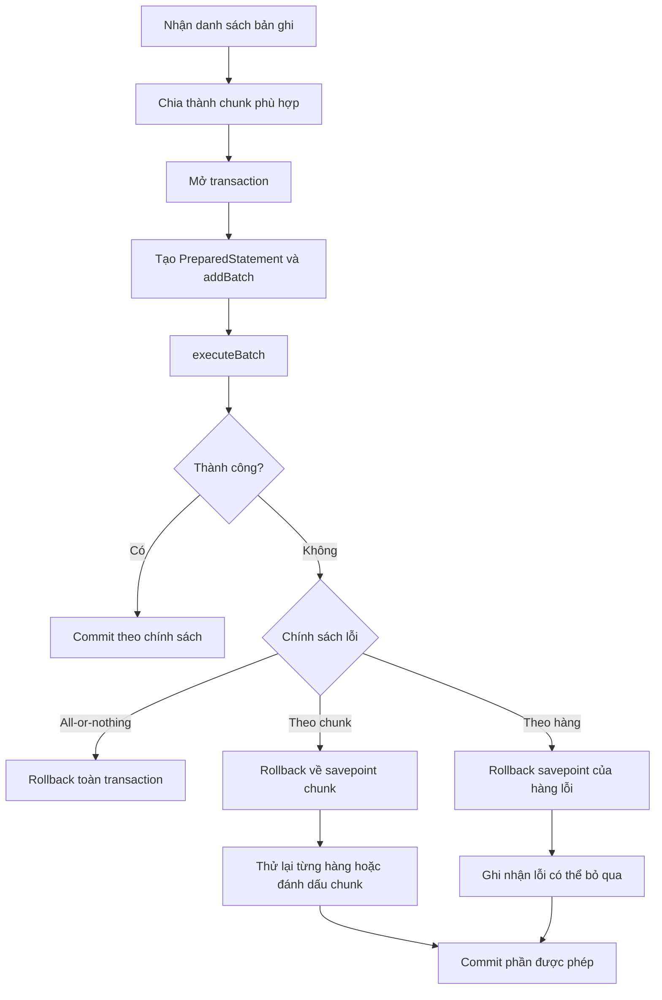
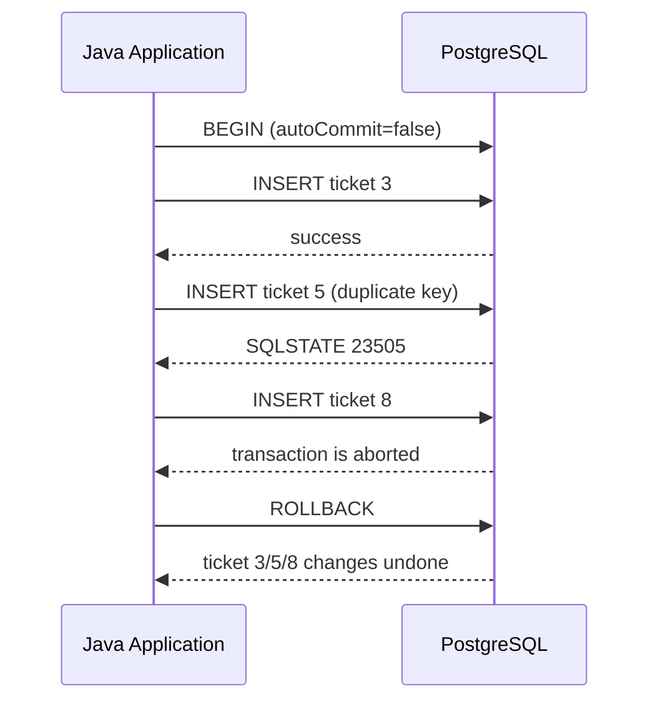

# Thực thi theo lô và xử lý lỗi từng phần

Ứng dụng thường phải gửi nhiều thao tác SQL có cùng cấu trúc: nhập hàng nghìn đơn hàng, cập nhật trạng thái của một nhóm ticket, ghi nhiều dòng chi tiết hoặc đồng bộ dữ liệu từ một nguồn khác. Gửi từng câu lệnh qua mạng có thể tạo nhiều lượt trao đổi giữa ứng dụng và database. **Thực thi theo lô** (*batch execution*) cho phép gom nhiều thao tác tương tự để giảm chi phí giao tiếp và tăng thông lượng.

Tuy nhiên, một lô có thể chứa một hàng vi phạm khóa duy nhất, khóa ngoại, CHECK, trigger hoặc quy tắc nghiệp vụ. Khi một thao tác thất bại, ứng dụng cần quyết định rõ:

- Hủy toàn bộ lô để bảo đảm **all-or-nothing**?
- Giữ những hàng hợp lệ và bỏ qua từng hàng lỗi?
- Hoàn tác riêng một nhóm nhỏ (*chunk*) rồi thử lại từng bản ghi để tìm lỗi?
- Retry toàn bộ transaction khi lỗi do deadlock hoặc serialization?
- Làm sao biết chính xác những hàng nào đã được commit nếu driver trả BatchUpdateException?

Bài học thuộc chương **SQL trong ứng dụng** của module Database SQL, tập trung vào Java JDBC và các cơ chế transaction của database. Ví dụ chính dùng PreparedStatement, addBatch(), executeBatch(), BatchUpdateException, Savepoint và transaction tường minh.

**Điểm cần phân biệt:** batch là cách gửi/thực thi nhiều lệnh; transaction là cách xác định phạm vi commit/rollback. Một batch không tự động có nghĩa “mọi lệnh cùng thành công hoặc cùng thất bại”. Muốn có tính nguyên tử rõ ràng, ứng dụng phải quản lý transaction phù hợp với DBMS và driver.

## 1. Batch execution là gì?

Giả sử ứng dụng cần thêm 1.000 dòng ticket có cùng cấu trúc:

```sql
INSERT INTO tickets (ticket_id, title, status)
VALUES (?, ?, ?);
```

Nếu gửi từng câu SQL riêng, ứng dụng có thể thực hiện 1.000 lần chuẩn bị/gửi/nhận kết quả. Với batch, ứng dụng chuẩn bị statement một lần, thay tham số và thêm mỗi bộ tham số vào batch, sau đó gửi nhóm lệnh:

```java
PreparedStatement ps = conn.prepareStatement(
    "INSERT INTO tickets (ticket_id, title, status) VALUES (?, ?, ?)"
);

for (Ticket ticket : tickets) {
    ps.setLong(1, ticket.id());
    ps.setString(2, ticket.title());
    ps.setString(3, ticket.status());
    ps.addBatch();
}

int[] counts = ps.executeBatch();
```

Driver và DBMS có thể tối ưu cách truyền và thực thi nhóm lệnh. Tùy driver, một batch có thể được gửi dưới dạng nhiều lệnh, một giao thức batch riêng hoặc được viết lại thành dạng nhiều hàng. Vì thế, không nên giả định batch luôn là **một câu SQL duy nhất** ở phía database.

### 1.1. Batch phù hợp với công việc nào?

- Import nhiều bản ghi cùng schema.
- Cập nhật trạng thái của nhiều đơn.
- Ghi nhiều dòng chi tiết cho một nghiệp vụ.
- Nạp dữ liệu staging theo từng chunk.
- Đồng bộ dữ liệu từ message queue hoặc file.
- Xóa/cập nhật nhiều hàng theo danh sách khóa đã được kiểm soát.

### 1.2. Khi nào không nên gom vào một batch?

- Mỗi thao tác phụ thuộc vào kết quả vừa trả về của thao tác trước và không thể xác định trước tham số.
- Mỗi dòng có logic khác nhau đến mức phải chạy nhiều nhánh SQL riêng.
- Một lệnh cần trả dữ liệu để quyết định có gửi lệnh tiếp theo hay không.
- Lô quá lớn làm tăng bộ nhớ, thời gian giữ khóa và chi phí rollback.
- Nghiệp vụ yêu cầu mỗi bản ghi commit độc lập và có thể được xử lý lại riêng.

Batch là một công cụ tối ưu đường giao tiếp, không phải quy tắc “càng gom nhiều càng tốt”.

## 2. Phân biệt batch, transaction và chunk

Ba khái niệm này liên quan nhưng trả lời các câu hỏi khác nhau.

| Khái niệm | Câu hỏi được giải quyết | Ví dụ |
| --- | --- | --- |
| **Batch** | Gửi nhiều lệnh tương tự như thế nào? | addBatch() rồi executeBatch() |
| **Transaction** | Những thay đổi nào cùng commit hoặc rollback? | setAutoCommit(false), commit(), rollback() |
| **Chunk** | Chia một tập dữ liệu lớn thành các nhóm xử lý ra sao? | 500 bản ghi/chunk |

Một transaction có thể chứa nhiều batch. Một batch có thể được đặt trong transaction. Một chunk có thể tương ứng một transaction hoặc chỉ là một phần của transaction lớn hơn.

### 2.1. Ba chính sách thường gặp

**All-or-nothing:** Mọi hàng của lô cùng commit hoặc toàn bộ transaction rollback. Dùng khi các hàng tạo thành một đơn vị nghiệp vụ không thể chia nhỏ.

**Best-effort theo từng hàng:** Mỗi hàng có savepoint; hàng lỗi được rollback riêng, hàng hợp lệ tiếp tục. Chỉ dùng khi nghiệp vụ cho phép kết quả một phần.

**Best-effort theo chunk:** Một nhóm được thực thi bằng batch; nếu nhóm lỗi, rollback chunk rồi thử lại từng hàng hoặc đánh dấu cả chunk thất bại. Hợp lý với import lớn.

### 2.2. Sơ đồ luồng xử lý



Sơ đồ chỉ thể hiện lựa chọn kiến trúc. Mỗi DBMS có quy tắc transaction và lỗi riêng; một số lỗi làm transaction không thể tiếp tục cho tới khi rollback.

## 3. Bộ dữ liệu thực hành

Ví dụ chính dùng PostgreSQL với bảng ticket. Có thể tạo schema riêng `demo_batch_393` trên database sandbox.

### 3.1. Tạo bảng

```sql
CREATE SCHEMA demo_batch_393;

CREATE TABLE demo_batch_393.tickets (
    ticket_id BIGINT PRIMARY KEY,
    external_key TEXT NOT NULL UNIQUE,
    title TEXT NOT NULL,
    priority INTEGER NOT NULL
        CHECK (priority BETWEEN 1 AND 5),
    status TEXT NOT NULL DEFAULT 'open'
        CHECK (status IN ('open', 'in_progress', 'done')),
    created_at TIMESTAMPTZ NOT NULL DEFAULT CURRENT_TIMESTAMP
);
```

Mỗi hàng có:

- `ticket_id`: khóa chính do ứng dụng cung cấp.
- `external_key`: mã từ hệ thống ngoài, phải duy nhất.
- `title`: nội dung bắt buộc.
- `priority`: từ 1 đến 5.
- `status`: chỉ nhận ba trạng thái đã định nghĩa.

Các ràng buộc giúp tạo lỗi có thể dự đoán khi chạy batch.

### 3.2. Thêm dữ liệu mẫu

```sql
INSERT INTO demo_batch_393.tickets (
    ticket_id, external_key, title, priority, status
)
VALUES
    (1, 'EXT-001', 'Không đăng nhập được', 3, 'open'),
    (2, 'EXT-002', 'Cập nhật hồ sơ', 2, 'open');
```

Dữ liệu đầu vào mẫu để thử batch:

| ticket_id | external_key | title | priority | Tình trạng |
| ---: | --- | --- | ---: | --- |
| 3 | EXT-003 | Không nhận email | 4 | Hợp lệ |
| 4 | EXT-004 | Lỗi thanh toán | 5 | Hợp lệ |
| 5 | EXT-002 | Trùng mã ngoài | 2 | Vi phạm UNIQUE |
| 6 | EXT-006 | Không có tiêu đề | 3 | Vi phạm NOT NULL nếu truyền NULL |
| 7 | EXT-007 | Ưu tiên 9 | 9 | Vi phạm CHECK |
| 8 | EXT-008 | Không cập nhật được | 1 | Hợp lệ |

### 3.3. Xác nhận trạng thái

```sql
SELECT ticket_id, external_key, title, priority, status
FROM demo_batch_393.tickets
ORDER BY ticket_id;
```

Trước khi chạy các ví dụ, bảng chỉ có ticket 1 và 2. Nếu đã chạy thử trước đó, cần reset dữ liệu mẫu theo cách an toàn trong sandbox hoặc dùng ID mới; không xóa dữ liệu chia sẻ.

## 4. JDBC PreparedStatement và addBatch

### 4.1. Chuẩn bị một câu SQL có tham số

Trong Java, dùng PreparedStatement cho các lệnh có cùng cấu trúc:

```java
String sql =
    "INSERT INTO demo_batch_393.tickets " +
    "(ticket_id, external_key, title, priority, status) " +
    "VALUES (?, ?, ?, ?, ?)";

PreparedStatement ps = conn.prepareStatement(sql);
```

Các dấu ? là vị trí tham số. Giá trị được bind bằng các phương thức như setLong, setString, setInt, setNull, setBigDecimal, thay vì ghép dữ liệu người dùng vào chuỗi SQL.

### 4.2. Thêm nhiều bộ tham số vào batch

```java
for (TicketInput ticket : tickets) {
    ps.setLong(1, ticket.id());
    ps.setString(2, ticket.externalKey());
    ps.setString(3, ticket.title());
    ps.setInt(4, ticket.priority());
    ps.setString(5, "open");

    ps.addBatch();
}

int[] counts = ps.executeBatch();
```

addBatch() lưu bộ tham số hiện tại như một phần tử trong batch. executeBatch() yêu cầu driver thực thi những phần tử đã được thêm.

Mỗi vòng lặp cần gán **đầy đủ mọi tham số** của câu SQL. Nếu bỏ quên một tham số, driver có thể báo lỗi tham số chưa được thiết lập hoặc giữ giá trị cũ tùy cách quản lý statement; hãy viết code sao cho không phụ thuộc vào giá trị còn sót.

### 4.3. PreparedStatement và Statement

| Loại | Cách thêm batch | Phù hợp |
| --- | --- | --- |
| Statement | addBatch("UPDATE ...") | Câu SQL khác nhau nhưng đã được tạo an toàn |
| PreparedStatement | Bind tham số rồi addBatch() | Cùng SQL, nhiều bộ dữ liệu |

Không nối trực tiếp input không tin cậy vào Statement.addBatch(String). PreparedStatement vừa tách dữ liệu khỏi cú pháp SQL, vừa tái sử dụng cấu trúc câu lệnh.

### 4.4. clearBatch và clearParameters

- clearBatch() xóa các lệnh đã xếp vào batch nhưng chưa thực thi.
- clearParameters() xóa các giá trị tham số đang bind của prepared statement.
- Đóng statement bằng try-with-resources khi hoàn tất.

Không cần gọi clearParameters() sau mỗi lần addBatch() trong ví dụ thông thường; các giá trị tham số hiện tại được chụp vào batch theo hợp đồng JDBC. Tuy vậy, cần gán đầy đủ các tham số cho lần bind tiếp theo.

## 5. Ví dụ Java: batch nguyên tử trong một transaction

Chính sách: **nếu bất kỳ ticket nào lỗi, không ticket nào trong lô được commit**.

### 5.1. Mô hình dữ liệu Java

Ví dụ dưới đây dùng Java 8+ và không phụ thuộc record:

```java
public final class TicketInput {
    private final long id;
    private final String externalKey;
    private final String title;
    private final int priority;

    public TicketInput(
            long id,
            String externalKey,
            String title,
            int priority
    ) {
        this.id = id;
        this.externalKey = externalKey;
        this.title = title;
        this.priority = priority;
    }

    public long id() { return id; }
    public String externalKey() { return externalKey; }
    public String title() { return title; }
    public int priority() { return priority; }
}
```

### 5.2. Hàm insertAtomically

```java
import java.sql.Connection;
import java.sql.PreparedStatement;
import java.sql.SQLException;
import java.util.List;
import javax.sql.DataSource;

public final class TicketBatchWriter {
    private final DataSource dataSource;

    public TicketBatchWriter(DataSource dataSource) {
        this.dataSource = dataSource;
    }

    public int[] insertAtomically(List<TicketInput> tickets)
            throws SQLException {

        String sql =
            "INSERT INTO demo_batch_393.tickets " +
            "(ticket_id, external_key, title, priority, status) " +
            "VALUES (?, ?, ?, ?, 'open')";

        try (Connection conn = dataSource.getConnection()) {
            conn.setAutoCommit(false);

            try (PreparedStatement ps = conn.prepareStatement(sql)) {
                for (TicketInput ticket : tickets) {
                    ps.setLong(1, ticket.id());
                    ps.setString(2, ticket.externalKey());
                    ps.setString(3, ticket.title());
                    ps.setInt(4, ticket.priority());
                    ps.addBatch();
                }

                int[] counts = ps.executeBatch();
                conn.commit();
                return counts;

            } catch (SQLException | RuntimeException error) {
                try {
                    conn.rollback();
                } catch (SQLException rollbackError) {
                    error.addSuppressed(rollbackError);
                }
                throw error;
            }
        }
    }
}
```

Các điểm quan trọng:

1. setAutoCommit(false) mở transaction do ứng dụng quản lý.
2. Mọi phần tử được xếp vào cùng batch.
3. Chỉ gọi commit() khi executeBatch() hoàn tất không ném lỗi.
4. Nếu có SQLException hoặc lỗi runtime trong lúc chuẩn bị/thực thi, gọi rollback().
5. Nếu rollback cũng lỗi, lỗi rollback được gắn vào lỗi ban đầu bằng addSuppressed().
6. Connection và PreparedStatement được đóng nhờ try-with-resources.

Trong thực tế, nên đặt phần chuẩn bị tham số và batch trong phạm vi quản lý lỗi như ví dụ. Nếu transaction bắt đầu rồi code thoát bằng một lỗi khác ngoài SQLException/RuntimeException đã bắt, connection phải được xử lý theo chính sách pool/transaction của ứng dụng. Không trả connection còn transaction dang dở vào pool.

### 5.3. Vì sao cần setAutoCommit(false)?

Một connection JDBC mới thường ở chế độ auto-commit. Khi auto-commit bật, mỗi câu lệnh được xác nhận theo cơ chế driver/database sau khi hoàn tất. Không nên giả định một lần executeBatch() trong auto-commit luôn tạo một đơn vị nguyên tử bao trùm tất cả phần tử trên mọi driver.

Nếu cần **toàn bộ lô cùng commit hoặc rollback**, hãy tắt auto-commit, thực thi batch và gọi commit/rollback tường minh.

### 5.4. Không đặt commit trong vòng lặp

Mẫu không phù hợp với all-or-nothing:

```java
for (TicketInput ticket : tickets) {
    insertOne(conn, ticket);
    conn.commit();
}
```

Mỗi lần commit làm mất khả năng rollback toàn bộ lô nếu hàng sau lỗi. Đây là chính sách “mỗi hàng một transaction”, không phải transaction nguyên tử cho cả batch.

## 6. Kết quả executeBatch và BatchUpdateException

executeBatch() trả về int[] có các mã kết quả cho những lệnh trong batch.

### 6.1. Các giá trị thường gặp

| Giá trị | Hằng JDBC | Ý nghĩa |
| ---: | --- | --- |
| Số nguyên không âm | Số hàng bị ảnh hưởng | Driver báo số hàng cập nhật/thêm/xóa |
| -2 | Statement.SUCCESS_NO_INFO | Lệnh thành công nhưng không xác định được số hàng ảnh hưởng |
| -3 | Statement.EXECUTE_FAILED | Lệnh được ghi nhận là thất bại trong kết quả batch |

Không so sánh tất cả giá trị với 1. Một số thao tác hợp lệ có thể ảnh hưởng 0 hàng; một số driver trả SUCCESS_NO_INFO dù lệnh thành công.

### 6.2. BatchUpdateException

Nếu một lệnh trong batch lỗi, driver có thể ném BatchUpdateException, là lớp con của SQLException.

```java
try {
    int[] counts = ps.executeBatch();
    System.out.println("Batch completed: " + counts.length);
} catch (BatchUpdateException error) {
    int[] counts = error.getUpdateCounts();

    System.err.println(
        "Batch failed; reported update counts = " + counts.length
    );

    for (int i = 0; i < counts.length; i++) {
        int count = counts[i];

        if (count == Statement.EXECUTE_FAILED) {
            System.err.println("Command " + i + " failed");
        } else if (count == Statement.SUCCESS_NO_INFO) {
            System.out.println(
                "Command " + i + " succeeded; row count unknown"
            );
        } else {
            System.out.println(
                "Command " + i + " affected " + count + " rows"
            );
        }
    }

    throw error;
}
```

getUpdateCounts() chứa thông tin driver báo về các lệnh đã xử lý. **Không được giả định mảng luôn có đúng một phần tử cho mỗi lệnh ban đầu**, hoặc rằng mọi driver luôn dừng/luôn tiếp tục ở cùng vị trí sau lỗi.

Một driver có thể dừng tại lệnh lỗi; driver khác có thể tiếp tục xử lý những lệnh còn lại và báo EXECUTE_FAILED ở vị trí tương ứng. Số phần tử và nội dung update counts phụ thuộc hành vi driver theo JDBC và cách batch được gửi.

### 6.3. Không suy ra dữ liệu đã commit chỉ từ update counts

Một BatchUpdateException có thể cho biết một số lệnh đã thực thi trước khi gặp lỗi. Nhưng nếu batch nằm trong transaction tường minh và ứng dụng rollback, **những lệnh thành công trước lỗi cũng không còn được commit**.

Ngược lại, với auto-commit hoặc driver/database có cách thực thi khác, một phần kết quả có thể đã được xác nhận. Vì thế:

- Update counts mô tả kết quả thực thi do driver báo.
- Transaction/commit xác định dữ liệu nào bền vững.
- Truy vấn đối soát hoặc idempotency key giúp xác định kết quả khi trạng thái commit không chắc chắn.

### 6.4. Duyệt chuỗi exception

Một lỗi có thể mang thông tin bổ sung qua getNextException():

```java
SQLException current = error;

while (current != null) {
    System.err.println("SQLState: " + current.getSQLState());
    System.err.println("Vendor code: " + current.getErrorCode());
    System.err.println("Message: " + current.getMessage());

    current = current.getNextException();
}
```

Đừng ghi log password, token, dữ liệu cá nhân hoặc toàn bộ payload nhạy cảm khi in lỗi. Chỉ log định danh tương quan, SQLState, tên constraint nếu driver cung cấp và thông tin đã được phép.

### 6.5. Batch lớn và executeLargeBatch

JDBC 4.2 (Java 8+) có executeLargeBatch() trả long[] để hỗ trợ số lượng cập nhật vượt phạm vi int:

```java
long[] counts = ps.executeLargeBatch();
```

BatchUpdateException cũng có getLargeUpdateCounts() trong JDBC tương ứng. Driver cần hỗ trợ API và kiểu kết quả này; nếu dùng driver cũ, executeBatch() vẫn là lựa chọn tương thích phổ biến hơn.

## 7. Vì sao một hàng lỗi có thể làm hỏng cả transaction?

Giả sử batch chứa ba thao tác:

```text
1. INSERT ticket 3 — hợp lệ
2. INSERT ticket 5 — trùng external_key
3. INSERT ticket 8 — hợp lệ
```

Với PostgreSQL, nếu các lệnh chạy trong một transaction và lệnh thứ hai gặp lỗi SQL không được xử lý, transaction bị chuyển sang trạng thái thất bại. Những câu SQL tiếp theo trong transaction thường bị từ chối cho tới khi rollback hoặc rollback tới savepoint phù hợp.

Luồng:



Ngay cả khi driver trả update count cho ticket 3 là thành công, ticket 3 vẫn bị rollback nếu ứng dụng rollback toàn transaction.

### 7.1. Statement atomicity và transaction atomicity

Hai mức cần phân biệt:

- **Statement atomicity:** thay đổi do một câu SQL thất bại không để lại trạng thái dở dang theo ngữ nghĩa DBMS.
- **Transaction atomicity:** mọi thay đổi transactional của transaction chưa commit cùng được xác nhận hoặc hủy.

Batch JDBC có thể chứa nhiều statement. Transaction có thể chứa nhiều batch và các statement khác nữa.

### 7.2. Khi nào một phần có thể được giữ?

Nếu ứng dụng dùng auto-commit, chia từng lệnh thành transaction riêng, hoặc dùng savepoint để phục hồi riêng phần lỗi, một số thay đổi trước/sau lỗi có thể được commit theo chính sách. Nhưng đây là quyết định thiết kế rõ ràng, không phải thuộc tính tự động của executeBatch().

## 8. Xử lý lỗi từng phần bằng SAVEPOINT

Nếu nghiệp vụ cho phép giữ những ticket hợp lệ và bỏ qua ticket lỗi, có thể tạo savepoint trước mỗi hàng. Khi một lệnh lỗi, rollback tới savepoint đó rồi tiếp tục.

### 8.1. Ý tưởng

```text
BEGIN TRANSACTION
  SAVEPOINT row_1
  INSERT ticket 3
  RELEASE row_1

  SAVEPOINT row_2
  INSERT ticket 5 → lỗi UNIQUE
  ROLLBACK TO row_2
  RELEASE row_2

  SAVEPOINT row_3
  INSERT ticket 8
  RELEASE row_3
COMMIT
```

Kết quả: ticket 3 và 8 được commit; ticket 5 bị bỏ qua và ghi nhận là thất bại.

### 8.2. Java: xử lý từng hàng bằng savepoint

Đây là ví dụ cho PostgreSQL/DBMS hỗ trợ savepoint và transaction. isSkippableDataError() phải được định nghĩa theo **hợp đồng lỗi nghiệp vụ** của ứng dụng, không phải bỏ qua mọi lỗi SQL.

```java
import java.sql.Connection;
import java.sql.PreparedStatement;
import java.sql.SQLException;
import java.sql.Savepoint;
import java.util.ArrayList;
import java.util.List;

public final class PartialBatchWriter {

    public static final class Failure {
        private final long ticketId;
        private final String sqlState;
        private final String message;

        public Failure(long ticketId, SQLException error) {
            this.ticketId = ticketId;
            this.sqlState = error.getSQLState();
            this.message = error.getMessage();
        }

        public long ticketId() { return ticketId; }
        public String sqlState() { return sqlState; }
        public String message() { return message; }
    }

    public static final class Result {
        private final int inserted;
        private final List<Failure> failures;

        public Result(int inserted, List<Failure> failures) {
            this.inserted = inserted;
            this.failures = failures;
        }

        public int inserted() { return inserted; }
        public List<Failure> failures() { return failures; }
    }

    private static boolean isSkippableDataError(SQLException error) {
        String state = error.getSQLState();

        // Chỉ bỏ qua một số lỗi dữ liệu đã được nghiệp vụ duyệt.
        // 23505: unique_violation (PostgreSQL)
        // 23514: check_violation (PostgreSQL)
        return "23505".equals(state) || "23514".equals(state);
    }

    public static Result insertBestEffort(
            Connection conn,
            List<TicketInput> tickets
    ) throws SQLException {

        if (conn.getAutoCommit()) {
            throw new SQLException(
                "Best-effort savepoint mode requires autoCommit=false"
            );
        }

        String sql =
            "INSERT INTO demo_batch_393.tickets " +
            "(ticket_id, external_key, title, priority, status) " +
            "VALUES (?, ?, ?, ?, 'open')";

        int inserted = 0;
        List<Failure> failures = new ArrayList<>();

        try (PreparedStatement ps = conn.prepareStatement(sql)) {
            for (TicketInput ticket : tickets) {
                Savepoint savepoint = conn.setSavepoint();

                try {
                    ps.setLong(1, ticket.id());
                    ps.setString(2, ticket.externalKey());
                    ps.setString(3, ticket.title());
                    ps.setInt(4, ticket.priority());

                    ps.executeUpdate();
                    conn.releaseSavepoint(savepoint);
                    inserted++;

                } catch (SQLException error) {
                    try {
                        conn.rollback(savepoint);
                    } catch (SQLException rollbackError) {
                        error.addSuppressed(rollbackError);
                        throw error;
                    }

                    if (!isSkippableDataError(error)) {
                        throw error;
                    }

                    failures.add(new Failure(ticket.id(), error));
                    conn.releaseSavepoint(savepoint);
                }
            }
        }

        return new Result(inserted, failures);
    }
}
```

### 8.3. Caller phải quyết định commit hay rollback

Phương thức trên **không tự commit**. Caller sở hữu transaction:

```java
try (Connection conn = dataSource.getConnection()) {
    conn.setAutoCommit(false);

    try {
        PartialBatchWriter.Result result =
            PartialBatchWriter.insertBestEffort(conn, tickets);

        // Kết quả lỗi có thể được ghi vào nơi phù hợp
        // nếu muốn cùng commit với những hàng hợp lệ.
        conn.commit();

        System.out.println("Inserted: " + result.inserted());
        System.out.println("Rejected: " + result.failures().size());

    } catch (SQLException | RuntimeException error) {
        try {
            conn.rollback();
        } catch (SQLException rollbackError) {
            error.addSuppressed(rollbackError);
        }
        throw error;
    }
}
```

Nếu bất kỳ lỗi không thể bỏ qua nào xảy ra, caller rollback toàn transaction. Những hàng trước đó trong transaction cũng không được commit.

### 8.4. Vì sao không bắt mọi SQLException rồi tiếp tục?

Lỗi có thể là:

- Lỗi dữ liệu có thể bỏ qua theo nghiệp vụ, như duplicate key.
- Lỗi kết nối database.
- Deadlock/serialization failure.
- Thiếu quyền.
- Lỗi cú pháp SQL.
- Lỗi cấu hình hoặc lỗi driver.
- Transaction không thể tiếp tục.

Nếu nuốt tất cả lỗi, ứng dụng có thể báo “đã xử lý xong” trong khi connection mất, transaction bị hủy hoặc cấu hình sai.

Chỉ tiếp tục với **một danh sách lỗi đã được xác định có thể bỏ qua**. Với lỗi kết nối hoặc lỗi transaction, thường phải dừng và xử lý ở phạm vi toàn transaction.

### 8.5. Giới hạn của ví dụ

- releaseSavepoint() có thể không được hỗ trợ hoặc có hành vi khác theo driver; xử lý lỗi phù hợp.
- Một số lỗi nghiêm trọng khiến rollback tới savepoint cũng thất bại; khi đó phải rollback toàn transaction/loại connection.
- Failure trong ví dụ giữ message để minh họa; production nên tránh ghi dữ liệu nhạy cảm trong message.
- Nếu ghi danh sách lỗi vào bảng trong cùng transaction rồi rollback toàn transaction, chính danh sách lỗi ấy cũng rollback. Muốn lưu kết quả từ chối lâu dài, cần thiết kế đường ghi sau rollback hoặc hệ thống log phù hợp.

## 9. Batch theo chunk và fallback khi một nhóm lỗi

Với hàng triệu bản ghi, một savepoint cho mỗi hàng có thể tốn chi phí. Một cách cân bằng là chia thành chunk, ví dụ 200 hoặc 500 bản ghi, rồi gửi mỗi chunk bằng executeBatch().

Các con số chỉ minh họa; cần đo theo kích thước payload, latency, driver, index, trigger, lock và tài nguyên DB.

### 9.1. Quy trình chunk

```text
Danh sách 10.000 hàng
  ├── Chunk 1: 500 hàng → batch thành công → giữ
  ├── Chunk 2: 500 hàng → lỗi → rollback chunk
  │       └── thử lại từng hàng để tìm bản ghi lỗi
  ├── Chunk 3: 500 hàng → batch thành công → giữ
  └── ...
COMMIT transaction theo chính sách import
```

Nếu toàn bộ import là một đơn vị atomic, chỉ commit sau khi tất cả chunk hoàn tất; một chunk không thể phục hồi sẽ rollback **toàn transaction**.

Nếu import chấp nhận từng chunk độc lập, mỗi chunk có thể là một transaction riêng. Khi đó các chunk trước đã commit vẫn tồn tại nếu chunk sau thất bại. Phải ghi nhận checkpoint để có thể tiếp tục từ đúng vị trí.

### 9.2. Savepoint cho mỗi chunk

```java
conn.setAutoCommit(false);

Savepoint chunkSavepoint = conn.setSavepoint();

try {
    // Add các phần tử của chunk vào PreparedStatement.
    // ps.executeBatch();
    conn.releaseSavepoint(chunkSavepoint);

} catch (BatchUpdateException error) {
    conn.rollback(chunkSavepoint);

    // Batch đã được hoàn tác về đầu chunk.
    // Có thể thử lại từng hàng bằng savepoint riêng
    // nếu nghiệp vụ cho phép partial success.
}
```

Nếu batch đã thực thi một số lệnh trước khi lỗi, rollback về savepoint sẽ hoàn tác những thay đổi transactional sau savepoint trong các engine hỗ trợ transaction. Đây là lý do quan trọng để đặt savepoint **trước khi gửi chunk**.

### 9.3. Fallback từng hàng để xác định lỗi

Sau khi rollback chunk, có thể:

1. Tạo savepoint cho từng hàng.
2. Thực thi từng hàng bằng cùng prepared statement.
3. Rollback hàng lỗi.
4. Ghi mã lỗi và định danh hàng.
5. Giữ những hàng hợp lệ nếu nghiệp vụ cho phép.

Cách này tốn nhiều round-trip hơn batch ban đầu nhưng chỉ áp dụng cho chunk có lỗi, giúp cân bằng hiệu năng và khả năng chẩn đoán.

### 9.4. Không dùng update counts làm checkpoint commit

Không đánh dấu chunk “đã commit” chỉ vì executeBatch() trả về đủ update counts. Phải xác nhận commit() thành công và cập nhật checkpoint trong một thiết kế transaction nhất quán.

Nếu checkpoint lưu trong database, lý tưởng là ghi checkpoint **trong cùng transaction** với các hàng của chunk. Nếu ghi checkpoint sang hệ thống ngoài, cần cơ chế idempotency/đối soát để xử lý tình huống commit thành công nhưng ứng dụng mất kết nối trước khi nhận phản hồi.

## 10. BatchUpdateException: đọc lỗi có kỷ luật

### 10.1. Không giả định driver dừng tại lệnh lỗi

JDBC cho phép driver xử lý batch theo cách phụ thuộc khả năng DBMS. Khi một lệnh thất bại, driver có thể dừng hoặc tiếp tục xử lý những lệnh còn lại theo hành vi được hỗ trợ; BatchUpdateException chứa update counts được driver báo.

Vì vậy, một batch có 10 lệnh có thể trả:

- Mảng counts ngắn hơn 10 nếu driver dừng sớm.
- Mảng có các vị trí thành công và EXECUTE_FAILED nếu driver tiếp tục.
- SUCCESS_NO_INFO cho lệnh thành công nhưng không xác định số hàng.

Không viết logic “lệnh thứ 4 chắc chắn lỗi vì mảng có 3 phần tử” nếu chưa xác nhận driver và cách batch được triển khai.

### 10.2. Batch rewrite làm thay đổi cách nhìn lỗi

Một số driver có tùy chọn viết lại batch nhiều lệnh thành một câu nhiều hàng hoặc một giao thức hiệu quả hơn. Điều này có thể cải thiện hiệu năng, nhưng **độ chi tiết lỗi và update counts** có thể khác với thực thi từng câu lệnh riêng.

Ví dụ PostgreSQL JDBC có tùy chọn tối ưu batch insert như `reWriteBatchedInserts` ở những phiên bản driver phù hợp. Khi bật/tắt, hãy kiểm tra cả:

- Hiệu năng.
- Kết quả update counts.
- Cách lỗi unique/check được báo.
- Khả năng xác định hàng lỗi.
- Hành vi transaction/rollback.

Không phụ thuộc vào thứ tự lỗi cụ thể khi thay đổi phiên bản driver hoặc cấu hình rewrite.

### 10.3. SQLState giúp phân loại nhóm lỗi

| SQLState class | Ý nghĩa khái quát | Cách xử lý thường gặp |
| --- | --- | --- |
| `23` | Integrity constraint violation | Kiểm tra dữ liệu/constraint; có thể bỏ qua theo chính sách |
| `40` | Transaction rollback | Xem xét retry toàn transaction với giới hạn |
| `08` | Connection exception | Kiểm tra kết nối; kết quả commit có thể chưa rõ |
| `42` | Syntax/access rule violation | Sửa SQL/quyền/schema, không retry mù |
| `25` | Invalid transaction state | Kiểm tra trạng thái transaction và rollback/savepoint |

Ví dụ PostgreSQL:

- `23505`: unique violation.
- `23503`: foreign key violation.
- `23514`: check violation.
- `40001`: serialization failure.
- `40P01`: deadlock detected.
- `25P02`: transaction đang ở trạng thái lỗi.

SQLState chuẩn và vendor code cụ thể phụ thuộc DBMS. Không dùng một mã PostgreSQL như hợp đồng đa DBMS mà không có lớp ánh xạ.

### 10.4. Lỗi duplicate có thể là xung đột nghiệp vụ hợp lệ

Một external key đã tồn tại có thể có ba ý nghĩa:

- Đây là bản ghi trùng cần từ chối.
- Đây là retry của một thông điệp đã xử lý thành công, cần trả lại kết quả cũ.
- Đây là yêu cầu cập nhật bản ghi hiện tại, phù hợp UPSERT.

Không phải cứ gặp 23505 là bỏ qua an toàn. Ứng dụng phải biết **idempotency key** hoặc quy tắc đồng bộ nào đang được sử dụng.

## 11. Retry: chỉ retry đúng loại lỗi và đúng phạm vi

Batch có thể lỗi vì dữ liệu hoặc vì xung đột đồng thời. Hai loại này không nên xử lý giống nhau.

### 11.1. Lỗi dữ liệu thường không tự hết khi retry

Ví dụ:

- NOT NULL bị vi phạm.
- CHECK bị vi phạm.
- Khóa ngoại không tồn tại.
- Dữ liệu không parse được.
- Một khóa duy nhất bị trùng với bản ghi đã tồn tại và nghiệp vụ không định nghĩa upsert.

Gửi lại đúng batch với cùng dữ liệu thường chỉ tạo lại cùng lỗi. Cần sửa dữ liệu, đánh dấu từ chối hoặc áp dụng quy tắc nghiệp vụ đã định.

### 11.2. Deadlock và serialization failure có thể retry

Một transaction có thể bị hủy vì hai giao dịch cạnh tranh khóa hoặc mức cô lập yêu cầu serialization.

Với PostgreSQL, 40001 và 40P01 là những trường hợp thường được xem xét retry **toàn bộ transaction**.

Không retry chỉ câu SQL cuối cùng nếu transaction trước đó đã rollback; cần chạy lại logic đọc–kiểm tra–ghi từ đầu để quyết định dựa trên trạng thái mới.

### 11.3. Retry có giới hạn và backoff

Mẫu khái niệm:

```java
int maxAttempts = 3;

for (int attempt = 1; attempt <= maxAttempts; attempt++) {
    try {
        executeWholeTransaction();
        break;
    } catch (SQLException error) {
        if (!isRetryableTransactionError(error)
                || attempt == maxAttempts) {
            throw error;
        }

        sleepWithBackoffAndJitter(attempt);
    }
}
```

executeWholeTransaction() phải tạo/hoàn tất transaction mới mỗi lần. sleepWithBackoffAndJitter() là hàm minh họa; production cần timeout, interrupt handling, giới hạn tổng thời gian và tránh retry đồng loạt gây quá tải.

### 11.4. Idempotency khi không biết COMMIT đã thành công chưa

Một tình huống khó:

1. Ứng dụng gửi COMMIT.
2. Database commit thành công.
3. Kết nối bị ngắt trước khi ứng dụng nhận được phản hồi.
4. Ứng dụng không biết transaction đã commit hay chưa.

Nếu retry một batch tạo đơn mà không có idempotency, ứng dụng có thể tạo đơn lặp hoặc nhận duplicate key.

Giải pháp thường là:

- Mỗi yêu cầu có idempotency key ổn định.
- Database có UNIQUE constraint bảo vệ key.
- Lưu kết quả xử lý của key trong cùng transaction.
- Khi retry, truy vấn kết quả đã lưu và trả lại thay vì thực hiện nghiệp vụ lần nữa.

Không coi BatchUpdateException hoặc lỗi kết nối sau commit() là bằng chứng chắc chắn mọi thay đổi chưa được commit.

## 12. Idempotency và UPSERT trong batch

### 12.1. Dùng external_key làm idempotency key

Bảng demo đã có:

```sql
external_key TEXT NOT NULL UNIQUE
```

Đây là rào cản chống tạo hai ticket cùng khóa ngoài. Nhưng để retry an toàn, còn cần xác định khi khóa đã tồn tại thì phải làm gì.

### 12.2. PostgreSQL ON CONFLICT DO NOTHING

Ví dụ:

```sql
INSERT INTO demo_batch_393.tickets (
    ticket_id, external_key, title, priority, status
)
VALUES (?, ?, ?, ?, 'open')
ON CONFLICT (external_key) DO NOTHING;
```

Lệnh có thể thành công về mặt SQL nhưng ảnh hưởng 0 hàng khi external_key đã tồn tại. Vì thế update count bằng 0 không đồng nghĩa lỗi.

### 12.3. PostgreSQL ON CONFLICT DO UPDATE

Nếu nghiệp vụ muốn cập nhật ticket đã tồn tại:

```sql
INSERT INTO demo_batch_393.tickets (
    ticket_id, external_key, title, priority, status
)
VALUES (?, ?, ?, ?, 'open')
ON CONFLICT (external_key)
DO UPDATE SET
    title = EXCLUDED.title,
    priority = EXCLUDED.priority;
```

Đây là một chính sách đồng bộ cụ thể. Cần quyết định:

- Có được ghi đè status không?
- Có cần giữ ticket đã done không?
- ticket_id từ nguồn ngoài có được thay đổi không?
- Nếu cùng key đến từ hai worker, bản ghi mới hơn được xác định bằng timestamp/version nào?

UPSERT không tự giải quyết xung đột nghiệp vụ về thứ tự sự kiện.

### 12.4. Idempotency không có nghĩa mọi lần chạy lại đều vô hại

Một batch có thể gửi email, trừ tiền hoặc phát event ngoài database. Nếu transaction database rollback nhưng side effect ngoài DB đã xảy ra, retry có thể gửi/trừ lần nữa.

Dùng transactional outbox, idempotency key cho consumer và cơ chế deduplicate ở dịch vụ ngoài. Không gọi API/email trực tiếp trong vòng lặp batch rồi cho rằng rollback database sẽ hủy chúng.

## 13. Generated keys và kết quả của batch

Một ứng dụng đôi khi cần ID database sinh ra để ghi bảng con sau khi insert bảng cha.

### 13.1. getGeneratedKeys

JDBC có API:

```java
PreparedStatement ps = conn.prepareStatement(
    "INSERT INTO tickets (external_key, title, priority, status) " +
    "VALUES (?, ?, ?, 'open')",
    Statement.RETURN_GENERATED_KEYS
);
```

Sau khi thực thi, ứng dụng có thể gọi getGeneratedKeys(). Nhưng hỗ trợ **nhiều generated keys trong batch** phụ thuộc driver/DBMS và phiên bản; không giả định mảng keys luôn ánh xạ chính xác với mọi lệnh trong batch khi có conflict hoặc lỗi.

### 13.2. Preassign ID nếu cần quan hệ cha–con rõ ràng

Với import nhiều bảng có FK, một lựa chọn là tạo ID ổn định ở ứng dụng (UUID hoặc ID từ hệ thống nguồn) trước khi batch:

```text
orders:
  order_id = 8f... (đã biết)

order_items:
  order_id = 8f... (tham chiếu cùng ID)
```

Nhờ đó, batch parent và child có thể được xây dựng mà không phải đọc lại generated key cho từng hàng.

### 13.3. PostgreSQL RETURNING

PostgreSQL hỗ trợ INSERT ... RETURNING, nhưng cách JDBC driver kết hợp RETURNING với batch và generated keys có khác biệt. Nếu cần ánh xạ ID chính xác, hãy kiểm tra driver thực tế; đôi khi thực thi một multi-row insert với RETURNING phù hợp hơn hoặc dùng ID do ứng dụng tạo.

### 13.4. Không suy luận vị trí generated key từ update counts

Một lệnh ON CONFLICT DO NOTHING có thể ảnh hưởng 0 hàng, trong khi lệnh kế tiếp insert thành công. Nếu driver chỉ trả các generated keys thành công, vị trí của key có thể không còn khớp chỉ số lệnh ban đầu theo giả định của ứng dụng.

Dùng business key ổn định để ánh xạ kết quả, hoặc kiểm tra chính xác hợp đồng driver. Không nối generated keys với input chỉ dựa trên thứ tự nếu driver không bảo đảm.

## 14. Chia batch và chọn kích thước chunk

Batch quá nhỏ gây nhiều lượt giao tiếp; batch quá lớn có thể tăng memory, thời gian giữ khóa, thời gian rollback và độ khó xác định hàng lỗi.

### 14.1. Những yếu tố ảnh hưởng

- Số cột và kích thước payload mỗi hàng.
- Latency giữa application và database.
- Driver có rewrite batch hay không.
- Index, foreign key, trigger và constraint.
- Mức độ tranh chấp khóa.
- Bộ nhớ phía ứng dụng và database.
- Thời gian transaction được phép mở.
- Khả năng retry và phục hồi từ checkpoint.

### 14.2. Không có batch size tối ưu chung

Có thể thử các mức như 100, 250, 500, 1.000 hàng/chunk trên dữ liệu đại diện, đo:

- Rows/second.
- P50/P95 latency mỗi chunk.
- CPU, I/O, WAL/redo.
- Số deadlock/serialization failure.
- Bộ nhớ heap của ứng dụng.
- Tỷ lệ lỗi và thời gian xử lý fallback.
- Thời gian rollback khi chunk thất bại.

Đây là cách chọn dựa trên đo đạc, không phải quy tắc “500 luôn tốt nhất”.

### 14.3. Chunk và transaction boundary

| Chiến lược | Ưu điểm | Hệ quả |
| --- | --- | --- |
| Một transaction cho toàn import | Toàn bộ import atomic | Transaction dài, rollback lớn, giữ khóa lâu |
| Một transaction mỗi chunk | Checkpoint và retry theo chunk dễ hơn | Các chunk trước có thể đã commit khi chunk sau lỗi |

Nếu chọn transaction mỗi chunk, cần lưu tiến độ và thiết kế idempotency để chạy lại không tạo bản ghi trùng.

### 14.4. Ví dụ chia danh sách thành chunk trong Java

```java
static <T> List<List<T>> chunks(List<T> items, int chunkSize) {
    if (chunkSize <= 0) {
        throw new IllegalArgumentException("chunkSize must be positive");
    }

    List<List<T>> result = new ArrayList<>();

    for (int start = 0; start < items.size(); start += chunkSize) {
        int end = Math.min(start + chunkSize, items.size());
        result.add(items.subList(start, end));
    }

    return result;
}
```

subList() là view trên danh sách gốc; không sửa danh sách trong lúc các chunk đang được xử lý. Với import streaming lớn, nên đọc từng chunk từ nguồn thay vì materialize toàn bộ dữ liệu trong bộ nhớ.

## 15. Thứ tự batch và quan hệ khóa ngoại

Khi import dữ liệu có quan hệ cha–con, thứ tự thực thi có thể quyết định FK có hợp lệ hay không.

Ví dụ:

```text
customers
  └── orders
        └── order_items
```

Nếu FK được kiểm tra ngay khi statement thực thi:

1. Chèn customers.
2. Chèn orders tham chiếu customers.
3. Chèn order_items tham chiếu orders.

Chạy batch order_items trước khi orders tồn tại có thể bị từ chối.

### 15.1. Một transaction, nhiều batch theo thứ tự

```java
conn.setAutoCommit(false);

try {
    batchInsertCustomers(conn, customers);
    batchInsertOrders(conn, orders);
    batchInsertOrderItems(conn, items);

    conn.commit();
} catch (SQLException | RuntimeException error) {
    try {
        conn.rollback();
    } catch (SQLException rollbackError) {
        error.addSuppressed(rollbackError);
    }
    throw error;
}
```

Nếu batch order_items lỗi, cả customers và orders chưa commit cũng bị rollback theo transaction all-or-nothing.

### 15.2. Deferred constraints

Một số DBMS, bao gồm PostgreSQL với constraint phù hợp, cho phép trì hoãn kiểm tra FK tới cuối transaction. Nhưng không phải mọi constraint đều deferrable, và không nên dùng deferred để thay thế một thứ tự ghi dễ hiểu nếu không cần.

Nếu constraint deferred, một batch có thể hoàn tất nhưng COMMIT mới phát hiện tham chiếu không hợp lệ. Caller phải xử lý lỗi ở commit như một lỗi transaction.

### 15.3. Trigger và batch

Trigger có thể chạy cho từng hàng hoặc theo statement tùy DBMS. Một batch lớn có thể kích hoạt nhiều lần trigger, tạo audit hoặc cập nhật bảng khác. Khi đo hiệu năng, phải tính cả công việc trigger và các index/constraint bị tác động, không chỉ thời gian truyền batch.

## 16. Savepoint theo hàng hay theo chunk?

Không phải lỗi nào cũng nên bỏ qua. Cần chọn granularity phù hợp.

| Cách | Khi phù hợp | Chi phí/đánh đổi |
| --- | --- | --- |
| Không savepoint, rollback toàn transaction | Batch là một đơn vị nghiệp vụ | Đơn giản, atomic; một lỗi hủy cả lô |
| Savepoint mỗi hàng | Mỗi hàng độc lập, lỗi dữ liệu có thể bỏ qua | Nhiều thao tác savepoint, ít tối ưu batch hơn |
| Savepoint mỗi chunk | Lô lớn, chỉ cần rollback nhóm lỗi | Phải fallback để tìm hàng lỗi trong chunk |
| Transaction mỗi chunk | Import có thể commit từng phần | Cần checkpoint/idempotency; không atomic toàn import |

### 16.1. Savepoint chỉ có ý nghĩa trong transaction

Trong JDBC, phải tắt auto-commit trước khi gọi setSavepoint(). Nếu connection ở auto-commit, driver có thể từ chối thao tác savepoint.

### 16.2. PostgreSQL sau lỗi cần rollback về savepoint

Nếu một statement lỗi trong transaction PostgreSQL, transaction ở trạng thái aborted. ROLLBACK TO SAVEPOINT là cách khôi phục phần sau savepoint để tiếp tục, miễn lỗi và connection còn có thể phục hồi.

Không chỉ bắt exception Java rồi gửi câu SQL kế tiếp; database có thể trả 25P02 vì transaction vẫn đang lỗi.

### 16.3. Savepoint không tạo commit riêng

releaseSavepoint() chỉ giải phóng điểm đánh dấu. Nó không commit các thay đổi sau savepoint. Nếu caller rollback toàn transaction, các hàng đã “thành công” trước đó vẫn bị hủy.

### 16.4. Một số lỗi không thể bỏ qua an toàn

Lỗi kết nối, deadlock, serialization failure, mất quyền, cú pháp sai hoặc transaction bị đánh dấu không thể commit thường không phù hợp để tiếp tục theo kiểu best-effort. Cần rollback transaction, phân loại lỗi và có thể retry toàn bộ.

## 17. Khác biệt DBMS ảnh hưởng đến batch và lỗi

JDBC chuẩn hóa API phía Java, nhưng không xóa khác biệt transaction và batch của DBMS.

### 17.1. PostgreSQL

- Một lỗi SQL trong transaction thường làm transaction chuyển sang trạng thái aborted.
- Cần ROLLBACK hoặc ROLLBACK TO SAVEPOINT trước khi tiếp tục.
- Có ON CONFLICT, RETURNING, deferred constraints và các loại trigger riêng.
- PostgreSQL JDBC có thể rewrite batch insert theo tùy chọn driver; cần kiểm tra update counts và lỗi trên đúng phiên bản.
- COPY là công cụ nạp dữ liệu chuyên dụng, có thể phù hợp hơn JDBC batch với import rất lớn.

### 17.2. MySQL/InnoDB

- Transaction và rollback phụ thuộc storage engine; InnoDB hỗ trợ transaction.
- Lỗi constraint trong batch có thể ảnh hưởng transaction theo ngữ cảnh/engine.
- Không suy rộng atomicity sang bảng dùng engine không transactional.
- INSERT ... ON DUPLICATE KEY UPDATE có ngữ nghĩa riêng; update counts và driver behavior cần kiểm tra.
- LOAD DATA là một lựa chọn bulk load khác với JDBC batch.

### 17.3. SQL Server

- JDBC driver có thể thực thi batch trong transaction theo cấu hình và API sử dụng.
- SET XACT_ABORT ON ảnh hưởng cách một số lỗi làm transaction bị hủy.
- XACT_STATE() có thể cho biết transaction còn commit được hay chỉ rollback được trong các khối T-SQL phù hợp.
- SqlBulkCopy (.NET) là công cụ bulk riêng; JDBC driver có API và cơ chế batch riêng.
- Deadlock thường cần retry toàn transaction sau khi DBMS rollback victim.

### 17.4. Oracle Database

- JDBC hỗ trợ batch update và BatchUpdateException; driver có thể cung cấp update counts theo cách riêng.
- Oracle có batch DML và các cơ chế bulk PL/SQL như FORALL, SAVE EXCEPTIONS trong PL/SQL.
- SAVE EXCEPTIONS cho phép thu thập lỗi theo phần tử trong một số bulk operation; không phải cú pháp JDBC chung.
- Cần hiểu rõ transaction, savepoint và hành vi driver Oracle khi batch lỗi.

### 17.5. SQLite

- SQLite có các conflict resolution algorithms như ABORT, FAIL, ROLLBACK, IGNORE, REPLACE.
- Các hành vi này khác nhau về phần thay đổi nào của statement được giữ hoặc hoàn tác.
- JDBC driver bọc SQLite có thể bổ sung đặc tính riêng; kiểm tra đúng phiên bản driver.
- Ghi đồng thời có giới hạn riêng của SQLite; transaction dài có thể giữ khóa và ảnh hưởng writer khác.

### 17.6. Bảng tóm tắt

| DBMS | Điều cần kiểm tra khi batch lỗi |
| --- | --- |
| PostgreSQL | Transaction aborted state, savepoint, deferred constraint, driver rewrite |
| MySQL/InnoDB | Storage engine, autocommit, duplicate handling, update counts |
| SQL Server | XACT_ABORT, XACT_STATE, transaction scope, driver behavior |
| Oracle | Batch error reporting, savepoint, PL/SQL bulk exceptions |
| SQLite | Conflict algorithm, transaction scope, driver wrapping |

**Không suy ra một quy tắc rollback chung chỉ từ việc Java đều ném BatchUpdateException.** Hãy kiểm tra DBMS, driver và cấu hình đang chạy.

## 18. Bulk load không phải lúc nào cũng là JDBC batch

Với hàng triệu hoặc hàng chục triệu hàng, API bulk chuyên dụng có thể nhanh hơn việc gọi addBatch() liên tục.

| Cơ chế | DBMS | Mục tiêu |
| --- | --- | --- |
| JDBC executeBatch() | Nhiều DBMS | Batch DML từ Java |
| PostgreSQL COPY | PostgreSQL | Nạp dữ liệu khối lượng lớn |
| MySQL LOAD DATA | MySQL | Nạp dữ liệu từ file |
| SQL Server bulk mechanisms | SQL Server | Import khối lượng lớn |
| Oracle SQL*Loader / direct path và PL/SQL bulk | Oracle | Nạp/xử lý hàng loạt |
| SQLite transaction + prepared statement | SQLite | Giảm chi phí transaction/prepare khi ghi nhiều hàng |

Bulk load có thể có quy tắc khác về trigger, constraint, logging, error file và atomicity. Đừng tắt constraint hoặc trigger chỉ để tăng tốc mà không có quy trình kiểm tra dữ liệu sau nạp.

## 19. Ghi nhận lỗi từng phần và kết quả import

Một hệ thống import tốt nên trả được:

- Tổng số bản ghi nhận vào.
- Số bản ghi đã commit.
- Số bản ghi bị từ chối.
- Định danh bản ghi lỗi.
- Mã lỗi có thể phân loại.
- Chunk/checkpoint đã hoàn tất.
- Có cần retry hay can thiệp dữ liệu không.

### 19.1. Không lưu lỗi rồi commit dữ liệu không nhất quán

Nếu muốn lưu một hàng lỗi trong bảng import_errors, phải quyết định phạm vi transaction:

- Nếu lỗi là một hàng bị bỏ qua bằng savepoint, có thể ghi lỗi vào bảng kết quả trong transaction còn lại và commit cùng những hàng hợp lệ.
- Nếu toàn transaction rollback, hàng import_errors trong cùng transaction cũng rollback.
- Nếu cần log thất bại của cả transaction, ghi sau khi rollback hoặc qua một hệ thống quan sát độc lập có kiểm soát.

### 19.2. Không ghi toàn bộ dữ liệu nhạy cảm vào error log

Một hàng có thể chứa email, số điện thoại, thông tin thanh toán hoặc token. Log lỗi nên lưu ID tương quan, SQLState, tên constraint và trường lỗi cần thiết; mã hóa/ẩn dữ liệu theo chính sách.

### 19.3. Kết quả partial phải được biểu diễn rõ

Không trả response đơn giản success=true nếu 900/1.000 hàng đã ghi và 100 hàng bị từ chối. Dùng trạng thái thể hiện rõ COMPLETED_WITH_ERRORS hoặc cấu trúc kết quả có inserted, rejected, retryable, chunkId theo hợp đồng API.

Đừng để client tự suy đoán từ update counts nội bộ của JDBC.

## 20. Kiểm thử batch và lỗi từng phần

Một bộ kiểm thử nên chạy trên database thử nghiệm thật với đúng driver và phiên bản được triển khai.

### 20.1. Kiểm thử all-or-nothing

1. Chuẩn bị bảng rỗng hoặc ID mới.
2. Tạo batch gồm hai hàng hợp lệ và một hàng vi phạm UNIQUE.
3. Bắt BatchUpdateException.
4. Rollback transaction.
5. Query lại và xác nhận không hàng nào của batch được commit.
6. Xác nhận dữ liệu trước transaction vẫn còn.

### 20.2. Kiểm thử best-effort với savepoint

1. Tắt auto-commit.
2. Chèn ba hàng, trong đó một hàng vi phạm CHECK.
3. Tạo savepoint trước mỗi hàng.
4. Rollback riêng hàng lỗi.
5. Commit.
6. Xác nhận hai hàng hợp lệ có mặt, hàng lỗi vắng mặt và kết quả import báo đúng định danh.

### 20.3. Kiểm thử chunk fallback

1. Tạo chunk gồm nhiều hàng.
2. Đưa một hàng duplicate vào giữa chunk.
3. Thực thi batch.
4. Khi lỗi, rollback về savepoint chunk.
5. Thực thi lại từng hàng để tìm lỗi.
6. Xác nhận không có bản ghi nào của batch thử đầu tiên bị nhân đôi.

### 20.4. Kiểm thử driver và autocommit

Chạy cùng tập dữ liệu trong hai chế độ:

- autoCommit=true.
- autoCommit=false và commit/rollback tường minh.

Ghi nhận số hàng thực sự tồn tại sau lỗi. Không kết luận dựa vào log update counts một mình.

### 20.5. Kiểm thử lỗi transaction và retry

Dùng hai connection để tạo deadlock hoặc serialization conflict trong sandbox. Xác nhận:

- SQLState được nhận diện.
- Toàn transaction được rollback.
- Retry tạo transaction mới.
- Idempotency key ngăn nghiệp vụ chạy lặp.
- Retry có giới hạn và dừng khi gặp lỗi dữ liệu cố định.

### 20.6. Kiểm thử commit response bị mất

Mô phỏng tình huống connection bị ngắt quanh thời điểm commit nếu môi trường hỗ trợ. Xác nhận ứng dụng dùng idempotency key hoặc truy vấn đối soát để xác định kết quả, không tự động gửi lại một nghiệp vụ không idempotent.

## 21. Checklist thiết kế batch trong ứng dụng

1. SQL trong batch có cùng cấu trúc và dùng PreparedStatement không?
2. Tất cả tham số có được bind lại cho mỗi hàng không?
3. Batch size có được đo trên dữ liệu thực tế không?
4. Transaction boundary đã phản ánh đúng đơn vị nghiệp vụ chưa?
5. Có yêu cầu all-or-nothing hay partial success?
6. Nếu partial success, có savepoint và danh sách lỗi rõ ràng không?
7. Có chỉ bỏ qua những SQLState/lỗi được phép không?
8. Có phân biệt SUCCESS_NO_INFO, EXECUTE_FAILED và update count bằng 0 không?
9. Có tránh suy luận dữ liệu đã commit từ getUpdateCounts() không?
10. Có xử lý BatchUpdateException và getNextException() không?
11. Có rollback khi lỗi và giữ rollback exception dưới dạng suppressed không?
12. Có đảm bảo connection pool không nhận connection còn transaction lỗi không?
13. Có xử lý 25P02/transaction aborted theo DBMS không?
14. Có retry toàn transaction cho serialization/deadlock với giới hạn không?
15. Có tránh retry mù lỗi CHECK/FK/NOT NULL/permission không?
16. Có idempotency key cho import/sync có thể chạy lại không?
17. Có xử lý trường hợp commit thành công nhưng response bị mất không?
18. Có cân nhắc generated keys và mapping input/output không?
19. Có giữ thứ tự parent/child khi có foreign key không?
20. Có xét trigger, audit, index và constraint trong chi phí batch không?
21. Có checkpoint/chunk strategy nếu import lớn không?
22. Có đo memory, latency, throughput, lock và rollback duration không?
23. Có kiểm thử bằng đúng driver/DBMS/phiên bản production không?
24. Có bảo vệ dữ liệu nhạy cảm trong log lỗi không?
25. Kết quả partial có được công bố rõ cho caller không?

## 22. Dọn dẹp dữ liệu thực hành

Sau khi hoàn tất trên **database sandbox riêng**, có thể xóa schema mẫu:

```sql
DROP SCHEMA demo_batch_393 CASCADE;
```

CASCADE xóa các object phụ thuộc trong schema. Chỉ chạy khi đã xác nhận schema này được tạo riêng cho bài học, không chứa dữ liệu của ứng dụng hoặc người khác.

## 23. Bài tập thực hành có đáp án

Các câu dùng bảng demo_batch_393.tickets và Java JDBC như các phần trên, trừ khi đề bài nêu rõ tình huống giả định.

### Bài 1 — Batch khác transaction thế nào?

**Đáp án:** Batch gom nhiều lệnh để thực thi/gửi hiệu quả hơn; transaction quyết định phạm vi commit/rollback. Batch có thể chạy trong một transaction, nhiều transaction hoặc auto-commit tùy ứng dụng.

### Bài 2 — PreparedStatement

Vì sao nên dùng PreparedStatement khi batch nhiều ticket?

**Đáp án:** Cùng cấu trúc SQL được chuẩn bị một lần, giá trị được bind riêng, giảm việc parse lặp và tránh ghép input thành SQL injection.

### Bài 3 — addBatch

addBatch() có gửi ngay SQL tới database không?

**Đáp án:** Thông thường nó thêm bộ tham số/lệnh vào batch ở phía JDBC; việc thực thi được yêu cầu khi gọi executeBatch() hoặc API tương ứng.

### Bài 4 — executeBatch trả về gì?

**Đáp án:** int[] update counts, mỗi phần tử phản ánh kết quả driver báo cho lệnh đã xử lý; có thể chứa số hàng, SUCCESS_NO_INFO hoặc các giá trị đặc biệt.

### Bài 5 — SUCCESS_NO_INFO

Giá trị Statement.SUCCESS_NO_INFO có nghĩa gì?

**Đáp án:** Lệnh thành công nhưng driver không xác định được số hàng bị ảnh hưởng.

### Bài 6 — EXECUTE_FAILED

Giá trị Statement.EXECUTE_FAILED có nghĩa gì?

**Đáp án:** Lệnh được báo là thất bại trong kết quả batch; cần kết hợp exception và transaction status để quyết định dữ liệu đã commit chưa.

### Bài 7 — BatchUpdateException

**Đáp án:** Đây là SQLException cung cấp update counts của batch khi có lỗi; driver có thể dừng hoặc tiếp tục tùy khả năng và hành vi thực thi. Không giả định mảng counts luôn đủ độ dài.

### Bài 8 — All-or-nothing

Hai hàng hợp lệ, hàng thứ ba duplicate. Muốn toàn bộ batch rollback thì làm gì?

**Đáp án:** Tắt auto-commit, thực thi batch trong transaction, chỉ commit khi thành công; nếu lỗi, rollback toàn transaction.

### Bài 9 — Auto-commit

Có thể mặc định executeBatch() trong auto-commit luôn atomic cho mọi driver không?

**Đáp án:** Không. Cách driver/database thực thi và commit batch khác nhau. Muốn all-or-nothing rõ ràng, dùng transaction tường minh.

### Bài 10 — Savepoint

Muốn bỏ qua một hàng lỗi nhưng giữ các hàng hợp lệ trong transaction, dùng gì?

**Đáp án:** Tạo savepoint trước mỗi hàng, rollback về savepoint khi hàng đó gặp lỗi được phép bỏ qua, sau đó tiếp tục và commit transaction nếu các điều kiện còn lại hợp lệ.

### Bài 11 — Savepoint release

releaseSavepoint() có commit dữ liệu sau savepoint không?

**Đáp án:** Không. Nó chỉ giải phóng điểm đánh dấu; transaction bao ngoài vẫn quyết định commit/rollback.

### Bài 12 — PostgreSQL transaction aborted

Sau lỗi unique trong transaction PostgreSQL, ứng dụng bắt exception rồi chạy INSERT tiếp ngay. Điều gì có thể xảy ra?

**Đáp án:** PostgreSQL báo transaction đang aborted (25P02) cho tới khi rollback hoặc rollback tới savepoint trước lỗi.

### Bài 13 — Lỗi có thể bỏ qua

Có nên bắt mọi SQLException và tiếp tục batch best-effort không?

**Đáp án:** Không. Chỉ tiếp tục với lỗi dữ liệu đã được nghiệp vụ cho phép; lỗi kết nối, quyền, cú pháp, deadlock hoặc transaction state cần xử lý ở phạm vi khác.

### Bài 14 — Chunk

Vì sao import 1 triệu hàng nên cân nhắc chunk?

**Đáp án:** Giảm bộ nhớ, thời gian giữ transaction/lock, phạm vi rollback và giúp checkpoint/retry. Batch size cần đo, không có số tối ưu chung.

### Bài 15 — Batch counts và commit

Batch trả đủ 100 update counts thành công. Có thể kết luận 100 hàng đã commit không?

**Đáp án:** Không. Nếu transaction sau đó rollback hoặc commit thất bại, các thay đổi có thể không được lưu. Phải xác nhận commit/đối soát.

### Bài 16 — Duplicate external key

Ticket EXT-002 đã tồn tại. Nên làm gì khi retry?

**Đáp án:** Theo chính sách: từ chối duplicate, trả kết quả đã xử lý theo idempotency key, ON CONFLICT DO NOTHING hoặc UPSERT. Không mặc định bỏ qua mọi duplicate.

### Bài 17 — Retry deadlock

PostgreSQL báo 40P01. Retry câu lệnh cuối hay toàn transaction?

**Đáp án:** Thường retry toàn transaction trong một transaction mới, với số lần thử/backoff hữu hạn và đọc lại trạng thái.

### Bài 18 — Retry CHECK violation

PostgreSQL báo 23514 do priority=9. Retry cùng dữ liệu có ích không?

**Đáp án:** Không. Dữ liệu phải được sửa hoặc từ chối; retry không làm giá trị 9 trở thành hợp lệ.

### Bài 19 — Mất kết nối sau COMMIT

Ứng dụng không nhận được phản hồi COMMIT. Có chắc database rollback không?

**Đáp án:** Không. Commit có thể đã thành công nhưng phản hồi bị mất. Dùng idempotency key/đối soát để xác định kết quả trước khi retry nghiệp vụ.

### Bài 20 — Generated keys

getGeneratedKeys() có bảo đảm mọi driver trả key cho batch theo đúng vị trí input không?

**Đáp án:** Không nên giả định. Hỗ trợ và mapping phụ thuộc driver/DBMS, nhất là khi batch có conflict, lỗi hoặc lệnh ảnh hưởng 0 hàng.

### Bài 21 — Foreign key

Khi batch import customers, orders và order_items, nên sắp thứ tự thế nào nếu FK kiểm tra ngay?

**Đáp án:** Chèn bảng cha trước: customers, sau đó orders, rồi order_items.

### Bài 22 — Deferred FK

Nếu FK được trì hoãn, executeBatch() thành công có chắc COMMIT thành công không?

**Đáp án:** Không. Deferred constraint có thể chỉ phát hiện lỗi khi commit.

### Bài 23 — Driver rewrite

Bật tùy chọn rewrite batch insert có thể ảnh hưởng điều gì?

**Đáp án:** Hiệu năng, cách nhóm câu SQL, update counts, mức chi tiết lỗi và khả năng xác định hàng lỗi. Cần kiểm thử đúng driver/version.

### Bài 24 — Trigger

Batch insert 500 hàng có thể kích hoạt trigger nhiều lần không?

**Đáp án:** Có. Tùy loại trigger và DBMS, trigger có thể chạy theo hàng hoặc theo statement; cần tính chi phí trigger trong hiệu năng batch.

### Bài 25 — Oracle SAVE EXCEPTIONS

SAVE EXCEPTIONS có phải API JDBC chuẩn dùng trên mọi DBMS không?

**Đáp án:** Không. Đây là cơ chế PL/SQL bulk của Oracle; JDBC chuẩn dùng BatchUpdateException/savepoint và các API phù hợp driver.

### Bài 26 — SQLite FAIL và ABORT

Có thể coi mọi lỗi conflict của SQLite đều rollback cùng phạm vi như PostgreSQL không?

**Đáp án:** Không. SQLite có các conflict algorithm như ABORT, FAIL, ROLLBACK, IGNORE với phạm vi tác động khác nhau.

### Bài 27 — Batch size

500 hàng luôn tốt hơn 100 hàng/chunk chứ?

**Đáp án:** Không. Phải đo theo payload, driver, latency, index, trigger, tài nguyên và workload.

### Bài 28 — Best effort có phù hợp chuyển tiền không?

Một batch chuyển tiền gồm 10 giao dịch, một giao dịch thiếu số dư. Có nên commit 9 giao dịch còn lại?

**Đáp án:** Tùy hợp đồng nghiệp vụ. Nếu cả 10 giao dịch là một đơn vị không thể chia, rollback toàn bộ. Nếu từng giao dịch độc lập, xử lý từng transaction/chunk với idempotency và đối soát rõ ràng.

### Bài 29 — Ghi error log trong cùng transaction

Transaction toàn lô rollback. Hàng import_errors ghi trong cùng transaction có còn không?

**Đáp án:** Không. Nó rollback cùng transaction. Muốn ghi nhận thất bại lâu dài, ghi sau rollback hoặc dùng đường log độc lập có chủ đích.

### Bài 30 — Thiết kế batch import an toàn

Nêu các thành phần chính của một import 100.000 hàng có thể chạy lại và chấp nhận lỗi từng bản ghi.

**Đáp án gợi ý:** Chia chunk; PreparedStatement; transaction boundary rõ; savepoint theo chunk hoặc từng hàng tùy yêu cầu; phân loại SQLState; rollback khi lỗi không thể bỏ qua; idempotency key/unique constraint; checkpoint trong transaction phù hợp; log lỗi không lộ dữ liệu nhạy cảm; retry có giới hạn cho lỗi transaction; đo batch size và kiểm thử đúng driver/DBMS.

