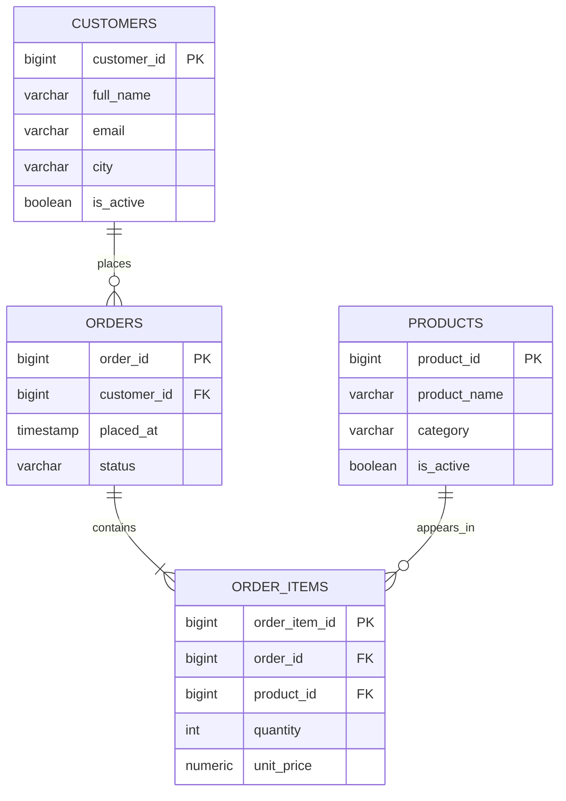

# Phân tích khách hàng chưa mua và sản phẩm chưa bán

Một hệ thống bán hàng không chỉ cần biết ai đã mua và sản phẩm nào bán chạy. Bộ phận kinh doanh còn cần trả lời những câu hỏi ngược lại:

- Khách hàng nào đã đăng ký nhưng chưa từng phát sinh đơn mua hợp lệ?
- Khách hàng nào từng mua trước đây nhưng chưa mua trong 90 ngày gần nhất?
- Sản phẩm nào đang được bày bán nhưng chưa từng xuất hiện trong một đơn hàng thành công?
- Sản phẩm nào từng bán, nhưng không có giao dịch trong quý này?
- Trong một thành phố hoặc một nhóm khách hàng, có bao nhiêu người chưa mua?
- Khách hàng nào chưa mua một sản phẩm cụ thể, dù đã mua những sản phẩm khác?

Đây là nhóm bài toán **anti-join**: tìm những hàng ở một tập dữ liệu không có hàng tương ứng ở tập khác. Trong SQL, cách biểu đạt quan trọng nhất là `NOT EXISTS`. Có thể dùng `LEFT JOIN ... IS NULL`, `NOT IN` hoặc phép hiệu tập hợp trong một số tình huống, nhưng mỗi cách có điều kiện và bẫy riêng.

Bài học thuộc chương **Thực hành tổng hợp** của module Database SQL. Ta sẽ xây dựng một mô hình bán hàng nhỏ, viết truy vấn theo từng định nghĩa nghiệp vụ, phân tích lỗi do NULL/trạng thái đơn hàng/ngày tháng, rồi xem cách tối ưu và kiểm thử kết quả.

**Nguyên tắc cốt lõi:** “Chưa mua” và “chưa bán” phải được định nghĩa trước. Một đơn nháp, đơn đã hủy, dòng hàng trả lại hoặc đơn chưa thanh toán có được tính là mua/bán hay không là quyết định nghiệp vụ. Nếu không chốt định nghĩa, truy vấn đúng cú pháp vẫn có thể trả sai báo cáo.

## 1. Hiểu đúng bài toán anti-join

Giả sử có hai tập:

- Tập A: tất cả khách hàng đang được theo dõi.
- Tập B: khách hàng có ít nhất một giao dịch mua hợp lệ.

Ta cần tìm những phần tử thuộc A nhưng không xuất hiện trong B.

```text
Tất cả khách hàng
┌────────────────────────────────────────┐
│  Khách đã mua       │  Chưa từng mua    │
│  (có đơn hợp lệ)    │  (không có đơn)   │
└────────────────────────────────────────┘
                               ↑
                    Kết quả anti-join
```

Anti-join không phải là phép nối để tìm những hàng khớp. Nó tìm những hàng ở phía trái **không có hàng phù hợp** ở phía phải.

### 1.1. Các cách viết thường gặp

| Cách viết | Ý nghĩa | Lưu ý |
| --- | --- | --- |
| `NOT EXISTS` | Không tồn tại hàng con thỏa điều kiện | Thường là lựa chọn rõ ràng, an toàn với NULL |
| `LEFT JOIN ... IS NULL` | Nối trái rồi giữ hàng không có đối tác | Phải kiểm tra cột phía phải chắc chắn NOT NULL khi có match |
| `NOT IN` | Giá trị không nằm trong tập con | Rất dễ sai khi tập con có NULL |
| `EXCEPT` / `MINUS` | Hiệu của hai tập kết quả | Khác cú pháp và khả năng hỗ trợ theo DBMS |

### 1.2. Phân biệt “chưa từng” và “chưa trong kỳ”

Hai câu hỏi sau khác nhau:

- **Chưa từng mua:** trong toàn bộ lịch sử không có giao dịch mua hợp lệ.
- **Chưa mua trong kỳ:** trong khoảng thời gian đang xét không có giao dịch mua hợp lệ, dù khách hàng có thể đã mua trước đó.

Ví dụ:

| Khách hàng | Lịch sử | Kết quả “chưa từng mua” | Kết quả “chưa mua quý này” |
| --- | --- | --- | --- |
| An | Chưa có đơn | Có | Có |
| Bình | Mua tháng trước | Không | Có nếu tháng trước ngoài quý |
| Chi | Mua trong quý | Không | Không |
| Dũng | Chỉ có đơn hủy | Có | Có |

Đây là khác biệt nghiệp vụ lớn nhất của bài. Không được đặt điều kiện ngày tháng vào sai vị trí rồi vô tình biến câu hỏi “chưa từng” thành “chưa mua trong kỳ”.

## 2. Mô hình dữ liệu thực hành

Ta dùng bốn bảng:

- `customers`: danh sách khách hàng.
- `products`: catalog sản phẩm.
- `orders`: phần đầu đơn hàng, chứa khách hàng, thời điểm và trạng thái.
- `order_items`: các dòng sản phẩm trong đơn hàng.

Quan hệ:



Một khách hàng có thể có nhiều đơn. Một đơn có nhiều dòng hàng. Một sản phẩm có thể xuất hiện trong nhiều dòng đơn hàng.

### 2.1. Tạo schema và bảng

Ví dụ SQL theo cú pháp PostgreSQL:

```sql
CREATE SCHEMA sales_lab_432;

CREATE TABLE sales_lab_432.customers (
    customer_id BIGINT PRIMARY KEY,
    full_name   VARCHAR(120) NOT NULL,
    email       VARCHAR(200),
    city        VARCHAR(80),
    is_active   BOOLEAN NOT NULL DEFAULT TRUE,
    created_at  TIMESTAMPTZ NOT NULL DEFAULT CURRENT_TIMESTAMP
);

CREATE TABLE sales_lab_432.products (
    product_id   BIGINT PRIMARY KEY,
    product_name VARCHAR(160) NOT NULL,
    category     VARCHAR(80),
    is_active    BOOLEAN NOT NULL DEFAULT TRUE
);

CREATE TABLE sales_lab_432.orders (
    order_id    BIGINT PRIMARY KEY,
    customer_id BIGINT NOT NULL
        REFERENCES sales_lab_432.customers(customer_id),
    placed_at   TIMESTAMPTZ NOT NULL,
    status      VARCHAR(20) NOT NULL
        CHECK (status IN (
            'draft', 'pending', 'paid',
            'shipped', 'completed', 'cancelled'
        ))
);

CREATE TABLE sales_lab_432.order_items (
    order_item_id BIGINT PRIMARY KEY,
    order_id      BIGINT NOT NULL
        REFERENCES sales_lab_432.orders(order_id),
    product_id    BIGINT NOT NULL
        REFERENCES sales_lab_432.products(product_id),
    quantity      INTEGER NOT NULL CHECK (quantity > 0),
    unit_price    NUMERIC(12, 2) NOT NULL CHECK (unit_price >= 0)
);
```

Các kiểu như `BOOLEAN`, `TIMESTAMPTZ`, `BIGINT` và cách tạo schema có thể cần điều chỉnh khi dùng DBMS khác. Phần sau sẽ chỉ ra cách chuyển đổi.

### 2.2. Định nghĩa đơn hàng được tính là mua hợp lệ

Trong bài thực hành, ta thống nhất:

```sql
status IN ('paid', 'shipped', 'completed')
```

Một đơn ở trạng thái `draft`, `pending` hoặc `cancelled` không được tính là một lần mua thành công.

Đây là quy ước của bài, không phải quy tắc đúng cho mọi doanh nghiệp. Nếu công ty ghi nhận doanh thu ngay ở trạng thái paid, hoặc chỉ khi completed, hãy đổi danh sách trạng thái theo định nghĩa tài chính đã thống nhất.

### 2.3. Dữ liệu mẫu khách hàng

```sql
INSERT INTO sales_lab_432.customers
    (customer_id, full_name, email, city, is_active, created_at)
VALUES
    (1, 'An',    'an@example.test',    'Ho Chi Minh City', TRUE, '2026-01-05'),
    (2, 'Binh',  'binh@example.test',  'Ha Noi',           TRUE, '2026-01-10'),
    (3, 'Chi',   'chi@example.test',   'Da Nang',          TRUE, '2026-02-01'),
    (4, 'Dung',  'dung@example.test',  'Ho Chi Minh City', TRUE, '2026-02-15'),
    (5, 'Giang', 'giang@example.test', 'Can Tho',          TRUE, '2026-03-01'),
    (6, 'Hanh',  'hanh@example.test',  'Ha Noi',           FALSE,'2026-03-05'),
    (7, 'Khoa',  'khoa@example.test',  'Da Nang',          TRUE, '2026-04-01'),
    (8, 'Lan',   'lan@example.test',   'Ho Chi Minh City', TRUE, '2026-04-10');
```

### 2.4. Dữ liệu mẫu sản phẩm

```sql
INSERT INTO sales_lab_432.products
    (product_id, product_name, category, is_active)
VALUES
    (101, 'Bàn phím cơ',       'Phụ kiện', TRUE),
    (102, 'Chuột không dây',   'Phụ kiện', TRUE),
    (103, 'Màn hình 27 inch',  'Màn hình', TRUE),
    (104, 'Webcam HD',         'Phụ kiện', TRUE),
    (105, 'Tai nghe',          'Âm thanh', TRUE),
    (106, 'Loa Bluetooth',     'Âm thanh', FALSE),
    (107, 'Đế laptop',         'Phụ kiện', TRUE),
    (108, 'Micro USB',         'Âm thanh', TRUE);
```

### 2.5. Dữ liệu mẫu đơn hàng

```sql
INSERT INTO sales_lab_432.orders
    (order_id, customer_id, placed_at, status)
VALUES
    (1001, 1, '2026-01-12 09:00:00+07', 'completed'),
    (1002, 2, '2026-01-15 10:00:00+07', 'cancelled'),
    (1003, 2, '2026-03-10 11:00:00+07', 'completed'),
    (1004, 3, '2026-04-05 12:00:00+07', 'paid'),
    (1005, 4, '2026-04-12 13:00:00+07', 'pending'),
    (1006, 5, '2026-05-01 14:00:00+07', 'shipped'),
    (1007, 1, '2026-05-15 15:00:00+07', 'completed'),
    (1008, 7, '2026-06-01 16:00:00+07', 'draft'),
    (1009, 3, '2026-06-15 17:00:00+07', 'completed');
```

### 2.6. Dữ liệu mẫu dòng đơn hàng

```sql
INSERT INTO sales_lab_432.order_items
    (order_item_id, order_id, product_id, quantity, unit_price)
VALUES
    (1, 1001, 101, 1, 1500000),
    (2, 1001, 102, 2,  350000),
    (3, 1002, 103, 1, 5000000),
    (4, 1003, 104, 1,  800000),
    (5, 1004, 102, 1,  350000),
    (6, 1004, 105, 1, 1200000),
    (7, 1005, 103, 1, 5000000),
    (8, 1006, 101, 1, 1500000),
    (9, 1006, 107, 1,  250000),
    (10,1007, 105, 2, 1200000),
    (11,1008, 108, 1,  450000),
    (12,1009, 102, 1,  350000);
```

Các đơn cancelled, pending và draft vẫn có dòng hàng. Điều này cố ý tạo ra tình huống để kiểm tra truy vấn: nếu chỉ nhìn `order_items`, ta có thể kết luận nhầm một sản phẩm đã bán hoặc một khách hàng đã mua.

### 2.7. Đọc nhanh dữ liệu mẫu

| Khách hàng | Đơn hợp lệ | Đơn không hợp lệ | Kết luận toàn lịch sử |
| --- | --- | --- | --- |
| An | 1001, 1007 | — | Đã mua |
| Binh | 1003 | 1002 | Đã mua |
| Chi | 1004, 1009 | — | Đã mua |
| Dung | — | 1005 | Chưa mua hợp lệ |
| Giang | 1006 | — | Đã mua |
| Hanh | — | — | Chưa mua hợp lệ |
| Khoa | — | 1008 | Chưa mua hợp lệ |
| Lan | — | — | Chưa mua hợp lệ |

Khách hàng Hanh không hoạt động nhưng vẫn có trong danh sách. Nếu báo cáo chỉ dành cho khách hàng đang hoạt động, cần thêm điều kiện `c.is_active = TRUE`. Không được nhầm điều kiện lọc danh sách khách hàng với điều kiện xác định đã mua.

## 3. Cách chuẩn: NOT EXISTS

`NOT EXISTS` kiểm tra xem truy vấn con có trả về hàng nào hay không. Nó không cần lấy dữ liệu từ truy vấn con; chỉ cần biết có ít nhất một hàng thỏa điều kiện.

### 3.1. Tìm khách hàng chưa từng mua

```sql
SELECT
    c.customer_id,
    c.full_name,
    c.email,
    c.city
FROM sales_lab_432.customers AS c
WHERE NOT EXISTS (
    SELECT 1
    FROM sales_lab_432.orders AS o
    JOIN sales_lab_432.order_items AS oi
      ON oi.order_id = o.order_id
    WHERE o.customer_id = c.customer_id
      AND o.status IN ('paid', 'shipped', 'completed')
)
ORDER BY c.customer_id;
```

Kết quả dự kiến:

| customer_id | full_name | city |
| ---: | --- | --- |
| 4 | Dung | Ho Chi Minh City |
| 6 | Hanh | Ha Noi |
| 7 | Khoa | Da Nang |
| 8 | Lan | Ho Chi Minh City |

Giải thích:

1. Truy vấn ngoài duyệt từng khách hàng.
2. Truy vấn con tìm đơn hợp lệ của chính khách hàng đó.
3. JOIN order_items yêu cầu đơn có ít nhất một dòng hàng.
4. Nếu không tồn tại hàng nào, NOT EXISTS là TRUE và khách hàng được giữ lại.
5. Nếu có ít nhất một dòng đơn hợp lệ, khách hàng bị loại khỏi kết quả.

### 3.2. Vì sao dùng SELECT 1?

Bên trong EXISTS, giá trị ở SELECT list không quan trọng. Các cách sau đều có ý nghĩa tồn tại tương đương:

```sql
WHERE EXISTS (SELECT 1 FROM orders ...)
WHERE EXISTS (SELECT * FROM orders ...)
WHERE EXISTS (SELECT o.order_id FROM orders AS o ...)
```

SELECT 1 thể hiện rõ mục đích: chỉ kiểm tra sự tồn tại, không cần lấy toàn bộ cột.

### 3.3. Chỉ cần kiểm tra bảng orders hay phải JOIN order_items?

Nếu định nghĩa nghiệp vụ “đã mua” là có đơn ở trạng thái paid/shipped/completed, và hệ thống bảo đảm mọi đơn đó luôn có ít nhất một dòng hàng, có thể kiểm tra trực tiếp bảng orders:

```sql
SELECT c.customer_id, c.full_name
FROM sales_lab_432.customers AS c
WHERE NOT EXISTS (
    SELECT 1
    FROM sales_lab_432.orders AS o
    WHERE o.customer_id = c.customer_id
      AND o.status IN ('paid', 'shipped', 'completed')
);
```

Nếu đơn có thể được đánh dấu completed nhưng không có dòng hàng (do import lỗi, dữ liệu cũ hoặc mô hình cho phép đơn rỗng), hai truy vấn khác nhau.

**Chọn bảng phản ánh chính xác sự kiện nghiệp vụ.** Nếu “mua” được định nghĩa là có ít nhất một dòng sản phẩm đã bán, hãy kiểm tra cả order_items. Nếu một đơn completed luôn được coi là mua theo hợp đồng dữ liệu, chỉ cần orders có thể đủ.

### 3.4. EXISTS dừng khi tìm được đối tác đầu tiên

Database thường có thể dừng kiểm tra khi đã tìm thấy một hàng thỏa điều kiện. Nó không cần đếm hết tất cả đơn của khách hàng để trả lời câu hỏi có/không.

Optimizer có thể biến NOT EXISTS thành anti semi join hoặc kế hoạch tương đương. Không nên nghĩ truy vấn con nhất thiết chạy lặp tuần tự đầy đủ cho từng khách hàng; kế hoạch thực tế phụ thuộc DBMS, index, thống kê và số hàng.

## 4. Tìm sản phẩm chưa từng bán

Câu hỏi tương tự: sản phẩm có trong catalog nhưng không có dòng nào thuộc đơn hàng hợp lệ.

```sql
SELECT
    p.product_id,
    p.product_name,
    p.category
FROM sales_lab_432.products AS p
WHERE NOT EXISTS (
    SELECT 1
    FROM sales_lab_432.order_items AS oi
    JOIN sales_lab_432.orders AS o
      ON o.order_id = oi.order_id
    WHERE oi.product_id = p.product_id
      AND o.status IN ('paid', 'shipped', 'completed')
)
ORDER BY p.product_id;
```

Kết quả dự kiến:

| product_id | product_name | category | Lý do |
| ---: | --- | --- | --- |
| 103 | Màn hình 27 inch | Màn hình | Chỉ xuất hiện trong đơn cancelled/pending |
| 106 | Loa Bluetooth | Âm thanh | Không có dòng đơn hàng |
| 108 | Micro USB | Âm thanh | Chỉ xuất hiện trong đơn draft |

Sản phẩm 103 đã xuất hiện trong order_items, nhưng các đơn tương ứng không hợp lệ. Vì vậy theo định nghĩa của bài, nó chưa từng bán.

### 4.1. Không nhầm “có trong order_items” với “đã bán”

Truy vấn sau không đủ:

```sql
SELECT p.product_id, p.product_name
FROM sales_lab_432.products AS p
WHERE NOT EXISTS (
    SELECT 1
    FROM sales_lab_432.order_items AS oi
    WHERE oi.product_id = p.product_id
);
```

Nó tìm sản phẩm chưa từng xuất hiện trong bất kỳ dòng đơn nào, kể cả đơn draft, pending hoặc cancelled. Đây là câu hỏi khác với “chưa có giao dịch bán hợp lệ”.

Nếu cần báo cáo audit tất cả dòng đặt hàng, kể cả đơn hủy, truy vấn trên có thể đúng. Nếu báo cáo kinh doanh cần sản phẩm chưa bán thành công, phải nối với orders và lọc trạng thái.

## 5. LEFT JOIN ... IS NULL: cách viết anti-join khác

Một cách phổ biến khác là nối trái danh sách khách hàng với đơn hợp lệ, sau đó giữ những hàng không có đơn khớp.

### 5.1. Khách hàng chưa từng mua

```sql
SELECT
    c.customer_id,
    c.full_name,
    c.city
FROM sales_lab_432.customers AS c
LEFT JOIN (
    SELECT DISTINCT o.customer_id
    FROM sales_lab_432.orders AS o
    JOIN sales_lab_432.order_items AS oi
      ON oi.order_id = o.order_id
    WHERE o.status IN ('paid', 'shipped', 'completed')
) AS buyers
  ON buyers.customer_id = c.customer_id
WHERE buyers.customer_id IS NULL
ORDER BY c.customer_id;
```

Subquery buyers tạo danh sách khách hàng đã mua hợp lệ. LEFT JOIN giữ mọi khách hàng; nếu không tìm được đối tác, cột phía buyers là NULL.

### 5.2. Điều kiện lọc phải nằm trong ON khi muốn giữ hàng không khớp

Đây là lỗi thường gặp:

```sql
SELECT c.customer_id, c.full_name
FROM sales_lab_432.customers AS c
LEFT JOIN sales_lab_432.orders AS o
  ON o.customer_id = c.customer_id
WHERE o.status IN ('paid', 'shipped', 'completed')
  AND o.order_id IS NULL;
```

Điều kiện WHERE yêu cầu o.status thuộc danh sách trạng thái. Với hàng không match, o.status là NULL, nên biểu thức không TRUE. Truy vấn đã vô tình loại hàng không khớp trước khi kiểm tra IS NULL.

Nếu dùng LEFT JOIN để tìm hàng thiếu đối tác, các điều kiện xác định đối tác hợp lệ thường phải đặt trong ON:

```sql
SELECT c.customer_id, c.full_name
FROM sales_lab_432.customers AS c
LEFT JOIN sales_lab_432.orders AS o
  ON o.customer_id = c.customer_id
 AND o.status IN ('paid', 'shipped', 'completed')
WHERE o.order_id IS NULL;
```

### 5.3. Kiểm tra cột nào IS NULL?

Hãy kiểm tra một cột phía phải được đảm bảo NOT NULL khi hàng thực sự match, thường là primary key:

```sql
WHERE o.order_id IS NULL
```

Không nên kiểm tra một cột nullable như email, ghi chú hoặc mô tả. Nếu đơn hợp lệ tồn tại nhưng cột nullable của nó là NULL, truy vấn sẽ kết luận nhầm không có đơn.

## 6. NOT IN và bẫy NULL

NOT IN nhìn có vẻ tự nhiên:

```sql
SELECT c.customer_id, c.full_name
FROM sales_lab_432.customers AS c
WHERE c.customer_id NOT IN (
    SELECT o.customer_id
    FROM sales_lab_432.orders AS o
);
```

Nếu subquery trả về danh sách ID không chứa NULL, nó có thể cho kết quả mong muốn theo định nghĩa đơn giản. Nhưng nếu có một giá trị NULL trong tập con, kết quả có thể không như người viết nghĩ.

### 6.1. Vì sao NULL phá NOT IN?

Giả sử tập con là:

```text
(1, 2, NULL)
```

Với customer_id = 4, phép kiểm tra tương đương:

```sql
4 <> 1
AND 4 <> 2
AND 4 <> NULL
```

Hai điều kiện đầu TRUE, nhưng 4 <> NULL là UNKNOWN. Trong SQL, TRUE AND TRUE AND UNKNOWN cho UNKNOWN; WHERE chỉ giữ hàng khi điều kiện TRUE. Vì vậy customer 4 không được trả về.

Nếu subquery có ít nhất một NULL, NOT IN có thể không trả hàng nào (ngoại trừ các trường hợp biểu thức đặc biệt). Đây là lỗi logic khó phát hiện nếu dữ liệu test chưa có NULL.

### 6.2. Khắc phục bằng lọc NULL

Nếu chắc chắn semantics phù hợp:

```sql
SELECT c.customer_id, c.full_name
FROM sales_lab_432.customers AS c
WHERE c.customer_id NOT IN (
    SELECT o.customer_id
    FROM sales_lab_432.orders AS o
    WHERE o.customer_id IS NOT NULL
);
```

Tuy nhiên, cách này vẫn chỉ kiểm tra bảng orders và chưa áp dụng trạng thái mua hợp lệ/dòng hàng. Phải thêm đúng điều kiện nghiệp vụ.

### 6.3. Khuyến nghị dùng NOT EXISTS

```sql
SELECT c.customer_id, c.full_name
FROM sales_lab_432.customers AS c
WHERE NOT EXISTS (
    SELECT 1
    FROM sales_lab_432.orders AS o
    WHERE o.customer_id = c.customer_id
      AND o.status IN ('paid', 'shipped', 'completed')
);
```

NOT EXISTS tránh bẫy NULL ở cột được so sánh trong tập con: nếu o.customer_id là NULL, điều kiện bằng với ID khách hàng không trở thành TRUE. Tuy nhiên, khóa ngoại NOT NULL trong schema vẫn là thiết kế tốt để ngăn dữ liệu đơn hàng thiếu khách hàng.

### 6.4. So sánh ba cách viết

| Tiêu chí | NOT EXISTS | LEFT JOIN IS NULL | NOT IN |
| --- | --- | --- | --- |
| Đọc theo ý nghĩa “không có hàng liên quan” | Rất rõ | Khá rõ | Có thể khó đọc |
| An toàn khi subquery chứa NULL | Có | Có nếu kiểm tra đúng cột NOT NULL | Không tự an toàn |
| Dễ thêm nhiều điều kiện liên quan | Có | Có nhưng dễ đặt nhầm ON/WHERE | Có nhưng phải lọc NULL |
| Dễ tạo trùng hàng | Không do truy vấn con | Có thể nếu join nhiều hàng | Không |
| Khuyến nghị mặc định | Ưu tiên | Dùng khi rõ cấu trúc | Chỉ dùng khi semantics NULL được kiểm soát |

Không có nghĩa optimizer luôn chạy NOT EXISTS nhanh hơn. Nhiều DBMS có thể biến các cách viết tương đương thành cùng một kế hoạch. Hãy ưu tiên đúng nghĩa và đo execution plan khi hiệu năng quan trọng.

## 7. EXCEPT và MINUS: hiệu hai tập kết quả

Một cách nhìn khác: lấy danh sách tất cả khách hàng rồi trừ đi danh sách người đã mua.

### 7.1. PostgreSQL và SQL Server: EXCEPT

```sql
SELECT customer_id
FROM sales_lab_432.customers

EXCEPT

SELECT o.customer_id
FROM sales_lab_432.orders AS o
JOIN sales_lab_432.order_items AS oi
  ON oi.order_id = o.order_id
WHERE o.status IN ('paid', 'shipped', 'completed');
```

EXCEPT trả các hàng có trong tập bên trái mà không có trong tập bên phải. Trong dạng thông thường, phép toán loại duplicate (set semantics).

### 7.2. Oracle: MINUS

Oracle sử dụng MINUS cho phép hiệu tập hợp:

```sql
SELECT customer_id
FROM customers

MINUS

SELECT o.customer_id
FROM orders o
JOIN order_items oi ON oi.order_id = o.order_id
WHERE o.status IN ('paid', 'shipped', 'completed');
```

### 7.3. Khi cần trả thêm thông tin khách hàng

Có thể dùng hiệu tập hợp lấy ID trước, rồi nối lại bảng customers:

```sql
SELECT c.customer_id, c.full_name, c.city
FROM sales_lab_432.customers AS c
JOIN (
    SELECT customer_id
    FROM sales_lab_432.customers

    EXCEPT

    SELECT o.customer_id
    FROM sales_lab_432.orders AS o
    JOIN sales_lab_432.order_items AS oi
      ON oi.order_id = o.order_id
    WHERE o.status IN ('paid', 'shipped', 'completed')
) AS never_bought
  ON never_bought.customer_id = c.customer_id
ORDER BY c.customer_id;
```

Cú pháp này không chạy nguyên trạng trên Oracle vì Oracle dùng MINUS; MySQL cũng cần kiểm tra phiên bản hỗ trợ phép hiệu tập hợp. NOT EXISTS thường là cách viết portable hơn.

### 7.4. EXCEPT có xử lý duplicate khác JOIN

Phép hiệu tập hợp mặc định có semantics tập hợp, loại duplicate. Nếu dùng EXCEPT ALL ở DBMS hỗ trợ, số lần xuất hiện cũng tham gia vào phép toán. Với danh sách khóa khách hàng, duplicate thường không có ý nghĩa vì customer_id là primary key.

## 8. Khách hàng chưa mua trong một khoảng thời gian

Đây là báo cáo thường gặp trong CRM: khách hàng chưa phát sinh mua trong 30/60/90 ngày, hoặc không mua trong tháng/quý hiện tại.

### 8.1. Chốt khoảng thời gian

Ví dụ phân tích quý II/2026 theo múi giờ Việt Nam:

```text
Từ: 2026-04-01 00:00:00+07
Đến: 2026-07-01 00:00:00+07 (không bao gồm)
```

Dùng khoảng nửa mở:

```sql
placed_at >= :period_start
AND placed_at < :period_end
```

Cách này tránh lỗi thời gian cuối ngày như 23:59:59.999999, và dễ dùng index trên cột timestamp.

### 8.2. Khách hàng chưa mua trong quý II

```sql
SELECT c.customer_id, c.full_name, c.city
FROM sales_lab_432.customers AS c
WHERE NOT EXISTS (
    SELECT 1
    FROM sales_lab_432.orders AS o
    JOIN sales_lab_432.order_items AS oi
      ON oi.order_id = o.order_id
    WHERE o.customer_id = c.customer_id
      AND o.status IN ('paid', 'shipped', 'completed')
      AND o.placed_at >= TIMESTAMPTZ '2026-04-01 00:00:00+07'
      AND o.placed_at <  TIMESTAMPTZ '2026-07-01 00:00:00+07'
)
ORDER BY c.customer_id;
```

Kết quả dự kiến gồm khách hàng không có giao dịch mua hợp lệ trong khoảng này, kể cả người từng mua trước tháng 4.

Với dữ liệu mẫu, Binh đã mua trước quý II nhưng không có đơn hợp lệ trong quý II; Dung, Hanh, Khoa và Lan cũng không có đơn hợp lệ trong khoảng. Chi có đơn paid/completed trong quý; Giang có đơn shipped ngày 1/5.

### 8.3. Phân biệt “chưa từng mua” với “không mua quý II”

Chỉ cần bỏ điều kiện thời gian trong NOT EXISTS là câu hỏi đổi thành “chưa từng mua hợp lệ”.

Không nên viết:

```sql
WHERE NOT EXISTS (
    SELECT 1
    FROM orders o
    WHERE o.customer_id = c.customer_id
)
AND o.placed_at >= :period_start;
```

Biến o không tồn tại ở phạm vi ngoài, và điều kiện thời gian phải nằm trong truy vấn con xác định giao dịch nào được xem là mua trong kỳ.

### 8.4. Khách hàng đã mua trước kỳ nhưng không mua trong kỳ

Nếu báo cáo cần riêng nhóm “đã từng mua nhưng đã ngừng hoạt động trong kỳ”, phải có hai điều kiện:

- Có ít nhất một lần mua hợp lệ trước ngày bắt đầu.
- Không có lần mua hợp lệ trong kỳ.

```sql
SELECT c.customer_id, c.full_name
FROM sales_lab_432.customers AS c
WHERE EXISTS (
    SELECT 1
    FROM sales_lab_432.orders AS old_o
    JOIN sales_lab_432.order_items AS old_oi
      ON old_oi.order_id = old_o.order_id
    WHERE old_o.customer_id = c.customer_id
      AND old_o.status IN ('paid', 'shipped', 'completed')
      AND old_o.placed_at < TIMESTAMPTZ '2026-04-01 00:00:00+07'
)
AND NOT EXISTS (
    SELECT 1
    FROM sales_lab_432.orders AS new_o
    JOIN sales_lab_432.order_items AS new_oi
      ON new_oi.order_id = new_o.order_id
    WHERE new_o.customer_id = c.customer_id
      AND new_o.status IN ('paid', 'shipped', 'completed')
      AND new_o.placed_at >= TIMESTAMPTZ '2026-04-01 00:00:00+07'
      AND new_o.placed_at <  TIMESTAMPTZ '2026-07-01 00:00:00+07'
)
ORDER BY c.customer_id;
```

Đây là một nhóm gần với khái niệm **khách hàng ngủ đông**. Doanh nghiệp có thể định nghĩa kỳ 30/60/90 ngày, nhưng cần nói rõ mốc thời gian và trạng thái giao dịch.

## 9. Sản phẩm chưa bán trong một khoảng thời gian

Câu hỏi tương tự cho catalog sản phẩm.

### 9.1. Sản phẩm không có giao dịch bán trong quý II

```sql
SELECT p.product_id, p.product_name, p.category
FROM sales_lab_432.products AS p
WHERE NOT EXISTS (
    SELECT 1
    FROM sales_lab_432.order_items AS oi
    JOIN sales_lab_432.orders AS o
      ON o.order_id = oi.order_id
    WHERE oi.product_id = p.product_id
      AND o.status IN ('paid', 'shipped', 'completed')
      AND o.placed_at >= TIMESTAMPTZ '2026-04-01 00:00:00+07'
      AND o.placed_at <  TIMESTAMPTZ '2026-07-01 00:00:00+07'
)
ORDER BY p.product_id;
```

Kết quả có thể chứa sản phẩm đã bán trước quý II nhưng không bán trong quý II. Đây là danh sách “không bán trong kỳ”, không phải “chưa từng bán”.

### 9.2. Sản phẩm chưa từng có bán hợp lệ

Bỏ điều kiện ngày tháng:

```sql
SELECT p.product_id, p.product_name
FROM sales_lab_432.products AS p
WHERE NOT EXISTS (
    SELECT 1
    FROM sales_lab_432.order_items AS oi
    JOIN sales_lab_432.orders AS o
      ON o.order_id = oi.order_id
    WHERE oi.product_id = p.product_id
      AND o.status IN ('paid', 'shipped', 'completed')
);
```

### 9.3. Sản phẩm đã từng bán nhưng không bán trong kỳ

Tương tự khách hàng ngủ đông, dùng EXISTS lịch sử và NOT EXISTS trong kỳ:

```sql
SELECT p.product_id, p.product_name
FROM sales_lab_432.products AS p
WHERE EXISTS (
    SELECT 1
    FROM sales_lab_432.order_items AS old_oi
    JOIN sales_lab_432.orders AS old_o
      ON old_o.order_id = old_oi.order_id
    WHERE old_oi.product_id = p.product_id
      AND old_o.status IN ('paid', 'shipped', 'completed')
      AND old_o.placed_at < TIMESTAMPTZ '2026-04-01 00:00:00+07'
)
AND NOT EXISTS (
    SELECT 1
    FROM sales_lab_432.order_items AS new_oi
    JOIN sales_lab_432.orders AS new_o
      ON new_o.order_id = new_oi.order_id
    WHERE new_oi.product_id = p.product_id
      AND new_o.status IN ('paid', 'shipped', 'completed')
      AND new_o.placed_at >= TIMESTAMPTZ '2026-04-01 00:00:00+07'
      AND new_o.placed_at <  TIMESTAMPTZ '2026-07-01 00:00:00+07'
)
ORDER BY p.product_id;
```

### 9.4. Đừng nhầm “chưa bán” với “hết hàng”

Sản phẩm chưa bán là một kết luận về lịch sử giao dịch. Hết hàng là kết luận về tồn kho.

| Tình trạng | Có thể chưa bán? | Có thể còn hàng? |
| --- | --- | --- |
| Chưa từng bán, tồn kho 50 | Có | Có |
| Đã bán hết | Không | Không |
| Đã bán, còn tồn kho | Không | Có |
| Chưa bán, chưa nhập kho | Có | Không |

Nếu cần báo cáo sản phẩm chưa bán **và còn tồn kho**, phải nối thêm bảng inventory/stock và lọc số lượng tồn. Không thể suy ra tồn kho từ order_items.

## 10. Tìm khách hàng chưa mua một sản phẩm cụ thể

Bài toán này khác “khách hàng chưa từng mua bất cứ thứ gì”. Ta muốn tìm khách hàng chưa mua sản phẩm 102 (chuột không dây), dù họ có thể đã mua sản phẩm khác.

```sql
SELECT c.customer_id, c.full_name
FROM sales_lab_432.customers AS c
WHERE NOT EXISTS (
    SELECT 1
    FROM sales_lab_432.orders AS o
    JOIN sales_lab_432.order_items AS oi
      ON oi.order_id = o.order_id
    WHERE o.customer_id = c.customer_id
      AND oi.product_id = 102
      AND o.status IN ('paid', 'shipped', 'completed')
)
ORDER BY c.customer_id;
```

Muốn truyền sản phẩm bằng tham số, bind product_id theo API/driver.

### 10.1. Khách hàng chưa mua một nhóm sản phẩm

Ví dụ chưa mua bất kỳ sản phẩm nào thuộc category Âm thanh:

```sql
SELECT c.customer_id, c.full_name
FROM sales_lab_432.customers AS c
WHERE NOT EXISTS (
    SELECT 1
    FROM sales_lab_432.orders AS o
    JOIN sales_lab_432.order_items AS oi
      ON oi.order_id = o.order_id
    JOIN sales_lab_432.products AS p
      ON p.product_id = oi.product_id
    WHERE o.customer_id = c.customer_id
      AND p.category = 'Âm thanh'
      AND o.status IN ('paid', 'shipped', 'completed')
);
```

Điều kiện category nằm trong truy vấn con, nên NOT EXISTS chỉ xét các giao dịch thuộc nhóm sản phẩm đó.

### 10.2. Khách đã mua A nhưng chưa mua B

Ví dụ khách hàng đã mua bàn phím cơ (101) nhưng chưa mua chuột không dây (102):

```sql
SELECT c.customer_id, c.full_name
FROM sales_lab_432.customers AS c
WHERE EXISTS (
    SELECT 1
    FROM sales_lab_432.orders AS o
    JOIN sales_lab_432.order_items AS oi
      ON oi.order_id = o.order_id
    WHERE o.customer_id = c.customer_id
      AND oi.product_id = 101
      AND o.status IN ('paid', 'shipped', 'completed')
)
AND NOT EXISTS (
    SELECT 1
    FROM sales_lab_432.orders AS o
    JOIN sales_lab_432.order_items AS oi
      ON oi.order_id = o.order_id
    WHERE o.customer_id = c.customer_id
      AND oi.product_id = 102
      AND o.status IN ('paid', 'shipped', 'completed')
);
```

Đây là một mẫu phân tích cross-sell: khách đã mua một nhóm nhưng chưa mua nhóm bổ sung.

## 11. Khách hàng chưa mua bất kỳ sản phẩm nào trong danh mục

Một cách mở rộng là tìm những khách hàng chưa mua **bất kỳ sản phẩm nào thuộc danh mục** được chọn. Dùng NOT EXISTS với JOIN trong truy vấn con.

Nếu cần danh sách khách hàng chưa mua toàn bộ một tập sản phẩm cụ thể, có thể dùng phép chia quan hệ hoặc so sánh số lượng. Nhưng phải phân biệt:

- Chưa mua **bất kỳ** sản phẩm nào trong tập.
- Chưa mua **tất cả** sản phẩm trong tập.
- Đã mua một phần, nhưng còn thiếu một số sản phẩm.

### 11.1. Chưa mua sản phẩm nào trong nhóm

```sql
WHERE NOT EXISTS (
    SELECT 1
    FROM orders o
    JOIN order_items oi ON oi.order_id = o.order_id
    JOIN products p ON p.product_id = oi.product_id
    WHERE o.customer_id = c.customer_id
      AND p.category = :category
      AND o.status IN ('paid', 'shipped', 'completed')
)
```

Chỉ cần một giao dịch thuộc category là khách bị loại.

### 11.2. Chưa mua một sản phẩm cụ thể

Đặt điều kiện `oi.product_id = :product_id` trong cùng truy vấn con. Khách vẫn có thể mua sản phẩm khác.

### 11.3. Chưa mua đủ mọi sản phẩm trong tập

Đây là bài toán khác. Giả sử tập sản phẩm mục tiêu có các ID 101, 102, 105; khách chưa mua đủ cả ba nếu số sản phẩm khác nhau đã mua trong tập nhỏ hơn số sản phẩm mục tiêu.

Một cách minh họa:

```sql
WITH target_products AS (
    SELECT product_id
    FROM sales_lab_432.products
    WHERE product_id IN (101, 102, 105)
),
customer_purchases AS (
    SELECT DISTINCT
        o.customer_id,
        oi.product_id
    FROM sales_lab_432.orders AS o
    JOIN sales_lab_432.order_items AS oi
      ON oi.order_id = o.order_id
    JOIN target_products AS tp
      ON tp.product_id = oi.product_id
    WHERE o.status IN ('paid', 'shipped', 'completed')
)
SELECT c.customer_id, c.full_name
FROM sales_lab_432.customers AS c
LEFT JOIN customer_purchases AS cp
  ON cp.customer_id = c.customer_id
GROUP BY c.customer_id, c.full_name
HAVING COUNT(DISTINCT cp.product_id) < (
    SELECT COUNT(*) FROM target_products
)
ORDER BY c.customer_id;
```

Nếu tập target rỗng, phép so sánh có thể đưa mọi khách hàng vào kết quả vì số sản phẩm mục tiêu bằng 0. Nghiệp vụ thường nên kiểm tra danh sách target không rỗng trước khi chạy.

## 12. Phân tích theo thành phố, nhóm khách hàng và thời gian

Sau khi xác định được khách hàng chưa mua, có thể tổng hợp theo city, ngày đăng ký, nguồn marketing hoặc nhóm khách hàng.

### 12.1. Đếm khách hàng chưa từng mua theo thành phố

```sql
SELECT
    c.city,
    COUNT(*) AS never_bought_customers
FROM sales_lab_432.customers AS c
WHERE c.is_active = TRUE
  AND NOT EXISTS (
      SELECT 1
      FROM sales_lab_432.orders AS o
      JOIN sales_lab_432.order_items AS oi
        ON oi.order_id = o.order_id
      WHERE o.customer_id = c.customer_id
        AND o.status IN ('paid', 'shipped', 'completed')
  )
GROUP BY c.city
ORDER BY never_bought_customers DESC, c.city;
```

Vì một khách hàng chỉ xuất hiện một lần ở truy vấn ngoài, `COUNT(*)` đếm đúng số khách hàng trong từng thành phố.

### 12.2. Tỷ lệ khách chưa mua trên tổng khách hoạt động

```sql
WITH active_customers AS (
    SELECT customer_id, city
    FROM sales_lab_432.customers
    WHERE is_active = TRUE
),
never_bought AS (
    SELECT c.customer_id, c.city
    FROM active_customers AS c
    WHERE NOT EXISTS (
        SELECT 1
        FROM sales_lab_432.orders AS o
        JOIN sales_lab_432.order_items AS oi
          ON oi.order_id = o.order_id
        WHERE o.customer_id = c.customer_id
          AND o.status IN ('paid', 'shipped', 'completed')
    )
)
SELECT
    (SELECT COUNT(*) FROM active_customers) AS active_total,
    (SELECT COUNT(*) FROM never_bought) AS never_bought_total,
    100.0 * (SELECT COUNT(*) FROM never_bought)
      / NULLIF((SELECT COUNT(*) FROM active_customers), 0)
      AS never_bought_percent;
```

`NULLIF(x, 0)` tránh chia cho 0. Khi không có khách hoạt động, tỷ lệ sẽ là NULL thay vì lỗi chia cho 0.

### 12.3. Khách chưa mua trong 90 ngày gần nhất

Có thể truyền mốc thời gian từ ứng dụng:

```sql
SELECT c.customer_id, c.full_name
FROM sales_lab_432.customers AS c
WHERE NOT EXISTS (
    SELECT 1
    FROM sales_lab_432.orders AS o
    JOIN sales_lab_432.order_items AS oi
      ON oi.order_id = o.order_id
    WHERE o.customer_id = c.customer_id
      AND o.status IN ('paid', 'shipped', 'completed')
      AND o.placed_at >= :from_timestamp
      AND o.placed_at <  :to_timestamp
);
```

Nếu muốn “90 ngày tính đến hiện tại”, ứng dụng có thể truyền khoảng thời gian đã tính theo timezone nghiệp vụ. Tránh rải `CURRENT_DATE - 90` ở nhiều truy vấn nếu các hệ thống phải dùng cùng một mốc báo cáo.

### 12.4. Tính số ngày kể từ lần mua gần nhất

Đôi khi báo cáo cần cả khách chưa từng mua và khách đã lâu chưa mua. Ta có thể dùng LEFT JOIN với aggregate:

```sql
WITH last_purchase AS (
    SELECT
        o.customer_id,
        MAX(o.placed_at) AS last_purchased_at
    FROM sales_lab_432.orders AS o
    JOIN sales_lab_432.order_items AS oi
      ON oi.order_id = o.order_id
    WHERE o.status IN ('paid', 'shipped', 'completed')
    GROUP BY o.customer_id
)
SELECT
    c.customer_id,
    c.full_name,
    lp.last_purchased_at,
    CASE
        WHEN lp.last_purchased_at IS NULL THEN 'NEVER_BOUGHT'
        WHEN lp.last_purchased_at < :inactive_before THEN 'INACTIVE'
        ELSE 'RECENT'
    END AS purchase_segment
FROM sales_lab_432.customers AS c
LEFT JOIN last_purchase AS lp
  ON lp.customer_id = c.customer_id
ORDER BY c.customer_id;
```

`MAX(placed_at)` cho thời điểm mua gần nhất. Khách không có nhóm giao dịch hợp lệ sẽ có NULL và được gán NEVER_BOUGHT.

## 13. Phân tích sản phẩm chưa bán và tồn kho

Một báo cáo catalog thường cần thêm tồn kho, giá niêm yết, trạng thái hoạt động và thời gian tạo sản phẩm. Những dữ liệu này thường nằm ở bảng khác.

Giả sử có bảng tồn kho:

```sql
CREATE TABLE sales_lab_432.inventory (
    product_id BIGINT PRIMARY KEY
        REFERENCES sales_lab_432.products(product_id),
    on_hand INTEGER NOT NULL CHECK (on_hand >= 0),
    reserved  INTEGER NOT NULL DEFAULT 0 CHECK (reserved >= 0)
);
```

### 13.1. Sản phẩm chưa từng bán nhưng còn tồn kho

```sql
SELECT
    p.product_id,
    p.product_name,
    i.on_hand,
    i.reserved,
    i.on_hand - i.reserved AS available_quantity
FROM sales_lab_432.products AS p
JOIN sales_lab_432.inventory AS i
  ON i.product_id = p.product_id
WHERE i.on_hand > i.reserved
  AND NOT EXISTS (
      SELECT 1
      FROM sales_lab_432.order_items AS oi
      JOIN sales_lab_432.orders AS o
        ON o.order_id = oi.order_id
      WHERE oi.product_id = p.product_id
        AND o.status IN ('paid', 'shipped', 'completed')
  )
ORDER BY available_quantity DESC, p.product_id;
```

Điều kiện tồn kho ở truy vấn ngoài; NOT EXISTS kiểm tra lịch sử bán hợp lệ. Nếu `on_hand` bao gồm hàng đã hỏng hoặc bị giữ, định nghĩa available quantity phải theo quy tắc kho thật.

### 13.2. Sản phẩm chưa bán trong kỳ và còn hàng

Thêm điều kiện thời gian vào truy vấn con. Điều đó tìm sản phẩm có tồn kho nhưng không có đơn hợp lệ trong kỳ, bao gồm cả sản phẩm đã bán trước đó.

### 13.3. Tách sản phẩm ngừng kinh doanh

Nếu chỉ quan tâm catalog đang mở bán, thêm:

```sql
AND p.is_active = TRUE
```

Nếu mục tiêu là audit toàn bộ catalog, kể cả sản phẩm archived, không thêm điều kiện này. Bộ lọc active là quyết định về phạm vi báo cáo, không phải một phần tất yếu của anti-join.

## 14. Đếm sản phẩm chưa bán theo danh mục

```sql
SELECT
    p.category,
    COUNT(*) AS unsold_product_count
FROM sales_lab_432.products AS p
WHERE p.is_active = TRUE
  AND NOT EXISTS (
      SELECT 1
      FROM sales_lab_432.order_items AS oi
      JOIN sales_lab_432.orders AS o
        ON o.order_id = oi.order_id
      WHERE oi.product_id = p.product_id
        AND o.status IN ('paid', 'shipped', 'completed')
  )
GROUP BY p.category
ORDER BY unsold_product_count DESC, p.category;
```

Nếu category có thể NULL, GROUP BY sẽ gom các giá trị NULL thành một nhóm. Có thể dùng `COALESCE(category, 'Chưa phân loại')` khi hiển thị, nhưng phải tránh làm thay đổi cách nhóm nếu NULL có ý nghĩa riêng.

## 15. Tìm các cặp khách hàng–sản phẩm chưa từng giao dịch

Nếu thật sự cần tìm khách hàng nào chưa mua sản phẩm nào, phải tạo tập cặp khách hàng × sản phẩm rồi loại những cặp có giao dịch:

```sql
SELECT
    c.customer_id,
    c.full_name,
    p.product_id,
    p.product_name
FROM sales_lab_432.customers AS c
CROSS JOIN sales_lab_432.products AS p
WHERE c.is_active = TRUE
  AND p.is_active = TRUE
  AND NOT EXISTS (
      SELECT 1
      FROM sales_lab_432.orders AS o
      JOIN sales_lab_432.order_items AS oi
        ON oi.order_id = o.order_id
      WHERE o.customer_id = c.customer_id
        AND oi.product_id = p.product_id
        AND o.status IN ('paid', 'shipped', 'completed')
  )
ORDER BY c.customer_id, p.product_id;
```

Nếu có 100.000 khách và 50.000 sản phẩm, cross join lý thuyết tạo 5 tỷ cặp trước khi lọc. Đây có thể là một truy vấn cực lớn. Chỉ dùng khi câu hỏi nghiệp vụ thật sự yêu cầu ma trận mọi cặp, hoặc giới hạn trước theo một tập khách/sản phẩm nhỏ.

### 15.1. Ma trận cross-sell theo nhóm

Trong thực tế, thay vì xuất mọi cặp, thường chọn một nhóm sản phẩm mục tiêu (campaign) và một nhóm khách đủ điều kiện. Dùng CTE để giới hạn hai tập trước CROSS JOIN:

```sql
WITH target_customers AS (
    SELECT customer_id, full_name
    FROM sales_lab_432.customers
    WHERE is_active = TRUE
),
target_products AS (
    SELECT product_id, product_name
    FROM sales_lab_432.products
    WHERE is_active = TRUE
      AND category = 'Âm thanh'
)
SELECT
    c.customer_id,
    c.full_name,
    p.product_id,
    p.product_name
FROM target_customers AS c
CROSS JOIN target_products AS p
WHERE NOT EXISTS (
    SELECT 1
    FROM sales_lab_432.orders AS o
    JOIN sales_lab_432.order_items AS oi
      ON oi.order_id = o.order_id
    WHERE o.customer_id = c.customer_id
      AND oi.product_id = p.product_id
      AND o.status IN ('paid', 'shipped', 'completed')
);
```

Đây là danh sách cơ hội cross-sell cho nhóm sản phẩm Âm thanh.

## 16. Các lỗi nghiệp vụ thường gặp

### 16.1. Quên lọc trạng thái đơn hàng

Truy vấn chỉ nối orders với order_items mà không lọc status sẽ tính cả đơn draft/cancelled. Hãy thống nhất trạng thái nào được tính là mua/bán.

### 16.2. Đặt điều kiện ngày tháng sai vị trí

Nếu muốn tìm khách không mua trong kỳ, điều kiện ngày phải nằm trong NOT EXISTS. Đặt ở truy vấn ngoài hoặc trong WHERE sau LEFT JOIN có thể biến outer join thành inner join hoặc làm đổi semantics.

### 16.3. Dùng NOT IN với tập con có NULL

Một NULL trong subquery có thể làm NOT IN trả UNKNOWN. Ưu tiên NOT EXISTS, hoặc chứng minh cột con NOT NULL và lọc NULL.

### 16.4. Đếm số dòng join thay vì số khách hàng/sản phẩm

Một khách có nhiều đơn và nhiều order_items sẽ xuất hiện nhiều hàng trong join. Nếu cần số khách, dùng NOT EXISTS trên truy vấn ngoài customer hoặc COUNT(DISTINCT customer_id) khi logic yêu cầu.

### 16.5. Dùng DISTINCT để che lỗi join

DISTINCT có thể làm kết quả nhìn như không trùng nhưng không sửa logic sai. Hãy xác định quan hệ một-nhiều và dùng EXISTS nếu chỉ cần biết có/không.

### 16.6. Quên sản phẩm trong đơn bị hủy

Một sản phẩm có thể xuất hiện trong order_items nhưng đơn bị hủy. Nếu báo cáo là bán thành công, phải lọc status.

### 16.7. Định nghĩa mua dựa trên order header nhưng bỏ qua dòng hàng

Nếu đơn có thể rỗng hoặc import chưa hoàn tất, chỉ kiểm tra orders có thể coi một đơn không có sản phẩm là mua. Cần xác định nguồn sự kiện có ý nghĩa.

### 16.8. Quên soft delete và active flag

Khách inactive, sản phẩm archived có thể vẫn cần xuất hiện trong báo cáo lịch sử. Không mặc định lọc active nếu mục tiêu là audit.

### 16.9. Sai múi giờ hoặc biên ngày

Dùng BETWEEN với timestamp và ngày kết thúc có thể bỏ sót phần thời gian cuối ngày. Dùng khoảng nửa mở [start, end) và truyền timestamp theo timezone nghiệp vụ.

### 16.10. CROSS JOIN không giới hạn

Tạo mọi cặp khách hàng × sản phẩm có thể làm số hàng tăng theo tích hai tập. Hãy giới hạn đối tượng và chỉ xuất cặp khi thực sự cần.

### 16.11. Cột so sánh không cùng kiểu

So sánh ID kiểu text với bigint hoặc cast cột trong điều kiện có thể làm mất khả năng dùng index. Dùng kiểu dữ liệu nhất quán và bind tham số đúng kiểu.

### 16.12. Trạng thái trả hàng/hoàn tiền

Một đơn completed có thể sau đó được trả hàng hoặc refund. “Đã từng mua” có thể vẫn là TRUE về lịch sử; “doanh số thuần” có thể phải trừ refund/return. Không dùng một cột status duy nhất nếu mô hình thực tế cần trạng thái đơn và trạng thái hoàn trả riêng.

## 17. Tối ưu truy vấn anti-join

Không tối ưu chỉ bằng cách đổi NOT EXISTS thành LEFT JOIN hoặc ngược lại. Hãy bắt đầu từ đúng ngữ nghĩa, sau đó xem kế hoạch thực thi.

### 17.1. Index phục vụ tìm đơn theo khách hàng

Truy vấn khách chưa mua thường kiểm tra:

- orders.customer_id = customers.customer_id
- Trạng thái đơn thuộc danh sách cho phép.
- Thời gian đơn nằm trong khoảng nếu báo cáo theo kỳ.
- order_items.order_id = orders.order_id.

Một index có thể cân nhắc:

```sql
CREATE INDEX idx_orders_customer_status_date
ON sales_lab_432.orders
    (customer_id, status, placed_at, order_id);

CREATE INDEX idx_order_items_order_product
ON sales_lab_432.order_items
    (order_id, product_id);
```

Đây là điểm bắt đầu để đo, không phải index bắt buộc cho mọi hệ. Nếu truy vấn sản phẩm thường bắt đầu từ product_id, index khác có thể hữu ích.

### 17.2. Index phục vụ tìm sản phẩm theo dòng đơn

```sql
CREATE INDEX idx_order_items_product_order
ON sales_lab_432.order_items
    (product_id, order_id);
```

Index này hỗ trợ tìm dòng đơn theo product_id rồi nối tới order. Có thể cần cả hai thứ tự index nếu workload có cả hai kiểu truy vấn; tránh tạo index trùng lặp mà không đo lợi ích.

### 17.3. Partial index trong PostgreSQL

Nếu đa số truy vấn chỉ quan tâm đơn hợp lệ, PostgreSQL có thể dùng partial index:

```sql
CREATE INDEX idx_orders_valid_customer_date
ON sales_lab_432.orders
    (customer_id, placed_at, order_id)
WHERE status IN ('paid', 'shipped', 'completed');
```

Predicate của truy vấn cần tương thích để planner sử dụng index. Partial index giảm số entry lưu so với index chứa mọi trạng thái, nhưng làm tăng chi phí ghi và cần quản trị phù hợp.

### 17.4. Index trên cột khóa ngoại

Một số DBMS không tự động tạo index cho mọi foreign key ở phía bảng con. Kiểm tra schema và workload; index trên order_items.order_id, order_items.product_id và orders.customer_id thường hữu ích cho join/anti-join tương ứng.

### 17.5. EXPLAIN để xem kế hoạch

PostgreSQL:

```sql
EXPLAIN (ANALYZE, BUFFERS)
SELECT c.customer_id, c.full_name
FROM sales_lab_432.customers AS c
WHERE NOT EXISTS (
    SELECT 1
    FROM sales_lab_432.orders AS o
    JOIN sales_lab_432.order_items AS oi
      ON oi.order_id = o.order_id
    WHERE o.customer_id = c.customer_id
      AND o.status IN ('paid', 'shipped', 'completed')
);
```

Có thể thấy các node như Nested Loop Anti Join, Hash Anti Join hoặc kế hoạch tương đương. Không bắt buộc phải có một node cụ thể; optimizer chọn kế hoạch theo số hàng, thống kê, index và chi phí.

EXPLAIN ANALYZE thực sự chạy truy vấn. Dùng cẩn trọng trên bảng lớn/production và tránh chạy DML có tác động ngoài ý muốn.

### 17.6. Đừng tạo index mọi cột điều kiện

Index có chi phí:

- Tốn dung lượng.
- Làm INSERT/UPDATE/DELETE chậm hơn.
- Tốn thời gian bảo trì.
- Có thể không được planner chọn nếu selectivity thấp.

Tạo index dựa trên workload và execution plan, không dựa trên việc cột xuất hiện trong WHERE là đủ.

## 18. Tối ưu phạm vi thời gian và truy vấn báo cáo

### 18.1. Dùng điều kiện sargable

Tốt:

```sql
o.placed_at >= :start_time
AND o.placed_at < :end_time
```

Có thể kém thuận lợi cho index thường:

```sql
DATE(o.placed_at) = :report_date
```

Vì hàm được áp dụng lên cột, database có thể khó dùng index B-tree thông thường cho điều kiện range. Nếu cần lọc theo ngày, tính biên timestamp ở ứng dụng hoặc dùng expression index phù hợp DBMS.

### 18.2. Không cast cột khóa trong điều kiện join

Tránh:

```sql
CAST(o.customer_id AS VARCHAR(30)) = c.customer_code
```

nếu có thể chuẩn hóa kiểu dữ liệu và join trực tiếp. Cast trên cột có thể cản index và tạo lỗi so sánh định dạng.

### 18.3. Dùng CTE để làm rõ logic, không mặc định nó luôn nhanh hơn

CTE có thể giúp chia truy vấn thành các bước như active customers, valid purchases, never buyers. Optimizer của DBMS có thể inline hoặc materialize CTE tùy hệ/phiên bản/cú pháp. Hãy dùng CTE vì khả năng đọc và kiểm tra; sau đó đo kế hoạch.

### 18.4. Precompute khi báo cáo quá nặng

Nếu báo cáo “khách không mua trong 90 ngày” được chạy thường xuyên trên hàng chục triệu đơn, có thể duy trì bảng tổng hợp last_purchase_at hoặc materialized view. Nhưng cần xử lý cập nhật đơn, hủy, refund và xóa dữ liệu để summary không sai.

Precompute chuyển chi phí từ lúc đọc sang lúc ghi/cập nhật; chỉ phù hợp khi có quy trình đồng bộ và kiểm tra tính nhất quán.

## 19. Khác biệt giữa các DBMS

Logic anti-join có tính phổ biến, nhưng kiểu dữ liệu, boolean, thời gian và phép hiệu tập hợp khác nhau.

### 19.1. PostgreSQL

- Hỗ trợ NOT EXISTS, LEFT JOIN ... IS NULL, EXCEPT.
- BOOLEAN, TIMESTAMPTZ và partial index.
- Có EXPLAIN (ANALYZE, BUFFERS) để đo.
- Planner có các chiến lược anti join.

### 19.2. MySQL

- Hỗ trợ NOT EXISTS và LEFT JOIN anti-join.
- Kiểu Boolean thường được biểu diễn qua TINYINT/BOOLEAN alias.
- Dùng DATETIME hoặc TIMESTAMP tùy nhu cầu timezone và semantics.
- EXPLAIN ANALYZE có trên các phiên bản hỗ trợ; kiểm tra phiên bản cụ thể.
- Khả năng EXCEPT phụ thuộc phiên bản; không dựa vào cú pháp này khi cần tương thích MySQL rộng.

### 19.3. SQL Server

- Hỗ trợ NOT EXISTS, LEFT JOIN anti-join và EXCEPT.
- Boolean thường biểu diễn bằng BIT.
- Kiểu thời gian gồm datetime2/datetimeoffset tùy nhu cầu.
- Có Actual Execution Plan và các công cụ thống kê IO/time.
- Có thể dùng filtered index tương tự partial index về ý tưởng, với cú pháp SQL Server.

### 19.4. Oracle

- Hỗ trợ NOT EXISTS, LEFT JOIN anti-join và MINUS.
- Không có kiểu BOOLEAN lưu trong bảng theo cách PostgreSQL; thường dùng NUMBER/CHAR theo quy ước.
- Dùng DATE/TIMESTAMP/TIMESTAMP WITH TIME ZONE theo yêu cầu.
- Execution plan và runtime statistics phục vụ phân tích chi phí.
- Phải chú ý NULL semantics giống SQL ba giá trị.

### 19.5. SQLite

- Hỗ trợ NOT EXISTS, LEFT JOIN và EXCEPT.
- Không có kiểu Boolean riêng; giá trị 0/1 thường được dùng.
- Date/time có thể lưu TEXT, REAL hoặc INTEGER theo quy ước ứng dụng.
- Kiểm tra affinity/kiểu dữ liệu để tránh so sánh thời gian không nhất quán.

### 19.6. Bảng tổng hợp

| DBMS | Cách anti-join khuyến nghị | Hiệu tập hợp | Ghi chú |
| --- | --- | --- | --- |
| PostgreSQL | NOT EXISTS | EXCEPT | BOOLEAN, TIMESTAMPTZ, partial index |
| MySQL | NOT EXISTS | Tùy phiên bản | Boolean alias, kiểu thời gian và index theo engine |
| SQL Server | NOT EXISTS | EXCEPT | BIT, datetime2/datetimeoffset, filtered index |
| Oracle | NOT EXISTS | MINUS | DATE/TIMESTAMP, quy ước Boolean |
| SQLite | NOT EXISTS | EXCEPT | Date/time theo quy ước lưu trữ, Boolean 0/1 |

Câu NOT EXISTS thường là lựa chọn dễ chuyển đổi giữa các hệ hơn. Dù vậy, phải điều chỉnh tên schema, kiểu timestamp, boolean và parameter marker theo driver.

## 20. JDBC: truyền điều kiện và khoảng thời gian an toàn

Ứng dụng không nên nối ngày, customer ID hay product ID từ request vào chuỗi SQL.

### 20.1. PreparedStatement với NOT EXISTS

Ví dụ Java:

```java
String sql = """
    SELECT c.customer_id, c.full_name
    FROM sales_lab_432.customers AS c
    WHERE NOT EXISTS (
        SELECT 1
        FROM sales_lab_432.orders AS o
        JOIN sales_lab_432.order_items AS oi
          ON oi.order_id = o.order_id
        WHERE o.customer_id = c.customer_id
          AND o.status IN ('paid', 'shipped', 'completed')
          AND o.placed_at >= ?
          AND o.placed_at < ?
    )
    ORDER BY c.customer_id
    """;

try (PreparedStatement ps = conn.prepareStatement(sql)) {
    ps.setObject(1, periodStart);
    ps.setObject(2, periodEnd);

    try (ResultSet rs = ps.executeQuery()) {
        while (rs.next()) {
            long customerId = rs.getLong("customer_id");
            String fullName = rs.getString("full_name");
            // Map kết quả.
        }
    }
}
```

Text block cần Java 15+; nếu dùng Java 8–14, thay bằng chuỗi nối. Kiểu bind timestamp phụ thuộc driver: OffsetDateTime, Timestamp hoặc phương thức setObject/setTimestamp phù hợp.

### 20.2. Bind danh sách trạng thái

Một placeholder ? chỉ đại diện cho **một giá trị**, không tự bung thành danh sách:

```sql
WHERE status IN (?)
```

Nếu bind chuỗi `'paid','shipped','completed'` vào một placeholder, database coi đó là một chuỗi duy nhất, không phải ba giá trị.

Có thể tạo số lượng placeholder dựa trên kích thước danh sách đã kiểm soát:

```java
String placeholders = String.join(
    ",",
    Collections.nCopies(statuses.size(), "?")
);

String sql = "SELECT ... WHERE status IN (" + placeholders + ")";
```

Sau đó bind từng trạng thái bằng PreparedStatement. Không ghép chính giá trị trạng thái từ client vào SQL. Nếu danh sách rỗng, phải định nghĩa rõ trả rỗng hay bỏ filter; đừng tạo IN () không hợp lệ.

### 20.3. Bind customer/product ID

```java
String sql =
    "SELECT p.product_id, p.product_name " +
    "FROM sales_lab_432.products p " +
    "WHERE NOT EXISTS (" +
    "  SELECT 1 FROM sales_lab_432.order_items oi " +
    "  JOIN sales_lab_432.orders o ON o.order_id = oi.order_id " +
    "  WHERE oi.product_id = p.product_id " +
    "    AND o.customer_id = ?" +
    "    AND o.status IN ('paid','shipped','completed')" +
    ")";

try (PreparedStatement ps = conn.prepareStatement(sql)) {
    ps.setLong(1, customerId);
}
```

Ví dụ này tìm sản phẩm khách hàng chưa mua. Trong production, kiểm tra khách hàng có thuộc tenant hiện tại không trước khi trả dữ liệu.

## 21. Bảo mật và quyền truy cập trong báo cáo anti-join

Một truy vấn anti-join có thể vô tình tiết lộ dữ liệu nhạy cảm nếu nó chạy trên toàn bộ tenant hoặc bỏ qua quyền truy cập.

### 21.1. Luôn giới hạn tenant

Nếu hệ thống multi-tenant, cả tập ngoài và truy vấn con phải được giới hạn đúng tenant theo mô hình dữ liệu. Ví dụ customers có tenant_id, orders cũng có tenant_id:

```sql
SELECT c.customer_id, c.full_name
FROM customers AS c
WHERE c.tenant_id = :tenant_id
  AND NOT EXISTS (
      SELECT 1
      FROM orders AS o
      JOIN order_items AS oi ON oi.order_id = o.order_id
      WHERE o.customer_id = c.customer_id
        AND o.tenant_id = c.tenant_id
        AND o.status IN ('paid', 'shipped', 'completed')
  );
```

Ràng buộc khóa ngoại/composite key nên bảo đảm order thuộc đúng tenant của customer. Không chỉ tin tenant_id do client gửi; lấy tenant từ danh tính đã xác thực và kiểm tra authorization ở server.

### 21.2. Không dùng anti-join làm authorization duy nhất

Việc khách hàng chưa mua một sản phẩm không có nghĩa user hiện tại được phép xem hồ sơ khách hàng hoặc giá nội bộ. Truy vấn phải có filter quyền phù hợp và chỉ chọn các cột được phép công bố.

### 21.3. Phân quyền bảng nguồn

Role báo cáo cần quyền SELECT trên các bảng hoặc view được duyệt. Có thể tạo view chỉ công bố trường cần cho báo cáo, rồi cấp quyền trên view. Không cấp quyền rộng toàn schema chỉ để một dashboard chạy được.

### 21.4. Log truy vấn và dữ liệu cá nhân

Báo cáo khách hàng có thể chứa email, thành phố, lịch sử mua. Log nên ghi tham số đã mask, thời gian chạy, số hàng và định danh request; không ghi tràn lan dữ liệu cá nhân.

## 22. Quy trình kiểm tra kết quả truy vấn

Một truy vấn anti-join cần được kiểm chứng bằng cả ví dụ dương và âm.

### 22.1. Kiểm tra một khách đã mua

Khách An (ID 1) có đơn completed. Truy vấn “chưa từng mua” không được trả An.

### 22.2. Kiểm tra khách chỉ có đơn hủy

Khách Binh có đơn cancelled 1002 nhưng cũng có completed 1003. Truy vấn phải xem Binh là đã mua do có ít nhất một đơn hợp lệ.

Nếu bỏ đơn completed 1003 khỏi dữ liệu test, Binh phải được xem là chưa mua hợp lệ dù có order header và order_items trong đơn cancelled.

### 22.3. Kiểm tra khách chỉ có đơn nháp

Khoa có đơn draft. Truy vấn phải xem Khoa là chưa mua theo định nghĩa bài.

### 22.4. Kiểm tra sản phẩm chỉ xuất hiện trong đơn hủy/nháp

Sản phẩm 103 có trong đơn cancelled và pending; sản phẩm 108 có trong đơn draft. Cả hai vẫn phải xuất hiện trong danh sách chưa bán hợp lệ.

### 22.5. Kiểm tra sản phẩm không có dòng đơn nào

Sản phẩm 106 không xuất hiện trong order_items. Nó phải xuất hiện trong danh sách chưa bán.

### 22.6. Kiểm tra biên thời gian

Tạo một đơn đúng thời điểm start và một đơn đúng thời điểm end:

- Đơn tại start thuộc kỳ.
- Đơn tại end không thuộc kỳ nếu dùng placed_at < end.

Đây là kiểm tra quan trọng để tránh lệch ngày/tháng.

### 22.7. Đối chiếu số lượng

Số khách chưa từng mua cộng số khách đã mua phải bằng tổng số khách trong phạm vi filter (ví dụ chỉ khách active). Nếu không khớp, xem lại join, trạng thái, tenant và điều kiện lọc.

## 23. Bài tập thực hành có đáp án

Các bài dùng schema `sales_lab_432` và định nghĩa mua hợp lệ `paid`/`shipped`/`completed` đã nêu ở phần 2.

### Bài 1 — Anti-join là gì?

**Đáp án:** Tìm các hàng của tập bên trái không có hàng liên quan thỏa điều kiện trong tập bên phải. Ví dụ khách hàng không có đơn mua hợp lệ.

### Bài 2 — Khách hàng chưa từng mua

**Đáp án:** Dùng NOT EXISTS trên orders có customer_id tương ứng, lọc status hợp lệ và JOIN order_items nếu định nghĩa mua yêu cầu có ít nhất một dòng hàng.

### Bài 3 — Sản phẩm chưa từng bán

**Đáp án:** Duyệt products và NOT EXISTS dòng order_items của sản phẩm nối với orders ở trạng thái mua hợp lệ.

### Bài 4 — Đơn cancelled có được tính là mua không?

**Đáp án:** Không trong quy ước bài. Trạng thái cancelled bị loại khỏi danh sách trạng thái hợp lệ.

### Bài 5 — Khách chỉ có đơn draft

**Đáp án:** Được xem là chưa mua hợp lệ vì draft không thuộc paid/shipped/completed.

### Bài 6 — Sản phẩm trong đơn cancelled

Sản phẩm đã có order_items nhưng tất cả đơn đều cancelled. Có được coi là đã bán không?

**Đáp án:** Không theo định nghĩa bài; phải nối orders và lọc trạng thái hợp lệ.

### Bài 7 — NOT EXISTS dùng SELECT gì?

**Đáp án:** Thường dùng SELECT 1 vì giá trị select list không quan trọng; EXISTS chỉ kiểm tra có hàng hay không.

### Bài 8 — NOT IN và NULL

Subquery của NOT IN trả (1, 2, NULL). Customer ID 4 có được giữ chắc chắn không?

**Đáp án:** Không. So sánh với NULL tạo UNKNOWN, khiến điều kiện NOT IN không TRUE. Ưu tiên NOT EXISTS hoặc loại NULL đúng cách.

### Bài 9 — LEFT JOIN IS NULL

Nên kiểm tra cột nào ở phía phải?

**Đáp án:** Cột NOT NULL khi hàng match, tốt nhất là primary key như order_id hoặc order_item_id; tránh cột nullable như email.

### Bài 10 — ON hay WHERE?

Trong LEFT JOIN anti-join, điều kiện status của đơn nên nằm đâu để giữ customer không match?

**Đáp án:** Đặt trong ON khi xác định đơn nào được coi là đối tác hợp lệ; sau đó WHERE khóa chính phía phải IS NULL. Nếu đặt status trong WHERE, hàng NULL-extended có thể bị loại.

### Bài 11 — Chưa từng mua và chưa mua trong kỳ

Khách mua năm ngoái nhưng không mua quý này thuộc nhóm nào?

**Đáp án:** Không thuộc “chưa từng mua”; có thuộc “chưa mua trong quý này”.

### Bài 12 — Khách ngủ đông

Cần điều kiện nào để tìm khách từng mua trước kỳ nhưng không mua trong kỳ?

**Đáp án:** EXISTS giao dịch hợp lệ trước start AND NOT EXISTS giao dịch hợp lệ trong khoảng [start, end).

### Bài 13 — Khoảng ngày nửa mở

Vì sao dùng placed_at >= start AND placed_at < end?

**Đáp án:** Tránh phải đoán timestamp cuối ngày và tránh bỏ sót phần precision; mốc end thuộc kỳ kế tiếp, không thuộc kỳ hiện tại.

### Bài 14 — Đơn rỗng

Nếu order completed có thể không có order_items, truy vấn chỉ kiểm tra orders có đủ để kết luận đã mua không?

**Đáp án:** Không nếu định nghĩa mua yêu cầu có sản phẩm; phải kiểm tra sự tồn tại của ít nhất một dòng hàng.

### Bài 15 — Sản phẩm chưa bán và hết hàng

Có thể suy ra sản phẩm chưa bán là hết hàng không?

**Đáp án:** Không. Lịch sử bán và tồn kho là hai dữ liệu khác nhau; cần bảng inventory.

### Bài 16 — Chưa mua sản phẩm cụ thể

Muốn tìm khách chưa mua product_id=102, điều kiện nào cần thêm trong NOT EXISTS?

**Đáp án:** oi.product_id = 102, cùng customer_id và trạng thái đơn hợp lệ.

### Bài 17 — Cross-sell

Muốn khách đã mua sản phẩm 101 nhưng chưa mua 102, dùng cấu trúc nào?

**Đáp án:** EXISTS cho sản phẩm 101 AND NOT EXISTS cho sản phẩm 102.

### Bài 18 — Chưa mua bất kỳ sản phẩm nào trong category

**Đáp án:** NOT EXISTS truy vấn con nối orders, order_items, products và lọc category cùng trạng thái hợp lệ.

### Bài 19 — Chưa mua đủ mọi sản phẩm trong tập

**Đáp án:** So sánh số product_id khác nhau đã mua trong tập mục tiêu với số sản phẩm mục tiêu, hoặc dùng một phép chia quan hệ tương đương. Phải xử lý trường hợp tập mục tiêu rỗng.

### Bài 20 — Đếm khách hàng

Một khách có 5 đơn và 12 order_items. Nếu join trực tiếp rồi COUNT(*), có chắc đếm được 1 khách không?

**Đáp án:** Không; join tạo nhiều dòng. Dùng NOT EXISTS ở truy vấn ngoài hoặc COUNT(DISTINCT customer_id) nếu đang tổng hợp danh sách join.

### Bài 21 — Active customer

Báo cáo chỉ dành cho khách đang hoạt động. Đặt điều kiện nào?

**Đáp án:** c.is_active = TRUE ở truy vấn ngoài. Đây là filter phạm vi khách, tách biệt với điều kiện xác định đã mua.

### Bài 22 — Soft delete sản phẩm

Báo cáo audit toàn catalog có nên tự lọc is_active=TRUE không?

**Đáp án:** Không nhất thiết. Nếu audit cần cả sản phẩm archived, giữ chúng; nếu báo cáo chỉ cho catalog hiện bán, mới lọc active.

### Bài 23 — Index khách hàng

Anti-join tìm đơn theo customer_id, status, placed_at. Một index khởi đầu có thể là gì?

**Đáp án:** Ví dụ orders(customer_id, status, placed_at, order_id), nhưng phải đo execution plan và workload trước khi quyết định.

### Bài 24 — Index sản phẩm

Truy vấn thường tìm order_items theo product_id rồi nối orders. Index nào có thể hữu ích?

**Đáp án:** Ví dụ order_items(product_id, order_id). Nếu các truy vấn khác bắt đầu từ order_id, có thể cần index theo thứ tự ngược.

### Bài 25 — Partial index

PostgreSQL có thể tạo index chỉ cho các đơn hợp lệ không?

**Đáp án:** Có, dùng partial index với WHERE status IN ('paid','shipped','completed') nếu workload phù hợp và planner có thể dùng predicate.

### Bài 26 — EXCEPT và MINUS

Oracle dùng từ khóa nào để lấy hiệu hai tập?

**Đáp án:** MINUS. PostgreSQL và SQL Server dùng EXCEPT; kiểm tra hỗ trợ phiên bản ở hệ khác.

### Bài 27 — Cột nullable

Nếu dùng LEFT JOIN IS NULL trên email, khách có email NULL nhưng có đơn sẽ bị hiểu nhầm thế nào?

**Đáp án:** Có thể bị kết luận là không có đơn vì email phía join có thể NULL dù match tồn tại. Kiểm tra primary key phía phải.

### Bài 28 — Tenant

Vì sao phải giới hạn tenant trong truy vấn anti-join?

**Đáp án:** Tránh kiểm tra giao dịch ngoài phạm vi tenant hoặc làm lộ dữ liệu khách khác. Tenant phải lấy từ danh tính được xác thực và áp dụng nhất quán cho cả hai phía.

### Bài 29 — Trả hàng/refund

Một đơn completed sau đó được refund. Nó có còn tính là “đã từng mua” không?

**Đáp án:** Tùy định nghĩa. Lịch sử đã phát sinh giao dịch có thể vẫn tính là từng mua; doanh số thuần cần mô hình return/refund riêng.

### Bài 30 — Kiểm thử biên thời gian

Đơn đúng timestamp start và đúng timestamp end thuộc kỳ nào với khoảng [start, end)?

**Đáp án:** Đơn tại start được tính; đơn tại end không được tính.

### Bài 31 — CROSS JOIN khách × sản phẩm

Có 100.000 khách và 50.000 sản phẩm. Số cặp lý thuyết là bao nhiêu?

**Đáp án:** 5 tỷ cặp. Cần giới hạn tập trước hoặc tránh tạo ma trận đầy đủ nếu không thật sự cần.

### Bài 32 — NOT EXISTS hay LEFT JOIN?

Có thể khẳng định NOT EXISTS luôn nhanh hơn LEFT JOIN IS NULL trên mọi DBMS không?

**Đáp án:** Không. Optimizer có thể chuyển chúng thành cùng chiến lược anti-join. Chọn cách rõ nghĩa và xem execution plan.

### Bài 33 — COUNT tỷ lệ

Tại sao dùng NULLIF(total_customers, 0) trong mẫu chia tỷ lệ?

**Đáp án:** Tránh lỗi chia cho 0 khi không có khách trong phạm vi báo cáo; kết quả khi đó là NULL.

### Bài 34 — Ngày và index

Vì sao DATE(placed_at) = :day có thể kém thuận lợi hơn range condition?

**Đáp án:** Hàm áp dụng trên cột có thể làm index B-tree thông thường khó được dùng. Dùng start/end timestamp nửa mở hoặc expression index phù hợp.

### Bài 35 — Xác định đúng nguồn sự kiện

Nếu doanh nghiệp chỉ coi đơn đã thanh toán là mua, sửa điều kiện trạng thái ra sao?

**Đáp án:** Dùng o.status = 'paid' trong tất cả truy vấn định nghĩa mua/bán, đồng bộ giữa truy vấn khách hàng và sản phẩm.

## 24. Checklist trước khi phát hành báo cáo

1. Đã định nghĩa “mua hợp lệ” bằng trạng thái đơn nào chưa?
2. Đơn có cần ít nhất một order item để được tính là mua không?
3. Báo cáo hỏi “chưa từng” hay “chưa trong kỳ”?
4. Nếu theo kỳ, start/end có đúng timezone và dùng khoảng nửa mở không?
5. Đơn cancelled/draft/pending có bị loại đúng không?
6. Refund/return có quy tắc riêng chưa?
7. Khách active/inactive và sản phẩm archived có thuộc phạm vi không?
8. Có dùng NOT EXISTS hoặc anti-join với điều kiện đúng không?
9. Nếu dùng NOT IN, đã loại NULL và xác minh semantics chưa?
10. Nếu dùng LEFT JOIN IS NULL, có kiểm tra primary key phía phải không?
11. Điều kiện trạng thái/thời gian có đặt đúng trong ON hoặc NOT EXISTS không?
12. Có tránh đếm duplicate do quan hệ một-nhiều không?
13. Có phân biệt chưa bán và hết hàng không?
14. Có giới hạn tenant và kiểm tra authorization không?
15. Có index cho khóa nối và filter thường dùng không?
16. Có xem EXPLAIN/actual plan với dữ liệu đại diện không?
17. Có kiểm tra biên ngày và trạng thái đơn trong test không?
18. Có xác nhận kết quả bằng các khách/sản phẩm biết trước không?
19. Có bảo vệ dữ liệu cá nhân trong output và log không?
20. Có kiểm tra phiên bản DBMS và kiểu dữ liệu khi chuyển dialect không?

## 25. Tổng kết

Phân tích khách hàng chưa mua và sản phẩm chưa bán là bài toán **anti-join**: lấy danh sách đối tượng mục tiêu rồi loại những đối tượng có giao dịch phù hợp.

NOT EXISTS thường là cách viết rõ ràng và an toàn nhất, đặc biệt khi tập con có thể chứa NULL. LEFT JOIN ... IS NULL cũng hữu ích nếu điều kiện match được đặt đúng trong ON và kiểm tra cột khóa NOT NULL. NOT IN cần đặc biệt chú ý NULL; EXCEPT/MINUS phù hợp khi muốn biểu diễn hiệu hai tập và DBMS hỗ trợ.

Quan trọng hơn cú pháp là định nghĩa nghiệp vụ: đơn nào được tính là mua, có cần dòng hàng không, thời gian nào được xét, khách inactive/sản phẩm archived có thuộc báo cáo không và refund được xử lý thế nào. “Chưa từng mua” khác hoàn toàn “không mua trong quý”, còn “chưa bán” cũng không đồng nghĩa “hết hàng”.

Sau khi truy vấn đúng, hãy kiểm tra số lượng bằng dữ liệu mẫu, xem execution plan và tạo index theo cách truy cập thực tế. Với báo cáo CRM hoặc catalog lớn, kết quả phải được giới hạn theo tenant/quyền truy cập và không được làm lộ thông tin khách hàng ngoài phạm vi.
