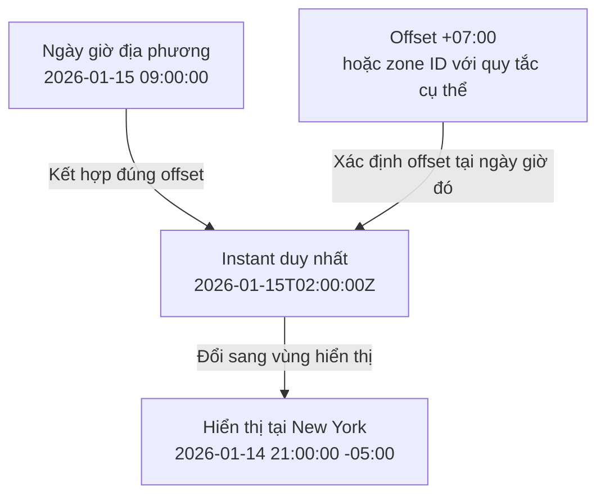

# Giá trị có múi giờ và không có múi giờ

Trong SQL, cùng một giá trị như `2026-01-15 09:00:00` có thể mang hai ý nghĩa rất khác nhau:

- **“09:00 tại một địa phương”**: một *giờ trên đồng hồ* vào một ngày cụ thể, chưa đủ thông tin để xác định một thời điểm duy nhất trên toàn thế giới.
- **“09:00 theo giờ Việt Nam, UTC+07:00”**: một *thời điểm thực tế* có thể quy đổi thành `2026-01-15 02:00:00Z` theo UTC.

Sự khác biệt này quyết định cách thiết kế cột SQL, cách so sánh thời gian và cách dữ liệu xuất hiện khi người dùng ở những múi giờ khác nhau. Nếu chọn sai kiểu dữ liệu hoặc tự chuyển đổi tùy tiện, một cuộc hẹn có thể hiển thị lệch giờ, báo cáo có thể tính sai ngày, hoặc sự kiện có thể bị ghi nhận sai thứ tự.

Bài học giải thích các kiểu giá trị có và không có thông tin múi giờ trong cơ sở dữ liệu quan hệ, dùng **PostgreSQL** làm ví dụ SQL chính. Cuối bài có so sánh với các DBMS khác và cách ứng dụng Java trao đổi dữ liệu thời gian.

## 1. Phân biệt bốn khái niệm thời gian

Trước khi chọn kiểu cột, cần phân biệt **ngày**, **ngày giờ địa phương**, **thời điểm tuyệt đối** và **múi giờ**.

### 1.1. Ngày giờ địa phương (local date-time)

`2026-01-15 09:00:00` cho biết ngày 15/01/2026 lúc 09:00 theo cách đọc đồng hồ, nhưng chưa nói đồng hồ đó thuộc khu vực nào.

Giá trị này phù hợp với thông tin kiểu:

- “Cửa hàng mở cửa lúc 09:00”.
- “Buổi học dự kiến bắt đầu lúc 09:00 ngày 15/01”.
- “Ngày sinh là 15/01/2000”.

Thông tin ngày sinh thậm chí chỉ cần kiểu `DATE` vì gắn thêm giờ hoặc múi giờ thường làm sai ý nghĩa nghiệp vụ.

### 1.2. Thời điểm tuyệt đối (instant)

Một **instant** là một thời điểm duy nhất trên trục thời gian toàn cầu. Có nhiều cách biểu diễn cùng một instant:

```text
2026-01-15T02:00:00Z       UTC
2026-01-15T09:00:00+07:00  UTC+07:00
2026-01-14T21:00:00-05:00  UTC-05:00
```

Ba chuỗi trên biểu thị **cùng một thời điểm**. Khi một sự kiện đã xảy ra, như “máy chủ nhận yêu cầu lúc nào”, ta thường cần lưu chính xác instant.

Ký hiệu `Z` trong chuỗi theo chuẩn ISO 8601/RFC 3339 có nghĩa **UTC**, tương đương offset `+00:00`.

### 1.3. UTC offset

**Offset** là độ chênh giữa đồng hồ địa phương và UTC tại một thời điểm:

- `+07:00`: giờ địa phương nhanh hơn UTC 7 giờ.
- `-05:00`: giờ địa phương chậm hơn UTC 5 giờ.
- `+00:00` hoặc `Z`: không chênh UTC.

Offset cho phép tính instant từ một ngày giờ địa phương đã biết:

```text
Local time: 2026-01-15 09:00:00
Offset:     +07:00
UTC:        2026-01-15 02:00:00Z
```

Tuy nhiên, **offset không phải là tên múi giờ**. Nó chỉ là con số chênh lệch, không mô tả đầy đủ quy tắc áp dụng trong quá khứ và tương lai.

### 1.4. Múi giờ theo khu vực (time zone / zone ID)

Một **zone ID** như `Asia/Ho_Chi_Minh`, `Europe/Paris` hay `America/New_York` biểu thị bộ quy tắc về offset theo vị trí địa lý và thời điểm. Các quy tắc có thể gồm giờ mùa hè (*daylight saving time*, DST), thay đổi lịch sử hoặc các quyết định pháp lý trong tương lai.

Ví dụ, tại New York:

| Thời điểm | Zone ID | Offset áp dụng |
| --- | --- | --- |
| 15/01/2026, 09:00 | `America/New_York` | `-05:00` |
| 15/07/2026, 09:00 | `America/New_York` | `-04:00` |

Cùng một zone ID có thể có offset khác nhau tùy ngày. Vì vậy, không nên thay thế `America/New_York` bằng một offset cố định nếu hệ thống cần xử lý lịch dài hạn.

Trong phần lớn bối cảnh hiện tại, `Asia/Ho_Chi_Minh` dùng UTC+07:00, nhưng vẫn nên lưu zone ID khi nghiệp vụ thực sự cần giữ thông tin địa phương và quy tắc múi giờ.

### 1.5. Sơ đồ mối quan hệ



Một giá trị ngày giờ địa phương **đứng một mình** không đủ để suy ra instant; muốn chuyển đổi đúng phải biết offset hoặc zone ID kèm quy tắc xử lý khi giờ bị trùng hay không tồn tại.

## 2. Những kiểu dữ liệu thời gian thường gặp trong SQL

Tên và ngữ nghĩa kiểu dữ liệu **không giống hệt nhau giữa các DBMS**. Dưới đây là khái niệm thường gặp, trước khi đi vào cú pháp PostgreSQL.

| Kiểu/ý tưởng | Thông tin chứa đựng | Thích hợp cho |
| --- | --- | --- |
| `DATE` | Ngày theo lịch, không có giờ hoặc offset | Ngày sinh, ngày hiệu lực hợp đồng |
| `TIME WITHOUT TIME ZONE` (hoặc `TIME` tùy DBMS) | Giờ trong ngày, không gắn ngày/múi giờ | Giờ mở cửa thông thường |
| `TIMESTAMP WITHOUT TIME ZONE` | Ngày và giờ địa phương, không gắn offset hay zone | Thời gian được mô tả theo đồng hồ tại một địa phương |
| `TIMESTAMP WITH TIME ZONE` hoặc kiểu tương đương | Ngữ nghĩa thời điểm có xét múi giờ; cách lưu và biểu diễn tùy DBMS | Thời điểm log, giao dịch, sự kiện thực tế |
| Kiểu ngày giờ kèm offset, như `datetimeoffset` của SQL Server | Ngày giờ cùng offset | Dữ liệu cần giữ offset đi kèm theo ngữ nghĩa DBMS |

**Lưu ý về tên `TIMESTAMP`:** Trong PostgreSQL, `TIMESTAMP` mặc định là **`TIMESTAMP WITHOUT TIME ZONE`**. Trong MySQL, kiểu `TIMESTAMP` lại có hành vi chuyển đổi qua múi giờ của phiên kết nối. Không thể suy ra cách lưu chỉ từ tên kiểu `TIMESTAMP` mà không biết đang dùng hệ quản trị nào.

Một hệ quản trị hỗ trợ `TIMESTAMP WITH TIME ZONE` cũng **không nhất thiết lưu lại tên zone ID ban đầu**. Đây là khác biệt quan trọng giữa “giữ đúng instant” và “giữ nguyên khu vực mà người dùng đã chọn”.

## 3. PostgreSQL: `TIMESTAMP` và `TIMESTAMPTZ`

PostgreSQL có hai kiểu cốt lõi:

```sql
-- Không chứa thông tin múi giờ
TIMESTAMP WITHOUT TIME ZONE
-- Viết gọn:
TIMESTAMP

-- Xác định một thời điểm, có xét múi giờ khi nhập/xuất
TIMESTAMP WITH TIME ZONE
-- Viết gọn theo PostgreSQL:
TIMESTAMPTZ
```

### 3.1. `TIMESTAMP WITHOUT TIME ZONE`

Ví dụ:

```sql
CREATE TABLE lich_hoc (
    id INTEGER PRIMARY KEY,
    gio_bat_dau TIMESTAMP NOT NULL
);

INSERT INTO lich_hoc (id, gio_bat_dau)
VALUES (1, TIMESTAMP '2026-01-15 09:00:00');
```

Cột `gio_bat_dau` lưu các thành phần năm–tháng–ngày–giờ–phút–giây. **Không có offset/zone ID** đi kèm; PostgreSQL không tự hiểu đó là 09:00 ở Hà Nội, Paris hay New York.

Đọc lại giá trị không tự dịch sang múi giờ khác chỉ vì múi giờ phiên kết nối thay đổi:

```sql
SET TIME ZONE 'UTC';

SELECT gio_bat_dau FROM lich_hoc WHERE id = 1;
-- 2026-01-15 09:00:00

SET TIME ZONE 'Asia/Ho_Chi_Minh';

SELECT gio_bat_dau FROM lich_hoc WHERE id = 1;
-- 2026-01-15 09:00:00
```

Điểm quan trọng: **không thể khôi phục múi giờ gốc từ riêng cột `TIMESTAMP`**. Nếu ứng dụng ngầm hiểu mọi giá trị thuộc một múi giờ cụ thể, quy ước đó phải được quản lý chặt chẽ ở nơi khác.

### 3.2. `TIMESTAMP WITH TIME ZONE` / `TIMESTAMPTZ`

Ví dụ lưu thời điểm một yêu cầu được ghi nhận:

```sql
CREATE TABLE su_kien (
    id INTEGER PRIMARY KEY,
    thoi_diem TIMESTAMPTZ NOT NULL
);

INSERT INTO su_kien (id, thoi_diem)
VALUES
    (1, TIMESTAMPTZ '2026-01-15 09:00:00+07:00'),
    (2, TIMESTAMPTZ '2026-01-15 02:00:00+00:00');
```

Hai hàng mang **hai mã bản ghi khác nhau nhưng cùng một instant**.

PostgreSQL chuyển dữ liệu `TIMESTAMPTZ` thành biểu diễn nội bộ của một thời điểm tuyệt đối. Khi trả kết quả, DBMS hiển thị theo tham số `TimeZone` của phiên kết nối:

```sql
SET TIME ZONE 'UTC';

SELECT id, thoi_diem
FROM su_kien
ORDER BY id;

-- id | thoi_diem
-- 1  | 2026-01-15 02:00:00+00
-- 2  | 2026-01-15 02:00:00+00

SET TIME ZONE 'Asia/Ho_Chi_Minh';

SELECT id, thoi_diem
FROM su_kien
ORDER BY id;

-- id | thoi_diem
-- 1  | 2026-01-15 09:00:00+07
-- 2  | 2026-01-15 09:00:00+07
```

**Ý nghĩa:** cùng một thời điểm được biểu diễn khác nhau khi đổi múi giờ hiển thị; bản thân thời điểm không thay đổi.

Tên `WITH TIME ZONE` dễ gây hiểu nhầm. Trong PostgreSQL, `TIMESTAMPTZ` **không lưu lại** zone ID hay offset nguyên gốc mà người gửi nhập. Từ một giá trị `TIMESTAMPTZ`, không thể xác định liệu người dùng ban đầu đã nhập `Asia/Ho_Chi_Minh`, `+07:00` hay một cách biểu diễn tương đương khác. Nếu cần giữ zone ID ban đầu, phải lưu riêng.

### 3.3. Bẫy khi viết literal có offset nhưng ép thành `TIMESTAMP`

Trong PostgreSQL, kiểu dữ liệu của literal được xác định theo phần khai báo kiểu, **không phải** bằng cách nhìn dấu `+07:00` ở trong chuỗi.

```sql
SET TIME ZONE 'UTC';

SELECT
    TIMESTAMP   '2026-01-15 09:00:00+07:00' AS khong_mui_gio,
    TIMESTAMPTZ '2026-01-15 09:00:00+07:00' AS co_mui_gio;

-- khong_mui_gio        | co_mui_gio
-- 2026-01-15 09:00:00  | 2026-01-15 02:00:00+00
```

Với literal được khai báo là `TIMESTAMP WITHOUT TIME ZONE`, thông tin offset trong chuỗi **bị bỏ qua**. Điều này có thể làm mất ý nghĩa thời điểm ngay lúc nhập dữ liệu.

Nếu đầu vào chứa offset và muốn giữ đúng instant, hãy truyền/ép về `TIMESTAMPTZ` hoặc dùng kiểu giá trị tương ứng của driver, rồi kiểm tra quy tắc của DBMS đang sử dụng.

### 3.4. Những gì `TimeZone` của phiên kết nối ảnh hưởng

Trong PostgreSQL, cấu hình `TimeZone` tác động đến nhiều thao tác liên quan tới `TIMESTAMPTZ`, ví dụ:

- Cách biểu diễn kết quả `TIMESTAMPTZ` khi trả về văn bản.
- Việc diễn giải một giá trị nhập **không có offset rõ ràng** khi đích là `TIMESTAMPTZ`.
- Các phép biến đổi hoặc ép kiểu giữa `TIMESTAMP` và `TIMESTAMPTZ` khi không nêu zone một cách tường minh.

Do đó, hãy tránh để một instant phụ thuộc vào “múi giờ máy chủ hiện tại” một cách ngầm định. Khi tích hợp nhiều ứng dụng hoặc dịch vụ, nên dùng dữ liệu có offset rõ ràng và có quy ước kết nối cụ thể.

## 4. Đổi giữa ngày giờ địa phương và instant trong PostgreSQL

PostgreSQL hỗ trợ toán tử `AT TIME ZONE`; ý nghĩa phụ thuộc vào **kiểu dữ liệu bên trái**.

| Đầu vào | `AT TIME ZONE 'Zone/Name'` trả về | Ý nghĩa |
| --- | --- | --- |
| `TIMESTAMP WITHOUT TIME ZONE` | `TIMESTAMPTZ` | Diễn giải ngày giờ “trên đồng hồ” là thời gian thuộc zone đó, rồi suy ra instant. |
| `TIMESTAMPTZ` | `TIMESTAMP WITHOUT TIME ZONE` | Chuyển một instant sang giờ đồng hồ tại zone đó; kết quả không mang zone/offset. |

### 4.1. Từ giờ địa phương sang instant

```sql
SET TIME ZONE 'UTC';

SELECT
    TIMESTAMP '2026-01-15 09:00:00'
        AT TIME ZONE 'Asia/Ho_Chi_Minh' AS instant_utc;

-- instant_utc
-- 2026-01-15 02:00:00+00
```

Lệnh yêu cầu PostgreSQL hiểu 09:00 là **09:00 theo quy tắc của Asia/Ho_Chi_Minh ngày 15/01/2026**, từ đó xác định instant.

### 4.2. Từ instant sang giờ địa phương

```sql
SELECT
    TIMESTAMPTZ '2026-01-15 02:00:00+00'
        AT TIME ZONE 'Asia/Ho_Chi_Minh' AS gio_viet_nam;

-- gio_viet_nam
-- 2026-01-15 09:00:00
```

Kết quả `gio_viet_nam` là kiểu `TIMESTAMP WITHOUT TIME ZONE`. Dù vừa dùng tên múi giờ trong phép biến đổi, kiểu dữ liệu kết quả **không tự giữ lại** tên `Asia/Ho_Chi_Minh`.

### 4.3. Vì sao không tự cộng/trừ bảy giờ?

Cách làm `utc_time + INTERVAL '7 hours'` chỉ tình cờ đúng cho một khu vực có offset +07:00 tại thời điểm đang xét, và dễ sai với khu vực có DST hoặc thay đổi quy tắc lịch sử. Hãy dùng **zone ID** và các toán tử/hàm múi giờ của DBMS khi chuyển đổi thời gian địa phương.

Tương tự, dùng `AT TIME ZONE` không giải quyết mọi bài toán nếu một giờ địa phương rơi vào khoảng **không tồn tại** hoặc **bị lặp** vì DST. Trường hợp đó cần quy tắc nghiệp vụ rõ ràng; không nên dựa vào hành vi mặc định ngầm của một thư viện hay DBMS.

## 5. Daylight Saving Time: giờ không tồn tại và giờ trùng nhau

Một số khu vực thay đổi giờ theo mùa. Trong năm 2026, tại `America/New_York`:

- **Ngày 08/03/2026**, đồng hồ chuyển từ `01:59:59` sang `03:00:00`. Vì thế `2026-03-08 02:30:00` **không tồn tại** theo giờ địa phương tại New York.
- **Ngày 01/11/2026**, đồng hồ chuyển lùi từ gần `02:00` về `01:00`. Vì thế `2026-11-01 01:30:00` xảy ra **hai lần**, một lần theo offset `-04:00` và một lần theo `-05:00`.

```text
Giờ địa phương bị trùng:
2026-11-01 01:30:00 -04:00 = 2026-11-01 05:30:00Z
2026-11-01 01:30:00 -05:00 = 2026-11-01 06:30:00Z
```

Hai thời điểm cách nhau **một giờ**, dù phần ngày giờ địa phương giống hệt nhau.

Vì vậy:

- Một giá trị `TIMESTAMP WITHOUT TIME ZONE` chỉ ghi `2026-11-01 01:30:00` **không đủ** để biết nó chỉ thời điểm nào.
- Biết thêm zone ID `America/New_York` vẫn có thể **chưa đủ** để phân biệt hai lần xuất hiện nếu thiếu chính sách chọn offset.
- Khi đặt lịch, hệ thống nên quyết định cách xử lý trường hợp “giờ không tồn tại” (từ chối, gợi ý giờ khác...) và “giờ bị trùng” (yêu cầu chọn lần thứ nhất/lần thứ hai, xác định offset...).

Đây là lý do **zone ID**, **offset** và **instant** không thể dùng thay thế lẫn nhau trong mọi nghiệp vụ.

## 6. Chọn kiểu cột theo ý nghĩa nghiệp vụ

Hãy bắt đầu bằng câu hỏi: **Đang lưu một thời điểm đã xảy ra, một giờ trên đồng hồ, hay một lịch hẹn gắn với khu vực?**

| Dữ liệu | Điều cần bảo toàn | Gợi ý thiết kế |
| --- | --- | --- |
| Thời điểm tạo đơn hàng | Instant để so sánh và sắp xếp trên toàn hệ thống | `TIMESTAMPTZ` (PostgreSQL) |
| Thời điểm nhận sự kiện từ API | Instant, không bị lệch khi đổi máy chủ | `TIMESTAMPTZ`; truyền offset hoặc instant rõ ràng |
| Ngày sinh | Ngày theo lịch, không phải một instant | `DATE` |
| Giờ cửa hàng thường mở | Giờ trên đồng hồ, có thể chưa liên quan đến một ngày | `TIME` kèm múi giờ cửa hàng nếu phải tính lịch toàn cầu |
| Cuộc hẹn một lần vào 09:00 ở Hà Nội | Giờ địa phương, zone ID và instant xác định | Lưu instant; lưu thêm ngày giờ địa phương/zone ID nếu cần giữ ý định của người đặt |
| Cuộc họp 09:00 mỗi thứ Hai ở Paris | Quy tắc lặp theo giờ địa phương tại Paris | Lưu giờ, quy tắc lặp và `Europe/Paris`; suy ra instant theo từng ngày diễn ra |
| Bản ghi nhập từ hệ thống cũ không biết múi giờ | Giữ nguyên giá trị chưa có đủ ngữ cảnh | `TIMESTAMP` cùng thông tin về nguồn/quy tắc; không tự gán UTC |

### 6.1. Ví dụ: audit log và thời gian tạo bản ghi

Một hệ thống giao dịch muốn lưu chính xác thời điểm bản ghi được tạo:

```sql
CREATE TABLE giao_dich (
    id BIGINT PRIMARY KEY,
    ma_giao_dich VARCHAR(50) NOT NULL,
    created_at TIMESTAMPTZ NOT NULL DEFAULT CURRENT_TIMESTAMP
);
```

`CURRENT_TIMESTAMP` trong PostgreSQL có kiểu ngữ nghĩa phù hợp với `TIMESTAMPTZ` và biểu diễn thời điểm gắn với ngữ cảnh giao dịch. Hệ thống có thể hiển thị `created_at` theo vùng của người xem mà không đổi instant.

**Lưu ý:** Trong PostgreSQL, `CURRENT_TIMESTAMP`/`now()` trả về thời điểm **bắt đầu giao dịch hiện tại**, không nhất thiết là lúc đồng hồ vật lý chạy đến từng câu lệnh. Khi cần đo thời điểm thực tế từng lệnh, cần xem các hàm như `clock_timestamp()` và yêu cầu độ chính xác của nghiệp vụ.

### 6.2. Ví dụ: lịch hẹn cố định tại một khu vực

Giả sử khách đặt lịch lúc 09:00 ngày 15/01/2026 tại Hà Nội. Hệ thống muốn giữ cả **ý định địa phương** lẫn **instant đã được xác định**:

```sql
CREATE TABLE lich_hen (
    id BIGINT PRIMARY KEY,
    gio_dia_phuong TIMESTAMP NOT NULL,
    zone_id VARCHAR(100) NOT NULL,
    bat_dau_luc TIMESTAMPTZ NOT NULL
);
```

Thêm dữ liệu:

```sql
INSERT INTO lich_hen
    (id, gio_dia_phuong, zone_id, bat_dau_luc)
VALUES (
    1,
    TIMESTAMP '2026-01-15 09:00:00',
    'Asia/Ho_Chi_Minh',
    TIMESTAMP '2026-01-15 09:00:00'
        AT TIME ZONE 'Asia/Ho_Chi_Minh'
);
```

Ở đây:

- `gio_dia_phuong` giữ “09:00 ngày 15/01” mà người dùng chọn.
- `zone_id` giữ nơi quy tắc múi giờ được áp dụng.
- `bat_dau_luc` giữ instant đã tính từ hai thông tin trên.

Nếu lưu cả ba trường, ứng dụng phải kiểm soát **tính nhất quán** khi chỉnh lịch; không được đổi `gio_dia_phuong` mà bỏ quên `bat_dau_luc`. Với các lịch lặp trong tương lai, instant của từng lần xảy ra nên được tính theo quy tắc của zone tại ngày tương ứng; việc cố định offset hôm nay cho mọi lần hẹn là sai khi khu vực có DST.

### 6.3. Ví dụ: sự kiện ở nhiều quốc gia

Một sự kiện trực tuyến được tổ chức vào `2026-01-15T02:00:00Z`. Người xem có thể thấy:

| Khu vực | Giờ địa phương cùng một instant |
| --- | --- |
| `Asia/Ho_Chi_Minh` | 09:00, 15/01/2026 |
| `Europe/Paris` | 03:00, 15/01/2026 |
| `America/New_York` | 21:00, 14/01/2026 |

**Ngày cũng có thể khác nhau** theo múi giờ. Bởi vậy, báo cáo “đơn hàng ngày 15/01” chỉ có nghĩa rõ ràng khi biết đang tính **ngày theo UTC** hay **ngày của một khu vực kinh doanh**.

## 7. Truy vấn theo ngày địa phương một cách chính xác

Giả sử bảng `su_kien` có cột `thoi_diem TIMESTAMPTZ`. Muốn lấy **các sự kiện diễn ra trong ngày 15/01/2026 theo giờ Việt Nam**, ta phải chuyển **hai mốc nửa đêm địa phương** sang instant.

```sql
SELECT id, thoi_diem
FROM su_kien
WHERE thoi_diem >= (
    TIMESTAMP '2026-01-15 00:00:00'
        AT TIME ZONE 'Asia/Ho_Chi_Minh'
)
AND thoi_diem < (
    TIMESTAMP '2026-01-16 00:00:00'
        AT TIME ZONE 'Asia/Ho_Chi_Minh'
)
ORDER BY thoi_diem;
```

Khoảng này tương đương từ `2026-01-14T17:00:00Z` (bao gồm) tới `2026-01-15T17:00:00Z` (không bao gồm). Đây là cách lọc **nửa mở** `[đầu ngày, đầu ngày kế tiếp)`, giúp tránh đếm trùng hoặc bỏ sót sự kiện ở ranh giới.

**Không nên mặc định** rằng mỗi ngày địa phương luôn dài 24 giờ. Tại vùng có DST, một ngày chuyển giờ có thể dài 23 hoặc 25 giờ; hãy xác định **đầu hai ngày liên tiếp trong cùng zone**, rồi chuyển mỗi đầu mốc thành instant.

### 7.1. Vì sao `DATE(thoi_diem)` có thể gây bất ngờ?

Trong PostgreSQL, khi ép `TIMESTAMPTZ` thành `DATE`, ngày thu được phụ thuộc vào múi giờ dùng để diễn giải instant, thường là `TimeZone` của phiên kết nối.

```sql
SET TIME ZONE 'UTC';

SELECT (TIMESTAMPTZ '2026-01-15 00:30:00+07')::DATE
    AS ngay_theo_utc;
-- 2026-01-14

SET TIME ZONE 'Asia/Ho_Chi_Minh';

SELECT (TIMESTAMPTZ '2026-01-15 00:30:00+07')::DATE
    AS ngay_theo_viet_nam;
-- 2026-01-15
```

Nếu muốn lấy ngày ở một vùng cụ thể, hãy chỉ định rõ:

```sql
SELECT (
    TIMESTAMPTZ '2026-01-15 00:30:00+07'
        AT TIME ZONE 'Asia/Ho_Chi_Minh'
)::DATE AS ngay_tai_viet_nam;
-- 2026-01-15
```

Đối với truy vấn lọc nhiều hàng, dùng **điều kiện khoảng trên cột instant** như ví dụ đầu mục thường cho bộ tối ưu cơ hội sử dụng chỉ mục trực tiếp trên cột hơn so với bọc cột trong một hàm.

## 8. Cú pháp và hành vi khác nhau giữa các hệ quản trị

SQL có chuẩn chung nhưng triển khai kiểu thời gian khác nhau. Trước khi chuyển schema giữa các DBMS, cần kiểm tra tài liệu tương ứng.

| DBMS | Giá trị không kèm múi giờ | Giá trị có xét múi giờ/offset | Điều cần chú ý |
| --- | --- | --- | --- |
| **PostgreSQL** | `TIMESTAMP` / `TIMESTAMP WITHOUT TIME ZONE` | `TIMESTAMPTZ` / `TIMESTAMP WITH TIME ZONE` | `TIMESTAMPTZ` biểu diễn instant; hiển thị theo session `TimeZone` và **không lưu zone ID gốc**. |
| **MySQL** | `DATETIME` | `TIMESTAMP` | `TIMESTAMP` được chuyển từ múi giờ phiên kết nối sang UTC khi ghi, rồi từ UTC sang múi giờ phiên khi đọc; `DATETIME` không có bước chuyển đổi tương đương. |
| **SQL Server** | `datetime2` | `datetimeoffset` | `datetimeoffset` giữ thông tin offset; offset không thay thế đầy đủ quy tắc của một zone ID. |
| **Oracle Database** | `TIMESTAMP` | `TIMESTAMP WITH TIME ZONE`, `TIMESTAMP WITH LOCAL TIME ZONE` | Hai kiểu có múi giờ có ngữ nghĩa lưu trữ/hiển thị khác nhau; phải xem rõ quy tắc Oracle. |
| **SQLite** | Thường dùng chuỗi ngày giờ hoặc dạng số | Dùng quy ước định dạng và hàm chuyển đổi | Không có kiểu cột ngày giờ chuyên dụng giống PostgreSQL; ứng dụng phải thống nhất cách mã hóa. |

### 8.1. PostgreSQL và MySQL: cùng tên `TIMESTAMP`, khác ý nghĩa

Trong PostgreSQL:

```sql
CREATE TABLE mau_pg (
    x TIMESTAMP,
    y TIMESTAMPTZ
);
```

`x` là ngày giờ **không kèm múi giờ**; `y` có ngữ nghĩa instant.

Trong MySQL:

```sql
CREATE TABLE mau_mysql (
    x DATETIME,
    y TIMESTAMP
);
```

`x` là ngày giờ không có bước chuyển đổi múi giờ tự động; `y` được chuyển theo `time_zone` của phiên kết nối khi ghi/đọc. Dù có điểm tương đồng trong mục đích sử dụng, **không thể coi MySQL `TIMESTAMP` và PostgreSQL `TIMESTAMPTZ` là một kiểu hoàn toàn giống nhau**. Chúng còn khác nhau về phạm vi giá trị ngày giờ, hành vi với giá trị không hợp lệ và cấu hình, tùy phiên bản.

Đặc biệt, `TIMESTAMP` của MySQL có phạm vi thời gian hạn chế hơn `DATETIME` trong những phiên bản MySQL thông dụng; nếu lưu các lịch hẹn rất xa trong tương lai, phải kiểm tra phạm vi kiểu dữ liệu và phiên bản DBMS.

### 8.2. SQL Server và Oracle có kiểu giữ thông tin múi giờ khác

`datetimeoffset` của SQL Server gắn offset với giá trị ngày giờ. Nó giúp biểu diễn offset cụ thể, nhưng **không phải** là nơi lưu đầy đủ các quy tắc DST của `America/New_York`.

Oracle có `TIMESTAMP WITH TIME ZONE` và `TIMESTAMP WITH LOCAL TIME ZONE`, mỗi kiểu có quy tắc riêng về thông tin múi giờ và cách biểu diễn theo phiên. Không nên tự chuyển bảng PostgreSQL sang Oracle bằng cách đổi tên kiểu mà không xem xét ngữ nghĩa.

### 8.3. SQLite: cần quy ước kiểu và định dạng

SQLite thường biểu diễn thời gian bằng chuỗi ISO 8601, số giây Unix hoặc số Julian day. Ví dụ một ứng dụng có thể lưu timestamp UTC dạng văn bản:

```sql
CREATE TABLE log_su_kien (
    id INTEGER PRIMARY KEY,
    created_at TEXT NOT NULL
);

INSERT INTO log_su_kien (id, created_at)
VALUES (1, '2026-01-15T02:00:00Z');
```

Cột `TEXT` không tự chứng minh rằng mọi giá trị đều có UTC/offset hợp lệ. Ứng dụng cần thống nhất cách chuẩn hóa, kiểm tra dữ liệu và diễn giải khi truy vấn.

## 9. Trao đổi dữ liệu thời gian qua API và Java

Trong các ứng dụng Java, kiểu dữ liệu thời gian của chương trình nên thể hiện **ý nghĩa** tương ứng với cột SQL.

| Java `java.time` | Ý nghĩa | Cách dùng thường gặp |
| --- | --- | --- |
| `LocalDate` | Ngày, không có giờ/múi giờ | Ngày sinh, ngày theo lịch |
| `LocalTime` | Giờ trong ngày | Giờ mở cửa |
| `LocalDateTime` | Ngày giờ địa phương, không chứa offset/zone | Cột SQL `TIMESTAMP WITHOUT TIME ZONE` |
| `Instant` | Một thời điểm tuyệt đối trên trục UTC | Giá trị event/audit cần so sánh toàn cầu |
| `OffsetDateTime` | Ngày giờ với offset | Trao đổi giá trị có offset qua API/JDBC phù hợp |
| `ZonedDateTime` | Ngày giờ cùng zone ID và quy tắc vùng | Lịch hẹn theo vùng hoặc hiển thị địa phương |

Các ánh xạ JDBC cụ thể phụ thuộc driver và DBMS. Với PostgreSQL JDBC, `LocalDateTime` thường tương ứng `timestamp without time zone`, còn `OffsetDateTime` tương ứng `timestamp with time zone`. Không nên mặc định driver sẽ bảo toàn zone ID gốc của `ZonedDateTime` khi lưu một cột `TIMESTAMPTZ`.

### 9.1. Ví dụ Java: cùng instant dưới nhiều cách hiển thị

```java
import java.time.Instant;
import java.time.ZoneId;
import java.time.ZonedDateTime;

public class TimeZoneExample {
    public static void main(String[] args) {
        Instant occurredAt = Instant.parse("2026-01-15T02:00:00Z");

        ZonedDateTime vietnamTime = occurredAt.atZone(
            ZoneId.of("Asia/Ho_Chi_Minh")
        );
        ZonedDateTime newYorkTime = occurredAt.atZone(
            ZoneId.of("America/New_York")
        );

        System.out.println(occurredAt);
        // 2026-01-15T02:00:00Z

        System.out.println(vietnamTime);
        // 2026-01-15T09:00+07:00[Asia/Ho_Chi_Minh]

        System.out.println(newYorkTime);
        // 2026-01-14T21:00-05:00[America/New_York]
    }
}
```

Một giá trị `Instant` giữ **thời điểm**, còn `atZone(...)` chọn cách **hiển thị** thời điểm đó theo khu vực. Việc chuyển sang zone khác có thể thay đổi cả ngày tháng hiển thị.

### 9.2. Ví dụ Java: ý định địa phương và zone ID

```java
import java.time.Instant;
import java.time.LocalDateTime;
import java.time.ZoneId;

public class AppointmentExample {
    public static void main(String[] args) {
        LocalDateTime local = LocalDateTime.of(
            2026, 1, 15, 9, 0
        );
        ZoneId zone = ZoneId.of("Asia/Ho_Chi_Minh");

        Instant actualInstant = local.atZone(zone).toInstant();

        System.out.println(local);
        // 2026-01-15T09:00

        System.out.println(actualInstant);
        // 2026-01-15T02:00:00Z
    }
}
```

Ví dụ này đơn giản vì 09:00 tại Việt Nam vào ngày đã chọn không nằm trong khoảng chuyển DST. Với các zone có chuyển DST, ứng dụng cần kiểm tra giờ bị trùng/không tồn tại và có chính sách xử lý rõ ràng; phương thức chuyển đổi mặc định không thay thế quyết định nghiệp vụ.

### 9.3. Dữ liệu JSON: ghi rõ offset khi gửi instant

Nếu API trả về một **thời điểm đã xảy ra**, các dạng như sau giúp người nhận biết offset:

```json
{
  "eventId": 101,
  "occurredAt": "2026-01-15T02:00:00Z"
}
```

hoặc cùng instant theo giờ Việt Nam:

```json
{
  "eventId": 101,
  "occurredAt": "2026-01-15T09:00:00+07:00"
}
```

Trong khi đó, dữ liệu:

```json
{
  "eventId": 101,
  "occurredAt": "2026-01-15T09:00:00"
}
```

**không tự cho biết** 09:00 thuộc múi giờ nào. Nếu một API vẫn dùng định dạng không offset, hợp đồng API phải mô tả rõ ý nghĩa và quy ước; cách an toàn hơn cho sự kiện đã xảy ra là dùng instant/offset rõ ràng.

Với cuộc hẹn trong tương lai mà người dùng chọn “09:00 tại Paris”, API có thể cần cả ngày giờ địa phương và zone ID:

```json
{
  "localStart": "2026-07-15T09:00:00",
  "timeZone": "Europe/Paris"
}
```

Ứng dụng sau đó chuyển sang instant theo quy tắc và chính sách DST khi lên lịch.

## 10. Những lỗi phổ biến và cách tránh

### Lỗi 1: Lưu “giờ Việt Nam” vào cột không múi giờ nhưng đặt tên là `created_at_utc`

Ví dụ lưu `2026-01-15 09:00:00` và gọi nó là “UTC” mà không chuyển đổi. Khi hệ thống đọc lại dưới giả định UTC, sự kiện sẽ bị lệch **7 giờ**.

**Cách tránh:** Xác định rõ giá trị đầu vào là giờ địa phương hay instant; chuyển đổi bằng offset/zone trước khi lưu instant.

### Lỗi 2: Đổi chữ `+07:00` thành `Z` mà giữ nguyên giờ

`2026-01-15T09:00:00+07:00` **khác** `2026-01-15T09:00:00Z`. Muốn biểu diễn cùng instant dưới UTC, phải đổi thành `2026-01-15T02:00:00Z`.

**Cách tránh:** Dùng thư viện xử lý thời gian thay vì sửa chuỗi thủ công.

### Lỗi 3: Mặc định mọi ngày đều có 24 giờ

Ở vùng chuyển DST, cộng đúng 24 giờ vào instant không luôn đưa đến cùng giờ đồng hồ của ngày kế tiếp.

**Cách tránh:** Với lịch theo địa phương, tính ngày/giờ tiếp theo theo **zone ID**; với khoảng thời gian thực đã trôi qua, dùng thời lượng instant theo yêu cầu.

### Lỗi 4: Lưu riêng offset cố định cho lịch lặp

Cuộc họp 09:00 thứ Hai tại Paris không luôn có cùng offset UTC giữa mùa đông và mùa hè.

**Cách tránh:** Lưu quy tắc lặp, giờ địa phương và `Europe/Paris`; tạo instant cho mỗi lần diễn ra.

### Lỗi 5: Giả định `TIMESTAMP` giống nhau giữa PostgreSQL và MySQL

Chuyển schema máy móc có thể làm thay đổi cách dữ liệu được diễn giải và hiển thị.

**Cách tránh:** Kiểm tra tài liệu DBMS/driver cụ thể và dùng bài kiểm thử với hai phiên có múi giờ khác nhau khi chuyển hệ.

### Lỗi 6: Chuyển `TIMESTAMP` sang `TIMESTAMPTZ` mà không hiểu dữ liệu cũ

Nếu dữ liệu cũ là “09:00 tại Hà Nội” nhưng DBMS diễn giải chúng là “09:00 UTC”, quá trình chuyển kiểu sẽ tạo ra instant sai.

**Cách tránh:** Trước khi chuyển kiểu, xác minh ý nghĩa nguồn dữ liệu; khi cần, diễn giải giá trị cũ với một zone tường minh và xử lý các dòng không đồng nhất theo nguồn.

### Lỗi 7: Nghĩ rằng `TIMESTAMPTZ` lưu lại nơi người dùng nhập

Cùng instant có thể được nhập với nhiều offset/zone khác nhau và PostgreSQL không bảo toàn zone ID gốc trong cột này.

**Cách tránh:** Lưu thêm `zone_id` khi nghiệp vụ cần biết địa phương ban đầu.

### Lỗi 8: Dùng múi giờ của máy chủ làm quy tắc nghiệp vụ

Một ứng dụng chạy ở máy chủ UTC và một ứng dụng chạy ở máy chủ múi giờ khác có thể tạo ra kết quả ngày khác nhau nếu dựa vào mặc định.

**Cách tránh:** Định nghĩa zone nghiệp vụ tường minh, ghi rõ định dạng API và thống nhất ngữ nghĩa cột thời gian.

## 11. Bài tập thực hành

Các ví dụ dưới đây chạy theo cú pháp **PostgreSQL**. Nên thực hành trong một database thử nghiệm và quan sát kiểu kết quả cũng như múi giờ hiển thị.

### Bài 1. Hai chuỗi có cùng instant không?

Cho:

```text
A = 2026-01-15T09:00:00+07:00
B = 2026-01-15T02:00:00Z
C = 2026-01-15T09:00:00Z
```

**Câu hỏi:** Cặp nào cùng instant?

**Đáp án:** `A` và `B`. `C` xảy ra muộn hơn `A` và `B` bảy giờ.

Kiểm tra:

```sql
SELECT
    TIMESTAMPTZ '2026-01-15 09:00:00+07:00'
        = TIMESTAMPTZ '2026-01-15 02:00:00+00:00'
        AS a_b_bang_nhau,
    TIMESTAMPTZ '2026-01-15 09:00:00+07:00'
        = TIMESTAMPTZ '2026-01-15 09:00:00+00:00'
        AS a_c_bang_nhau;

-- a_b_bang_nhau | a_c_bang_nhau
-- true          | false
```

### Bài 2. Đổi múi giờ có thay đổi giờ trong `TIMESTAMP` không?

```sql
SET TIME ZONE 'UTC';
SELECT TIMESTAMP '2026-01-15 09:00:00';

SET TIME ZONE 'America/New_York';
SELECT TIMESTAMP '2026-01-15 09:00:00';
```

**Đáp án:** Không. Cả hai lần trả về cùng ngày giờ `2026-01-15 09:00:00`, vì giá trị đã khai báo là `TIMESTAMP WITHOUT TIME ZONE`.

### Bài 3. Hiển thị một instant theo vùng người dùng

```sql
SELECT
    TIMESTAMPTZ '2026-01-15 02:00:00Z'
        AT TIME ZONE 'Europe/Paris' AS tai_paris,
    TIMESTAMPTZ '2026-01-15 02:00:00Z'
        AT TIME ZONE 'Asia/Ho_Chi_Minh' AS tai_ha_noi;
```

**Đáp án mong đợi:** `tai_paris = 2026-01-15 03:00:00` và `tai_ha_noi = 2026-01-15 09:00:00`.

### Bài 4. Vì sao một cuộc hẹn không thể chỉ lưu `2026-11-01 01:30` ở New York?

**Đáp án:** Vì vào ngày chuyển DST mùa thu năm 2026, giờ 01:30 xuất hiện hai lần. Cần thêm thông tin chọn offset/lần xuất hiện hoặc chính sách giải quyết mơ hồ trước khi xác định một instant.

### Bài 5. Tự thiết kế kiểu dữ liệu

Hãy chọn kiểu cho bốn trường: `birth_date`, `created_at`, `store_open_time`, `weekly_meeting_start`.

**Một phương án hợp lý:**

- `birth_date`: `DATE`.
- `created_at`: `TIMESTAMPTZ` trên PostgreSQL.
- `store_open_time`: `TIME`, đồng thời lưu zone của cửa hàng nếu cần đổi sang instant cho một ngày cụ thể.
- `weekly_meeting_start`: giờ địa phương và quy tắc ngày lặp kèm `zone_id`; không chỉ lưu một `TIMESTAMPTZ` cho toàn bộ lịch lặp.

## 12. Ghi nhớ khi thiết kế dữ liệu thời gian

Có ba câu hỏi giúp chọn kiểu dữ liệu chính xác:

1. **Cần biết “lúc nào trên trục thời gian” hay “mấy giờ theo đồng hồ tại địa phương”?** Instant và local date-time phục vụ hai nhu cầu khác nhau.
2. **Có cần giữ zone ID ban đầu không?** Nếu có, đừng giả định cột “with time zone” của mọi DBMS tự lưu tên khu vực.
3. **Thời gian có thể trải qua DST, thay đổi quy tắc hoặc được người dùng ở nhiều nơi xem không?** Nếu có, hãy tính chuyển đổi bằng zone ID, xác định cách xử lý giờ mơ hồ và biểu diễn offset rõ ràng khi trao đổi instant.

Trong PostgreSQL, `TIMESTAMP` biểu diễn **ngày giờ không có múi giờ**, còn `TIMESTAMPTZ` biểu diễn **thời điểm có xét múi giờ khi nhập và hiển thị** nhưng **không giữ tên zone gốc**. Hiểu đúng sự khác biệt này giúp tránh những lỗi âm thầm rất khó phát hiện trong hệ thống sử dụng SQL.
