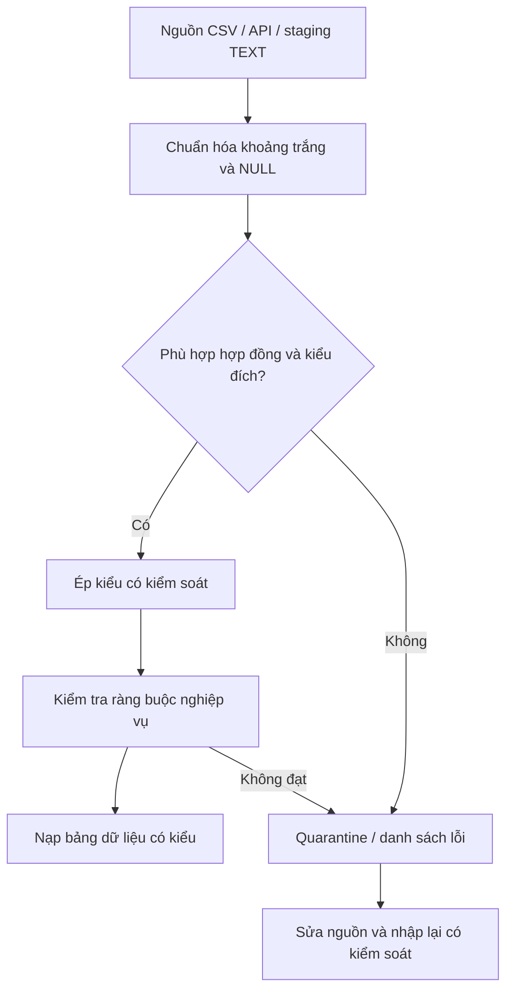

# So sánh khác kiểu và lỗi dữ liệu không thể chuyển đổi

Một câu SQL có thể đúng cú pháp nhưng trả kết quả sai vì **hai giá trị đang được so sánh theo hai kiểu dữ liệu khác nhau**. Cũng có trường hợp truy vấn bị từ chối ngay khi chạy vì hệ quản trị không tìm được phép so sánh phù hợp, hoặc vì một chuỗi nhìn giống số/ngày lại không thể chuyển thành kiểu mong muốn.

Ví dụ, các giá trị `'2'` và `'10'` là **chuỗi ký tự** nếu được lưu trong cột `TEXT`. Sắp xếp chúng theo chuỗi có thể cho thứ tự `'10'` rồi `'2'`; còn khi lưu dưới dạng số, `2` nhỏ hơn `10`. Việc đặt dấu nháy, kiểu của cột, cơ chế ép kiểu và quy tắc của từng hệ quản trị quyết định ngữ nghĩa thực tế.

Trong chương **Kiểu dữ liệu** của Database SQL, bài này tập trung vào các năng lực:

- Phân biệt **kiểu của giá trị**, **kiểu của cột**, **literal chưa xác định kiểu** và **tham số truy vấn**.
- Hiểu phép so sánh giữa số nguyên, số thập phân, chuỗi, ngày giờ và Boolean.
- Nhận biết lúc nào SQL thực hiện **chuyển đổi ngầm định**, lúc nào phải **ép kiểu tường minh**.
- Giải thích và xử lý lỗi dữ liệu không thể chuyển đổi, dữ liệu vượt phạm vi, định dạng không hợp lệ và `NULL`.
- Thiết kế luồng nhập liệu có bước xác thực và phân loại dòng lỗi, thay vì để phép `CAST` ngẫu nhiên làm hỏng toàn bộ báo cáo.
- Viết điều kiện lọc, `JOIN`, sắp xếp và truy vấn ứng dụng theo đúng kiểu dữ liệu.

**Ngữ cảnh cú pháp:** Các đoạn SQL chạy được trong **PostgreSQL**, trừ khi có nhãn hệ quản trị khác. Cơ chế chuyển đổi kiểu khác nhau đáng kể giữa PostgreSQL, MySQL, SQL Server, Oracle và các hệ thống phân tích, nên không được suy diễn toàn bộ ví dụ PostgreSQL sang hệ khác.

## 1. Một phép so sánh SQL thực chất so sánh điều gì?

Xem hai biểu thức:

```sql
SELECT
    2 < 10 AS numeric_comparison,
    '2'::text COLLATE "C" < '10'::text COLLATE "C"
        AS text_comparison;
```

Kết quả trong PostgreSQL:

| Biểu thức | Kết quả | Giải thích |
| --- | --- | --- |
| `2 < 10` | `TRUE` | Hai giá trị được so sánh theo giá trị số |
| `'2'::text COLLATE "C" < '10'::text COLLATE "C"` | `FALSE` | So sánh chuỗi theo thứ tự ký tự với collation `C`; ký tự đầu `'2'` lớn hơn `'1'` |

Việc chỉ nhìn ký tự hiển thị không đủ. Muốn giải thích một phép so sánh, cần xét **bốn thành phần**:

1. **Kiểu dữ liệu của từng toán hạng:** `INTEGER`, `NUMERIC`, `TEXT`, `DATE`, `TIMESTAMP`, `BOOLEAN`…
2. **Toán tử được áp dụng:** `=`, `<>`, `<`, `>`, `BETWEEN`, `IN`, `LIKE`…
3. **Quy tắc chọn toán tử và chuyển kiểu:** Hệ quản trị có thể tìm toán tử phù hợp trực tiếp, chuyển kiểu được phép, hoặc báo lỗi.
4. **Ngữ cảnh so sánh:** Collation cho chuỗi, múi giờ cho một số kiểu thời gian, độ chính xác cho số thực, và `NULL` cho dữ liệu thiếu.

Không tồn tại một quy tắc chung kiểu “SQL luôn tự đổi chuỗi thành số” cho tất cả hệ quản trị. Chính sự khác nhau này gây nhiều lỗi khi di chuyển ứng dụng hoặc nhập dữ liệu từ file CSV, JSON và API.

### Literal không có kiểu xác định ngay từ đầu

Trong PostgreSQL, literal chuỗi viết trực tiếp như `'10'` ban đầu có kiểu nội bộ `unknown` cho đến khi ngữ cảnh buộc nó phải nhận kiểu phù hợp. Điều này khác với một **cột đã được khai báo `TEXT`** hoặc một giá trị được ép kiểu rõ ràng thành `TEXT`.

```sql
-- PostgreSQL: literal '10' được suy luận thành integer để so sánh.
SELECT 10 = '10' AS inferred_literal;
-- TRUE

-- Hai toán hạng đã có kiểu integer và text:
SELECT 10 = '10'::text AS mixed_typed_operands;
-- ERROR: operator does not exist: integer = text
```

Ví dụ thứ hai cố ý minh họa lỗi, không chạy chung với các câu truy vấn khác nếu muốn toàn bộ script hoàn tất. PostgreSQL không cung cấp toán tử so sánh trực tiếp `integer = text` trong trường hợp này.

Điểm cần nhớ:

- `'10'` xuất hiện trực tiếp trong SQL có thể được **suy luận kiểu từ ngữ cảnh**.
- `'10'::text` hoặc một cột `TEXT` là dữ liệu **đã xác định kiểu**.
- `10` là literal số; cách diễn giải cụ thể còn phụ thuộc giá trị và ngữ cảnh.
- Tham số ứng dụng `$1` hay `?` có cơ chế định kiểu theo driver, khai báo và ngữ cảnh; không mặc định chúng luôn hoạt động như literal `'10'`.

Vì thế, **một so sánh chạy được với literal không bảo đảm sẽ chạy được khi thay literal bằng cột hoặc tham số kiểu `TEXT`**.

## 2. Các dạng chuyển đổi kiểu thường gặp

### 2.1. Chuyển đổi ngầm định (*implicit conversion*)

Đây là chuyển đổi hệ quản trị tự chọn trong một ngữ cảnh mà quy tắc của nó cho phép.

```sql
SELECT
    1::integer = 1.0::numeric AS same_numeric_value,
    12::smallint < 13::bigint AS integer_families;
```

Hai biểu thức trả `TRUE`. PostgreSQL có các phép so sánh hoặc quy tắc chuyển kiểu tương thích cho họ kiểu số. Trong trường hợp này, người viết không cần tự chuyển mọi toán hạng về cùng một kiểu.

Tuy nhiên, sự thuận tiện này không đồng nghĩa rằng **bất cứ `TEXT` nào trông như số cũng sẽ được đổi ngầm thành số**.

### 2.2. Chuyển đổi tường minh (*explicit conversion*)

Hai cách viết phổ biến của PostgreSQL:

```sql
SELECT
    CAST('125.50' AS NUMERIC(10, 2)) AS amount_by_cast,
    '125.50'::NUMERIC(10, 2)         AS amount_by_colon;
```

`CAST(expression AS target_type)` là cú pháp SQL phổ biến; toán tử `::` là cách viết ngắn đặc trưng của PostgreSQL và một số hệ tương thích.

Khi kiểu nguồn và kiểu đích khác nhau về ý nghĩa, cách ép kiểu tường minh thường giúp người đọc hiểu chính xác chủ đích. Nhưng `CAST` **không làm dữ liệu sai trở thành dữ liệu hợp lệ**: giá trị không thể chuyển đổi vẫn gây lỗi.

### 2.3. Chuyển đổi mất thông tin (*lossy conversion*)

Một phép chuyển kiểu có thể chạy được nhưng làm mất thông tin:

```sql
SELECT
    '00123'::integer AS parsed_number,
    CAST(12.75 AS integer) AS converted_integer;
```

`'00123'::integer` tạo số `123`, làm mất hai số `0` đầu. Đối với mã đơn hàng, mã bưu chính, số tài khoản hoặc mã sản phẩm, các số `0` đầu thường là **một phần của định danh**, không được loại bỏ. Đừng chuyển một trường định danh sang số chỉ vì mọi ký tự của nó đều là chữ số.

Phép đổi số thập phân sang số nguyên có thể làm mất phần thập phân theo quy tắc riêng của hệ quản trị và phép chuyển đổi. Trong PostgreSQL, chuyển `NUMERIC` sang kiểu số nguyên **làm tròn** giá trị về số nguyên gần nhất; đừng tự suy luận rằng mọi hệ quản trị đều cắt phần thập phân giống nhau.

### 2.4. Biến đổi định dạng khác với chuyển kiểu

Hai tác vụ sau có mục đích khác nhau:

- **Parsing/chuyển kiểu:** `'125.50'::numeric` chuyển chuỗi thành giá trị số để tính toán.
- **Định dạng hiển thị:** `TO_CHAR(125.50::numeric, 'FM999990.00')` chuyển một giá trị số thành chuỗi để trình bày.

Nếu dùng chuỗi đã định dạng để so sánh hoặc sắp xếp như số, bạn có thể quay lại lỗi so sánh theo ký tự. Nguyên tắc là **lưu kiểu đúng cho mục đích xử lý; định dạng ở tầng xuất dữ liệu**.

## 3. Vì sao chuyển kiểu thất bại?

Có bốn nhóm lỗi chính. Chúng cần được phân biệt vì cách xử lý khác nhau.

| Nhóm tình huống | Ví dụ PostgreSQL | Vấn đề |
| --- | --- | --- |
| Không có phép so sánh phù hợp | `10 = '10'::text` | Kiểu của hai toán hạng không có toán tử `=` tương ứng |
| Chuỗi không đúng cú pháp kiểu đích | `'mười'::integer` | Giá trị `TEXT` không thể phân tích thành số nguyên |
| Vượt phạm vi hoặc độ chính xác | `'99999999999'::integer` | Số quá lớn so với giới hạn `INTEGER` |
| Giá trị ngày giờ không hợp lệ | `'2025-02-30'::date` | Ngày 30/2 không tồn tại |

Các ví dụ dưới đây **cố ý gây lỗi**, nên chạy riêng khi cần quan sát thông báo:

```sql
-- Không tìm được toán tử so sánh integer = text.
SELECT 10 = '10'::text;

-- invalid input syntax for type integer
SELECT CAST('mười' AS integer);

-- integer out of range
SELECT CAST('99999999999' AS integer);

-- date/time field value out of range
SELECT CAST('2025-02-30' AS date);
```

Trong PostgreSQL, những lỗi thường liên quan các mã SQLSTATE như:

- `42883`: không có toán tử/hàm phù hợp (*undefined_function*), gồm trường hợp `operator does not exist`.
- `22P02`: cú pháp biểu diễn dữ liệu đầu vào không hợp lệ (*invalid_text_representation*).
- `22003`: giá trị số nằm ngoài phạm vi (*numeric_value_out_of_range*).
- `22008`: giá trị ngày giờ nằm ngoài phạm vi (*datetime_field_overflow*); lỗi ngày giờ khác có thể có mã khác.

Tên lỗi, SQLSTATE và thời điểm phát sinh còn phụ thuộc biểu thức và kiểu dữ liệu cụ thể. Ở ứng dụng, cần lưu mã lỗi/chi tiết phù hợp trong log kỹ thuật, nhưng không nên trả toàn bộ thông tin nội bộ của câu SQL cho người dùng cuối.

### Cùng là chuỗi “trông giống số” nhưng chưa chắc chuyển được

```sql
SELECT
    '120.50'::numeric AS normal_decimal,
    ' 120.50 '::numeric AS whitespace_accepted,
    '1e2'::numeric AS scientific_notation;
```

PostgreSQL chấp nhận ba giá trị trên như số tương ứng. Tuy nhiên, `'1,200.50'` với dấu phân cách hàng nghìn thường **không** được chấp nhận bằng cách `::numeric` trực tiếp:

```sql
SELECT '1,200.50'::numeric;
-- ERROR: invalid input syntax for type numeric
```

Điều này cho thấy “có thể ép kiểu bằng PostgreSQL” và “đúng định dạng nghiệp vụ” là hai tiêu chí khác nhau. Có hệ thống muốn chấp nhận dấu phẩy phân nhóm, có hệ thống bắt buộc dấu chấm thập phân, có hệ thống cấm số âm và ký pháp khoa học. Quy ước phải được nêu rõ từ đầu.

## 4. Số với số: tương thích kiểu không có nghĩa mọi phép so sánh đều an toàn

### 4.1. `INTEGER`, `BIGINT` và `NUMERIC`

```sql
SELECT
    42::integer = 42::bigint   AS integer_bigint_equal,
    42::integer = 42.00::numeric AS integer_numeric_equal,
    99.99::numeric > 99::integer AS decimal_greater;
```

Cả ba cột trả `TRUE`. Các kiểu số có thể tương tác trong phép so sánh, nhưng kiểu đích và độ lớn vẫn quan trọng.

Một số giới hạn điển hình của PostgreSQL:

| Kiểu | Ý nghĩa | Điểm cần lưu ý |
| --- | --- | --- |
| `SMALLINT` | Số nguyên 2 byte | Phạm vi hẹp |
| `INTEGER` / `INT` | Số nguyên 4 byte | Tối đa `2,147,483,647` |
| `BIGINT` | Số nguyên 8 byte | Phù hợp hơn cho số lượng/ID số lớn |
| `NUMERIC(p, s)` | Số thập phân chính xác với độ chính xác `p` và số chữ số thập phân `s` | Có thể lỗi khi giá trị sau quy tắc làm tròn vượt số chữ số được phép |
| `REAL` / `DOUBLE PRECISION` | Số thực dấu phẩy động nhị phân | Có sai số biểu diễn, không nên so sánh bằng tuyệt đối cho phép tính cần độ chính xác thập phân |

Ví dụ `NUMERIC(12,2)` cho phép tối đa 10 chữ số ở phần nguyên và 2 chữ số phần thập phân. Giá trị có quá nhiều chữ số nguyên sẽ không vừa kiểu này.

### 4.2. So sánh số thực dấu phẩy động

```sql
SELECT
    0.1::double precision + 0.2::double precision
        = 0.3::double precision AS floating_point_equal,
    0.1::numeric + 0.2::numeric
        = 0.3::numeric AS decimal_equal;
```

Phép so sánh đầu có thể trả `FALSE` vì số thực nhị phân không biểu diễn chính xác nhiều phân số thập phân, trong khi phép tính `NUMERIC` thứ hai cho `TRUE`. Với phép tính tiền tệ hoặc đối soát tài chính, thường nên dùng `NUMERIC`/`DECIMAL` và một quy tắc làm tròn đã thống nhất.

Nếu bắt buộc sử dụng floating point, có thể kiểm tra sai số trong một ngưỡng thích hợp của bài toán:

```sql
SELECT ABS(
    (0.1::double precision + 0.2::double precision)
    - 0.3::double precision
) < 1e-10::double precision AS approximately_equal;
```

Ngưỡng `1e-10` chỉ là ví dụ; ứng dụng thật phải chọn dung sai theo đơn vị, quy mô và yêu cầu độ chính xác.

### 4.3. Không dùng chuỗi để kiểm tra giá trị số

```sql
SELECT
    '100'::text = '0100'::text AS text_equal,
    '100'::integer = '0100'::integer AS numeric_equal;
```

Kết quả lần lượt là `FALSE` và `TRUE`. Nếu `'0100'` là mã nghiệp vụ, kiểu chuỗi và kết quả so sánh chuỗi mới có thể là điều cần giữ. Nếu đó là số lượng, so sánh số mới đúng.

## 5. Chuỗi với chuỗi: collation, thứ tự và phân biệt mã định danh

Khi cả hai phía đều là `TEXT`/`VARCHAR`, phép so sánh diễn ra theo quy tắc chuỗi. Với toán tử so sánh thứ tự như `<`, `>` hoặc `ORDER BY`, **collation** quyết định quy tắc sắp xếp.

```sql
SELECT value
FROM (VALUES ('2'), ('10'), ('100'), ('3')) AS t(value)
ORDER BY value COLLATE "C";
```

Kết quả theo collation `C` là:

```text
10
100
2
3
```

Sắp xếp cùng các giá trị dưới dạng số:

```sql
SELECT value
FROM (VALUES ('2'), ('10'), ('100'), ('3')) AS t(value)
ORDER BY value::integer;
```

Kết quả:

```text
2
3
10
100
```

Đổi kiểu để sắp xếp chỉ hợp lý khi **tất cả dữ liệu thật sự là số hợp lệ** và ý nghĩa nghiệp vụ là số. Nếu tập dữ liệu có `'N/A'`, câu `ORDER BY value::integer` có thể lỗi. Nếu dữ liệu là mã sản phẩm, cách sắp xếp số cũng có thể sai yêu cầu.

### Phân biệt chữ hoa/chữ thường, dấu và khoảng trắng

- Quy tắc so sánh chữ hoa/chữ thường có thể chịu ảnh hưởng bởi collation và kiểu dữ liệu; không được giả định `'abc'` và `'ABC'` luôn bằng nhau.
- Khoảng trắng ở đầu/cuối có thể làm thay đổi giá trị chuỗi. Có thể dùng `BTRIM` để chuẩn hóa khi yêu cầu nghiệp vụ cho phép.
- Với mã phân biệt hoa/thường, tránh tự động `LOWER` mọi dữ liệu; việc chuẩn hóa phải phù hợp quy tắc định danh.
- `CHAR(n)` có hành vi khoảng trắng đệm khác `VARCHAR`/`TEXT`; cần lưu ý khi thiết kế khóa hoặc so sánh dữ liệu từ hệ thống cũ.

Với chuỗi Unicode và nhiều ngôn ngữ, lựa chọn collation ảnh hưởng trực tiếp tới sắp xếp và đôi khi cả hành vi so sánh bằng, tùy kiểu collation. Tránh gắn logic xác thực định danh vào một giả định mơ hồ về thứ tự từ điển.

## 6. Ngày tháng: so sánh chuỗi ngày và ngày thực là hai việc khác nhau

### 6.1. Định dạng không chuẩn làm thứ tự chuỗi sai

```sql
SELECT
    '2025-2-9'::text COLLATE "C"
        < '2025-12-01'::text COLLATE "C" AS lexical_comparison,
    DATE '2025-02-09'
        < DATE '2025-12-01' AS date_comparison;
```

Kết quả lần lượt là `FALSE` và `TRUE`. Cách viết chuỗi ngày không đồng nhất về số chữ số làm phép so sánh từ điển phản ánh sai thứ tự thời gian.

Kể cả khi chuỗi ISO `YYYY-MM-DD` được chuẩn hóa nhất quán và đôi khi cho cùng thứ tự với ngày, một cột ngày nên dùng `DATE` vì:

- Hệ quản trị xác thực ngày thực tế có tồn tại.
- Có thể dùng phép toán ngày, khoảng thời gian, hàm ngày giờ.
- Tránh phụ thuộc định dạng hiển thị và đặc tính collation.
- Điều kiện lọc có khả năng tận dụng index trên cột `DATE` hoặc `TIMESTAMP` phù hợp.

### 6.2. So sánh `DATE` với `TIMESTAMP`

```sql
SELECT
    DATE '2025-02-13'
        = TIMESTAMP '2025-02-13 00:00:00' AS at_midnight,
    DATE '2025-02-13'
        < TIMESTAMP '2025-02-13 14:30:00' AS before_afternoon;
```

Trong PostgreSQL, hai biểu thức trả `TRUE`. Khi so sánh với `TIMESTAMP` không kèm múi giờ, giá trị `DATE` được hiểu tương ứng thời điểm đầu ngày. Tuy nhiên, nếu mục tiêu là “mọi bản ghi trong ngày 13/2”, điều kiện bằng với ngày không thay thế được một **khoảng thời gian** bao trọn ngày.

```sql
-- Giữ mọi thời điểm trong ngày 13/2/2025.
SELECT order_id, paid_at
FROM typed_orders
WHERE paid_at >= TIMESTAMP '2025-02-13 00:00:00'
  AND paid_at <  TIMESTAMP '2025-02-14 00:00:00';
```

Bảng `typed_orders` ở đây là **minh họa cho bảng đã có cột typed**, không phải bảng tạm được tạo trong bài. Cách lọc nửa mở `>= start`, `< next_start` phù hợp với dấu thời gian có độ chính xác cao; tránh kết thúc kỳ bằng `23:59:59` dễ bỏ sót phần lẻ của giây.

### 6.3. Múi giờ và thời điểm thực

`TIMESTAMP WITHOUT TIME ZONE` là ngày giờ theo lịch nhưng không kèm thông tin múi giờ. `TIMESTAMP WITH TIME ZONE` (PostgreSQL viết tắt `TIMESTAMPTZ`) dùng để biểu diễn thời điểm thực với quy tắc chuyển đổi múi giờ.

```sql
SELECT
    TIMESTAMPTZ '2025-02-13 08:00:00+00'
      = TIMESTAMPTZ '2025-02-13 15:00:00+07'
      AS same_instant;
```

Biểu thức trả `TRUE`: hai cách ghi biểu diễn cùng một thời điểm. Khi ép kiểu hoặc so sánh giữa kiểu có và không có múi giờ, kết quả có thể phụ thuộc **múi giờ phiên làm việc**; ứng dụng cần quy định rõ dữ liệu được lưu và diễn giải theo múi giờ nào.

### 6.4. Chuỗi ngày không hợp lệ phải được phát hiện

```sql
SELECT CAST('2025-02-30' AS DATE);
-- ERROR: ngày không tồn tại
```

Biểu thức chính quy chỉ kiểm tra dạng `YYYY-MM-DD` chưa đủ để khẳng định ngày tồn tại: `2025-02-30` đúng hình dạng nhưng sai về lịch. Các đầu vào khác như `15/02/2025` có thể bị diễn giải khác tùy cấu hình/ngôn ngữ. Hãy thống nhất định dạng đầu vào, xác thực bằng bộ phân tích ngày của hệ thống và ghi lại lý do loại bản ghi.

## 7. Boolean: tránh dựa vào sự “giống nhau” giữa số, chuỗi và logic

Trong PostgreSQL, `BOOLEAN` có các giá trị `TRUE`, `FALSE` và `NULL`. Các chuỗi nhập Boolean được PostgreSQL chấp nhận theo một số dạng như `'true'`, `'false'`, `'yes'`, `'no'`, `'on'`, `'off'`, `'1'`, `'0'`. Điều đó **không có nghĩa** mọi trường hợp so sánh `BOOLEAN` với `INTEGER` hay `TEXT` đều được hỗ trợ ngầm định.

```sql
SELECT
    'yes'::boolean AS parsed_boolean,
    '1'::boolean   AS parsed_digit,
    TRUE = 'true'  AS inferred_boolean_literal;
```

Ba biểu thức trên có ý nghĩa `TRUE` trong PostgreSQL. Nhưng câu sau không có toán tử so sánh Boolean với Integer trực tiếp:

```sql
SELECT TRUE = 1;
-- ERROR: operator does not exist: boolean = integer
```

Với dữ liệu nhập, quy tắc chấp nhận giá trị phải được thiết kế theo hợp đồng API, chẳng hạn **chỉ nhận `true`/`false`** hoặc **chỉ nhận `1`/`0`**. Một bộ chuyển kiểu có thể chấp nhận nhiều dạng hơn những gì nghiệp vụ muốn cho phép.

## 8. `NULL`: không phải chuỗi rỗng, số 0 hay một giá trị để so sánh bằng

`NULL` biểu thị giá trị chưa biết hoặc không có, tùy ý nghĩa cột. Nó không bằng số `0`, không giống chuỗi `''` và không thể kiểm tra bằng `= NULL`.

```sql
SELECT
    NULL::integer = 0 AS null_equals_zero,
    NULL::integer = NULL::integer AS two_nulls_equal,
    NULL::integer IS NULL AS null_detected;
```

Kết quả lần lượt là `NULL`, `NULL`, `TRUE`. Trong điều kiện `WHERE`, chỉ các hàng có kết quả điều kiện là `TRUE` được giữ; `FALSE` và `UNKNOWN` (biểu diễn bằng `NULL` Boolean) đều bị loại.

### So sánh an toàn với `NULL`

```sql
SELECT
    NULL::integer IS NOT DISTINCT FROM NULL::integer AS both_missing,
    NULL::integer IS DISTINCT FROM 0::integer AS missing_vs_zero,
    5::integer IS NOT DISTINCT FROM 5::integer AS same_value;
```

Cả ba biểu thức trên trả `TRUE` trong PostgreSQL. `IS [NOT] DISTINCT FROM` hữu ích khi nghiệp vụ muốn **coi hai giá trị `NULL` là tương đương** để đối chiếu dữ liệu; vẫn phải dùng kiểu tương thích giữa các toán hạng.

### Chuyển kiểu với `NULL`

```sql
SELECT
    CAST(NULL AS integer) AS null_integer,
    NULLIF(BTRIM('   '), '') AS blank_as_null;
```

`CAST(NULL AS integer)` vẫn là `NULL`, không gây lỗi. `NULLIF(BTRIM(...), '')` hữu ích để chuyển chuỗi chỉ chứa khoảng trắng thành `NULL` trước bước parse. Nhưng nó **không thể** xử lý các chuỗi sai như `'N/A'` hay `'12x'`: nếu ép kiểu chúng, lỗi vẫn xảy ra.

Đặc biệt, `COALESCE` không phải một bộ chuyển đổi kiểu an toàn:

```sql
-- Hợp lệ: cả hai đối số có thể thống nhất về kiểu integer.
SELECT COALESCE(NULL::integer, 0);

-- Ví dụ cố ý gây lỗi: không thể biến 'N/A' thành integer.
SELECT COALESCE(NULL::integer, 'N/A');
```

PostgreSQL phải xác định kiểu kết quả chung của `COALESCE`. Literal `'N/A'` bị cố chuyển về kiểu số nguyên và thất bại, dù nhánh đầu chỉ là `NULL`.

## 9. Dựng bộ dữ liệu nhập thô để thực hành

Trong thực tế, file CSV thường đưa nhiều cột vào hệ thống dưới dạng văn bản. Đây là tình huống lý tưởng để thấy **chuyển đổi kiểu khác với xác thực nghiệp vụ**.

Tạo bảng tạm:

```sql
CREATE TEMP TABLE imported_payments_raw (
    raw_order_code TEXT,
    raw_amount     TEXT,
    raw_paid_date  TEXT,
    raw_enabled    TEXT
);

INSERT INTO imported_payments_raw (
    raw_order_code, raw_amount, raw_paid_date, raw_enabled
) VALUES
    ('A001', '120.50',             '2025-02-13', 'true'),
    ('A002', ' 80 ',               '2025-02-14', 'false'),
    ('A003', 'N/A',                '2025-02-15', 'true'),
    ('A004', '',                   '2025-02-30', 'yes'),
    ('A005', '1,200.50',           '15/02/2025', '1'),
    ('A006', '999999999999999999', '2025-02-16', 'false'),
    ('A007', NULL,                 NULL,         NULL),
    ('A008', '-20.00',             '2025-02-18', 'false');
```

Các dữ liệu được bố trí có chủ ý:

| Mã | `raw_amount` | Tình huống |
| --- | --- | --- |
| A001 | `120.50` | Số thập phân hợp lệ |
| A002 | ` 80 ` | Có khoảng trắng cần chuẩn hóa |
| A003 | `N/A` | Ký hiệu thiếu dữ liệu, không phải số |
| A004 | Chuỗi rỗng | Không có số tiền |
| A005 | `1,200.50` | Có dấu phân cách hàng nghìn |
| A006 | `999999999999999999` | Vượt độ lớn mục tiêu `NUMERIC(12,2)` |
| A007 | `NULL` | Giá trị thiếu thực sự |
| A008 | `-20.00` | Số hợp lệ về cú pháp, nhưng **bị cấm** nếu chính sách số tiền không âm |

Cột `raw_paid_date` cũng gồm ngày hợp lệ, ngày không tồn tại và ngày viết không theo mẫu ISO. Cột `raw_enabled` chứa nhiều cách viết Boolean. **Không nên cập nhật phá hủy bảng nguồn khi chưa có quy tắc nhập liệu**; giữ dữ liệu thô để đối chiếu và điều tra bản ghi bị loại.

## 10. Những câu lệnh dễ mắc lỗi khi làm việc với bảng nhập thô

### 10.1. So sánh `TEXT` với `INTEGER`

```sql
SELECT raw_order_code
FROM imported_payments_raw
WHERE raw_amount > 100;
-- PostgreSQL: không có toán tử text > integer phù hợp.
```

Câu này sai kiểu, bởi `raw_amount` được khai báo `TEXT`. Một “cách sửa” nhìn có vẻ nhanh là:

```sql
SELECT raw_order_code
FROM imported_payments_raw
WHERE raw_amount > '100';
```

Lúc này phép so sánh có thể **chạy được** vì `'100'` được xử lý như chuỗi phù hợp với cột `TEXT`. Nhưng nó so sánh **chuỗi theo collation**, không phải số. Điều kiện có thể chọn sai tập dữ liệu, và các dòng `N/A`/chuỗi rỗng vẫn được xét theo ký tự.

### 10.2. Ép kiểu cả cột ngay trong `WHERE`

```sql
SELECT raw_order_code
FROM imported_payments_raw
WHERE raw_amount::numeric > 100;
-- ERROR khi gặp giá trị như 'N/A' hoặc '1,200.50'.
```

Ép kiểu trực tiếp chuyển được những giá trị hợp lệ, nhưng **một dòng lỗi có thể làm toàn bộ câu truy vấn thất bại**.

Một ý tưởng khác là lọc chuỗi trông hợp lệ rồi mới ép kiểu:

```sql
-- Không dùng thứ tự viết AND làm cơ chế chống lỗi ép kiểu.
SELECT raw_order_code
FROM imported_payments_raw
WHERE raw_amount ~ '^[0-9]+([.][0-9]+)?$'
  AND raw_amount::numeric > 100;
```

Vấn đề là SQL không cam kết điều kiện bên trái `AND` luôn được thực hiện trước điều kiện bên phải. Bộ tối ưu hóa có thể thay đổi thứ tự xử lý biểu thức. Ngoài ra, regex chỉ kiểm tra **hình dạng**, chưa kiểm tra phạm vi, độ chính xác, hay quy tắc nghiệp vụ.

Để xử lý nhập liệu, nên xác thực riêng và chỉ thực hiện `CAST` tại nhánh đã xác nhận phù hợp, hoặc sử dụng hàm chuyển kiểu an toàn của hệ quản trị.

### 10.3. Lọc ngày bằng chuỗi

```sql
SELECT raw_order_code
FROM imported_payments_raw
WHERE raw_paid_date >= '2025-02-14';
```

Biểu thức này so sánh **TEXT với TEXT**. Những giá trị `15/02/2025` hoặc chuỗi sai định dạng có thể tạo kết quả trái với ý nghĩa “ngày đã thanh toán từ 14/2 trở đi”. Việc nó không báo lỗi còn nguy hiểm hơn một phép `CAST` thất bại, vì truy vấn có thể tạo báo cáo sai nhưng vẫn chạy bình thường.

## 11. Xác thực và chuyển đổi có kiểm soát trong PostgreSQL

### 11.1. Quy định rõ kiểu đích và hợp đồng dữ liệu

Giả sử yêu cầu cho số tiền là:

- Không được âm.
- Tối đa 10 chữ số phần nguyên và tối đa 2 chữ số phần thập phân.
- Dùng dấu chấm `.` làm dấu thập phân.
- Không chấp nhận dấu phân tách hàng nghìn, tiền tố tiền tệ hay ký pháp khoa học.
- Chuỗi rỗng hoặc chỉ có khoảng trắng được xem là **thiếu**, không phải số `0`.

Kiểu đích tương ứng là `NUMERIC(12,2)`. Quan trọng: mặc dù PostgreSQL có thể parse `1e2` thành `100`, quy tắc bên trên **cố ý không cho phép** nó trong dữ liệu nhập.

### 11.2. Kiểm tra kiểu đầu vào bằng `pg_input_is_valid` (PostgreSQL 16+)

PostgreSQL 16 giới thiệu hàm `pg_input_is_valid(text, type_name)`, giúp kiểm tra liệu một chuỗi có phù hợp với hàm nhập của kiểu chỉ định hay không, đối với những kiểu hỗ trợ cơ chế báo lỗi mềm.

```sql
SELECT
    pg_input_is_valid('120.50', 'numeric') AS valid_numeric,
    pg_input_is_valid('N/A', 'numeric') AS invalid_numeric,
    pg_input_is_valid('999999999999999999', 'numeric') AS syntactically_numeric;
```

Hai cột đầu lần lượt là `TRUE` và `FALSE`. Cột thứ ba là `TRUE` vì giá trị đó là số hợp lệ đối với `NUMERIC` không giới hạn độ chính xác chỉ định; **nó vẫn vượt phạm vi cho phép của `NUMERIC(12,2)`** trong hợp đồng ví dụ.

Phải phân biệt:

> **Parse được theo kiểu đích** chưa chứng minh **thỏa ràng buộc độ rộng, độ chính xác và chính sách nghiệp vụ**.

Ở các phiên bản PostgreSQL trước 16, không có sẵn `pg_input_is_valid`. Có thể xác thực tại tầng nhập liệu hoặc tạo hàm chuyển kiểu có kiểm soát bằng PL/pgSQL và xử lý ngoại lệ cho những kiểu cần thiết. Không nên giả định cú pháp `TRY_CAST` của hệ khác có thể chạy nguyên trong PostgreSQL.

Một số hàm nhập của kiểu chuyên biệt có thể chưa hỗ trợ cơ chế lỗi mềm của `pg_input_is_valid` và vẫn phát sinh lỗi. Khi dùng hàm này ngoài các kiểu quen thuộc, cần xác nhận khả năng hỗ trợ của kiểu tương ứng.

### 11.3. Phân loại giá trị trước khi ép sang `NUMERIC(12,2)`

Ví dụ sau sử dụng **hai lớp điều kiện**: kiểm tra định dạng nghiệp vụ bằng regex và kiểm tra parser số của PostgreSQL. Đoạn code chạy trên PostgreSQL 16+.

```sql
WITH normalized AS (
    SELECT
        raw_order_code,
        raw_amount,
        NULLIF(BTRIM(raw_amount), '') AS amount_text
    FROM imported_payments_raw
),
classified AS (
    SELECT
        raw_order_code,
        raw_amount,
        amount_text,
        CASE
            WHEN amount_text IS NULL THEN 'missing'
            WHEN amount_text ~ '^[0-9]{1,10}([.][0-9]{1,2})?$'
                 AND pg_input_is_valid(amount_text, 'numeric')
                THEN 'valid'
            ELSE 'invalid'
        END AS amount_status
    FROM normalized
)
SELECT
    raw_order_code,
    raw_amount,
    amount_status,
    CASE
        WHEN amount_status = 'valid'
            THEN amount_text::NUMERIC(12, 2)
        ELSE NULL
    END AS amount_value
FROM classified
ORDER BY raw_order_code;
```

Giải thích từng tầng:

1. `BTRIM` bỏ khoảng trắng đầu/cuối; `NULLIF(..., '')` gộp chuỗi trống vào trạng thái thiếu.
2. Regex `^[0-9]{1,10}([.][0-9]{1,2})?$` giới hạn phần nguyên có 1–10 chữ số và phần lẻ có 0–2 chữ số, không chấp nhận dấu âm hay dấu phân cách hàng nghìn.
3. `pg_input_is_valid(..., 'numeric')` xác nhận parser PostgreSQL có thể đọc chuỗi dưới dạng số.
4. `CASE` ở truy vấn ngoài chỉ thực hiện `::NUMERIC(12,2)` khi trạng thái là `valid`.
5. Cột `amount_status` giữ lại nguyên nhân phân loại ở mức cơ bản, không tự động biến dữ liệu lỗi thành `0`.

Kết quả mong đợi:

| Mã | Trạng thái | Số tiền sau chuyển |
| --- | --- | ---: |
| A001 | `valid` | 120.50 |
| A002 | `valid` | 80.00 |
| A003 | `invalid` | `NULL` |
| A004 | `missing` | `NULL` |
| A005 | `invalid` | `NULL` |
| A006 | `invalid` | `NULL` |
| A007 | `missing` | `NULL` |
| A008 | `invalid` | `NULL` |

Với hợp đồng trên, giá trị `0000000000.99` là hợp lệ về định dạng và kích thước, dù người dùng có thể muốn thêm quy tắc chuẩn hóa số `0` đầu. Những trường hợp như vậy nhắc rằng **quy tắc kỹ thuật chỉ là một phần của hợp đồng dữ liệu**.

### 11.4. Xử lý ngày và Boolean là các bước riêng

Đối với ngày tháng, cần quy định định dạng đầu vào, ví dụ chỉ chấp nhận `YYYY-MM-DD`. Kiểm tra regex có thể xác định hình dạng nhưng không phát hiện được ngày 30/2, năm nhuận hay những ngày bất hợp lệ khác; phải bổ sung **kiểm tra ngày theo lịch** bằng parser phù hợp. Nếu thiết lập luồng nhập phức tạp, cần phân loại riêng mã lỗi ngày giờ.

Đối với Boolean, không nên dựa hoàn toàn vào tập giá trị mà PostgreSQL tình cờ chấp nhận. Ví dụ, nếu hợp đồng chỉ cho `true`/`false`, có thể chuẩn hóa an toàn:

```sql
SELECT
    raw_order_code,
    raw_enabled,
    CASE LOWER(BTRIM(raw_enabled))
        WHEN 'true' THEN TRUE
        WHEN 'false' THEN FALSE
        ELSE NULL
    END AS enabled_value,
    CASE
        WHEN raw_enabled IS NULL OR BTRIM(raw_enabled) = ''
            THEN 'missing'
        WHEN LOWER(BTRIM(raw_enabled)) IN ('true', 'false')
            THEN 'valid'
        ELSE 'invalid'
    END AS enabled_status
FROM imported_payments_raw
ORDER BY raw_order_code;
```

Khi đó `'yes'` và `'1'` được ghi là **invalid theo hợp đồng ví dụ**, dù PostgreSQL có thể ép chúng sang Boolean. Tách cột trạng thái và giá trị giúp tránh hiểu nhầm `NULL` chuyển đổi với một giá trị `FALSE` hợp lệ.

### 11.5. Giữ lại bản ghi lỗi để sửa dữ liệu nguồn

Một luồng nhập dữ liệu có thể được mô tả như sau:



Không nên lặng lẽ dùng `COALESCE(CAST(...), 0)` để biến dữ liệu sai thành số `0`. Nếu `CAST` gặp giá trị không hợp lệ, nó thường lỗi **trước khi `COALESCE` kịp thay thế**. Với trường hợp có cơ chế chuyển kiểu an toàn trả `NULL`, việc thay tất cả `NULL` thành `0` vẫn có thể làm mất thông tin lỗi cần xử lý.

Đối với dữ liệu vận hành, nên lưu mã hàng nguồn, giá trị thô, giá trị đã chuẩn hóa, lý do lỗi và thời gian nhập để truy vết. Chỉ chuyển bản ghi đủ điều kiện sang bảng chính sau khi xác định rõ quy tắc loại bỏ, sửa chữa hoặc từ chối.

## 12. Một biểu thức `CASE` cũng cần thống nhất kiểu dữ liệu

SQL phải xác định kiểu của cả biểu thức `CASE`, kể cả khi logic hiện tại chỉ đi vào một nhánh.

```sql
-- PostgreSQL: lỗi vì phải chuyển literal 'unknown' thành integer.
SELECT CASE WHEN TRUE THEN 100 ELSE 'unknown' END;
```

Nếu mục đích là trả một **nhãn hiển thị**, hãy chuyển cả hai nhánh về `TEXT`:

```sql
SELECT CASE
    WHEN TRUE THEN 100::text
    ELSE 'unknown'::text
END AS display_label;
```

Nếu mục đích là trả một **số**, hãy giữ kiểu số và biểu diễn dữ liệu chưa biết bằng `NULL` cùng một cột trạng thái riêng:

```sql
SELECT
    CASE
        WHEN FALSE THEN 100::numeric
        ELSE NULL::numeric
    END AS numeric_value,
    CASE
        WHEN FALSE THEN 'valid'
        ELSE 'unknown'
    END AS value_status;
```

### `UNION`, `VALUES` và `COALESCE` cũng cần kiểu chung

```sql
-- Sai: 'N/A' phải được xem xét trong bối cảnh cột kết quả số.
SELECT 10 AS amount
UNION ALL
SELECT 'N/A';
```

Trong PostgreSQL, literal `'N/A'` ở ví dụ trên có thể bị cố chuyển về kiểu số của cột đầu và gây lỗi. Nếu mục đích là gộp dữ liệu số và bản ghi lỗi, nên thiết kế **hai cột** gồm giá trị có kiểu số và trạng thái, hoặc chủ động đưa toàn bộ sang kiểu chuỗi khi mục tiêu chỉ là hiển thị.

Tương tự, đối số của `COALESCE` phải có kiểu chung phù hợp. `COALESCE(some_integer, 'unknown')` không phải cách xuất trạng thái thiếu hợp lệ cho một trường số.

## 13. So sánh và `JOIN` giữa hai bảng có khóa khác kiểu

Giả sử bảng giao dịch có khóa số:

```sql
CREATE TEMP TABLE transactions_typed (
    transaction_id INTEGER PRIMARY KEY,
    amount NUMERIC(12, 2) NOT NULL
);

INSERT INTO transactions_typed(transaction_id, amount) VALUES
    (123, 100.00),
    (124, 200.00);
```

Còn bảng đầu vào từ CSV có mã giao dịch dưới dạng chuỗi:

```sql
CREATE TEMP TABLE transaction_links_raw (
    transaction_code TEXT
);

INSERT INTO transaction_links_raw(transaction_code) VALUES
    ('123'),
    ('00123'),
    ('124'),
    ('ABC');
```

Không thể nối trực tiếp kiểu `INTEGER` và `TEXT` với toán tử `=` thông thường trong PostgreSQL:

```sql
SELECT t.transaction_id, l.transaction_code
FROM transactions_typed AS t
JOIN transaction_links_raw AS l
  ON t.transaction_id = l.transaction_code;
-- ERROR: operator does not exist: integer = text
```

Nếu ép mọi chuỗi nguồn về `INTEGER`, dòng `ABC` gây lỗi. Và `'123'` với `'00123'` cùng chuyển thành `123`, khiến một bản ghi giao dịch có thể nối với **hai mã nguồn khác nhau**.

Cách đúng phụ thuộc ý nghĩa khóa:

- Nếu đó là **ID số thực sự**, cần xác thực và chuyển đổi trong một bước làm sạch có kiểm soát, loại hay đánh dấu các mã không hợp lệ.
- Nếu đó là **mã định danh**, có thể phải đổi thiết kế cột khóa về kiểu chuỗi và quyết định rõ `'123'` với `'00123'` có phải hai mã khác nhau.
- Nếu nguồn và đích dùng hai quy tắc mã hóa khác nhau, cần một **bảng ánh xạ định danh** hoặc quy tắc chuẩn hóa được nghiệp vụ phê duyệt; không tự động xóa số `0` đầu bằng `CAST`.

**Bài học về số hàng sau `JOIN`:** Khi chuyển kiểu làm mất tính duy nhất, phép nối có thể nhân dòng dữ liệu. Đây là lỗi số liệu nghiêm trọng, không chỉ là chuyện câu SQL chạy được hay không.

## 14. Ép kiểu trên cột lọc có thể ảnh hưởng hiệu năng

Giả sử bảng dữ liệu chính được thiết kế đúng kiểu:

```sql
CREATE TEMP TABLE typed_payments (
    payment_id INTEGER PRIMARY KEY,
    amount NUMERIC(12, 2) NOT NULL
);

INSERT INTO typed_payments VALUES
    (1, 100.00), (2, 250.00), (3, 80.00);
```

Có thể tạo index trên cột `amount`:

```sql
CREATE INDEX idx_typed_payments_amount
    ON typed_payments(amount);
```

Điều kiện có kiểu phù hợp:

```sql
SELECT payment_id, amount
FROM typed_payments
WHERE amount >= 100::numeric
ORDER BY amount;
```

Một số trường hợp ép kiểu **trên cột** có thể làm thay đổi cách dùng index:

```sql
-- Minh họa cách lọc không phù hợp nếu mục tiêu là so sánh số:
SELECT payment_id
FROM typed_payments
WHERE amount::text >= '100';
```

Đây là phép so sánh chuỗi, nên có thể trả kết quả sai về nghĩa và không sử dụng được index `amount` theo cách so sánh số thông thường. Khi thực sự cần biểu thức trên cột, có thể phải cân nhắc index biểu thức, nhưng chỉ sau khi đã đo nhu cầu thực tế.

Một câu lệnh có kiểu đúng **không bảo đảm** máy chủ sẽ dùng index: bộ tối ưu hóa còn xét kích thước bảng, thống kê và độ chọn lọc của điều kiện. Dùng `EXPLAIN` để quan sát kế hoạch; đừng thêm index một cách cảm tính.

## 15. Tham số truy vấn trong ứng dụng: giữ kiểu tại ranh giới

Khi ứng dụng Java/JDBC truyền giá trị vào SQL, nên dùng **prepared statement** và phương thức bind tương ứng kiểu đích, thay vì tự nối chuỗi hoặc ép kiểu ngầm.

Ví dụ Java với `java.sql` và `java.math.BigDecimal`:

```java
import java.math.BigDecimal;
import java.sql.Connection;
import java.sql.PreparedStatement;
import java.sql.ResultSet;
import java.sql.SQLException;

public class PaymentLookup {
    public static void printPaymentsAtLeast(
            Connection connection,
            BigDecimal minAmount
    ) throws SQLException {
        String sql = """
            SELECT payment_id, amount
            FROM typed_payments
            WHERE amount >= ?
            ORDER BY amount, payment_id
            """;

        try (PreparedStatement statement =
                 connection.prepareStatement(sql)) {
            statement.setBigDecimal(1, minAmount);

            try (ResultSet rows = statement.executeQuery()) {
                while (rows.next()) {
                    System.out.println(
                        rows.getInt("payment_id") + ": " +
                        rows.getBigDecimal("amount")
                    );
                }
            }
        }
    }
}
```

Đoạn code minh họa kỳ vọng bảng `typed_payments` có sẵn trong cùng phiên/kết nối; bảng tạm PostgreSQL chỉ hiển thị trong phiên tạo nó. Với hệ thống thật, bảng và schema được quản lý qua migration thay vì tạo thủ công trong mỗi phiên.

Trong chương trình:

1. Chuyển đầu vào người dùng thành `BigDecimal` bằng cơ chế xác thực của ứng dụng; nếu sai, trả lỗi dữ liệu đầu vào có ý nghĩa.
2. Bind bằng `setBigDecimal` để chuyển **giá trị số**, không đưa chuỗi SQL tự ghép vào câu truy vấn.
3. So sánh với cột `NUMERIC` để hai phía có ngữ nghĩa tương thích.
4. Ghi log và phân biệt lỗi dữ liệu với lỗi cơ sở dữ liệu; không sử dụng thông báo lỗi PostgreSQL như một phương án xác thực đầu vào duy nhất.

Prepared statement còn giúp chống SQL injection. Tuy nhiên, nó không tự động làm mọi dữ liệu hợp lệ: một chuỗi như `'abc'` được bind vào tham số phải là số vẫn có thể gây lỗi nếu quá trình bind/chuyển kiểu sai hoặc thiếu xác thực.

## 16. So sánh khả năng xử lý giữa các hệ quản trị SQL

Không nên sao chép nguyên câu SQL chuyển kiểu giữa các nền tảng mà không kiểm tra tài liệu chính thức và phiên bản đang dùng.

| Hệ quản trị | Đặc điểm cần lưu ý |
| --- | --- |
| **PostgreSQL** | Chặt chẽ về toán tử giữa các kiểu đã xác định; có `CAST`/`::`; PostgreSQL 16+ có `pg_input_is_valid` cho những kiểu hỗ trợ. Không có `TRY_CAST` tổng quát giống SQL Server. |
| **SQL Server** | Có quy tắc **data type precedence**; một số so sánh trộn kiểu làm SQL Server tự chuyển kiểu có độ ưu tiên thấp hơn lên kiểu cao hơn, và có thể gây lỗi ở dữ liệu xấu. Có `TRY_CAST`/`TRY_CONVERT` trả `NULL` cho nhiều chuyển đổi thất bại, nhưng không phải mọi chuyển đổi đều được phép. |
| **MySQL** | Trong một số phép so sánh, có cơ chế chuyển chuỗi sang số rộng hơn; dữ liệu không phải số có thể dẫn đến chuyển đổi ngầm, cảnh báo hoặc kết quả bất ngờ. Hành vi chi tiết chịu ảnh hưởng phiên bản/ngữ cảnh và `sql_mode`. |
| **Oracle Database** | Có chuyển đổi ngầm trong một số ngữ cảnh, nhưng kết quả và lỗi có thể phụ thuộc định dạng số/ngày và thiết lập NLS. Nên dùng chuyển đổi tường minh với định dạng xác định khi thích hợp. |
| **BigQuery (GoogleSQL)** | Phân biệt `CAST` thông thường với `SAFE_CAST`; `SAFE_CAST` trả `NULL` cho nhiều lỗi chuyển đổi lúc chạy, nhưng phép chuyển không hợp lệ về mặt kiểu vẫn có thể bị từ chối khi phân tích SQL. |

Ví dụ các ý tưởng tương ứng, **không được chạy tất cả trong một hệ**:

```sql
-- SQL Server:
SELECT TRY_CONVERT(decimal(12, 2), 'N/A') AS amount_or_null;

-- BigQuery GoogleSQL:
SELECT SAFE_CAST('N/A' AS NUMERIC) AS amount_or_null;

-- PostgreSQL 16+:
SELECT pg_input_is_valid('N/A', 'numeric') AS input_is_numeric;
```

Một hàm trả `NULL` khi chuyển đổi thất bại giải quyết vấn đề **không dừng cả truy vấn**, nhưng chưa giải quyết vấn đề **ghi lại dòng sai, phân biệt thiếu dữ liệu, và áp dụng chính sách nghiệp vụ**. Nếu làm báo cáo, hãy giữ một trường trạng thái hoặc danh sách bản ghi bị loại.

## 17. Các mẫu sai thường gặp và cách viết an toàn hơn

| Mẫu gây rủi ro | Nguyên nhân | Hướng xử lý |
| --- | --- | --- |
| `text_amount > '100'` | So sánh chuỗi, không phải số | Chuẩn hóa/parse thành `NUMERIC` trước, dùng cột có kiểu số |
| `text_amount::numeric > 100` trên dữ liệu bẩn | Một chuỗi sai làm `CAST` lỗi | Phân loại giá trị trước, chuyển trong nhánh hợp lệ hoặc dùng cơ chế safe cast phù hợp |
| `WHERE regex_ok AND raw_value::integer > 0` | Thứ tự tính các vế `AND` không được bảo đảm | Thiết kế biểu thức chuyển đổi an toàn; không dựa vào short-circuit |
| `raw_code::integer = numeric_code` | Mất số `0` đầu, có thể làm trùng định danh | Xác định ý nghĩa khóa; dùng kiểu chuỗi hoặc ánh xạ chính thức nếu là mã |
| `raw_date >= '2025-02-01'` với cột `TEXT` | Lọc theo ký tự | Parse ngày hợp lệ và dùng cột `DATE`/`TIMESTAMP` |
| `COALESCE(raw_text::numeric, 0)` | `CAST` lỗi trước khi `COALESCE` có ích | Xác thực chuyển kiểu và phân biệt thiếu dữ liệu với dữ liệu sai |
| `amount::text = '100'` trên cột số | Thay ngữ nghĩa số bằng chuỗi, có thể cản trở index số | Giữ cột kiểu số; dùng tham số/literal kiểu số |
| `CASE ... THEN amount ELSE 'N/A' END` | Các nhánh không có kiểu chung hợp lệ | Tách giá trị số và trạng thái; hoặc chủ động chuyển cả hai về `TEXT` để hiển thị |
| So sánh float bằng tuyệt đối | Sai số nhị phân | Dùng `NUMERIC` cho thập phân chính xác hoặc dung sai phù hợp |
| Thấy `NULL` và coi là `0` | Thay đổi nghĩa dữ liệu | Xác định rõ quy tắc thiếu dữ liệu trước khi `COALESCE` |

## 18. Bài luyện tập có đáp án

### Bài 1 — Literal chuỗi và cột `TEXT` khác nhau ra sao?

Dự đoán hai biểu thức PostgreSQL:

```sql
SELECT 25 = '25';

SELECT 25 = '25'::text;
```

**Đáp án:** Câu đầu trả `TRUE` vì literal chưa xác định kiểu được suy luận thành số nguyên phù hợp. Câu sau báo lỗi không có toán tử `integer = text` tương ứng. Bài học là **đừng lấy một ví dụ literal chạy được để khẳng định bảng có cột `TEXT` sẽ tự động so sánh được với số**.

### Bài 2 — Sắp xếp dữ liệu số được lưu dưới dạng chuỗi

Với tập `'2'`, `'10'`, `'100'` và `'3'`, thứ tự theo `TEXT COLLATE "C"` và theo số khác nhau thế nào?

**Đáp án:**

- Theo chuỗi: `10, 100, 2, 3`.
- Theo số: `2, 3, 10, 100`.

Nếu dữ liệu có thêm `'N/A'` thì ép tất cả về `INTEGER` để sắp xếp có thể thất bại. Hãy có bước xác thực thay vì đặt `CAST` trực tiếp lên cột bẩn.

### Bài 3 — Phân loại dữ liệu nhập

Áp dụng hợp đồng `NUMERIC(12,2)` không âm, không dấu phân nhóm, tối đa hai chữ số thập phân cho bảng `imported_payments_raw`.

**Đáp án:** A001 và A002 **valid**; A004 và A007 **missing**; A003, A005, A006, A008 **invalid**. Lưu ý: A008 là một số có thể parse được nhưng vi phạm **quy tắc không âm**.

### Bài 4 — Regex có đủ để xác nhận ngày?

```sql
SELECT '2025-02-30' ~ '^[0-9]{4}-[0-9]{2}-[0-9]{2}$'
    AS format_looks_correct;
```

**Đáp án:** `TRUE`, vì regex chỉ kiểm tra cấu trúc ký tự. Nhưng ngày 30/2/2025 không tồn tại và không thể chuyển thành `DATE` hợp lệ. Phải kiểm tra cả lịch thực tế.

### Bài 5 — Tại sao `COALESCE` không cứu được một chuỗi số sai?

```sql
SELECT COALESCE('N/A'::numeric, 0);
```

**Đáp án:** SQL phải thực hiện `'N/A'::numeric` trước khi kết hợp kết quả bằng `COALESCE`. Phép chuyển đổi lỗi ngay tại bước parse chuỗi. Muốn có giá trị mặc định, phải **phân loại được giá trị thiếu/không hợp lệ** trước và xác định có nên dùng `0` hay không.

### Bài 6 — Thiết kế khóa nối

Bảng A có mã `'00123'` kiểu `TEXT`, bảng B có `123` kiểu `INTEGER`. Có nên ép A sang `INTEGER` rồi nối bằng `=`?

**Đáp án:** Chưa thể quyết định chỉ dựa trên hình thức chuỗi. Nếu đó là cùng một định danh số thực, cần xác nhận quy tắc và chuẩn hóa. Nếu số `0` đầu mang ý nghĩa, phép ép kiểu sẽ phá dữ liệu định danh. Khi A còn các mã không thể parse, phép ép toàn cột còn gây lỗi. Phải xác định ý nghĩa khóa trước khi viết `JOIN`.

### Bài 7 — Chuẩn hóa cờ Boolean từ dữ liệu nhập

Giả sử chỉ cho phép `true` và `false`, không phân biệt chữ hoa/chữ thường và bỏ khoảng trắng đầu/cuối. Những giá trị `'TRUE'`, `' yes '`, `'0'` và `NULL` được phân loại thế nào?

**Đáp án:** `'TRUE'` là hợp lệ và tương đương `TRUE`; `' yes '` và `'0'` không hợp lệ theo **hợp đồng riêng** này dù PostgreSQL có thể chấp nhận chúng khi ép sang `BOOLEAN`; `NULL` là thiếu dữ liệu. Nếu nghiệp vụ muốn chấp nhận thêm `yes/no/0/1`, hãy sửa hợp đồng và bộ chuyển đổi có chủ đích.

## 19. Quy trình suy luận khi gặp phép so sánh khác kiểu

Khi gặp lỗi `operator does not exist`, `invalid input syntax`, số liệu sắp xếp bất thường hoặc `JOIN` cho quá nhiều hàng, nên đi theo trình tự:

1. **Xác định kiểu thực tế của từng toán hạng.** Dùng schema, tham số đã bind hoặc `pg_typeof(expression)` trong PostgreSQL khi cần quan sát biểu thức.
2. **Xác định nghĩa nghiệp vụ.** Đây là số lượng, tiền tệ, ngày giờ, cờ logic hay mã định danh? Cùng dãy ký tự có thể có cách xử lý khác nhau.
3. **Phân biệt lỗi toán tử với lỗi dữ liệu.** Không có phép so sánh `INTEGER = TEXT` là chuyện xác định kiểu; `'abc'::INTEGER` là lỗi giá trị; `'99999999999'::INTEGER` là lỗi phạm vi.
4. **Chọn kiểu đích rõ ràng.** Với tiền dùng số thập phân chính xác; với thời điểm dùng kiểu thời gian thích hợp; với mã có số `0` đầu thường cần giữ `TEXT`.
5. **Kiểm tra dữ liệu ở ranh giới.** Bao gồm chuỗi rỗng, `NULL`, ký tự lạ, định dạng ngày khác nhau, số âm, số quá lớn và dấu phân cách địa phương.
6. **Chuyển đổi có kiểm soát và lưu lý do lỗi.** Dùng staging có cột thô, cột đã chuyển và trạng thái; chỉ nhập bản ghi hợp lệ vào bảng chính.
7. **Viết lại so sánh và `JOIN` với kiểu nhất quán.** Không đổi cột sang `TEXT` chỉ để SQL hết báo lỗi nếu nghiệp vụ cần so sánh số; không đổi ID chuỗi sang số khi ý nghĩa định danh không cho phép.
8. **Sau khi đúng nghĩa mới tối ưu.** Kiểm tra index và kế hoạch `EXPLAIN`, nhất là các phép ép kiểu trực tiếp trên cột ở `WHERE`/`JOIN`.

Điểm cốt lõi của chủ đề là: **chuyển được kiểu chỉ là điều kiện kỹ thuật; so sánh đúng phải giữ nguyên ý nghĩa dữ liệu.** Một truy vấn đáng tin cậy cần làm rõ kiểu nguồn, kiểu đích, quy tắc chuyển đổi, dữ liệu ngoại lệ và ngữ nghĩa của phép so sánh trước khi dùng kết quả cho nghiệp vụ.

