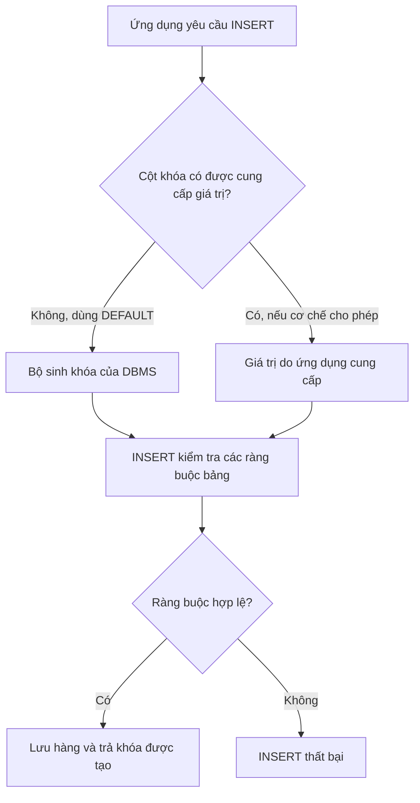

# Identity, sequence và cơ chế sinh khóa theo hệ quản trị

Khi tạo bảng, chúng ta thường muốn mỗi dòng có một khóa định danh duy nhất mà ứng dụng không cần tự đếm số. Một số hệ quản trị dùng cột `IDENTITY`, một số dùng `AUTO_INCREMENT`, một số cung cấp đối tượng `SEQUENCE`, còn SQLite gắn cơ chế sinh số với `ROWID`. Những cơ chế này cùng giải quyết nhu cầu **cấp một giá trị khóa mới**, nhưng khác nhau về cú pháp, vòng đời, hành vi giao dịch, khả năng chia sẻ bộ sinh và cách lấy khóa sau `INSERT`.

Ví dụ: ứng dụng tạo một khách hàng mới rồi cần dùng `customer_id` vừa sinh để tạo đơn hàng. Nếu ứng dụng tự chạy `SELECT MAX(customer_id) + 1` thì hai phiên ghi đồng thời có thể cùng chọn một số, dẫn đến trùng khóa. Cơ chế sinh khóa của hệ quản trị giải quyết việc **phân phối giá trị** trong môi trường nhiều phiên, nhưng vẫn cần khóa chính, ràng buộc và giao dịch để bảo vệ tính đúng đắn.

Bài học thuộc chương **Bảng và lược đồ** của Database SQL. Các ví dụ được chia theo từng hệ quản trị và **không chạy lẫn cú pháp**. Trọng tâm là hiểu mô hình, tạo bảng, lấy khóa sinh ra, xử lý nhập dữ liệu và nhận diện các giả định sai về tính liên tục của ID.

## 1. Khóa chính và bộ sinh khóa là hai khái niệm khác nhau

**Khóa chính** (*primary key*) là ràng buộc trên bảng: giá trị khóa phải xác định duy nhất mỗi hàng và không được `NULL`. **Bộ sinh khóa** (*key generator*) là cơ chế cấp giá trị mới để ứng dụng đưa vào cột khóa.

Hai cơ chế thường xuất hiện cùng nhau:

```sql
-- PostgreSQL 10+:
CREATE TABLE customers (
    customer_id BIGINT GENERATED ALWAYS AS IDENTITY PRIMARY KEY,
    full_name   TEXT NOT NULL
);
```

Ở đây:

- `BIGINT` là **kiểu dữ liệu** của cột khóa.
- `GENERATED ALWAYS AS IDENTITY` yêu cầu hệ quản trị **sinh giá trị mặc định** cho cột bằng một sequence được liên kết.
- `PRIMARY KEY` mới là ràng buộc **duy nhất và không NULL** áp dụng cho các giá trị khóa.

Một cột identity không tự động đồng nghĩa với khóa chính trong tất cả hệ quản trị. Trong PostgreSQL, khai báo identity tự nó **không bảo đảm duy nhất**; phải thêm `PRIMARY KEY` hoặc `UNIQUE` khi cần. Ngược lại, có thể có khóa chính **không tự sinh**, chẳng hạn mã quốc gia `'VN'` hoặc khóa ghép gồm hai cột.

### 1.1. Khóa thay thế và khóa nghiệp vụ

| Loại khóa | Ý nghĩa | Ví dụ | Điểm cần cân nhắc |
| --- | --- | --- | --- |
| **Khóa thay thế** (*surrogate key*) | ID kỹ thuật không chứa ý nghĩa nghiệp vụ | `customer_id = 1042` | Dễ làm khóa ngoại; không thay thế các ràng buộc nghiệp vụ |
| **Khóa tự nhiên** (*natural key*) | Dữ liệu vốn có chức năng định danh | Mã quốc gia chuẩn; mã sản phẩm đã được quản lý | Có thể thay đổi hoặc có quy tắc chuẩn hóa riêng |
| **Khóa ghép** (*composite key*) | Tổ hợp nhiều cột xác định duy nhất hàng | `(order_id, product_id)` | Không nhất thiết cần thêm một cột ID sinh tự động |

Ví dụ, bảng khách hàng có thể dùng `customer_id` làm khóa chính và đồng thời đặt `UNIQUE(email)` nếu chính sách hệ thống xác định email phải duy nhất. Bộ sinh identity chỉ đảm bảo có giá trị khóa mới được cấp theo cơ chế của nó; nó **không** ngăn hai khách hàng cùng email nếu không có ràng buộc phù hợp.

Một khóa có tính tăng dần cũng **không** phải là bằng chứng về thời gian tạo, trạng thái giao dịch hoặc thứ tự commit. Những thông tin đó cần cột thời gian và quy tắc nghiệp vụ riêng.

## 2. Bức tranh tổng quát: Identity, sequence, serial, auto-increment và ROWID

| Cơ chế | Khái niệm | Điểm thường gặp |
| --- | --- | --- |
| **Identity column** | Cột được khai báo để hệ quản trị tự sinh giá trị theo tùy chọn | PostgreSQL, SQL Server, Oracle |
| **Sequence object** | Đối tượng độc lập cấp các giá trị từ dãy số theo cấu hình | PostgreSQL, SQL Server, Oracle |
| **`SERIAL` / `BIGSERIAL`** | Cú pháp tiện ích cũ của PostgreSQL, dựng cột số + sequence + mặc định `nextval` | PostgreSQL |
| **`AUTO_INCREMENT`** | Thuộc tính cột số cấp giá trị tăng tự động | MySQL, MariaDB |
| **`INTEGER PRIMARY KEY` gắn `ROWID`** | Khóa nguyên của bảng trở thành bí danh của `ROWID` | SQLite |
| **UUID do database/ứng dụng cấp** | Mã có không gian giá trị lớn, không cần một bộ đếm số tập trung | Có trong nhiều hệ qua hàm hoặc thư viện |

**Sequence** và **identity** không phải hai tên gọi hoàn toàn đồng nghĩa. Trong PostgreSQL, identity được **hỗ trợ bởi sequence** do hệ quản trị quản lý cùng cột. Nhưng sequence cũng có thể tồn tại độc lập, được gọi trực tiếp và dùng cho những nhu cầu khác ngoài khóa chính.

Mô hình tư duy:



Sơ đồ mô tả luồng khái niệm, không phải trình tự vật lý cố định của mọi engine. **Giá trị đã được bộ sinh cấp có thể bị bỏ phí** ngay cả khi `INSERT` thất bại; điều này là một tính chất quan trọng sẽ phân tích ở phần giao dịch.

## 3. PostgreSQL: `GENERATED ... AS IDENTITY`

PostgreSQL hỗ trợ identity column từ phiên bản 10, với hai chế độ phổ biến:

- `GENERATED ALWAYS AS IDENTITY`: hệ quản trị chủ động cấp giá trị; nếu muốn tự cung cấp một giá trị cụ thể phải dùng cú pháp cho phép ghi đè.
- `GENERATED BY DEFAULT AS IDENTITY`: hệ quản trị sinh giá trị khi người gọi không cung cấp; người gọi có thể đưa khóa cụ thể trực tiếp.

### 3.1. Tạo bảng và nhận khóa bằng `RETURNING`

Chạy trong một cơ sở dữ liệu PostgreSQL dành cho thực hành:

```sql
CREATE TABLE identity_customers (
    customer_id BIGINT GENERATED ALWAYS AS IDENTITY PRIMARY KEY,
    email       TEXT NOT NULL UNIQUE,
    full_name   TEXT NOT NULL
);

INSERT INTO identity_customers (email, full_name)
VALUES ('an@example.test', 'An')
RETURNING customer_id, email, full_name;
```

Với bảng mới và sequence mặc định, khóa đầu tiên thường là `1`. Ứng dụng nên dùng **chính giá trị được trả về**, không tự giả định rằng nó luôn bằng 1 hoặc luôn tăng thêm đúng một đơn vị so với hàng trước đó.

Điểm cần phân biệt:

```sql
-- Được phép: yêu cầu hệ thống sinh ID.
INSERT INTO identity_customers (email, full_name)
VALUES ('binh@example.test', 'Binh');

-- Được phép: nêu rõ dùng mặc định.
INSERT INTO identity_customers (customer_id, email, full_name)
VALUES (DEFAULT, 'chi@example.test', 'Chi');

-- Với GENERATED ALWAYS: cung cấp ID thông thường sẽ bị từ chối.
INSERT INTO identity_customers (customer_id, email, full_name)
VALUES (500, 'dung@example.test', 'Dung');
```

Trường hợp cuối là ví dụ **cố ý gây lỗi**. Khi thật sự cần nhập dữ liệu cũ mang ID đã có, PostgreSQL cho phép ghi đè có chủ đích:

```sql
INSERT INTO identity_customers (customer_id, email, full_name)
OVERRIDING SYSTEM VALUE
VALUES (500, 'dung@example.test', 'Dung')
RETURNING customer_id;
```

**Cảnh báo về trạng thái sequence:** Ghi ID tường minh như `500` không có nghĩa sequence đã tự nhảy tới `501`. Nếu sequence vẫn đi qua dải ID đó trong tương lai, nó có thể tạo giá trị đã tồn tại và ràng buộc khóa chính sẽ báo trùng. Khi nhập dữ liệu, phải có kế hoạch đồng bộ bộ sinh khóa sau khi hoàn tất.

### 3.2. Chế độ `BY DEFAULT`

```sql
CREATE TABLE identity_imports (
    import_id BIGINT GENERATED BY DEFAULT AS IDENTITY PRIMARY KEY,
    source_ref TEXT NOT NULL
);

-- DBMS cấp giá trị.
INSERT INTO identity_imports (source_ref)
VALUES ('file-a')
RETURNING import_id;

-- Ứng dụng chủ động cung cấp giá trị, được cho phép.
INSERT INTO identity_imports (import_id, source_ref)
VALUES (9000, 'file-legacy')
RETURNING import_id;
```

`BY DEFAULT` phù hợp một số luồng import cần giữ ID cũ; tuy nhiên, nó mở rộng khả năng ghi ID tùy ý nên cần kiểm soát quyền, quy trình nhập liệu và bộ sinh. Nếu hệ thống vận hành bình thường muốn cấm tự ý cung cấp khóa, `ALWAYS` thường truyền đạt chủ đích rõ hơn.

### 3.3. Tùy chọn khởi tạo và bước nhảy

```sql
CREATE TABLE ticket_identity (
    ticket_id BIGINT GENERATED ALWAYS AS IDENTITY (
        START WITH 1000
        INCREMENT BY 5
        MINVALUE 1000
        CACHE 10
        NO CYCLE
    ) PRIMARY KEY,
    title TEXT NOT NULL
);

INSERT INTO ticket_identity (title)
VALUES ('Yeu cau A'), ('Yeu cau B')
RETURNING ticket_id;
```

Với bảng mới, dãy được cấu hình bắt đầu từ `1000` và tăng theo bước `5`. Khi có `CACHE` hoặc các phiên kết nối đồng thời, không nên dựa vào việc nhìn thấy các ID liên tiếp theo thứ tự commit. `NO CYCLE` tránh tự quay lại đầu dãy khi hết giá trị; nó không loại bỏ nguy cơ hết phạm vi và cũng không tự biến sequence thành ràng buộc duy nhất.

Những tùy chọn thường gặp gồm:

| Tùy chọn | Ý nghĩa |
| --- | --- |
| `START WITH n` | Giá trị khởi đầu khi dùng bộ sinh lần đầu |
| `INCREMENT BY n` | Bước nhảy, có thể không bằng 1 |
| `MINVALUE` / `MAXVALUE` | Giới hạn của dãy |
| `CACHE n` | Dự trữ nhóm giá trị để giảm chi phí cấp số; có thể tăng khoảng trống sau sự cố/đổi phiên |
| `CYCLE` / `NO CYCLE` | Cho phép hoặc không cho phép quay vòng khi chạm giới hạn |

Không dùng `CYCLE` với khóa chính đang còn lưu các giá trị cũ trừ khi thiết kế chủ động giải quyết khả năng trùng. Sequence cấp số, còn ràng buộc `PRIMARY KEY` mới từ chối giá trị đã tồn tại.

## 4. PostgreSQL: sequence độc lập và `nextval`

### 4.1. Tạo sequence rồi dùng trong giá trị mặc định

```sql
CREATE SEQUENCE invoice_no_seq
    AS BIGINT
    START WITH 10000
    INCREMENT BY 1
    CACHE 20
    NO CYCLE;

CREATE TABLE invoices_seq (
    invoice_id BIGINT PRIMARY KEY
        DEFAULT nextval('invoice_no_seq'::regclass),
    description TEXT NOT NULL
);

-- Liên kết vòng đời sequence với cột đang dùng nó.
ALTER SEQUENCE invoice_no_seq OWNED BY invoices_seq.invoice_id;

INSERT INTO invoices_seq (description)
VALUES ('Hoa don dau tien')
RETURNING invoice_id;
```

`CREATE SEQUENCE` tạo một đối tượng lược đồ độc lập. `nextval('invoice_no_seq')` yêu cầu giá trị tiếp theo và **làm tiến trạng thái sequence**. Mỗi lần gọi thành công thường tiêu thụ một giá trị ngay cả khi người gọi không dùng nó để thêm hàng. Câu `ALTER SEQUENCE ... OWNED BY ...` tạo quan hệ sở hữu phục vụ quản lý vòng đời; nó không đồng nghĩa với một ràng buộc `FOREIGN KEY`.

Một sequence có thể được dùng bởi nhiều câu lệnh hoặc nhiều bảng nếu thiết kế cần chung một dải số. Ngược lại, khi muốn mỗi bảng có một bộ sinh riêng, thường để mỗi bảng có identity hoặc sequence riêng.

### 4.2. `nextval`, `currval` và `lastval`

```sql
-- Mỗi lần gọi sẽ yêu cầu một giá trị mới.
SELECT nextval('invoice_no_seq');

-- Giá trị cuối cùng mà phiên hiện tại đã lấy từ sequence này.
SELECT currval('invoice_no_seq');

-- Giá trị cuối cùng mà phiên hiện tại đã lấy từ bất kỳ sequence nào.
SELECT lastval();
```

| Hàm PostgreSQL | Ý nghĩa | Lưu ý |
| --- | --- | --- |
| `nextval(seq)` | Cấp số tiếp theo | Có thể làm xuất hiện khoảng trống trong ID |
| `currval(seq)` | Giá trị gần nhất đã cấp **cho phiên hiện tại** từ sequence chỉ định | Báo lỗi nếu phiên chưa gọi `nextval` cho sequence đó |
| `lastval()` | Giá trị từ lần gọi `nextval` gần nhất trong phiên, bất kể sequence | Dễ nhầm nếu câu lệnh/trigger đụng đến nhiều sequence |
| `setval(seq, value[, is_called])` | Thiết lập trạng thái sequence | Phục vụ đồng bộ/khôi phục có kiểm soát; không dùng thường xuyên trong luồng CRUD |

`currval` của PostgreSQL được ràng buộc với **session**, không phải “khóa được tạo bởi câu `INSERT` trước đó” một cách tổng quát. Trong ứng dụng có pool kết nối, nhiều sequence và trigger, cách an toàn và rõ ràng nhất là lấy kết quả bằng:

```sql
INSERT INTO invoices_seq (description)
VALUES ('Hoa don tiep theo')
RETURNING invoice_id;
```

Giá trị này gắn trực tiếp với **hàng vừa được chèn**, tránh phải đoán sequence nào đã được gọi cuối cùng.

### 4.3. `SERIAL` / `BIGSERIAL`: cú pháp lịch sử

PostgreSQL vẫn hỗ trợ:

```sql
CREATE TABLE legacy_customers (
    customer_id BIGSERIAL PRIMARY KEY,
    email TEXT NOT NULL UNIQUE
);
```

`BIGSERIAL` **không phải một kiểu số nguyên độc lập** như `BIGINT`. Nó là cú pháp tiện ích để PostgreSQL dựng một cột `BIGINT NOT NULL`, một sequence liên kết và mặc định lấy `nextval`. Điều này tạo hiệu ứng “auto-increment” tương tự nhiều nhu cầu identity, nhưng metadata và ngữ nghĩa cho phép ID tường minh không giống hệt `GENERATED ALWAYS AS IDENTITY`.

| PostgreSQL identity | PostgreSQL serial |
| --- | --- |
| Cú pháp chuẩn SQL `GENERATED ... AS IDENTITY` | Cú pháp riêng của PostgreSQL |
| Sequence được liên kết theo cơ chế identity của cột | Sequence được tạo kèm biểu thức `DEFAULT nextval(...)` |
| `ALWAYS` kiểm soát việc ghi giá trị tường minh | Thông thường có thể ghi ID tường minh |
| Thường thích hợp cho lược đồ mới cần diễn đạt rõ nguồn giá trị | Thường gặp trong lược đồ cũ và mã đã tồn tại |

Khi bảo trì dự án cũ, không nên đổi hàng loạt `SERIAL` sang identity chỉ vì hai kiểu trông tương tự. Cần xem phụ thuộc, quyền và cách ứng dụng đang thực hiện import/ghi ID.

## 5. Sequence và giao dịch: vì sao ID có thể “nhảy số”?

**Giá trị của sequence không phải là một bộ đếm giao dịch có thể rollback.** Trong PostgreSQL, thay đổi do `nextval` và `setval` không được hoàn tác theo cách những thay đổi bảng thông thường được hoàn tác khi `ROLLBACK`.

Ví dụ trong môi trường thực hành:

```sql
BEGIN;

INSERT INTO invoices_seq (description)
VALUES ('Se bi rollback')
RETURNING invoice_id;

ROLLBACK;

INSERT INTO invoices_seq (description)
VALUES ('Duoc giu lai')
RETURNING invoice_id;
```

Hàng được tạo trong transaction thứ nhất bị rollback, nhưng **số đã cấp** có thể không được cấp lại. Vì vậy, giữa hai ID còn tồn tại có thể thiếu một hoặc nhiều số.

Ngoài rollback, khoảng trống cũng có thể xuất hiện do:

- Chèn thất bại vì `PRIMARY KEY`, `UNIQUE` hoặc ràng buộc khác sau khi bộ sinh đã cấp giá trị.
- Câu `INSERT ... ON CONFLICT DO NOTHING` trong PostgreSQL đã yêu cầu giá trị mặc định trước khi xác định có xung đột trong nhiều tình huống.
- Một ứng dụng gọi `nextval` nhưng không dùng số đó để lưu hàng.
- Bộ đệm `CACHE` làm một số giá trị đã dự trữ không còn dùng được sau sự cố hoặc thay đổi phiên/tiến trình.
- Quản trị viên thay đổi điểm bắt đầu, bước tăng hoặc trạng thái bộ sinh.

### 5.1. Không suy ra số hàng từ dải ID

Giả sử bảng còn các ID `1, 2, 5, 9`. Không thể kết luận rằng bảng có 9 hàng, đã xóa 5 hàng hoặc có đúng 5 giao dịch thất bại. Chỉ biết hiện tại bảng có 4 hàng với các khóa đó.

Đếm hàng bằng `COUNT(*)`; kiểm tra nghiệp vụ bằng dữ liệu nghiệp vụ. **Khoảng trống của ID tự sinh thường là bình thường.**

### 5.2. Giá trị ID không phản ánh thứ tự commit

Xem lịch xử lý hai phiên đồng thời:

| Thời điểm | Phiên A | Phiên B |
| --- | --- | --- |
| 1 | `BEGIN`; lấy ID `100` | |
| 2 | Chưa commit | `BEGIN`; lấy ID `101` |
| 3 | | `COMMIT` hàng ID `101` |
| 4 | `COMMIT` hàng ID `100` | |

Hàng `101` hoàn tất trước hàng `100` dù ID lớn hơn. Với sequence có cache theo phiên, thứ tự giá trị được cấp quan sát từ nhiều phiên còn có thể phức tạp hơn.

Không dùng `ORDER BY id DESC` như một cam kết “hàng vừa commit gần nhất”. Nếu yêu cầu thứ tự thời gian, cần xác định cột thời gian, sự kiện hoặc cơ chế ghi nhận thứ tự commit phù hợp; ngay cả dấu thời gian tạo ứng dụng cũng không tự đồng nghĩa với thời điểm commit.

### 5.3. Có thể dùng sequence tạo số hóa đơn liên tục không?

Không nên mặc định dùng identity/sequence làm **số chứng từ pháp lý bắt buộc liên tục, không có khoảng trống**. Chúng ưu tiên cấp số hiệu quả khi có đồng thời, không cam kết dãy sau commit không thiếu số.

Nếu nghiệp vụ yêu cầu không bỏ số hoặc phải giải trình mọi số, cần mô hình riêng: định nghĩa thời điểm “số được phát hành”, trạng thái hủy, nhật ký cấp số, khóa/giao dịch tuần tự và quy định kiểm toán. Trong nhiều hệ thống, số phát hành chứng từ là **trường nghiệp vụ** khác với khóa chính kỹ thuật. Thiết kế chi tiết phụ thuộc quy định cụ thể của tổ chức và pháp luật áp dụng.

## 6. Đồng bộ sequence sau import, restore hoặc ghi ID tường minh

Một lỗi thực tế: dữ liệu phục hồi có khóa lớn hơn trạng thái hiện tại của bộ sinh.

Ví dụ, bảng `identity_imports` đang có hàng `import_id = 9000` do nhập tường minh; sequence có thể vẫn chuẩn bị cấp `2`, `3`, ... và về sau đụng đến các giá trị đã tồn tại. Việc tăng bằng thủ công cần thực hiện trong **cửa sổ quản trị**, dừng hoặc kiểm soát đồng thời các phiên ghi.

### 6.1. Cơ chế `setval` trong PostgreSQL

```sql
-- Ví dụ độc lập về ý nghĩa hàm:
SELECT setval('invoice_no_seq', 20000, true);

-- Với INCREMENT BY 1, lần nextval kế tiếp thường trả 20001.
SELECT nextval('invoice_no_seq');
```

Tham số thứ ba `is_called` đặc biệt quan trọng:

- `setval('some_seq', 20000, true)`: ghi nhận giá trị `20000` đã được cấp; `nextval` kế tiếp tiến thêm một bước.
- `setval('some_seq', 20000, false)`: `nextval` kế tiếp trả đúng `20000`.

Có thể tìm sequence liên kết với cột serial/identity bằng:

```sql
SELECT pg_get_serial_sequence(
    'identity_imports',
    'import_id'
) AS owned_sequence;
```

Về nguyên tắc, sau import cần điều chỉnh bộ sinh sao cho giá trị tiếp theo **không xung đột với các khóa hiện có**. Công thức kiểu `MAX(id) + 1` chỉ nên được sử dụng trong bước đồng bộ trạng thái sequence **khi không còn phiên ghi cạnh tranh**, hoàn toàn khác với dùng nó làm cơ chế sinh khóa cho từng lệnh `INSERT`.

**Không chạy một câu `setval` máy móc trên bảng đang được ghi đồng thời.** Điều chỉnh bộ sinh trong PostgreSQL có thể không được rollback như sửa hàng thông thường; các session có cache có thể còn giữ số được cấp trước đó. Cần tính đến ownership, bước tăng, giá trị âm, `MINVALUE`/`MAXVALUE`, khả năng có khóa trùng và quy trình backup/restore trước khi đổi sequence.

### 6.2. `TRUNCATE ... RESTART IDENTITY`

PostgreSQL hỗ trợ:

```sql
-- Chỉ dùng trên bảng thử nghiệm khi muốn xóa toàn bộ dữ liệu.
TRUNCATE TABLE identity_imports RESTART IDENTITY;
```

`RESTART IDENTITY` khởi động lại những sequence **được sở hữu bởi cột của bảng bị truncate**; không áp dụng tùy tiện cho mọi sequence độc lập trong schema. Trong PostgreSQL, tác vụ restart sequence do `TRUNCATE ... RESTART IDENTITY` có ngữ nghĩa transaction riêng và có thể rollback cùng lệnh truncate; khác với hành vi `nextval`/`setval` thông thường.

Đây là thao tác phá dữ liệu nên chỉ minh họa trên bảng thử nghiệm. Với bảng đang vận hành, xóa hết dữ liệu để “sửa số ID” là một giải pháp sai mục tiêu và có thể phá khóa ngoại.

## 7. MySQL/MariaDB: `AUTO_INCREMENT`

MySQL sử dụng thuộc tính cột `AUTO_INCREMENT`. Ví dụ trên MySQL với InnoDB:

```sql
CREATE TABLE mysql_customers (
    customer_id BIGINT UNSIGNED NOT NULL AUTO_INCREMENT,
    email VARCHAR(255) NOT NULL,
    full_name VARCHAR(100) NOT NULL,
    PRIMARY KEY (customer_id),
    UNIQUE KEY uq_mysql_customers_email (email)
) ENGINE = InnoDB;

INSERT INTO mysql_customers (email, full_name)
VALUES ('an@example.test', 'An');

SELECT LAST_INSERT_ID() AS new_customer_id;
```

Đặc điểm:

- `AUTO_INCREMENT` thường gắn với một cột số nguyên đã được đánh chỉ mục, mỗi bảng thông thường có một cột auto-increment.
- Nếu không cung cấp giá trị ID, engine cấp số theo trạng thái bộ sinh của bảng.
- `LAST_INSERT_ID()` là cơ chế **gắn với kết nối**, tránh việc một kết nối khác làm thay đổi kết quả mà phiên hiện tại nhìn thấy.
- Đối với `INSERT` nhiều hàng, `LAST_INSERT_ID()` thường trả **giá trị tự sinh đầu tiên** của câu lệnh đó; không thể đơn giản giả định nó là ID cuối cùng.
- `AUTO_INCREMENT` có thể có khoảng trống do xung đột, rollback, upsert, cơ chế cấp số và sự cố, tùy engine/phiên bản.

### 7.1. Chèn nhiều hàng và lấy khóa

```sql
INSERT INTO mysql_customers (email, full_name)
VALUES
    ('binh@example.test', 'Binh'),
    ('chi@example.test', 'Chi');

SELECT LAST_INSERT_ID() AS first_generated_id;
```

Không tự suy ra tập ID bằng cách lấy `first_generated_id + 1`, `+2` cho mọi môi trường và mọi dạng câu lệnh. Cách cấp số ở lệnh nhiều hàng, trigger, chế độ khóa auto-increment và engine/phiên bản có thể ảnh hưởng đến giả định về liên tục. Driver hoặc API ứng dụng cần hỗ trợ lấy khóa được tạo cho các hàng cần thiết; kiểm tra hành vi thực tế của driver trước khi phụ thuộc vào nó.

### 7.2. Ghi khóa tường minh và thay điểm bắt đầu

```sql
INSERT INTO mysql_customers (customer_id, email, full_name)
VALUES (5000, 'legacy@example.test', 'Du lieu cu');
```

MySQL thường cho phép ghi số tường minh vào cột `AUTO_INCREMENT` khi không vi phạm khóa chính. Cơ chế cập nhật giá trị cấp tiếp theo phụ thuộc engine và giá trị được ghi; không thể xem việc ghi ID thủ công là vô hại đối với bộ đếm tự động.

Có thể đặt một giá trị auto-increment tương lai:

```sql
ALTER TABLE mysql_customers AUTO_INCREMENT = 10000;
```

Câu lệnh này là thao tác thay đổi schema/trạng thái bộ sinh, nên phải dùng có kiểm soát; engine không nhất thiết cho phép bộ đếm xuống thấp hơn giá trị hiện có lớn nhất.

**Phân biệt MySQL và MariaDB:** Cả hai dùng `AUTO_INCREMENT`, nhưng MariaDB còn có khả năng sequence riêng ở những phiên bản hỗ trợ; không mặc định rằng mọi cú pháp `CREATE SEQUENCE` của MariaDB chạy trên MySQL.

### 7.3. Không nhầm `LAST_INSERT_ID()` với `MAX(id)`

```sql
-- Sai trong môi trường nhiều phiên: có thể nhìn thấy ID từ người ghi khác.
SELECT MAX(customer_id) FROM mysql_customers;

-- Đúng hướng cho INSERT vừa sinh khóa trên cùng kết nối:
SELECT LAST_INSERT_ID();
```

`MAX(id)` cho biết ID lớn nhất hiện đang tồn tại trong bảng, không trả lời chính xác câu hỏi “câu lệnh của phiên này vừa thêm hàng nào?”. Ứng dụng nên đọc khóa do câu `INSERT` trả về hoặc do driver cung cấp.

## 8. Microsoft SQL Server: `IDENTITY(seed, increment)`

SQL Server khai báo identity bằng cú pháp `IDENTITY(seed, increment)`:

```sql
CREATE TABLE dbo.CustomersIdentity (
    CustomerId BIGINT IDENTITY(1, 1) NOT NULL
        CONSTRAINT PK_CustomersIdentity PRIMARY KEY,
    Email NVARCHAR(255) NOT NULL
        CONSTRAINT UQ_CustomersIdentity_Email UNIQUE,
    FullName NVARCHAR(100) NOT NULL
);
```

`IDENTITY(1, 1)` có nghĩa seed là `1` và bước tăng là `1`. Cũng như các hệ khác, phải thêm `PRIMARY KEY`/`UNIQUE` để bảo đảm duy nhất theo yêu cầu; riêng `IDENTITY` không thay thế ràng buộc.

### 8.1. Lấy ID với `OUTPUT INSERTED`

```sql
DECLARE @NewCustomers TABLE (CustomerId BIGINT);

INSERT INTO dbo.CustomersIdentity (Email, FullName)
OUTPUT INSERTED.CustomerId INTO @NewCustomers(CustomerId)
VALUES (N'an@example.test', N'An');

SELECT CustomerId FROM @NewCustomers;
```

Mệnh đề `OUTPUT INSERTED.CustomerId` liên kết khóa trả về với các hàng do chính câu lệnh `INSERT` tạo; cách này hữu ích cho nhiều hàng. SQL Server cũng hỗ trợ `SCOPE_IDENTITY()` để lấy identity cuối cùng được sinh trong **scope hiện tại** của phiên, nhưng cần hiểu rõ giới hạn scope, trigger và trường hợp không có identity vừa được sinh.

Tránh nhầm:

| Cách lấy ID trong SQL Server | Ý nghĩa |
| --- | --- |
| `SCOPE_IDENTITY()` | Identity cuối cùng được sinh trong scope hiện tại |
| `@@IDENTITY` | Identity cuối cùng được sinh trong phiên, kể cả những thao tác trong trigger thuộc scope khác |
| `IDENT_CURRENT('table')` | Giá trị identity cuối cùng của bảng được chỉ định, **không bị giới hạn trong phiên hiện tại** |
| `OUTPUT INSERTED.Id` | Giá trị ID của hàng/hàng do câu lệnh đang thực hiện tạo ra |

Trong ứng dụng, `OUTPUT INSERTED...` thường rõ ràng hơn khi cần gắn đúng ID với bản ghi của lệnh hiện tại. Không dùng `IDENT_CURRENT` để “tìm ID mình vừa tạo” trong môi trường có nhiều kết nối.

### 8.2. Nhập dữ liệu với ID tường minh

SQL Server yêu cầu bật chế độ cho phép nhập identity thủ công:

```sql
SET IDENTITY_INSERT dbo.CustomersIdentity ON;

INSERT INTO dbo.CustomersIdentity
    (CustomerId, Email, FullName)
VALUES
    (500, N'legacy@example.test', N'Du lieu cu');

SET IDENTITY_INSERT dbo.CustomersIdentity OFF;
```

Chỉ **một bảng trong một phiên** có thể bật `IDENTITY_INSERT ON` tại một thời điểm. Nếu câu lệnh nhập lỗi trước khi `OFF` chạy, phiên có thể còn giữ trạng thái này; quy trình import cần xử lý lỗi và đảm bảo tắt chế độ khi hoàn tất. Việc ghi ID tường minh có thể thay đổi giá trị identity hiện tại nếu ID mới lớn hơn, tùy trạng thái.

Khi cần kiểm tra/điều chỉnh identity hiện tại, SQL Server cung cấp `DBCC CHECKIDENT`. Đây là thao tác quản trị phải xem kỹ dữ liệu và môi trường đồng thời, không phải giải pháp thay cho cơ chế sinh khóa chuẩn.

### 8.3. SQL Server có `SEQUENCE` độc lập

```sql
CREATE SEQUENCE dbo.InvoiceNumberSeq
    AS BIGINT
    START WITH 1000
    INCREMENT BY 1
    CACHE 20
    NO CYCLE;

CREATE TABLE dbo.InvoicesFromSequence (
    InvoiceId BIGINT NOT NULL
        CONSTRAINT DF_InvoicesFromSequence_Id
        DEFAULT (NEXT VALUE FOR dbo.InvoiceNumberSeq),
    Description NVARCHAR(255) NOT NULL,
    CONSTRAINT PK_InvoicesFromSequence PRIMARY KEY (InvoiceId)
);

INSERT INTO dbo.InvoicesFromSequence (Description)
VALUES (N'Hoa don A');
```

`NEXT VALUE FOR` lấy giá trị tiếp theo của sequence. Sequence SQL Server được quản lý tách khỏi một bảng cụ thể, nên phù hợp khi cần một bộ sinh chung; vẫn có thể xuất hiện khoảng trống do rollback, lỗi và cache.

## 9. Oracle Database: `IDENTITY` và `SEQUENCE.NEXTVAL`

Oracle có sequence từ lâu; từ Oracle Database 12c, có thể khai báo identity column. Ví dụ:

```sql
CREATE TABLE oracle_customers (
    customer_id NUMBER GENERATED ALWAYS AS IDENTITY PRIMARY KEY,
    email VARCHAR2(255) NOT NULL UNIQUE,
    full_name VARCHAR2(100) NOT NULL
);

INSERT INTO oracle_customers (email, full_name)
VALUES ('an@example.test', 'An');
```

Oracle hỗ trợ các biến thể `GENERATED ALWAYS`, `GENERATED BY DEFAULT` và `GENERATED BY DEFAULT ON NULL`. Biến thể `ON NULL` có thể cấp số khi bên ghi chủ động truyền `NULL`, trong khi `BY DEFAULT` thông thường thiên về khi giá trị bị bỏ qua. Cần xem phiên bản và ngữ nghĩa cụ thể khi thiết kế ứng dụng đa hệ.

### 9.1. Sequence độc lập

```sql
CREATE SEQUENCE oracle_invoice_seq
    START WITH 1000
    INCREMENT BY 1
    CACHE 20
    NOCYCLE;

CREATE TABLE oracle_invoices (
    invoice_id NUMBER PRIMARY KEY,
    description VARCHAR2(255) NOT NULL
);

INSERT INTO oracle_invoices (invoice_id, description)
VALUES (oracle_invoice_seq.NEXTVAL, 'Hoa don A');
```

`oracle_invoice_seq.NEXTVAL` cấp số kế tiếp. `oracle_invoice_seq.CURRVAL` đọc số gần nhất được cấp cho **phiên hiện tại**, sau khi phiên đó đã gọi `NEXTVAL` tương ứng. Hành vi về khoảng trống và transaction tương tự nguyên tắc chung: một số được cấp không mặc nhiên quay lại khi thao tác bảng rollback.

### 9.2. Nhận khóa vừa tạo bằng `RETURNING INTO`

Oracle hỗ trợ `RETURNING ... INTO`. Ví dụ khối PL/SQL:

```sql
DECLARE
    v_customer_id NUMBER;
BEGIN
    INSERT INTO oracle_customers (email, full_name)
    VALUES ('binh@example.test', 'Binh')
    RETURNING customer_id INTO v_customer_id;

    DBMS_OUTPUT.PUT_LINE('Created ID: ' || v_customer_id);
END;
/
```

Dòng `/` là ký hiệu thực thi khối trong một số công cụ Oracle như SQL*Plus/SQLcl; không phải cú pháp SQL chung. Trong ứng dụng, driver có thể hỗ trợ biến bind đầu ra hoặc API lấy generated keys. Đừng thay `RETURNING` bằng `SELECT MAX(customer_id)`.

## 10. SQLite: `ROWID`, `INTEGER PRIMARY KEY` và `AUTOINCREMENT`

SQLite có mô hình riêng. Trong bảng *rowid table* thông thường, mỗi hàng có một `ROWID` số nguyên 64-bit có dấu. Cột khai báo đúng dạng `INTEGER PRIMARY KEY` thường trở thành **bí danh cho ROWID**.

```sql
CREATE TABLE sqlite_customers (
    customer_id INTEGER PRIMARY KEY,
    email TEXT NOT NULL UNIQUE,
    full_name TEXT NOT NULL
);

INSERT INTO sqlite_customers (email, full_name)
VALUES ('an@example.test', 'An');

SELECT last_insert_rowid() AS new_customer_id;
```

Nếu bỏ qua `customer_id` hoặc cung cấp `NULL` trong trường hợp phù hợp, SQLite sẽ chọn ROWID chưa dùng theo thuật toán của nó. Với cơ chế mặc định, sau khi xóa những hàng nhất định, một số ROWID cũ **có thể được tái sử dụng**, đặc biệt giá trị lớn nhất đã bị xóa.

### 10.1. Khi nào thêm `AUTOINCREMENT`?

```sql
CREATE TABLE sqlite_events (
    event_id INTEGER PRIMARY KEY AUTOINCREMENT,
    message TEXT NOT NULL
);
```

SQLite `AUTOINCREMENT` thay đổi thuật toán chọn ROWID để **tránh tái sử dụng những ROWID đã từng được commit trước đó của cùng bảng**. Nó không bảo đảm mọi số liên tiếp, không ngăn khoảng trống và có chi phí bổ sung để theo dõi giá trị lớn nhất đã dùng. Vì vậy, **không cần tự động thêm `AUTOINCREMENT` cho mọi bảng SQLite**.

Một số điểm phải nhớ:

- `INTEGER PRIMARY KEY` gắn với `ROWID` trong rowid table thông thường; `BIGINT PRIMARY KEY` không phải cùng cơ chế đó.
- `AUTOINCREMENT` chỉ có ý nghĩa hợp lệ với `INTEGER PRIMARY KEY` của rowid table; không dùng cho bảng `WITHOUT ROWID`.
- `last_insert_rowid()` trả ROWID gần nhất được tạo trên **cùng kết nối**, có các chi tiết cần xem xét với trigger và kết nối chia sẻ. Không dùng nó để tìm ID do một kết nối khác vừa tạo.
- SQLite hỗ trợ `RETURNING` từ phiên bản 3.35.0, giúp lấy trực tiếp khóa mới trong câu lệnh `INSERT`.

Ví dụ trên phiên bản hỗ trợ:

```sql
INSERT INTO sqlite_customers (email, full_name)
VALUES ('binh@example.test', 'Binh')
RETURNING customer_id;
```

SQLite không có cú pháp sequence độc lập `CREATE SEQUENCE` như PostgreSQL/Oracle/SQL Server. Nếu ứng dụng cần bộ sinh chung cho nhiều bảng, phải tự thiết kế cơ chế phù hợp với mô hình transaction và khóa của SQLite.

## 11. So sánh nhanh cách tạo và nhận khóa giữa các hệ quản trị

| Hệ quản trị | Khai báo khóa thường dùng | Cách nhận ID gắn với INSERT | Ghi chú |
| --- | --- | --- | --- |
| **PostgreSQL** | `BIGINT GENERATED ALWAYS AS IDENTITY PRIMARY KEY` | `INSERT ... RETURNING id` | Identity dựa trên sequence; `SERIAL` là cú pháp lịch sử |
| **MySQL/InnoDB** | `BIGINT AUTO_INCREMENT PRIMARY KEY` | `LAST_INSERT_ID()` trên cùng kết nối hoặc API driver | Không mặc định mọi INSERT nhiều hàng tạo dải liên tiếp |
| **SQL Server** | `BIGINT IDENTITY(1,1) PRIMARY KEY` | `OUTPUT INSERTED.Id`; hoặc `SCOPE_IDENTITY()` theo ngữ cảnh | Có `SEQUENCE` độc lập với `NEXT VALUE FOR` |
| **Oracle** | `NUMBER GENERATED ... AS IDENTITY PRIMARY KEY` | `RETURNING id INTO ...` | Sequence dùng `seq.NEXTVAL`; identity từ 12c |
| **SQLite** | `INTEGER PRIMARY KEY` | `INSERT ... RETURNING id` (3.35+) hoặc `last_insert_rowid()` | `AUTOINCREMENT` là tùy chọn có thêm chi phí |

Bảng này chỉ tóm lược mẫu thông dụng; không thay thế việc xem phiên bản và driver đang dùng. Tính năng như `RETURNING`, cách chèn hàng loạt và hành vi auto-generated keys có thể thay đổi theo phiên bản hoặc driver.

## 12. Insert bảng cha rồi bảng con: lấy khóa thế nào cho đúng?

Bài toán: tạo một khách hàng và ngay sau đó tạo đơn hàng tham chiếu khóa khách vừa sinh. Với PostgreSQL:

```sql
CREATE TABLE parent_customers (
    customer_id BIGINT GENERATED ALWAYS AS IDENTITY PRIMARY KEY,
    email TEXT NOT NULL UNIQUE
);

CREATE TABLE child_orders (
    order_id BIGINT GENERATED ALWAYS AS IDENTITY PRIMARY KEY,
    customer_id BIGINT NOT NULL REFERENCES parent_customers(customer_id),
    placed_at TIMESTAMPTZ NOT NULL DEFAULT CURRENT_TIMESTAMP
);
```

Có thể thực hiện trong cùng một transaction và lấy khóa từ lệnh tạo cha. Trong PostgreSQL, một CTE chứa `INSERT ... RETURNING` cho phép truyền khóa giữa hai thao tác trong **một câu SQL**:

```sql
WITH new_customer AS (
    INSERT INTO parent_customers (email)
    VALUES ('new@example.test')
    RETURNING customer_id
)
INSERT INTO child_orders (customer_id)
SELECT customer_id
FROM new_customer
RETURNING order_id, customer_id, placed_at;
```

Câu trên tạo một khách và một đơn liên quan. Nếu bước tạo con thất bại vì một ràng buộc, tác dụng trên các hàng trong cùng câu lệnh sẽ bị hủy theo ngữ nghĩa statement/transaction của PostgreSQL; **những số sequence đã cấp có thể vẫn tạo khoảng trống**.

Trong ứng dụng thực tế thường có nhiều thao tác nghiệp vụ hơn, khi đó cần quản lý transaction rõ ràng:

```text
BEGIN TRANSACTION
    INSERT khách → nhận customer_id
    INSERT đơn hàng dùng customer_id
    INSERT chi tiết đơn hàng dùng order_id
COMMIT

Nếu một bước lỗi:
    ROLLBACK các thay đổi bảng của transaction
    (ID đã cấp không nhất thiết được sử dụng lại)
```

**Nguyên tắc:** Lấy khóa được sinh từ chính câu lệnh `INSERT`/API driver đang thực hiện, sau đó truyền nó tới bảng con. Không đọc `MAX(id)` hoặc đoán số tiếp theo để tạo quan hệ.

## 13. Ứng dụng Java/JDBC lấy generated key

Đối với ứng dụng Java, JDBC cung cấp API `getGeneratedKeys()`. Ví dụ khái niệm với bảng PostgreSQL `parent_customers` ở phần trên:

```java
import java.sql.Connection;
import java.sql.PreparedStatement;
import java.sql.ResultSet;
import java.sql.SQLException;
import java.sql.Statement;

public class CustomerRepository {
    public long createCustomer(Connection connection, String email)
            throws SQLException {

        String sql = "INSERT INTO parent_customers (email) VALUES (?)";

        try (PreparedStatement statement = connection.prepareStatement(
                sql, Statement.RETURN_GENERATED_KEYS)) {

            statement.setString(1, email);

            int changed = statement.executeUpdate();
            if (changed != 1) {
                throw new SQLException("Expected one inserted customer");
            }

            try (ResultSet keys = statement.getGeneratedKeys()) {
                if (!keys.next()) {
                    throw new SQLException("No generated key returned");
                }
                return keys.getLong(1);
            }
        }
    }
}
```

Một số driver cho phép chỉ rõ tên cột trong `prepareStatement(sql, new String[] {"customer_id"})` để tránh nhầm nhiều cột được trả về. Trong PostgreSQL, ứng dụng cũng có thể dùng SQL `INSERT ... RETURNING customer_id` và đọc kết quả qua API truy vấn phù hợp. Hỗ trợ và dạng dữ liệu trả về của `getGeneratedKeys()` phụ thuộc driver, nên phải kiểm tra với phiên bản driver đang sử dụng.

Nếu cần tạo cha và con cùng nhau, tầng dịch vụ nên quản lý **một transaction** bao cả hai thao tác. Đồng thời cần xem xét kết nối từ pool: bất kỳ hàm kiểu “ID cuối cùng của phiên” chỉ đáng tin khi gọi trên **đúng kết nối** với câu `INSERT` trước đó.

### 13.1. Vì sao không tự sinh bằng `MAX(id) + 1`?

Hai transaction có thể thực hiện:

```text
T1: SELECT MAX(id) → 100
T2: SELECT MAX(id) → 100
T1: INSERT id = 101 → thành công
T2: INSERT id = 101 → trùng khóa hoặc xung đột
```

Dùng sequence/identity tránh việc cả hai phiên tự chọn cùng một “giá trị lớn nhất + 1” mà không có cơ chế đồng bộ. Với ID được sinh tại ứng dụng, phải dùng một thuật toán có thiết kế chống trùng phù hợp; chỉ thêm một câu `SELECT MAX` không đủ.

## 14. Khi nào chọn identity, sequence độc lập hoặc UUID?

Không có một cơ chế tốt nhất cho mọi bài toán. Hãy bắt đầu từ tính chất của khóa và yêu cầu triển khai.

| Nhu cầu | Hướng lựa chọn | Lý do |
| --- | --- | --- |
| Khóa chính kỹ thuật tăng theo số cho một bảng | Identity/auto-increment/ROWID phù hợp hệ quản trị | Cú pháp đơn giản, tích hợp chặt với INSERT |
| Một bộ sinh số dùng cho nhiều bảng hoặc một quy trình riêng | Sequence độc lập (nếu engine hỗ trợ) | Có thể gọi trực tiếp, cấu hình và dùng chung |
| Import cần giữ ID cũ | Chế độ cho ghi đè có kiểm soát + đồng bộ trạng thái | Không làm mất quan hệ giữa dữ liệu cũ |
| Tạo ID trước khi ghi vào database hoặc giữa nhiều dịch vụ | UUID hoặc thuật toán ID phân tán được quản lý | Giảm phụ thuộc vào một điểm cấp số tập trung |
| Mã nghiệp vụ có cấu trúc và quy tắc phát hành riêng | Trường mã nghiệp vụ + bộ kiểm soát phát hành riêng | Tách ý nghĩa nghiệp vụ khỏi khóa nội bộ |
| Cần thứ tự tạo/giao dịch rõ ràng | Cột thời gian/sự kiện và chính sách thứ tự riêng | ID tăng không biểu thị thứ tự commit đáng tin cậy |

### 14.1. UUID không phải chỉ là một kiểu “identity ngẫu nhiên”

UUID có không gian giá trị lớn và có thể được tạo trước khi chèn. Ví dụ với PostgreSQL có hàm `gen_random_uuid()` trong môi trường hỗ trợ:

```sql
CREATE TABLE uuid_customers (
    customer_id UUID PRIMARY KEY DEFAULT gen_random_uuid(),
    email TEXT NOT NULL UNIQUE
);

INSERT INTO uuid_customers (email)
VALUES ('uuid@example.test')
RETURNING customer_id;
```

UUID có xác suất trùng rất thấp khi dùng thuật toán sinh đúng, nhưng không có nghĩa hoàn toàn không thể trùng; `PRIMARY KEY` vẫn là lớp ràng buộc bảo đảm duy nhất trong bảng. UUID v4 thường mang tính ngẫu nhiên, trong khi UUID v7 chứa thành phần thời gian theo chuẩn tương ứng; đặc tính thứ tự và tính khả dụng phụ thuộc thư viện/hệ quản trị.

Không tự suy diễn ID UUID là bí mật hoặc cơ chế phân quyền: bất kỳ ID nào được dùng trong API cũng phải được kiểm soát quyền truy cập theo người dùng và đối tượng.

### 14.2. Trường hợp cần ID số phân tán

Một số hệ thống dùng thuật toán tạo ID số như Snowflake-style IDs, kết hợp mốc thời gian, mã nút và số thứ tự cục bộ. Chúng có thể hỗ trợ nhiều dịch vụ sinh ID không phải gọi một sequence chung, nhưng cần quản lý **trùng mã nút**, **đồng hồ hệ thống**, **khả năng quay ngược thời gian**, **giới hạn bit** và **tốc độ cấp số**. Đây là phương án thiết kế phân tán riêng, không phải thuộc tính mặc định của `IDENTITY` hay `AUTO_INCREMENT`.

Nếu hệ thống chỉ có một cơ sở dữ liệu quan hệ, identity thường đã đáp ứng đủ nhu cầu khóa thay thế. Chỉ thêm cơ chế phân tán khi có yêu cầu rõ ràng về phạm vi cấp khóa và độ sẵn sàng.

## 15. Ràng buộc duy nhất, phạm vi số và vòng đời của bộ sinh

### 15.1. Tránh hết phạm vi ID

`INTEGER` 32-bit có giới hạn khoảng 2,1 tỷ số dương trong các hệ kiểu số nguyên có dấu phổ biến. Nếu lưu lượng ghi lớn hoặc bảng có vòng đời dài, cân nhắc `BIGINT` 64-bit ngay từ khi thiết kế. Các yêu cầu cụ thể còn phụ thuộc dải số cấu hình, bước tăng và khả năng lưu trữ của engine.

Không giả định `BIGINT` là “không bao giờ hết”. Nếu dãy có `MAXVALUE`, cấu hình `CYCLE`, hoặc cấp nhiều số bỏ phí, vẫn phải có giám sát sử dụng vùng giá trị. Lệnh đổi từ `INT` sang `BIGINT` khi hệ thống đang có nhiều khóa ngoại có thể là một migration phức tạp.

### 15.2. Identity không thay thế `UNIQUE` và `FOREIGN KEY`

```sql
-- PostgreSQL:
CREATE TABLE customer_addresses (
    address_id BIGINT GENERATED ALWAYS AS IDENTITY PRIMARY KEY,
    customer_id BIGINT NOT NULL
        REFERENCES parent_customers(customer_id),
    address_line TEXT NOT NULL
);
```

`address_id` là ID của địa chỉ. Cột `customer_id` là khóa ngoại; nó **phải lấy giá trị của khách hàng thật sự tồn tại**. Tự gán identity cho cả `customer_id` ở bảng địa chỉ sẽ tạo các số mới không còn đảm bảo trỏ về đúng khách.

### 15.3. Phân quyền đối với sequence

Sequence là đối tượng có quyền riêng trong những hệ quản trị hỗ trợ nó. Trong PostgreSQL, các quyền như `USAGE`, `SELECT` và `UPDATE` có liên quan đến những thao tác sequence khác nhau; quyền ghi bảng không có nghĩa mọi quyền sequence độc lập đều được cấp tự động theo cách ứng dụng mong đợi. Khi gặp lỗi thiếu quyền lúc `INSERT` gọi `nextval`, hãy kiểm tra cả quyền với bảng và sequence liên quan.

Ứng dụng thường chỉ cần quyền tối thiểu để chèn và lấy khóa; quyền thay đổi trạng thái bằng `setval` hoặc sửa `START WITH` nên dành cho vai trò quản trị/migration được cấp phép.

### 15.4. Đổi tên bảng, xóa bảng và dependency

Một identity column thường có sequence do hệ quản trị quản lý kèm theo. Sequence tạo độc lập có thể tồn tại ngay cả khi bảng sử dụng nó đã bị xóa nếu không gắn quan hệ sở hữu/phụ thuộc phù hợp. Vì vậy, khi viết migration:

- Phân biệt **bảng sở hữu sequence** với bảng chỉ **tham chiếu sequence**.
- Kiểm tra sequence có đang được nhiều bảng hoặc quy trình dùng chung không.
- Không xóa hoặc reset sequence chỉ dựa trên tên gần giống tên bảng.
- Có phương án phục hồi dữ liệu và thống nhất việc đổi schema với các phiên ứng dụng đang ghi.

## 16. Các hiểu lầm phổ biến

| Nhận định dễ nhầm | Thực tế |
| --- | --- |
| “Có identity thì chắc chắn không trùng.” | Phải có ràng buộc khóa chính/duy nhất phù hợp; ID tường minh, thay trạng thái hoặc `CYCLE` vẫn có thể gây trùng. |
| “Rollback phải trả lại số.” | Sequence và phần lớn bộ sinh không bảo đảm khôi phục giá trị đã cấp; khoảng trống là bình thường. |
| “ID 200 luôn được commit sau ID 199.” | Thời điểm cấp số không phải thời điểm commit, nhất là khi có nhiều transaction. |
| “Xóa hàng sẽ cho phép tái sử dụng ID.” | Tùy engine và cơ chế; không lấy khả năng tái sử dụng làm giả định nghiệp vụ. |
| “`SELECT MAX(id)` là ID tôi vừa thêm.” | Có thể là hàng của phiên khác và không gắn với câu INSERT hiện tại. |
| “`SERIAL` của PostgreSQL là một kiểu số.” | Đây là cú pháp tiện ích tạo cột số + sequence + default. |
| “Identity và sequence lúc nào cũng giống nhau.” | Identity là thuộc tính cột; sequence có thể là đối tượng cấp số độc lập. |
| “Thêm `CACHE` đảm bảo nhanh mà số vẫn liên tục.” | Cache có thể tạo thêm khoảng trống và ảnh hưởng thứ tự quan sát qua các phiên. |
| “`AUTO_INCREMENT` giống nhau ở mọi hệ.” | MySQL, SQL Server, PostgreSQL, Oracle, SQLite có cú pháp và ngữ nghĩa chi tiết khác nhau. |
| “Số tăng là đủ để làm mã hóa đơn.” | Mã chứng từ có yêu cầu phát hành/kiểm toán riêng; không được tự suy từ khóa kỹ thuật. |
| “Khóa ID không đoán được thì khỏi kiểm tra quyền.” | Phân quyền phải độc lập với hình thức ID. |

## 17. Thực hành: từ định nghĩa bảng đến xử lý tình huống

Các bài dưới đây dùng PostgreSQL nếu không có ghi chú khác. Mỗi bài nhằm phát triển một cách suy nghĩ về cơ chế sinh khóa, không chỉ nhớ cú pháp.

### Bài 1 — Thiết kế khóa chính cho bảng đơn hàng

Yêu cầu: mỗi đơn hàng có một khóa số 64-bit tự sinh; cột mã đơn nghiệp vụ phải duy nhất; mã có thể chứa chữ và số.

Một thiết kế phù hợp:

```sql
CREATE TABLE shop_orders (
    order_id BIGINT GENERATED ALWAYS AS IDENTITY PRIMARY KEY,
    order_code TEXT NOT NULL UNIQUE,
    created_at TIMESTAMPTZ NOT NULL DEFAULT CURRENT_TIMESTAMP
);
```

Giải thích: `order_id` là khóa kỹ thuật; `order_code` là mã nghiệp vụ. Hai cột có thể có vòng đời và cách kiểm soát khác nhau. `UNIQUE` trên mã nghiệp vụ ngăn mã bị lặp mà identity không thể tự ngăn.

### Bài 2 — Câu lệnh nào lấy đúng khóa mới?

Giả sử nhiều phiên cùng chèn khách hàng. So sánh:

```sql
-- A: chỉ đọc ID lớn nhất hiện có
SELECT MAX(customer_id) FROM identity_customers;

-- B: tạo bản ghi và nhận đúng ID của nó
INSERT INTO identity_customers (email, full_name)
VALUES ('ha@example.test', 'Ha')
RETURNING customer_id;
```

**Đáp án:** B trực tiếp trả khóa của hàng vừa chèn. A không xác định được ID mà phiên đang quan tâm, có thể bị ảnh hưởng bởi phiên khác và còn không xử lý đúng trường hợp hàng chưa commit hoặc đã xóa.

### Bài 3 — Khi `ROLLBACK`, vì sao ID bị bỏ trống?

```sql
BEGIN;

INSERT INTO identity_imports (source_ref)
VALUES ('test-rollback')
RETURNING import_id;

ROLLBACK;
```

**Đáp án:** Dòng bị hủy; giá trị identity cấp từ sequence có thể vẫn đã bị tiêu thụ. Lệnh `SELECT COUNT(*)` mới cho số dòng còn lại. Không có yêu cầu các khóa của những dòng tồn tại phải liên tiếp.

### Bài 4 — Import khóa lớn vào `BY DEFAULT`

```sql
INSERT INTO identity_imports (import_id, source_ref)
VALUES (15000, 'from-archive');
```

**Câu hỏi:** Giá trị tiếp theo có chắc là `15001`?

**Đáp án:** Không. Việc ghi ID tường minh có thể không làm sequence nền tăng đến giá trị vừa nhập. Cần bước đồng bộ bộ sinh trong quy trình import sau khi đã kiểm soát các phiên ghi. Ràng buộc khóa chính bảo vệ khỏi trùng, nhưng nếu để bộ sinh chạm ID đã có thì thao tác ghi sẽ lỗi.

### Bài 5 — Phân biệt identity với sequence dùng chung

Yêu cầu: hai bảng khác nhau phải có ID kỹ thuật riêng, nhưng một hệ thống cần một bộ số tham chiếu chung cho các tác vụ trong hai bảng. Chọn thiết kế nào?

**Đáp án gợi ý:** Các bảng vẫn dùng identity riêng cho khóa chính; nếu yêu cầu số tham chiếu chung là **một dãy kỹ thuật có thể có khoảng trống**, có thể cấp từ một sequence độc lập được dùng chung (nếu engine hỗ trợ). Nếu “số tham chiếu” là mã nghiệp vụ phải liên tục hoặc có quy định kiểm toán, không thể chỉ dùng sequence mà chưa phân tích yêu cầu.

### Bài 6 — SQLite có cần `AUTOINCREMENT` không?

Bảng SQLite chỉ cần ID nguyên duy nhất cho hàng đang tồn tại, không có yêu cầu cấm tái sử dụng ID từng xuất hiện. Nên khai báo:

```sql
CREATE TABLE notes (
    note_id INTEGER PRIMARY KEY,
    body TEXT NOT NULL
);
```

**Đáp án:** Dạng trên thường là đủ. Chỉ cân nhắc `AUTOINCREMENT` nếu có yêu cầu cụ thể về không tái dùng ROWID từng được commit; chấp nhận chi phí bổ sung và vẫn không đòi hỏi ID liên tiếp.

### Bài 7 — Phân tích thứ tự hai transaction

Transaction A được cấp `200`, transaction B được cấp `201`. B commit trước; A commit sau. Truy vấn `ORDER BY id DESC LIMIT 1` trả B. Có thể kết luận B là transaction mới commit nhất không?

**Đáp án:** Không. ID phản ánh một phần hoạt động cấp khóa, không phải thứ tự commit. Trong ví dụ này, A commit muộn hơn dù ID nhỏ hơn.

### Bài 8 — Bảo vệ luồng tạo cha–con

Thiết kế các bước cần có khi tạo khách hàng, đơn hàng và chi tiết đơn hàng:

1. Bắt đầu transaction nghiệp vụ.
2. Tạo khách, lấy `customer_id` từ câu `INSERT` hoặc API driver.
3. Tạo đơn với đúng `customer_id`, nhận `order_id` được tạo.
4. Tạo chi tiết với đúng `order_id`.
5. `COMMIT` khi toàn bộ thao tác hợp lệ; nếu lỗi, `ROLLBACK` thay đổi bảng.

**Đáp án:** Luồng này bảo vệ tính nhất quán quan hệ giữa bảng cha–con. Nó **không** đòi hỏi sequence hoàn trả số nếu rollback và không cần `MAX(id)`.

## 18. Phương pháp lựa chọn và vận hành bộ sinh khóa

Khi thiết kế bảng mới, hãy đặt các câu hỏi theo đúng thứ tự:

1. **Giá trị là khóa kỹ thuật hay mã nghiệp vụ?** Không đồng nhất hai khái niệm khi mã nghiệp vụ có định dạng, quy tắc phát hành hoặc vòng đời riêng.
2. **Phạm vi duy nhất ở đâu?** Một bảng, nhiều bảng, một database, nhiều database hay nhiều dịch vụ? Ràng buộc ở database phải phản ánh phạm vi nó có thể thực sự đảm bảo.
3. **Ai cấp giá trị?** Database cấp lúc `INSERT`, hay ứng dụng cần tạo trước để gắn ID vào nhiều hệ thống?
4. **Có chấp nhận khoảng trống không?** Với khóa chính kỹ thuật, thường nên chấp nhận; nếu không, phải thiết kế quy trình nghiệp vụ/kiểm toán riêng.
5. **Kiểu số có đủ lớn không?** Xem tốc độ cấp số, thời gian sống, bước tăng, cache, khả năng mất số và dung lượng của kiểu.
6. **Lấy khóa sau INSERT bằng cách nào?** Ưu tiên `RETURNING`/`OUTPUT`/API driver đúng với engine, câu lệnh và kết nối.
7. **Có luồng import hoặc restore ID tường minh không?** Lập kế hoạch đồng bộ trạng thái bộ sinh và kiểm tra ràng buộc trong cửa sổ quản trị.
8. **Quyền truy cập và quan hệ sở hữu có rõ không?** Giới hạn quyền tạo, sửa, reset sequence và migration.
9. **Khi nào được phép thay đổi cơ chế?** Di chuyển từ `SERIAL` sang identity, từ `INT` sang `BIGINT` hoặc sang UUID cần xét khóa ngoại, dữ liệu hiện có, API và các dịch vụ phụ thuộc.

Một thiết kế tốt thường khá đơn giản: **khóa chính rõ ràng**, **giá trị khóa do cơ chế phù hợp cấp**, **lệnh INSERT trả ID của chính hàng vừa tạo**, và **các ràng buộc kiểm tra tính đúng đắn của dữ liệu**. Identity, sequence, auto-increment và ROWID khác nhau ở cách cung cấp giá trị; việc giữ quan hệ giữa các bảng, hiểu transaction và tách khóa kỹ thuật khỏi mã nghiệp vụ vẫn là trách nhiệm của thiết kế dữ liệu.

