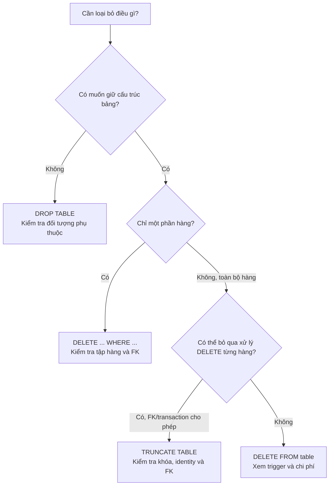

# DROP, TRUNCATE và ranh giới với DELETE

Giả sử bạn đang thực hành SQL trên bảng `orders`. Sau một buổi thử nghiệm, bạn muốn xóa một đơn hàng sai, làm trống toàn bộ dữ liệu mẫu, hoặc loại bỏ hẳn bảng để tạo lại cấu trúc từ đầu. Cả ba mục tiêu đều liên quan đến việc “xóa”, nhưng câu lệnh SQL phù hợp hoàn toàn khác nhau:

```sql
DELETE FROM orders WHERE order_id = 101;  -- xóa hàng thỏa điều kiện
TRUNCATE TABLE orders;                    -- làm trống toàn bộ bảng
DROP TABLE orders;                        -- loại bỏ chính đối tượng bảng
```

Đây là những ví dụ về cú pháp; đừng chạy nguyên văn trên bảng có dữ liệu quan trọng. Sai lầm giữa `DELETE`, `TRUNCATE` và `DROP` có thể khiến bạn xóa nhiều dữ liệu hơn dự kiến, mất cấu trúc bảng hoặc làm hỏng các phụ thuộc như khóa ngoại và view.

Bài học thuộc chương **Bảng và lược đồ** của **Database SQL**, trình bày sự khác biệt về đối tượng bị tác động, phạm vi xóa, ràng buộc, trigger, cột tự tăng, giao dịch và hiệu năng. Phần thực hành chính dùng **PostgreSQL** với bảng tạm để thao tác an toàn; quy tắc của các DBMS khác được phân biệt rõ.

## 1. Trước hết: xóa hàng hay xóa bảng?

Một bảng có ít nhất hai mặt cần phân biệt:

1. **Định nghĩa bảng**: tên bảng, cột, kiểu dữ liệu, khóa, ràng buộc, index và những thuộc tính khác.
2. **Dữ liệu của bảng**: các hàng hiện đang được lưu theo định nghĩa đó.

Ngoài ra, bảng có thể liên quan đến **đối tượng khác**: view tham chiếu tới bảng, bảng con tham chiếu bằng khóa ngoại, trigger, quyền truy cập, sequence phục vụ cột tự tăng.

```text
Database
└── Schema
    ├── Bảng orders
    │   ├── Định nghĩa: order_id, customer_id, amount, ...
    │   ├── Ràng buộc / index / trigger
    │   └── Dữ liệu: hàng 101, 102, 103, ...
    └── Bảng order_items
        └── Có thể có khóa ngoại tới orders
```

Ba câu lệnh tác động ở các cấp khác nhau:

- `DELETE` **xóa các hàng**. Định nghĩa bảng vẫn tồn tại.
- `TRUNCATE` **làm trống bảng ở mức toàn bảng** bằng cơ chế chuyên biệt. Định nghĩa bảng vẫn tồn tại.
- `DROP TABLE` **xóa đối tượng bảng khỏi schema**, gồm định nghĩa của nó và dữ liệu do bảng đó sở hữu; các đối tượng phụ thuộc có thể bị ảnh hưởng.

Nếu chỉ muốn xóa **một cột**, đó là việc thay đổi định nghĩa, chẳng hạn `ALTER TABLE ... DROP COLUMN`, không phải chức năng của `DELETE` hay `TRUNCATE`.

## 2. Bảng so sánh nhanh

| Tiêu chí | `DELETE` | `TRUNCATE` | `DROP TABLE` |
| --- | --- | --- | --- |
| Mục tiêu chính | Xóa một số hoặc tất cả các hàng | Làm trống toàn bộ bảng được chỉ định | Loại bỏ đối tượng bảng |
| Có `WHERE` để chọn hàng? | **Có** | **Không** | **Không** |
| Giữ bảng để chèn/truy vấn tiếp? | **Có** | **Có** | **Không** |
| Giữ định nghĩa cột, index, constraint? | Có | Có | Không còn cùng đối tượng bảng |
| Xử lý từng hàng | Có thể tác động theo từng hàng, kích hoạt logic liên quan | Không xử lý bằng thao tác `DELETE` từng hàng thông thường | Không phải phép xóa hàng |
| Trigger | Trigger `DELETE` theo quy định DBMS | Trigger `TRUNCATE` nếu DBMS hỗ trợ; thường không kích hoạt trigger `DELETE` | Có thể có cơ chế sự kiện DDL riêng |
| Khóa ngoại | Kiểm tra theo các hàng bị xóa; có thể có `ON DELETE CASCADE` | Thường có ràng buộc riêng cho bảng tham chiếu/bị tham chiếu | Có thể bị chặn bởi đối tượng phụ thuộc; `CASCADE` tùy DBMS |
| Cột tự tăng/sequence | Thường không tự đặt lại bộ đếm | Có thể giữ hoặc đặt lại, tùy DBMS/cú pháp | Đối tượng bảng bị xóa; sequence phụ thuộc có thể bị xóa |
| Khả năng `ROLLBACK` | Phụ thuộc DBMS và loại bảng/transaction | **Khác đáng kể giữa DBMS** | **Khác đáng kể giữa DBMS** |
| Tác động hiệu năng | Phụ thuộc số hàng, index, trigger và logging | Thường nhanh khi cần xóa toàn bộ hàng | Thao tác thay đổi schema và phụ thuộc |
| Bản chất thường gọi | DML | DDL hoặc thao tác toàn bảng có ngữ nghĩa DDL | DDL |

**Điểm quan trọng:** không được suy ra khả năng hoàn tác chỉ từ nhãn “DML” hay “DDL”. PostgreSQL có thể `ROLLBACK` nhiều thao tác `TRUNCATE TABLE` và `DROP TABLE` trong transaction, còn MySQL và Oracle có quy tắc DDL khác.

## 3. `DELETE`: xóa theo điều kiện, giữ nguyên bảng

Cú pháp cơ bản:

```sql
DELETE FROM table_name
WHERE condition;
```

Ví dụ, giả sử bảng `sales.orders` tồn tại và `order_id` là khóa chính:

```sql
DELETE FROM sales.orders
WHERE order_id = 101;
```

Câu lệnh chỉ nhắm vào các hàng có `order_id = 101`. Nếu không hàng nào khớp, thường không có hàng nào bị xóa; SQL không tự báo lỗi chỉ vì không tìm thấy hàng.

### 3.1. Quên `WHERE` sẽ xóa toàn bộ hàng

```sql
-- Cẩn thận: xóa mọi hàng trong bảng
DELETE FROM sales.orders;
```

Sau một lệnh `DELETE` không có `WHERE` chạy thành công, bảng vẫn còn: tên bảng, cột, index, khóa và cấu hình schema không tự biến mất.

Với dữ liệu lớn, xóa toàn bảng bằng `DELETE` có thể tiêu tốn nhiều tài nguyên do phải xử lý hàng, index, transaction log hoặc phiên bản hàng theo cơ chế lưu trữ của DBMS. Đây là lý do cần cân nhắc `TRUNCATE` nếu mục tiêu thực sự là bỏ toàn bộ dữ liệu và các ràng buộc cho phép.

### 3.2. Xóa có chọn lọc và xem hàng bị xóa

PostgreSQL hỗ trợ `RETURNING` để trả về giá trị từ các hàng vừa bị xóa:

```sql
-- PostgreSQL: ví dụ khi chỉ muốn xóa bản ghi có mã cụ thể
DELETE FROM sales.orders
WHERE order_id = 101
RETURNING order_id, customer_id, amount;
```

`RETURNING` giúp biết thao tác đã tác động vào hàng nào nhưng **không ngăn** thao tác xóa xảy ra. SQL Server có cơ chế `OUTPUT` với ý tưởng tương tự; không nên áp dụng cùng một cú pháp cho mọi DBMS.

Trước khi xóa dữ liệu thật, bạn có thể kiểm tra tập hàng bằng điều kiện giống dự kiến:

```sql
SELECT order_id, customer_id, amount
FROM sales.orders
WHERE order_id = 101;
```

Kết quả `SELECT` chỉ là ảnh chụp theo ngữ cảnh truy vấn; trong môi trường nhiều phiên cùng thay đổi dữ liệu, tập hàng có thể đổi trước khi `DELETE` chạy. Nếu cần bảo đảm nghiêm ngặt, phải dùng giao dịch và mức cô lập/khóa phù hợp với DBMS.

### 3.3. `DELETE` và khóa ngoại

Nếu bảng `order_items` tham chiếu `orders` bằng khóa ngoại, việc xóa đơn hàng có thể:

- Bị từ chối nếu còn hàng con và ràng buộc không cho xóa cha.
- Xóa những hàng con liên quan nếu khóa ngoại được khai báo `ON DELETE CASCADE`.
- Gán `NULL` hoặc áp dụng hành vi khác nếu ràng buộc được thiết kế như vậy.

`ON DELETE CASCADE` là **quy tắc của khóa ngoại khi xóa hàng**. Nó không đồng nghĩa với `DROP TABLE ... CASCADE` hoặc `TRUNCATE ... CASCADE`, vốn tác động đến đối tượng hoặc tập bảng theo cách khác.

### 3.4. Trigger và quy trình nghiệp vụ

Ở DBMS hỗ trợ trigger `DELETE`, xóa hàng có thể kích hoạt logic ghi nhật ký, đồng bộ bảng phụ, kiểm tra quy tắc hoặc xử lý dữ liệu liên quan. PostgreSQL hỗ trợ trigger `DELETE` ở mức hàng và mức câu lệnh. Nếu hệ thống dùng trigger để kiểm toán thao tác xóa, thay `DELETE` bằng `TRUNCATE` có thể bỏ qua luồng nghiệp vụ đó.

**Không thể coi `DELETE FROM table` và `TRUNCATE TABLE table` là tương đương chỉ vì cuối cùng đều không còn hàng.**

## 4. `TRUNCATE`: làm trống toàn bộ bảng

Cú pháp phổ biến:

```sql
TRUNCATE TABLE table_name;
```

`TRUNCATE` không nhận `WHERE` để chọn từng hàng:

```sql
-- Sai cú pháp trong PostgreSQL: TRUNCATE không hỗ trợ WHERE
TRUNCATE TABLE sales.orders WHERE order_id = 101;
```

Nếu muốn chỉ loại bỏ đơn hàng 101, phải dùng `DELETE ... WHERE`. Nếu muốn bỏ toàn bộ dữ liệu trong bảng và tiếp tục sử dụng đúng cấu trúc đó, `TRUNCATE` là ứng viên phù hợp khi mọi điều kiện và phụ thuộc đã được xem xét.

### 4.1. Bảng vẫn còn sau `TRUNCATE`

Sau khi `TRUNCATE` thành công, bạn vẫn có thể thực hiện:

```sql
SELECT COUNT(*) FROM sales.orders;  -- thường là 0
INSERT INTO sales.orders (...) VALUES (...);
```

Dòng `INSERT` chỉ minh họa rằng bảng còn tồn tại; tên cột và giá trị phải thay bằng schema thực tế. Cấu trúc bảng và các ràng buộc vẫn có hiệu lực, nên hàng mới phải tiếp tục đáp ứng `NOT NULL`, khóa chính, khóa ngoại, `CHECK`, v.v.

`TRUNCATE` không đồng nghĩa với “xóa luôn index”. Index vẫn thuộc định nghĩa bảng, chỉ không còn entry tương ứng với các hàng đã bị làm trống.

### 4.2. Cột tự tăng: giữ hay đặt lại bộ đếm?

Giả sử bảng có khóa chính dạng identity. Sau khi đã tạo các giá trị 1, 2, 3 và làm trống bảng, khóa được sinh cho hàng tiếp theo có phải 1 không? **Không thể trả lời chung nếu chưa biết DBMS và cú pháp `TRUNCATE`.**

Trong PostgreSQL:

```sql
TRUNCATE TABLE sales.orders CONTINUE IDENTITY;
```

`CONTINUE IDENTITY` giữ tiến trình của các sequence liên quan (đây là mặc định khi `TRUNCATE` trên PostgreSQL). Còn:

```sql
TRUNCATE TABLE sales.orders RESTART IDENTITY;
```

`RESTART IDENTITY` khởi động lại các sequence được sở hữu bởi các cột của bảng bị truncate. Trong PostgreSQL, thao tác khởi động lại này có tính giao dịch cùng `TRUNCATE`. Cột identity hoặc sequence không phải công cụ đảm bảo số khóa không bao giờ được tái sử dụng; nếu mã khóa đã xuất hiện ở hệ thống ngoài, đặt lại bộ đếm có thể gây va chạm nghiệp vụ.

`DELETE` thông thường **không tự reset** sequence/identity. MySQL, SQL Server và các hệ khác có hành vi reset khác nhau, cần tra theo DBMS trước khi suy đoán giá trị khóa tiếp theo.

### 4.3. Khóa ngoại có thể chặn `TRUNCATE`

Trong PostgreSQL, không thể tự do truncate một bảng đang bị bảng khác tham chiếu bằng khóa ngoại. Ngay cả khi bảng con đang rỗng, việc tham chiếu vẫn có thể khiến câu lệnh `TRUNCATE` trên bảng cha bị từ chối.

Có thể phải đưa các bảng liên quan vào cùng một lệnh:

```sql
-- Ví dụ cấu trúc trong PostgreSQL, chỉ dùng khi định xóa cả hai bảng
TRUNCATE TABLE sales.order_items, sales.orders;
```

Hoặc dùng `CASCADE`:

```sql
-- PostgreSQL: có thể làm trống cả bảng đang tham chiếu
TRUNCATE TABLE sales.orders CASCADE;
```

**`TRUNCATE ... CASCADE` rất dễ làm mất dữ liệu ở phạm vi lớn hơn một bảng.** PostgreSQL có thể tự thêm những bảng đang tham chiếu bằng khóa ngoại, rồi tiếp tục theo chuỗi liên quan. Đọc kỹ tập bảng bị tác động; không xem `CASCADE` là tùy chọn “bỏ qua lỗi” vô hại.

Trong SQL Server, các giới hạn `TRUNCATE` đối với bảng có khóa ngoại không giống PostgreSQL: một bảng đang được tham chiếu bởi khóa ngoại thường không được truncate, trừ những trường hợp được DBMS cho phép như khóa ngoại tự tham chiếu. Đừng chép nguyên giải pháp `TRUNCATE ... CASCADE` của PostgreSQL sang SQL Server.

### 4.4. Trigger khi `TRUNCATE`

PostgreSQL hỗ trợ trigger riêng cho sự kiện `TRUNCATE` ở mức câu lệnh. `TRUNCATE` **không kích hoạt trigger `ON DELETE`** theo cách `DELETE` từng hàng. Đây là khác biệt lớn nếu hệ thống lưu lịch sử xóa bằng trigger.

Các DBMS khác có thể không có trigger `TRUNCATE` tương tự; SQL Server chẳng hạn không kích hoạt trigger `DELETE` khi `TRUNCATE`. Nếu cần thực hiện logic nghiệp vụ theo từng bản ghi đã bị loại bỏ, `DELETE` có thể là lựa chọn bắt buộc.

### 4.5. Hiệu năng, khóa và đồng thời

`TRUNCATE` thường nhanh hơn `DELETE` không điều kiện khi cần làm trống bảng lớn, vì DBMS có thể giải phóng/tái sử dụng cấu trúc lưu trữ của bảng mà không xóa từng hàng theo con đường DML thông thường.

Tuy nhiên, điều đó **không có nghĩa `TRUNCATE` luôn an toàn hơn hoặc không cần khóa**. Trong PostgreSQL, `TRUNCATE` lấy khóa `ACCESS EXCLUSIVE` trên bảng được tác động và có thể chặn các thao tác đồng thời, kể cả đọc, cho tới khi transaction kết thúc. `TRUNCATE` cũng có đặc điểm khác với thao tác `DELETE` khi xét snapshot/MVCC; vì vậy không dùng nó như một tối ưu hóa vô điều kiện cho hệ thống đang có lưu lượng lớn.

## 5. `DROP TABLE`: xóa cả định nghĩa đối tượng

`DROP TABLE` làm cho bảng không còn tồn tại như một đối tượng có thể truy vấn hoặc chèn tiếp:

```sql
DROP TABLE sales.orders;
```

Sau khi thao tác này được commit thành công, `SELECT * FROM sales.orders` sẽ không còn tham chiếu được bảng vừa xóa; muốn dùng lại tên đó phải tạo một bảng mới. Một bảng mới có cùng tên **không mặc nhiên** phục hồi dữ liệu, quyền, trigger, index hay mọi phụ thuộc của bảng cũ.

### 5.1. `IF EXISTS` chỉ xử lý trường hợp bảng không tồn tại

PostgreSQL hỗ trợ:

```sql
DROP TABLE IF EXISTS sales.orders;
```

`IF EXISTS` tránh lỗi khi bảng chưa có hoặc đã bị xóa, nhưng **không bảo vệ** một bảng đang tồn tại mà bạn nhầm là bảng thử nghiệm. Nếu kết nối nhầm database/schema, lệnh vẫn có thể xóa đúng tên bảng tại nơi không mong muốn.

Hãy xác định đúng database, schema và chủ sở hữu trước khi chạy. Trong môi trường học tập, nên chỉ thao tác trên bảng tạm hoặc schema được cấp riêng.

### 5.2. `RESTRICT` và `CASCADE` không có nghĩa giống `TRUNCATE CASCADE`

Giả sử một view đang dùng bảng `sales.orders`. PostgreSQL mặc định hạn chế `DROP TABLE` nếu có đối tượng phụ thuộc không thể tự xóa, tương đương cách từ chối theo `RESTRICT`:

```sql
DROP TABLE sales.orders RESTRICT;
```

Nếu yêu cầu loại bỏ cả những đối tượng phụ thuộc:

```sql
DROP TABLE sales.orders CASCADE;
```

`CASCADE` có thể khiến view và những đối tượng phụ thuộc khác bị xóa, hoặc khiến các ràng buộc khóa ngoại ở bảng khác bị loại bỏ. **Nó không có nghĩa “xóa mọi hàng của các bảng con theo `ON DELETE CASCADE`”**. Ví dụ, trong PostgreSQL, khi drop bảng cha với `CASCADE`, bảng con có khóa ngoại trỏ tới cha thường **vẫn tồn tại**, nhưng ràng buộc khóa ngoại tương ứng bị xóa; còn các view phụ thuộc có thể bị drop.

Đặc biệt cẩn trọng với từ `CASCADE` vì hậu quả phụ thuộc vào **câu lệnh đang dùng**:

| Cú pháp | Ý nghĩa chính |
| --- | --- |
| `ON DELETE CASCADE` | Khi xóa hàng cha, xóa các hàng con liên quan theo FK |
| `TRUNCATE parent CASCADE` trong PostgreSQL | Làm trống cả các bảng tham chiếu thuộc phạm vi cascade |
| `DROP TABLE parent CASCADE` trong PostgreSQL | Xóa bảng và các đối tượng/ràng buộc phụ thuộc cần loại bỏ |

### 5.3. `DROP TABLE` khác `DROP SCHEMA` và `DROP DATABASE`

- `DROP TABLE`: loại bỏ **một bảng**.
- `DROP SCHEMA`: loại bỏ **không gian chứa đối tượng**; có thể có điều kiện phụ thuộc hoặc `CASCADE` riêng.
- `DROP DATABASE`: loại bỏ **toàn bộ database** theo quy tắc của DBMS, với mức ảnh hưởng lớn hơn nhiều.

Khi mục tiêu chỉ là dọn dữ liệu mẫu trong một bảng, không dùng `DROP SCHEMA` hoặc `DROP DATABASE`. Chúng thuộc cấp cấu trúc rộng hơn hoàn toàn.

## 6. Một ví dụ khóa ngoại: ba kiểu “CASCADE” khác nhau

Dùng hai bảng PostgreSQL minh họa:

```sql
CREATE TEMP TABLE parent_lab (
    id INTEGER PRIMARY KEY
);

CREATE TEMP TABLE child_lab (
    id        INTEGER PRIMARY KEY,
    parent_id INTEGER NOT NULL REFERENCES parent_lab(id)
);

INSERT INTO parent_lab (id) VALUES (1);
INSERT INTO child_lab (id, parent_id) VALUES (10, 1);
```

Đây là các bảng tạm trong session; để thử từng tình huống dưới đây, nên tạo lại bảng ở trạng thái ban đầu hoặc dùng transaction và `ROLLBACK`. **Các câu lệnh dưới đây là các tình huống độc lập**, không phải một chuỗi cần chạy liên tiếp:

**Tình huống A — xóa hàng cha:**

```sql
DELETE FROM parent_lab WHERE id = 1;
```

Với khóa ngoại như đã khai báo (không có `ON DELETE CASCADE`), PostgreSQL từ chối xóa hàng cha vì hàng con 10 còn tham chiếu tới nó. Nếu ràng buộc được định nghĩa `ON DELETE CASCADE`, việc xóa hàng cha có thể kéo theo hàng con tương ứng.

**Tình huống B — làm trống bảng cha:**

```sql
TRUNCATE TABLE parent_lab;
```

PostgreSQL từ chối vì `child_lab` tham chiếu `parent_lab`. Muốn làm trống cả hai mà vẫn giữ định nghĩa và FK:

```sql
TRUNCATE TABLE child_lab, parent_lab;
```

Hoặc dùng `TRUNCATE TABLE parent_lab CASCADE` nếu thực sự chấp nhận làm trống các bảng tham chiếu được PostgreSQL xác định.

**Tình huống C — xóa bảng cha:**

```sql
DROP TABLE parent_lab;
```

Có thể bị từ chối vì FK ở `child_lab` phụ thuộc vào `parent_lab`. Với:

```sql
DROP TABLE parent_lab CASCADE;
```

PostgreSQL có thể xóa `parent_lab` và FK phụ thuộc ở `child_lab`; **bản thân `child_lab` không vì thế mà tự động bị drop**. Dữ liệu trong `child_lab` không biến thành phép xóa hàng theo `ON DELETE CASCADE`.

Khi gặp lỗi phụ thuộc, đừng thêm `CASCADE` theo phản xạ. Hãy quyết định rõ có cần xóa **hàng con**, làm trống **cả bảng con**, hay loại bỏ **mối ràng buộc cấu trúc**.

## 7. Thực hành an toàn bằng bảng tạm PostgreSQL

Các ví dụ trong phần này được thiết kế để chạy trong **một phiên PostgreSQL**; dùng bảng tạm `cleanup_lab` và không phụ thuộc vào bảng của ứng dụng. Nếu đang chạy trong công cụ có tự thay đổi kết nối giữa các câu lệnh, hãy bảo đảm các lệnh ở cùng session.

### Bước 1: Tạo bảng và dữ liệu ban đầu

```sql
CREATE TEMP TABLE cleanup_lab (
    id    INTEGER GENERATED BY DEFAULT AS IDENTITY PRIMARY KEY,
    label TEXT NOT NULL
);

INSERT INTO cleanup_lab (label)
VALUES ('A'), ('B'), ('C');

SELECT id, label
FROM cleanup_lab
ORDER BY id;
```

Trong phiên mới, kết quả có ba hàng `A`, `B`, `C`. Nếu bảng tạm cùng tên đã tồn tại trong phiên, hãy mở session mới trước khi thực hành để tránh lỗi tên trùng.

### Bước 2: `DELETE` một hàng rồi `ROLLBACK`

```sql
BEGIN;

DELETE FROM cleanup_lab
WHERE label = 'B'
RETURNING id, label;

SELECT id, label
FROM cleanup_lab
ORDER BY id;

ROLLBACK;

SELECT id, label
FROM cleanup_lab
ORDER BY id;
```

Trong transaction, câu `SELECT` đầu sau `DELETE` còn hai hàng `A` và `C`. Sau `ROLLBACK`, ba hàng ban đầu xuất hiện trở lại.

Đây là đặc tính giao dịch của `DELETE` trên bảng PostgreSQL thông thường, không phải lời hứa rằng mọi hệ thống ngoài database đã nhận thông báo xóa cũng được hoàn tác.

### Bước 3: `TRUNCATE` toàn bảng rồi `ROLLBACK`

```sql
BEGIN;

TRUNCATE TABLE cleanup_lab RESTART IDENTITY;

SELECT COUNT(*) AS rows_in_transaction
FROM cleanup_lab;

ROLLBACK;

SELECT COUNT(*) AS rows_after_rollback
FROM cleanup_lab;
```

Trong transaction, `rows_in_transaction = 0`. Sau `ROLLBACK`, `rows_after_rollback = 3`. PostgreSQL hỗ trợ hoàn tác `TRUNCATE` và việc restart identity đi kèm theo transaction.

Lưu ý: kết luận này áp dụng cho **PostgreSQL**, không được sao chép sang MySQL/Oracle nơi `TRUNCATE` thường là DDL có implicit commit.

### Bước 4: `DROP TABLE` rồi `ROLLBACK`

```sql
BEGIN;

DROP TABLE cleanup_lab;

-- Trong transaction hiện tại, bảng không còn để SELECT.

ROLLBACK;

SELECT id, label
FROM cleanup_lab
ORDER BY id;
```

Sau rollback, bảng tạm lại tồn tại với dữ liệu ban đầu. Đây là minh họa khác về tính giao dịch của `DROP TABLE` trong PostgreSQL.

### Bước 5: Dọn bảng thực hành

Khi đã hoàn thành các bước trên:

```sql
DROP TABLE cleanup_lab;
```

Sau lệnh cuối, `cleanup_lab` không còn trong session hiện tại. Nếu không xóa thủ công, bảng `TEMP` thông thường cũng tự biến mất khi session PostgreSQL kết thúc.

## 8. Khả năng hoàn tác thay đổi theo DBMS

Giả định “cứ đặt `BEGIN` trước là có thể `ROLLBACK` tất cả” rất nguy hiểm. Dưới đây là so sánh với bảng thông thường và transaction được cấu hình đúng:

| DBMS | `DELETE` | `TRUNCATE TABLE` | `DROP TABLE` |
| --- | --- | --- | --- |
| **PostgreSQL** | Có thể rollback trong transaction | Có thể rollback trong transaction; khóa mạnh và quy tắc MVCC riêng | Có thể rollback `DROP TABLE` trong transaction |
| **MySQL** | Có thể rollback với bảng giao dịch như InnoDB | Thường là DDL với implicit commit; không rollback bằng transaction thông thường | DDL implicit commit; không rollback bằng `ROLLBACK` thông thường |
| **SQL Server** | Có thể rollback trong transaction | Có thể rollback trong transaction phù hợp; có giới hạn FK và đối tượng được hỗ trợ | Có thể rollback một số thao tác `DROP TABLE` trong transaction phù hợp |
| **Oracle Database** | Có thể rollback DML chưa commit | DDL gây implicit commit; không rollback theo cách của `DELETE` | DDL gây implicit commit; có thể có cơ chế khôi phục riêng như recycle bin nhưng không thay thế `ROLLBACK` |
| **SQLite** | `DELETE` hỗ trợ transaction | Không có lệnh `TRUNCATE TABLE` riêng | `DROP TABLE` có thể thuộc transaction tường minh và được rollback |

Các DBMS còn có khác biệt theo phiên bản, engine lưu trữ, loại bảng, chính sách giao dịch và công cụ client. Đừng dựa vào mô tả “xóa dữ liệu” để suy ra phương thức khôi phục chung.

### Một số hệ quả thực tế

- Trên **MySQL**, `START TRANSACTION; TRUNCATE TABLE ...; ROLLBACK;` thường **không phục hồi** các hàng, vì `TRUNCATE` được xử lý như DDL có implicit commit.
- Trên **PostgreSQL**, `BEGIN; TRUNCATE TABLE ...; ROLLBACK;` có thể phục hồi hàng trong phạm vi transaction. Nếu transaction đã `COMMIT`, `ROLLBACK` ở bước sau không thể đảo ngược commit đó.
- Trên **SQL Server**, dù `TRUNCATE` có thể rollback trong transaction, vẫn phải xem FK, trigger, loại bảng và mức khóa.
- Trên **SQLite**, nếu cần xóa toàn bộ hàng trong bảng, dùng `DELETE FROM table`; `TRUNCATE TABLE` không phải cú pháp SQLite.

**Rollback không phải bản sao lưu.** Sau khi thay đổi đã commit, khôi phục dữ liệu thường cần backup, point-in-time recovery, log hoặc cơ chế riêng do DBMS/hệ thống xây dựng.

## 9. Tốc độ, khóa và không gian lưu trữ

Sự khác biệt hiệu năng không nên diễn giải thành “`TRUNCATE` lúc nào cũng tốt hơn `DELETE`”.

### `DELETE` khi cần chọn hàng

`DELETE ... WHERE` có thể sử dụng index để tìm đúng các hàng cần xóa. Nếu chỉ xóa một phần nhỏ của bảng lớn, thao tác này có thể phù hợp hơn nhiều so với làm trống bảng. Nhưng khi xóa hàng loạt, DBMS phải xử lý thay đổi theo cơ chế DML, bao gồm index, ràng buộc, trigger và log.

Riêng PostgreSQL dùng MVCC, các phiên bản hàng đã xóa có thể cần được xử lý bởi `VACUUM`. Xóa hàng không bảo đảm dung lượng file bảng lập tức được trả về hệ điều hành; không nên dựa vào `DELETE` để “thu nhỏ file ngay”.

### `TRUNCATE` khi thực sự bỏ toàn bộ dữ liệu

Khi xóa mọi hàng của bảng lớn, `TRUNCATE` có thể xử lý bằng thao tác cấp cấu trúc lưu trữ thay vì ghi nhận từng lần xóa hàng. Trong PostgreSQL, `TRUNCATE` thường có thể thu hồi không gian bảng nhanh hơn thao tác `DELETE` toàn bảng.

Đổi lại, nó có thể giữ khóa rất mạnh; các truy vấn đồng thời chờ khóa, các quy tắc trigger/FK khác `DELETE` và không thể lọc bằng `WHERE`.

### `DROP` khi không còn cần đối tượng bảng

`DROP TABLE` giải phóng cả định nghĩa bảng, cùng dữ liệu và tài nguyên phụ thuộc thuộc sở hữu bảng. Đây là thao tác quản lý schema. Dù bảng rỗng, `DROP` vẫn phá bỏ đối tượng và có thể làm các câu SQL, view, ứng dụng hoặc tiến trình di trú schema bị lỗi.

Tóm lại về mục tiêu kỹ thuật:

- Xóa một phần dữ liệu → cân nhắc `DELETE`.
- Làm trống bảng nhưng vẫn cần bảng → cân nhắc `TRUNCATE` khi FK/trigger/transaction cho phép.
- Không cần bảng nữa → cân nhắc `DROP TABLE` như một thay đổi schema có kiểm soát.

## 10. Quyền truy cập: được xóa hàng chưa chắc được drop bảng

Nhiều DBMS tách quyền thao tác dữ liệu khỏi quyền thay đổi cấu trúc:

- `DELETE` cần quyền xóa hàng, và truy vấn có điều kiện có thể cần quyền đọc các cột tham chiếu.
- `TRUNCATE` có quyền hoặc yêu cầu riêng; trong PostgreSQL có đặc quyền `TRUNCATE` riêng.
- `DROP TABLE` thường yêu cầu là chủ sở hữu bảng hoặc có quyền quản trị/tương đương tùy DBMS.

Một tài khoản có thể chạy `DELETE` nhưng bị từ chối `TRUNCATE` hoặc `DROP`. Điều đó không có nghĩa ba câu lệnh là các cách viết khác nhau của cùng một thao tác; DBMS cố ý đặt ranh giới quyền vì mức độ ảnh hưởng khác nhau.

Trong môi trường nhiều schema, hãy ghi tên đầy đủ như `training.orders` khi cần để tránh chạy trên bảng cùng tên ở schema khác. Trong PostgreSQL, có thể xác nhận ngữ cảnh bằng:

```sql
SELECT current_database() AS database_name,
       current_schema()   AS schema_name,
       current_user       AS current_role;

SHOW search_path;
```

`search_path` ảnh hưởng đến việc phân giải tên ngắn. Ngay cả câu `DROP TABLE IF EXISTS orders` cũng có thể tác động nhầm nếu trong đường tìm kiếm có một bảng `orders` ngoài dự kiến. `IF EXISTS` chỉ xử lý trường hợp không có đối tượng, không xác minh “đúng bảng”.

## 11. Quyết định dùng câu lệnh nào trong từng tình huống

| Yêu cầu | Câu lệnh phù hợp thường gặp | Giải thích |
| --- | --- | --- |
| Xóa đơn hàng số 101 vì nhập nhầm | `DELETE ... WHERE order_id = 101` | Chỉ tác động hàng được chọn; cần xem FK và nghiệp vụ |
| Xóa bản ghi nhật ký cũ hơn một mốc thời gian | `DELETE ... WHERE created_at < ...` | Cần điều kiện lọc; có thể cân nhắc partition nếu dữ liệu rất lớn |
| Làm rỗng bảng dữ liệu demo và dùng lại cấu trúc | `TRUNCATE TABLE ...` | Phù hợp nếu chấp nhận toàn bảng và những ràng buộc cho phép |
| Dọn bảng staging sau mỗi lần import | `TRUNCATE` hoặc cơ chế thay bảng tùy kiến trúc | Quan tâm khóa, đồng thời, trigger và transaction |
| Bỏ hẳn bảng thí nghiệm không dùng nữa | `DROP TABLE ...` | Xóa định nghĩa; cần xem phụ thuộc |
| Xóa một cột khỏi bảng vẫn đang dùng | `ALTER TABLE ... DROP COLUMN` | Thay đổi schema, không xóa hàng |
| Đánh dấu đơn hàng đã hủy nhưng giữ lịch sử | `UPDATE ... SET status = 'CANCELLED'` | Đây là thay đổi trạng thái, không phải xóa vật lý |
| Xóa dữ liệu cá nhân theo quy định | Cần thiết kế thao tác và kiểm soát theo yêu cầu nghiệp vụ | `DELETE` đơn lẻ có thể chưa xử lý bản sao, dữ liệu tham chiếu, archive hoặc backup |

Nếu ứng dụng dùng **soft delete** (ví dụ `deleted_at` hoặc `is_deleted`), việc “xóa” trong giao diện có thể được thực hiện bằng `UPDATE`, không phải `DELETE`. Đừng dùng `TRUNCATE` hay `DROP` để thay thế quy trình nghiệp vụ này.

### Sơ đồ lựa chọn



Sơ đồ dùng để xác định thao tác **phù hợp về ngữ nghĩa**. Quyết định cuối còn cần kiểm tra chính sách sao lưu, quyền và đặc tính DBMS cụ thể.

## 12. Một số hiểu lầm thường gặp

### “`DELETE` không có `WHERE` chính là `TRUNCATE`”

Không đúng. Cả hai có thể làm bảng không còn hàng, nhưng xử lý FK, trigger, sequence, log, khóa và khả năng hoàn tác theo DBMS có thể khác nhau.

### “`TRUNCATE` là `DROP` rồi `CREATE` lại bảng”

Đây không phải cách hiểu đúng về ngữ nghĩa SQL. `TRUNCATE` giữ đối tượng bảng cùng định nghĩa, trong khi `DROP` làm đối tượng không còn tồn tại. Một số cơ chế lưu trữ có thể tổ chức lại dữ liệu khi truncate, nhưng không được đồng nhất điều đó với vòng đời bảng bị drop và tạo mới.

### “Chỉ `DELETE` mới có thể rollback vì là DML”

Không đúng trên mọi DBMS. PostgreSQL có thể rollback cả `TRUNCATE TABLE` và `DROP TABLE` trong transaction; MySQL lại có implicit commit với nhiều lệnh DDL.

### “Thêm `CASCADE` để lệnh nào cũng chạy được”

Không nên. `CASCADE` ở `ON DELETE`, `TRUNCATE` và `DROP` tác động khác nhau. Nó có thể mở rộng phạm vi từ một bảng/hàng sang nhiều bảng hoặc đối tượng phụ thuộc.

### “Xóa hết hàng thì ID tự tăng bắt đầu lại từ 1”

Không đúng với `DELETE` thông thường. Hành vi `TRUNCATE` tùy DBMS và cú pháp, ví dụ PostgreSQL mặc định `CONTINUE IDENTITY`, nhưng có `RESTART IDENTITY`.

### “`DROP TABLE IF EXISTS` an toàn vì bảng có thể không tồn tại”

`IF EXISTS` chỉ tránh lỗi thiếu bảng. Nếu đúng tên đó đang tồn tại ở database/schema không mong muốn, nó vẫn có thể bị drop.

## 13. Các bước chuẩn bị trước khi xóa dữ liệu thực tế

Với bảng có giá trị, quy trình kỹ thuật nên bắt đầu từ việc **xác định chính xác mục tiêu**:

1. Xác nhận **DBMS, database, schema, tên bảng và môi trường**. Không dựa vào tab SQL đang mở để phỏng đoán nơi kết nối.
2. Xác định muốn xóa **một nhóm hàng**, **mọi hàng nhưng giữ bảng**, hay **toàn bộ đối tượng bảng**.
3. Nếu dùng `DELETE` có điều kiện, thử `SELECT` với điều kiện tương ứng để xem tập dữ liệu mục tiêu.
4. Kiểm tra khóa ngoại, view, trigger, sequence/identity, các công việc tự động và người dùng bảng đó.
5. Xác định transaction có thể rollback câu lệnh này trên DBMS/engine đang dùng hay không. Kiểm tra bản sao lưu hoặc phương án khôi phục khi cần.
6. Xem xét khóa, mức đồng thời và thời điểm chạy thao tác. Với bảng lớn, việc xóa nhiều hàng trong một transaction có thể ảnh hưởng lâu đến tiến trình khác.
7. Chỉ thực hiện thay đổi trong phạm vi đã được duyệt và xác nhận kết quả bằng câu truy vấn/metadata phù hợp.

Với PostgreSQL, một kỹ thuật hữu ích khi **thử xóa hàng** trong môi trường được cấp quyền là:

```sql
BEGIN;

DELETE FROM training.orders
WHERE status = 'TEST'
RETURNING order_id, status;

-- Kiểm tra tập hàng trả về trước khi quyết định kết thúc transaction.
-- COMMIT;    -- chỉ khi thật sự muốn áp dụng
ROLLBACK;     -- dùng trong buổi thử nghiệm
```

`training.orders` là tên minh họa, không phải bảng chắc chắn tồn tại. Nếu muốn thử lệnh hoàn toàn không ảnh hưởng dữ liệu thật, hãy thay bằng bảng tạm trong phần thực hành. Việc dùng transaction để xem `RETURNING` có thể giữ khóa cho đến khi kết thúc; đừng giữ transaction mở lâu trong môi trường đông người dùng.

## 14. Bài tập thực hành

Các bài tập dùng PostgreSQL và bảng tạm `cleanup_lab` đã được tạo ở phần 7, trừ khi bài ghi rõ là câu hỏi lý thuyết. Hãy dự đoán kết quả trước khi chạy. Nếu đã `DROP` bảng ở bước 5, tạo lại bảng tạm để thực hành.

### Bài 1 — Chọn câu lệnh

Với mỗi yêu cầu, chọn `DELETE`, `TRUNCATE` hoặc `DROP` và giải thích:

1. Xóa tất cả hàng có `status = 'CANCELLED'` nhưng giữ các hàng khác.
2. Làm trống bảng thử nghiệm để nạp dữ liệu mới cùng cấu trúc.
3. Loại bỏ bảng tạm không còn cần và không muốn dùng lại.
4. Giữ bảng và dữ liệu, chỉ đổi trạng thái `active` của một hàng thành `false`.

### Bài 2 — Dự đoán dữ liệu sau `DELETE`

Giả sử `cleanup_lab` chứa ba hàng `A`, `B`, `C`:

```sql
DELETE FROM cleanup_lab WHERE label = 'B';
SELECT COUNT(*) FROM cleanup_lab;
```

Có bao nhiêu hàng sau lệnh? Cột `id` và định nghĩa bảng có còn không? Nếu câu `DELETE` bỏ `WHERE` thì điều gì xảy ra?

### Bài 3 — Giao dịch PostgreSQL

Dự đoán kết quả của `COUNT(*)` cuối cùng:

```sql
BEGIN;
TRUNCATE TABLE cleanup_lab;
ROLLBACK;
SELECT COUNT(*) FROM cleanup_lab;
```

Thử tiếp cùng cách với `DROP TABLE cleanup_lab` trong transaction. Tại sao hai kết quả này không được mặc định áp dụng cho MySQL?

### Bài 4 — Khóa ngoại

Giả sử `orders` là bảng cha và `order_items` có khóa ngoại tới `orders`.

1. Tại sao `TRUNCATE TABLE orders` có thể bị từ chối trên PostgreSQL?
2. `TRUNCATE TABLE orders CASCADE` có thể tác động tới bảng nào?
3. `DROP TABLE orders CASCADE` có chắc chắn xóa hẳn bảng `order_items` không?
4. `ON DELETE CASCADE` được dùng trong định nghĩa nào và kích hoạt ở loại thao tác nào?

### Bài 5 — IDENTITY

Một bảng PostgreSQL dùng `GENERATED ... AS IDENTITY` đã sinh các khóa 1, 2, 3. Dự đoán hành vi cấp khóa tiếp theo khi:

- `DELETE FROM table` rồi chèn hàng mới.
- `TRUNCATE TABLE table CONTINUE IDENTITY` rồi chèn hàng mới.
- `TRUNCATE TABLE table RESTART IDENTITY` rồi chèn hàng mới.

Giả sử không có session khác sử dụng sequence, không có thay đổi cấu hình khác và các câu lệnh được commit.

### Bài 6 — Tìm lỗi trong tư duy

Một người nói: “Tôi sẽ chạy `BEGIN; TRUNCATE TABLE orders;` trên MySQL, nếu thấy sai thì chỉ cần `ROLLBACK` như PostgreSQL.” Nhận định này sai ở đâu? Cần xác minh điều gì về DBMS và engine trước khi dựa vào rollback?

### Bài 7 — Hiệu năng và nghiệp vụ

Bạn có một bảng nhật ký hàng triệu hàng, nhưng chỉ cần xóa các bản ghi cũ hơn 90 ngày. Có nên dùng `TRUNCATE` vì nhanh hơn `DELETE` không? Nếu hệ thống tạo partition theo thời gian, còn phương án kiến trúc nào cần cân nhắc?

### Gợi ý đáp án

**Bài 1:** (1) `DELETE ... WHERE status = 'CANCELLED'`; (2) `TRUNCATE TABLE ...` nếu phù hợp FK, trigger, transaction; (3) `DROP TABLE ...`; (4) `UPDATE ... SET active = false WHERE ...`, vì không cần xóa.

**Bài 2:** Còn 2 hàng; cấu trúc bảng, cột `id` và các ràng buộc vẫn tồn tại. Bỏ `WHERE` sẽ xóa mọi hàng.

**Bài 3:** Nếu trước khi thử có 3 hàng, `ROLLBACK` sau `TRUNCATE` khiến `COUNT(*)` cuối là 3. `ROLLBACK` sau `DROP TABLE` trong PostgreSQL khôi phục đối tượng bảng về trạng thái trước transaction. MySQL xử lý `TRUNCATE`/`DROP` như DDL có implicit commit trong tình huống thông thường.

**Bài 4:** (1) Bảng bị tham chiếu bằng FK; (2) có thể làm trống `order_items` và các bảng tham chiếu liên quan; (3) không, ở PostgreSQL bảng con có thể còn nhưng mất FK phụ thuộc; (4) `ON DELETE CASCADE` là thuộc tính khóa ngoại và được áp dụng khi xóa hàng cha bằng `DELETE`.

**Bài 5:** `DELETE` thông thường không reset bộ đếm; `CONTINUE IDENTITY` cũng giữ tiến trình; `RESTART IDENTITY` đặt lại các sequence sở hữu bởi cột của bảng. Với identity bắt đầu từ 1 và không thay đổi cấu hình, sau restart khóa đầu tiên thường lại là 1.

**Bài 6:** `TRUNCATE` trong MySQL thường là DDL có implicit commit, nên `ROLLBACK` không khôi phục dữ liệu bị truncate. Cần xem quy tắc transaction/DDL của hệ, loại bảng và phương án khôi phục dữ liệu.

**Bài 7:** `TRUNCATE` làm trống toàn bảng, sẽ xóa cả các bản ghi mới. Cần dùng `DELETE ... WHERE created_at < ...` hoặc nếu dữ liệu được phân vùng đúng thiết kế, cân nhắc thao tác quản lý partition cũ theo cơ chế DBMS (ví dụ detach/drop partition), sau khi kiểm tra phụ thuộc và quy tắc vận hành.

Ba lệnh không chỉ khác nhau ở cú pháp mà còn ở **ranh giới trách nhiệm**: `DELETE` thao tác với hàng dữ liệu, `TRUNCATE` thay toàn bộ nội dung bảng theo cơ chế chuyên biệt, còn `DROP TABLE` thay đổi cấu trúc schema bằng cách loại bỏ đối tượng. Mỗi khi viết một lệnh có khả năng xóa dữ liệu, hãy xác định rõ mức tác động đó trước khi quyết định tối ưu tốc độ hay thêm tùy chọn `CASCADE`.
