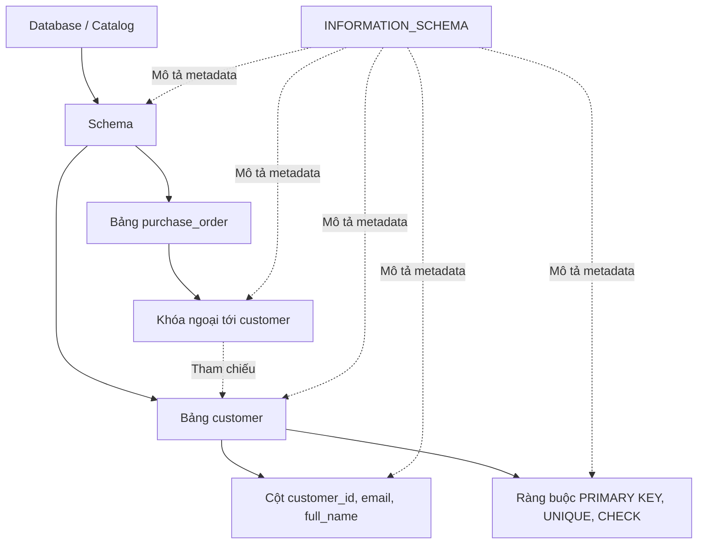
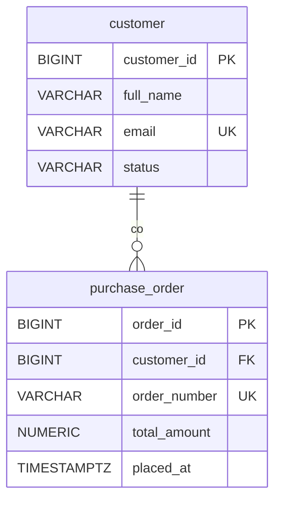

# Tra cứu bảng, cột và ràng buộc bằng INFORMATION_SCHEMA

Khi làm việc với một cơ sở dữ liệu đã tồn tại, ta thường cần trả lời những câu hỏi như:

- Database đang có những **schema** và **bảng** nào?
- Bảng `customer` có những **cột** gì, kiểu dữ liệu nào, cột nào được phép `NULL`?
- Cột nào là **khóa chính (PRIMARY KEY)** hoặc thuộc ràng buộc **UNIQUE**?
- **Khóa ngoại (FOREIGN KEY)** đang tham chiếu đến bảng và cột nào?
- Những quy tắc **CHECK** nào đang được áp dụng?
- Một bảng/cột có tồn tại trước khi chạy thao tác quản trị hoặc migration không?

Không cần đọc toàn bộ dữ liệu nghiệp vụ để biết những thông tin đó. Nhiều hệ quản trị cơ sở dữ liệu quan hệ cung cấp **`INFORMATION_SCHEMA`**: tập hợp các *view hệ thống* cho phép tra cứu **metadata** bằng SQL.

Bài học hướng dẫn cách đọc và kết hợp các view quan trọng của `INFORMATION_SCHEMA` để khám phá **bảng, cột và ràng buộc**. Các ví dụ thực hành sử dụng PostgreSQL; những điểm khác biệt với MySQL, SQL Server, Oracle và SQLite được làm rõ ở phần sau.

## 1. INFORMATION_SCHEMA là gì?

**Metadata** là “dữ liệu mô tả dữ liệu”. Chẳng hạn, tên bảng, tên cột, kiểu dữ liệu, khả năng chứa `NULL` và tên khóa ngoại là metadata; còn họ tên khách hàng, email và số tiền đơn hàng là dữ liệu nghiệp vụ.

`INFORMATION_SCHEMA` là một phần của mô hình SQL tiêu chuẩn, dùng để trình bày thông tin mô tả các đối tượng cơ sở dữ liệu dưới dạng những bảng/view có thể truy vấn bằng `SELECT`.

Ví dụ:

```sql
SELECT table_schema, table_name, table_type
FROM information_schema.tables
ORDER BY table_schema, table_name;
```

Truy vấn trên đọc **danh sách bảng và view**, không đọc nội dung từng bản ghi trong các bảng đó.

### 1.1. Các lớp khái niệm



Nhìn chung:

| Khái niệm | Vai trò |
| --- | --- |
| **Catalog** | Phạm vi tập hợp schema được hệ quản trị nhận diện; trong nhiều DBMS thường gắn với database, nhưng cách tổ chức khác nhau. |
| **Schema** | Không gian tên chứa bảng, view và các đối tượng liên quan. |
| **Table** | Cấu trúc dữ liệu dạng hàng và cột. |
| **Column** | Thuộc tính của bảng, có tên, vị trí, kiểu dữ liệu và nhiều quy tắc. |
| **Constraint** | Quy tắc giúp bảo toàn tính hợp lệ của dữ liệu: khóa chính, khóa ngoại, duy nhất, kiểm tra điều kiện. |
| **INFORMATION_SCHEMA** | Giao diện để truy vấn metadata bằng SQL, thường phản ánh các đối tượng mà tài khoản được phép nhìn thấy. |

Tên `information_schema` trong PostgreSQL là một **schema có sẵn**, chứa những view metadata. Ta có thể truy vấn bằng tên đầy đủ như `information_schema.columns`.

### 1.2. Vì sao dùng INFORMATION_SCHEMA?

Ưu điểm chính:

1. **Dễ khám phá:** có thể đọc metadata bằng cú pháp `SELECT` quen thuộc.
2. **Tương đối chuẩn hóa:** nhiều tên view và cột metadata xuất phát từ SQL standard.
3. **Tiện xây công cụ:** phục vụ tra cứu schema, tài liệu hóa, kiểm tra điều kiện trước migration hoặc hiển thị cấu trúc dữ liệu.
4. **Tôn trọng cơ chế phân quyền:** nhiều view chỉ cho thấy các đối tượng mà người dùng có quyền truy cập hoặc được phép xem metadata.

Tuy nhiên, “theo chuẩn” **không có nghĩa mọi DBMS triển khai giống nhau hoàn toàn**. Một số DBMS thiếu một phần view, có cột mở rộng riêng, hoặc cung cấp metadata chi tiết hơn qua catalog nội bộ.

## 2. Những view INFORMATION_SCHEMA cần biết

Các tên sau đặc biệt hữu ích:

| View | Dùng để tra cứu |
| --- | --- |
| `information_schema.schemata` | Những schema nhìn thấy trong phạm vi catalog/database hiện hành. |
| `information_schema.tables` | Các bảng và view, cùng thông tin như schema, tên và loại. |
| `information_schema.columns` | Các cột: thứ tự, kiểu dữ liệu, cho phép `NULL`, giá trị mặc định và thuộc tính khác. |
| `information_schema.table_constraints` | Ràng buộc gắn với bảng, như `PRIMARY KEY`, `UNIQUE`, `FOREIGN KEY`, `CHECK`. |
| `information_schema.key_column_usage` | Cột thuộc các ràng buộc khóa, gồm thứ tự cột trong khóa. |
| `information_schema.constraint_column_usage` | Cột liên quan tới ràng buộc; cần xem ngữ nghĩa từng loại ràng buộc và DBMS. |
| `information_schema.referential_constraints` | Quy tắc tham chiếu của khóa ngoại như `UPDATE_RULE` và `DELETE_RULE`. |
| `information_schema.check_constraints` | Biểu thức điều kiện của các ràng buộc `CHECK`. |
| `information_schema.views` | Metadata về view, chẳng hạn định nghĩa view nếu có quyền xem. |

**Không có một view duy nhất chứa đầy đủ mọi thông tin.** Để biết một khóa ngoại gồm những cột nào và tham chiếu khóa nào, thường phải **JOIN** nhiều view metadata dựa trên định danh ràng buộc.

Nhiều view có các cột như:

```text
table_catalog
table_schema
table_name

constraint_catalog
constraint_schema
constraint_name
```

Chúng giúp xác định đối tượng đầy đủ, vì hai schema khác nhau có thể có bảng cùng tên. Khi JOIN metadata, cần dùng đủ khóa định danh thay vì chỉ ghép theo `table_name` hoặc `constraint_name`.

## 3. Tạo lược đồ mẫu để thực hành

Các câu lệnh trong mục này dành cho **PostgreSQL**. Nếu không có quyền tạo schema, có thể thay `catalog_demo` bằng schema được cấp và điều chỉnh tên đối tượng tương ứng.

Ta tạo schema `catalog_demo` với hai bảng:

- `customer`: khách hàng, có khóa chính, email duy nhất và ràng buộc trạng thái.
- `purchase_order`: đơn hàng, có khóa chính, mã đơn duy nhất, tổng tiền không âm và khóa ngoại tới khách hàng.

```sql
CREATE SCHEMA catalog_demo;

CREATE TABLE catalog_demo.customer (
    customer_id BIGINT GENERATED ALWAYS AS IDENTITY,
    full_name VARCHAR(100) NOT NULL,
    email VARCHAR(255) NOT NULL,
    status VARCHAR(20) NOT NULL DEFAULT 'ACTIVE',

    CONSTRAINT pk_customer
        PRIMARY KEY (customer_id),
    CONSTRAINT uq_customer_email
        UNIQUE (email),
    CONSTRAINT ck_customer_status
        CHECK (status IN ('ACTIVE', 'INACTIVE'))
);

CREATE TABLE catalog_demo.purchase_order (
    order_id BIGINT GENERATED ALWAYS AS IDENTITY,
    customer_id BIGINT NOT NULL,
    order_number VARCHAR(32) NOT NULL,
    total_amount NUMERIC(12, 2) NOT NULL,
    placed_at TIMESTAMPTZ NOT NULL DEFAULT CURRENT_TIMESTAMP,

    CONSTRAINT pk_purchase_order
        PRIMARY KEY (order_id),
    CONSTRAINT uq_purchase_order_number
        UNIQUE (order_number),
    CONSTRAINT ck_purchase_order_total
        CHECK (total_amount >= 0),
    CONSTRAINT fk_purchase_order_customer
        FOREIGN KEY (customer_id)
        REFERENCES catalog_demo.customer (customer_id)
        ON UPDATE CASCADE
        ON DELETE RESTRICT
);
```

Bài này tập trung vào **tra cứu cấu trúc**, nên không cần chèn bản ghi `INSERT`. Sau hai lệnh `CREATE TABLE`, metadata về bảng và ràng buộc đã có sẵn để truy vấn.

Sơ đồ quan hệ:



Mỗi khách hàng có thể có nhiều đơn hàng. Mỗi đơn hàng tham chiếu một khách hàng qua `purchase_order.customer_id`.

> Mọi câu lệnh ở các phần kế tiếp chỉ **đọc metadata**; chúng không tạo, sửa hoặc xóa dữ liệu. Trong ví dụ thực hành, phần tạo schema/bảng ở trên là bước chuẩn bị riêng.

## 4. Tra cứu schema với INFORMATION_SCHEMA.SCHEMATA

Muốn xem các schema có thể tra cứu:

```sql
SELECT
    catalog_name,
    schema_name,
    schema_owner
FROM information_schema.schemata
ORDER BY schema_name;
```

Nếu chỉ quan tâm schema ví dụ:

```sql
SELECT
    catalog_name,
    schema_name,
    schema_owner
FROM information_schema.schemata
WHERE schema_name = 'catalog_demo';
```

Trong PostgreSQL, kết quả của truy vấn thứ hai thường có một hàng với `schema_name = 'catalog_demo'` nếu schema đã được tạo và phiên kết nối có đủ quyền nhìn thấy.

**Phân biệt:** một **schema** không nhất thiết là một **database** độc lập. Trong PostgreSQL, một database có thể chứa nhiều schema, chẳng hạn `public` và `catalog_demo`. Cột `catalog_name` chỉ catalog/database mà metadata thuộc về theo cách trình bày của hệ quản trị.

Khi một công cụ báo “không tìm thấy schema”, cần kiểm tra **database/catal​og đang kết nối**, tài khoản và quyền trước khi kết luận schema không tồn tại.

## 5. Tra cứu danh sách bảng với INFORMATION_SCHEMA.TABLES

### 5.1. Liệt kê bảng trong một schema

```sql
SELECT
    table_catalog,
    table_schema,
    table_name,
    table_type
FROM information_schema.tables
WHERE table_schema = 'catalog_demo'
ORDER BY table_name;
```

Kết quả dự kiến về mặt nội dung:

| table_schema | table_name | table_type |
| --- | --- | --- |
| catalog_demo | customer | BASE TABLE |
| catalog_demo | purchase_order | BASE TABLE |

Cột `table_type` mô tả loại đối tượng. Trong nhiều DBMS, giá trị phổ biến là:

- `BASE TABLE`: bảng dữ liệu thông thường.
- `VIEW`: view, tức kết quả logic của truy vấn được định nghĩa sẵn.

Các loại khác có thể xuất hiện tùy DBMS và phiên bản. Không nên giả định chỉ có đúng hai giá trị trên ở mọi hệ.

### 5.2. Chỉ tìm bảng cơ sở

```sql
SELECT table_schema, table_name
FROM information_schema.tables
WHERE table_schema = 'catalog_demo'
  AND table_type = 'BASE TABLE'
ORDER BY table_name;
```

Cách này hữu ích khi muốn tài liệu hóa các bảng lưu dữ liệu và bỏ qua view. Nếu công cụ cũng cần lấy view, hãy không lọc `table_type` hoặc truy vấn loại tương ứng.

### 5.3. Kiểm tra bảng tồn tại

Trong PostgreSQL và các DBMS hỗ trợ `EXISTS` theo cú pháp tương tự:

```sql
SELECT EXISTS (
    SELECT 1
    FROM information_schema.tables
    WHERE table_schema = 'catalog_demo'
      AND table_name = 'customer'
      AND table_type = 'BASE TABLE'
) AS customer_visible;
```

Trả về `TRUE` nếu view metadata có hàng phù hợp. Tên cột `customer_visible` được đặt có chủ đích: **kết quả phản ánh tính nhìn thấy qua metadata của tài khoản hiện tại**, không phải một cam kết toàn cục rằng đối tượng không tồn tại ở đâu khác.

### 5.4. Tìm bảng theo tiền tố tên

```sql
SELECT table_schema, table_name
FROM information_schema.tables
WHERE table_schema = 'catalog_demo'
  AND table_name LIKE 'purchase%'
ORDER BY table_name;
```

Khi tìm bằng tên, chú ý rằng cách gấp chữ hoa/thường, ký tự được quote và phép so sánh chuỗi có thể khác nhau giữa các DBMS. Chẳng hạn trong PostgreSQL, đối tượng tạo bằng tên không có dấu quote thường được chuyển thành chữ thường trong catalog.

## 6. Tra cứu cột với INFORMATION_SCHEMA.COLUMNS

Đây là view thường dùng nhất khi cần xem “định nghĩa bảng”.

```sql
SELECT
    ordinal_position,
    column_name,
    data_type,
    is_nullable,
    column_default
FROM information_schema.columns
WHERE table_schema = 'catalog_demo'
  AND table_name = 'customer'
ORDER BY ordinal_position;
```

Ý nghĩa các cột:

| Metadata | Ý nghĩa |
| --- | --- |
| `ordinal_position` | Vị trí khai báo của cột trong bảng, bắt đầu từ 1. |
| `column_name` | Tên cột. |
| `data_type` | Kiểu dữ liệu được trình bày qua giao diện metadata. |
| `is_nullable` | `YES` hoặc `NO`: cột có thể chứa `NULL` theo metadata. |
| `column_default` | Biểu thức mặc định được hệ quản trị công bố, nếu có; định dạng có thể khác nhau giữa DBMS. |

Ví dụ đối với bảng `customer`, những cột sẽ xuất hiện theo thứ tự:

| ordinal_position | column_name | is_nullable |
| ---: | --- | --- |
| 1 | customer_id | NO |
| 2 | full_name | NO |
| 3 | email | NO |
| 4 | status | NO |

Ở ví dụ này tất cả đều không cho phép `NULL`; `customer_id` là identity/khóa chính, các cột khác được khai báo `NOT NULL`.

### 6.1. Kiểm tra độ dài chuỗi và độ chính xác số

Để hiển thị thông tin kiểu dữ liệu chi tiết hơn:

```sql
SELECT
    table_name,
    column_name,
    data_type,
    character_maximum_length,
    numeric_precision,
    numeric_scale,
    is_nullable
FROM information_schema.columns
WHERE table_schema = 'catalog_demo'
ORDER BY table_name, ordinal_position;
```

Ví dụ:

- `full_name VARCHAR(100)`: `character_maximum_length` là `100`.
- `email VARCHAR(255)`: `character_maximum_length` là `255`.
- `total_amount NUMERIC(12, 2)`: `numeric_precision` là `12` và `numeric_scale` là `2`.
- Các trường không áp dụng cho kiểu hiện tại thường trả `NULL` trong metadata.

**Không dùng `data_type` một mình để tái tạo đầy đủ câu lệnh tạo cột.** Kiểu có tham số độ dài/precision, enum, domain, array, identity, generated column hay kiểu riêng của DBMS có thể cần thêm metadata hoặc catalog đặc thù.

### 6.2. Kiểm tra cột có giá trị mặc định

```sql
SELECT
    column_name,
    column_default
FROM information_schema.columns
WHERE table_schema = 'catalog_demo'
  AND table_name = 'customer'
ORDER BY ordinal_position;
```

Ví dụ, `status` có biểu thức mặc định tương ứng `'ACTIVE'`. Cách DBMS biểu diễn literal, phép ép kiểu hoặc hàm trong `column_default` có thể khác câu SQL ban đầu.

**Phân biệt hai ý nghĩa của `NULL`:**

- `columns.column_default IS NULL`: metadata không cung cấp biểu thức default cho cột đó.
- Giá trị `NULL` trong một hàng dữ liệu: bản ghi không có giá trị xác định ở cột đó.

Đó là hai lớp thông tin khác nhau. Một cột không có default không có nghĩa tất cả bản ghi của cột ấy đều là `NULL`.

### 6.3. Nhận diện identity column trên PostgreSQL

PostgreSQL có thể trình bày thêm metadata về cột identity:

```sql
SELECT
    column_name,
    data_type,
    is_identity,
    identity_generation
FROM information_schema.columns
WHERE table_schema = 'catalog_demo'
  AND table_name = 'customer'
ORDER BY ordinal_position;
```

Với `customer_id BIGINT GENERATED ALWAYS AS IDENTITY`, `is_identity` dự kiến là `YES` và `identity_generation` là `ALWAYS`.

Tùy kiểu cột và phiên bản DBMS, các thuộc tính identity/auto-increment có thể được lưu trong các cột metadata khác nhau. Không suy ra “có tự tăng” chỉ từ `column_default`.

### 6.4. Kiểm tra một cột có xuất hiện trong metadata hay không

```sql
SELECT EXISTS (
    SELECT 1
    FROM information_schema.columns
    WHERE table_schema = 'catalog_demo'
      AND table_name = 'purchase_order'
      AND column_name = 'total_amount'
) AS total_amount_visible;
```

Kiểm tra này hữu ích trong công cụ khảo sát schema hoặc trong điều kiện chuẩn bị migration. Nhưng không nên dùng riêng phép kiểm tra rồi tự tin thực hiện DDL về sau mà bỏ qua **điều kiện cạnh tranh**: cấu trúc có thể bị thay đổi bởi phiên khác giữa lúc kiểm tra và lúc thao tác.

## 7. Tra cứu ràng buộc của bảng

Ràng buộc (*constraint*) là quy tắc DBMS dùng để bảo vệ tính hợp lệ của dữ liệu. Với bảng ví dụ:

- `PRIMARY KEY`: khóa chính định danh duy nhất một hàng.
- `UNIQUE`: các giá trị hoặc bộ giá trị phải duy nhất theo quy tắc hệ quản trị.
- `FOREIGN KEY`: giá trị phải tham chiếu đến khóa hợp lệ ở bảng được tham chiếu.
- `CHECK`: dữ liệu phải thỏa điều kiện được khai báo, với ngữ nghĩa ba giá trị của SQL.

### 7.1. Danh sách ràng buộc: TABLE_CONSTRAINTS

```sql
SELECT
    table_schema,
    table_name,
    constraint_name,
    constraint_type
FROM information_schema.table_constraints
WHERE table_schema = 'catalog_demo'
ORDER BY table_name, constraint_type, constraint_name;
```

Một số hàng dự kiến:

| table_name | constraint_name | constraint_type |
| --- | --- | --- |
| customer | pk_customer | PRIMARY KEY |
| customer | uq_customer_email | UNIQUE |
| customer | ck_customer_status | CHECK |
| purchase_order | pk_purchase_order | PRIMARY KEY |
| purchase_order | uq_purchase_order_number | UNIQUE |
| purchase_order | fk_purchase_order_customer | FOREIGN KEY |
| purchase_order | ck_purchase_order_total | CHECK |

Thứ tự bảng trong kết quả thực tế sẽ theo `ORDER BY` và quy tắc so sánh chuỗi của DBMS.

### 7.2. TABLE_CONSTRAINTS chưa cho biết tất cả cột

View `table_constraints` chủ yếu cho biết **ràng buộc nào nằm trên bảng nào và thuộc loại gì**. Muốn biết khóa chính, UNIQUE hoặc khóa ngoại gồm những cột nào, kết hợp với `key_column_usage`.

Đối với `NOT NULL`, cách tra cứu di động dễ hiểu nhất là `information_schema.columns.is_nullable`. Không nên mặc định mọi ràng buộc `NOT NULL` đều hiện như một hàng riêng cùng dạng với `PRIMARY KEY` trong `table_constraints` ở mọi DBMS/phiên bản.

## 8. Tra cứu cột khóa chính và UNIQUE

### 8.1. KEY_COLUMN_USAGE là gì?

View `information_schema.key_column_usage` thường chứa:

| Metadata | Ý nghĩa |
| --- | --- |
| `constraint_catalog`, `constraint_schema`, `constraint_name` | Định danh ràng buộc. |
| `table_catalog`, `table_schema`, `table_name` | Bảng sở hữu cột thuộc ràng buộc. |
| `column_name` | Cột tham gia ràng buộc khóa. |
| `ordinal_position` | Thứ tự cột trong ràng buộc khóa. |
| `position_in_unique_constraint` | Với khóa ngoại: vị trí cột tương ứng trong khóa duy nhất được tham chiếu, nếu DBMS hỗ trợ/điền metadata này. |

Một khóa chính gồm **hai cột** có thể tạo hai hàng metadata trong `key_column_usage`. Vì vậy cần đọc cả `ordinal_position`, không chỉ tên cột.

### 8.2. Liệt kê các cột PRIMARY KEY và UNIQUE

```sql
SELECT
    tc.table_schema,
    tc.table_name,
    tc.constraint_name,
    tc.constraint_type,
    kcu.column_name,
    kcu.ordinal_position
FROM information_schema.table_constraints AS tc
JOIN information_schema.key_column_usage AS kcu
    ON kcu.constraint_catalog = tc.constraint_catalog
   AND kcu.constraint_schema = tc.constraint_schema
   AND kcu.constraint_name = tc.constraint_name
   AND kcu.table_catalog = tc.table_catalog
   AND kcu.table_schema = tc.table_schema
   AND kcu.table_name = tc.table_name
WHERE tc.table_schema = 'catalog_demo'
  AND tc.constraint_type IN ('PRIMARY KEY', 'UNIQUE')
ORDER BY
    tc.table_name,
    tc.constraint_type,
    tc.constraint_name,
    kcu.ordinal_position;
```

Kết quả sẽ chỉ ra:

- `customer.pk_customer` gồm `customer_id`.
- `customer.uq_customer_email` gồm `email`.
- `purchase_order.pk_purchase_order` gồm `order_id`.
- `purchase_order.uq_purchase_order_number` gồm `order_number`.

**Tại sao JOIN nhiều cột định danh?** Tên ràng buộc có thể không duy nhất toàn database trong mọi DBMS và mọi phạm vi. Ghép mỗi `constraint_name` có thể kết hợp nhầm ràng buộc khác bảng/schema. Dùng đủ catalog/schema/tên ràng buộc và bảng sở hữu làm câu truy vấn dễ hiểu hơn.

### 8.3. Chỉ lấy khóa chính của một bảng

```sql
SELECT
    kcu.column_name,
    kcu.ordinal_position
FROM information_schema.table_constraints AS tc
JOIN information_schema.key_column_usage AS kcu
    ON kcu.constraint_catalog = tc.constraint_catalog
   AND kcu.constraint_schema = tc.constraint_schema
   AND kcu.constraint_name = tc.constraint_name
   AND kcu.table_catalog = tc.table_catalog
   AND kcu.table_schema = tc.table_schema
   AND kcu.table_name = tc.table_name
WHERE tc.table_schema = 'catalog_demo'
  AND tc.table_name = 'purchase_order'
  AND tc.constraint_type = 'PRIMARY KEY'
ORDER BY kcu.ordinal_position;
```

Dự kiến trả một cột khóa: `order_id`.

Nếu bảng dùng khóa chính tổng hợp, ví dụ `(region_code, account_no)`, truy vấn sẽ trả **hai hàng theo đúng thứ tự**. Thứ tự đó rất quan trọng khi xây khóa ghép hoặc phân tích foreign key tương ứng.

## 9. Tra cứu khóa ngoại và bảng được tham chiếu

Khóa ngoại có hai mặt:

- **Bên tham chiếu (child / referencing table):** bảng `purchase_order`, cột `customer_id`.
- **Bên được tham chiếu (parent / referenced table):** bảng `customer`, cột `customer_id`.

Ngoài tên bảng/cột, có thể cần kiểm tra hành vi khi xóa hoặc sửa khóa ở bảng cha, như `ON DELETE RESTRICT` hoặc `ON UPDATE CASCADE`.

### 9.1. Các view cần kết hợp

- `table_constraints` cho biết đây là `FOREIGN KEY`.
- `key_column_usage` cho biết cột của bảng con tham gia ràng buộc.
- `referential_constraints` cho biết tên khóa được tham chiếu và quy tắc cập nhật/xóa.
- `key_column_usage` của khóa bên cha cho biết cột tương ứng trên bảng cha.

Một ví dụ PostgreSQL dùng đủ các mối liên kết:

```sql
SELECT
    fk.table_schema AS child_schema,
    fk.table_name AS child_table,
    fk.constraint_name AS fk_name,
    fk_col.column_name AS child_column,
    parent_col.table_schema AS parent_schema,
    parent_col.table_name AS parent_table,
    parent_col.column_name AS parent_column,
    rc.update_rule,
    rc.delete_rule
FROM information_schema.table_constraints AS fk
JOIN information_schema.key_column_usage AS fk_col
    ON fk_col.constraint_catalog = fk.constraint_catalog
   AND fk_col.constraint_schema = fk.constraint_schema
   AND fk_col.constraint_name = fk.constraint_name
   AND fk_col.table_catalog = fk.table_catalog
   AND fk_col.table_schema = fk.table_schema
   AND fk_col.table_name = fk.table_name
JOIN information_schema.referential_constraints AS rc
    ON rc.constraint_catalog = fk.constraint_catalog
   AND rc.constraint_schema = fk.constraint_schema
   AND rc.constraint_name = fk.constraint_name
JOIN information_schema.key_column_usage AS parent_col
    ON parent_col.constraint_catalog = rc.unique_constraint_catalog
   AND parent_col.constraint_schema = rc.unique_constraint_schema
   AND parent_col.constraint_name = rc.unique_constraint_name
   AND parent_col.ordinal_position = fk_col.position_in_unique_constraint
WHERE fk.constraint_type = 'FOREIGN KEY'
  AND fk.table_schema = 'catalog_demo'
ORDER BY
    fk.table_name,
    fk.constraint_name,
    fk_col.ordinal_position;
```

Với ví dụ, một hàng tương ứng sẽ có:

| child_table | child_column | parent_table | parent_column | update_rule | delete_rule |
| --- | --- | --- | --- | --- | --- |
| purchase_order | customer_id | customer | customer_id | CASCADE | RESTRICT |

Kết quả `update_rule` và `delete_rule` thể hiện quy tắc được khai báo; DBMS có thể trình bày thêm giá trị khác như `NO ACTION`, `SET NULL`, `SET DEFAULT` theo tính năng và cú pháp hỗ trợ.

**Điểm mấu chốt:** `position_in_unique_constraint` giúp ghép **đúng từng cột con với cột cha** khi một khóa ngoại gồm nhiều cột. Nếu chỉ JOIN bảng con và bảng cha theo tên ràng buộc mà không nối theo vị trí, kết quả có thể bị nhân hàng hoặc ghép sai cột.

### 9.2. Cách đọc quy tắc xóa và cập nhật

Với:

```sql
FOREIGN KEY (customer_id)
    REFERENCES catalog_demo.customer (customer_id)
    ON UPDATE CASCADE
    ON DELETE RESTRICT
```

Ý nghĩa:

- `ON UPDATE CASCADE`: khi giá trị khóa được tham chiếu ở bảng cha được cập nhật hợp lệ, DBMS cập nhật giá trị khóa ngoại tương ứng ở bảng con.
- `ON DELETE RESTRICT`: không cho xóa hàng cha nếu còn hàng con tham chiếu phù hợp.

Các quy tắc thường gặp gồm `CASCADE`, `RESTRICT`, `NO ACTION`, `SET NULL` và `SET DEFAULT`. Hành vi chính xác, thời điểm kiểm tra ràng buộc và khả năng trì hoãn có khác biệt giữa hệ quản trị.

### 9.3. Vì sao không chỉ JOIN với CONSTRAINT_COLUMN_USAGE?

`constraint_column_usage` rất hữu ích để thấy cột được sử dụng bởi ràng buộc. Tuy nhiên, đối với khóa ngoại nhiều cột, ghép trực tiếp **tất cả cột con** trong `key_column_usage` với **tất cả cột tham chiếu** trong `constraint_column_usage` chỉ theo tên ràng buộc có thể tạo ra **tích Descartes giữa các cột**, khiến cặp tương ứng bị sai.

Đối với khóa ngoại tổng hợp, cần thông tin **vị trí tương ứng** trong `key_column_usage` hoặc metadata khóa ngoại chuyên biệt của DBMS. Truy vấn ở mục 9.1 minh họa cách dựa vào `position_in_unique_constraint` trong PostgreSQL.

## 10. Tra cứu CHECK constraint

Ràng buộc `CHECK` bảo đảm dữ liệu thỏa một biểu thức, ví dụ số tiền không âm hoặc trạng thái nằm trong một tập hợp cho phép.

`information_schema.check_constraints` cung cấp `check_clause`, tức phần biểu thức điều kiện được hệ quản trị công bố.

```sql
SELECT
    tc.table_schema,
    tc.table_name,
    tc.constraint_name,
    cc.check_clause
FROM information_schema.table_constraints AS tc
JOIN information_schema.check_constraints AS cc
    ON cc.constraint_catalog = tc.constraint_catalog
   AND cc.constraint_schema = tc.constraint_schema
   AND cc.constraint_name = tc.constraint_name
WHERE tc.table_schema = 'catalog_demo'
  AND tc.constraint_type = 'CHECK'
ORDER BY tc.table_name, tc.constraint_name;
```

Đối với dữ liệu mẫu, các ràng buộc cần quan sát là:

- `ck_customer_status`: biểu thức kiểm tra `status IN ('ACTIVE', 'INACTIVE')`.
- `ck_purchase_order_total`: biểu thức kiểm tra `total_amount >= 0`.

Cách DBMS xuất biểu thức có thể thêm dấu ngoặc hoặc phép ép kiểu. Không nên so sánh chuỗi `check_clause` với nguyên văn câu DDL theo cách tuyệt đối, vì cùng một biểu thức có thể được chuẩn hóa khác nhau.

**Lưu ý về `CHECK` và `NULL`:** Trong SQL, `CHECK` thường chỉ từ chối kết quả `FALSE`; kết quả `UNKNOWN` do `NULL` có thể được chấp nhận. Nếu dữ liệu bắt buộc có giá trị, thêm `NOT NULL` bên cạnh `CHECK`.

Ví dụ bảng `purchase_order` khai báo cả `total_amount NUMERIC(12, 2) NOT NULL` và `CHECK (total_amount >= 0)` để chặn `NULL` lẫn số âm.

## 11. Khóa tổng hợp: tại sao thứ tự cột rất quan trọng?

Xét ví dụ mở rộng trên PostgreSQL:

```sql
CREATE TABLE catalog_demo.region_account (
    region_code CHAR(2) NOT NULL,
    account_no INTEGER NOT NULL,
    display_name VARCHAR(100) NOT NULL,
    CONSTRAINT pk_region_account
        PRIMARY KEY (region_code, account_no)
);

CREATE TABLE catalog_demo.account_invoice (
    invoice_no BIGINT PRIMARY KEY,
    region_code CHAR(2) NOT NULL,
    account_no INTEGER NOT NULL,
    amount NUMERIC(12, 2) NOT NULL,
    CONSTRAINT fk_invoice_account
        FOREIGN KEY (region_code, account_no)
        REFERENCES catalog_demo.region_account (region_code, account_no)
);
```

Một khóa chính có **hai cột**:

```text
(region_code, account_no)
      1           2
```

Khóa ngoại cũng có hai cột tương ứng theo vị trí. Các cặp phải là:

| Cột bảng con | Vị trí trong FK | Cột bảng cha |
| --- | ---: | --- |
| account_invoice.region_code | 1 | region_account.region_code |
| account_invoice.account_no | 2 | region_account.account_no |

Chạy lại truy vấn ở mục 9.1 sẽ cho thêm các hàng của `fk_invoice_account`. Điều quan trọng là kết hợp `fk_col.position_in_unique_constraint` với `parent_col.ordinal_position`. Nếu JOIN thiếu điều kiện này, kết quả có thể sai như:

```text
region_code -> region_code
region_code -> account_no   (sai)
account_no  -> region_code  (sai)
account_no  -> account_no
```

Trong nhiều bài toán introspection, “đọc được tất cả tên cột” chưa đủ; phải **giữ nguyên thứ tự và cặp cột tương ứng** của ràng buộc.

## 12. Kết hợp TABLES và COLUMNS để lập tài liệu schema

Một tác vụ phổ biến là xuất danh mục bảng/cột cho một schema. Có thể JOIN `tables` với `columns` theo đủ tên catalog, schema và bảng:

```sql
SELECT
    t.table_schema,
    t.table_name,
    t.table_type,
    c.ordinal_position,
    c.column_name,
    c.data_type,
    c.is_nullable,
    c.column_default
FROM information_schema.tables AS t
JOIN information_schema.columns AS c
    ON c.table_catalog = t.table_catalog
   AND c.table_schema = t.table_schema
   AND c.table_name = t.table_name
WHERE t.table_schema = 'catalog_demo'
  AND t.table_type = 'BASE TABLE'
ORDER BY
    t.table_name,
    c.ordinal_position;
```

Kết quả có **một hàng cho mỗi cột**, kèm bảng sở hữu cột. Đây là cơ sở để:

- Tạo bảng liệt kê cấu trúc dữ liệu.
- Sinh tài liệu kỹ thuật/biểu mẫu mô tả các bảng.
- Phát hiện cột có thể `NULL` hoặc thiếu quy tắc default.
- Tạo báo cáo thay đổi schema giữa hai môi trường, sau khi chuẩn hóa và so sánh metadata thích hợp.

Khi kết hợp tiếp với ràng buộc, cần lưu ý quan hệ **một bảng – nhiều cột – nhiều ràng buộc**: JOIN tất cả một lượt dễ **nhân bản hàng**. Có thể truy vấn từng nhóm metadata rồi ghép ở tầng báo cáo theo khóa đối tượng.

## 13. Kết hợp thông tin UNIQUE với từng cột

Giả sử muốn trả lời “email có được khai báo duy nhất không?”. Có thể đọc riêng các ràng buộc `UNIQUE` và cột của chúng:

```sql
SELECT
    tc.table_name,
    tc.constraint_name,
    kcu.column_name
FROM information_schema.table_constraints AS tc
JOIN information_schema.key_column_usage AS kcu
    ON kcu.constraint_catalog = tc.constraint_catalog
   AND kcu.constraint_schema = tc.constraint_schema
   AND kcu.constraint_name = tc.constraint_name
   AND kcu.table_catalog = tc.table_catalog
   AND kcu.table_schema = tc.table_schema
   AND kcu.table_name = tc.table_name
WHERE tc.table_schema = 'catalog_demo'
  AND tc.table_name = 'customer'
  AND tc.constraint_type = 'UNIQUE'
ORDER BY tc.constraint_name, kcu.ordinal_position;
```

Kết quả tương ứng là `uq_customer_email` trên cột `email`.

Nếu ràng buộc UNIQUE gồm nhiều cột, ví dụ `UNIQUE (tenant_id, external_id)`, mỗi cột sẽ có một hàng metadata. Khi đó không được hiểu “mỗi cột riêng lẻ là duy nhất”; **chỉ tổ hợp các cột** mới chịu ràng buộc duy nhất.

Cũng cần phân biệt:

- **UNIQUE constraint**: quy tắc toàn vẹn dữ liệu, truy vấn được qua `table_constraints`.
- **Unique index**: cấu trúc chỉ mục có thể được tạo độc lập, tùy DBMS. Không phải mọi unique index đều xuất hiện dưới dạng một ràng buộc UNIQUE trong `INFORMATION_SCHEMA`.

Nếu cần kiểm kê **tất cả index**, phải tra cứu metadata chỉ mục của từng DBMS, không chỉ `table_constraints`.

## 14. Câu hỏi thường gặp: INFORMATION_SCHEMA có cho biết mọi thứ không?

Không. `INFORMATION_SCHEMA` là giao diện chuẩn hóa cho một phần lớn metadata, nhưng nhiều chi tiết quan trọng là **đặc thù hệ quản trị**.

| Nhu cầu | INFORMATION_SCHEMA có phù hợp? | Khi cần thêm |
| --- | --- | --- |
| Liệt kê bảng và view | Có, thường dùng `tables` | Catalog riêng nếu cần phân loại đặc biệt |
| Đọc danh sách và kiểu cột | Có, dùng `columns` | Domain, enum, array, collation hoặc thuộc tính riêng |
| Xác định khóa chính/khóa ngoại | Có, kết hợp các view constraints | Metadata riêng nếu muốn đầy đủ chi tiết engine |
| Xem điều kiện CHECK | Có, nếu DBMS cung cấp `check_constraints` | Catalog riêng cho trạng thái/chi tiết bổ sung |
| Thống kê số hàng thực tế | Không phải mục đích chính | `COUNT(*)` trên bảng hoặc thống kê engine (có thể xấp xỉ) |
| Kích thước dữ liệu trên đĩa | Thường không | Hàm/catalog đặc thù DBMS |
| Thông tin đầy đủ về chỉ mục | Không được chuẩn hóa đầy đủ ở các view trên | Catalog/index metadata của DBMS |
| Trigger, partition, tablespace, comment, quyền chi tiết | Có thể thiếu hoặc không nhất quán | View hệ thống đặc thù và tài liệu chính thức |
| DDL nguyên gốc để tạo lại bảng | Không bảo đảm | Công cụ xuất schema/DDL của DBMS |

Ví dụ, trong **PostgreSQL**, khi cần liệt kê index:

```sql
-- PostgreSQL-specific: không phải INFORMATION_SCHEMA
SELECT
    schemaname,
    tablename,
    indexname,
    indexdef
FROM pg_catalog.pg_indexes
WHERE schemaname = 'catalog_demo'
ORDER BY tablename, indexname;
```

`pg_catalog` là catalog hệ thống của PostgreSQL, có thể chứa chi tiết không được trình bày qua `INFORMATION_SCHEMA`. Công cụ `psql` còn có lệnh tiện ích như `\d catalog_demo.customer`, nhưng `\d` là **lệnh của psql**, không phải một câu SQL tiêu chuẩn.

## 15. Khác biệt giữa PostgreSQL, MySQL, SQL Server và các DBMS khác

### 15.1. PostgreSQL

- `information_schema` có nhiều view theo chuẩn SQL và thường được dùng cho metadata phổ biến.
- PostgreSQL còn có `pg_catalog` để tra cứu chi tiết: index, type, trigger, partition, comment, constraint và nhiều đối tượng riêng.
- Tên schema thường là `public` nếu tạo bảng không chỉ định schema và cấu hình `search_path` dẫn tới đó; có thể có schema khác tùy cấu hình.
- Dữ liệu trong `information_schema` phụ thuộc vào quyền và khả năng nhìn thấy đối tượng.
- Các ví dụ tạo bảng và truy vấn ràng buộc trong bài dùng PostgreSQL.

### 15.2. MySQL

MySQL có cơ sở metadata `INFORMATION_SCHEMA`, với các view như `SCHEMATA`, `TABLES`, `COLUMNS`, `TABLE_CONSTRAINTS`, `KEY_COLUMN_USAGE` và `REFERENTIAL_CONSTRAINTS`.

Điểm khác:

- Trong MySQL, hai khái niệm **schema** và **database** thường được dùng gần như tương đương khi đặt tên không gian bảng.
- `TABLE_SCHEMA` thường là tên database.
- Có những metadata riêng, ví dụ `INFORMATION_SCHEMA.STATISTICS` cho chỉ mục.
- Một số cột mở rộng như `COLUMN_TYPE`, `EXTRA` hữu ích khi đọc kiểu cụ thể và cơ chế auto-increment.
- Cách triển khai CHECK constraint và khả năng thực thi phụ thuộc phiên bản MySQL; không nên giả định mọi bản cũ đều thực thi giống MySQL hiện đại.

Ví dụ MySQL lọc cột theo database:

```sql
SELECT
    table_schema,
    table_name,
    column_name,
    column_type,
    is_nullable
FROM information_schema.columns
WHERE table_schema = 'shop_db'
ORDER BY table_name, ordinal_position;
```

`column_type` trong ví dụ là trường metadata riêng của MySQL, **không phải cột di động trong mọi DBMS**.

### 15.3. Microsoft SQL Server

SQL Server hỗ trợ một tập view `INFORMATION_SCHEMA` như `TABLES`, `COLUMNS`, `TABLE_CONSTRAINTS`. Tuy nhiên, tài liệu và công cụ quản trị SQL Server thường dùng **catalog views** trong schema `sys` khi cần metadata đầy đủ hơn.

Ví dụ các view đặc thù:

```sql
-- SQL Server-specific
SELECT name, object_id
FROM sys.tables;

SELECT name, object_id
FROM sys.foreign_keys;
```

Không nên coi các view `INFORMATION_SCHEMA` của SQL Server là nguồn phản ánh **mọi tính năng và mọi thuộc tính** của đối tượng SQL Server. Chú ý schema `dbo` phổ biến và sự khác biệt giữa tên schema với tên database.

### 15.4. Oracle Database

Oracle có hệ thống **data dictionary views** như:

```text
USER_TABLES
ALL_TABLES
ALL_TAB_COLUMNS
ALL_CONSTRAINTS
ALL_CONS_COLUMNS
DBA_TABLES
```

Phạm vi `USER_*`, `ALL_*`, `DBA_*` khác nhau về quyền và đối tượng được thấy. Oracle không cung cấp cùng giao diện `INFORMATION_SCHEMA` như PostgreSQL/MySQL để có thể sao chép nguyên các câu SQL trong bài.

### 15.5. SQLite

SQLite **không có bộ view `INFORMATION_SCHEMA`** giống PostgreSQL. Metadata thường được tra cứu qua `sqlite_schema` và các lệnh `PRAGMA`:

```sql
-- SQLite: tên bảng và SQL định nghĩa ban đầu
SELECT name, type, sql
FROM sqlite_schema
WHERE type IN ('table', 'view')
ORDER BY name;

-- SQLite: thông tin cột
PRAGMA table_info('customer');

-- SQLite: thông tin khóa ngoại
PRAGMA foreign_key_list('purchase_order');
```

`PRAGMA table_info` không bao gồm mọi loại cột, ví dụ một số cột được tạo theo cơ chế generated/hidden; `PRAGMA table_xinfo` giúp thấy thêm khi cần.

### 15.6. Bảng so sánh nhanh

| Hệ quản trị | Tra cứu chuẩn INFORMATION_SCHEMA | Metadata chuyên biệt thường dùng |
| --- | --- | --- |
| PostgreSQL | Có | `pg_catalog`, các hàm catalog, `psql` |
| MySQL | Có | Các bảng/cột mở rộng trong `INFORMATION_SCHEMA`, metadata hệ thống khác |
| SQL Server | Có, nhưng chưa bao phủ mọi tính năng | `sys.tables`, `sys.columns`, `sys.foreign_keys`, `sys.indexes` |
| Oracle Database | Không dùng cùng hệ view INFORMATION_SCHEMA theo cách các ví dụ trên | `USER_*`, `ALL_*`, `DBA_*` |
| SQLite | Không | `sqlite_schema`, `PRAGMA` |

Khi viết công cụ hỗ trợ nhiều DBMS, có thể xây một lớp trừu tượng cho các nhu cầu chung và thêm phần xử lý metadata đặc thù cho từng driver/engine.

## 16. Những lỗi thường gặp khi tra cứu metadata

### 16.1. Chỉ lọc theo tên bảng, quên schema

```sql
-- Chưa đủ rõ nếu nhiều schema có bảng cùng tên:
SELECT *
FROM information_schema.columns
WHERE table_name = 'customer';
```

Câu truy vấn có thể trả cột của nhiều bảng `customer` ở các schema khác nhau.

Cách rõ ràng hơn:

```sql
SELECT
    table_schema,
    table_name,
    column_name
FROM information_schema.columns
WHERE table_schema = 'catalog_demo'
  AND table_name = 'customer'
ORDER BY ordinal_position;
```

### 16.2. Chỉ JOIN theo constraint_name

Hai đối tượng có thể có tên ràng buộc giống nhau ở các phạm vi khác nhau. Nếu JOIN chỉ bằng tên mà bỏ catalog, schema và bảng, truy vấn có thể ghép nhầm.

Hãy dùng **định danh đầy đủ mà view cung cấp** theo ngữ nghĩa từng loại ràng buộc; với khóa ngoại nhiều cột còn cần vị trí cột tương ứng.

### 16.3. Không thấy bảng thì kết luận bảng không tồn tại

Metadata có thể bị lọc theo quyền. Kiểm tra:

- Có đang kết nối đúng database/catalog không?
- Tên schema chính xác chưa?
- Tài khoản có quyền xem đối tượng không?
- Đối tượng là bảng, view hay loại khác?
- Tên đối tượng có được tạo bằng dấu quote và chữ hoa/thường đặc biệt không?

Kết quả trống ở `INFORMATION_SCHEMA` có nghĩa “không tìm thấy đối tượng **qua view trong ngữ cảnh hiện tại**”; không nhất thiết chứng minh đối tượng chưa tồn tại trên toàn máy chủ.

### 16.4. Nhầm `is_nullable` với một CHECK constraint

`is_nullable = 'NO'` cho biết metadata xác định cột không được `NULL`. Trong khi đó, `CHECK` mô tả một biểu thức điều kiện. Không nên coi `NOT NULL` và mọi biểu thức `CHECK` là một loại constraint giống hệt nhau về cách xuất hiện trong `table_constraints`.

### 16.5. Giả định ordinal_position là định danh cột vĩnh viễn

`ordinal_position` cho biết **thứ tự hiện tại** của cột trong metadata. Nó hữu ích để hiển thị theo thứ tự khai báo, nhưng không phải ID ổn định dùng làm khóa lâu dài cho cột. Thay đổi schema có thể ảnh hưởng đến thứ tự hoặc sự tồn tại của cột tùy DBMS.

### 16.6. Coi output INFORMATION_SCHEMA là câu DDL nguyên bản

Metadata trả thông tin đã được DBMS chuẩn hóa; `column_default` và `check_clause` có thể dùng cách biểu diễn không trùng nguyên câu lệnh ban đầu. Khi cần xuất lược đồ để tạo lại đầy đủ, nên dùng công cụ dump/schema export phù hợp với hệ quản trị.

### 16.7. Dùng giá trị metadata để nối trực tiếp vào tên bảng khi xây SQL động

Đọc tên bảng từ `information_schema.tables` **không tự làm cho việc ghép chuỗi SQL trở nên an toàn**. Nếu cần tạo câu lệnh động dựa trên tên đối tượng, phải quote identifier đúng quy tắc driver/DBMS và kiểm soát tên đối tượng được phép. Tham số bind dùng cho **giá trị**, không thay thế trực tiếp cú pháp identifier trong hầu hết SQL driver.

Ví dụ điều kiện lọc metadata có thể bind tham số:

```sql
-- Placeholder ? là dạng minh họa thường gặp trong JDBC.
SELECT table_name
FROM information_schema.tables
WHERE table_schema = ?
  AND table_type = 'BASE TABLE';
```

Giá trị schema có thể truyền qua tham số bind; còn tên bảng dùng trong câu `SELECT ... FROM ten_bang` phải được xử lý như identifier, theo API/quoting phù hợp.

## 17. Thực hành: khám phá toàn bộ lược đồ mẫu

Hãy thực hiện phần tạo schema ở mục 3, sau đó làm từng yêu cầu dưới đây.

### Bài 1. Liệt kê toàn bộ bảng trong schema

```sql
SELECT table_name, table_type
FROM information_schema.tables
WHERE table_schema = 'catalog_demo'
ORDER BY table_name;
```

**Dự kiến:** `customer` và `purchase_order` là `BASE TABLE`. Nếu đã chạy thêm phần khóa tổng hợp ở mục 11, sẽ có thêm `region_account` và `account_invoice`.

### Bài 2. Tìm các cột được khai báo NOT NULL

```sql
SELECT table_name, column_name
FROM information_schema.columns
WHERE table_schema = 'catalog_demo'
  AND is_nullable = 'NO'
ORDER BY table_name, ordinal_position;
```

**Ý nghĩa:** Liệt kê những cột mà metadata công bố không cho phép `NULL`, gồm khóa chính và các cột có quy tắc không rỗng.

### Bài 3. Xác định khóa chính của purchase_order

```sql
SELECT kcu.column_name
FROM information_schema.table_constraints AS tc
JOIN information_schema.key_column_usage AS kcu
    ON kcu.constraint_catalog = tc.constraint_catalog
   AND kcu.constraint_schema = tc.constraint_schema
   AND kcu.constraint_name = tc.constraint_name
   AND kcu.table_catalog = tc.table_catalog
   AND kcu.table_schema = tc.table_schema
   AND kcu.table_name = tc.table_name
WHERE tc.table_schema = 'catalog_demo'
  AND tc.table_name = 'purchase_order'
  AND tc.constraint_type = 'PRIMARY KEY'
ORDER BY kcu.ordinal_position;
```

**Dự kiến:** `order_id`.

### Bài 4. Liệt kê tên khóa ngoại của schema

```sql
SELECT
    table_name,
    constraint_name
FROM information_schema.table_constraints
WHERE table_schema = 'catalog_demo'
  AND constraint_type = 'FOREIGN KEY'
ORDER BY table_name, constraint_name;
```

**Dự kiến sau mục 3:** `fk_purchase_order_customer` trên bảng `purchase_order`. Nếu đã tạo bảng ở mục 11, sẽ có thêm `fk_invoice_account`.

### Bài 5. Tìm CHECK constraint liên quan đến total_amount

```sql
SELECT
    tc.constraint_name,
    cc.check_clause
FROM information_schema.table_constraints AS tc
JOIN information_schema.check_constraints AS cc
    ON cc.constraint_catalog = tc.constraint_catalog
   AND cc.constraint_schema = tc.constraint_schema
   AND cc.constraint_name = tc.constraint_name
WHERE tc.table_schema = 'catalog_demo'
  AND tc.table_name = 'purchase_order'
  AND tc.constraint_type = 'CHECK'
ORDER BY tc.constraint_name;
```

**Dự kiến:** một ràng buộc tên `ck_purchase_order_total` với điều kiện tương ứng `total_amount >= 0`.

### Bài 6. Phát hiện ràng buộc UNIQUE trên một cột

**Yêu cầu:** Viết truy vấn liệt kê tên ràng buộc `UNIQUE` và cột tham gia trên bảng `customer`.

**Lời giải:** dùng truy vấn tại mục 13. Kết quả dự kiến là `uq_customer_email` trên cột `email`.

### Bài 7. Kiểm tra thứ tự khóa tổng hợp

Sau khi chạy phần DDL ở mục 11, dùng truy vấn `PRIMARY KEY` tại mục 8.2 nhưng lọc `table_name = 'region_account'`.

**Kết quả cần nhận ra:**

| ordinal_position | column_name |
| ---: | --- |
| 1 | region_code |
| 2 | account_no |

Sau đó áp dụng truy vấn `FOREIGN KEY` tại mục 9.1 cho `fk_invoice_account` và quan sát hai cặp cột con/cha tương ứng.

## 18. Mẫu truy vấn tham khảo nhanh

| Muốn biết | View chính | Điều kiện/lưu ý |
| --- | --- | --- |
| Có những schema nào? | `schemata` | Kiểm tra catalog và quyền |
| Một schema có những bảng nào? | `tables` | `WHERE table_schema = ...` |
| Chỉ bảng vật lý thông thường? | `tables` | `table_type = 'BASE TABLE'` |
| Bảng có những cột nào? | `columns` | Lọc `table_schema` + `table_name`; sắp `ordinal_position` |
| Cột có thể `NULL` không? | `columns` | Đọc `is_nullable` |
| Cột có default không? | `columns` | Đọc `column_default` |
| Ràng buộc nào trên bảng? | `table_constraints` | Lọc schema/bảng |
| Cột nào thuộc PK/UNIQUE? | `table_constraints` + `key_column_usage` | Giữ `ordinal_position` |
| FK tham chiếu cột nào? | `table_constraints` + `key_column_usage` + `referential_constraints` và khóa cha | Ghép đủ định danh và vị trí tương ứng |
| FK xóa/sửa thế nào? | `referential_constraints` | Xem `delete_rule`, `update_rule` |
| CHECK kiểm tra điều gì? | `table_constraints` + `check_constraints` | Xem `check_clause` |
| Chỉ mục, trigger và chi tiết riêng của engine? | Metadata DBMS | PostgreSQL `pg_catalog`, SQL Server `sys`, v.v. |

Khi đọc cấu trúc một hệ thống SQL chưa quen, cách làm hiệu quả là bắt đầu với **`schemata` → `tables` → `columns`**, rồi mới đi vào **`table_constraints`**, **`key_column_usage`**, **`referential_constraints`** và **`check_constraints`**. Luôn xác định đúng catalog/schema, giữ thứ tự cột của khóa tổng hợp, và phân biệt **thông tin nhìn thấy qua metadata** với **toàn bộ trạng thái nội bộ** của DBMS. Cách tiếp cận này giúp khám phá lược đồ có hệ thống mà không cần đọc dữ liệu nghiệp vụ của từng bảng.
