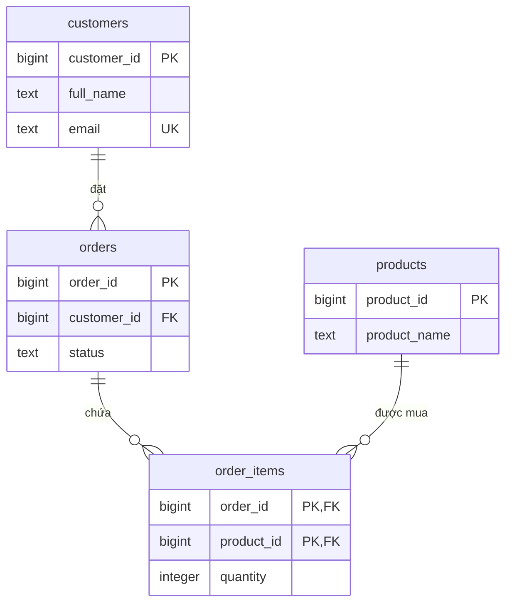

# FOREIGN KEY và tính toàn vẹn tham chiếu

Trong cơ sở dữ liệu quan hệ, một đơn hàng thường thuộc về một khách hàng, một dòng chi tiết thuộc về một đơn hàng, và mỗi dòng chi tiết có thể tham chiếu một sản phẩm. Nếu hệ thống cho phép lưu `orders.customer_id = 999` nhưng bảng khách hàng không có `customer_id = 999`, dữ liệu trở nên **mồ côi** (*orphan*): ứng dụng có thể hiển thị đơn hàng nhưng không tìm thấy khách đã đặt.

**FOREIGN KEY** (khóa ngoại) là ràng buộc ở mức cơ sở dữ liệu dùng để bảo vệ **tính toàn vẹn tham chiếu** (*referential integrity*). Nó yêu cầu giá trị tham chiếu của hàng ở **bảng con** phải phù hợp với một khóa được phép tham chiếu ở **bảng cha**, trừ các trường hợp `NULL` mà ràng buộc cho phép. Khi bảng cha bị cập nhật hoặc xóa, khóa ngoại còn quy định hành động cần thực hiện đối với các hàng đang tham chiếu.

Bài học thuộc chương **Khóa và ràng buộc** của Database SQL, sử dụng PostgreSQL làm ngữ cảnh thực hành chính. Các nguyên tắc quan hệ có tính tổng quát; cú pháp và các tùy chọn như `DEFERRABLE`, `NOT VALID` hay chính sách thực thi khóa ngoại có thể khác theo hệ quản trị.

## 1. Tại sao cần tính toàn vẹn tham chiếu?

Giả sử có hai bảng:

| `customers` | | `orders` | |
| --- | --- | --- | --- |
| `customer_id` | `name` | `order_id` | `customer_id` |
| 1 | An | 101 | 1 |
| 2 | Bình | 102 | 2 |
| | | 103 | 999 |

Đơn `103` đang trỏ tới khách hàng `999` không tồn tại. Nếu chỉ kiểm tra `customer_id` trong mã ứng dụng, một đường nhập liệu khác (script SQL, tác vụ định kỳ, migration, dịch vụ khác) vẫn có thể ghi sai. Hơn nữa, hai transaction có thể thay đổi bảng cha và bảng con đồng thời, khiến kiểm tra kiểu “`SELECT` rồi `INSERT`” ở tầng ứng dụng không đủ để bảo đảm dữ liệu.

Ràng buộc khóa ngoại chuyển quy tắc đó vào chính database:

```sql
FOREIGN KEY (customer_id)
REFERENCES customers(customer_id)
```

Khi ràng buộc có hiệu lực, hệ quản trị kiểm tra sự tồn tại của giá trị cha trong ngữ cảnh transaction và đồng thời xử lý những tình huống cập nhật/xóa có thể phá vỡ quan hệ.

**Một khóa ngoại bảo vệ sự tồn tại của quan hệ, không tự chứng minh mọi quy tắc nghiệp vụ.** Ví dụ, khách hàng có tồn tại nhưng đã bị khóa tài khoản vẫn thỏa điều kiện tham chiếu; nghiệp vụ “chỉ nhận đơn từ khách đang hoạt động” cần logic và ràng buộc phù hợp khác.

### Các khái niệm trước khi viết SQL

| Khái niệm | Ý nghĩa |
| --- | --- |
| **Bảng cha** (*parent/referenced table*) | Bảng chứa khóa được tham chiếu, ví dụ `customers` |
| **Bảng con** (*child/referencing table*) | Bảng chứa cột khóa ngoại, ví dụ `orders` |
| **Khóa chính** (*primary key*) | Định danh duy nhất và không `NULL` của một hàng |
| **Khóa ứng viên/khóa duy nhất** | Bộ cột được bảo đảm duy nhất và có thể đủ điều kiện làm đích tham chiếu tùy hệ quản trị |
| **Ràng buộc FOREIGN KEY** | Quy tắc cho các cột con tham chiếu một bộ cột cha |
| **Referential action** | Hành động khi khóa cha bị cập nhật hoặc xóa: từ chối, cascade, đặt `NULL` hoặc giá trị mặc định |

Một bảng có thể vừa là **con** của bảng này, vừa là **cha** của bảng khác. Ví dụ, `orders` tham chiếu `customers` nhưng được `order_items` tham chiếu.

## 2. Dựng lược đồ thực hành

Ví dụ cửa hàng dùng bốn bảng:



Trong mô hình:

- Một khách hàng có thể có **0 hoặc nhiều** đơn hàng; mỗi đơn phải thuộc về **đúng một** khách hàng.
- Một đơn có thể có nhiều dòng chi tiết; trong lược đồ minh họa, mỗi dòng phải thuộc về một đơn.
- Một sản phẩm có thể được mua trong nhiều đơn; mỗi dòng chi tiết tham chiếu một sản phẩm.
- `order_items` có khóa chính ghép `(order_id, product_id)` để một sản phẩm không xuất hiện hai dòng trong cùng một đơn.

### 2.1. Định nghĩa bảng với khóa ngoại đặt tên rõ ràng

Chạy các câu sau trong database PostgreSQL thử nghiệm. Dùng ID cố định để dễ dự đoán kết quả; cơ chế sinh ID tự động là một chủ đề riêng và không thay đổi ngữ nghĩa khóa ngoại.

```sql
CREATE TABLE customers (
    customer_id BIGINT PRIMARY KEY,
    full_name   TEXT NOT NULL,
    email       TEXT NOT NULL UNIQUE
);

CREATE TABLE products (
    product_id   BIGINT PRIMARY KEY,
    product_name TEXT NOT NULL,
    unit_price   NUMERIC(12, 2) NOT NULL CHECK (unit_price >= 0)
);

CREATE TABLE orders (
    order_id    BIGINT PRIMARY KEY,
    customer_id BIGINT NOT NULL,
    status      TEXT NOT NULL CHECK (
        status IN ('pending', 'paid', 'cancelled')
    ),
    CONSTRAINT fk_orders_customer
        FOREIGN KEY (customer_id)
        REFERENCES customers(customer_id)
        ON UPDATE NO ACTION
        ON DELETE RESTRICT
);

CREATE TABLE order_items (
    order_id   BIGINT NOT NULL,
    product_id BIGINT NOT NULL,
    quantity   INTEGER NOT NULL CHECK (quantity > 0),
    unit_price NUMERIC(12, 2) NOT NULL CHECK (unit_price >= 0),
    CONSTRAINT pk_order_items PRIMARY KEY (order_id, product_id),
    CONSTRAINT fk_order_items_order
        FOREIGN KEY (order_id)
        REFERENCES orders(order_id)
        ON DELETE CASCADE,
    CONSTRAINT fk_order_items_product
        FOREIGN KEY (product_id)
        REFERENCES products(product_id)
        ON DELETE RESTRICT
);
```

Nhìn vào từng phần của:

```sql
CONSTRAINT fk_orders_customer
    FOREIGN KEY (customer_id)
    REFERENCES customers(customer_id)
    ON DELETE RESTRICT
```

- `CONSTRAINT fk_orders_customer` đặt tên để dễ đọc log, tìm trong metadata và dùng khi migration.
- `FOREIGN KEY (customer_id)` chỉ cột **bảng con**.
- `REFERENCES customers(customer_id)` chỉ cột được tham chiếu ở **bảng cha**.
- `ON DELETE RESTRICT` yêu cầu từ chối xóa hàng cha nếu vẫn còn hàng con tham chiếu.
- `ON UPDATE` điều khiển trường hợp thay đổi **giá trị khóa ở bảng cha**, không phải mọi thay đổi của hàng cha.

Cột `orders.customer_id` được đặt `NOT NULL` vì nghiệp vụ yêu cầu mọi đơn đều có khách hàng. Khóa ngoại **không tự làm cột con `NOT NULL`**.

### 2.2. Tạo dữ liệu hợp lệ

```sql
INSERT INTO customers (customer_id, full_name, email) VALUES
    (1, 'An',   'an@example.test'),
    (2, 'Binh', 'binh@example.test'),
    (3, 'Chi',  'chi@example.test');

INSERT INTO products (product_id, product_name, unit_price) VALUES
    (10, 'Sach SQL', 50.00),
    (11, 'Khoa hoc', 100.00);

INSERT INTO orders (order_id, customer_id, status) VALUES
    (101, 1, 'paid'),
    (102, 1, 'pending'),
    (103, 2, 'paid');

INSERT INTO order_items
    (order_id, product_id, quantity, unit_price)
VALUES
    (101, 10, 2, 50.00),
    (101, 11, 1, 100.00),
    (103, 10, 1, 50.00);
```

Dữ liệu này tuân thủ quan hệ: mọi `orders.customer_id` tồn tại trong `customers`; mọi `order_items.order_id` tồn tại trong `orders`; và mọi `order_items.product_id` tồn tại trong `products`.

## 3. Khóa ngoại bảo đảm điều gì khi INSERT và UPDATE?

### 3.1. INSERT với tham chiếu hợp lệ

```sql
INSERT INTO orders (order_id, customer_id, status)
VALUES (104, 3, 'pending');
```

Câu này thành công vì khách `3` tồn tại, dù khách `3` chưa có đơn nào trước đó. Khóa ngoại cho phép nhiều hàng con tham chiếu cùng một hàng cha; nó **không tạo ràng buộc duy nhất trên cột con**.

### 3.2. INSERT tạo tham chiếu mồ côi

Câu sau **cố ý gây lỗi**; hãy chạy riêng khi thực hành:

```sql
INSERT INTO orders (order_id, customer_id, status)
VALUES (105, 999, 'pending');
```

PostgreSQL báo lỗi ràng buộc khóa ngoại, thường có SQLSTATE `23503` (`foreign_key_violation`): giá trị `customer_id = 999` không có trong bảng `customers`. Hàng `105` không được lưu.

Nếu đang ở trong một transaction tường minh, sau lỗi SQL thông thường transaction của PostgreSQL ở trạng thái thất bại và cần `ROLLBACK`, hoặc rollback về `SAVEPOINT` phù hợp, trước khi tiếp tục thao tác.

### 3.3. UPDATE cột khóa ngoại cũng phải hợp lệ

```sql
-- Hợp lệ: đổi đơn 102 từ khách 1 sang khách 2.
UPDATE orders
SET customer_id = 2
WHERE order_id = 102;
```

```sql
-- Cố ý gây lỗi: khách 888 không tồn tại.
UPDATE orders
SET customer_id = 888
WHERE order_id = 102;
```

Ràng buộc không chỉ kiểm tra khi chèn hàng mới; nó cũng áp dụng khi cập nhật dữ liệu tham chiếu. Một số thao tác có thể bị kiểm tra tại cuối câu lệnh hoặc tại thời điểm kiểm tra ràng buộc trong transaction, tùy loại constraint.

### 3.4. Thêm hàng cha trước rồi mới thêm hàng con

Với khóa ngoại kiểm tra tức thời thông thường:

```sql
BEGIN;

INSERT INTO customers (customer_id, full_name, email)
VALUES (4, 'Dung', 'dung@example.test');

INSERT INTO orders (order_id, customer_id, status)
VALUES (106, 4, 'pending');

COMMIT;
```

Thứ tự này hợp lệ. Nếu chỉ định khách `4` nhưng chưa tạo bản ghi cha và constraint đang kiểm tra ngay, `INSERT` vào bảng con sẽ lỗi. Ở phần sau sẽ thấy constraint **DEFERRABLE** có thể cho phép tạm thời đảo thứ tự trong một transaction phù hợp.

## 4. Khóa ngoại không tự động làm những việc nào?

Nhiều lỗi thiết kế đến từ việc suy diễn thêm tính chất không thuộc FOREIGN KEY.

| Điều thường bị giả định | Thực tế |
| --- | --- |
| Khóa ngoại ngăn cột con nhận `NULL` | Chỉ khi có `NOT NULL` hoặc quy tắc `MATCH` cụ thể; FK thông thường có thể cho phép `NULL` |
| Khóa ngoại bảo đảm cột con duy nhất | Nhiều dòng con có thể tham chiếu cùng một cha |
| Khóa ngoại tự tạo index trên cột con | PostgreSQL **không tự tạo index** trên cột tham chiếu chỉ vì có FK |
| Khóa ngoại tự xóa con khi xóa cha | Chỉ khi cấu hình `ON DELETE CASCADE`; mặc định thường là `NO ACTION` |
| Khóa ngoại kiểm tra “khách đang active” | Nó chỉ kiểm tra quan hệ tới hàng cha, không kiểm tra trạng thái nghiệp vụ tùy ý |
| Khóa ngoại tự tạo hàng cha nếu chưa có | FK từ chối tham chiếu không hợp lệ, không tạo dữ liệu bù |
| Khóa ngoại làm các bảng tự JOIN được | FK là ràng buộc; muốn kết hợp kết quả vẫn cần `JOIN` |
| Có FK thì mọi thao tác ghi chắc chắn thành công | Còn phải thỏa `CHECK`, `UNIQUE`, `NOT NULL`, trigger và các ràng buộc khác |

Một cột có tên `customer_id` **không đương nhiên là khóa ngoại**. Nó chỉ trở thành cột được kiểm soát tham chiếu khi lược đồ có `FOREIGN KEY` tương ứng.

## 5. Điều gì xảy ra khi DELETE hàng cha?

Giả sử muốn xóa khách `1` trong khi đang có đơn `101` và `102` thuộc về khách đó. Hệ quản trị phải bảo vệ quan hệ.

```sql
-- Cố ý gây lỗi với fk_orders_customer ON DELETE RESTRICT:
DELETE FROM customers
WHERE customer_id = 1;
```

`RESTRICT` từ chối thao tác vì còn hàng con tham chiếu. Ngược lại, xóa khách `3` có thể thành công khi không còn đơn nào tham chiếu; nhưng sau bài thực hành `INSERT` ở mục 3 có thể đã tạo đơn `104`/`106` cho khách `3`/`4`. Hãy xem dữ liệu hiện tại trước khi dự đoán một `DELETE` có thành công hay không.

Các hành động tham chiếu được khai báo riêng cho:

- `ON DELETE ...`: khi **hàng cha bị xóa**.
- `ON UPDATE ...`: khi **cột khóa được tham chiếu ở cha thay đổi**.

### 5.1. Năm hành vi tham chiếu phổ biến trong PostgreSQL

| Hành vi | Khi xóa hoặc đổi khóa cha | Tình huống phù hợp |
| --- | --- | --- |
| `NO ACTION` | Báo vi phạm nếu còn tham chiếu không hợp lệ tại thời điểm constraint được kiểm tra | Mặc định; có thể kết hợp cơ chế kiểm tra trì hoãn khi constraint cho phép |
| `RESTRICT` | Ngăn thay đổi khóa cha khi vẫn có tham chiếu; không cho trì hoãn kiểm tra hành động này | Quan hệ phải được giữ, cần thao tác chỉnh sửa con trước |
| `CASCADE` | Xóa con khi xóa cha, hoặc cập nhật khóa ngoại con khi khóa cha đổi | Dữ liệu con phụ thuộc vòng đời hoặc khóa cha |
| `SET NULL` | Đặt cột khóa ngoại con thành `NULL` | Quan hệ là tùy chọn và cột con cho phép `NULL` |
| `SET DEFAULT` | Đặt cột khóa ngoại con thành giá trị `DEFAULT` | Có khóa mặc định hợp lệ được thiết kế có chủ đích |

**`NO ACTION` và `RESTRICT` thường cho kết quả tương tự ở thao tác đơn giản**, nhưng khác nhau về khả năng trì hoãn kiểm tra. `NO ACTION` có thể chờ đến thời điểm kiểm tra ràng buộc nếu constraint được khai báo `DEFERRABLE` và đang ở chế độ deferred. `RESTRICT` không thể được trì hoãn theo cách này trong PostgreSQL.

### 5.2. `CASCADE`: xóa con theo vòng đời cha

Bảng `order_items` đang dùng:

```sql
FOREIGN KEY (order_id)
REFERENCES orders(order_id)
ON DELETE CASCADE
```

Nếu xóa đơn `101`, các dòng chi tiết của chính đơn đó cũng bị xóa:

```sql
-- Ví dụ xem trước ảnh hưởng trong transaction, cuối cùng hoàn tác.
BEGIN;

SELECT * FROM order_items WHERE order_id = 101;

DELETE FROM orders WHERE order_id = 101;

SELECT * FROM order_items WHERE order_id = 101;
-- Không còn dòng nào trong transaction này.

ROLLBACK;
```

`ROLLBACK` phục hồi cả đơn và các dòng chi tiết của nó trong ví dụ. Cơ chế cascade được thực hiện trong khuôn khổ câu lệnh/transaction, không phải một tác vụ nền “xóa sau”.

**Chọn `CASCADE` theo quyền sở hữu vòng đời dữ liệu.** Dòng chi tiết của một đơn thường không có ý nghĩa nếu đơn bị xóa, nên cascade có thể hợp lý ở quan hệ `orders → order_items`. Ngược lại, tự xóa mọi đơn hàng lịch sử khi xóa khách hàng có thể vi phạm nhu cầu lưu trữ/audit. Khi đó nên `RESTRICT`, vô hiệu hóa khách, hoặc thiết kế chính sách lưu trữ riêng.

Một `DELETE` trên bảng cha có nhiều tầng cascade có thể xóa **nhiều bảng và nhiều hàng**. Trong hệ thống thật, hãy kiểm tra đường quan hệ và số bản ghi bị tác động trước khi dùng.

### 5.3. `SET NULL`: giữ con nhưng bỏ liên kết

Ví dụ độc lập với bảng ghi chú không bắt buộc có người phụ trách:

```sql
CREATE TABLE support_agents (
    agent_id BIGINT PRIMARY KEY,
    display_name TEXT NOT NULL
);

CREATE TABLE support_notes (
    note_id BIGINT PRIMARY KEY,
    assigned_agent_id BIGINT NULL,
    note_text TEXT NOT NULL,
    CONSTRAINT fk_notes_agent
        FOREIGN KEY (assigned_agent_id)
        REFERENCES support_agents(agent_id)
        ON DELETE SET NULL
);

INSERT INTO support_agents VALUES (10, 'Agent A');
INSERT INTO support_notes VALUES
    (1001, 10, 'Can xu ly'),
    (1002, NULL, 'Chua gan');

DELETE FROM support_agents WHERE agent_id = 10;

SELECT note_id, assigned_agent_id FROM support_notes;
```

Kết quả: ghi chú `1001` vẫn tồn tại, nhưng `assigned_agent_id` trở thành `NULL`; ghi chú `1002` không thay đổi.

Nếu `assigned_agent_id` được khai báo `NOT NULL`, thao tác xóa cha yêu cầu `SET NULL` sẽ gặp ràng buộc không cho phép lưu `NULL`. Vì vậy, hành động tham chiếu phải tương thích với tính bắt buộc/tùy chọn của quan hệ.

### 5.4. `SET DEFAULT`: giá trị mặc định phải thật sự tồn tại

Giả sử đơn hàng có thể gán về một tài khoản “không xác định” đã tồn tại:

```sql
CREATE TABLE category_groups (
    group_id INTEGER PRIMARY KEY,
    group_name TEXT NOT NULL
);

CREATE TABLE catalog_entries (
    entry_id INTEGER PRIMARY KEY,
    group_id INTEGER NOT NULL DEFAULT 0,
    title TEXT NOT NULL,
    CONSTRAINT fk_catalog_group
        FOREIGN KEY (group_id)
        REFERENCES category_groups(group_id)
        ON DELETE SET DEFAULT
);

INSERT INTO category_groups VALUES
    (0, 'Chua phan loai'),
    (1, 'Nhom se xoa');

INSERT INTO catalog_entries VALUES
    (11, 1, 'Tai lieu A');

DELETE FROM category_groups WHERE group_id = 1;
```

Khi xóa nhóm `1`, `catalog_entries.group_id` được đặt thành `0`. Điều đó hợp lệ vì **đã có hàng cha mang khóa `0`**.

Nếu `DEFAULT 0` nhưng bảng cha không có khóa `0`, `SET DEFAULT` không thể tạo tham chiếu hợp lệ; thao tác có thể lỗi `FOREIGN KEY`. Giá trị mặc định không có “đặc quyền” bỏ qua ràng buộc.

Trong PostgreSQL, `ON DELETE SET NULL` có cú pháp mở rộng cho phép chỉ định một số cột cần đặt `NULL` trong khóa ngoại ghép; cú pháp và hành vi này không nên giả định có ở mọi hệ quản trị. Với `ON UPDATE`, phải kiểm tra hỗ trợ cụ thể theo phiên bản.

## 6. Khi UPDATE khóa chính/khóa được tham chiếu

Phần lớn hệ thống nên coi khóa chính kỹ thuật là **ổn định**, không tùy tiện thay đổi nó sau khi tạo. Tuy nhiên, đôi khi khóa được tham chiếu là mã nghiệp vụ có thể đổi, như `country_code` hoặc mã danh mục.

### 6.1. `ON UPDATE RESTRICT` hoặc `NO ACTION`

Nếu bảng con vẫn giữ khóa cũ và hành động là từ chối cập nhật, thao tác thay khóa cha không được phép tạo ra hàng con mồ côi.

```sql
-- Theo lược đồ orders ban đầu:
-- fk_orders_customer dùng ON UPDATE NO ACTION.
UPDATE customers
SET customer_id = 900
WHERE customer_id = 1;
-- Gây lỗi nếu vẫn có orders tham chiếu customer_id = 1.
```

Có thể cập nhật có trình tự theo giao dịch nếu điều kiện và chế độ constraint cho phép, nhưng thường nên thiết kế khóa kỹ thuật bất biến.

### 6.2. `ON UPDATE CASCADE`

Ví dụ mã bộ phận được dùng làm khóa:

```sql
CREATE TABLE departments (
    department_code TEXT PRIMARY KEY,
    department_name TEXT NOT NULL
);

CREATE TABLE employees (
    employee_id BIGINT PRIMARY KEY,
    department_code TEXT NOT NULL,
    CONSTRAINT fk_employees_department
        FOREIGN KEY (department_code)
        REFERENCES departments(department_code)
        ON UPDATE CASCADE
        ON DELETE RESTRICT
);

INSERT INTO departments VALUES ('ENG', 'Ky thuat');
INSERT INTO employees VALUES (1, 'ENG');

UPDATE departments
SET department_code = 'TECH'
WHERE department_code = 'ENG';

SELECT employee_id, department_code FROM employees;
```

Kết quả: nhân viên `1` được cập nhật `department_code = 'TECH'` bởi `ON UPDATE CASCADE`.

Cascade trên một khóa nghiệp vụ có thể cần thiết, nhưng cập nhật khóa của hàng cha nhiều người dùng có thể tác động số lượng lớn bản ghi con. Nếu mã nghiệp vụ thường xuyên đổi, một **khóa thay thế bất biến** làm FK có thể giảm chi phí đổi mã.

## 7. Khóa ngoại có thể tham chiếu khóa nào?

Thông thường, khóa ngoại tham chiếu một **PRIMARY KEY** hoặc một tập cột được bảo đảm **UNIQUE** theo điều kiện của hệ quản trị.

### 7.1. Tham chiếu khóa duy nhất khác khóa chính

PostgreSQL cho phép khóa ngoại tham chiếu cột có ràng buộc duy nhất thích hợp (hoặc unique index không partial hợp lệ):

```sql
CREATE TABLE currencies (
    currency_id BIGINT PRIMARY KEY,
    currency_code CHAR(3) NOT NULL UNIQUE,
    currency_name TEXT NOT NULL
);

CREATE TABLE price_lists (
    price_list_id BIGINT PRIMARY KEY,
    currency_code CHAR(3) NOT NULL,
    CONSTRAINT fk_price_lists_currency
        FOREIGN KEY (currency_code)
        REFERENCES currencies(currency_code)
);

INSERT INTO currencies VALUES
    (1, 'VND', 'Vietnamese dong'),
    (2, 'USD', 'US dollar');

INSERT INTO price_lists VALUES (10, 'VND');
```

`price_lists.currency_code` tham chiếu `currencies.currency_code`, dù khóa chính của bảng cha là `currency_id`.

Trong thiết kế thực, mã quốc tế có thể có chu trình chuẩn hóa và ràng buộc bổ sung. Bài học chính là đích tham chiếu **không nhất thiết là cột PK**, nhưng phải là một khóa duy nhất đủ điều kiện.

### 7.2. Không tham chiếu tùy tiện một cột không duy nhất

```sql
CREATE TABLE cities (
    city_id BIGINT PRIMARY KEY,
    city_name TEXT NOT NULL
);
```

Nếu nhiều thành phố trùng tên, `city_name` không xác định duy nhất hàng cha. Khóa ngoại `REFERENCES cities(city_name)` sẽ bị từ chối trong PostgreSQL khi không có khóa duy nhất hợp lệ trên cột này.

Không nên thêm `UNIQUE(city_name)` chỉ để câu `FOREIGN KEY` chạy được nếu nghiệp vụ cho phép trùng tên. Hãy tham chiếu `city_id` hoặc một mã thực sự duy nhất.

### 7.3. Kiểu dữ liệu cần có phép so sánh phù hợp

Khóa ngoại cần cơ chế so sánh tương thích giữa cột con và đích tham chiếu. Không mặc định rằng một mã `TEXT` như `'00123'` có thể tham chiếu an toàn `INTEGER 123`.

Nếu dữ liệu định danh có số 0 đầu, việc tự ép thành số có thể làm hai mã khác nhau biến thành một. Nên xác định kiểu, collation và quy tắc chuẩn hóa khóa trước khi tạo FK.

## 8. Khóa ngoại ghép và quy tắc `NULL`

Một quan hệ có thể dựa trên **nhiều cột**. Ví dụ kho hàng có vị trí được định danh bằng cặp `(warehouse_id, bin_code)`.

```sql
CREATE TABLE warehouse_bins (
    warehouse_id INTEGER NOT NULL,
    bin_code TEXT NOT NULL,
    label TEXT NOT NULL,
    CONSTRAINT pk_warehouse_bins
        PRIMARY KEY (warehouse_id, bin_code)
);

CREATE TABLE stock_positions (
    stock_id BIGINT PRIMARY KEY,
    warehouse_id INTEGER,
    bin_code TEXT,
    quantity INTEGER NOT NULL CHECK (quantity >= 0),
    CONSTRAINT fk_stock_bin
        FOREIGN KEY (warehouse_id, bin_code)
        REFERENCES warehouse_bins(warehouse_id, bin_code)
);
```

Một hàng con như `(warehouse_id = 2, bin_code = 'A01')` phải khớp **cùng một hàng cha có đúng cặp đó**; không đủ nếu `warehouse_id = 2` xuất hiện ở hàng cha này và `bin_code = 'A01'` xuất hiện ở hàng cha khác.

### 8.1. `MATCH SIMPLE`: mặc định thường gặp

Trong PostgreSQL, khóa ngoại ghép mặc định theo `MATCH SIMPLE`. Nếu **bất kỳ cột nào trong bộ khóa ngoại là `NULL`**, hàng con được miễn yêu cầu phải có hàng cha khớp, miễn các ràng buộc riêng khác không bị vi phạm.

Ví dụ với `stock_positions`:

```sql
INSERT INTO stock_positions
    (stock_id, warehouse_id, bin_code, quantity)
VALUES
    (1, NULL, NULL, 0),
    (2, 5, NULL, 0);
```

Cả hai hàng này có thể được chấp nhận bởi FK `MATCH SIMPLE` (nếu không có ràng buộc khác), dù `warehouse_id = 5` chưa có trong bảng cha. Trường hợp `(5, NULL)` đôi khi là **lỗ hổng mô hình**: một phần khóa đã có, phần còn lại thiếu.

### 8.2. `MATCH FULL`: tất cả NULL hoặc tất cả có giá trị

Nếu muốn cấm bộ khóa ngoại chỉ thiếu một phần, khai báo `MATCH FULL`:

```sql
CREATE TABLE stock_positions_strict (
    stock_id BIGINT PRIMARY KEY,
    warehouse_id INTEGER,
    bin_code TEXT,
    quantity INTEGER NOT NULL CHECK (quantity >= 0),
    CONSTRAINT fk_stock_bin_full
        FOREIGN KEY (warehouse_id, bin_code)
        REFERENCES warehouse_bins(warehouse_id, bin_code)
        MATCH FULL
);
```

Với `MATCH FULL`:

- `(NULL, NULL)` được phép vì cả bộ khóa là `NULL`.
- `(5, NULL)` và `(NULL, 'A01')` bị từ chối vì chỉ **một phần** bộ khóa là `NULL`.
- `(5, 'A01')` chỉ được phép nếu bảng cha có đúng cặp `(5, 'A01')`.

Nếu quan hệ luôn bắt buộc, hãy kết hợp `NOT NULL` trên **từng cột** của bộ khóa ngoại; `MATCH FULL` một mình vẫn cho phép cả hai cột cùng `NULL`.

### 8.3. Số lượng và thứ tự cột phải tương ứng

```sql
FOREIGN KEY (warehouse_id, bin_code)
REFERENCES warehouse_bins (warehouse_id, bin_code)
```

Hai danh sách cột phải có cùng số lượng và tương ứng theo thứ tự đã khai báo. Không thể gộp tùy tiện `warehouse_id` ở bảng con với `bin_code` ở bảng cha chỉ vì tên hoặc kiểu có vẻ giống nhau.

## 9. Quan hệ một-nhiều, một-một và nhiều-nhiều

### 9.1. Một-nhiều

`orders.customer_id` là một FK **không duy nhất**. Nhiều đơn cùng một khách là hợp lệ.

```text
customers(1)  ←  orders(101)
              ←  orders(102)
```

### 9.2. Một-một

Nếu mỗi khách có tối đa một hồ sơ phụ, có thể dùng FK đồng thời là PK:

```sql
CREATE TABLE customer_profiles (
    customer_id BIGINT PRIMARY KEY,
    avatar_url TEXT,
    CONSTRAINT fk_profile_customer
        FOREIGN KEY (customer_id)
        REFERENCES customers(customer_id)
        ON DELETE CASCADE
);
```

`PRIMARY KEY(customer_id)` ngăn hai profile cùng tham chiếu một khách; `FOREIGN KEY` bảo đảm khách đó tồn tại. Đây là quan hệ “mỗi khách **tối đa** một profile”; FK không tự buộc **mọi khách đều phải có profile**. Nếu muốn tồn tại ở cả hai phía, cần cơ chế nghiệp vụ/transaction hay thiết kế khác.

### 9.3. Nhiều-nhiều qua bảng nối

Một học viên có nhiều khóa học và một khóa học có nhiều học viên:

```sql
CREATE TABLE students (
    student_id BIGINT PRIMARY KEY,
    student_name TEXT NOT NULL
);

CREATE TABLE courses (
    course_id BIGINT PRIMARY KEY,
    course_name TEXT NOT NULL
);

CREATE TABLE enrollments (
    student_id BIGINT NOT NULL,
    course_id BIGINT NOT NULL,
    enrolled_at TIMESTAMPTZ NOT NULL DEFAULT CURRENT_TIMESTAMP,
    PRIMARY KEY (student_id, course_id),
    CONSTRAINT fk_enrollments_student
        FOREIGN KEY (student_id)
        REFERENCES students(student_id)
        ON DELETE CASCADE,
    CONSTRAINT fk_enrollments_course
        FOREIGN KEY (course_id)
        REFERENCES courses(course_id)
        ON DELETE CASCADE
);
```

Hai FK riêng bảo đảm **học viên** và **khóa học** đều tồn tại; PK ghép ngăn đăng ký trùng một cặp. Cascade xóa hàng **đăng ký**, không tự xóa học viên khi xóa khóa học hay ngược lại. Chọn cascade dựa trên vòng đời của bản ghi trung gian, không dựa đơn thuần vào mong muốn giảm số câu SQL.

## 10. Kiểm tra tức thời và kiểm tra trì hoãn bằng `DEFERRABLE`

Mặc định, ràng buộc FK trong PostgreSQL thường là `NOT DEFERRABLE`, nghĩa là không thể yêu cầu trì hoãn kiểm tra tới cuối transaction.

Trong một số bài toán, ta muốn **tạm thời có tham chiếu chưa tồn tại** trong quá trình xử lý nhiều bước, miễn đến thời điểm kiểm tra cuối cùng mọi quan hệ hợp lệ. PostgreSQL hỗ trợ khai báo `DEFERRABLE` với hành động `NO ACTION`.

### 10.1. Ví dụ: thêm con trước, cha sau trong cùng transaction

```sql
CREATE TABLE deferred_parents (
    parent_id BIGINT PRIMARY KEY
);

CREATE TABLE deferred_children (
    child_id BIGINT PRIMARY KEY,
    parent_id BIGINT NOT NULL,
    CONSTRAINT fk_deferred_child_parent
        FOREIGN KEY (parent_id)
        REFERENCES deferred_parents(parent_id)
        ON DELETE NO ACTION
        DEFERRABLE INITIALLY DEFERRED
);
```

`DEFERRABLE INITIALLY DEFERRED` cho phép kiểm tra FK được trì hoãn tới lúc `COMMIT`:

```sql
BEGIN;

-- Tạm thời chưa có parent_id = 900.
INSERT INTO deferred_children (child_id, parent_id)
VALUES (1, 900);

-- Hoàn thành quan hệ trước khi commit.
INSERT INTO deferred_parents (parent_id)
VALUES (900);

COMMIT;
```

Transaction có thể commit vì đến thời điểm kiểm tra cuối cùng, khóa cha đã tồn tại. Nếu bỏ câu `INSERT` vào bảng cha, `COMMIT` sẽ bị từ chối do vi phạm FK.

### 10.2. Điều khiển thời điểm kiểm tra

Có hai tùy chọn khởi tạo thường gặp:

- `DEFERRABLE INITIALLY IMMEDIATE`: có thể chuyển sang deferred, nhưng mặc định kiểm tra ngay.
- `DEFERRABLE INITIALLY DEFERRED`: mặc định kiểm tra ở cuối transaction, có thể chuyển về immediate.

Trong transaction, PostgreSQL hỗ trợ:

```sql
SET CONSTRAINTS fk_deferred_child_parent DEFERRED;
-- Hoặc:
SET CONSTRAINTS fk_deferred_child_parent IMMEDIATE;
```

`SET CONSTRAINTS ... IMMEDIATE` có thể kích hoạt kiểm tra những vi phạm đang chờ và gây lỗi nếu dữ liệu chưa hợp lệ.

**Điểm khác biệt quan trọng:** `RESTRICT` không thể bị trì hoãn như hành động `NO ACTION`; vì vậy không nên thay `NO ACTION` bằng `RESTRICT` trong ví dụ cần trì hoãn. Các hành động cascade hay set-value có quy tắc kích hoạt riêng, không phải mọi hiệu ứng của FK đều đợi đến lúc commit.

Kiểm tra trì hoãn rất hữu ích khi nạp đồ thị quan hệ phức tạp, nhưng cần được dùng có chủ đích: nó cho phép có khoảng thời gian transaction chưa nhất quán ở mức trung gian, và lỗi có thể xuất hiện **muộn tại COMMIT**.

## 11. Truy vấn JOIN và khóa ngoại có vai trò khác nhau

Khóa ngoại định nghĩa **ràng buộc tồn tại**, còn `JOIN` định nghĩa **cách kết hợp các hàng trong kết quả**.

```sql
SELECT
    o.order_id,
    c.full_name,
    o.status
FROM orders AS o
JOIN customers AS c
    ON c.customer_id = o.customer_id
ORDER BY o.order_id;
```

Dù có FK, người viết vẫn phải chỉ điều kiện nối khi lấy dữ liệu từ hai bảng. FK giúp loại bỏ trường hợp **khách tham chiếu không tồn tại** ở dữ liệu được kiểm soát; nó không làm database tự “kéo” tên khách vào `SELECT`.

### 11.1. `INNER JOIN` không cho biết khách nào chưa có đơn

```sql
SELECT c.customer_id, c.full_name, o.order_id
FROM customers AS c
LEFT JOIN orders AS o
    ON o.customer_id = c.customer_id
ORDER BY c.customer_id, o.order_id;
```

`LEFT JOIN` giữ cả khách chưa có đơn, với các cột từ `orders` nhận `NULL` ở hàng kết quả. Việc hiển thị `NULL` ở phía phải của `LEFT JOIN` **không phải vi phạm FK**: đây là hàng kết quả do phép nối tạo ra, không phải một bản ghi `orders` chứa khóa ngoại mồ côi.

### 11.2. FK không ngăn nhân dòng vì quan hệ một-nhiều

Nếu một khách có hai đơn, khi nối `customers` sang `orders`, khách đó có hai hàng trong kết quả. Điều này hoàn toàn đúng theo quan hệ. Để đếm khách, phải xác định rõ cấp độ tổng hợp, chẳng hạn `COUNT(DISTINCT c.customer_id)` hoặc nhóm theo khách; không dùng `DISTINCT` như cách che lỗi thiết kế JOIN.

## 12. Di chuyển dữ liệu cũ: tìm và xử lý orphan trước khi VALIDATE

Hệ thống cũ có thể đã lưu dữ liệu khi chưa có FK. Khi thêm ràng buộc mới, các hàng con không có cha sẽ khiến việc kiểm tra thất bại.

Giả sử một bảng nhập liệu cũ:

```sql
CREATE TABLE legacy_orders (
    order_id BIGINT PRIMARY KEY,
    customer_id BIGINT NULL,
    note_text TEXT
);

INSERT INTO legacy_orders VALUES
    (501, 1, 'Hop le'),
    (502, 999, 'Khach khong ton tai'),
    (503, NULL, 'Chua gan khach');
```

### 12.1. Tìm bản ghi không có hàng cha tương ứng

```sql
SELECT l.order_id, l.customer_id
FROM legacy_orders AS l
LEFT JOIN customers AS c
    ON c.customer_id = l.customer_id
WHERE l.customer_id IS NOT NULL
  AND c.customer_id IS NULL
ORDER BY l.order_id;
```

Kết quả: đơn `502` tham chiếu `customer_id = 999`.

Có thể dùng `NOT EXISTS`:

```sql
SELECT l.order_id, l.customer_id
FROM legacy_orders AS l
WHERE l.customer_id IS NOT NULL
  AND NOT EXISTS (
      SELECT 1
      FROM customers AS c
      WHERE c.customer_id = l.customer_id
  );
```

Hai truy vấn đều **bỏ qua khóa ngoại `NULL`** vì trong thiết kế này khóa ngoại tùy chọn. Nếu muốn mọi đơn phải có khách, cần thêm `NOT NULL` sau khi giải quyết dữ liệu thiếu và xác nhận quy tắc nghiệp vụ.

### 12.2. Thêm constraint sau khi dữ liệu đã sạch

Cách thông thường là xác nhận không còn orphan rồi thêm FK:

```sql
-- Chỉ chạy khi dữ liệu đã hợp lệ.
ALTER TABLE legacy_orders
ADD CONSTRAINT fk_legacy_orders_customer
FOREIGN KEY (customer_id)
REFERENCES customers(customer_id)
ON DELETE RESTRICT;
```

PostgreSQL sẽ kiểm tra những hàng hiện có khi tạo constraint theo cách thông thường. Nếu còn `customer_id = 999`, câu `ALTER TABLE` sẽ không thành công.

### 12.3. PostgreSQL `NOT VALID` và `VALIDATE CONSTRAINT`

Với bảng lớn, PostgreSQL cung cấp quy trình mở rộng:

```sql
ALTER TABLE legacy_orders
ADD CONSTRAINT fk_legacy_orders_customer
FOREIGN KEY (customer_id)
REFERENCES customers(customer_id)
NOT VALID;
```

`NOT VALID` cho phép thêm constraint mà **chưa quét xác minh toàn bộ dữ liệu cũ**. Nó vẫn áp dụng cơ chế bảo vệ FK đối với các thao tác mới hoặc thay đổi có liên quan sau khi tạo; nó **không** có nghĩa là tắt FK hoàn toàn.

Sau khi xử lý các hàng cũ vi phạm, yêu cầu kiểm tra toàn bảng:

```sql
ALTER TABLE legacy_orders
VALIDATE CONSTRAINT fk_legacy_orders_customer;
```

Nếu còn orphan, validation thất bại và constraint vẫn chưa được đánh dấu hợp lệ cho toàn bộ dữ liệu lịch sử.

Không tự động sửa `customer_id = 999` thành `NULL` hay xóa hàng `502` nếu chưa có chính sách xử lý dữ liệu. Có thể cần khôi phục khách từ nguồn gốc, ánh xạ mã khách, gắn vào một bản ghi được xác thực hoặc đưa hàng lỗi vào danh sách cần đối soát.

Đối với migration dữ liệu lớn, `NOT VALID`/`VALIDATE CONSTRAINT` giúp giảm phần việc trong giai đoạn tạo constraint, nhưng các lệnh vẫn có thể lấy khóa và gây tác động đến tải hệ thống. Cần triển khai theo quy trình migration đã lập kế hoạch, không mặc định mọi thao tác là “không khóa bảng”.

## 13. Chỉ mục trên khóa ngoại và tác động đến hiệu năng

Để kiểm tra khóa cha có tồn tại, PostgreSQL sử dụng đích tham chiếu có tính duy nhất phù hợp, thường gắn với index của `PRIMARY KEY` hoặc `UNIQUE`.

Tuy nhiên, PostgreSQL **không tự tạo index trên cột con khi khai báo FOREIGN KEY**.

Xét quan hệ:

```text
customers(customer_id PRIMARY KEY)
       ↓
orders(customer_id FOREIGN KEY)
```

Khi xóa hoặc đổi khóa một khách, database cần tìm những hàng `orders` đang tham chiếu khách đó. Nếu `orders` có hàng triệu dòng và thiếu index phù hợp ở `orders.customer_id`, việc kiểm tra hoặc thực hiện hành động tham chiếu có thể phải quét rất nhiều hàng.

Có thể tạo index ở phía con:

```sql
CREATE INDEX idx_orders_customer_id
    ON orders(customer_id);

CREATE INDEX idx_order_items_product_id
    ON order_items(product_id);
```

Tại sao ví dụ thêm index cho `order_items.product_id`? Khóa chính ghép `(order_id, product_id)` đã tạo một index có `order_id` là cột đầu, thường giúp tìm dòng theo `order_id`. Nhưng truy vấn chỉ lọc `product_id` có thể cần index riêng theo `product_id`, nhất là khi hệ thống xóa/sửa sản phẩm hoặc thường xuyên truy vấn chi tiết theo sản phẩm.

### Khi nào nên tạo index?

- FK nằm trên bảng con lớn và cha thường bị xóa/cập nhật khóa.
- Ứng dụng thường `JOIN` hoặc lọc theo cột khóa ngoại.
- Cascade có thể xử lý lượng lớn bản ghi con.
- Phân tích thực tế cho thấy chi phí tra cứu ở phía con đáng kể.

Index có chi phí về dung lượng và cập nhật khi ghi. Với bảng nhỏ, index bổ sung có thể chưa mang lại lợi ích rõ ràng. Dùng `EXPLAIN`/`EXPLAIN ANALYZE` trong môi trường phù hợp để đánh giá; không tạo index cho mọi cột theo một công thức cứng nhắc.

## 14. Tính toàn vẹn tham chiếu trong giao dịch đồng thời

Kiểm tra tham chiếu không đơn thuần là chạy `SELECT 1 FROM parents WHERE id = ?` trước mỗi lần ghi. Nếu hai transaction cùng thao tác, quá trình kiểm tra còn liên quan đến cơ chế khóa và mức cô lập.

Một tình huống lý thuyết:

```text
Transaction A                         Transaction B
-------------                         -------------
Kiểm tra khách 1 còn tồn tại
                                      Xóa khách 1
INSERT đơn customer_id = 1
```

Nếu ứng dụng chỉ tự kiểm tra và không có FK, có thể xuất hiện trạng thái không hợp lệ phụ thuộc thứ tự commit và mức cô lập. Khi có FK được thực thi, database phối hợp kiểm tra và khóa cần thiết để tránh commit một tham chiếu vi phạm ràng buộc.

Trong PostgreSQL, các thao tác kiểm tra FK có thể giữ những khóa liên quan tới hàng cha, khiến thao tác xóa/sửa khóa cha phải chờ transaction khác. Vì vậy:

- **Chờ khóa** khi insert con và delete/update cha cạnh tranh có thể là hiện tượng bình thường.
- Một transaction có thể thất bại vì **deadlock** hoặc **timeout** nếu nhiều luồng lấy khóa theo thứ tự không nhất quán.
- Cần giữ transaction ngắn gọn, truy cập bảng theo thứ tự có chủ đích, có index phù hợp và xử lý retry ở tầng ứng dụng khi gặp lỗi có thể retry.
- Không tắt FK chỉ để giảm lỗi cạnh tranh; vấn đề thường cần chẩn đoán lịch thao tác và cách chọn khóa.

**Một ràng buộc FK giúp giữ dữ liệu hợp lệ ở trạng thái commit**, nhưng không làm mọi tổ hợp thao tác đồng thời tự trở thành nghiệp vụ đúng. Ví dụ, hai đơn có cùng mã nghiệp vụ vẫn cần `UNIQUE(order_code)`.

## 15. Khóa ngoại và trạng thái nghiệp vụ: soft delete, tenant và phân quyền

### 15.1. Soft delete không kích hoạt `ON DELETE`

Nếu hệ thống “xóa” khách hàng bằng cách cập nhật:

```sql
UPDATE customers
SET full_name = '[Da vo hieu hoa]'
WHERE customer_id = 2;
```

thì đó là `UPDATE` một cột thường, không phải `DELETE` hàng cha và cũng không phải thay khóa `customer_id`. `ON DELETE CASCADE` hoặc `ON DELETE RESTRICT` **không được kích hoạt bởi kiểu soft delete này**.

Trong hệ thống thật, soft delete thường dùng cột như `deleted_at` hoặc `is_deleted`. FK vẫn cho phép đơn tham chiếu hàng cha đang soft-deleted vì hàng đó vẫn tồn tại. Nếu nghiệp vụ không được tạo đơn mới cho khách vô hiệu hóa, cần kiểm tra thêm tại tầng ứng dụng hoặc thiết kế ràng buộc/transaction đặc thù.

### 15.2. FK không thay thế phân quyền

FK chỉ trả lời: “Hàng cha được tham chiếu có tồn tại không?” Nó không trả lời: “Người dùng hiện tại có được phép thấy hàng cha này không?”. Các truy vấn, API và chính sách bảo mật vẫn phải kiểm tra quyền trên dữ liệu thực tế.

### 15.3. Khóa ngoại ghép giúp tránh tham chiếu chéo tenant

Trong mô hình nhiều tenant, có thể cần đảm bảo một đơn hàng chỉ tham chiếu khách thuộc cùng tenant.

Ví dụ:

```sql
CREATE TABLE tenant_customers (
    tenant_id BIGINT NOT NULL,
    customer_id BIGINT NOT NULL,
    full_name TEXT NOT NULL,
    PRIMARY KEY (tenant_id, customer_id)
);

CREATE TABLE tenant_orders (
    tenant_id BIGINT NOT NULL,
    order_id BIGINT NOT NULL,
    customer_id BIGINT NOT NULL,
    PRIMARY KEY (tenant_id, order_id),
    CONSTRAINT fk_tenant_order_customer
        FOREIGN KEY (tenant_id, customer_id)
        REFERENCES tenant_customers(tenant_id, customer_id)
);
```

Hàng `tenant_orders(tenant_id = 10, customer_id = 7)` chỉ hợp lệ nếu khách `(10, 7)` tồn tại. Nó **không** được tham chiếu khách `(20, 7)` của tenant khác.

Ràng buộc này bảo vệ tính nhất quán giữa các khóa; ứng dụng vẫn phải kiểm tra người gọi có quyền thao tác trong `tenant_id = 10`. Trong thiết kế đa tenant, cần phối hợp FK, khóa duy nhất, lọc theo tenant, quyền truy cập và transaction.

## 16. Khóa ngoại tự tham chiếu và quan hệ vòng

Một bảng có thể tham chiếu chính nó, ví dụ mỗi nhân viên có một quản lý cũng là nhân viên.

```sql
CREATE TABLE staff (
    staff_id BIGINT PRIMARY KEY,
    full_name TEXT NOT NULL,
    manager_id BIGINT NULL,
    CONSTRAINT fk_staff_manager
        FOREIGN KEY (manager_id)
        REFERENCES staff(staff_id)
        ON DELETE SET NULL
);

INSERT INTO staff (staff_id, full_name, manager_id)
VALUES
    (1, 'Director', NULL),
    (2, 'Leader', 1),
    (3, 'Developer', 2);
```

`manager_id = NULL` biểu thị không có quản lý được chỉ định. Xóa `staff_id = 2` theo hành động `SET NULL` khiến `staff_id = 3` tiếp tục tồn tại nhưng không còn liên kết quản lý.

### FK tự tham chiếu không ngăn chu trình nghiệp vụ

Hai nhân viên có thể được cập nhật để quản lý lẫn nhau nếu cả hai ID đã tồn tại:

```text
staff 2 → manager 3
staff 3 → manager 2
```

Tất cả tham chiếu đều hợp lệ theo FK, nhưng cây tổ chức có **chu trình**. Nếu nghiệp vụ yêu cầu cấu trúc cây không có vòng, phải thêm cơ chế kiểm tra chu trình phù hợp. FK đảm bảo **đích tham chiếu tồn tại**, không đảm bảo đồ thị tham chiếu không có vòng.

Các bảng tham chiếu vòng giữa nhau cũng là trường hợp có thể cần transaction, `DEFERRABLE` và thứ tự nạp dữ liệu được tính toán cẩn thận.

## 17. Những giới hạn thiết kế của FOREIGN KEY

### 17.1. Không thể dùng FK thường để tham chiếu tùy ý nhiều bảng

Ví dụ thiết kế một bảng:

```text
comments(
  target_type = 'order' hoặc 'product',
  target_id = ...
)
```

và mong một FK duy nhất tự tham chiếu `orders` khi `target_type = 'order'`, còn tham chiếu `products` khi `target_type = 'product'`. FK thông thường **không tự đổi bảng đích theo giá trị của một cột**.

Có thể thiết kế bảng liên kết riêng theo loại đối tượng, một bảng cha chung cho đối tượng, hoặc cơ chế khác phù hợp. Nếu chỉ dựa vào `target_type`/`target_id` không có FK thật, cần một chiến lược đảm bảo toàn vẹn thay thế và chấp nhận chi phí phức tạp của nó.

### 17.2. Không tùy tiện FK xuyên database hoặc dịch vụ

Trong PostgreSQL, FK thông thường áp dụng giữa các bảng thuộc **cùng database**; không thể chỉ viết `REFERENCES` để tạo FK tới một database PostgreSQL khác hoặc một API bên ngoài. Các hệ quản trị khác có phạm vi và hạn chế riêng, nhưng FK thông thường không bảo đảm tính toàn vẹn xuyên nhiều dịch vụ độc lập.

Nếu một dịch vụ lưu `customer_id` và dịch vụ khác mới sở hữu bảng khách, cần quyết định có chấp nhận tham chiếu mềm hay dùng cơ chế đồng bộ, sự kiện, kiểm tra tồn tại và bù trừ khi dữ liệu thay đổi. Không gọi đó là FK của database khi thực tế chỉ có một cột trùng tên.

### 17.3. Không thay cho quy tắc dữ liệu khác

- `UNIQUE` ngăn trùng cặp khóa nghiệp vụ.
- `CHECK` giới hạn giá trị một hàng, như `quantity > 0`.
- `NOT NULL` yêu cầu giá trị bắt buộc.
- FK giữ quan hệ tới hàng cha tồn tại.
- Quy tắc như “chỉ đơn `paid` mới được xuất hóa đơn” cần mô hình nghiệp vụ và kiểm soát riêng.

Sự phối hợp các ràng buộc mới tạo nên tính nhất quán mong muốn; không có một `FOREIGN KEY` thay thế được tất cả.

## 18. Khác biệt đáng chú ý giữa các hệ quản trị

Không phải mọi hệ hỗ trợ đầy đủ các tùy chọn PostgreSQL ở trên.

| Hệ quản trị | Điểm cần nhớ về FK |
| --- | --- |
| **PostgreSQL** | Hỗ trợ `DEFERRABLE`, `MATCH FULL`, `NOT VALID`/`VALIDATE CONSTRAINT`, các hành động `CASCADE`/`SET NULL`/`SET DEFAULT`/`NO ACTION`/`RESTRICT`. Không tự tạo index trên cột con. |
| **MySQL/InnoDB** | Enforce FK với engine hỗ trợ (InnoDB); cần index phù hợp và InnoDB có thể tự tạo index phía con nếu thiếu. Không hỗ trợ kiểm tra trì hoãn như PostgreSQL; `NO ACTION` về thực tế gần `RESTRICT`. `SET DEFAULT` không được InnoDB hỗ trợ như hành động FK. |
| **SQL Server** | Hỗ trợ `ON DELETE`/`ON UPDATE` như `NO ACTION`, `CASCADE`, `SET NULL`, `SET DEFAULT`, nhưng không có cơ chế `DEFERRABLE` transaction tương tự PostgreSQL. Có thể tạo constraint không kiểm tra lịch sử bằng `WITH NOCHECK`, cần quan tâm trạng thái trusted/untrusted khi vận hành. |
| **Oracle Database** | Hỗ trợ khóa ngoại và ràng buộc `DEFERRABLE`; `ON DELETE CASCADE` và `ON DELETE SET NULL` là những tùy chọn phổ biến. Không giả định Oracle hỗ trợ `ON UPDATE CASCADE` bằng cú pháp giống PostgreSQL. |
| **SQLite** | Cần bật thực thi FK ở từng kết nối bằng `PRAGMA foreign_keys = ON` trên bản build hỗ trợ, thường phải làm ngoài transaction. Hỗ trợ hành động tham chiếu và ràng buộc deferred với cú pháp riêng. |

Ví dụ SQLite:

```sql
PRAGMA foreign_keys = ON;

CREATE TABLE parent (
    id INTEGER PRIMARY KEY
);

CREATE TABLE child (
    id INTEGER PRIMARY KEY,
    parent_id INTEGER REFERENCES parent(id)
);

INSERT INTO child (id, parent_id) VALUES (1, 999);
-- Khi foreign_keys ON, bị từ chối nếu parent 999 không tồn tại.
```

**Đặc biệt quan trọng với SQLite:** Khai báo `REFERENCES` trong DDL không đủ để kết luận mọi kết nối đều đang enforce FK. Ứng dụng hoặc thư viện kết nối cần bảo đảm cấu hình thực thi phù hợp. Việc đổi `PRAGMA foreign_keys` khi transaction đang mở không hoạt động như một cách bật/tắt tức thời cho transaction đó.

Cùng một mục đích nghiệp vụ có thể cần DDL khác nhau khi di chuyển sang hệ quản trị khác. Hãy kiểm tra phiên bản engine, storage engine và cơ chế quản lý migration trước khi dùng lại nguyên câu lệnh.

## 19. Ứng dụng cần xử lý lỗi FK thế nào?

Khi database từ chối `INSERT`, `UPDATE` hoặc `DELETE` vì FK, ứng dụng nên coi đó là **vi phạm ràng buộc dữ liệu**, không phải lỗi ngẫu nhiên để bỏ qua.

Ví dụ với Java JDBC khi tạo một đơn hàng:

```java
import java.sql.Connection;
import java.sql.PreparedStatement;
import java.sql.SQLException;

public class OrderRepository {
    public void createOrder(
            Connection connection,
            long orderId,
            long customerId
    ) throws SQLException {
        String sql = """
            INSERT INTO orders (order_id, customer_id, status)
            VALUES (?, ?, 'pending')
            """;

        try (PreparedStatement statement =
                 connection.prepareStatement(sql)) {
            statement.setLong(1, orderId);
            statement.setLong(2, customerId);
            statement.executeUpdate();
        }
    }
}
```

Nếu khách không tồn tại, PostgreSQL thường trả SQLSTATE `23503`. Tầng service có thể chuyển nó thành thông báo phù hợp, chẳng hạn “khách hàng được tham chiếu không tồn tại”, đồng thời ghi log định danh constraint và thông tin cần thiết cho điều tra.

Không nên viết mã để bắt mọi `SQLException` rồi tự thêm một khách hàng giả hoặc xóa các đơn liên quan mà không có yêu cầu nghiệp vụ. Khi tạo đơn và chi tiết trong một transaction, lỗi FK cần dẫn tới rollback thay đổi liên quan và trả kết quả rõ ràng cho người gọi.

### Thông điệp lỗi có thể gợi ý vị trí hỏng

Trong PostgreSQL, thông báo thường nêu tên constraint (ví dụ `fk_orders_customer`), bảng liên quan và giá trị tham chiếu không tồn tại. Tên constraint có ý nghĩa giúp chẩn đoán nhanh. Tuy nhiên, hệ thống production nên giới hạn thông tin chi tiết gửi tới người dùng cuối để tránh lộ schema hoặc dữ liệu nhạy cảm.

## 20. Bài tập thực hành

Các bài dùng lược đồ `customers`, `orders`, `products` và `order_items` ở đầu bài. Nếu đã chạy các lệnh thay đổi dữ liệu trong những mục trước, hãy đưa database thử nghiệm về trạng thái mong muốn hoặc dự đoán kết quả dựa trên trạng thái hiện tại.

### Bài 1 — Chèn đơn cho khách chưa tồn tại

```sql
INSERT INTO orders (order_id, customer_id, status)
VALUES (201, 404, 'pending');
```

**Câu hỏi:** Điều gì xảy ra khi khách `404` chưa có trong `customers`?

**Đáp án:** Bị từ chối bởi `fk_orders_customer`; PostgreSQL thường trả `23503`. Bài học: FK không tự tạo khách hàng mới.

### Bài 2 — Xóa một đơn có dòng chi tiết

```sql
BEGIN;

DELETE FROM orders WHERE order_id = 101;

SELECT * FROM order_items WHERE order_id = 101;

ROLLBACK;
```

**Đáp án:** Trong transaction, các dòng chi tiết thuộc đơn `101` bị xóa do `ON DELETE CASCADE`. Sau `ROLLBACK`, cả đơn lẫn chi tiết được khôi phục. Không phải mọi quan hệ FK đều cascade: đây là hành động đã khai báo riêng cho `fk_order_items_order`.

### Bài 3 — Xóa khách hàng có đơn

```sql
DELETE FROM customers WHERE customer_id = 1;
```

**Đáp án:** Bị từ chối nếu vẫn tồn tại đơn tham chiếu khách `1`, vì `fk_orders_customer` có `ON DELETE RESTRICT`. Không được hiểu rằng `CASCADE` từ `orders` sang `order_items` tự làm hàng `customers` xóa được; hướng cascade được áp dụng theo từng FK cụ thể.

### Bài 4 — Khóa ngoại cho phép NULL?

Tạo bảng liên hệ tùy chọn:

```sql
CREATE TABLE tickets (
    ticket_id BIGINT PRIMARY KEY,
    customer_id BIGINT NULL REFERENCES customers(customer_id),
    summary TEXT NOT NULL
);

INSERT INTO tickets VALUES (1, NULL, 'Khach chua xac dinh');
```

**Đáp án:** Lệnh `INSERT` hợp lệ vì `customer_id` là `NULL` và quan hệ tùy chọn. Nếu mọi ticket bắt buộc thuộc về khách hàng, thêm `NOT NULL` khi thiết kế cột.

### Bài 5 — Khóa ngoại ghép và MATCH FULL

Với `warehouse_bins` có khóa cha `(5, 'A01')`, dự đoán:

| Giá trị FK ở con | `MATCH SIMPLE` | `MATCH FULL` |
| --- | --- | --- |
| `(5, 'A01')` | Hợp lệ | Hợp lệ |
| `(5, 'B99')` | Lỗi nếu cha không có cặp này | Lỗi nếu cha không có cặp này |
| `(5, NULL)` | Được phép bởi FK | Không được phép |
| `(NULL, NULL)` | Được phép bởi FK | Được phép bởi FK |

**Giải thích:** `MATCH FULL` yêu cầu hoặc toàn bộ cột FK đều `NULL`, hoặc tất cả có giá trị và khớp hàng cha. Các cột `NOT NULL` riêng có thể làm một số dòng trong bảng bị từ chối vì lý do khác.

### Bài 6 — Thêm FK cho dữ liệu cũ có orphan

`legacy_orders` có dòng `(order_id = 502, customer_id = 999)`. Hãy viết truy vấn tìm orphan.

**Đáp án gợi ý:**

```sql
SELECT l.order_id, l.customer_id
FROM legacy_orders AS l
WHERE l.customer_id IS NOT NULL
  AND NOT EXISTS (
      SELECT 1
      FROM customers AS c
      WHERE c.customer_id = l.customer_id
  );
```

Bước tiếp theo là xác minh nguồn và quy tắc sửa dữ liệu; không tự xóa bản ghi chỉ để vượt qua validation.

### Bài 7 — Quan hệ một-một hay một-nhiều?

`customer_profiles.customer_id` vừa là PK vừa là FK tới `customers.customer_id`. Có thể lưu hai profile có cùng `customer_id = 1` không?

**Đáp án:** Không, vì **PRIMARY KEY** của `customer_profiles` ngăn trùng. Nếu chỉ có FK mà không có PK/UNIQUE trên `customer_id` ở bảng profile, nhiều hàng profile cùng tham chiếu một khách sẽ có thể được lưu.

### Bài 8 — Vì sao cần index phía con?

Bảng `orders` có hàng triệu dòng, `customers` nhỏ. Lệnh xóa một khách có nhiều khả năng gây quét dữ liệu nào nếu thiếu index `orders(customer_id)`?

**Đáp án:** Database có thể phải tìm kiếm nhiều hàng trong `orders` để phát hiện những đơn đang tham chiếu khách đó hoặc thực hiện hành động cascade. Index trên khóa ngoại phía con thường giúp tra cứu theo `customer_id` hiệu quả hơn; vẫn cần kiểm tra tải thực tế và kế hoạch thực thi.

### Bài 9 — FK có ngăn chu trình quản lý?

Bảng `staff` có `manager_id` tham chiếu `staff_id`. Nhân viên A quản lý B, rồi cập nhật A trỏ về B. Hai ID đều tồn tại. FK có báo lỗi không?

**Đáp án:** Thông thường không: cả hai tham chiếu đều trỏ tới hàng tồn tại. Để cấm chu trình tổ chức cần kiểm tra mô hình cây/đồ thị riêng, ngoài kiểm tra FK.

### Bài 10 — Chọn hành động xóa

Hãy đề xuất hành động phù hợp cho từng quan hệ và giải thích quy tắc nghiệp vụ:

| Quan hệ | Một lựa chọn hợp lý | Lý do |
| --- | --- | --- |
| Đơn hàng → chi tiết đơn hàng | `ON DELETE CASCADE` | Chi tiết phụ thuộc vòng đời đơn, nếu nghiệp vụ cho phép xóa đơn |
| Khách hàng → đơn đã thanh toán | `ON DELETE RESTRICT` | Cần giữ lịch sử giao dịch; có thể dùng soft delete cho khách |
| Nhân viên → ghi chú được giao | `ON DELETE SET NULL` | Ghi chú vẫn cần tồn tại khi nhân viên rời hệ thống |
| Danh mục → sản phẩm | `RESTRICT` hoặc `SET NULL` | Tùy sản phẩm có được tồn tại độc lập và có thể bỏ danh mục hay không |

**Không có hành động duy nhất đúng cho mọi hệ thống.** Thiết kế phải phản ánh vòng đời bản ghi và yêu cầu lưu trữ.

## 21. Cách suy luận và thiết kế FOREIGN KEY

Khi gặp yêu cầu cần liên kết hai bảng, hãy trả lời theo thứ tự:

1. **Quan hệ tồn tại giữa hai loại bản ghi nào?** Xác định cha và con dựa trên ý nghĩa dữ liệu.
2. **Mỗi hàng con tham chiếu bao nhiêu hàng cha?** Một khóa đơn, khóa ghép hay bảng trung gian cho nhiều-nhiều?
3. **Đích tham chiếu có thực sự duy nhất không?** Dùng PK hoặc khóa UNIQUE phù hợp; đừng ép một cột không duy nhất thành UNIQUE chỉ để DDL chạy.
4. **Quan hệ bắt buộc hay tùy chọn?** Dùng `NOT NULL` và quy tắc `MATCH` tương ứng.
5. **Khi cha bị xóa, con còn ý nghĩa không?** Chọn `RESTRICT`/`NO ACTION`, `CASCADE`, `SET NULL` hay `SET DEFAULT` theo nghiệp vụ.
6. **Khóa cha có được phép đổi không?** Nếu có, cân nhắc `ON UPDATE CASCADE` hoặc thiết kế khóa thay thế ổn định.
7. **Có transaction nhiều bước hay import dữ liệu cũ không?** Xem thứ tự thao tác, `DEFERRABLE`, dữ liệu orphan, `NOT VALID` và validation.
8. **Bảng con lớn đến mức nào?** Cân nhắc index phù hợp để thao tác trên cha và các phép `JOIN` không phải quét quá nhiều hàng.
9. **Có quy tắc ngoài việc “cha tồn tại” không?** Trạng thái active, tenant, phân quyền, cấm chu trình, lịch sử, kiểm toán đều có thể cần biện pháp riêng.
10. **Hệ quản trị và phiên bản đang dùng có hỗ trợ cú pháp đó không?** Không mặc định mọi engine có `MATCH FULL`, `DEFERRABLE` hoặc `SET DEFAULT` giống PostgreSQL.

Kết quả của một thiết kế tốt là **không thể lưu hàng con mồ côi** ở trạng thái dữ liệu được chấp nhận, đồng thời hành vi cập nhật/xóa được quyết định rõ ràng trước khi triển khai. `FOREIGN KEY` là hàng rào toàn vẹn quan trọng ở mức database; để hệ thống đúng về nghiệp vụ, nó cần được phối hợp với khóa chính, `UNIQUE`, `NOT NULL`, `CHECK`, transaction, index và quy tắc vòng đời dữ liệu.

