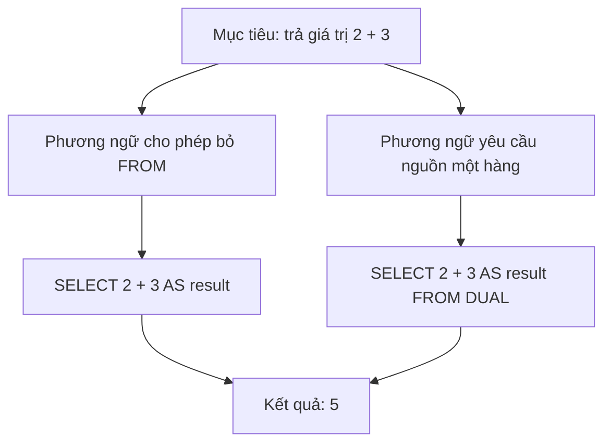

# Truy vấn không đọc bảng và giới hạn theo phương ngữ

Thông thường, một câu truy vấn SQL lấy dữ liệu từ bảng:

```sql
SELECT customer_id, full_name
FROM customers;
```

Tuy nhiên, không phải mọi truy vấn đều cần đọc bảng nghiệp vụ. Ta có thể yêu cầu hệ quản trị tính một phép toán, trả một hằng số, hiển thị thời gian hiện tại hoặc đánh giá một biểu thức điều kiện. Với một số hệ quản trị, câu lệnh sau là hợp lệ:

```sql
SELECT 2 + 3 AS result;
-- result = 5
```

Điểm dễ gây nhầm lẫn là **khả năng bỏ `FROM` phụ thuộc vào phương ngữ SQL và phiên bản hệ quản trị**. PostgreSQL, MySQL, SQLite và SQL Server hỗ trợ nhiều dạng `SELECT` không có `FROM`; Oracle truyền thống yêu cầu nguồn một hàng `DUAL`, còn các phiên bản Oracle mới hỗ trợ thêm cú pháp không `FROM`.

Bài học sẽ giải thích cách truy vấn không đọc bảng hoạt động, khi nào dùng, khác biệt giữa các hệ quản trị và những giới hạn cần lưu ý. Đồng thời, cần phân biệt **giới hạn do phương ngữ** với các cú pháp **giới hạn số hàng kết quả** như `LIMIT`, `TOP` và `FETCH FIRST`.

## 1. Truy vấn không đọc bảng là gì?

**Truy vấn không đọc bảng** (*tableless query*, *SELECT without FROM*) là câu lệnh trả kết quả được tính từ hằng số, biểu thức, hàm hoặc tham số, **không tham chiếu trực tiếp tới một bảng nguồn thông thường trong mệnh đề `FROM`**.

Ví dụ:

```sql
SELECT 42 AS answer;

SELECT 'Hello SQL' AS greeting;

SELECT 10 * 3 AS total;

SELECT CASE
           WHEN 15 >= 10 THEN 'PASS'
           ELSE 'FAIL'
       END AS result;
```

Trên PostgreSQL, MySQL, SQLite và SQL Server, các câu lệnh trên thường trả về một hàng chứa các giá trị đã tính.

| Câu lệnh | Tên cột kết quả | Giá trị |
| --- | --- | --- |
| `SELECT 42 AS answer` | `answer` | `42` |
| `SELECT 'Hello SQL' AS greeting` | `greeting` | `Hello SQL` |
| `SELECT 10 * 3 AS total` | `total` | `30` |
| `SELECT CASE ... END AS result` | `result` | `PASS` |

Truy vấn này hữu ích để kiểm tra kết nối, thử toán tử và hàm SQL, chuyển đổi kiểu hoặc dựng những tập dữ liệu nhỏ phục vụ kiểm thử.

### 1.1. “Không đọc bảng” không đồng nghĩa “không dùng database”

Câu lệnh vẫn được DBMS phân tích, kiểm tra cú pháp, đánh giá biểu thức và trả tập kết quả. Đối với một số hàm, DBMS có thể cần đọc trạng thái phiên, đồng hồ hệ thống, metadata, dãy số (*sequence*) hoặc dùng tài nguyên thực thi.

Vì vậy, phát biểu chính xác là: **truy vấn không tham chiếu tới bảng nguồn nghiệp vụ thông qua `FROM`**, chứ không khẳng định DBMS hoàn toàn không làm I/O hoặc không truy cập bất kỳ trạng thái nào.

Ví dụ:

```sql
-- PostgreSQL/MySQL/SQL Server/SQLite: ví dụ dạng chung.
SELECT CURRENT_TIMESTAMP AS observed_at;
```

Truy vấn này không đọc bảng khách hàng nhưng vẫn hỏi hệ quản trị về giá trị thời gian hiện tại theo ngữ nghĩa riêng của nó.

### 1.2. Vì sao SELECT vẫn tạo được kết quả nếu không có FROM?

Có thể hình dung một biểu thức vô hướng không có bảng nguồn được đánh giá trong **ngữ cảnh một hàng**:

```text
Biểu thức:  2 + 3
               |
               v
         +------------+
         | result = 5 |
         +------------+
              1 hàng
```

Một số DBMS mô hình hóa điều này trực tiếp bằng `SELECT` không `FROM`. Những DBMS khác yêu cầu chỉ định **bảng giả một hàng**.

Đây là cách giải thích dễ nhớ về hành vi kết quả; cơ chế thực thi bên trong và tính năng đặc biệt như hàm trả nhiều hàng có thể khác giữa các hệ quản trị.

## 2. Các biểu thức cơ bản không cần bảng nguồn

Các ví dụ ở mục này phù hợp với PostgreSQL, MySQL, SQLite và SQL Server nếu không ghi chú khác.

### 2.1. Hằng số số, chuỗi và NULL

```sql
SELECT
    100 AS quantity,
    'SQL' AS language_name,
    NULL AS optional_value;
```

Kết quả logic:

| quantity | language_name | optional_value |
| ---: | --- | --- |
| 100 | SQL | `NULL` |

`NULL` là một giá trị thiếu/chưa xác định trong SQL, không phải một chuỗi văn bản. Khi hiển thị, mỗi công cụ SQL có thể biểu diễn ô `NULL` khác nhau.

### 2.2. Phép tính số học

```sql
SELECT
    8 + 2 AS addition,
    8 - 2 AS subtraction,
    8 * 2 AS multiplication;
```

Kết quả:

| addition | subtraction | multiplication |
| ---: | ---: | ---: |
| 10 | 6 | 16 |

Cần chú ý **phép chia số nguyên và ép kiểu** có thể khác nhau giữa các DBMS:

```sql
SELECT 1 / 2 AS half;
```

Không nên khẳng định mọi phương ngữ sẽ trả `0.5`. Một số DBMS/kiểu toán hạng áp dụng chia số nguyên; DBMS khác có thể trả số thập phân hoặc số thực.

Nếu cần kết quả có ý nghĩa thập phân, hãy lựa chọn và ép kiểu toán hạng theo quy tắc của DBMS đang sử dụng, ví dụ trên PostgreSQL:

```sql
SELECT 1.0 / 2 AS half;
-- 0.50000000000000000000 (cách hiển thị có thể khác)
```

### 2.3. Biểu thức CASE

`CASE` trả về một giá trị dựa trên điều kiện:

```sql
SELECT CASE
           WHEN 75 >= 60 THEN 'Passed'
           ELSE 'Failed'
       END AS exam_result;
-- Passed
```

Không cần tạo bảng điểm chỉ để thử cú pháp `CASE`. Điều này đặc biệt hữu ích khi học logic điều kiện hoặc kiểm chứng một công thức xử lý.

### 2.4. COALESCE và giá trị NULL

`COALESCE` chọn đối số đầu tiên khác `NULL`:

```sql
SELECT
    COALESCE(NULL, 'unknown') AS display_name,
    COALESCE(NULL, NULL, 10) AS amount;
```

Kết quả:

| display_name | amount |
| --- | ---: |
| unknown | 10 |

Ví dụ này tách việc kiểm tra biểu thức ra khỏi dữ liệu trong bảng, giúp quan sát ngữ nghĩa của `NULL` và hàm xử lý giá trị thiếu.

### 2.5. Alias cho cột kết quả

Tên được đặt bởi `AS` là **bí danh cột** trong tập kết quả:

```sql
SELECT
    2026 AS current_year_example,
    'VI' AS locale_code;
```

`AS` không tạo cột vật lý và không sửa schema. Nó chỉ định tên hiển thị cho biểu thức ở kết quả.

Nếu không đặt alias, DBMS có thể tự tạo tên như `?column?`, `(No column name)` hoặc chuỗi biểu thức, tùy công cụ và phương ngữ. Trong truy vấn dùng cho ứng dụng, đặt alias rõ ràng giúp xử lý kết quả ổn định hơn.

## 3. Truy vấn thời gian và hàm hệ thống không cần FROM

Các hàm thời gian hoặc môi trường thường được thử bằng truy vấn không đọc bảng.

### 3.1. CURRENT_DATE và CURRENT_TIMESTAMP

Trên nhiều DBMS:

```sql
SELECT
    CURRENT_DATE AS today,
    CURRENT_TIMESTAMP AS observed_at;
```

Ý nghĩa:

- `CURRENT_DATE`: ngày hiện hành theo ngữ cảnh của DBMS/phiên.
- `CURRENT_TIMESTAMP`: giá trị ngày giờ hiện hành với ngữ nghĩa kiểu dữ liệu và mức độ chính xác tùy DBMS.

**Không nên mong đầu ra giống hệt nhau ở mọi hệ**. Thời gian có thể phụ thuộc múi giờ phiên kết nối, máy chủ, hoặc thời điểm bắt đầu giao dịch. Chẳng hạn PostgreSQL gắn `CURRENT_TIMESTAMP` với thời điểm bắt đầu giao dịch hiện tại; cơ chế này không có nghĩa mọi DBMS sẽ làm giống vậy.

Để so sánh kết quả giữa máy chủ hoặc ghi nhận sự kiện thực tế, cần hiểu rõ kiểu dữ liệu thời gian và múi giờ đang áp dụng.

### 3.2. Hàm mang tính đặc thù phương ngữ

| Hệ quản trị | Ví dụ | Nội dung |
| --- | --- | --- |
| PostgreSQL | `SELECT version() AS db_version;` | Thông tin phiên bản PostgreSQL. |
| MySQL | `SELECT DATABASE() AS selected_database;` | Tên database được chọn trong phiên, có thể là `NULL`. |
| SQL Server | `SELECT DB_NAME() AS selected_database;` | Tên database hiện hành. |
| SQLite | `SELECT sqlite_version() AS db_version;` | Phiên bản thư viện SQLite. |
| Oracle truyền thống | `SELECT SYSDATE AS observed_at FROM DUAL;` | Thời gian từ hệ thống theo ngữ nghĩa Oracle. |

Những hàm này không phải cú pháp chung có thể sao chép nguyên giữa các DBMS. Khi xây ứng dụng hỗ trợ nhiều loại database, nên tách phần SQL đặc thù thành cấu hình/adapter tương ứng.

### 3.3. Kiểm tra kết nối

Một câu lệnh như:

```sql
SELECT 1 AS ok;
```

thường được dùng để kiểm tra kênh kết nối và khả năng thực thi câu SQL đơn giản ở những DBMS hỗ trợ `SELECT` không `FROM`.

Tuy nhiên, **thực thi thành công `SELECT 1` không chứng minh rằng toàn bộ hệ thống dữ liệu đang khỏe mạnh**. Nó không nhất thiết xác nhận quyền đọc bảng nghiệp vụ, hiệu năng truy vấn, tình trạng replication hay giao dịch phức tạp.

Trong ứng dụng, nên sử dụng cơ chế kiểm tra kết nối của driver/pool hoặc health check phù hợp với DBMS, thay vì mặc định `SELECT 1` luôn là lựa chọn tốt nhất cho mọi hệ.

## 4. Khác biệt quan trọng: SELECT không FROM theo phương ngữ

Cú pháp `SELECT 1 AS result` tưởng chừng rất đơn giản nhưng không hoạt động giống nhau trong mọi DBMS và phiên bản.

| DBMS | `SELECT 1 AS result;` không `FROM` | Cách viết có tính tương thích |
| --- | --- | --- |
| PostgreSQL | Hỗ trợ | `SELECT 1 AS result;` |
| MySQL | Hỗ trợ | `SELECT 1 AS result;` |
| SQLite | Hỗ trợ | `SELECT 1 AS result;` |
| Microsoft SQL Server | Hỗ trợ | `SELECT 1 AS result;` |
| Oracle Database 19c/21c và các bản truyền thống | Không hỗ trợ cú pháp này theo kiểu thông thường | `SELECT 1 AS result FROM DUAL;` |
| Oracle Database 23c/23ai trở lên | Có hỗ trợ `SELECT` không `FROM` cho biểu thức | Có thể bỏ `FROM DUAL` khi môi trường/phiên bản hỗ trợ |
| IBM Db2 | Khác các ví dụ trên | Có thể dùng `VALUES 1` hoặc `SELECT 1 FROM SYSIBM.SYSDUMMY1` theo Db2 |

Các biến thể và giới hạn theo phiên bản cần được xác nhận trên môi trường đang triển khai. Đặc biệt, **đừng lấy ví dụ chạy được trên Oracle mới để mặc định Oracle cũ cũng hỗ trợ**.

### 4.1. PostgreSQL

```sql
SELECT 1 AS answer;

SELECT CURRENT_DATE AS today;

SELECT 'Hello PostgreSQL' AS message;
```

PostgreSQL hỗ trợ `SELECT` không có `FROM`. Các biểu thức vô hướng thông thường tạo ra một hàng.

Có thể lọc hàng kết quả bằng `WHERE`:

```sql
SELECT 'visible' AS status
WHERE 10 > 5;
-- Một hàng: visible

SELECT 'hidden' AS status
WHERE 10 < 5;
-- Không có hàng.
```

Tuy không có bảng nguồn, `WHERE` vẫn quyết định có giữ hàng kết quả hay không. Với các tính năng đặc thù như **set-returning functions** (`generate_series`), PostgreSQL còn có thể sinh nhiều hàng; không được kết luận tuyệt đối rằng mọi `SELECT` thiếu `FROM` chỉ có một hàng.

### 4.2. MySQL

```sql
SELECT 1 AS answer;

SELECT NOW() AS observed_at;

SELECT VERSION() AS db_version;
```

MySQL cho phép bỏ `FROM` khi chỉ đánh giá biểu thức. MySQL cũng chấp nhận `FROM DUAL` trong những ngữ cảnh tương thích với Oracle, nhưng thường không bắt buộc:

```sql
SELECT 1 AS answer FROM DUAL;
```

Chỉ vì một DBMS chấp nhận tên `DUAL` không có nghĩa `DUAL` là bảng nghiệp vụ thật được lưu và quản lý hệt nhau ở mọi hệ.

### 4.3. SQLite

```sql
SELECT 1 AS answer;

SELECT 'SQLite' AS database_name;

SELECT CURRENT_TIMESTAMP AS observed_at;
```

SQLite có cơ chế `SELECT` không `FROM`; một truy vấn `SELECT` với biểu thức vô hướng và không có nguồn thông thường có thể trả một hàng kết quả.

```sql
SELECT 100 AS amount
WHERE 1 = 0;
-- Không có hàng.
```

SQLite cũng hỗ trợ nhiều cú pháp SQL riêng và hệ thống kiểu dữ liệu linh hoạt. Cú pháp biểu thức hoặc hàm được hỗ trợ ở PostgreSQL không nhất thiết có trên SQLite.

### 4.4. SQL Server (T-SQL)

```sql
SELECT 1 AS answer;

SELECT GETDATE() AS observed_at;

SELECT DB_NAME() AS current_database;
```

SQL Server không bắt buộc `FROM` khi câu `SELECT` chỉ tính biểu thức. Hàm `GETDATE()` và `DB_NAME()` là ví dụ đặc thù T-SQL.

SQL Server có nhiều khác biệt về hàm, kiểu dữ liệu, cách nối chuỗi và giới hạn số hàng so với PostgreSQL/MySQL. Không nên coi “cùng chấp nhận `SELECT 1`” là bằng chứng mọi truy vấn khác đều tương thích.

### 4.5. Oracle và DUAL

Trên các bản Oracle truyền thống như 19c/21c, `SELECT` thông thường phải có nguồn `FROM`. Oracle cung cấp bảng đặc biệt **`DUAL`** để đánh giá biểu thức:

```sql
SELECT 1 AS answer
FROM DUAL;

SELECT 10 * 3 AS total
FROM DUAL;

SELECT SYSDATE AS observed_at
FROM DUAL;
```

`DUAL` là đối tượng một hàng phục vụ các câu truy vấn cần nguồn hình thức. Oracle có cơ chế tối ưu cho nhiều phép truy vấn chỉ tính biểu thức từ `DUAL`, nên không nên diễn giải `FROM DUAL` như đọc một bảng dữ liệu nghiệp vụ thông thường với khối lượng bản ghi.

Oracle Database 23c/23ai đã bổ sung khả năng `SELECT` không `FROM` cho một số trường hợp. Dù vậy, `FROM DUAL` vẫn là cú pháp quen thuộc và quan trọng khi cần hỗ trợ các phiên bản Oracle cũ.

### 4.6. Db2 và bảng giả

IBM Db2 thường dùng biểu thức `VALUES` hoặc bảng giả `SYSIBM.SYSDUMMY1`:

```sql
-- Db2: biểu thức giá trị trực tiếp
VALUES 1;

-- Db2: SELECT với bảng giả một hàng
SELECT 1 AS answer
FROM SYSIBM.SYSDUMMY1;
```

Tên và khả năng hỗ trợ cụ thể có thể khác giữa biến thể/phiên bản Db2, nhưng nguyên tắc chung vẫn là chọn dạng câu lệnh được DBMS của mình hỗ trợ, không tự động sao chép `SELECT` không `FROM`.

## 5. DUAL, dummy table và truy vấn không có FROM khác nhau thế nào?

Có hai cách biểu đạt mục đích “tạo kết quả từ một biểu thức”:



**Về ý nghĩa kết quả** trong ví dụ vô hướng, hai dạng có thể tương đương. **Về cú pháp và thực thi**, chúng không phải một mệnh đề SQL duy nhất chạy trên mọi hệ quản trị.

Một số điều cần phân biệt:

1. **`DUAL` trong Oracle** là đối tượng đặc biệt phục vụ truy vấn một hàng; không phải tên được chuẩn SQL bảo đảm trên mọi DBMS.
2. **`SYSIBM.SYSDUMMY1` trong Db2** có mục đích tương tự nhưng tên và quy tắc riêng.
3. **`SELECT` không `FROM`** là dạng được nhiều DBMS trực tiếp chấp nhận; không cần người dùng tự tạo bảng.
4. Tạo một bảng nghiệp vụ tên `dual` trong DBMS khác **không biến nó thành đối tượng hệ thống chuẩn** và có thể dẫn đến rắc rối tương thích.

Với thư viện đa cơ sở dữ liệu, nên xây câu SQL dựa trên **dialect** được xác định từ driver/ORM hoặc cấu hình rõ ràng.

## 6. Một truy vấn không đọc bảng có thể trả 0, 1 hoặc nhiều hàng không?

### 6.1. Một hàng từ biểu thức vô hướng

Trường hợp điển hình:

```sql
SELECT 7 * 8 AS value;
-- Một hàng, value = 56.
```

Một danh sách nhiều biểu thức trong `SELECT` vẫn là **nhiều cột của cùng một hàng**, không phải nhiều hàng:

```sql
SELECT
    1 AS first_value,
    2 AS second_value,
    3 AS third_value;
```

Kết quả:

| first_value | second_value | third_value |
| ---: | ---: | ---: |
| 1 | 2 | 3 |

### 6.2. Không có hàng khi điều kiện WHERE sai

```sql
SELECT 1 AS result
WHERE 1 = 2;
-- 0 hàng.
```

Trong hệ quản trị hoặc phiên bản cần `DUAL`, dùng dạng tương ứng:

```sql
-- Oracle 19c/21c:
SELECT 1 AS result
FROM DUAL
WHERE 1 = 2;
-- 0 hàng.
```

Đây là một cách thử ngữ nghĩa `WHERE` mà không cần dựng bảng dữ liệu mẫu.

### 6.3. Nhiều hàng với UNION ALL

Trên PostgreSQL/MySQL/SQLite/SQL Server, có thể ghép nhiều truy vấn biểu thức:

```sql
SELECT 1 AS id, 'A' AS label
UNION ALL
SELECT 2 AS id, 'B' AS label
UNION ALL
SELECT 3 AS id, 'C' AS label
ORDER BY id;
```

Kết quả:

| id | label |
| ---: | --- |
| 1 | A |
| 2 | B |
| 3 | C |

`UNION ALL` ghép kết quả và **giữ các hàng trùng nhau** nếu có. Đây là cách dựng tập dữ liệu nhỏ không phụ thuộc bảng nghiệp vụ.

Với Oracle 19c/21c, mỗi nhánh `SELECT` cần `FROM DUAL`:

```sql
SELECT 1 AS id, 'A' AS label FROM DUAL
UNION ALL
SELECT 2 AS id, 'B' AS label FROM DUAL
UNION ALL
SELECT 3 AS id, 'C' AS label FROM DUAL
ORDER BY id;
```

### 6.4. VALUES như một cách tạo dữ liệu tạm

Ngoài `SELECT` không `FROM`, nhiều hệ quản trị cung cấp **table value constructor** `VALUES` để tạo các hàng trực tiếp:

```sql
-- PostgreSQL và SQLite có thể chạy dạng VALUES độc lập.
VALUES
    (1, 'Basic'),
    (2, 'Advanced');
```

Hoặc trong PostgreSQL, đặt tên cột bằng bảng dẫn xuất:

```sql
SELECT v.level_id, v.level_name
FROM (
    VALUES
        (1, 'Basic'),
        (2, 'Advanced')
) AS v(level_id, level_name)
ORDER BY v.level_id;
```

Cú pháp `VALUES` độc lập, cú pháp đặt alias cho cột và cách suy luận kiểu giữa các hàng **khác nhau theo DBMS**. Ví dụ, T-SQL có thể sử dụng `VALUES` trong một derived table với `FROM (VALUES ...)`, nhưng không nên mặc định mọi hệ đều chấp nhận nguyên lệnh `VALUES (...)` đứng một mình.

`VALUES` không hoàn toàn cùng khái niệm với `SELECT` không có `FROM`; đây là một **nguồn dữ liệu do câu lệnh tạo ra**, thuận tiện khi thử nghiệm hoặc xây tập hằng số.

### 6.5. Hàm trả nhiều hàng

Một số DBMS có hàm tạo tập giá trị. Ví dụ PostgreSQL:

```sql
SELECT n
FROM generate_series(1, 3) AS s(n)
ORDER BY n;
```

Kết quả: ba hàng với `n = 1, 2, 3`.

Đây là **truy vấn có nguồn trong `FROM`**, nhưng không đọc bảng nghiệp vụ vật lý. Nó giúp phân biệt:

- `SELECT` **không có `FROM`**: một dạng cú pháp.
- Truy vấn **không đọc bảng lưu trữ**: một thuộc tính rộng hơn, có thể dùng nguồn dữ liệu tạo bởi hàm hoặc `VALUES`.

Đừng đánh đồng hai mô tả khi phân tích SQL thực tế.

## 7. Truy vấn biểu thức có thể nhận tham số không?

Có. Ứng dụng thường truyền tham số qua prepared statement mà không cần truy vấn bảng.

Ví dụ trong Java JDBC, câu lệnh sau sử dụng placeholder `?`:

```java
import java.sql.Connection;
import java.sql.PreparedStatement;
import java.sql.ResultSet;

public class ScalarQueryExample {
    public static int doubleValue(Connection connection, int input)
            throws Exception {
        String sql = "SELECT CAST(? AS INTEGER) * 2 AS result";

        try (PreparedStatement statement =
                 connection.prepareStatement(sql)) {
            statement.setInt(1, input);

            try (ResultSet resultSet = statement.executeQuery()) {
                if (!resultSet.next()) {
                    throw new IllegalStateException("No scalar result");
                }
                return resultSet.getInt("result");
            }
        }
    }
}
```

Ví dụ SQL `SELECT CAST(? AS INTEGER) * 2` phù hợp để minh họa cách bind tham số trên các DBMS hỗ trợ `SELECT` không `FROM`; với Oracle truyền thống, có thể cần `FROM DUAL` và kiểu ép phù hợp. Cú pháp bind placeholder cũng tùy driver hoặc công cụ (`?` trong JDBC, `$1` ở một số API PostgreSQL, tên biến trong T-SQL...).

**Ưu điểm:** tham số được truyền như dữ liệu qua driver, không phải nối trực tiếp chuỗi từ người dùng vào SQL. Hãy dùng prepared statement cho các giá trị động, ngay cả khi truy vấn không đọc bảng.

## 8. Giới hạn theo phương ngữ: không phải chức năng nào cũng giống nhau

**Phương ngữ SQL (SQL dialect)** là tập cú pháp và tính năng do từng DBMS/phiên bản triển khai. Cùng một mục tiêu “trả một giá trị” có thể bị giới hạn bởi nhiều điểm.

### 8.1. Mệnh đề FROM có được bỏ hay không

Đây là khác biệt trực tiếp nhất:

```sql
-- PostgreSQL/MySQL/SQLite/SQL Server:
SELECT 100 AS amount;

-- Oracle truyền thống:
SELECT 100 AS amount FROM DUAL;

-- Db2:
VALUES 100;
```

Một hệ thống hỗ trợ đa DBMS phải có khả năng chọn mẫu phù hợp.

### 8.2. Tên hàm khác nhau

Ví dụ lấy thời gian:

```sql
-- PostgreSQL:
SELECT CURRENT_TIMESTAMP AS observed_at;

-- MySQL:
SELECT NOW() AS observed_at;

-- SQL Server:
SELECT GETDATE() AS observed_at;

-- SQLite:
SELECT CURRENT_TIMESTAMP AS observed_at;

-- Oracle truyền thống:
SELECT SYSTIMESTAMP AS observed_at FROM DUAL;
```

Những biểu thức này **không nhất thiết giống hệt về kiểu trả về, múi giờ, thời điểm đánh giá hoặc độ chính xác**. Không nên coi các hàm là tương đương tuyệt đối chỉ vì cùng được dùng để lấy “thời gian hiện tại”.

### 8.3. Nối chuỗi khác nhau

Trên PostgreSQL/SQLite/Oracle, thường thấy toán tử `||`:

```sql
-- PostgreSQL và SQLite:
SELECT 'Hello' || ' ' || 'SQL' AS message;
```

SQL Server thường dùng `+` cho chuỗi, còn MySQL có hàm `CONCAT`:

```sql
-- SQL Server:
SELECT 'Hello' + ' ' + 'SQL' AS message;

-- MySQL:
SELECT CONCAT('Hello', ' ', 'SQL') AS message;
```

Cách xử lý `NULL` trong phép nối chuỗi và kiểu dữ liệu của các đối số cũng có khác biệt. Khi xây câu SQL di động, nên chọn cú pháp/hàm đã được kiểm chứng trên các DBMS mục tiêu.

### 8.4. Boolean và kiểu trả về

Ví dụ:

```sql
SELECT TRUE AS flag;
```

PostgreSQL hỗ trợ literal kiểu Boolean; MySQL nhận `TRUE` như một alias số trong nhiều bối cảnh; SQLite cũng có quy tắc riêng; SQL Server không có literal Boolean độc lập `TRUE` dùng hệt như PostgreSQL. Oracle cũng thay đổi khả năng dùng kiểu Boolean trong SQL ở các phiên bản mới.

Để viết ví dụ truy vấn biểu thức cơ bản chạy trên nhiều DBMS, số và chuỗi đơn giản thường dễ tương thích hơn literal Boolean hay các phép ép kiểu đặc thù.

### 8.5. Phạm vi sử dụng hàm và quyền hạn

Một số hàm chỉ được phép gọi trong một loại câu lệnh hoặc yêu cầu quyền tương ứng. Có hàm đọc session, sử dụng sequence hoặc là hàm do người dùng tự định nghĩa (*user-defined function*) với ảnh hưởng phụ.

Một câu `SELECT` không `FROM` có thể vẫn tạo ra hiệu ứng ngoài việc trả một hằng số nếu gọi hàm có tác dụng phụ hoặc sử dụng sequence. Vì vậy, trong hệ thống production không nên xem mọi truy vấn dạng này là “vô hại” chỉ dựa vào việc thiếu `FROM`.

### 8.6. Cú pháp ép kiểu khác nhau

`CAST` là cú pháp phổ biến:

```sql
SELECT CAST('123' AS INTEGER) AS numeric_value;
```

Tuy nhiên, tên kiểu và cách xử lý đầu vào không hợp lệ vẫn có khác biệt. PostgreSQL còn hỗ trợ dạng tắt:

```sql
-- PostgreSQL-specific:
SELECT '123'::INTEGER AS numeric_value;
```

Không nên dùng `::INTEGER` trong một truy vấn giả định phải chạy trực tiếp trên SQL Server hay MySQL.

## 9. Phân biệt “giới hạn phương ngữ” và “giới hạn số hàng”

Từ “giới hạn” có hai nghĩa thường gặp trong bài SQL:

1. **Giới hạn của phương ngữ:** DBMS nào chấp nhận `SELECT` thiếu `FROM`, hàm nào tồn tại, có hỗ trợ `DUAL` không, cú pháp nào hợp lệ.
2. **Giới hạn số hàng trả về:** chỉ lấy một số hàng đầu tiên của kết quả, thường bằng `LIMIT`, `TOP` hoặc `FETCH FIRST`.

Hai vấn đề liên quan đến cú pháp SQL nhưng **không đồng nghĩa**. Hiểu cả hai giúp đọc ví dụ từ các DBMS khác nhau.

### 9.1. LIMIT trên PostgreSQL, MySQL và SQLite

Ví dụ từ bảng `products`:

```sql
SELECT product_id, product_name
FROM products
ORDER BY product_id
LIMIT 5;
```

Truy vấn lấy tối đa năm hàng đầu tiên theo `product_id`. Muốn bỏ qua mười hàng đầu tiên rồi lấy tối đa năm hàng kế tiếp:

```sql
SELECT product_id, product_name
FROM products
ORDER BY product_id
LIMIT 5 OFFSET 10;
```

Đây là dạng thông dụng trên PostgreSQL, MySQL và SQLite. SQL Server không dùng `LIMIT` như một mệnh đề chuẩn tương đương.

MySQL còn có cú pháp `LIMIT 10, 5` với thứ tự tham số khác `LIMIT 5 OFFSET 10`. Dạng `LIMIT count OFFSET skip` thường dễ đọc hơn khi di chuyển giữa PostgreSQL/MySQL/SQLite.

### 9.2. TOP trên SQL Server

Với T-SQL:

```sql
SELECT TOP (5)
    product_id,
    product_name
FROM products
ORDER BY product_id;
```

`TOP (5)` giới hạn tối đa năm hàng. Nếu không có `ORDER BY`, “năm hàng đầu” **không có thứ tự đảm bảo**.

Để lấy trang dữ liệu với offset trên SQL Server:

```sql
SELECT product_id, product_name
FROM products
ORDER BY product_id
OFFSET 10 ROWS
FETCH NEXT 5 ROWS ONLY;
```

Trong SQL Server, cú pháp `OFFSET ... FETCH` yêu cầu `ORDER BY`.

### 9.3. FETCH FIRST/NEXT theo SQL standard và Oracle

Một số DBMS như PostgreSQL, Oracle hiện đại và Db2 hỗ trợ dạng giới hạn hàng dựa trên `FETCH`:

```sql
SELECT product_id, product_name
FROM products
ORDER BY product_id
FETCH FIRST 5 ROWS ONLY;
```

Oracle từ 12c hỗ trợ cú pháp phân trang dạng `OFFSET ... FETCH`:

```sql
SELECT product_id, product_name
FROM products
ORDER BY product_id
OFFSET 10 ROWS
FETCH NEXT 5 ROWS ONLY;
```

Không nên thay thế máy móc toàn bộ `LIMIT` bằng `FETCH` trong mọi hệ mà không kiểm tra cú pháp và phiên bản.

### 9.4. Bảng so sánh giới hạn số hàng

| DBMS | Cách thường dùng lấy 5 hàng | Phân trang bỏ 10, lấy 5 |
| --- | --- | --- |
| PostgreSQL | `LIMIT 5` hoặc `FETCH FIRST 5 ROWS ONLY` | `LIMIT 5 OFFSET 10` |
| MySQL | `LIMIT 5` | `LIMIT 5 OFFSET 10` |
| SQLite | `LIMIT 5` | `LIMIT 5 OFFSET 10` |
| SQL Server | `TOP (5)` | `OFFSET 10 ROWS FETCH NEXT 5 ROWS ONLY` với `ORDER BY` |
| Oracle 12c+ | `FETCH FIRST 5 ROWS ONLY` | `OFFSET 10 ROWS FETCH NEXT 5 ROWS ONLY` |
| Db2 | `FETCH FIRST 5 ROWS ONLY` | Phụ thuộc phiên bản/cú pháp `OFFSET ... FETCH` |

### 9.5. ORDER BY giúp kết quả ổn định

`LIMIT` hoặc `TOP` chỉ hạn chế **số lượng hàng**; chúng không tự quyết định hàng nào phải xuất hiện nếu không có thứ tự rõ ràng.

```sql
-- Không có ORDER BY: 5 hàng trả về có thể thay đổi.
SELECT product_id
FROM products
LIMIT 5;

-- Có ORDER BY: rõ thứ tự theo khóa định danh.
SELECT product_id
FROM products
ORDER BY product_id
LIMIT 5;
```

Ngay cả `ORDER BY price` có thể chưa ổn định nếu nhiều hàng cùng `price`. Với phân trang, nên thêm cột định danh tạo thứ tự duy nhất:

```sql
SELECT product_id, price
FROM products
ORDER BY price, product_id
LIMIT 5 OFFSET 10;
```

Dạng này giúp xác định thứ tự trong một trạng thái dữ liệu nhất định. Khi bảng thay đổi giữa các lần phân trang, offset pagination vẫn có thể lặp/bỏ sót hàng; hệ thống cần chiến lược phù hợp nếu yêu cầu duyệt ổn định qua nhiều lần cập nhật.

### 9.6. Giới hạn hàng trên truy vấn không có FROM

Một truy vấn biểu thức vô hướng vốn thường chỉ trả một hàng:

```sql
-- PostgreSQL:
SELECT 42 AS answer
LIMIT 1;
```

`LIMIT 1` ở đây không thay đổi tập kết quả thông thường. Còn:

```sql
-- PostgreSQL:
SELECT 42 AS answer
LIMIT 0;
-- Không có hàng.
```

Tương tự trên SQL Server:

```sql
SELECT TOP (1) 42 AS answer;
```

Tuy nhiên, **không thể dùng `LIMIT` để sửa lỗi thiếu `FROM` ở DBMS bắt buộc `FROM`**. Ví dụ trên Oracle 19c, phải viết `FROM DUAL` rồi mới cân nhắc cú pháp giới hạn hàng nếu thực sự cần.

## 10. Một bảng đối chiếu mục đích và cú pháp

| Mục đích | PostgreSQL | MySQL | SQL Server | Oracle 19c |
| --- | --- | --- | --- | --- |
| Trả số 1 | `SELECT 1;` | `SELECT 1;` | `SELECT 1;` | `SELECT 1 FROM DUAL;` |
| Tính 2 + 3 | `SELECT 2 + 3;` | `SELECT 2 + 3;` | `SELECT 2 + 3;` | `SELECT 2 + 3 FROM DUAL;` |
| Lấy ngày hiện tại | `SELECT CURRENT_DATE;` | `SELECT CURRENT_DATE;` | `SELECT CAST(GETDATE() AS DATE);` | `SELECT CURRENT_DATE FROM DUAL;` |
| Tạo hai hàng từ hai hằng số | `SELECT 1 UNION ALL SELECT 2;` | `SELECT 1 UNION ALL SELECT 2;` | `SELECT 1 UNION ALL SELECT 2;` | `SELECT 1 FROM DUAL UNION ALL SELECT 2 FROM DUAL;` |
| Lấy năm hàng đầu từ bảng | `... LIMIT 5` | `... LIMIT 5` | `SELECT TOP (5) ...` | `... FETCH FIRST 5 ROWS ONLY` |

Bảng chỉ minh họa những cú pháp phổ biến; khi dùng trong ứng dụng thật, phải xét phiên bản và kiểu dữ liệu tương ứng. Oracle mới có thêm khả năng `SELECT` không `FROM`, còn SQL Server/SQLite có những điểm riêng đã nêu ở các mục trước.

## 11. Áp dụng vào ứng dụng và công cụ SQL

### 11.1. Kiểm tra biểu thức trước khi nhúng vào truy vấn bảng

Giả sử ứng dụng cần tính phân loại dựa trên một quy tắc:

```sql
-- Thử biểu thức riêng trước (PostgreSQL/MySQL/SQLite/SQL Server).
SELECT CASE
           WHEN 250 >= 200 THEN 'HIGH'
           ELSE 'NORMAL'
       END AS tier;
```

Sau khi hiểu biểu thức, có thể đưa nó vào câu truy vấn bảng:

```sql
SELECT
    order_id,
    total_amount,
    CASE
        WHEN total_amount >= 200 THEN 'HIGH'
        ELSE 'NORMAL'
    END AS tier
FROM orders;
```

Khả năng truy vấn không `FROM` giúp **tách bài toán kiểm tra biểu thức** khỏi việc chuẩn bị bảng và dữ liệu mẫu. Tuy nhiên, kết quả trên giá trị hằng không chứng minh mọi edge case của dữ liệu thật đã được xử lý.

### 11.2. Tạo dữ liệu tạm để học JOIN hoặc so sánh

Có thể dùng `VALUES` hoặc `UNION ALL` để tạo những hàng nhỏ trong cùng câu SQL, hạn chế phải tạo bảng vĩnh viễn.

Ví dụ PostgreSQL:

```sql
SELECT v.customer_id, v.customer_name
FROM (
    VALUES
        (1, 'An'),
        (2, 'Bình'),
        (3, 'Chi')
) AS v(customer_id, customer_name)
WHERE v.customer_id >= 2
ORDER BY v.customer_id;
```

Kết quả:

| customer_id | customer_name |
| ---: | --- |
| 2 | Bình |
| 3 | Chi |

Dữ liệu của `VALUES` chỉ tồn tại trong ngữ cảnh câu lệnh và **không được chèn vào bảng `customers`**.

### 11.3. Không dùng chuỗi SQL động không kiểm soát

Ngay cả khi chỉ tạo truy vấn kiểm tra biểu thức, dữ liệu đầu vào từ người dùng vẫn nên được bind bằng tham số phù hợp. Ví dụ:

```sql
-- Placeholder theo JDBC, dùng với DBMS hỗ trợ SELECT không FROM.
SELECT COALESCE(CAST(? AS VARCHAR(100)), 'unknown') AS display_name;
```

Cách ép kiểu chính xác có thể khác trên SQL Server, Oracle hoặc các DBMS khác. Đừng ghép dữ liệu không tin cậy thành chuỗi SQL chỉ vì câu lệnh không có `FROM`.

### 11.4. Đừng nhầm kết quả một hàng với giá trị một cột

```sql
SELECT 1 AS a, 2 AS b;
```

Trả về **một hàng, hai cột**.

```sql
SELECT 1 AS a
UNION ALL
SELECT 2 AS a;
```

Trả về **hai hàng, một cột**.

Sự phân biệt này quan trọng khi đọc `ResultSet` trong Java/JDBC: số hàng và số cột là hai chiều độc lập của kết quả SQL.

## 12. Những lỗi thường gặp

### Lỗi 1: Sao chép SELECT 1 vào Oracle cũ

```sql
SELECT 1;
```

Dạng này có thể lỗi trên Oracle 19c/21c vì thiếu `FROM`.

Dùng:

```sql
SELECT 1 FROM DUAL;
```

Hoặc trên Oracle mới hỗ trợ bỏ `FROM`, dựa vào phiên bản mục tiêu để chọn cú pháp.

### Lỗi 2: Dùng FROM DUAL như thể đó là chuẩn toàn DBMS

Không phải DBMS nào cũng có `DUAL` với ngữ nghĩa tương tự Oracle. MySQL hỗ trợ một dạng tương thích; PostgreSQL hoặc SQLite không mặc định cung cấp bảng `DUAL` hệ thống.

Với PostgreSQL, hãy viết `SELECT 1` thay vì thêm `FROM DUAL` theo thói quen Oracle.

### Lỗi 3: Nghĩ SELECT không FROM luôn chỉ trả đúng một hàng

Điều này đúng với nhiều biểu thức vô hướng thông thường, nhưng một câu lệnh có `WHERE` sai có thể trả **0 hàng**; `UNION ALL` có thể trả nhiều hàng; PostgreSQL còn có hàm trả tập.

Hãy xét toàn bộ câu SQL, không chỉ xem có `FROM` hay không.

### Lỗi 4: Nghĩ phép tính đơn giản sẽ có cùng kiểu kết quả ở mọi DBMS

`SELECT 1 / 2` có thể chịu quy tắc chia số nguyên hoặc chuyển kiểu khác nhau. `CURRENT_TIMESTAMP` cũng có thể khác ngữ nghĩa thời điểm và kiểu dữ liệu.

Cần nắm rõ kiểu toán hạng, kết quả và phương ngữ.

### Lỗi 5: Nhầm LIMIT với giới hạn khả năng của DBMS

`LIMIT 5` là một cú pháp giới hạn hàng kết quả được hỗ trợ ở một số DBMS. Nó không nói rằng “DBMS chỉ đọc tối đa năm hàng vật lý” hay đảm bảo truy vấn rẻ; bộ tối ưu có thể vẫn phải lọc, sắp xếp hoặc xử lý nhiều hàng.

### Lỗi 6: Giới hạn hàng nhưng không ORDER BY

`SELECT ... LIMIT 10` hay `SELECT TOP (10) ...` không đảm bảo thứ tự hoặc tập hàng ổn định nếu không có `ORDER BY` phù hợp.

Thêm khóa sắp xếp rõ ràng, nhất là khi phân trang hoặc so sánh kết quả giữa các lần chạy.

### Lỗi 7: Coi truy vấn không FROM là kiểm tra toàn diện kết nối

`SELECT 1` chỉ xác nhận một thao tác SQL đơn giản. Nó không kiểm tra mọi quyền truy cập bảng, điều kiện giao dịch hay hoạt động của các thành phần ngoài DBMS.

Dùng health check phù hợp và kiểm tra riêng những chức năng quan trọng khi cần.

## 13. Bài tập thực hành

Chọn DBMS mà bạn có sẵn. Nếu dùng Oracle 19c/21c, bổ sung `FROM DUAL` vào các câu `SELECT` không nguồn. Nếu dùng PostgreSQL/MySQL/SQLite/SQL Server, có thể bắt đầu với ví dụ không `FROM`.

### Bài 1. Tính và đặt tên cột

Viết truy vấn trả một hàng gồm ba cột:

- `base = 10`.
- `bonus = 5`.
- `total = 15`.

Gợi ý:

```sql
SELECT
    10 AS base,
    5 AS bonus,
    10 + 5 AS total;
```

**Kết quả:** một hàng với ba cột `10`, `5` và `15`.

### Bài 2. Kiểm tra CASE

Cho điểm `80`. Viết truy vấn trả `'PASS'` nếu điểm từ 60 trở lên, ngược lại `'FAIL'`.

```sql
SELECT CASE
           WHEN 80 >= 60 THEN 'PASS'
           ELSE 'FAIL'
       END AS outcome;
```

**Kết quả:** `PASS`.

### Bài 3. Đặt điều kiện tạo 0 hàng

Viết truy vấn không `FROM` trả `42` nhưng chỉ khi `1 = 2`.

```sql
SELECT 42 AS answer
WHERE 1 = 2;
```

**Kết quả:** không có hàng. Với Oracle truyền thống:

```sql
SELECT 42 AS answer
FROM DUAL
WHERE 1 = 2;
```

### Bài 4. Tạo ba hàng mà không tạo bảng

Dùng `UNION ALL`:

```sql
SELECT 'A' AS code
UNION ALL
SELECT 'B' AS code
UNION ALL
SELECT 'C' AS code;
```

**Kết quả:** ba hàng chứa các giá trị `A`, `B`, `C`. Để thấy thứ tự xác định trong mọi truy vấn tổng quát, có thể thêm cột số thứ tự và `ORDER BY`; không nên dựa vào thứ tự hiển thị mặc định.

### Bài 5. Chuyển câu lệnh sang Oracle 19c

Đầu vào:

```sql
SELECT 100 * 2 AS result;
```

**Lời giải Oracle 19c:**

```sql
SELECT 100 * 2 AS result
FROM DUAL;
```

### Bài 6. Đổi truy vấn giới hạn số hàng

Cho truy vấn PostgreSQL:

```sql
SELECT product_id, product_name
FROM products
ORDER BY product_id
LIMIT 5;
```

**Viết lại theo SQL Server:**

```sql
SELECT TOP (5)
    product_id,
    product_name
FROM products
ORDER BY product_id;
```

**Viết lại theo Oracle 12c+:**

```sql
SELECT product_id, product_name
FROM products
ORDER BY product_id
FETCH FIRST 5 ROWS ONLY;
```

Cả ba cùng mô tả mục tiêu lấy tối đa năm hàng đầu tiên theo `product_id` từ bảng `products`; khác nhau ở cú pháp phương ngữ.

### Bài 7. Phân biệt hàng và cột

Với:

```sql
SELECT 1 AS x, 2 AS y
UNION ALL
SELECT 3 AS x, 4 AS y;
```

**Câu hỏi:** bao nhiêu hàng, bao nhiêu cột?

**Đáp án:** hai hàng, hai cột. Các giá trị là `(1, 2)` và `(3, 4)`.

### Bài 8. Dùng CURRENT_TIMESTAMP có thể suy ra điều gì?

```sql
SELECT CURRENT_TIMESTAMP AS observed_at;
```

**Đáp án:** có thể thấy DBMS trả một giá trị ngày giờ theo ngữ nghĩa và cấu hình hiện hành. Không thể từ riêng câu lệnh này suy ra mọi DBMS đều dùng UTC, trả cùng độ chính xác, cùng kiểu dữ liệu hoặc lấy thời điểm vật lý tại đúng thời điểm đánh giá biểu thức.

## 14. Mẫu tham khảo nhanh

| Mục tiêu | Câu lệnh gợi ý | Ghi chú |
| --- | --- | --- |
| Kiểm tra phép tính | `SELECT 2 + 3 AS result;` | Dành cho DBMS hỗ trợ `SELECT` không `FROM`. |
| Kiểm tra biểu thức chuỗi | `SELECT 'SQL' AS label;` | Đặt alias để có tên cột rõ ràng. |
| Thử logic CASE | `SELECT CASE WHEN 1 = 1 THEN 'YES' ELSE 'NO' END AS result;` | Không cần dữ liệu mẫu. |
| Kiểm tra NULL | `SELECT COALESCE(NULL, 'fallback') AS result;` | Quan sát xử lý giá trị thiếu. |
| Lấy thời gian | `SELECT CURRENT_TIMESTAMP AS observed_at;` | Cú pháp và ngữ nghĩa tùy DBMS. |
| Tương thích Oracle 19c/21c | `SELECT 1 AS result FROM DUAL;` | Cần nguồn một hàng. |
| Tương thích Db2 với dummy table | `SELECT 1 AS result FROM SYSIBM.SYSDUMMY1;` | Xác nhận biến thể/phiên bản Db2. |
| Tạo nhiều hàng không lưu bảng | `SELECT 1 UNION ALL SELECT 2;` | Oracle truyền thống cần `FROM DUAL` từng nhánh. |
| Giới hạn số hàng trên PostgreSQL/MySQL/SQLite | `... ORDER BY id LIMIT 5` | Chỉ giới hạn kết quả, không đảm bảo công việc xử lý rẻ. |
| Giới hạn số hàng trên SQL Server | `SELECT TOP (5) ... ORDER BY id` | `TOP` là cú pháp T-SQL. |
| Giới hạn số hàng trên Oracle 12c+ | `... ORDER BY id FETCH FIRST 5 ROWS ONLY` | Cú pháp row limiting của Oracle. |

Một câu `SELECT` không có `FROM` có thể là cách ngắn nhất để thử một biểu thức SQL, nhưng phải chọn cú pháp theo DBMS và phiên bản cụ thể. **`DUAL`, `SYSIBM.SYSDUMMY1`, khả năng bỏ `FROM` và các hàm đặc thù đều thuộc phạm vi tương thích phương ngữ**. Nếu muốn giới hạn số hàng, lại phải chọn đúng `LIMIT`, `TOP` hoặc `FETCH` và xác định thứ tự bằng `ORDER BY`. Phân biệt rõ hai nhóm vấn đề này giúp viết truy vấn dễ hiểu, dễ chuyển hệ quản trị và ít bất ngờ khi chạy trong ứng dụng thực tế.
