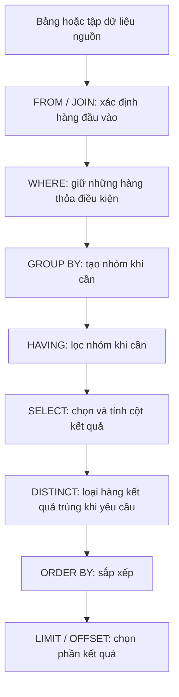
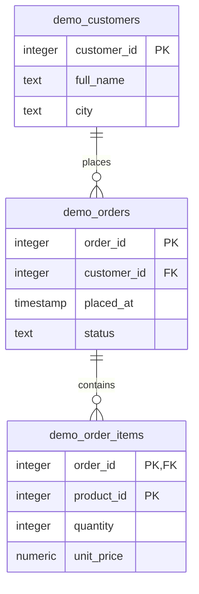

# Đọc và kiểm chứng truy vấn từng bước bằng dữ liệu mẫu

Viết được một câu `SELECT` chưa có nghĩa là đã hiểu nó. Một truy vấn có thể chạy thành công nhưng vẫn **trả sai hàng**, **đếm sai đối tượng**, **tính tổng gấp nhiều lần** hoặc **bỏ sót những bản ghi có giá trị `NULL`**. Khi đọc SQL, người học cần biết mỗi điều kiện đang loại những hàng nào, mỗi phép `JOIN` làm thay đổi số hàng ra sao, và các phép `GROUP BY`, `ORDER BY`, `LIMIT` tạo ra kết quả cuối cùng như thế nào.

Cách học hiệu quả là dùng một **bộ dữ liệu nhỏ, biết trước đáp án**, sau đó thực hiện truy vấn thành từng lớp. Bài này hướng dẫn quy trình đó trong chương **Truy vấn cơ bản** của Database SQL, từ câu `SELECT` đơn giản đến truy vấn nhiều bảng và báo cáo tổng hợp.

Các ví dụ sử dụng **PostgreSQL**. Những khái niệm như `SELECT`, `WHERE`, `JOIN`, `GROUP BY` và `HAVING` được áp dụng rộng rãi trong SQL; cú pháp thời gian, giới hạn số dòng và các tiện ích kiểm chứng có thể khác giữa các hệ quản trị.

## 1. Mục tiêu: đọc SQL như một chuỗi biến đổi dữ liệu

Với một truy vấn bất kỳ, hãy trả lời được sáu câu hỏi:

1. **Đang lấy dữ liệu từ đâu?** Bảng, truy vấn con hoặc tập kết quả trung gian nào?
2. **Mỗi hàng đầu vào đại diện cho điều gì?** Một khách hàng, một đơn hàng hay một dòng chi tiết đơn?
3. **Hàng nào được giữ hoặc loại?** Từng điều kiện trong `WHERE` hay `ON` ảnh hưởng thế nào?
4. **Số hàng có thay đổi không?** `JOIN` có nhân hàng, `GROUP BY` có gộp hàng, `DISTINCT` có loại trùng không?
5. **Mỗi cột kết quả được tính thế nào?** Cột gốc, phép tính, hàm tổng hợp hoặc bí danh?
6. **Kết quả có đủ xác định để kiểm chứng không?** Đã có `ORDER BY` khi cần thứ tự? Có trường hợp ranh giới và `NULL` để thử không?

Một truy vấn có thể được nhìn như một chuỗi biến đổi:



Đây là **thứ tự xử lý logic để hiểu ngữ nghĩa**. Bộ tối ưu hóa của database có thể thực thi khác về mặt vật lý mà vẫn giữ kết quả SQL đúng. Khi kiểm chứng từng bước, ta theo dõi **tập hàng về mặt logic**, không suy đoán máy chủ đọc từng dòng theo thứ tự nào.

## 2. Tạo một bộ dữ liệu mẫu đủ nhỏ để tính bằng tay

Bộ dữ liệu bán hàng gồm ba bảng: `demo_customers` (khách hàng), `demo_orders` (đơn hàng), `demo_order_items` (dòng chi tiết đơn). Dùng bảng tạm trong PostgreSQL để dữ liệu thực hành không ảnh hưởng đến các bảng vận hành; bảng tạm tồn tại trong phiên kết nối hiện tại.

### 2.1. Lược đồ và quan hệ



Mỗi hàng của `demo_customers` là **một khách hàng**; mỗi hàng của `demo_orders` là **một đơn hàng**; mỗi hàng của `demo_order_items` là **một dòng sản phẩm trong một đơn hàng**. Trong bài, dòng chi tiết được nhận diện bằng bộ khóa `(order_id, product_id)`. Mỗi đơn có ít nhất một dòng chi tiết theo dữ liệu mẫu, nhưng khóa ngoại một mình không bắt buộc mọi đơn luôn phải có chi tiết trong mọi tình huống thực tế.

### 2.2. Câu lệnh tạo bảng

```sql
CREATE TEMP TABLE demo_customers (
    customer_id INTEGER PRIMARY KEY,
    full_name   TEXT NOT NULL,
    city        TEXT
);

CREATE TEMP TABLE demo_orders (
    order_id    INTEGER PRIMARY KEY,
    customer_id INTEGER NOT NULL
        REFERENCES demo_customers(customer_id),
    placed_at   TIMESTAMP NOT NULL,
    status      TEXT NOT NULL
        CHECK (status IN ('paid', 'pending', 'cancelled'))
);

CREATE TEMP TABLE demo_order_items (
    order_id   INTEGER NOT NULL
        REFERENCES demo_orders(order_id),
    product_id INTEGER NOT NULL,
    quantity   INTEGER NOT NULL CHECK (quantity > 0),
    unit_price NUMERIC(12, 2) NOT NULL CHECK (unit_price >= 0),
    PRIMARY KEY (order_id, product_id)
);
```

Bộ dữ liệu minh họa dùng `unit_price` lưu trong dòng chi tiết, là **đơn giá của giao dịch tại thời điểm ghi đơn**. Điều này giúp tính tổng tiền đơn bằng `quantity * unit_price` mà không phải phụ thuộc bảng giá hiện hành.

### 2.3. Thêm dữ liệu mẫu

```sql
INSERT INTO demo_customers (customer_id, full_name, city) VALUES
    (1, 'An',   'Ha Noi'),
    (2, 'Binh', 'TP HCM'),
    (3, 'Chi',  'Ha Noi'),
    (4, 'Dung', NULL);

INSERT INTO demo_orders (order_id, customer_id, placed_at, status) VALUES
    (101, 1, TIMESTAMP '2025-03-01 09:00:00', 'paid'),
    (102, 1, TIMESTAMP '2025-03-05 11:00:00', 'pending'),
    (103, 2, TIMESTAMP '2025-03-06 15:00:00', 'paid'),
    (104, 3, TIMESTAMP '2025-03-06 15:00:00', 'paid'),
    (105, 2, TIMESTAMP '2025-04-02 10:00:00', 'cancelled'),
    (106, 2, TIMESTAMP '2025-04-03 18:00:00', 'paid');

INSERT INTO demo_order_items
    (order_id, product_id, quantity, unit_price)
VALUES
    (101, 10, 1, 100.00),
    (101, 12, 2,  20.00),
    (102, 11, 1,  50.00),
    (103, 11, 2,  50.00),
    (103, 12, 1,  20.00),
    (104, 10, 1, 100.00),
    (105, 10, 1, 100.00),
    (106, 12, 3,  20.00);
```

### 2.4. Tờ dữ liệu gốc để đối chiếu

**Khách hàng**

| `customer_id` | `full_name` | `city` |
| ---: | --- | --- |
| 1 | An | Ha Noi |
| 2 | Binh | TP HCM |
| 3 | Chi | Ha Noi |
| 4 | Dung | `NULL` |

**Đơn hàng**

| `order_id` | `customer_id` | `placed_at` | `status` |
| ---: | ---: | --- | --- |
| 101 | 1 | 2025-03-01 09:00 | paid |
| 102 | 1 | 2025-03-05 11:00 | pending |
| 103 | 2 | 2025-03-06 15:00 | paid |
| 104 | 3 | 2025-03-06 15:00 | paid |
| 105 | 2 | 2025-04-02 10:00 | cancelled |
| 106 | 2 | 2025-04-03 18:00 | paid |

**Chi tiết đơn hàng**

| `order_id` | `product_id` | `quantity` | `unit_price` | Thành tiền dòng |
| ---: | ---: | ---: | ---: | ---: |
| 101 | 10 | 1 | 100.00 | 100.00 |
| 101 | 12 | 2 | 20.00 | 40.00 |
| 102 | 11 | 1 | 50.00 | 50.00 |
| 103 | 11 | 2 | 50.00 | 100.00 |
| 103 | 12 | 1 | 20.00 | 20.00 |
| 104 | 10 | 1 | 100.00 | 100.00 |
| 105 | 10 | 1 | 100.00 | 100.00 |
| 106 | 12 | 3 | 20.00 | 60.00 |

Từ dữ liệu này, có thể tính bằng tay trước khi chạy SQL:

- **6 đơn**, gồm **4 paid**, **1 pending**, **1 cancelled**.
- Giá trị đơn `101 = 140`; `102 = 50`; `103 = 120`; `104 = 100`; `105 = 100`; `106 = 60`.
- Chỉ tính đơn `paid` thì tổng tiền là `140 + 120 + 100 + 60 = 420`.
- Tháng 3/2025 có **3 đơn paid** (`101, 103, 104`) với tổng tiền **360**.
- Tháng 4/2025 có **1 đơn paid** (`106`) với tổng tiền **60**.
- Khách `Dung` chưa có đơn và có `city = NULL`.

Đây là **oracle kiểm chứng thủ công**: những giá trị đã biết trước, dùng để phát hiện truy vấn thiếu lọc trạng thái, nhân hàng hoặc tính sai cấp độ. Trong bài, doanh thu được định nghĩa đơn giản là tổng `quantity * unit_price` của **đơn paid**; nghiệp vụ thật có thể bổ sung thuế, hoàn tiền, giảm giá và thời điểm ghi nhận khác.

## 3. Đọc một câu SELECT từ cấu trúc đến ý nghĩa

Bắt đầu từ câu dễ nhất:

```sql
SELECT order_id, customer_id, status
FROM demo_orders;
```

Cách đọc:

- `FROM demo_orders`: nguồn dữ liệu là bảng đơn hàng, **6 hàng**.
- `SELECT order_id, customer_id, status`: lấy 3 cột của mỗi hàng, **không lọc và không gộp hàng**.
- Không có `ORDER BY`, nên **không có bảo đảm về thứ tự** các hàng trả về, ngay cả khi đôi lúc chúng xuất hiện theo thứ tự lúc chèn.

Muốn hiển thị theo thứ tự ID xác định:

```sql
SELECT order_id, customer_id, status
FROM demo_orders
ORDER BY order_id;
```

Trong lệnh này, `ORDER BY` không thay đổi tập hàng hay giá trị; nó chỉ yêu cầu thứ tự hiển thị. Khi người học đối chiếu bảng kết quả bằng tay, nên thêm `ORDER BY` vào câu truy vấn quan sát để tránh nhầm sự thay đổi thứ tự với sự thay đổi dữ liệu.

### 3.1. Phân biệt cột nguồn, biểu thức và bí danh

```sql
SELECT
    order_id,
    quantity,
    unit_price,
    quantity * unit_price AS line_amount
FROM demo_order_items
ORDER BY order_id, product_id;
```

`line_amount` không phải cột đã tồn tại trong bảng. Nó là **bí danh** của biểu thức tính cho từng hàng. `quantity * unit_price` được áp dụng trên hàng `demo_order_items`, nên mỗi hàng đầu ra vẫn là **một dòng sản phẩm**.

Tại thời điểm này chưa có tổng tiền của mỗi đơn. Muốn tính tổng cho đơn `101`, cần **cộng hai dòng của đơn 101**; việc chọn một cột tính toán chưa tự thực hiện phép cộng giữa các hàng.

### 3.2. Sử dụng alias để biết cột thuộc bảng nào

```sql
SELECT
    o.order_id,
    o.customer_id,
    o.status
FROM demo_orders AS o
ORDER BY o.order_id;
```

`o` là alias của `demo_orders` trong phạm vi câu lệnh. Với một bảng, alias là tùy chọn; khi `JOIN` nhiều bảng cùng có `customer_id`, viết `o.customer_id` và `c.customer_id` giúp tránh mơ hồ.

## 4. Đọc WHERE từng điều kiện: giữ hàng nào, loại hàng nào?

Xét truy vấn lọc trạng thái:

```sql
SELECT order_id, status
FROM demo_orders
WHERE status = 'paid'
ORDER BY order_id;
```

Bảng theo dõi từng hàng:

| `order_id` | `status` | `status = 'paid'` | Giữ? |
| ---: | --- | --- | --- |
| 101 | paid | `TRUE` | Có |
| 102 | pending | `FALSE` | Không |
| 103 | paid | `TRUE` | Có |
| 104 | paid | `TRUE` | Có |
| 105 | cancelled | `FALSE` | Không |
| 106 | paid | `TRUE` | Có |

Kết quả là `101, 103, 104, 106`. Phương pháp kiểm chứng là viết **một bảng chân trị theo từng hàng**, thay vì chỉ đọc lướt câu điều kiện và đoán.

### 4.1. Thêm điều kiện AND

```sql
SELECT order_id, customer_id, status
FROM demo_orders
WHERE status = 'paid'
  AND customer_id = 2
ORDER BY order_id;
```

Chỉ giữ đơn **vừa paid vừa thuộc khách 2**, tức `103` và `106`. Để kiểm chứng từng bước, có thể chạy một truy vấn lọc `paid` trước, rồi thêm điều kiện `customer_id = 2` vào lần chạy tiếp theo.

| Bước | Tập `order_id` |
| --- | --- |
| Nguồn `demo_orders` | 101, 102, 103, 104, 105, 106 |
| Sau `status = 'paid'` | 101, 103, 104, 106 |
| Sau cả hai điều kiện `AND` | 103, 106 |

Điều này là cách **suy luận về tập kết quả**, không có nghĩa PostgreSQL bắt buộc đánh giá điều kiện bên trái trước điều kiện bên phải khi thực thi.

### 4.2. OR, AND và dấu ngoặc đổi ý nghĩa

So sánh:

```sql
-- A: mọi đơn paid, thêm đơn pending của khách 1.
SELECT order_id
FROM demo_orders
WHERE status = 'paid'
   OR status = 'pending' AND customer_id = 1
ORDER BY order_id;
```

với:

```sql
-- B: chỉ các đơn paid hoặc pending thuộc khách 1.
SELECT order_id
FROM demo_orders
WHERE (status = 'paid' OR status = 'pending')
  AND customer_id = 1
ORDER BY order_id;
```

`AND` có độ ưu tiên cao hơn `OR`. Do đó:

| Truy vấn | Nhóm điều kiện logic | Kết quả |
| --- | --- | --- |
| A | `paid OR (pending AND customer_id=1)` | 101, 102, 103, 104, 106 |
| B | `(paid OR pending) AND customer_id=1` | 101, 102 |

Để kiểm chứng phép lọc nhiều điều kiện, hãy **viết lại dấu ngoặc cho từng nhóm ý nghĩa**, rồi đánh giá trên những hàng như `103` và `102`. `103` là paid nhưng không thuộc khách 1: nó giúp phân biệt hai câu truy vấn.

### 4.3. IS NULL và logic ba giá trị

`NULL` không đồng nghĩa với chuỗi rỗng hoặc giá trị số 0. Cột `city` của khách `Dung` là `NULL`.

```sql
SELECT customer_id, full_name
FROM demo_customers
WHERE city = 'Ha Noi'
ORDER BY customer_id;
```

Kết quả `An` và `Chi`. Khi hỏi khách **không ở Hà Nội**, câu:

```sql
SELECT customer_id, full_name
FROM demo_customers
WHERE city <> 'Ha Noi'
ORDER BY customer_id;
```

chỉ lấy `Binh`, **không lấy Dung**. Với Dung, phép so sánh `NULL <> 'Ha Noi'` trả về `UNKNOWN`; `WHERE` chỉ giữ giá trị `TRUE`.

Nếu yêu cầu bao gồm cả khách **chưa khai báo thành phố**, phải nói rõ:

```sql
SELECT customer_id, full_name
FROM demo_customers
WHERE city <> 'Ha Noi'
   OR city IS NULL
ORDER BY customer_id;
```

Kết quả là `Binh` và `Dung`.

Đọc SQL có `NULL` cần xét ba trạng thái `TRUE`, `FALSE`, `UNKNOWN`. Việc viết `city = NULL` hoặc `city <> NULL` để tìm giá trị thiếu là sai ngữ nghĩa; dùng `IS NULL` hoặc `IS NOT NULL`.

## 5. Kiểm chứng truy vấn theo khoảng thời gian

Câu hỏi: **Những đơn paid nào được đặt trong tháng 3/2025?**

SQL:

```sql
SELECT order_id, customer_id, placed_at, status
FROM demo_orders
WHERE status = 'paid'
  AND placed_at >= TIMESTAMP '2025-03-01 00:00:00'
  AND placed_at <  TIMESTAMP '2025-04-01 00:00:00'
ORDER BY placed_at, order_id;
```

Đọc từng điều kiện:

1. `status = 'paid'` giữ các đơn `101, 103, 104, 106`.
2. `placed_at >= '2025-03-01'` giữ các đơn từ đầu tháng 3 trở đi (với tập đang xét, cả bốn vẫn còn).
3. `placed_at < '2025-04-01'` loại đơn `106` của tháng 4.
4. `ORDER BY placed_at, order_id` sắp xếp ba đơn còn lại theo thời điểm, sau đó theo ID để phân biệt trường hợp bằng thời điểm.

Kết quả mong đợi:

| `order_id` | `customer_id` | `placed_at` | `status` |
| ---: | ---: | --- | --- |
| 101 | 1 | 2025-03-01 09:00 | paid |
| 103 | 2 | 2025-03-06 15:00 | paid |
| 104 | 3 | 2025-03-06 15:00 | paid |

### Vì sao dùng khoảng thời gian nửa mở?

Một sai lầm thường gặp là:

```sql
-- Có thể bỏ sót các hàng có phần lẻ giây vào cuối ngày 31/3.
WHERE placed_at BETWEEN TIMESTAMP '2025-03-01 00:00:00'
                    AND TIMESTAMP '2025-03-31 23:59:59'
```

`BETWEEN` bao gồm cả hai đầu, nhưng giá trị `2025-03-31 23:59:59.500` lớn hơn giới hạn trên. Với cột thời gian có phần lẻ của giây, điều kiện này bỏ sót các hàng cuối ngày.

Cách dùng:

```sql
WHERE placed_at >= TIMESTAMP '2025-03-01 00:00:00'
  AND placed_at <  TIMESTAMP '2025-04-01 00:00:00'
```

bao trùm toàn bộ tháng 3, không cần biết cột có độ chính xác tới mili giây hay micro giây. Nếu dùng thời điểm có múi giờ (`TIMESTAMPTZ`), phải xác định **múi giờ của kỳ báo cáo** trước khi tạo hai mốc ranh giới.

### Không biến cột thời gian thành chuỗi để so sánh

```sql
-- Không nên dùng biểu thức hiển thị chuỗi để xác định khoảng ngày.
WHERE TO_CHAR(placed_at, 'YYYY-MM') = '2025-03'
```

Trong PostgreSQL, cách này có thể chạy với dữ liệu phù hợp, nhưng biến dữ liệu thời gian thành chuỗi, làm ngữ nghĩa và khả năng dùng index thường kém rõ ràng hơn điều kiện phạm vi trực tiếp. Khi kiểm chứng, hãy ưu tiên so sánh **giá trị thời gian với mốc thời gian**.

## 6. ORDER BY, LIMIT và câu hỏi “hai đơn mới nhất”

Câu hỏi: **Hai đơn đã thanh toán mới nhất là đơn nào?**

```sql
SELECT order_id, placed_at
FROM demo_orders
WHERE status = 'paid'
ORDER BY placed_at DESC, order_id DESC
LIMIT 2;
```

Các đơn paid là `101, 103, 104, 106`. Theo thời điểm giảm dần, `106` mới nhất. Đơn `103` và `104` có **cùng thời điểm** `2025-03-06 15:00`; `order_id DESC` quyết định `104` đứng trước `103`. Vậy kết quả là `106` rồi `104`.

Nếu bỏ tiêu chí phụ:

```sql
ORDER BY placed_at DESC
LIMIT 2
```

thì hàng thứ hai trong hai hàng có cùng thời điểm **không được xác định duy nhất**: cả `103` và `104` có thể được chọn tùy kế hoạch thực thi và trạng thái dữ liệu. Muốn kết quả ổn định, cần một tiêu chí cuối cùng đủ để phân thứ tự, ví dụ khóa chính.

**Phân biệt:** `ORDER BY` thay đổi thứ tự, `LIMIT` thay đổi số hàng trả về; `LIMIT` không có `ORDER BY` thường không phù hợp cho câu hỏi “mới nhất” hay “lớn nhất”.

### OFFSET và tính ổn định của phân trang

```sql
SELECT order_id, placed_at
FROM demo_orders
WHERE status = 'paid'
ORDER BY placed_at DESC, order_id DESC
LIMIT 2 OFFSET 2;
```

Với dữ liệu mẫu không thay đổi, trang thứ hai gồm `103` và `101`. Nhưng khi dữ liệu được thêm/xóa giữa hai lần đọc trang, `OFFSET` có thể làm một hàng bị lặp hoặc bỏ qua. Với tập dữ liệu lớn và trang thay đổi theo thời gian, có thể cân nhắc phân trang theo khóa (*keyset pagination*); trước hết phải định nghĩa thứ tự đầy đủ và ổn định.

## 7. Đọc JOIN: vì sao số hàng tăng lên?

Một truy vấn chỉ lấy `demo_orders` có 6 hàng. Khi `JOIN` với `demo_order_items`, số hàng sẽ tăng vì **một đơn có thể có nhiều dòng chi tiết**.

```sql
SELECT
    o.order_id,
    o.status,
    oi.product_id,
    oi.quantity,
    oi.unit_price
FROM demo_orders AS o
JOIN demo_order_items AS oi
  ON oi.order_id = o.order_id
ORDER BY o.order_id, oi.product_id;
```

Bảng kết quả có **8 hàng**, vì bảng `demo_order_items` có 8 dòng tương ứng với 6 đơn. Cụ thể:

| `order_id` | Số dòng chi tiết | Số hàng kết quả sau JOIN |
| ---: | ---: | ---: |
| 101 | 2 | 2 |
| 102 | 1 | 1 |
| 103 | 2 | 2 |
| 104 | 1 | 1 |
| 105 | 1 | 1 |
| 106 | 1 | 1 |
| **Tổng** | **8** | **8** |

Trong quá trình đọc `JOIN`, hãy hỏi: **Một hàng bên trái có thể khớp bao nhiêu hàng bên phải?** Nếu kết quả là “nhiều”, một hàng đầu vào sẽ xuất hiện thành nhiều hàng sau nối.

### 7.1. Truy vấn đúng cú pháp nhưng đếm sai đơn

```sql
SELECT COUNT(*) AS row_count
FROM demo_orders AS o
JOIN demo_order_items AS oi
  ON oi.order_id = o.order_id
WHERE o.status = 'paid';
```

Kết quả là **6**, bởi các đơn paid có số dòng chi tiết:

- `101`: 2 dòng;
- `103`: 2 dòng;
- `104`: 1 dòng;
- `106`: 1 dòng.

Cộng lại 6 **dòng sản phẩm**, không phải 4 **đơn hàng**. Nếu câu hỏi là “có bao nhiêu đơn paid?”, hãy đếm trực tiếp từ `demo_orders`:

```sql
SELECT COUNT(*) AS paid_order_count
FROM demo_orders
WHERE status = 'paid';
-- 4
```

Hoặc khi cần giữ `JOIN` vì lý do khác:

```sql
SELECT COUNT(DISTINCT o.order_id) AS paid_order_count
FROM demo_orders AS o
JOIN demo_order_items AS oi
  ON oi.order_id = o.order_id
WHERE o.status = 'paid';
-- 4
```

`COUNT(DISTINCT ...)` phù hợp khi muốn đếm **khóa đơn duy nhất** trong kết quả đã nối. Tuy nhiên, nên xác định nguyên nhân số hàng tăng trước khi dùng `DISTINCT`; nếu điều kiện nối sai tạo nhiều hàng ngoài ý muốn, `DISTINCT` có thể che lỗi.

### 7.2. Thiếu điều kiện JOIN có thể tạo tích Descartes

```sql
-- Cố ý minh họa truy vấn sai khi muốn nối theo order_id:
SELECT o.order_id, oi.product_id
FROM demo_orders AS o
CROSS JOIN demo_order_items AS oi;
```

Vì có 6 đơn và 8 dòng chi tiết, `CROSS JOIN` tạo **6 × 8 = 48** cặp. `CROSS JOIN` là phép toán hợp lệ khi thật sự cần mọi tổ hợp, nhưng không đúng nếu ý định là mỗi đơn chỉ đi với chi tiết của nó.

Thói quen kiểm chứng:

- Xác định **khóa nối** giữa hai bảng.
- Dự đoán quan hệ một-một, một-nhiều hay nhiều-nhiều.
- Dự đoán số hàng trước và sau `JOIN`.
- Kiểm tra một trường hợp có nhiều dòng, như đơn `101`.
- Không dùng `DISTINCT` để chữa một điều kiện nối bị thiếu.

## 8. INNER JOIN và LEFT JOIN: giữ hàng bên nào?

Câu hỏi: **Hiển thị mọi khách hàng, kể cả khách chưa mua hàng, cùng số đơn đã thanh toán.**

Nếu dùng `INNER JOIN`:

```sql
SELECT c.customer_id, c.full_name, o.order_id
FROM demo_customers AS c
JOIN demo_orders AS o
  ON o.customer_id = c.customer_id
WHERE o.status = 'paid'
ORDER BY c.customer_id, o.order_id;
```

Khách `Dung` sẽ biến mất, vì không có đơn hàng tương ứng. Những khách có nhiều đơn paid sẽ xuất hiện nhiều dòng.

Để giữ cả khách không có đơn, dùng `LEFT JOIN` và đặt điều kiện trạng thái vào `ON`:

```sql
SELECT
    c.customer_id,
    c.full_name,
    COUNT(o.order_id) AS paid_order_count
FROM demo_customers AS c
LEFT JOIN demo_orders AS o
  ON o.customer_id = c.customer_id
 AND o.status = 'paid'
GROUP BY c.customer_id, c.full_name
ORDER BY c.customer_id;
```

Kết quả:

| `customer_id` | `full_name` | `paid_order_count` |
| ---: | --- | ---: |
| 1 | An | 1 |
| 2 | Binh | 2 |
| 3 | Chi | 1 |
| 4 | Dung | 0 |

Đọc từng phần:

1. `FROM demo_customers AS c`: bắt đầu từ 4 khách hàng, mỗi khách cần được giữ.
2. `LEFT JOIN demo_orders AS o ... AND o.status='paid'`: chỉ ghép những đơn paid; khách không có đơn paid vẫn có một hàng kết quả với các cột `o.*` bằng `NULL`.
3. `GROUP BY c.customer_id, c.full_name`: gom lại một nhóm mỗi khách.
4. `COUNT(o.order_id)`: chỉ đếm giá trị `order_id` không `NULL`, nên khách Dung được **0**.

Nếu chuyển `o.status = 'paid'` từ `ON` xuống `WHERE`:

```sql
-- Không giữ được khách không có đơn paid:
SELECT c.customer_id, c.full_name, COUNT(o.order_id)
FROM demo_customers AS c
LEFT JOIN demo_orders AS o
  ON o.customer_id = c.customer_id
WHERE o.status = 'paid'
GROUP BY c.customer_id, c.full_name;
```

Dòng `Dung` có `o.status = NULL` nên `WHERE` loại nó. Trong trường hợp này, việc đưa điều kiện sang `WHERE` **thay đổi ngữ nghĩa** của `LEFT JOIN`.

### COUNT(*) và COUNT(column) trên LEFT JOIN

```sql
SELECT
    c.customer_id,
    COUNT(*) AS joined_rows,
    COUNT(o.order_id) AS paid_orders
FROM demo_customers AS c
LEFT JOIN demo_orders AS o
  ON o.customer_id = c.customer_id
 AND o.status = 'paid'
GROUP BY c.customer_id
ORDER BY c.customer_id;
```

Với khách `Dung`, `COUNT(*) = 1` vì `LEFT JOIN` tạo một **hàng kết quả** để giữ khách, nhưng `COUNT(o.order_id) = 0` vì cột khóa ở phía đơn là `NULL`. Đây là trường hợp mẫu rất hữu ích khi kiểm tra báo cáo đếm.

## 9. GROUP BY: đừng nhầm cấp độ dữ liệu

Khi tính tổng tiền của mỗi đơn, cần gộp các **dòng chi tiết theo `order_id`**:

```sql
SELECT
    order_id,
    SUM(quantity * unit_price) AS order_total
FROM demo_order_items
GROUP BY order_id
ORDER BY order_id;
```

Kết quả:

| `order_id` | `order_total` |
| ---: | ---: |
| 101 | 140.00 |
| 102 | 50.00 |
| 103 | 120.00 |
| 104 | 100.00 |
| 105 | 100.00 |
| 106 | 60.00 |

Đây là phép biến đổi **8 dòng chi tiết → 6 dòng tổng tiền theo đơn**. Nếu truy vấn ngoài `SELECT` một cột như `product_id` mà không nhóm hay tổng hợp nó, không thể xác định nên lấy mã sản phẩm nào cho một đơn có nhiều sản phẩm. Trong PostgreSQL, câu truy vấn sẽ bị từ chối nếu cột không đáp ứng quy tắc `GROUP BY`.

### 9.1. WHERE khác HAVING

Câu hỏi: **Đơn paid nào có tổng tiền ít nhất 100?**

```sql
SELECT
    o.order_id,
    SUM(oi.quantity * oi.unit_price) AS order_total
FROM demo_orders AS o
JOIN demo_order_items AS oi
  ON oi.order_id = o.order_id
WHERE o.status = 'paid'
GROUP BY o.order_id
HAVING SUM(oi.quantity * oi.unit_price) >= 100
ORDER BY order_total DESC, o.order_id;
```

Theo từng lớp:

- `WHERE o.status = 'paid'` loại các dòng chi tiết thuộc đơn pending/cancelled trước khi nhóm.
- `GROUP BY o.order_id` tạo một hàng trên mỗi đơn paid.
- `SUM(...)` tính tổng tiền trong từng nhóm.
- `HAVING SUM(...) >= 100` chỉ giữ nhóm đơn đủ ngưỡng.
- `ORDER BY ...` sắp thứ tự kết quả.

Kết quả là `101 (140)`, `103 (120)` và `104 (100)`; đơn `106 (60)` bị loại bởi `HAVING`.

Đây là hai câu hỏi khác nhau:

- `WHERE oi.quantity * oi.unit_price >= 100`: chỉ giữ **dòng sản phẩm** có thành tiền từ 100, rồi mới cộng những dòng còn lại.
- `HAVING SUM(oi.quantity * oi.unit_price) >= 100`: giữ **đơn hàng** có tổng tiền từ 100.

Ví dụ đơn `101` có hai dòng `100` và `40`. Nếu dùng `WHERE thành tiền dòng >= 100`, tổng chỉ còn `100` thay vì `140`; điều kiện đó không tương đương yêu cầu “tổng đơn từ 100”.

### 9.2. AVG trên dòng và AVG trên đơn khác nhau

```sql
-- Trung bình thành tiền của từng dòng sản phẩm, không phải từng đơn.
SELECT AVG(quantity * unit_price) AS average_line_amount
FROM demo_order_items
WHERE order_id IN (101, 103);
```

Tập giá trị là `100, 40, 100, 20`, trung bình `65`. Nhưng tổng hai đơn `101` và `103` là `140` và `120`, nên **giá trị trung bình mỗi đơn** là `130`.

Muốn tính đúng trung bình mỗi đơn, hãy tổng hợp trước:

```sql
WITH order_totals AS (
    SELECT order_id,
           SUM(quantity * unit_price) AS order_total
    FROM demo_order_items
    WHERE order_id IN (101, 103)
    GROUP BY order_id
)
SELECT AVG(order_total) AS average_order_value
FROM order_totals;
-- 130.00
```

Khi kiểm chứng một hàm `AVG`, luôn hỏi: **trung bình của những đối tượng nào?** Dòng chi tiết, đơn hàng, khách hàng hay tháng?

## 10. Quy trình kiểm chứng trọn vẹn một truy vấn báo cáo

Bài toán: **Tính số đơn đã thanh toán và tổng tiền của từng khách trong tháng 3/2025, chỉ hiển thị khách có đơn paid trong tháng.**

Không nên bắt đầu bằng một `SELECT` quá dài rồi dò lỗi trên kết quả cuối. Hãy xác định các biến đổi trung gian.

### Bước 1 — Xác định câu hỏi và quy tắc

- Phạm vi thời gian: từ đầu `2025-03-01` đến trước `2025-04-01`.
- Trạng thái: chỉ `paid`.
- Một đơn có thể nhiều dòng chi tiết.
- Số đơn phải đếm ở cấp **đơn**, không đếm số dòng sản phẩm.
- Tổng tiền mỗi đơn là `SUM(quantity * unit_price)`.
- Kết quả cuối: **một dòng cho một khách có ít nhất một đơn paid trong tháng**.

### Bước 2 — Lấy đúng những đơn nằm trong phạm vi

```sql
SELECT order_id, customer_id, placed_at, status
FROM demo_orders
WHERE status = 'paid'
  AND placed_at >= TIMESTAMP '2025-03-01'
  AND placed_at <  TIMESTAMP '2025-04-01'
ORDER BY order_id;
```

Kết quả trung gian có đúng ba hàng:

| `order_id` | `customer_id` |
| ---: | ---: |
| 101 | 1 |
| 103 | 2 |
| 104 | 3 |

Nếu kết quả có `102` thì thiếu lọc `status`; nếu có `106` thì thiếu giới hạn cuối tháng.

### Bước 3 — JOIN chi tiết và quan sát số dòng

```sql
SELECT
    o.order_id,
    o.customer_id,
    oi.product_id,
    oi.quantity,
    oi.unit_price,
    oi.quantity * oi.unit_price AS line_amount
FROM demo_orders AS o
JOIN demo_order_items AS oi
  ON oi.order_id = o.order_id
WHERE o.status = 'paid'
  AND o.placed_at >= TIMESTAMP '2025-03-01'
  AND o.placed_at <  TIMESTAMP '2025-04-01'
ORDER BY o.order_id, oi.product_id;
```

Kết quả trung gian có **5 hàng**:

| `order_id` | `customer_id` | `product_id` | `line_amount` |
| ---: | ---: | ---: | ---: |
| 101 | 1 | 10 | 100.00 |
| 101 | 1 | 12 | 40.00 |
| 103 | 2 | 11 | 100.00 |
| 103 | 2 | 12 | 20.00 |
| 104 | 3 | 10 | 100.00 |

Số dòng tăng từ **3 đơn** thành **5 dòng sản phẩm** là dự kiến, không phải lỗi. Tổng các dòng ở bước này là `100 + 40 + 100 + 20 + 100 = 360`.

### Bước 4 — Gom về đúng một hàng trên mỗi đơn

```sql
SELECT
    o.order_id,
    o.customer_id,
    SUM(oi.quantity * oi.unit_price) AS order_total
FROM demo_orders AS o
JOIN demo_order_items AS oi
  ON oi.order_id = o.order_id
WHERE o.status = 'paid'
  AND o.placed_at >= TIMESTAMP '2025-03-01'
  AND o.placed_at <  TIMESTAMP '2025-04-01'
GROUP BY o.order_id, o.customer_id
ORDER BY o.order_id;
```

| `order_id` | `customer_id` | `order_total` |
| ---: | ---: | ---: |
| 101 | 1 | 140.00 |
| 103 | 2 | 120.00 |
| 104 | 3 | 100.00 |

Đây là bảng trung gian quan trọng nhất: **3 dòng = 3 đơn paid trong tháng 3**.

### Bước 5 — Gom các đơn theo khách và nối tên

Có thể đặt kết quả bước 4 vào CTE để đọc rõ:

```sql
WITH paid_order_totals AS (
    SELECT
        o.order_id,
        o.customer_id,
        SUM(oi.quantity * oi.unit_price) AS order_total
    FROM demo_orders AS o
    JOIN demo_order_items AS oi
      ON oi.order_id = o.order_id
    WHERE o.status = 'paid'
      AND o.placed_at >= TIMESTAMP '2025-03-01'
      AND o.placed_at <  TIMESTAMP '2025-04-01'
    GROUP BY o.order_id, o.customer_id
)
SELECT
    c.customer_id,
    c.full_name,
    COUNT(*) AS paid_order_count,
    SUM(p.order_total) AS paid_amount
FROM paid_order_totals AS p
JOIN demo_customers AS c
  ON c.customer_id = p.customer_id
GROUP BY c.customer_id, c.full_name
ORDER BY c.customer_id;
```

Kết quả cuối:

| `customer_id` | `full_name` | `paid_order_count` | `paid_amount` |
| ---: | --- | ---: | ---: |
| 1 | An | 1 | 140.00 |
| 2 | Binh | 1 | 120.00 |
| 3 | Chi | 1 | 100.00 |

Ở đây `COUNT(*)` **đúng là số đơn**, vì CTE đã bảo đảm một hàng trên mỗi đơn. Sử dụng cùng cú pháp `COUNT(*)` **trước** bước tổng hợp theo đơn sẽ đếm số dòng sản phẩm. Đây là lý do cần đọc **cấp độ mỗi hàng đầu vào** tại từng điểm trong truy vấn.

### Bước 6 — Đối chiếu tổng và số lượng

Báo cáo cuối phải thỏa hai bất biến của bộ dữ liệu mẫu:

```text
Tổng số đơn trong báo cáo = 1 + 1 + 1 = 3
Tổng tiền trong báo cáo  = 140 + 120 + 100 = 360
```

Đồng thời, tổng `360` phải khớp với tổng của năm dòng chi tiết sau `JOIN` ở bước 3, và tổng của ba đơn ở bước 4. Nếu số này khác nhau, hãy kiểm tra từng tầng thay vì sửa tùy tiện câu `SUM` cuối.

## 11. Kiểm chứng dữ liệu không có bản ghi liên quan

Câu hỏi thay đổi một chút: **Báo cáo doanh thu paid của tất cả khách, kể cả khách chưa mua hoặc chưa có đơn paid; hiển thị `0` khi không có doanh thu.**

Không thể chỉ dùng truy vấn bước 5, bởi nguồn `paid_order_totals` không có khách `Dung`. Muốn giữ tất cả khách, bắt đầu từ bảng `demo_customers`:

```sql
WITH paid_order_totals AS (
    SELECT
        o.order_id,
        o.customer_id,
        SUM(oi.quantity * oi.unit_price) AS order_total
    FROM demo_orders AS o
    JOIN demo_order_items AS oi
      ON oi.order_id = o.order_id
    WHERE o.status = 'paid'
    GROUP BY o.order_id, o.customer_id
)
SELECT
    c.customer_id,
    c.full_name,
    COUNT(p.order_id) AS paid_order_count,
    COALESCE(SUM(p.order_total), 0) AS paid_amount
FROM demo_customers AS c
LEFT JOIN paid_order_totals AS p
  ON p.customer_id = c.customer_id
GROUP BY c.customer_id, c.full_name
ORDER BY c.customer_id;
```

Kết quả toàn bộ dữ liệu mẫu:

| Khách | Số đơn paid | Tổng tiền paid |
| --- | ---: | ---: |
| An | 1 | 140.00 |
| Binh | 2 | 180.00 |
| Chi | 1 | 100.00 |
| Dung | 0 | 0.00 |

`COALESCE(SUM(...), 0)` là **quy tắc hiển thị có chủ đích**: với khách không có đơn paid, `SUM` trả `NULL` nên chuyển thành `0`. Trong bài toán khác, “chưa có dữ liệu” có thể không đồng nghĩa với doanh thu bằng 0; khi đó cần giữ trạng thái riêng.

Những câu hỏi kiểm chứng trường hợp rỗng:

- Khách có 0 đơn phải xuất hiện không?
- Nếu dùng `INNER JOIN`, những hàng nào sẽ mất?
- `COUNT(*)` và `COUNT(p.order_id)` có cho cùng kết quả với hàng không khớp không?
- Có cần phân biệt `0`, `NULL` và “không có hàng kết quả” không?

## 12. Các dạng lỗi thường gặp khi đọc và đối chiếu SQL

### 12.1. Nhầm bí danh của SELECT với cột nguồn

```sql
-- Sai trong PostgreSQL: line_amount chưa khả dụng ở WHERE cùng cấp.
SELECT quantity * unit_price AS line_amount
FROM demo_order_items
WHERE line_amount >= 100;
```

`WHERE` thuộc giai đoạn lọc trước khi danh sách kết quả `SELECT` được hình thành về mặt logic; alias `line_amount` không tự trở thành cột nguồn. Cách dễ hiểu là lặp lại biểu thức:

```sql
SELECT quantity * unit_price AS line_amount
FROM demo_order_items
WHERE quantity * unit_price >= 100;
```

Hoặc tách bằng CTE:

```sql
WITH lines AS (
    SELECT
        order_id,
        product_id,
        quantity * unit_price AS line_amount
    FROM demo_order_items
)
SELECT order_id, product_id, line_amount
FROM lines
WHERE line_amount >= 100
ORDER BY order_id, product_id;
```

Trong truy vấn ngoài, `line_amount` lúc này đã là cột của tập `lines`, nên có thể lọc bình thường. `ORDER BY` có những quy tắc riêng cho alias của `SELECT` trong nhiều hệ quản trị, nhưng điều đó không có nghĩa alias dùng được ở mọi mệnh đề.

### 12.2. Dùng DISTINCT để che JOIN sai

```sql
SELECT DISTINCT o.customer_id
FROM demo_orders AS o
JOIN demo_order_items AS oi
  ON oi.order_id = o.order_id;
```

Kết quả là tập ID khách xuất hiện trong các đơn có chi tiết. Nếu mục tiêu chỉ là lấy các khách có đơn, có thể truy vấn trực tiếp từ `demo_orders`:

```sql
SELECT DISTINCT customer_id
FROM demo_orders
ORDER BY customer_id;
```

Trong dữ liệu mẫu, cả hai cho `1, 2, 3`. Nhưng đừng kết luận JOIN đầu là “đúng” chỉ vì `DISTINCT` làm kết quả trông gọn. Nếu JOIN nhân hàng ngoài dự kiến và truy vấn có thêm `SUM`, việc dùng `DISTINCT` sau cùng không tự sửa tổng đã cộng sai.

### 12.3. Nhầm điều kiện trên hàng và điều kiện trên nhóm

```sql
-- Lọc các dòng giá trị >= 100 trước khi cộng:
SELECT order_id, SUM(quantity * unit_price) AS total
FROM demo_order_items
WHERE quantity * unit_price >= 100
GROUP BY order_id;
```

Ví dụ đơn `101` bị mất dòng `40`, nên tổng còn `100`. Nếu yêu cầu là **tổng đơn >= 100**, phải nhóm toàn bộ dòng của đơn rồi dùng `HAVING` hoặc lọc trên một CTE đã tính `order_total`.

### 12.4. Dùng điều kiện = NULL

```sql
-- Không tìm được khách city NULL theo cách mong muốn:
SELECT * FROM demo_customers WHERE city = NULL;

-- Đúng:
SELECT * FROM demo_customers WHERE city IS NULL;
```

`WHERE city = NULL` cho điều kiện `UNKNOWN` ở các hàng, nên không trả `Dung`. Đây là lỗi logic, không nhất thiết là lỗi cú pháp.

### 12.5. Lấy “mới nhất” mà không có ORDER BY

```sql
SELECT order_id
FROM demo_orders
LIMIT 1;
```

Không thể suy ra kết quả là `101` hay `106` chỉ từ thứ tự chèn dữ liệu. Muốn “mới nhất”, phải định nghĩa cột thời gian và cách phân định trường hợp bằng nhau:

```sql
SELECT order_id
FROM demo_orders
ORDER BY placed_at DESC, order_id DESC
LIMIT 1;
-- 106
```

### 12.6. Đếm sai sau LEFT JOIN

```sql
SELECT c.customer_id, COUNT(*) AS count_rows
FROM demo_customers AS c
LEFT JOIN demo_orders AS o
  ON o.customer_id = c.customer_id
GROUP BY c.customer_id;
```

Khách `Dung` có `COUNT(*) = 1` do hàng mở rộng của `LEFT JOIN`. Nếu yêu cầu là số đơn, dùng `COUNT(o.order_id)`.

### 12.7. Không xác định dữ liệu nào thực sự được tính

```sql
-- Sai nghiệp vụ nếu mục tiêu chỉ tính doanh thu đã thanh toán:
SELECT SUM(oi.quantity * oi.unit_price)
FROM demo_orders AS o
JOIN demo_order_items AS oi
  ON oi.order_id = o.order_id;
```

Câu trên cộng cả đơn `pending` và `cancelled`, cho `570` thay vì doanh thu paid `420`. Truy vấn hợp lệ về SQL nhưng **không đúng định nghĩa doanh thu của bài**. Khi kiểm chứng, câu đầu tiên phải là “bản ghi nào được phép tính?” chứ không phải “hàm `SUM` đã đúng cú pháp chưa?”.

## 13. Thiết kế dữ liệu mẫu có chủ đích để phát hiện sai lệch

Một bộ dữ liệu kiểm chứng tốt không nhất thiết có hàng nghìn dòng. **Vài hàng được chọn đúng** thường phát hiện lỗi nhanh hơn một bộ dữ liệu lớn nhưng ngẫu nhiên.

| Kiểu trường hợp cần có | Đã được biểu diễn ở dữ liệu mẫu | Lỗi có thể phát hiện |
| --- | --- | --- |
| Một hàng cha có nhiều con | Đơn 101 và 103 có hai dòng chi tiết | Đếm nhầm sau JOIN, SUM bị nhân |
| Hàng cha không có con | Khách Dung không có đơn | INNER/LEFT JOIN, COUNT(*) |
| Bản ghi cần loại theo trạng thái | Đơn pending 102, cancelled 105 | Thiếu WHERE trạng thái |
| Hàng ở hai phía ranh giới tháng | Đơn 101 trong tháng 3, 106 trong tháng 4 | Lọc kỳ sai |
| Hai bản ghi trùng tiêu chí sắp xếp | Đơn 103 và 104 cùng placed_at | LIMIT thiếu tiêu chí phụ |
| Giá trị NULL | Dung.city = NULL | Sai phép so sánh và xử lý UNKNOWN |
| Đơn có thành tiền nhiều mức | Đơn 101 gồm 100 và 40 | WHERE theo dòng nhầm HAVING theo đơn |
| Một khách nhiều đơn paid | Khách Binh có 103 và 106 | Sai số đơn và nhóm theo khách |

Khi dữ liệu thực tế không có sẵn trường hợp thử, nên bổ sung **các hàng kiểm chứng chuyên dụng trong môi trường thử nghiệm**. Không thêm dữ liệu giả vào bảng production chỉ để kiểm tra một câu truy vấn.

### 13.1. Tập kết quả dự kiến là một hợp đồng

Trước khi chạy SQL, hãy viết kết quả dự kiến bằng bảng hoặc tập ID. Ví dụ:

```text
Yêu cầu: Đơn paid trong tháng 3
Expected IDs: {101, 103, 104}
Expected row count: 3
Expected amount from items: 360.00
Excluded: 102 (pending), 105 (cancelled), 106 (tháng 4)
```

Có thể kiểm chứng theo nhiều cách:

- **Số hàng**: truy vấn trả đúng bao nhiêu hàng?
- **Tập ID**: những khóa nào phải có và không được có?
- **Giá trị cột**: từng số tiền/trạng thái có đúng không?
- **Tổng đối chiếu**: cộng các nhóm có khớp tổng nguồn không?
- **Trường hợp biên**: `NULL`, trùng thời gian, ranh giới ngày hoặc khách không có đơn có được xử lý đúng không?

Số hàng đúng **chưa đủ**: một truy vấn có thể trả đúng 3 hàng nhưng sai 1 ID. Tổng tiền đúng cũng chưa đủ: một số dòng sai có thể bù trừ cho nhau. Cần kết hợp cả tập khóa và giá trị.

## 14. Dùng SQL để đối chiếu hai tập ID

Ngoài đối chiếu bằng mắt, PostgreSQL hỗ trợ toán tử tập hợp `EXCEPT`. Ví dụ kiểm tra đơn paid trong tháng 3:

```sql
WITH actual AS (
    SELECT order_id
    FROM demo_orders
    WHERE status = 'paid'
      AND placed_at >= TIMESTAMP '2025-03-01'
      AND placed_at <  TIMESTAMP '2025-04-01'
),
expected(order_id) AS (
    VALUES (101), (103), (104)
)
SELECT 'unexpected' AS issue, order_id
FROM (
    SELECT order_id FROM actual
    EXCEPT
    SELECT order_id FROM expected
) AS extra_rows

UNION ALL

SELECT 'missing' AS issue, order_id
FROM (
    SELECT order_id FROM expected
    EXCEPT
    SELECT order_id FROM actual
) AS missing_rows
ORDER BY issue, order_id;
```

Khi hai tập bằng nhau, truy vấn trả **0 hàng**: không có ID bất ngờ và không có ID thiếu.

Phương pháp này so sánh **tập giá trị khóa**. `EXCEPT` mặc định xử lý các dòng trùng theo ngữ nghĩa tập hợp. Nếu bài toán yêu cầu kiểm tra cả **số lần xuất hiện** của từng hàng (ví dụ phát hiện JOIN nhân dòng), phải dùng đếm theo khóa hoặc `EXCEPT ALL` khi hệ quản trị hỗ trợ.

Một phép kiểm chứng tập hợp khác:

```sql
SELECT
    COUNT(*) AS row_count,
    COUNT(DISTINCT order_id) AS distinct_order_count
FROM (
    SELECT o.order_id
    FROM demo_orders AS o
    JOIN demo_order_items AS oi
      ON oi.order_id = o.order_id
    WHERE o.status = 'paid'
      AND o.placed_at >= TIMESTAMP '2025-03-01'
      AND o.placed_at <  TIMESTAMP '2025-04-01'
) AS joined_orders;
```

Kết quả dự kiến là `row_count = 5` và `distinct_order_count = 3`. Chênh lệch đó là bằng chứng số hàng tăng do quan hệ một-nhiều.

## 15. Những thói quen giúp đọc truy vấn dài

### 15.1. Đánh dấu cấp độ của từng tập trung gian

Khi viết một truy vấn nhiều lớp, hãy ghi chú ngay trên phần tương ứng:

```sql
WITH paid_march_orders AS (
    -- Grain: 1 row / paid order in March
    SELECT order_id, customer_id
    FROM demo_orders
    WHERE status = 'paid'
      AND placed_at >= TIMESTAMP '2025-03-01'
      AND placed_at <  TIMESTAMP '2025-04-01'
),
totals_by_order AS (
    -- Grain: 1 row / paid order
    SELECT
        p.order_id,
        p.customer_id,
        SUM(oi.quantity * oi.unit_price) AS order_total
    FROM paid_march_orders AS p
    JOIN demo_order_items AS oi
      ON oi.order_id = p.order_id
    GROUP BY p.order_id, p.customer_id
)
-- Grain: 1 row / customer with at least one paid March order
SELECT
    customer_id,
    COUNT(*) AS order_count,
    SUM(order_total) AS total_amount
FROM totals_by_order
GROUP BY customer_id
ORDER BY customer_id;
```

*Grain* là câu trả lời cho “một dòng của tập này tương ứng với đối tượng nào?”. Nếu không biết grain, rất khó phát hiện một lỗi tổng hợp âm thầm.

### 15.2. Đặt tên CTE theo dữ liệu mà nó chứa

Tên như `paid_march_orders`, `totals_by_order` và `revenue_by_customer` diễn đạt tập kết quả rõ hơn các tên `t1`, `tmp`, `data2`. Alias bảng ngắn như `o` và `oi` vẫn có ích khi diễn tả điều kiện nối.

### 15.3. Kiểm tra đầu vào nhỏ trước khi tăng quy mô

Khi truy vấn gặp vấn đề:

1. Chỉ chạy phần `FROM`/`JOIN` với các cột khóa.
2. Xem `WHERE` giữ lại các ID nào.
3. Quan sát số hàng và khóa lặp sau mỗi phép `JOIN`.
4. Thử từng phép tính cho một hàng và một đơn đã biết.
5. Chỉ thêm `GROUP BY`/`HAVING` khi đã xác nhận số hàng trước nhóm.
6. Cuối cùng thêm `ORDER BY` và `LIMIT`.

Đừng dùng `LIMIT` để làm mẫu kiểm chứng khi truy vấn không có `ORDER BY`: bạn có thể nhìn thấy những hàng khác nhau giữa các lần chạy và nhầm là lỗi truy vấn.

### 15.4. Phân biệt đúng ngữ nghĩa và đúng hiệu năng

Một truy vấn trả đúng kết quả vẫn có thể chậm; truy vấn chạy nhanh vẫn có thể sai nghiệp vụ. Hãy kiểm tra **ngữ nghĩa và kết quả** trước. Khi đã xác nhận, mới dùng `EXPLAIN` để hiểu kế hoạch thực thi, index và số hàng ước lượng/thực tế.

Trong PostgreSQL:

```sql
EXPLAIN
SELECT order_id
FROM demo_orders
WHERE status = 'paid';
```

`EXPLAIN` cho biết kế hoạch dự kiến, không thay thế kiểm chứng tập kết quả. `EXPLAIN ANALYZE` còn thực sự chạy câu truy vấn; không dùng tùy tiện với câu lệnh thay đổi dữ liệu nếu chưa hiểu tác động.

## 16. Bài tập đọc truy vấn với đáp án

Nên dự đoán đáp án bằng bảng dữ liệu mẫu trước khi chạy lệnh. Sau mỗi bài, hãy giải thích **vì sao một hàng được giữ hoặc loại**.

### Bài 1 — Đọc một điều kiện đơn

```sql
SELECT order_id
FROM demo_orders
WHERE status = 'cancelled'
ORDER BY order_id;
```

**Đáp án:** `105`. Chỉ đơn này có trạng thái `cancelled`.

### Bài 2 — Hai điều kiện AND

```sql
SELECT order_id
FROM demo_orders
WHERE status = 'paid'
  AND customer_id = 2
ORDER BY order_id;
```

**Đáp án:** `103` và `106`. Đơn `105` cũng thuộc khách 2 nhưng đã hủy nên không phù hợp.

### Bài 3 — Dấu ngoặc OR/AND

```sql
SELECT order_id
FROM demo_orders
WHERE (status = 'paid' OR status = 'pending')
  AND customer_id = 1
ORDER BY order_id;
```

**Đáp án:** `101, 102`. Điều kiện khách 1 áp dụng cho **cả** hai trạng thái được chấp nhận.

### Bài 4 — Giá trị NULL

```sql
SELECT customer_id
FROM demo_customers
WHERE city <> 'Ha Noi'
ORDER BY customer_id;
```

**Đáp án:** `2`; khách `4` không được lấy vì `city = NULL` dẫn đến `UNKNOWN`. Nếu thêm `OR city IS NULL`, kết quả là `2, 4`.

### Bài 5 — Hai đơn paid mới nhất

```sql
SELECT order_id
FROM demo_orders
WHERE status = 'paid'
ORDER BY placed_at DESC, order_id DESC
LIMIT 2;
```

**Đáp án:** `106, 104`. Đơn `104` và `103` bằng thời điểm; thứ tự `order_id DESC` chọn `104` trước.

### Bài 6 — Đếm đơn hay đếm dòng sản phẩm?

```sql
SELECT COUNT(*)
FROM demo_orders AS o
JOIN demo_order_items AS oi
  ON oi.order_id = o.order_id
WHERE o.status = 'paid';
```

**Đáp án:** `6` dòng sản phẩm thuộc các đơn paid. Để đếm số đơn paid, kết quả đúng là `4`; có thể đếm từ bảng `demo_orders` hoặc `COUNT(DISTINCT o.order_id)` sau JOIN.

### Bài 7 — Tổng tiền đơn có nhiều dòng

```sql
SELECT order_id, SUM(quantity * unit_price) AS order_total
FROM demo_order_items
WHERE order_id = 101
GROUP BY order_id;
```

**Đáp án:** `101, 140.00`, vì `1 × 100 + 2 × 20 = 140`.

### Bài 8 — Đơn paid có tổng tiền từ 100

```sql
SELECT o.order_id, SUM(oi.quantity * oi.unit_price) AS amount
FROM demo_orders AS o
JOIN demo_order_items AS oi
  ON oi.order_id = o.order_id
WHERE o.status = 'paid'
GROUP BY o.order_id
HAVING SUM(oi.quantity * oi.unit_price) >= 100
ORDER BY o.order_id;
```

**Đáp án:** `101 (140)`, `103 (120)`, `104 (100)`. Đơn `106` bị loại vì tổng là `60`; đơn `102` và `105` bị loại theo trạng thái.

### Bài 9 — Khách chưa có đơn nào

```sql
SELECT c.customer_id, c.full_name
FROM demo_customers AS c
WHERE NOT EXISTS (
    SELECT 1
    FROM demo_orders AS o
    WHERE o.customer_id = c.customer_id
)
ORDER BY c.customer_id;
```

**Đáp án:** `4, Dung`. `NOT EXISTS` kiểm tra không có hàng đơn nào tương ứng; khách `1, 2, 3` đều có ít nhất một đơn.

### Bài 10 — Đối chiếu số liệu theo tháng

Yêu cầu: đếm và tính tổng tiền của đơn paid trong tháng 3 và tháng 4. Hãy dự đoán trước, sau đó sử dụng CTE tổng theo đơn:

```sql
WITH paid_order_totals AS (
    SELECT
        o.order_id,
        o.placed_at,
        SUM(oi.quantity * oi.unit_price) AS order_total
    FROM demo_orders AS o
    JOIN demo_order_items AS oi
      ON oi.order_id = o.order_id
    WHERE o.status = 'paid'
    GROUP BY o.order_id, o.placed_at
)
SELECT
    DATE_TRUNC('month', placed_at)::date AS month_start,
    COUNT(*) AS paid_orders,
    SUM(order_total) AS paid_amount
FROM paid_order_totals
GROUP BY DATE_TRUNC('month', placed_at)::date
ORDER BY month_start;
```

**Đáp án:**

| Tháng | Số đơn paid | Tổng tiền |
| --- | ---: | ---: |
| 2025-03-01 | 3 | 360.00 |
| 2025-04-01 | 1 | 60.00 |

`DATE_TRUNC` và `::date` là cú pháp PostgreSQL. Tập `paid_order_totals` có một dòng trên một đơn paid nên `COUNT(*)` tại lớp ngoài là đếm đơn, không đếm chi tiết.

## 17. Quy trình áp dụng cho truy vấn mới

Khi nhận một yêu cầu như “tính doanh thu ba khách hàng mua nhiều nhất trong tháng gần đây”, đừng viết ngay một câu SQL hoàn chỉnh. Áp dụng quy trình sau:

| Bước | Câu hỏi | Sản phẩm kiểm chứng |
| --- | --- | --- |
| 1. Định nghĩa nghiệp vụ | Đơn nào được tính? Thời gian và múi giờ nào? | Điều kiện được mô tả bằng lời |
| 2. Xác định grain | Một dòng nguồn và một dòng kết quả là gì? | Khóa của mỗi cấp dữ liệu |
| 3. Chuẩn bị mẫu nhỏ | Có trường hợp thường, biên, `NULL`, không có con, nhiều con? | Bảng dữ liệu biết trước đáp án |
| 4. Lọc dữ liệu nguồn | Điều kiện `WHERE` giữ/loại đúng ID nào? | Danh sách ID còn lại |
| 5. Nối bảng | Sau `JOIN` tăng/giảm bao nhiêu hàng? | Bảng khóa nối và số hàng |
| 6. Tính và tổng hợp | Mỗi phép `SUM`/`COUNT` tính trên đối tượng nào? | Tổng theo đơn, khách hoặc tháng |
| 7. Sắp xếp và giới hạn | Có thứ tự xác định khi đồng hạng không? | `ORDER BY` đủ tiêu chí |
| 8. Đối chiếu | Có thiếu ID, thừa ID, lệch tổng hoặc bỏ sót trường hợp rỗng? | Kết quả kỳ vọng và kết quả thực tế |
| 9. Tối ưu nếu cần | Truy vấn chậm ở đâu sau khi đã đúng? | Kế hoạch thực thi và đo lường |

Tư duy quan trọng nhất là **biết chính xác mỗi hàng đang đại diện cho điều gì ở từng bước**. Khi giữ được các tập kết quả trung gian nhỏ và có thể giải thích, người học sẽ nhận ra sớm điều kiện lọc thiếu, `JOIN` nhân hàng, `GROUP BY` sai cấp độ hoặc `LIMIT` chưa có thứ tự ổn định. Đây là nền tảng để đọc và kiểm chứng cả những truy vấn SQL phức tạp hơn sau này.

