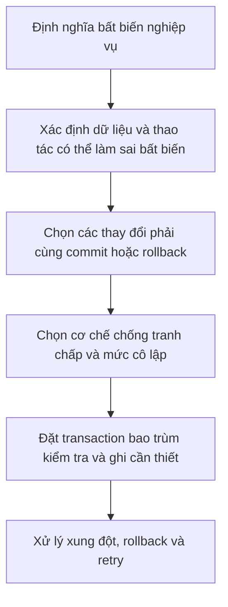

# Mối quan hệ giữa dữ liệu, bất biến nghiệp vụ và ranh giới giao dịch

Khi thiết kế một hệ thống có nhiều yêu cầu chạy đồng thời, câu hỏi quan trọng không chỉ là **dữ liệu được lưu trong bảng nào** mà còn là **trạng thái nào được phép tồn tại** và **những thay đổi nào phải được quyết định cùng nhau**. Ba câu hỏi này lần lượt dẫn đến ba khái niệm: dữ liệu, bất biến nghiệp vụ (*business invariant*) và ranh giới giao dịch (*transaction boundary*).

Một cơ sở dữ liệu có thể ghi từng câu lệnh SQL chính xác, không làm mất bản ghi và vẫn để ứng dụng rơi vào trạng thái sai nghiệp vụ. Điều đó thường xảy ra khi hai giao dịch đọc một trạng thái hợp lệ, mỗi giao dịch tự đưa ra quyết định hợp lý, nhưng kết quả khi chúng cùng hoàn tất lại vi phạm quy tắc chung. Hiểu mối quan hệ giữa ba khái niệm giúp xác định phải khóa gì, kiểm tra gì, dùng mức cô lập nào và đặt `COMMIT` ở đâu.

## 1. Ba khái niệm phải được phân biệt

| Khái niệm | Câu hỏi cần trả lời | Ví dụ với hệ thống đặt vé |
| --- | --- | --- |
| **Dữ liệu** | Hệ thống lưu những sự kiện và trạng thái nào? | Sự kiện, sức chứa, số vé đã đặt, đơn đặt vé, người đặt. |
| **Bất biến nghiệp vụ** | Điều kiện nào luôn phải đúng tại những thời điểm đã cam kết? | Số vé hợp lệ không vượt sức chứa; một ghế không thuộc về hai đơn đang hiệu lực. |
| **Ranh giới giao dịch** | Những thao tác nào cần thành công hoặc thất bại cùng nhau, với cơ chế cô lập đủ mạnh? | Giữ một ghế và tạo bản ghi đặt ghế trong cùng một giao dịch. |

**Dữ liệu** là biểu diễn được lưu trữ: hàng, cột, khóa, quan hệ và đôi khi là các sự kiện lịch sử. Dữ liệu có thể hoàn toàn hợp lệ về kiểu (`INTEGER`, `UUID`, `TIMESTAMP`) nhưng không hợp lệ về nghĩa. Ví dụ, hai đơn có cùng `seat_id` đều là những hàng SQL hợp lệ; chúng chỉ sai khi hai đơn cùng giữ độc quyền chiếc ghế đó.

**Bất biến nghiệp vụ** là mệnh đề phải giữ đúng cho mọi trạng thái mà hệ thống tuyên bố đã hoàn tất. Ta có thể ký hiệu trạng thái cơ sở dữ liệu là `S` và bất biến là `I(S)`. Yêu cầu đặt ra là:

```text
I(S_trước) = true
giao dịch áp dụng thay đổi lên S_trước
I(S_sau_commit) = true
```

Ví dụ: `balance >= 0`; `reserved <= capacity`; một mã đặt chỗ chỉ có một chủ sở hữu; tổng tiền ghi nợ và ghi có của một bút toán chuyển nội bộ phải cân bằng. Một số quy tắc là bất biến chặt (*strong invariants*) cần đúng ngay tại thời điểm commit; một số là mục tiêu nhất quán cuối cùng (*eventual consistency*) có thể tạm lệch theo quy trình đã được nghiệp vụ cho phép. Phải phân loại rõ trước khi chọn giải pháp.

**Ranh giới giao dịch** là tập công việc mà hệ quản trị cơ sở dữ liệu xử lý như một đơn vị nguyên tử (`BEGIN` ... `COMMIT`/`ROLLBACK`). Giao dịch giải quyết tính *all-or-nothing* của các thao tác trong phạm vi database, còn tính đúng đắn dưới đồng thời phụ thuộc thêm vào ràng buộc dữ liệu, cách cập nhật, cơ chế khóa và mức cô lập. Đặt hai thao tác vào một transaction **chưa tự động** bảo đảm mọi bất biến liên quan đến chúng.

## 2. Vì sao đồng thời khiến bất biến khó giữ?

Giả sử sự kiện có `capacity = 1`, `reserved = 0`. Hai khách A và B đặt vé gần như cùng lúc. Mỗi luồng ứng dụng thực hiện:

```sql
SELECT capacity, reserved FROM events WHERE id = 10;
-- Nếu reserved < capacity thì tiếp tục
INSERT INTO reservations (event_id, customer_id) VALUES (10, :customer_id);
UPDATE events SET reserved = reserved + 1 WHERE id = 10;
```

Nếu cả hai cùng đọc `reserved = 0` trước khi luồng còn lại cập nhật, cả hai đều có thể vượt qua điều kiện ở ứng dụng. Ngay cả khi các câu lệnh của mỗi luồng nằm trong một transaction, ở mức `READ COMMITTED` việc đọc điều kiện trước đó không tự dành quyền đặt vé cho luồng này.

| Thời điểm | Giao dịch A | Giao dịch B |
| --- | --- | --- |
| 1 | Đọc `reserved = 0`, thấy còn chỗ | |
| 2 | | Đọc `reserved = 0`, thấy còn chỗ |
| 3 | Tạo đặt vé của A | |
| 4 | | Tạo đặt vé của B |
| 5 | Tăng `reserved`, commit | |
| 6 | | Tăng `reserved`, commit |
| Kết quả | | Hai đặt vé hợp lệ; `reserved = 2 > capacity = 1` |

Đây là lỗi **kiểm tra rồi hành động** (*check-then-act*): điều kiện được kiểm tra trên trạng thái có thể đã lỗi thời khi quyết định được ghi xuống database. Bất biến `reserved <= capacity` trải qua cả *giá trị bộ đếm* và *việc chấp nhận đơn đặt*. Vì vậy, ranh giới giao dịch và cơ chế điều phối phải bảo vệ quyết định đó khỏi giao dịch cạnh tranh.

Một giải pháp đơn giản cho phần sức chứa là biến việc kiểm tra và tăng bộ đếm thành **một câu lệnh cập nhật có điều kiện**:

```sql
BEGIN;

UPDATE events
SET reserved = reserved + 1
WHERE id = 10 AND reserved < capacity
RETURNING id;

-- Chỉ khi UPDATE trả về đúng một hàng mới tạo reservation.
INSERT INTO reservations (event_id, customer_id)
VALUES (10, :customer_id);

COMMIT;
```

Ví dụ sử dụng cú pháp PostgreSQL. Câu `UPDATE` lấy khóa ghi trên hàng sự kiện; các giao dịch tranh chấp sẽ chờ nhau và điều kiện được kiểm tra theo trạng thái áp dụng của lần cập nhật. Khi hết chỗ, `UPDATE ... RETURNING` trả về **0 hàng**: ứng dụng phải `ROLLBACK` hoặc kết thúc mà không tạo reservation và trả kết quả hết chỗ. Không được chạy `INSERT` một cách vô điều kiện như đoạn SQL minh họa luồng điều khiển trên. Có thể bổ sung `CHECK (reserved >= 0 AND reserved <= capacity)` làm tuyến phòng vệ cho chính hàng `events`.

Nếu mỗi khách chỉ được đặt một lần, thêm `UNIQUE (event_id, customer_id)` cho quy tắc đó; nếu mỗi ghế chỉ được cấp một lần, cần một thiết kế khóa duy nhất phù hợp với trạng thái đặt chỗ. Một bộ đếm đúng **không thay thế** ràng buộc về ghế hay đơn đặt.

## 3. Bất biến quyết định cần bảo vệ dữ liệu nào

Không phải mọi bất biến đều có thể diễn đạt bằng `CHECK` trên một cột. Phạm vi dữ liệu mà một quy tắc đề cập sẽ gợi ý cơ chế bảo vệ thích hợp.

| Phạm vi bất biến | Ví dụ | Cơ chế thường phù hợp |
| --- | --- | --- |
| Một hàng | `balance_cents >= 0`, `reserved <= capacity` | `NOT NULL`, `CHECK`, `UPDATE` có điều kiện, khóa hàng. |
| Một khóa hoặc tập các hàng cùng khóa | Một mã đơn hàng không được trùng; mỗi ghế chỉ có một đặt chỗ đang hiệu lực | `UNIQUE` hoặc chỉ mục unique một phần khi điều kiện trạng thái cho phép. |
| Quan hệ giữa các hàng | Đơn đặt vé phải trỏ đến sự kiện tồn tại | Khóa ngoại (`FOREIGN KEY`) và transaction tạo dữ liệu liên quan. |
| Tổng hợp nhiều hàng | Một ca trực phải luôn còn ít nhất một bác sĩ trực | Giao thức khóa chung, thay đổi mô hình dữ liệu hoặc giao dịch `SERIALIZABLE` kèm retry. |
| Nhiều bước ghi | Chuyển tiền phải ghi nợ, ghi có và lưu dấu giao dịch thống nhất | Một transaction chứa tất cả thay đổi nội bộ cần commit cùng nhau. |
| Nhiều hệ thống | Đơn hàng trong DB phải dẫn đến sự kiện gửi sang message broker | Transactional outbox, cơ chế gửi lại và tiêu thụ idempotent; không giả định một local transaction bao trùm cả hai hệ thống. |

Ba nhận xét cần nhớ:

1. **Bất biến mô tả điều phải đúng**, không phụ thuộc việc ứng dụng tách thành bao nhiêu hàm hay service.
2. **Một transaction cần bao trùm những thay đổi có quan hệ nguyên tử**, nhưng cách cô lập vẫn phải đủ mạnh để tránh các giao dịch khác cùng phá vỡ bất biến.
3. **Đặt ràng buộc càng gần dữ liệu càng tốt**. `UNIQUE`, `CHECK`, `FOREIGN KEY` được database kiểm tra cho mọi đường ghi, kể cả batch hoặc công cụ quản trị; kiểm tra riêng ở ứng dụng chỉ hỗ trợ thông báo lỗi và điều phối.

## 4. Ví dụ nhiều hàng: chuyển tiền giữa hai tài khoản

Giả sử mỗi tài khoản có số dư nguyên theo đơn vị nhỏ nhất của tiền tệ (`balance_cents`), và một giao dịch chuyển nội bộ hợp lệ có các yêu cầu:

- Tài khoản nguồn không âm sau khi trừ tiền.
- Số tiền ghi có cho tài khoản đích bằng số tiền đã ghi nợ ở tài khoản nguồn, nếu không tính phí hoặc chênh lệch tỷ giá.
- Một yêu cầu chuyển với cùng khóa idempotency không được tạo ra hai lần chuyển tiền.
- Không được ghi nhận chuyển tiền thành công nếu một trong các thay đổi bắt buộc thất bại.

Hai lệnh cập nhật chạy trong hai transaction riêng biệt có thể dẫn đến trạng thái chỉ trừ tiền mà chưa cộng tiền khi tiến trình lỗi. Đặt chúng trong cùng một transaction bảo đảm tính nguyên tử:

```sql
-- PostgreSQL, ví dụ giản lược; giả định amount_cents > 0, hai tài khoản khác nhau.
CREATE TABLE accounts (
    id BIGINT PRIMARY KEY,
    balance_cents BIGINT NOT NULL CHECK (balance_cents >= 0)
);

CREATE TABLE transfer_requests (
    request_id UUID PRIMARY KEY,
    from_account BIGINT NOT NULL REFERENCES accounts(id),
    to_account BIGINT NOT NULL REFERENCES accounts(id),
    amount_cents BIGINT NOT NULL CHECK (amount_cents > 0),
    CHECK (from_account <> to_account)
);
```

```sql
BEGIN;

-- Khóa idempotency: INSERT trùng request_id sẽ bị UNIQUE/PRIMARY KEY chặn.
INSERT INTO transfer_requests (request_id, from_account, to_account, amount_cents)
VALUES (:request_id, :from_id, :to_id, :amount_cents);

-- Khóa hai tài khoản theo cùng một thứ tự để giảm nguy cơ deadlock.
SELECT id
FROM accounts
WHERE id IN (:from_id, :to_id)
ORDER BY id
FOR UPDATE;

UPDATE accounts
SET balance_cents = balance_cents - :amount_cents
WHERE id = :from_id AND balance_cents >= :amount_cents
RETURNING id;

UPDATE accounts
SET balance_cents = balance_cents + :amount_cents
WHERE id = :to_id
RETURNING id;

-- COMMIT chỉ khi cả hai tài khoản tồn tại, cả hai UPDATE trả về 1 hàng,
-- số tiền hợp lệ và mọi bước đều thành công; còn lại ROLLBACK.
COMMIT;
```

Đây là **khung triển khai**, không phải script SQL để chạy nguyên xi mà không kiểm tra kết quả. Ứng dụng phải bảo đảm đã khóa đủ hai tài khoản, kiểm tra số hàng trả về, xử lý lỗi số dư không đủ, giới hạn số học và rollback khi không đạt điều kiện. Nếu `request_id` đã tồn tại, phải đọc yêu cầu cũ và xác minh các tham số của lần gọi lại giống lần đầu trước khi trả về kết quả cũ; không coi hai nội dung khác nhau dùng chung khóa là cùng một yêu cầu. Với retry sau một kết quả commit không rõ ràng vì mất kết nối, khóa idempotency giúp truy vấn và đối chiếu kết quả trước đó.

Ví dụ này thể hiện ba lớp đảm bảo bổ sung cho nhau:

- `CHECK (balance_cents >= 0)` bảo vệ bất biến **trên từng tài khoản**.
- `UPDATE ... WHERE balance_cents >= :amount_cents` biến kiểm tra đủ tiền thành thao tác ghi có điều kiện trong database.
- Transaction kết hợp **hai cập nhật và bản ghi yêu cầu**, tránh trạng thái một nửa; `PRIMARY KEY (request_id)` bảo vệ tính duy nhất của yêu cầu.

Nếu quy tắc kế toán yêu cầu đối soát chặt chẽ, có thể dùng sổ cái (*ledger*) gồm các bút toán ghi nợ/ghi có và quy tắc tổng bằng 0 theo từng transaction. Khi đó cần thiết kế đường ghi và biện pháp kiểm soát ở cấp nhóm bút toán; chỉ có `CHECK` trên từng hàng không chứng minh được tổng bằng 0.

## 5. Trường hợp khó hơn: bất biến trải trên nhiều hàng và *write skew*

Xét bảng phân công bác sĩ trực:

```sql
CREATE TABLE shift_doctors (
    shift_id BIGINT NOT NULL,
    doctor_id BIGINT NOT NULL,
    on_call BOOLEAN NOT NULL,
    PRIMARY KEY (shift_id, doctor_id)
);
```

Bất biến: **mỗi ca trực luôn có ít nhất một bác sĩ `on_call = true`**.

Ban đầu, ca số 7 có bác sĩ A và B cùng trực. Mỗi người có quyền xin nghỉ nếu còn ít nhất một người khác trực. Hai giao dịch thực hiện tương tự:

```sql
BEGIN TRANSACTION ISOLATION LEVEL REPEATABLE READ;

SELECT COUNT(*)
FROM shift_doctors
WHERE shift_id = 7 AND on_call = true;

-- Nếu kết quả > 1:
UPDATE shift_doctors
SET on_call = false
WHERE shift_id = 7 AND doctor_id = :self_id;

COMMIT;
```

Trong PostgreSQL, `REPEATABLE READ` dùng cách ly snapshot. Giao dịch A và B có thể cùng nhìn thấy số lượng là 2, sau đó A cập nhật hàng của A, B cập nhật hàng của B. Vì hai giao dịch ghi vào **hai hàng khác nhau**, không nhất thiết xảy ra xung đột ghi cùng hàng. Cả hai có thể commit, để lại **0 bác sĩ trực**. Đây là *write skew*: mỗi transaction riêng lẻ tuân thủ điều kiện dựa trên snapshot đã đọc, nhưng trạng thái kết hợp phá vỡ bất biến.

```text
Trước:  A = trực, B = trực        => COUNT = 2, hợp lệ
T_A:    đọc COUNT = 2 -> A nghỉ
T_B:    đọc COUNT = 2 -> B nghỉ
Sau:    A = nghỉ, B = nghỉ        => COUNT = 0, vi phạm
```

Không có `CHECK` thông thường nào trên riêng hàng của A hoặc B diễn tả đầy đủ điều kiện "toàn bộ ca trực phải có ít nhất một người". Chỉ bọc `SELECT COUNT(*)` và `UPDATE` trong cùng transaction ở `REPEATABLE READ` cũng chưa đủ.

Có hai hướng giải quyết phổ biến:

**Hướng A — Serialize quyết định bằng một hàng đại diện.** Tạo hoặc sử dụng hàng `shifts(id)` của mỗi ca, và yêu cầu **mọi đường ghi có thể thay đổi số người trực** khóa hàng đó trước khi đếm và sửa. Với PostgreSQL ở `READ COMMITTED`:

```sql
BEGIN;

SELECT id FROM shifts WHERE id = 7 FOR UPDATE;

SELECT COUNT(*)
FROM shift_doctors
WHERE shift_id = 7 AND on_call = true;

-- Chỉ cập nhật nếu COUNT > 1 và bác sĩ hiện còn trực.
UPDATE shift_doctors
SET on_call = false
WHERE shift_id = 7 AND doctor_id = :self_id AND on_call = true;

COMMIT;
```

Vì mọi thao tác đổi lịch cùng khóa một hàng `shifts`, giao dịch thứ hai phải đợi giao dịch thứ nhất hoàn thành rồi mới đếm trên snapshot của câu `SELECT` tiếp theo. Việc **tất cả các đường ghi** tuân theo giao thức khóa là điều kiện bắt buộc. Nếu có batch job trực tiếp sửa `shift_doctors` mà bỏ qua khóa chung, bảo đảm này không còn đầy đủ. Hàng khóa phải tồn tại; `SELECT ... FOR UPDATE` trên kết quả rỗng không khóa được "hàng chưa tồn tại".

**Hướng B — Sử dụng `SERIALIZABLE` và retry toàn bộ transaction.** PostgreSQL có thể phát hiện chu trình phụ thuộc đọc/ghi khiến lịch thực thi không thể tương đương với một thứ tự tuần tự và hủy một giao dịch với lỗi `SQLSTATE 40001`. Ứng dụng phải `ROLLBACK`, đọc lại trạng thái và thử lại **toàn bộ** giao dịch theo chính sách retry có giới hạn. Khi thử lại, một bác sĩ đã nghỉ thì người còn lại không được phép nghỉ nữa.

Lựa chọn giữa hai hướng phụ thuộc số hàng tranh chấp, lượng giao dịch, khả năng áp dụng cùng một giao thức ở mọi đường ghi và chi phí retry. `SERIALIZABLE` không có nghĩa mọi giao dịch đều được commit; việc một giao dịch bị hủy để duy trì tính đúng đắn là hành vi dự kiến.

## 6. Đặt ranh giới giao dịch theo bất biến, không theo cấu trúc hàm

Một yêu cầu HTTP có thể gọi nhiều hàm, và một hàm có thể được nhiều luồng gọi cùng lúc. Ranh giới hàm hoặc controller không quyết định tính nguyên tử trong database. Khi xác định transaction, nên đi từ quy tắc nghiệp vụ:



Ví dụ đặt vé gồm ba thao tác: giữ số lượng chỗ, tạo reservation và xác định trạng thái đơn. Nếu nghiệp vụ hứa "đặt vé thành công" chỉ khi cả việc giữ chỗ lẫn reservation được lưu, thì hai thay đổi đó cần cùng commit. Việc gửi email xác nhận có thể diễn ra sau commit và được retry khi gửi lỗi; giữ transaction mở qua lúc gọi email không biến email thành một thành phần nguyên tử của database.

Một transaction **quá hẹp** có thể để dữ liệu ở trạng thái nửa chừng. Một transaction **quá rộng** giữ khóa lâu, tăng chờ đợi và deadlock, nhất là khi bao gồm HTTP call, thanh toán hoặc tác vụ chậm. Ranh giới phù hợp là phạm vi nhỏ nhất bảo vệ được bất biến chặt trong một database, cùng một cơ chế phối hợp rõ ràng cho những công việc ngoài phạm vi đó.

Trong thiết kế hướng domain, một *aggregate* thường được chọn làm đơn vị bảo vệ các bất biến nội bộ. Tuy nhiên, gắn nhãn `Aggregate` cho một đối tượng không tự làm các transaction trên database an toàn. Nếu bất biến thực sự trải qua nhiều aggregate, cần thay đổi mô hình, bảo vệ quy tắc xuyên aggregate bằng giao dịch/phối hợp phù hợp hoặc xác nhận rõ rằng nghiệp vụ chấp nhận nhất quán cuối cùng.

## 7. Cần phối hợp những công cụ nào?

### Ràng buộc dữ liệu

`NOT NULL`, `CHECK`, `UNIQUE`, `PRIMARY KEY` và `FOREIGN KEY` là nền tảng ngăn trạng thái sai ngay tại database. Với một quy tắc duy nhất có thể biểu đạt trực tiếp bằng chỉ mục unique, đó thường là cách đáng tin cậy hơn việc chạy `SELECT` xem đã tồn tại chưa rồi `INSERT`. Chẳng hạn, tạo hai đơn cùng mã trong hai giao dịch cạnh tranh có thể cùng vượt qua `SELECT`, nhưng ràng buộc unique sẽ chỉ cho phép trạng thái commit hợp lệ.

Một số quy tắc phụ thuộc tổng hợp, thời gian, hoặc nhiều hàng không biểu diễn được bằng một `CHECK`. Chúng cần thiết kế mô hình dữ liệu, câu lệnh cập nhật và giao thức đồng thời bổ sung.

### Cập nhật có điều kiện và khóa

Khi bất biến nằm trên một hàng, ưu tiên câu lệnh như `UPDATE ... WHERE version = :expected_version` hoặc `UPDATE ... WHERE quantity >= :requested`. Số hàng được cập nhật là tín hiệu thành công/xung đột rõ ràng. `SELECT ... FOR UPDATE` phù hợp khi cần đọc, quyết định và ghi dựa trên các hàng xác định, nhưng chỉ khóa các hàng database thực sự chọn được; nó không tự bảo vệ những hàng tương lai hoặc kết quả truy vấn đếm nếu không có giao thức khác.

Ví dụ khóa lạc quan (*optimistic concurrency control*):

```sql
UPDATE carts
SET total_cents = :new_total,
    version = version + 1
WHERE id = :cart_id AND version = :version_read;
```

Nếu kết quả là 0 hàng, dữ liệu có thể đã được sửa, bị xóa hoặc phiên bản đọc không còn đúng. Ứng dụng phải xác định nguyên nhân, đọc lại và quyết định tính toán lại hoặc trả lỗi xung đột. Ghi đè dựa trên bản đọc cũ mà không kiểm tra phiên bản có nguy cơ gây *lost update*.

### Mức cô lập và điểm commit

| Mức cô lập (theo ý nghĩa phổ biến) | Điều cần chú ý đối với bất biến |
| --- | --- |
| `READ COMMITTED` | Mỗi câu lệnh có thể thấy snapshot đã commit khác nhau; `SELECT` rồi `UPDATE` tách rời không tự an toàn. |
| `REPEATABLE READ` | Tùy DBMS; trong PostgreSQL dựa trên snapshot isolation và vẫn có thể gặp *write skew*. |
| `SERIALIZABLE` | Mục tiêu tương đương một thứ tự chạy tuần tự; ứng dụng phải sẵn sàng retry khi có serialization failure. |

Hành vi cụ thể thay đổi theo hệ quản trị; không suy diễn cơ chế của PostgreSQL sang MySQL, SQL Server hay Oracle chỉ vì cùng tên mức cô lập. Ngoài ra, transaction kết thúc khi rollback hoặc commit; một kiểm tra chạy **sau commit** không thể quay ngược bảo đảm nguyên tử của transaction vừa hoàn tất.

### Retry và idempotency

Xung đột đồng thời có thể dẫn đến lỗi serialization (`40001`) hoặc deadlock (`40P01`) trong PostgreSQL. Retry phải diễn ra ở phạm vi **toàn bộ thao tác nghiệp vụ**, có giới hạn số lần và thường có backoff. Không nên retry vô hạn; cũng không được lặp lại tác dụng phụ bên ngoài một cách mù quáng. Khóa idempotency và phép ghi có điều kiện giúp tách "thử lại yêu cầu cũ" khỏi "thực hiện nghiệp vụ mới".

## 8. Khi bất biến vượt ra ngoài một database

Giả sử transaction tạo đơn hàng trong PostgreSQL, sau đó gửi thông điệp sang broker để xử lý giao hàng. Nếu commit DB thành công nhưng tiến trình chết trước khi gửi, đơn đã tồn tại mà downstream không biết. Ngược lại, nếu gửi trước commit, downstream có thể thấy một sự kiện về đơn hàng sau đó bị rollback.

Một transaction cục bộ không thể tự bảo đảm tính nguyên tử của cả việc ghi database và gửi tới broker. Mô hình **transactional outbox** đưa bản ghi sự kiện cần phát vào cùng transaction với dữ liệu nghiệp vụ:

```sql
BEGIN;

INSERT INTO orders (id, customer_id, status)
VALUES (:order_id, :customer_id, 'CREATED');

INSERT INTO outbox_events (event_id, aggregate_id, event_type, payload)
VALUES (:event_id, :order_id, 'OrderCreated', :payload);

COMMIT;
```

Một tiến trình riêng lấy outbox và phát thông điệp, có thể gửi lại khi lỗi. Consumer phải xử lý trùng lặp một cách an toàn (*idempotent*), chẳng hạn lưu `event_id` đã áp dụng. Mẫu này bảo đảm **dữ liệu và ý định phát sự kiện được commit cùng nhau**, chứ không hứa broker chỉ nhận đúng một bản sao trong mọi tình huống.

Nếu luồng nghiệp vụ có nhiều dịch vụ, mỗi dịch vụ có database riêng, cần xác định bất biến nào bắt buộc đúng ngay và trạng thái trung gian nào được chấp nhận. Saga, đặt chỗ có hạn, thao tác bù và đối soát có thể giúp quản lý quy trình nhiều bước, nhưng thao tác bù không phải là rollback nguyên tử. Ví dụ, một khoản thanh toán đã được ngân hàng ghi nhận có thể cần hoàn tiền sau đó; hệ thống không thể giả định phép hoàn tiền xóa sạch mọi hậu quả tức thời của khoản thanh toán ban đầu.

## 9. Cách xác định transaction từ một yêu cầu nghiệp vụ

Khi nhận yêu cầu như "không bán quá số vé" hoặc "không cho tất cả bác sĩ trong cùng ca nghỉ", hãy lần lượt trả lời:

1. **Viết bất biến thành một mệnh đề kiểm chứng được.** Ví dụ `0 <= reserved <= capacity`, hoặc `COUNT(on_call WHERE shift_id = X) >= 1`. Xác định thời điểm nào mệnh đề phải đúng.
2. **Liệt kê mọi đường ghi có thể ảnh hưởng.** Không chỉ API chính: còn batch, job định kỳ, luồng quản trị, callback thanh toán và migration dữ liệu.
3. **Xác định tập dữ liệu liên quan.** Một hàng, một khóa unique, nhiều hàng trong một bảng, nhiều bảng, hay nhiều hệ thống? Nếu quy tắc dựa vào sự không tồn tại của hàng, cần chú ý phantom và race khi insert.
4. **Đưa các ghi cần cùng thành công vào một transaction.** Mỗi nhánh lỗi phải rollback; kiểm tra kết quả `UPDATE`/`INSERT`, không mặc định SQL thành công có nghĩa nghiệp vụ thành công.
5. **Chọn cơ chế chống cạnh tranh.** Ưu tiên ràng buộc DB và cập nhật có điều kiện cho quy tắc phù hợp; dùng khóa theo thứ tự nhất quán, kiểm soát phiên bản hoặc `SERIALIZABLE` cho trường hợp phức tạp.
6. **Quy định chính sách lỗi và retry.** Khi nào báo hết chỗ, khi nào báo phiên bản xung đột, khi nào retry serialization/deadlock, và làm sao không thực hiện lại tác dụng phụ?
7. **Giữ transaction ngắn và quan sát kết quả.** Theo dõi số lần xung đột, deadlock, độ dài giao dịch, thời gian đợi khóa và các trường hợp vi phạm bất biến được phát hiện.

Một cách tự kiểm tra tính đúng đắn của thiết kế là hỏi: **"Nếu hai phiên làm việc cùng thấy điều kiện đủ, điều gì trong database ngăn cả hai cùng commit một kết quả vi phạm quy tắc?"** Câu trả lời cần nêu được ràng buộc, khóa, câu lệnh cập nhật có điều kiện hoặc mức cô lập cụ thể. Câu "đã có transaction" chưa đủ.

## 10. Những nhầm lẫn thường gặp

- **"Mỗi câu lệnh SQL đều nguyên tử nên nghiệp vụ an toàn."** Nguyên tử của từng câu lệnh không tự nối nhiều thao tác và nhiều quyết định thành một thay đổi nhất quán.
- **"Tất cả kiểm tra ở service là đủ."** Hai service instance có thể cùng đọc một trạng thái cũ; đường ghi khác còn có thể bỏ qua kiểm tra đó.
- **"`REPEATABLE READ` ngăn mọi lỗi đồng thời."** Trong PostgreSQL, write skew vẫn xảy ra nếu các giao dịch ghi các hàng khác nhau nhưng dựa trên cùng một bất biến tổng hợp.
- **"`SELECT ... FOR UPDATE` khóa luôn kết quả đếm hoặc các hàng chưa tồn tại."** Nó khóa những hàng được chọn, không tự biến mọi truy vấn điều kiện thành khóa trên toàn bộ tập kết quả tiềm năng.
- **"Cứ tăng isolation là xong."** Cần biết đặc tính của DBMS, xử lý serialization failure và xem xét throughput, contention, độ dài giao dịch.
- **"Transaction càng dài càng chắc chắn."** Transaction chứa lời gọi mạng hoặc chờ người dùng kéo dài thời gian giữ khóa, không tạo tính nguyên tử xuyên hệ thống.
- **"Retry HTTP là an toàn."** Nếu lần đầu đã commit nhưng phản hồi bị mất, retry thiếu idempotency có thể tạo giao dịch trùng.

## 11. Tình huống vận dụng

**Tình huống A — Số lượng tồn kho.** Kho có 5 sản phẩm. Hai người cùng mua 4 sản phẩm. Nếu mỗi người đọc `stock = 5` rồi cùng ghi tồn kho dựa trên bản đọc, có thể phát sinh bán quá số lượng hoặc lost update. Hãy dùng `UPDATE inventory SET stock = stock - :qty WHERE sku = :sku AND stock >= :qty RETURNING stock` và tạo đơn cùng transaction. Có thể dùng `CHECK (stock >= 0)` như tuyến kiểm soát bổ sung. Nếu một đơn gồm nhiều SKU, phải quyết định toàn bộ các SKU có được giữ cùng nhau hay không và khóa chúng theo thứ tự nhất quán.

**Tình huống B — Người trực cuối cùng.** Hai người cùng xin nghỉ ở cùng một ca có hai bác sĩ. Khóa riêng hàng của từng bác sĩ không ngăn được write skew. Cần khóa chung ca trực và đếm lại trong giao dịch tuân thủ giao thức, hoặc dùng serializable với retry.

**Tình huống C — Thanh toán và gửi email.** Thanh toán được ghi thành công và email gửi thất bại. Không nên rollback khoản thanh toán chỉ vì email chưa tới. Ghi nhận sự kiện cần gửi trong outbox cùng transaction với trạng thái thanh toán, rồi gửi lại có kiểm soát. Nếu cần hoàn tiền, đó là một nghiệp vụ riêng có trạng thái và khả năng thất bại của nó.

**Tình huống D — Giữ chỗ theo thời hạn.** Một ghế có thể có các reservation ở trạng thái `HELD`, `CONFIRMED`, `EXPIRED`. Bất biến "chỉ một reservation đang hiệu lực trên một ghế" phải được diễn tả chính xác: thời điểm nào được coi là hết hạn, ai được phép chuyển trạng thái, transaction nào giải phóng ghế và transaction nào cấp lại. Một điều kiện trên đồng hồ ứng dụng không đủ nếu hai yêu cầu có thể cập nhật trạng thái cạnh tranh. Có thể mô hình hóa một hàng trạng thái ghế làm điểm tranh chấp hoặc dùng ràng buộc unique trên khóa sở hữu hiện hành, tùy mô hình và quy tắc thời hạn.

## Kết luận

**Dữ liệu** biểu diễn trạng thái, **bất biến nghiệp vụ** định nghĩa trạng thái nào được chấp nhận, còn **ranh giới giao dịch** xác định những thay đổi nào phải được cam kết nguyên tử. Để bất biến còn đúng dưới đồng thời, transaction phải kết hợp với ràng buộc database, điều kiện cập nhật, khóa hoặc mức cô lập thích hợp; các quyết định dựa trên dữ liệu nhiều hàng cần được bảo vệ như một thể thống nhất. Với tác vụ vượt một database, phải xác định rõ phần nhất quán chặt tại commit và phần được hoàn tất thông qua sự kiện, retry và đối soát.
