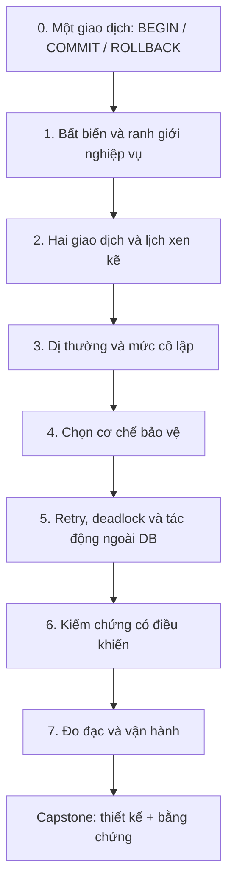
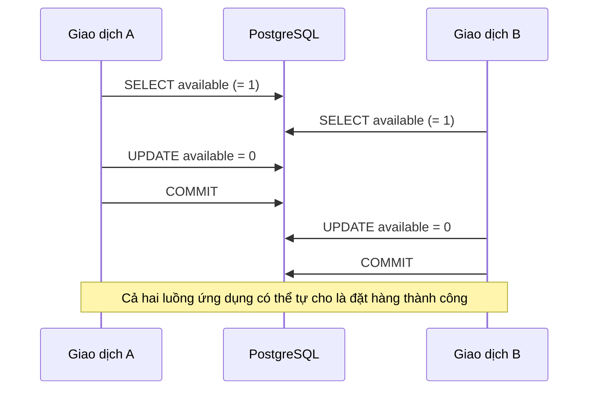

# Lộ trình học từ giao dịch đơn lẻ đến thiết kế và kiểm chứng đồng thời

Một thao tác cơ sở dữ liệu có thể chạy đúng khi chỉ có một người dùng, nhưng sai khi hai yêu cầu đến gần như cùng lúc. Ví dụ: kho còn một sản phẩm, hai khách đều đọc được “còn 1”, cả hai đều tạo đơn thành công. Không có câu lệnh SQL nào nhất thiết báo lỗi, nhưng hệ thống đã bán hai sản phẩm khi chỉ còn một.

Bài học này xây dựng **lộ trình học và thực hành** để đi từ việc hiểu một giao dịch (transaction) đến khả năng thiết kế quy tắc đồng thời (concurrency control), chứng minh tính đúng đắn và kiểm thử các lịch thực thi xen kẽ. Ví dụ dùng **PostgreSQL** để có một bộ hành vi nhất quán; khi áp dụng sang MySQL, SQL Server hay hệ quản trị khác, cần xác minh lại cách triển khai mức cô lập, khóa và xử lý xung đột.

## 1. Đích đến: từ “chạy đúng một lần” đến “đúng với mọi lịch hợp lệ”

Sau lộ trình này, người học cần làm được năm việc:

1. **Nêu bất biến nghiệp vụ (invariant)** dưới dạng điều kiện kiểm chứng được, chẳng hạn tồn kho không âm, một ghế không bị đặt hai lần, tổng tiền của một phép chuyển nội bộ được bảo toàn.
2. **Phân biệt giao dịch với từng câu SQL**: biết điểm bắt đầu, điểm commit/rollback, phần việc phải nguyên tử và phần tác động ngoài cơ sở dữ liệu không thuộc cùng giao dịch.
3. **Dựng lịch xen kẽ của ít nhất hai giao dịch**, nhận ra vì sao một cách triển khai đúng khi chạy tuần tự vẫn có thể sai khi chạy đồng thời.
4. **Chọn cơ chế bảo vệ phù hợp**: ràng buộc dữ liệu, cập nhật có điều kiện, khóa, kiểm soát phiên bản, mức cô lập và xử lý retry.
5. **Kiểm chứng** bằng các thí nghiệm hai kết nối, bài kiểm thử có điểm đồng bộ, quan sát lỗi và theo dõi hành vi dưới tải.

Định nghĩa cốt lõi:

- **Giao dịch** là một đơn vị công việc có kết thúc bằng `COMMIT` hoặc `ROLLBACK`. Trong phạm vi một cơ sở dữ liệu quan hệ, các thay đổi của giao dịch được cam kết cùng nhau hoặc không được cam kết.
- **Tính nguyên tử (atomicity)** không tự động bảo đảm **tính cô lập (isolation)**. Một giao dịch có thể commit trọn vẹn nhưng cùng một giao dịch khác tạo ra kết quả sai nghiệp vụ.
- **Lịch thực thi (schedule)** là thứ tự quan sát được của các thao tác từ nhiều giao dịch. Các lệnh có thể xen kẽ dù từng giao dịch tự nó vẫn giữ nguyên thứ tự nội bộ.
- **Khả tuần tự hóa (serializability)** là tính chất mà kết quả của các giao dịch đã commit tương đương với một thứ tự thực thi tuần tự nào đó, theo mô hình cô lập được hệ quản trị cam kết. Đây là chuẩn mạnh để lập luận về đồng thời, nhưng hệ thống vẫn cần mã hóa đúng bất biến nghiệp vụ.

### Bản đồ lộ trình



| Chặng | Câu hỏi phải trả lời | Sản phẩm học tập |
| --- | --- | --- |
| 0. Nền tảng | Một yêu cầu thay đổi dữ liệu thành công/thất bại thế nào? | Giao dịch đơn lẻ có commit, rollback và các ràng buộc |
| 1. Bất biến | Chính xác điều gì không bao giờ được phép sai? | Danh sách invariant và ranh giới giao dịch |
| 2. Xen kẽ | Nếu A và B cùng chạy, từng lệnh nhìn thấy gì? | Bảng lịch thực thi hai phiên |
| 3. Cô lập | Vì sao một số dữ liệu vẫn thay đổi giữa hai lần đọc? | Phân tích anomaly, snapshot, khóa và mức isolation |
| 4. Thiết kế | Cơ chế nào bảo vệ từng invariant? | Phương án SQL, giả thiết và điều kiện thành công/thất bại |
| 5. Khôi phục | Xung đột, deadlock, retry hoặc gọi dịch vụ ngoài DB xử lý ra sao? | Chính sách retry/idempotency và sơ đồ luồng |
| 6. Kiểm chứng | Có dựng được lịch gây lỗi cũ và xác nhận bản sửa? | Bộ kịch bản hai kết nối và các assertion |
| 7. Vận hành | Đúng nhưng có bị nghẽn hoặc chờ khóa quá lâu không? | Chỉ số và giới hạn hiệu năng có thể quan sát |

Hãy coi mỗi sản phẩm của chặng trước là đầu vào của chặng sau. Nếu chưa viết được invariant, việc chọn `SERIALIZABLE` hay `SELECT FOR UPDATE` thường chỉ là phỏng đoán.

## 2. Chặng 0 — Hiểu đúng một giao dịch đơn lẻ

Xét chuyển 30 đơn vị tiền từ tài khoản 1 sang tài khoản 2. Với số dư ban đầu lần lượt là 100 và 50, kết quả mong đợi là 70 và 80; tổng tiền vẫn là 150.

```sql
-- Chạy trong cơ sở dữ liệu thử nghiệm.
CREATE TABLE accounts (
    id bigint PRIMARY KEY,
    balance bigint NOT NULL CHECK (balance >= 0)
);

INSERT INTO accounts(id, balance)
VALUES (1, 100), (2, 50);

BEGIN;

UPDATE accounts
SET balance = balance - 30
WHERE id = 1 AND balance >= 30;

UPDATE accounts
SET balance = balance + 30
WHERE id = 2;

COMMIT;
```

Đoạn trên minh họa việc hai thay đổi thuộc cùng một transaction, **chưa phải triển khai chuyển tiền hoàn chỉnh**. Mã ứng dụng phải kiểm tra lệnh trừ có cập nhật đúng một hàng, lệnh cộng cập nhật đúng một hàng và hai tài khoản hợp lệ; nếu bất kỳ điều kiện nào sai thì `ROLLBACK`. Nếu chỉ một lệnh chạy thành công nhưng vẫn `COMMIT`, tổng tiền có thể sai. Với tiền thực, còn cần kiểu số, giới hạn, sổ cái, định danh yêu cầu và các quy tắc nghiệp vụ phù hợp.

Thử nghiệm cơ bản:

```sql
BEGIN;
UPDATE accounts SET balance = balance + 100 WHERE id = 1;
ROLLBACK;

SELECT id, balance FROM accounts ORDER BY id;
-- Tác động +100 vừa thử không được lưu.
```

Nắm bốn khái niệm ACID theo đúng vai trò:

| Thuộc tính | Ý nghĩa thực hành | Không nên suy diễn |
| --- | --- | --- |
| Atomicity | Toàn bộ thay đổi trong một giao dịch commit hoặc rollback | Không ngăn giao dịch khác đọc/sửa dữ liệu theo mức cô lập hiện hành |
| Consistency | Giao dịch đúng phải đưa dữ liệu từ trạng thái hợp lệ đến trạng thái hợp lệ; constraint hỗ trợ cưỡng chế | DB không tự hiểu các quy tắc nghiệp vụ chưa được mô hình hóa |
| Isolation | Quy định cách giao dịch tương tác và quan sát thay đổi của nhau | Không phải mọi mức cô lập đều tương đương chạy tuần tự |
| Durability | Dữ liệu đã commit được duy trì theo bảo đảm bền vững của DB | Không đồng nghĩa một email, HTTP call hay message đã thành công |

**Cửa qua chặng 0:** tự giải thích được việc giữ hai thao tác trong cùng transaction quan trọng thế nào, điều gì khiến `ROLLBACK` xảy ra và vì sao cần kiểm tra số hàng chịu tác động trước khi `COMMIT`.

## 3. Chặng 1 — Viết bất biến trước khi viết cơ chế khóa

Lỗi đồng thời là lỗi của **quy tắc phải luôn đúng**, không nhất thiết là lỗi cú pháp SQL. Trước khi chọn isolation, hãy lập bảng:

| Ngữ cảnh | Bất biến | Có thể cưỡng chế ở đâu? |
| --- | --- | --- |
| Bán hàng | `available >= 0` và mỗi suất hàng chỉ được cấp một lần | `CHECK`, cập nhật trừ tồn kho có điều kiện, giao dịch tạo đơn |
| Đặt chỗ | Mỗi vị trí trong một khung giờ chỉ có một booking hợp lệ | `UNIQUE` cho khóa chính xác; exclusion constraint nếu các khoảng thời gian có thể chồng lấn |
| Chuyển tiền | Không chi vượt hạn mức; mọi bút toán hợp lệ có đối ứng | Điều kiện UPDATE, constraint, sổ cái và giao dịch |
| Nhân sự trực ca | Luôn có ít nhất một người đang trực | Phối hợp nhiều hàng bằng khóa/điểm tuần tự hóa hoặc `SERIALIZABLE` |
| API thanh toán | Một idempotency key chỉ tạo một hiệu ứng nghiệp vụ | Khóa duy nhất cho key, lưu trạng thái và kết quả cùng giao dịch |

Bốn câu hỏi nên ghi cạnh mỗi invariant:

1. **Phạm vi** của quy tắc là một hàng, một nhóm hàng, một bảng hay nhiều hệ thống?
2. **Điểm quyết định** là lúc nào: khi đọc điều kiện, khi cập nhật, hay khi commit?
3. **Đối tượng cạnh tranh** là gì: cùng một hàng, các hàng khác nhau, một khoảng giá trị, hay cùng một định danh yêu cầu?
4. **Kết quả khi không thể bảo đảm điều kiện** là gì: từ chối yêu cầu, retry, đưa vào hàng đợi hay báo lỗi nghiệp vụ?

Ví dụ, “tồn kho không âm” và “không nhận hai đơn cho cùng một sản phẩm cuối cùng” có liên quan nhưng khác nhau. Hai lệnh cùng ghi `available = 0` có thể giữ `CHECK (available >= 0)` và vẫn duyệt nhầm hai đơn. Vì thế cần xem cả **quyết định cấp hàng** trong cùng transaction, chứ không chỉ quan sát số tồn kho cuối cùng.

**Cửa qua chặng 1:** diễn đạt được invariant bằng dữ liệu cụ thể, mô tả một trạng thái vi phạm và nêu bước nào của nghiệp vụ tạo ra nguy cơ đó.

## 4. Chặng 2 — Tư duy bằng hai kết nối và lịch thực thi

Một kết nối chạy A đến hết rồi mới chạy B chỉ kiểm tra được lịch tuần tự `A → B`. Trong hệ thống thật, các bước có thể xen kẽ:



Dựng thử tình huống trên bằng **hai terminal / hai kết nối** trong cơ sở dữ liệu dành cho thực hành:

```sql
CREATE TABLE inventory (
    sku text PRIMARY KEY,
    available integer NOT NULL CHECK (available >= 0)
);

INSERT INTO inventory(sku, available) VALUES ('BOOK', 1);
```

| Bước | Session A | Session B | Quan sát |
| --- | --- | --- | --- |
| 1 | `BEGIN;` | | A bắt đầu |
| 2 | `SELECT available FROM inventory WHERE sku = 'BOOK';` → 1 | | A lưu số 1 trong ứng dụng |
| 3 | | `BEGIN; SELECT available FROM inventory WHERE sku = 'BOOK';` → 1 | B cũng lưu số 1 |
| 4 | `UPDATE inventory SET available = 0 WHERE sku = 'BOOK';` | | A ghi tồn kho |
| 5 | `COMMIT;` | | A xác nhận đơn thứ nhất |
| 6 | | `UPDATE inventory SET available = 0 WHERE sku = 'BOOK'; COMMIT;` | B cũng xác nhận đơn thứ hai |
| 7 | `SELECT available FROM inventory WHERE sku = 'BOOK';` → 0 | | Dữ liệu còn 0 nhưng hai đơn được chấp nhận |

Đây là lỗi **read–modify–write bằng giá trị cũ**, một dạng *lost update về mặt logic ứng dụng*. Với PostgreSQL `READ COMMITTED`, cập nhật thứ hai có thể dùng một giá trị đã tính ở ứng dụng từ ảnh chụp cũ. Nếu hai lệnh `UPDATE` cạnh tranh đồng thời, lệnh sau có thể phải đợi khóa hàng; chờ khóa **không tự sửa phép tính cũ ở ứng dụng**.

Điểm cần học không phải thuộc lòng thứ tự này mà là cách dựng *interleaving*: dừng hai luồng tại đúng bước đọc, cho cả hai nhận cùng trạng thái, rồi lần lượt cho chúng ghi và commit. Khi thay lịch chạy, đầu ra có thể khác dù mã ứng dụng không đổi.

**Cửa qua chặng 2:** tự vẽ được timeline cho hai giao dịch và chỉ ra thời điểm mỗi giao dịch dựa trên giả thiết đã hết đúng.

## 5. Chặng 3 — Nhận diện dị thường và mức cô lập

### 5.1 Những tên gọi phải hiểu bằng lịch chạy

| Hiện tượng | Lịch ngắn gọn | Hệ quả |
| --- | --- | --- |
| Dirty read | A sửa giá trị nhưng chưa commit; B đọc giá trị đó; A rollback | B đã dùng dữ liệu chưa từng được commit |
| Non-repeatable read | A đọc hàng X; B sửa X và commit; A đọc lại X thấy khác | Hai lần đọc cùng hàng trong một transaction cho kết quả khác |
| Phantom read | A truy vấn tập hàng thỏa điều kiện; B thêm/xóa hàng và commit; A truy vấn lại thấy tập khác | Kết quả của truy vấn theo điều kiện thay đổi |
| Lost update | A và B cùng đọc X rồi ghi theo giá trị cũ; thay đổi của một bên bị mất | Kết quả cuối không phản ánh đầy đủ hai ý định cập nhật |
| Write skew | A và B đọc cùng một invariant nhiều hàng, sau đó sửa **hai hàng khác nhau**; cả hai commit | Invariant giữa các hàng bị phá dù không cùng ghi một hàng |
| Deadlock | A giữ khóa cần cho B, trong khi B giữ khóa cần cho A | Ít nhất một giao dịch phải bị hủy để phá vòng chờ |

Deadlock là vấn đề tiến triển khi khóa; các mục khác chủ yếu liên quan khả năng quan sát dữ liệu và bảo đảm tính đúng đắn. Hai transaction cùng chạy không có nghĩa luôn xảy ra lỗi: tính chất quan trọng là **lịch có thể gây lỗi có tồn tại hay không**.

### 5.2 Mức cô lập trong PostgreSQL

| Mức cô lập | Cách nhìn dữ liệu hữu ích cho người học | Điều cần chú ý |
| --- | --- | --- |
| `READ COMMITTED` (mặc định) | Mỗi câu lệnh nhìn ảnh chụp các thay đổi đã commit phù hợp thời điểm bắt đầu câu lệnh | Các lần SELECT có thể thấy khác nhau; quy tắc đọc trước, ghi sau có thể sai |
| `REPEATABLE READ` | Các truy vấn trong transaction dùng cùng một snapshot trong mô hình PostgreSQL | Chặn non-repeatable read/phantom theo cách PostgreSQL triển khai, nhưng **write skew vẫn có thể xảy ra** |
| `SERIALIZABLE` | DB theo dõi phụ thuộc để các giao dịch commit có kết quả tương đương thứ tự tuần tự | Có thể hủy một giao dịch với SQLSTATE `40001`; ứng dụng phải retry toàn bộ giao dịch |

Trong PostgreSQL, yêu cầu `READ UNCOMMITTED` được xử lý như `READ COMMITTED`; ví dụ dirty read chuẩn không tái hiện được bằng mức thấp này. `REPEATABLE READ` của PostgreSQL cũng có hành vi khác một số diễn giải tối thiểu trong chuẩn SQL. **Không sao chép nguyên bảng này sang DBMS khác**: cần thử trên phiên bản thực tế.

### 5.3 MVCC: tại sao “đang có khóa” vẫn có thể đọc

**MVCC** (*multi-version concurrency control*) cho phép các phiên đọc những phiên bản hàng phù hợp snapshot thay vì luôn buộc một bên đọc phải đợi một bên ghi. Hệ quả:

- Một câu `SELECT` thông thường không đồng nghĩa đã khóa các hàng để bảo vệ quyết định nghiệp vụ sau đó.
- Ở `READ COMMITTED`, câu `SELECT` kế tiếp có thể nhận một snapshot khác.
- Ở `REPEATABLE READ`, snapshot ổn định giúp giữ hình ảnh nhất quán nhưng hai giao dịch vẫn có thể cập nhật hai hàng khác nhau và gây *write skew*.
- `SELECT ... FOR UPDATE` là thao tác khóa hàng được chọn; nó cần một transaction đủ dài để bảo vệ việc kiểm tra và cập nhật sau đó, và phải kiểm tra lại điều kiện khi đã có khóa.

Thử với hai phiên:

```sql
-- Session A
BEGIN ISOLATION LEVEL READ COMMITTED;
SELECT balance FROM accounts WHERE id = 1; -- ghi lại kết quả

-- Session B, chạy giữa hai lần SELECT của A
BEGIN;
UPDATE accounts SET balance = balance + 10 WHERE id = 1;
COMMIT;

-- Quay về session A
SELECT balance FROM accounts WHERE id = 1; -- có thể tăng 10
COMMIT;
```

Làm lại sau khi khôi phục dữ liệu và đổi session A thành `BEGIN ISOLATION LEVEL REPEATABLE READ;`. Lần đọc thứ hai của A sẽ vẫn dùng snapshot của A (giả sử A đã xác lập snapshot trước khi B commit). Thí nghiệm này kiểm tra **tầm nhìn dữ liệu**, chưa kiểm tra cách bảo vệ bất biến của một phép cập nhật.

### 5.4 Write skew: bài học bắt buộc trước khi chọn REPEATABLE READ

Giả sử luôn phải có ít nhất một bác sĩ trực. Hai bác sĩ A và B đều đang trực, mỗi người muốn rời ca nếu vẫn còn người khác.

```sql
CREATE TABLE on_call (
    doctor_id text PRIMARY KEY,
    is_on_call boolean NOT NULL
);

INSERT INTO on_call VALUES ('A', true), ('B', true);
```

Thử hai phiên với `REPEATABLE READ`:

| Bước | Session A | Session B |
| --- | --- | --- |
| 1 | `BEGIN ISOLATION LEVEL REPEATABLE READ;` | `BEGIN ISOLATION LEVEL REPEATABLE READ;` |
| 2 | `SELECT count(*) FROM on_call WHERE is_on_call;` → 2 | |
| 3 | | `SELECT count(*) FROM on_call WHERE is_on_call;` → 2 |
| 4 | `UPDATE on_call SET is_on_call = false WHERE doctor_id = 'A';` | |
| 5 | | `UPDATE on_call SET is_on_call = false WHERE doctor_id = 'B';` |
| 6 | `COMMIT;` | `COMMIT;` |

Vì hai giao dịch cập nhật **hai hàng khác nhau**, chúng có thể cùng commit, để lại 0 người trực. Snapshot ổn định không đảm bảo invariant giữa các hàng.

Thử lại sau khi reset `is_on_call = true` cho cả hai và sử dụng `BEGIN ISOLATION LEVEL SERIALIZABLE;`. Với hai giao dịch thật sự chồng lấn như trên, PostgreSQL có thể hủy một bên do xung đột tuần tự hóa (`40001`). Ứng dụng phải xử lý retry; giao dịch retry sẽ đọc lại trạng thái mới và không cho người cuối cùng rời ca.

Một phương án khác là cho các giao dịch cùng khóa một tập hàng/“guard row” đại diện trước khi kiểm tra quy tắc, theo cùng thứ tự, rồi kiểm tra lại trạng thái đã được khóa. Chọn cách nào phụ thuộc tần suất xung đột, lượng hàng và giới hạn của nghiệp vụ.

**Cửa qua chặng 3:** phân biệt được việc *thấy một snapshot nhất quán* với việc *bảo vệ invariant*, giải thích được vì sao `REPEATABLE READ` chưa đủ cho ví dụ bác sĩ trực ca.

## 6. Chặng 4 — Thiết kế cơ chế bảo vệ theo phạm vi bất biến

Không có một câu lệnh khóa áp dụng tối ưu cho mọi bài toán. Hãy chọn cơ chế đơn giản nhất có thể giải thích và kiểm chứng.

### 6.1 Ràng buộc ở DB: tuyến phòng thủ đầu tiên

Khi một invariant có thể biểu diễn bằng `PRIMARY KEY`, `UNIQUE`, `CHECK`, `FOREIGN KEY` hoặc cơ chế constraint phù hợp, hãy để DB bảo vệ nó.

```sql
CREATE TABLE seat_reservations (
    id bigint GENERATED ALWAYS AS IDENTITY PRIMARY KEY,
    flight_id bigint NOT NULL,
    seat_no text NOT NULL,
    UNIQUE (flight_id, seat_no)
);
```

Hai yêu cầu cùng tạo vé cho một chỗ sẽ không thể cùng commit hai hàng có cặp `(flight_id, seat_no)` trùng nhau. Ứng dụng phải biến lỗi trùng khóa thành kết quả nghiệp vụ “chỗ đã được đặt”, không dùng retry vô hạn. Với khoảng thời gian chồng lấn, `UNIQUE (resource_id, start_time)` chưa bảo đảm không chồng lấn; PostgreSQL có thể dùng *exclusion constraint* trên range hoặc một chiến lược khóa khác.

Constraint tốt vì cưỡng chế ngay tại nơi lưu dữ liệu và bao trùm nhiều đường ghi. Nhưng những invariant như “ít nhất một người trực” không thể diễn đạt bằng `CHECK` trên từng hàng đơn lẻ.

### 6.2 Cập nhật nguyên tử có điều kiện: một tài nguyên, một hàng

Sửa ví dụ tồn kho bằng một câu SQL kết hợp **kiểm tra + thay đổi**:

```sql
BEGIN;

UPDATE inventory
SET available = available - 1
WHERE sku = 'BOOK' AND available > 0
RETURNING available;

-- Nếu trả về đúng một hàng: tạo đơn liên quan trong cùng giao dịch,
-- kiểm tra các bước khác rồi COMMIT.
-- Nếu không có hàng: không cấp hàng, ROLLBACK.

COMMIT; -- Chỉ thực hiện tại nhánh thành công.
```

Tại `READ COMMITTED`, PostgreSQL xử lý tranh chấp cập nhật cùng hàng bằng khóa và đánh giá điều kiện phù hợp sau khi chờ. Khi tồn kho bắt đầu là 1, chỉ một yêu cầu có thể trừ xuống 0; yêu cầu còn lại nhận **0 hàng được cập nhật**, cần thông báo hết hàng.

Đừng dùng mẫu đọc ra số lượng, tính `newAvailable = oldAvailable - 1` trong ứng dụng rồi `UPDATE SET available = newAvailable` mà thiếu cơ chế phát hiện giá trị đã đổi. Tránh gọi việc **đợi khóa** là bằng chứng đã an toàn nếu quyết định vẫn dựa trên dữ liệu cũ.

### 6.3 Khóa bi quan (pessimistic locking)

Dùng khi phải đọc trạng thái rồi thực hiện nhiều bước phụ thuộc và muốn các yêu cầu cạnh tranh cùng tài nguyên đi qua một đoạn tuần tự.

```sql
BEGIN;

SELECT id, balance
FROM accounts
WHERE id IN (1, 2)
ORDER BY id
FOR UPDATE;

-- Ứng dụng xác nhận có đúng hai tài khoản và đủ số dư.
-- Sau đó ghi cả hai cập nhật trong cùng transaction.

UPDATE accounts SET balance = balance - 30 WHERE id = 1;
UPDATE accounts SET balance = balance + 30 WHERE id = 2;

COMMIT;
```

Trong giao dịch thực tế, chỉ cập nhật khi mọi kiểm tra thành công; nếu không thì `ROLLBACK`. Thứ tự lấy khóa ổn định làm giảm nguy cơ deadlock giữa các giao dịch dùng cùng giao thức. Khóa được giữ đến khi transaction kết thúc, nên tránh HTTP call, sleep hoặc thao tác chậm ở giữa.

Lưu ý: khóa các hàng **đang tồn tại** không tự khóa được mọi hàng có thể xuất hiện sau này. Với invariant về “không có bản ghi nào trong khoảng X”, có thể cần unique/exclusion constraint, một hàng đại diện để khóa, hoặc `SERIALIZABLE`.

### 6.4 Khóa lạc quan (optimistic concurrency control)

Dùng cột phiên bản khi xung đột ít và không muốn giữ khóa qua lúc người dùng đang chỉnh sửa biểu mẫu.

```sql
CREATE TABLE documents (
    id bigint PRIMARY KEY,
    body text NOT NULL,
    version bigint NOT NULL DEFAULT 0
);

-- Người dùng đọc id=7, version=4.
UPDATE documents
SET body = 'Nội dung mới',
    version = version + 1
WHERE id = 7 AND version = 4
RETURNING version;
```

Nếu `RETURNING` không có hàng, một thay đổi khác đã đến trước (hoặc bản ghi không tồn tại); cần đọc lại và để nghiệp vụ quyết định có thể hợp nhất, retry hay báo xung đột. **Không tự động ghi đè** bằng phiên bản mới khi dữ liệu có thể mất ý định của người dùng. Đây là *compare-and-swap* tại DB, khác với chỉ kiểm tra version ở mã ứng dụng rồi cập nhật vô điều kiện.

### 6.5 Serializable: đơn giản hóa lập luận, chấp nhận xung đột phải retry

`SERIALIZABLE` phù hợp khi bất biến phụ thuộc nhiều hàng hoặc các điều kiện truy vấn khó khóa đầy đủ. Với PostgreSQL, cơ chế SSI (*Serializable Snapshot Isolation*) phát hiện những cấu trúc phụ thuộc không thể cùng commit một cách tuần tự hợp lệ.

```sql
BEGIN ISOLATION LEVEL SERIALIZABLE;

-- Đọc các hàng/quy tắc nghiệp vụ cần thiết.
-- Thực hiện các thay đổi nếu điều kiện được thỏa.

COMMIT;
-- COMMIT có thể thất bại với SQLSTATE 40001.
```

Ứng dụng phải **retry toàn bộ giao dịch từ đầu**, gồm cả bước đọc và quyết định, với giới hạn số lần. Retry riêng `COMMIT` hoặc chạy lại một lệnh `UPDATE` trên dữ liệu suy luận từ transaction cũ là sai mô hình. Serializable không thay thế constraint và mã kiểm tra nghiệp vụ; một giao dịch đơn lẻ có logic sai vẫn có thể commit.

### 6.6 Bảng chọn cơ chế

| Tình huống | Điểm xuất phát hợp lý | Bẫy cần tránh |
| --- | --- | --- |
| Một ghế/định danh chỉ có một bản ghi | `UNIQUE` hoặc constraint tương ứng | Kiểm tra “chưa tồn tại” bằng SELECT rồi INSERT không ràng buộc |
| Giảm một bộ đếm không âm | `UPDATE ... SET n = n - 1 WHERE n > 0` | Đọc rồi ghi số tuyệt đối từ ứng dụng |
| Sửa một tài liệu theo phiên bản | `UPDATE ... WHERE version = old_version` | Mặc định ghi đè khi version đã thay đổi |
| Chuyển giá trị giữa vài hàng | Giao dịch, khóa các hàng theo thứ tự cố định, kiểm tra tất cả điều kiện | Giữ khóa lúc gọi API ngoài, bỏ qua số hàng được cập nhật |
| Bất biến trải trên nhiều hàng hoặc truy vấn theo điều kiện | Constraint/guard lock nếu diễn đạt được; cân nhắc `SERIALIZABLE` | Tin rằng snapshot ổn định đồng nghĩa khả tuần tự hóa |
| Nhiều worker nhận việc từ hàng đợi DB | `FOR UPDATE SKIP LOCKED` cho bài toán queue có chủ đích | Dùng `SKIP LOCKED` để kiểm tra invariant cần nhìn đủ mọi hàng |

**Cửa qua chặng 4:** với mỗi invariant, mô tả được cơ chế đã chọn, các transaction nào sẽ tranh chấp, transaction thua nhận tín hiệu gì và ứng dụng phản hồi ra sao.

## 7. Chặng 5 — Deadlock, retry, idempotency và tác động ngoài DB

### 7.1 Deadlock là lỗi vận hành phải thiết kế đường xử lý

Nếu A khóa tài khoản 1 rồi chờ tài khoản 2, trong khi B khóa tài khoản 2 rồi chờ tài khoản 1, hình thành vòng chờ. PostgreSQL phát hiện deadlock và hủy một transaction với SQLSTATE `40P01`.

Để giảm tần suất:

1. Lấy khóa cho cùng tập tài nguyên theo **một thứ tự nhất quán**, chẳng hạn khóa theo `account_id` tăng dần.
2. Giữ transaction ngắn; không chờ mạng hay người dùng khi đang giữ khóa.
3. Có timeout và quan sát thời gian đợi khóa phù hợp môi trường.
4. Retry **toàn bộ transaction** đối với lỗi có thể phục hồi, có giới hạn và backoff.

Mẫu giả mã:

```text
function runWithRetry(request):
    for attempt in 1..MAX_ATTEMPTS:
        try:
            return executeWholeTransaction(request)
        catch dbError:
            if sqlState(dbError) not in {"40001", "40P01"}:
                throw dbError
            if attempt == MAX_ATTEMPTS:
                throw dbError
            delay(exponentialBackoffWithJitter(attempt))
```

Tách lỗi tranh chấp có thể retry khỏi lỗi nghiệp vụ. Ví dụ, `23505` (unique violation) khi hai người đặt cùng một ghế thường là kết quả “ghế đã có người giữ”, không có lý do retry mãi. Nếu ứng dụng tự có bộ kiểm soát version, xung đột version cũng cần chính sách riêng.

### 7.2 Retry có thể biến một yêu cầu thành nhiều lần thực thi

Giả sử client gửi lệnh tạo đơn, server commit nhưng mất kết nối trước khi trả kết quả. Client retry mà không có định danh chống lặp có thể tạo hai đơn.

**Idempotency key** là một khóa đại diện cho *ý định nghiệp vụ*, được lưu cùng trạng thái/kết quả của yêu cầu dưới ràng buộc duy nhất. Một quy trình điển hình:

1. Client gửi key ổn định cho cùng một ý định; yêu cầu mới dùng key mới.
2. Server ghi/giành quyền xử lý key ở DB với unique constraint; kiểm tra payload có khớp ý định đã ghi.
3. Cập nhật dữ liệu nghiệp vụ và lưu kết quả tham chiếu trong cùng transaction.
4. Khi request trùng tới, trả lại kết quả đã lưu hoặc trạng thái đang xử lý theo chính sách, không lặp hiệu ứng.
5. Xác định vòng đời của key và cách xử lý yêu cầu dang dở.

Idempotency key khác với transaction isolation: một bên bảo vệ thao tác lặp qua mạng, một bên bảo vệ giao dịch đồng thời trong DB. Những hệ thống thanh toán nghiêm túc thường cần **cả hai**.

### 7.3 Không đặt side effect ngoài DB vào giả định “rollback cùng transaction”

```text
BEGIN DB transaction
  UPDATE orders SET status = 'PAID'
  sendEmail()           <-- email không thể rollback cùng DB
ROLLBACK DB transaction
```

Nếu đã gửi email nhưng DB rollback, hệ thống có trạng thái đối nghịch. Nếu gửi email sau commit rồi tiến trình chết, có thể bỏ sót email.

Với thông báo/sự kiện quan trọng, **transactional outbox** thường là lựa chọn:

```text
Trong một DB transaction:
  1. Cập nhật order
  2. INSERT sự kiện cần phát vào bảng outbox
  3. COMMIT

Worker độc lập:
  4. Đọc outbox và gửi event
  5. Đánh dấu đã xử lý
  6. Consumer dùng idempotency để chịu được gửi lặp
```

Mẫu này giải quyết ranh giới giữa trạng thái DB và việc cần phát sự kiện; nó không biến hai hệ thống thành một atomic transaction toàn cục. Worker có thể gửi một sự kiện hơn một lần nếu chết sau khi gửi nhưng trước khi đánh dấu, nên consumer phải xử lý lặp.

**Cửa qua chặng 5:** giải thích được khác biệt giữa retry để giải quyết xung đột DB, idempotency để chống request lặp và outbox để không đánh rơi tác động sau commit.

## 8. Chặng 6 — Kiểm chứng bằng lịch xác định và invariant

Một bài test chạy 100 lần không lỗi chưa chứng minh an toàn: có thể scheduler chưa tạo được lịch nguy hiểm. Kiểm chứng nên có hai lớp:

- **Thí nghiệm lịch xác định:** chủ động đưa hai transaction đến điểm giao nhau cụ thể.
- **Kiểm thử tải/stress:** chạy nhiều lịch và đo xung đột, độ trễ, khả năng phục hồi. Lớp này bổ sung độ bao phủ, không thay thế thí nghiệm có điều khiển.

### 8.1 Mẫu thí nghiệm hai phiên

Với mỗi lỗi:

1. **Chuẩn bị dữ liệu** về trạng thái có thể tái lập.
2. **Chạy bản chưa bảo vệ** trong hai transaction bằng hai kết nối riêng, giữ giao dịch mở đúng lúc cần.
3. **Ghi lịch thực tế**: truy vấn, kết quả SELECT, hàng bị update, thời điểm commit/rollback và SQLSTATE.
4. **Kiểm tra invariant sau cả hai giao dịch**; không chỉ assert cả hai API trả 200.
5. **Áp dụng cơ chế đã chọn**, chạy lại đúng lịch và kiểm tra một giao dịch bị từ chối, bị retry, hoặc cả hai cùng thành công mà vẫn giữ invariant.

Có thể dùng terminal để dừng thủ công giữa các câu SQL. Với test tự động, dùng *barrier/latch* trong mã test để ép hai worker cùng đến bước đọc, rồi mới cho bước ghi chạy. Tránh dựa hoàn toàn vào `sleep(100ms)` vì không có bảo đảm lịch sẽ xảy ra như mong muốn.

Ví dụ giả mã test cho tồn kho:

```text
resetDatabase(stock = 1)

A = startWorker()
B = startWorker()

# Với bản lỗi: cả A và B đã SELECT thấy stock=1
awaitBarrier("both-have-read-stock")
releaseBarrier("both-may-update")
awaitAll(A, B)

assert stock("BOOK") == 0
assert successfulOrdersFor("BOOK") <= 1   # Bản lỗi có thể vi phạm

# Với bản dùng UPDATE có điều kiện:
resetDatabase(stock = 1)
runConcurrentPurchaseRequests(2)

assert stock("BOOK") == 0
assert successfulOrdersFor("BOOK") == 1
assert rejectedOutOfStockRequests() == 1
```

Thí nghiệm phải có **mỗi worker một connection**. Nếu vô tình chia sẻ một connection và một transaction, test sẽ không tạo ra đồng thời thực sự.

### 8.2 Ma trận kiểm chứng tối thiểu

| Kịch bản | Điều kiện khởi tạo và lịch cần ép | Invariant/kết quả phải kiểm tra |
| --- | --- | --- |
| Hai người mua món cuối | `available=1`, cả hai cạnh tranh để trừ tồn | Đúng một đơn được cấp hàng, tồn kho = 0, không âm |
| Hai lệnh chuyển cùng nguồn | Số dư chỉ đủ cho một lệnh, các lệnh xen kẽ | Không chi vượt; tổng tiền được bảo toàn đối với các chuyển nội bộ thành công |
| Hai người đặt cùng ghế | Hai INSERT cho cùng `(flight_id, seat_no)` | Tối đa một booking hợp lệ; bên còn lại có lỗi nghiệp vụ rõ ràng |
| Hai bác sĩ cùng rời ca | Cả hai đọc “đang có 2 người trực” | Sau các commit luôn còn ít nhất 1 người trực |
| Hai giao dịch khóa ngược thứ tự | A: khóa X rồi Y, B: khóa Y rồi X | Không treo vô thời hạn; deadlock bị phát hiện và giao dịch thua được xử lý |
| Retry sau `40001` | Ép conflict dưới `SERIALIZABLE` | Retry đọc lại, quyết định lại; không lặp side effect |
| Client gửi cùng request hai lần | Cùng idempotency key, có thể cùng lúc | Chỉ một hiệu ứng nghiệp vụ; kết quả trùng nhất quán |
| Tiến trình chết sau commit | Commit dữ liệu + outbox rồi dừng worker | Sự kiện không mất; gửi lại không gây nhân đôi hiệu ứng consumer |

Một assertion tốt kiểm tra **trạng thái cuối, số hiệu ứng thành công và lỗi mong đợi**. Ví dụ chỉ kiểm tra “tồn kho không âm” vẫn bỏ sót lỗi hai đơn được chấp nhận khi stock cuối bằng 0.

### 8.3 Bằng chứng cần lưu

Với mỗi thí nghiệm, ghi:

- Phiên bản DB và mức isolation; schema/constraint liên quan.
- Trạng thái đầu và invariant.
- Timeline của hai phiên (điểm đồng bộ, câu lệnh, số hàng, kết quả).
- Transaction nào commit, rollback hoặc bị `40001`/`40P01`.
- Trạng thái cuối và kết quả assertion.
- Lựa chọn cơ chế bảo vệ, giới hạn của thử nghiệm và các lịch chưa được bao phủ.

Để tăng niềm tin, bổ sung kiểm thử thuộc tính (*property-based testing*) sinh nhiều thứ tự thao tác, kiểm thử lịch sử giao dịch và mô hình hóa trạng thái nhỏ (ví dụ chỉ hai tài khoản/tài nguyên). Một test suite hữu hạn chứng minh **các kịch bản được kiểm tra đã qua**, không tự động chứng minh hệ thống đúng với mọi lịch có thể.

**Cửa qua chặng 6:** có ít nhất một thí nghiệm tái hiện lỗi cũ, một bản sửa bảo vệ invariant và kết quả quan sát có thể chạy lại bởi người khác.

## 9. Chặng 7 — Quan sát trong vận hành và cân bằng hiệu năng

An toàn dữ liệu là điều kiện bắt buộc, nhưng cách khóa quá rộng có thể làm hệ thống chậm hoặc khiến các yêu cầu độc lập phải chờ nhau. Sau khi có tính đúng đắn, mới đo chi phí.

Những chỉ số nên ghi theo workload thực:

- **Throughput và latency:** yêu cầu/giây, p50/p95/p99, đặc biệt khi nhiều người tranh cùng tài nguyên.
- **Thời gian chờ khóa và số connection đang chờ:** các giao dịch nào giữ khóa lâu, liệu có transaction đang idle nhưng vẫn mở không.
- **Số lỗi có thể retry:** `40001`, `40P01`, tỉ lệ retry thành công, số lần thử trung bình và tỷ lệ hết giới hạn retry.
- **Thời gian transaction và độ dài critical section:** transaction càng dài, cửa sổ cạnh tranh càng lớn.
- **Số lỗi nghiệp vụ hợp lệ:** hết hàng, trùng ghế, version conflict; tách chúng khỏi lỗi hệ thống.
- **Chi phí outbox/queue:** độ trễ phát sự kiện, số lần gửi lặp và hàng chờ tồn đọng.

Trên PostgreSQL, có thể bắt đầu điều tra bằng `pg_stat_activity`, `pg_locks`, các chỉ số trong `pg_stat_database` và log khi có lock wait/deadlock. Việc bật log/timeout nên phù hợp môi trường và khối lượng tải.

Một phép so sánh đáng làm: chạy cùng test với cập nhật nguyên tử, `SELECT ... FOR UPDATE`, optimistic version và `SERIALIZABLE`. Đo khi xung đột thấp lẫn cao, bởi cơ chế hiệu quả lúc ít tranh chấp có thể gặp nhiều retry khi tranh chấp dày đặc. **Không đánh đổi invariant để có throughput đẹp**.

## 10. Lịch học gợi ý: tám buổi có bài bàn giao

Một buổi khoảng 60–120 phút; tăng thời lượng tùy nền tảng. Mỗi buổi nên bắt đầu bằng giả thuyết (“điều gì có thể sai?”), chạy thí nghiệm, rồi viết bằng chứng quan sát.

| Buổi | Việc làm | Bàn giao để tự đánh giá |
| --- | --- | --- |
| 1 | Tạo schema thử nghiệm; chạy commit và rollback với chuyển tiền | Phân biệt câu SQL thành công với transaction hợp lệ; kiểm tra row count |
| 2 | Chọn 3 nghiệp vụ: tồn kho, ghế, ca trực; viết invariants | Bảng invariant, phạm vi dữ liệu và điều kiện thất bại |
| 3 | Dựng hai kết nối, tái hiện lỗi đọc rồi ghi giá trị cũ | Timeline hai phiên có kết quả từng bước |
| 4 | Thử `READ COMMITTED` và `REPEATABLE READ`; dựng write skew | Giải thích snapshot và lý do mức cô lập chưa đủ |
| 5 | Sửa tồn kho bằng atomic UPDATE; sửa booking bằng UNIQUE; thử optimistic version | Trạng thái cuối và kết quả khi request thua |
| 6 | Thử khóa có thứ tự, deadlock, `SERIALIZABLE` và retry | Luồng retry toàn transaction có giới hạn |
| 7 | Thử request lặp và luồng outbox; dựng test có barrier | Test tái lập được cả lỗi trước và sau sửa |
| 8 | Đo tranh chấp, latency, lock wait; hoàn thành capstone | Tài liệu thiết kế và nhật ký kiểm chứng |

**Điều kiện chuyển buổi:** nếu chưa thể tái hiện được lỗi bằng hai phiên, đừng chuyển ngay sang thay đổi isolation hoặc thêm khóa. Nếu chưa nêu được invariant, chưa thể biết cách sửa có thực sự đúng.

## 11. Capstone — Thiết kế hệ thống đặt chỗ có giới hạn tài nguyên

**Đề bài:** xây dựng API giữ một chỗ trong sự kiện, cho phép hai khách đặt đồng thời một ghế; client có thể retry khi mất mạng; sau khi đặt thành công phải phát sự kiện `SeatReserved`. Cần xác định chính sách hết hạn giữ chỗ và điều kiện một chỗ được đặt lại.

### Yêu cầu chức năng

- Một ghế chỉ có tối đa một lượt giữ chỗ/đặt chỗ **đang hiệu lực** tại một thời điểm.
- Hai yêu cầu đồng thời cho cùng ghế không cùng được xác nhận thành công.
- Cùng một ý định gửi lại với cùng idempotency key không tạo booking thứ hai.
- Sự kiện chỉ phản ánh trạng thái đã commit, và hệ thống nhận sự kiện chịu được gửi lặp.
- Những yêu cầu cho **ghế khác nhau** không bị tuần tự hóa rộng một cách không cần thiết.

### Các quyết định thiết kế phải giải thích

1. **Mô hình trạng thái:** `AVAILABLE → HELD → CONFIRMED`, hết hạn/cancel về trạng thái hợp lệ nào? Khi nào một hold thực sự hết hiệu lực?
2. **Invariant:** unique key nào biểu diễn “một ghế có một chủ hợp lệ”? Nếu có lịch sử booking, phân biệt bản ghi lịch sử và bản ghi sở hữu ghế hiện tại ra sao?
3. **Ranh giới transaction:** kiểm tra tình trạng ghế, cấp quyền giữ, gắn idempotency key và ghi outbox có nằm trong cùng giao dịch không?
4. **Cơ chế tranh chấp:** dùng unique constraint, atomic compare-and-set, row lock hay kết hợp? Tín hiệu nào trả về khi thua?
5. **Đường khôi phục:** client retry, DB `40001`/`40P01`, request có key trùng, worker phát sự kiện bị crash.
6. **Bằng chứng:** dựng được lịch tranh ghế, retry request và crash sau commit mà vẫn giữ invariant.
7. **Hiệu năng:** chứng minh các ghế độc lập có thể xử lý song song ở mức chấp nhận được.

Một bản nộp đủ có thể gồm `schema.sql`, mã xử lý transaction, mô tả trạng thái, 5–8 lịch test quan trọng và một báo cáo ngắn gồm: giả định, invariant, lựa chọn cơ chế, kết quả quan sát, hạn chế còn tồn tại.

### Tự chấm năng lực trước khi kết thúc

| Mức | Biểu hiện |
| --- | --- |
| **Chưa đạt** | Nêu tên isolation/lock nhưng không tạo được một lịch lỗi cụ thể |
| **Cơ bản** | Dựng được lỗi hai phiên và sửa được cạnh tranh trên một hàng |
| **Khá** | Chọn đúng constraint/lock/version/serializable cho nhiều dạng invariant; xử lý conflict rõ ràng |
| **Vững** | Kiểm chứng lịch có điều khiển, retry toàn giao dịch, chống request lặp và giải thích giới hạn tác động ngoài DB |
| **Sẵn sàng áp dụng** | Có bằng chứng tính đúng đắn lẫn quan sát chi phí dưới tranh chấp, nêu rõ giả định và cách vận hành |

## 12. Những ngộ nhận cần tự kiểm tra

**“Có `BEGIN/COMMIT` nên không thể oversell.”** Sai. Atomicity chỉ bảo đảm các thay đổi trong transaction đi cùng nhau. Nếu hai transaction cùng dựa vào điều kiện cũ và DB không cưỡng chế đúng invariant, cả hai vẫn có thể commit.

**“Có `CHECK (stock >= 0)` là đủ.”** Chưa đủ khi mỗi luồng tự xác nhận bán thành công nhưng cùng ghi giá trị cuối là 0. Phải ràng buộc cả quyết định cấp quyền/đơn hàng.

**“`REPEATABLE READ` tương đương serializable.”** Sai trong PostgreSQL: write skew trên các hàng khác nhau vẫn xảy ra.

**“`SELECT` đã đọc hàng thì hàng đó được giữ cho tôi.”** SELECT thường dùng snapshot MVCC; nếu cần khóa phải có cơ chế rõ ràng. Khóa một tập hàng còn phải xét các hàng mới có thể xuất hiện.

**“Đổi toàn hệ thống sang `SERIALIZABLE` là xong.”** Cần xử lý `40001`, kiểm soát retry và kiểm tra nghiệp vụ. Các side effect ngoài DB vẫn không rollback cùng giao dịch.

**“Cho phép retry bao nhiêu lần cũng được.”** Retry vô hạn có thể làm tắc hệ thống khi tải cao hoặc khi gặp lỗi vĩnh viễn. Cần giới hạn, backoff, phân loại lỗi và idempotency phù hợp.

**“Test song song nhiều vòng pass nghĩa là không có race condition.”** Một lịch nguy hiểm có thể chưa xuất hiện. Cần ít nhất một thí nghiệm điều khiển lịch rồi mới bổ sung stress test.

---

**Nguyên tắc xuyên suốt lộ trình:** bắt đầu bằng invariant, tìm lịch xen kẽ có thể phá invariant, chọn cơ chế cưỡng chế tại điểm quyết định, rồi tái hiện chính lịch đó để thu thập bằng chứng. Khi có thể làm trọn chu trình này cho một hàng, nhiều hàng và một yêu cầu phải đi qua mạng, người học đã có nền tảng để thiết kế và kiểm chứng giao dịch đồng thời trong hệ thống thực tế.
