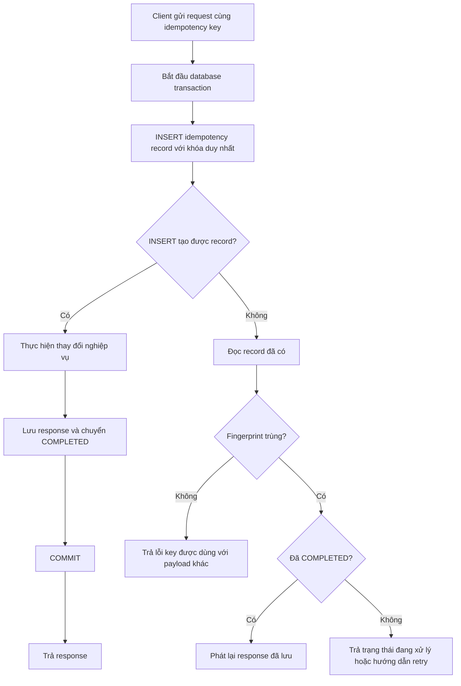

# Khóa lũy đẳng (idempotency key) và ràng buộc duy nhất

## Vì sao cần khóa lũy đẳng?

Trong một hệ thống phân tán, một yêu cầu có thể được gửi nhiều lần dù người dùng chỉ thực hiện một thao tác. Nguyên nhân thường gặp là mạng chập chờn, timeout, client không nhận được phản hồi, worker bị khởi động lại hoặc hàng đợi giao lại một thông điệp chưa được xác nhận.

Hãy xét tình huống tạo đơn hàng:

1. Client gửi yêu cầu tạo đơn hàng.
2. Server ghi đơn hàng vào database và commit transaction thành công.
3. Phản hồi bị mất trên đường truyền nên client nhận timeout.
4. Client cho rằng yêu cầu chưa thành công và gửi lại.
5. Nếu server xử lý lần gửi lại như một yêu cầu mới, database có thể xuất hiện hai đơn hàng.

Điểm khó là timeout không cho client biết transaction đã commit hay chưa. Client chỉ biết nó chưa nhận được phản hồi. Vì vậy, retry là hành vi bình thường và server phải có cách nhận ra lần gửi lại của cùng một thao tác.

**Idempotency key** (khóa lũy đẳng) là một mã định danh do client tạo và gửi kèm yêu cầu. Mọi lần retry của cùng một thao tác phải dùng lại cùng khóa. Server dùng khóa đó để xác định yêu cầu đã được tiếp nhận hoặc xử lý trước đây hay chưa. Nếu đã xử lý, server trả lại kết quả đã lưu thay vì thực hiện lại thao tác tạo dữ liệu.

Tính lũy đẳng có nghĩa là thực hiện cùng một thao tác nhiều lần cho cùng một định danh và cùng dữ liệu đầu vào vẫn tạo ra hiệu ứng nghiệp vụ tương đương với thực hiện một lần. Điều này không có nghĩa mọi lần gọi đều phải trả về cùng thời gian phản hồi hoặc mọi log đều giống nhau. Điều quan trọng là hiệu ứng nghiệp vụ không bị nhân đôi và client có thể nhận lại kết quả của thao tác ban đầu.

## Phân biệt retry, lũy đẳng và giao nhận đúng một lần

Ba khái niệm này liên quan với nhau nhưng không đồng nghĩa:

| Khái niệm | Ý nghĩa |
| --- | --- |
| Retry | Gửi lại một yêu cầu khi kết quả lần trước chưa rõ hoặc chưa thành công. |
| Idempotency | Lặp lại cùng một thao tác không làm tăng thêm hiệu ứng nghiệp vụ ngoài kết quả của lần đầu. |
| At-least-once delivery | Hệ thống giao thông điệp ít nhất một lần; cùng một thông điệp có thể được giao nhiều lần. |
| Exactly-once effect | Hiệu ứng nghiệp vụ được áp dụng một lần trong phạm vi được bảo đảm, dù thông điệp có thể được giao lại. |

Nhiều message broker và hàng đợi thực tế cung cấp cơ chế at-least-once. Ví dụ, consumer có thể xử lý xong thông điệp rồi bị dừng trước khi gửi ACK. Broker không biết công việc đã hoàn thành nên giao lại thông điệp. Vì vậy, consumer cần xử lý lặp an toàn.

Không nên hiểu idempotency key là lời hứa rằng toàn bộ hệ thống phân tán chỉ truyền hoặc thực thi một lần. Mạng vẫn có thể truyền nhiều lần; worker vẫn có thể chạy nhiều lần. Ta xây dựng **hiệu ứng một lần trong một phạm vi xác định** bằng cách kết hợp định danh ổn định, transaction và các ràng buộc duy nhất tại nơi lưu trạng thái.

## Ràng buộc duy nhất là lớp bảo vệ quan trọng

Giả sử ứng dụng kiểm tra trước khi tạo đơn hàng:

```sql
SELECT id
FROM orders
WHERE tenant_id = :tenant_id
  AND client_reference = :client_reference;
```

Nếu không tìm thấy dòng nào, ứng dụng thực hiện `INSERT`. Cách này có lỗi tranh chấp khi hai request chạy đồng thời:

```text
Request A                         Request B
---------                         ---------
SELECT: chưa có đơn hàng          
                                  SELECT: chưa có đơn hàng
INSERT đơn hàng                   
                                  INSERT đơn hàng
COMMIT                            COMMIT
```

Cả hai request đều kiểm tra trước khi request còn lại ghi dữ liệu. Kết quả có thể là hai đơn hàng trùng tham chiếu. Đây là lỗi **check-then-act**: thao tác kiểm tra và thao tác ghi không được database bảo vệ như một hành động nguyên tử.

Hãy chuyển quy tắc nghiệp vụ thành ràng buộc tại database:

```sql
CREATE TABLE orders (
    id                BIGINT GENERATED ALWAYS AS IDENTITY PRIMARY KEY,
    tenant_id         UUID NOT NULL,
    client_reference  VARCHAR(100) NOT NULL,
    amount            DECIMAL(18, 2) NOT NULL,
    created_at        TIMESTAMP NOT NULL DEFAULT CURRENT_TIMESTAMP,
    CONSTRAINT uq_orders_tenant_reference
        UNIQUE (tenant_id, client_reference)
);
```

Ràng buộc `UNIQUE (tenant_id, client_reference)` buộc database chỉ chấp nhận một đơn hàng có cùng tham chiếu trong cùng tenant. Nếu hai transaction cùng chèn một cặp giá trị, unique index sẽ điều phối tranh chấp: một transaction có thể commit; transaction còn lại phải chờ kết quả và nhận lỗi vi phạm unique constraint hoặc kết quả conflict tùy câu lệnh SQL.

Đây là điểm khác biệt cốt lõi: kiểm tra ở tầng ứng dụng chỉ quan sát trạng thái tại một thời điểm; unique constraint được database thực thi đồng bộ với thao tác ghi, kể cả khi nhiều transaction cạnh tranh.

Các cột tạo thành khóa duy nhất thường nên là `NOT NULL`. Trong SQL, cách xử lý `NULL` trong unique constraint phụ thuộc database và cấu hình; nhiều hệ quản trị cho phép nhiều dòng có `NULL` trong cột duy nhất. Nếu nghiệp vụ yêu cầu mọi bản ghi phải có định danh, hãy biểu diễn yêu cầu đó bằng `NOT NULL`.

## Idempotency key và khóa nghiệp vụ khác nhau thế nào?

Hai loại khóa giải quyết hai vấn đề gần nhau:

| Loại khóa | Dùng để trả lời | Ví dụ |
| --- | --- | --- |
| Idempotency key | Đây có phải lần gửi lại của cùng một thao tác API không? | `Idempotency-Key: 6b7...` |
| Khóa nghiệp vụ | Hai bản ghi này có đại diện cho cùng một thực thể hoặc sự kiện nghiệp vụ không? | `(tenant_id, client_reference)` |

Idempotency key thường có phạm vi theo client, tenant và thao tác API. Nó có thể hết hạn sau một khoảng thời gian lưu kết quả đã thống nhất. Khóa nghiệp vụ thường tồn tại lâu hơn vì nó bảo vệ một quy tắc dữ liệu, chẳng hạn mỗi mã đơn hàng từ hệ thống đối tác chỉ được tạo một lần.

Ví dụ, client gửi hai yêu cầu tạo đơn hàng với hai idempotency key khác nhau nhưng cùng `client_reference = 'PO-2026-018'`. Idempotency key không nhận ra chúng là cùng một yêu cầu vì hai khóa khác nhau. Ràng buộc duy nhất trên `orders` vẫn ngăn việc tạo hai đơn hàng có cùng mã tham chiếu.

Ngược lại, client retry cùng một yêu cầu với cùng idempotency key nhưng payload bị thay đổi. Idempotency key giúp server phát hiện việc tái sử dụng khóa sai mục đích; khóa nghiệp vụ không nhất thiết phát hiện được thay đổi này.

Một hệ thống xử lý đơn hàng đáng tin cậy thường cần cả hai lớp: idempotency key để retry API an toàn và unique constraint trên dữ liệu nghiệp vụ để bảo vệ bất biến lâu dài.

## Thiết kế bảng lưu idempotency key

Một bảng lưu khóa có thể chứa phạm vi của khóa, dấu vân tay request và kết quả đã xử lý:

```sql
CREATE TABLE idempotency_records (
    tenant_id        UUID NOT NULL,
    operation        VARCHAR(100) NOT NULL,
    idempotency_key  VARCHAR(255) NOT NULL,
    request_hash     CHAR(64) NOT NULL,
    status           VARCHAR(20) NOT NULL,
    response_status  INTEGER,
    response_body    JSONB,
    created_at       TIMESTAMPTZ NOT NULL DEFAULT CURRENT_TIMESTAMP,
    completed_at     TIMESTAMPTZ,
    expires_at       TIMESTAMPTZ,
    CONSTRAINT pk_idempotency_records
        PRIMARY KEY (tenant_id, operation, idempotency_key),
    CONSTRAINT ck_idempotency_records_status
        CHECK (status IN ('PROCESSING', 'COMPLETED'))
);
```

Đây là ví dụ dùng kiểu dữ liệu PostgreSQL (`UUID`, `JSONB`, `TIMESTAMPTZ`, `ON CONFLICT` ở phần sau). Với hệ quản trị khác, hãy điều chỉnh kiểu JSON, cú pháp upsert và kiểu thời gian tương ứng; nguyên tắc về khóa duy nhất và transaction vẫn giữ nguyên.

Các trường có ý nghĩa như sau:

- `tenant_id`: phạm vi sở hữu khóa. Một tenant không thể đọc hoặc chiếm khóa của tenant khác.
- `operation`: tên thao tác ổn định, chẳng hạn `CREATE_ORDER_V1`. Hai API khác nhau có thể dùng cùng chuỗi key mà không xung đột nếu operation khác nhau.
- `idempotency_key`: mã client gửi kèm và phải giữ nguyên qua các lần retry.
- `request_hash`: dấu vân tay của payload đã chuẩn hóa. Server dùng nó để phát hiện cùng key nhưng khác nội dung.
- `status`: trạng thái xử lý. Ví dụ này dùng `PROCESSING` và `COMPLETED`; một hệ thống xử lý nền có thể cần thêm trạng thái lỗi, hết hạn hoặc bị chiếm quyền xử lý.
- `response_status`, `response_body`: kết quả cần phát lại khi client gửi lại request.
- `created_at`, `completed_at`, `expires_at`: phục vụ vận hành, đo thời gian xử lý và chính sách lưu trữ.

Khóa chính gồm ba cột để giới hạn key theo tenant và operation. Nếu chỉ đặt `UNIQUE (idempotency_key)` trên toàn hệ thống, các client độc lập có thể vô tình va chạm khóa. Nếu không đưa tenant vào phạm vi tra cứu, ứng dụng còn có nguy cơ trả nhầm kết quả giữa các khách hàng.

Idempotency key nên là chuỗi khó đoán, đủ dài và được tạo bằng bộ sinh ngẫu nhiên phù hợp, ví dụ UUID. Khóa không phải thông tin xác thực: server vẫn phải kiểm tra danh tính, quyền truy cập và tenant của request trước khi trả lại kết quả đã lưu.

## Dấu vân tay request ngăn tái sử dụng key sai cách

Chỉ lưu idempotency key là chưa đủ. Giả sử client gửi:

```http
POST /orders
Idempotency-Key: 6b7f9d4a-...
Content-Type: application/json

{"clientReference":"PO-018","amount":120000}
```

Sau đó client gửi lại cùng key nhưng đổi `amount` thành `900000`. Nếu server chỉ tra key và trả kết quả cũ mà không so sánh payload, client có thể hiểu nhầm rằng yêu cầu mới đã được xử lý. Nếu server thực thi payload mới, cùng một key lại đại diện cho hai ý định khác nhau.

Server nên tính `request_hash` từ nội dung có ý nghĩa đối với thao tác. Có thể dùng SHA-256 trên biểu diễn chuẩn hóa của request. Việc chuẩn hóa cần xác định rõ thứ tự thuộc tính, định dạng số, giá trị mặc định, trường không tham gia nghiệp vụ và cách biểu diễn chuỗi. Hai JSON có thứ tự thuộc tính khác nhau nhưng cùng ý nghĩa nên tạo ra cùng fingerprint nếu hệ thống xem chúng là tương đương.

Không nên băm trực tiếp chuỗi JSON tùy ý nếu serializer có thể thay đổi thứ tự trường hoặc cách định dạng. Cũng không nên đưa dữ liệu thay đổi theo từng lần gọi như timestamp theo dõi hoặc request ID vào fingerprint nếu chúng không làm thay đổi ý nghĩa nghiệp vụ.

Khi key đã tồn tại:

- Nếu fingerprint trùng, đây là lần retry hợp lệ. Server trả kết quả đã lưu hoặc thông báo request vẫn đang được xử lý.
- Nếu fingerprint khác, server từ chối việc tái sử dụng key, thường bằng lỗi `409 Conflict` hoặc mã lỗi API được quy định rõ.

Fingerprint không thay thế việc xác thực. Không dùng hash để cho phép người gọi truy cập kết quả thuộc tenant hoặc người dùng khác.

## Quy trình xử lý API an toàn khi có request đồng thời

Với một thao tác nghiệp vụ chỉ ghi vào cùng database, cách đơn giản và mạnh là lưu idempotency record, thay đổi dữ liệu nghiệp vụ và kết quả phản hồi trong **cùng một transaction**.

Quy trình tổng quát:



### 1. Chiếm khóa bằng một câu lệnh nguyên tử

Với PostgreSQL, có thể dùng `INSERT ... ON CONFLICT DO NOTHING`:

```sql
INSERT INTO idempotency_records (
    tenant_id,
    operation,
    idempotency_key,
    request_hash,
    status
)
VALUES (
    :tenant_id,
    :operation,
    :idempotency_key,
    :request_hash,
    'PROCESSING'
)
ON CONFLICT (tenant_id, operation, idempotency_key)
DO NOTHING
RETURNING idempotency_key;
```

Nếu câu lệnh trả về một dòng, transaction hiện tại đã tạo được record và có quyền xử lý thao tác này. Nếu không trả về dòng nào, một record với cùng phạm vi khóa đã tồn tại hoặc transaction cạnh tranh đã commit trước.

Không thay câu lệnh trên bằng quy trình `SELECT` để kiểm tra rồi mới `INSERT`. Unique constraint kết hợp với `INSERT` mới là điểm quyết định nguyên tử khi có cạnh tranh.

### 2. Xử lý đường đi của request trùng

Khi không tạo được record, đọc record đã tồn tại trong một câu lệnh tiếp theo:

```sql
SELECT request_hash,
       status,
       response_status,
       response_body
FROM idempotency_records
WHERE tenant_id = :tenant_id
  AND operation = :operation
  AND idempotency_key = :idempotency_key;
```

Sau đó áp dụng quy tắc:

1. Không tìm thấy record: xử lý như trường hợp cạnh tranh hoặc vòng đời dữ liệu đặc biệt; đọc lại theo chính sách retry của hệ thống.
2. `request_hash` khác: trả lỗi xung đột vì key đã được dùng cho payload khác.
3. `status = 'COMPLETED'`: trả lại `response_status` và `response_body` đã lưu.
4. `status = 'PROCESSING'`: thông báo request đang được xử lý hoặc cung cấp cơ chế tra cứu trạng thái.

Với PostgreSQL ở mức cô lập `READ COMMITTED`, `INSERT ... ON CONFLICT DO NOTHING` có thể phải chờ transaction đang chèn cùng khóa kết thúc. Nếu transaction kia commit, câu lệnh hiện tại không chèn được; câu `SELECT` tiếp theo nhận snapshot mới và có thể đọc record vừa commit. Nếu transaction kia rollback, thao tác chèn đang chờ có thể tiếp tục thành công.

Ở mức cô lập khác, đặc biệt khi dùng snapshot cố định như `REPEATABLE READ`, ứng dụng cần xử lý khả năng serialization failure hoặc snapshot chưa nhìn thấy dòng cạnh tranh. Hãy retry toàn bộ transaction khi database báo lỗi có thể retry; không giả định mọi isolation level có cùng hành vi quan sát dữ liệu.

### 3. Ghi nghiệp vụ và kết quả trong cùng transaction

Sau khi chiếm được key, server tạo đơn hàng và lưu kết quả:

```sql
INSERT INTO orders (
    tenant_id,
    client_reference,
    amount
)
VALUES (
    :tenant_id,
    :client_reference,
    :amount
)
RETURNING id;

UPDATE idempotency_records
SET status = 'COMPLETED',
    response_status = 201,
    response_body = :response_body,
    completed_at = CURRENT_TIMESTAMP
WHERE tenant_id = :tenant_id
  AND operation = :operation
  AND idempotency_key = :idempotency_key;
```

Hai thao tác ghi phải nằm trong cùng transaction với câu `INSERT` idempotency record. Khi commit, cả đơn hàng và response đã lưu cùng xuất hiện. Nếu tạo đơn hàng hoặc cập nhật record thất bại, rollback sẽ hoàn tác cả hai; request retry có thể chiếm key và chạy lại.

Đường đi này còn xử lý được trường hợp server commit xong nhưng mất phản hồi: lần retry tìm thấy `COMPLETED` và nhận lại kết quả của lần đầu.

## Ví dụ triển khai ở tầng service Java

Đoạn mã dưới đây minh họa cấu trúc với Spring và repository có các phương thức tương ứng với SQL phía trên. Tên repository là ví dụ; phần quan trọng là ranh giới transaction và cách phân nhánh theo kết quả `insertIfAbsent`.

```java
@Service
public class OrderService {
    private final IdempotencyRepository idempotencyRepository;
    private final OrderRepository orderRepository;
    private final RequestHasher requestHasher;

    public OrderService(
            IdempotencyRepository idempotencyRepository,
            OrderRepository orderRepository,
            RequestHasher requestHasher) {
        this.idempotencyRepository = idempotencyRepository;
        this.orderRepository = orderRepository;
        this.requestHasher = requestHasher;
    }

    @Transactional
    public StoredHttpResponse createOrder(
            UUID tenantId,
            String idempotencyKey,
            CreateOrderRequest request) {

        String operation = "CREATE_ORDER_V1";
        String requestHash = requestHasher.sha256(request);

        boolean claimed = idempotencyRepository.insertIfAbsent(
                tenantId,
                operation,
                idempotencyKey,
                requestHash);

        if (!claimed) {
            IdempotencyRecord previous = idempotencyRepository
                    .find(tenantId, operation, idempotencyKey)
                    .orElseThrow(() -> new RetryableRequestException(
                            "Không đọc được idempotency record sau khi gặp conflict"));

            if (!previous.requestHash().equals(requestHash)) {
                throw new IdempotencyKeyReuseException(
                        "Idempotency key đã được dùng với nội dung khác");
            }

            if (previous.status() == IdempotencyStatus.COMPLETED) {
                return new StoredHttpResponse(
                        previous.responseStatus(),
                        previous.responseBody());
            }

            throw new RequestStillProcessingException(
                    "Yêu cầu cùng khóa vẫn đang được xử lý");
        }

        Order order = orderRepository.insert(
                tenantId,
                request.clientReference(),
                request.amount());

        StoredHttpResponse response = StoredHttpResponse.created(
                new OrderResponse(order.id(), order.clientReference()));

        idempotencyRepository.markCompleted(
                tenantId,
                operation,
                idempotencyKey,
                response.statusCode(),
                response.body());

        return response;
    }
}
```

`insertIfAbsent` nên thực thi câu `INSERT ... ON CONFLICT DO NOTHING RETURNING ...` và trả về `true` khi chèn được record. Không nên triển khai nó bằng `existsByKey()` rồi `save()` vì hai lời gọi đó tạo lại race condition.

Trong Spring, `@Transactional` chỉ hoạt động đúng khi lời gọi đi qua transaction proxy theo cấu hình của ứng dụng. Cần bảo đảm repository dùng cùng datasource và cùng transaction manager. Nếu gọi phương thức transactional theo kiểu self-invocation trong cùng object, proxy mặc định có thể không áp dụng transaction như mong đợi.

Đoạn mã là minh họa cho thao tác database đồng bộ. Nếu transaction rollback, exception phải thoát ra ngoài để framework rollback; không bắt lỗi rồi tiếp tục commit một record `PROCESSING` mà không có quy tắc phục hồi. Các exception dùng để biểu diễn lỗi key hoặc trạng thái đang xử lý cũng cần được ánh xạ sang HTTP response nhất quán.

## Hai transaction cùng dùng một idempotency key

Giả sử request A và B đồng thời gửi cùng tenant, operation và key. Cả hai cùng chạy câu `INSERT` có unique constraint.

```text
Transaction A                     Transaction B
--------------                     --------------
INSERT key K: thành công           
                                   INSERT key K: chờ conflict
Tạo order 501                      
Lưu response 201                   
COMMIT                             
                                   INSERT: DO NOTHING
                                   SELECT record K
                                   Đọc COMPLETED, order 501
                                   Trả response đã lưu
```

Chỉ transaction A tạo đơn hàng. Transaction B đi theo nhánh đọc kết quả đã có. Nếu A rollback thay vì commit, B có thể chèn được key và trở thành transaction xử lý request. Đây là lý do transaction và unique constraint phối hợp tốt: quyền xử lý được quyết định tại database, không dựa trên một khóa trong bộ nhớ của một instance ứng dụng.

Nếu hai request có cùng key nhưng fingerprint khác nhau, request đến sau sẽ bị từ chối sau khi đọc record hiện có. Không được âm thầm cập nhật fingerprint hoặc payload của record đầu tiên, vì hành động đó làm thay đổi ý nghĩa của khóa đã được sử dụng.

## Áp dụng cho consumer xử lý message queue

Trong hệ thống hàng đợi, message ID là định danh ổn định để consumer nhận ra thông điệp đã xử lý. Có thể tạo bảng lưu dấu thông điệp:

```sql
CREATE TABLE processed_messages (
    consumer_name  VARCHAR(100) NOT NULL,
    message_id     VARCHAR(255) NOT NULL,
    processed_at   TIMESTAMP NOT NULL DEFAULT CURRENT_TIMESTAMP,
    CONSTRAINT pk_processed_messages
        PRIMARY KEY (consumer_name, message_id)
);
```

Khóa chính gồm `consumer_name` và `message_id` vì cùng một message có thể được nhiều consumer độc lập xử lý theo các mục đích khác nhau. Nếu chỉ có một consumer logic, phạm vi có thể được đơn giản hóa nhưng vẫn cần một quy ước ổn định.

Consumer thực hiện các bước sau trong một transaction database:

```sql
INSERT INTO processed_messages (consumer_name, message_id)
VALUES (:consumer_name, :message_id)
ON CONFLICT (consumer_name, message_id) DO NOTHING
RETURNING message_id;
```

- Nếu chèn được dòng, consumer tiếp tục cập nhật dữ liệu nghiệp vụ rồi commit.
- Nếu không chèn được dòng, thông điệp đã được xử lý trong phạm vi consumer này; consumer có thể bỏ qua phần nghiệp vụ.
- Chỉ ACK message sau khi transaction commit thành công.

Ví dụ pseudo-code Java:

```java
public void onMessage(OrderPaidMessage message) {
    transactionTemplate.executeWithoutResult(status -> {
        boolean firstDelivery = processedMessageRepository
                .insertIfAbsent("order-projection", message.messageId());

        if (!firstDelivery) {
            return;
        }

        orderProjectionRepository.markPaid(message.orderId());
    });

    // ACK sau khi transactionTemplate đã hoàn thành commit.
    // Nếu xử lý hoặc commit thất bại, không ACK để broker có thể giao lại.
    acknowledge(message);
}
```

Trong ví dụ này, nếu `insertIfAbsent` trả về `false`, message đã được xử lý trước đó; transaction kết thúc bình thường mà không cập nhật projection, rồi consumer ACK bản giao lại. Nếu cập nhật projection thất bại, exception làm transaction rollback cả dấu `processed_messages`; lần giao lại có thể thử xử lý lại.

Không ACK trước khi commit. Nếu consumer ACK rồi mới ghi database và tiến trình bị dừng giữa hai bước, broker đã xóa message trong khi hiệu ứng nghiệp vụ chưa được lưu. Ngược lại, nếu commit xong rồi tiến trình dừng trước ACK, broker giao lại message; unique constraint khiến lần giao lại được bỏ qua an toàn.

**Dấu xử lý và thay đổi nghiệp vụ phải commit cùng nhau.** Nếu ghi `processed_messages` ở transaction riêng rồi mới cập nhật đơn hàng, consumer có thể commit dấu xử lý, gặp lỗi khi cập nhật đơn hàng và sau đó bỏ qua mọi lần giao lại. Khi đó dữ liệu nghiệp vụ bị mất cập nhật.

## Khi thao tác có gọi dịch vụ bên ngoài

Transaction database không thể tự động bao trọn một lời gọi HTTP tới cổng thanh toán, email provider hoặc dịch vụ của đối tác. Ví dụ:

1. Server gọi cổng thanh toán và cổng thanh toán đã trừ tiền.
2. Server bị dừng trước khi ghi kết quả thanh toán vào database.
3. Khi retry, server không biết lần gọi trước đã thành công hay chưa.

Giữ transaction database mở trong lúc gọi dịch vụ ngoài không giải quyết được tính nguyên tử giữa hai hệ thống. Database có thể rollback trong khi dịch vụ ngoài đã thực hiện tác dụng không thể rollback.

Một số cách phối hợp thường dùng:

- **Idempotency key ở dịch vụ ngoài:** gửi một khóa ổn định cho provider nếu API của provider hỗ trợ. Retry cùng thao tác phải dùng lại cùng khóa.
- **Transactional outbox:** trong một transaction database, ghi thay đổi nghiệp vụ và một outbox event. Một dispatcher đọc outbox và gửi event với cơ chế retry. Bản ghi outbox có định danh duy nhất để tránh tạo nhiều event cho cùng thao tác.
- **Consumer deduplication:** dịch vụ nhận event lưu message ID với unique constraint và ghi thay đổi nghiệp vụ trong cùng transaction, như phần xử lý queue ở trên.
- **Đối soát hoặc saga:** với quy trình nhiều bước, lưu trạng thái từng bước, hỗ trợ retry có kiểm soát và hành động bù khi một bước không thể hoàn thành.

Transactional outbox thường được dùng khi cần bảo đảm rằng thay đổi database và ý định phát event được lưu cùng nhau. Nó không khiến việc gửi qua mạng trở thành exactly-once: dispatcher có thể gửi lại sau khi mất ACK. Consumer vẫn phải xử lý lặp an toàn.

## Trạng thái đang xử lý và transaction dài

Ví dụ API ở trên ghi record `PROCESSING`, tạo đơn hàng và chuyển `COMPLETED` trong cùng một transaction. Khi transaction chưa commit, request cạnh tranh thường phải chờ unique conflict. Nếu transaction commit, request sau đọc được `COMPLETED`; nếu rollback, request sau có thể chiếm key. Vì vậy, trạng thái `PROCESSING` trong transaction ngắn không nhất thiết được request khác nhìn thấy.

Một số công việc dài được xử lý bất đồng bộ và cần công bố trạng thái `PROCESSING` trước khi công việc kết thúc. Khi đó, thiết kế thường tách thành các transaction:

1. Transaction đầu tiên tạo idempotency record và một job/outbox record, rồi commit.
2. Worker nhận job và chiếm quyền xử lý bằng cơ chế claim có thời hạn hoặc lease.
3. Worker cập nhật trạng thái và kết quả khi hoàn tất.
4. Request retry đọc được trạng thái `PROCESSING` và trả mã phản hồi phù hợp, chẳng hạn `202 Accepted` cùng URL tra cứu trạng thái.

Thiết kế này cần xử lý worker chết giữa chừng. Lease nên có thời hạn; worker mới chỉ được tiếp quản khi lease cũ hết hạn hoặc bị thu hồi theo quy tắc an toàn. Có thể dùng số lần tăng phiên bản (fencing token) để ngăn worker cũ tiếp tục ghi sau khi quyền xử lý đã được chuyển giao. Không nên coi một record `PROCESSING` tồn tại mãi là bằng chứng rằng worker vẫn đang chạy.

Trạng thái lỗi cũng cần quy tắc rõ ràng. Nếu lỗi khiến toàn bộ transaction đồng bộ rollback, key có thể được thử lại. Nếu hệ thống đã commit một kết quả lỗi cuối cùng, nó có thể lưu kết quả đó và phát lại cho cùng key. Với lỗi tạm thời, hệ thống có thể cho phép retry hoặc đưa job về hàng đợi. Hãy quyết định theo ngữ nghĩa API và nghiệp vụ thay vì tự động xóa mọi record lỗi.

## Chính sách lưu trữ và hết hạn khóa

Idempotency record không nhất thiết phải lưu vĩnh viễn. Tuy nhiên, thời gian lưu phải dài hơn khoảng thời gian mà client, proxy, job scheduler hoặc message broker có thể retry thao tác đó. Nếu xóa key quá sớm, một lần retry muộn có thể bị hiểu thành thao tác mới.

Khi đặt TTL, cần xác định:

- Client có thể retry trong bao lâu?
- Broker có thể giữ message và giao lại sau bao lâu?
- Có job nào phát lại request từ dead-letter queue không?
- Dữ liệu nghiệp vụ có unique key dài hạn để bảo vệ sau khi idempotency record bị dọn không?
- Kết quả response có chứa dữ liệu nhạy cảm cần chính sách lưu trữ riêng không?

Có thể dùng `expires_at` để chọn record đủ điều kiện dọn dẹp. Việc dọn dẹp nên chạy theo lô và không xóa record đang được xử lý. Nếu key hết hạn nhưng dữ liệu nghiệp vụ vẫn phải duy nhất, unique constraint nghiệp vụ phải tiếp tục bảo vệ bất biến đó.

Không nên cho phép client tùy ý đổi cùng key thành một thao tác mới chỉ vì đã qua TTL mà không có quy tắc rõ ràng. Với một số nghiệp vụ như thanh toán hoặc nhập đơn từ đối tác, khóa nghiệp vụ có thể cần tồn tại lâu hơn nhiều so với record idempotency API.

## Lỗi thường gặp khi triển khai

| Cách làm sai | Hậu quả | Cách xử lý |
| --- | --- | --- |
| Tạo key mới cho mỗi lần retry | Server xem mỗi lần gửi là một thao tác mới. | Client tạo key một lần và giữ nguyên cho đến khi có kết quả cuối cùng. |
| `SELECT` kiểm tra rồi `INSERT` mà không có unique constraint | Hai transaction có thể cùng vượt qua bước kiểm tra. | Đặt unique constraint và dùng thao tác insert nguyên tử. |
| Chỉ lưu key, không lưu fingerprint | Cùng key có thể bị tái sử dụng với payload khác. | Lưu hash của payload đã chuẩn hóa và từ chối khi không khớp. |
| Chỉ lưu key, không lưu kết quả | Server biết request đã tồn tại nhưng không thể phát lại response ban đầu. | Lưu status và response cần thiết hoặc định danh kết quả để truy xuất. |
| Ghi dấu message đã xử lý ở transaction riêng | Dấu đã commit nhưng cập nhật nghiệp vụ có thể thất bại. | Ghi dấu và thay đổi nghiệp vụ trong cùng transaction. |
| ACK message trước khi commit | Message có thể bị mất dù dữ liệu chưa được ghi. | ACK sau khi transaction commit thành công. |
| Gọi dịch vụ ngoài rồi giả định DB rollback sẽ hoàn tác lời gọi | Tác dụng bên ngoài vẫn tồn tại sau rollback. | Dùng idempotency của provider, outbox, saga hoặc đối soát. |
| Xóa key quá sớm | Retry muộn có thể tạo hiệu ứng trùng. | Chọn TTL theo cửa sổ retry và giữ unique constraint nghiệp vụ khi cần. |
| Dùng một key toàn cục không có tenant/operation | Có thể va chạm giữa client hoặc thao tác độc lập. | Xác định scope rõ ràng trong khóa duy nhất. |

## Kiểm chứng hành vi đồng thời

Khi triển khai, cần kiểm tra các tình huống cạnh tranh ở mức database, không chỉ gọi tuần tự trong một unit test:

1. Gửi đồng thời nhiều request có cùng tenant, operation, key và payload. Chỉ có một hiệu ứng tạo dữ liệu; các request còn lại nhận kết quả tương đương.
2. Gửi cùng key nhưng payload khác. Một request được xử lý; request còn lại nhận lỗi tái sử dụng key.
3. Cho transaction đầu tiên rollback sau khi đã chiếm key. Một request đang chờ phải có thể tiếp quản và xử lý thành công.
4. Cho server commit nhưng làm mất phản hồi. Retry phải phát lại kết quả đã lưu.
5. Cho consumer commit database rồi dừng trước ACK. Khi message được giao lại, consumer không áp dụng nghiệp vụ lần thứ hai.
6. Cho consumer lỗi trước commit. Cả dấu xử lý và cập nhật nghiệp vụ phải rollback để lần giao lại có thể chạy.
7. Kiểm tra key hết hạn, dọn dẹp và unique constraint nghiệp vụ để bảo đảm retry muộn không phá vỡ quy tắc dữ liệu.

Các bài kiểm tra đồng thời nên dùng nhiều connection hoặc nhiều thread thực sự cùng truy cập database. Mock repository không thể chứng minh unique index và transaction isolation hoạt động đúng khi có tranh chấp.

## Ví dụ tổng hợp

Một hệ thống nhận đơn hàng từ đối tác có thể kết hợp ba định danh:

| Định danh | Phạm vi | Mục đích |
| --- | --- | --- |
| `Idempotency-Key` | Tenant + `CREATE_ORDER_V1` + key | Nhận diện lần retry của cùng request API và phát lại response. |
| `client_reference` | Tenant + mã đơn từ đối tác | Bảo vệ quy tắc mỗi đơn đối tác chỉ được nhập một lần, kể cả khi đối tác tạo key mới. |
| `message_id` | Consumer + message ID | Ngăn queue consumer áp dụng lại cùng thông điệp sau khi broker giao lại. |

Luồng xử lý có thể diễn ra như sau:

1. Đối tác gửi yêu cầu tạo đơn cùng idempotency key và mã đơn hàng của họ.
2. API chiếm idempotency key bằng unique constraint. Nếu key đã hoàn tất với cùng fingerprint, API phát lại response.
3. Nếu là request mới, API tạo đơn hàng. Unique constraint trên `(tenant_id, client_reference)` bảo vệ trường hợp đối tác gửi cùng mã đơn với key khác.
4. Trong cùng transaction, API ghi outbox event báo đơn hàng đã tạo và lưu response `COMPLETED`.
5. Dispatcher gửi event tới broker. Nếu gửi lại, consumer dùng `(consumer_name, message_id)` để nhận ra bản giao trùng.
6. Consumer ghi dấu xử lý và cập nhật dữ liệu đọc trong cùng transaction, rồi mới ACK.

Mỗi khóa bảo vệ một ranh giới khác nhau. Idempotency key xử lý retry ở API; khóa nghiệp vụ bảo vệ tính duy nhất của dữ liệu; message ID bảo vệ consumer trước việc giao lại. Kết hợp chúng với transaction và unique constraint giúp hệ thống giữ được hiệu ứng nghiệp vụ ổn định khi có timeout, cạnh tranh và lỗi tiến trình.

## Bài tập vận dụng

Một endpoint `POST /payments` nhận `accountId`, `amount` và `Idempotency-Key`. Hệ thống lưu payment vào database, sau đó gửi yêu cầu trừ tiền tới một payment provider. Hãy xác định:

1. Phạm vi unique key của bảng idempotency record nên gồm những cột nào?
2. Vì sao cần fingerprint request, và trường hợp nào phải trả lỗi conflict?
3. Ràng buộc duy nhất nghiệp vụ nào có thể ngăn tạo hai payment cho cùng một lệnh thanh toán từ đối tác?
4. Vì sao không thể dựa vào rollback database để hoàn tác việc provider đã trừ tiền?
5. Nếu dùng outbox, dữ liệu nào cần được ghi trong transaction tạo payment và consumer cần chống trùng bằng cách nào?

Một thiết kế hợp lý sẽ scope idempotency key theo tenant và operation, lưu fingerprint của `accountId` và `amount` cùng các trường nghiệp vụ liên quan, đồng thời có unique constraint cho mã lệnh thanh toán từ đối tác. Việc gửi lệnh trừ tiền nên dùng khóa ổn định mà provider hỗ trợ hoặc được điều phối qua outbox. Consumer lưu message ID và cập nhật dữ liệu trong cùng transaction. Như vậy, retry ở API, retry khi gọi provider và giao lại message đều có cơ chế nhận diện riêng.
