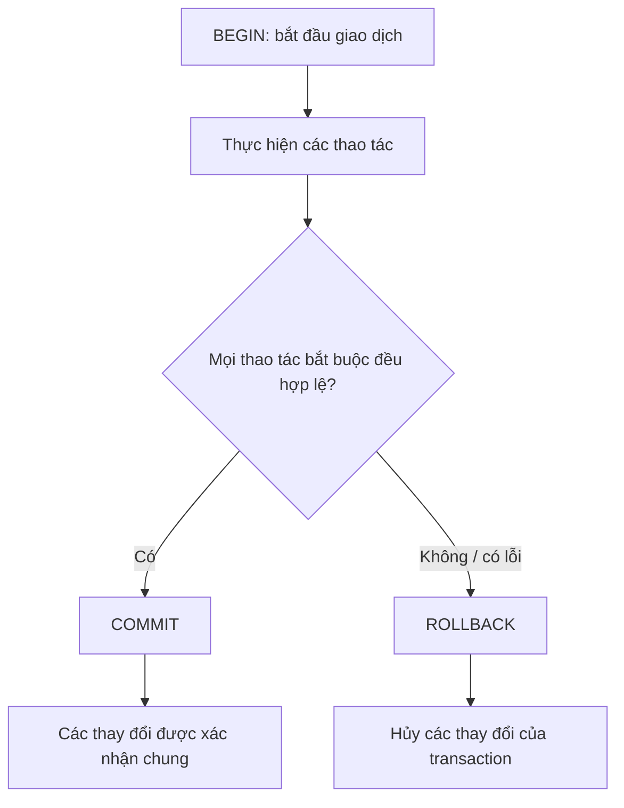

# Tính nguyên tử (Atomicity): thành công toàn bộ hoặc hủy bỏ thay đổi

Trong cơ sở dữ liệu, một nghiệp vụ thường cần nhiều thao tác ghi. Ví dụ, chuyển 250.000 đồng từ tài khoản A sang tài khoản B gồm ít nhất hai thay đổi: trừ tiền ở A và cộng tiền vào B. Nếu hệ thống chỉ trừ tiền rồi gặp lỗi trước khi cộng tiền, dữ liệu sẽ rơi vào trạng thái sai.

**Atomicity (tính nguyên tử)** là thuộc tính đầu tiên trong ACID, yêu cầu một **transaction (giao dịch)** được xử lý như một đơn vị không thể chia nhỏ khi xác nhận kết quả: **hoặc toàn bộ những thay đổi thuộc giao dịch được xác nhận, hoặc không thay đổi nào của giao dịch được giữ lại**.

## 1. Hiểu “toàn bộ hoặc không gì cả”

Giả sử trước giao dịch:

| Tài khoản | Số dư ban đầu |
|---|---:|
| A | 1.000.000 |
| B | 400.000 |
| **Tổng** | **1.400.000** |

Nghiệp vụ: chuyển 250.000 từ A sang B.

| Kết cục | Số dư A | Số dư B | Ý nghĩa |
|---|---:|---:|---|
| Giao dịch thành công, `COMMIT` | 750.000 | 650.000 | Cả hai thay đổi được xác nhận |
| Có lỗi, `ROLLBACK` | 1.000.000 | 400.000 | Cả hai tài khoản trở lại trạng thái trước giao dịch |
| Chỉ trừ A rồi dừng | 750.000 | 400.000 | **Trạng thái không được phép coi là kết quả cuối cùng của giao dịch nguyên tử** |

Đặc điểm quan trọng không nằm ở số lượng câu SQL. Một transaction có thể bao gồm hai câu `UPDATE`, nhiều câu `INSERT`, `DELETE`, các phép kiểm tra, và việc ghi nhật ký nghiệp vụ vào bảng khác. Những thao tác **được đặt cùng một ranh giới transaction** cần được xác nhận hoặc hủy theo một quyết định chung.

> “Nguyên tử” mô tả **kết quả xác nhận của cả transaction**, không có nghĩa các câu lệnh được thực thi đồng thời trong một bước CPU hay dữ liệu không thay đổi tạm thời trong quá trình thực thi.

## 2. Ranh giới transaction: BEGIN, COMMIT và ROLLBACK

Một giao dịch SQL thông thường có ba mốc:

1. `BEGIN` (hoặc `START TRANSACTION`): bắt đầu ranh giới giao dịch.
2. Thực hiện các lệnh đọc/ghi và kiểm tra điều kiện nghiệp vụ.
3. `COMMIT` nếu hợp lệ toàn bộ; `ROLLBACK` nếu phải hủy.



- **Trước `COMMIT`:** transaction vẫn có thể bị hủy; chính transaction thường đọc được các thay đổi mình vừa thực hiện.
- **Sau `COMMIT` thành công:** các thay đổi đã được chấp nhận như một kết quả chung. Vấn đề lưu bền qua sự cố thuộc thêm về **Durability**.
- **Sau `ROLLBACK`:** các thay đổi dữ liệu thuộc transaction chưa commit bị hủy, bao gồm cả những câu SQL trước đó đã chạy thành công.

Nếu kết nối mất trước khi transaction được commit, cơ sở dữ liệu giao dịch thông thường sẽ hủy transaction chưa được xác nhận. Tuy nhiên, nếu kết nối mất **đúng lúc client gửi `COMMIT`**, client có thể không biết chắc server đã commit hay chưa. Cần kiểm tra trạng thái thực tế trước khi lặp lại một thao tác không thể làm hai lần.

## 3. Ví dụ SQL: chuyển tiền an toàn trong một transaction

Ví dụ sau sử dụng cú pháp PostgreSQL; nguyên lý áp dụng cho các cơ sở dữ liệu quan hệ có hỗ trợ transaction. Để dễ theo dõi, đơn vị số dư trong bảng là nghìn đồng.

### 3.1. Tạo dữ liệu mẫu

```sql
CREATE TABLE accounts (
    id BIGINT PRIMARY KEY,
    holder VARCHAR(50) NOT NULL,
    balance NUMERIC(18, 2) NOT NULL CHECK (balance >= 0)
);

INSERT INTO accounts (id, holder, balance) VALUES
    (1, 'A', 1000.00),
    (2, 'B', 400.00);
```

Ràng buộc `CHECK (balance >= 0)` ngăn lưu số dư âm. Tuy nhiên, ràng buộc này **không thay thế** transaction: hai thay đổi vẫn phải được thực hiện chung.

### 3.2. Kịch bản thành công

```sql
BEGIN;

-- Bước 1: Chỉ trừ nếu tài khoản A có đủ tiền.
UPDATE accounts
SET balance = balance - 250.00
WHERE id = 1 AND balance >= 250.00;

-- Ứng dụng phải xác nhận câu UPDATE ảnh hưởng đúng 1 hàng.

-- Bước 2: Cộng tiền vào tài khoản B.
UPDATE accounts
SET balance = balance + 250.00
WHERE id = 2;

-- Ứng dụng phải xác nhận câu UPDATE ảnh hưởng đúng 1 hàng.

COMMIT;
```

Khi cả hai thao tác cập nhật đúng một hàng và `COMMIT` thành công, số dư trở thành A = 750 và B = 650. Hai thay đổi được xác nhận trong một transaction.

**Lưu ý thiết yếu:** Đây là trình tự SQL minh họa. Ứng dụng phải **kiểm tra số hàng được cập nhật trước khi commit**, và `ROLLBACK` nếu không đúng kỳ vọng. Bản thân câu `UPDATE` cập nhật 0 hàng thường **không phát sinh lỗi SQL**. Nếu A không đủ tiền hoặc B không tồn tại mà vẫn commit, nghiệp vụ sẽ sai dù cơ sở dữ liệu đã thực hiện transaction một cách nguyên tử.

### 3.3. Kịch bản thất bại và hoàn tác

Giả sử thao tác trừ A đã chạy, nhưng tài khoản đích được truyền vào không tồn tại:

```sql
BEGIN;

UPDATE accounts
SET balance = balance - 250.00
WHERE id = 1 AND balance >= 250.00;
-- 1 hàng được cập nhật trong transaction.

UPDATE accounts
SET balance = balance + 250.00
WHERE id = 999;
-- 0 hàng được cập nhật: thất bại về mặt nghiệp vụ.

-- Ứng dụng phát hiện số hàng không hợp lệ nên hủy giao dịch.
ROLLBACK;

SELECT id, balance FROM accounts ORDER BY id;
-- A = 1000.00, B = 400.00
```

Dù bước trừ tiền đã thực thi thành công trong transaction, `ROLLBACK` vẫn hoàn tác bước đó. Không có kết quả “A đã mất tiền nhưng B chưa nhận” được commit.

Một dạng lỗi khác là vi phạm ràng buộc, chẳng hạn số dư âm do một `UPDATE` không kiểm tra đủ tiền. Với PostgreSQL, sau lỗi SQL trong transaction, transaction thường chuyển sang trạng thái bị lỗi; các lệnh tiếp theo không thể hoàn tất bình thường cho đến khi rollback. Với MySQL/InnoDB, một số lỗi chỉ hủy **câu lệnh hiện tại**, còn transaction vẫn hoạt động. Vì vậy, ứng dụng phải chủ động quyết định **rollback toàn giao dịch** khi nghiệp vụ không còn hợp lệ, thay vì giả định mọi hệ quản trị xử lý lỗi giống nhau.

## 4. Vì sao hai câu UPDATE riêng lẻ không đủ?

Hãy xét cùng nghiệp vụ nhưng không mở transaction tường minh:

```sql
UPDATE accounts SET balance = balance - 250 WHERE id = 1;
-- Lỗi kết nối hoặc ứng dụng dừng ở đây.
UPDATE accounts SET balance = balance + 250 WHERE id = 2;
```

Khi **autocommit** đang bật, mỗi câu lệnh có thể được commit thành một transaction riêng. Câu trừ tiền đã commit sẽ không tự động được hủy chỉ vì câu cộng tiền phía sau chưa chạy.

Khác biệt nằm ở **ranh giới**:

| Cách thực thi | Kết quả nếu dừng sau câu trừ tiền |
|---|---|
| Hai câu SQL trong hai transaction autocommit riêng | Câu trừ tiền có thể đã được commit |
| Hai câu SQL trong một transaction đang mở | Câu trừ tiền chưa được commit; rollback sẽ hoàn tác |
| Một transaction nhưng ứng dụng bỏ qua lỗi rồi commit | Có thể commit kết quả nghiệp vụ thiếu bước; cần kiểm soát lỗi |

**Transaction bảo vệ tính nguyên tử của những thao tác nằm trong nó; lập trình viên vẫn phải xác định đúng những thao tác nào cần đi cùng nhau và khi nào được phép commit.**

## 5. Atomicity trong ứng dụng Java/Spring

Trong Spring, `@Transactional` có thể quản lý ranh giới transaction: khi phương thức hoàn tất bình thường, transaction manager commit; khi phát sinh lỗi thuộc quy tắc rollback, transaction manager rollback.

Ví dụ dùng `JdbcTemplate` và một cơ sở dữ liệu quan hệ với các bảng giao dịch:

```java
import java.math.BigDecimal;
import org.springframework.jdbc.core.JdbcTemplate;
import org.springframework.stereotype.Service;
import org.springframework.transaction.annotation.Transactional;

@Service
public class TransferService {
    private final JdbcTemplate jdbc;

    public TransferService(JdbcTemplate jdbc) {
        this.jdbc = jdbc;
    }

    @Transactional
    public void transfer(long fromId, long toId, BigDecimal amount) {
        if (fromId == toId) {
            throw new IllegalArgumentException("Tài khoản nguồn và đích phải khác nhau");
        }
        if (amount == null || amount.signum() <= 0) {
            throw new IllegalArgumentException("Số tiền phải lớn hơn 0");
        }

        int debited = jdbc.update(
            "UPDATE accounts " +
            "SET balance = balance - ? " +
            "WHERE id = ? AND balance >= ?",
            amount, fromId, amount
        );
        if (debited != 1) {
            throw new IllegalStateException("Không tìm thấy nguồn hoặc không đủ tiền");
        }

        int credited = jdbc.update(
            "UPDATE accounts SET balance = balance + ? WHERE id = ?",
            amount, toId
        );
        if (credited != 1) {
            throw new IllegalStateException("Không tìm thấy tài khoản đích");
        }
    }
}
```

Luồng xử lý:

1. Spring mở hoặc tham gia transaction theo cấu hình và cơ chế gọi phương thức.
2. Câu lệnh trừ tiền chỉ chạy khi đủ số dư; việc cập nhật một hàng là điều kiện bắt buộc.
3. Nếu không có tài khoản đích, phương thức ném `IllegalStateException`.
4. Với cấu hình Spring transaction thông thường, đây là **unchecked exception**, nên transaction bị rollback; thay đổi ở bước trừ tiền cũng được hủy.
5. Nếu cả hai thao tác hợp lệ và phương thức kết thúc bình thường, transaction được commit.

Những điều kiện cần có để ví dụ hoạt động đúng:

- `JdbcTemplate` phải dùng nguồn dữ liệu tham gia vào cùng transaction manager; bảng và engine phải hỗ trợ transaction.
- `@Transactional` phải thực sự được kích hoạt qua cơ chế quản lý transaction của Spring (ví dụ, gọi public method từ bean khác qua Spring proxy). Tự gọi nội bộ bằng `this.transfer(...)` có thể bỏ qua proxy khi dùng proxy-based transaction.
- Mặc định Spring rollback cho `RuntimeException` và `Error`; **checked exception** không tự động kích hoạt rollback trong cấu hình mặc định. Có thể cấu hình `@Transactional(rollbackFor = Exception.class)` nếu nghiệp vụ yêu cầu.
- Đừng bắt lỗi rồi âm thầm trả về thành công. Nếu exception bị nuốt và transaction vẫn được commit, ứng dụng có thể xác nhận một kết quả sai.
- Các thao tác trên nguồn dữ liệu khác hoặc lời gọi HTTP bên ngoài không tự động tham gia cùng transaction chỉ vì phương thức có `@Transactional`.

Khi có nhiều yêu cầu chuyển tiền đồng thời, câu `UPDATE ... WHERE balance >= ?` kiểm tra và trừ tiền trong cùng thao tác ghi của cơ sở dữ liệu. Tuy nhiên, tranh chấp khóa hoặc deadlock vẫn có thể xảy ra; khi DB yêu cầu retry, cần thử lại **toàn bộ transaction** với cơ chế chống xử lý trùng phù hợp.

## 6. Cơ sở dữ liệu thực hiện rollback như thế nào?

Nhìn từ ứng dụng, `ROLLBACK` có vẻ như “đảo ngược các câu SQL”. Bên trong, mỗi hệ quản trị dùng cơ chế riêng để duy trì trạng thái dữ liệu và phục hồi giao dịch. Các cơ chế thường gặp:

- **Undo information hoặc các phiên bản dữ liệu (MVCC):** giúp loại bỏ tác động của transaction chưa commit hoặc làm cho phiên bản chưa commit không trở thành kết quả được chấp nhận.
- **Transaction log / Write-Ahead Logging (WAL):** ghi thông tin phục vụ khôi phục trước khi các thay đổi liên quan được ghi bền vào các trang dữ liệu, tùy cơ chế của từng DBMS.
- **Commit record và recovery:** giúp cơ sở dữ liệu xác định transaction nào đã xác nhận và transaction nào phải bị hủy hoặc không được xem là kết quả đã commit sau khi xảy ra sự cố.

Không phải mọi DBMS lưu trữ phiên bản, undo hay WAL theo cùng một cách; ví dụ PostgreSQL dùng MVCC và WAL, còn InnoDB có undo log và redo log.

Về mặt hành vi, cần phân biệt:

| Tình huống | Kỳ vọng với cơ sở dữ liệu giao dịch hoạt động đúng |
|---|---|
| Một bước thất bại, ứng dụng gọi `ROLLBACK` | Các thay đổi chưa commit trong transaction bị hủy |
| Ứng dụng mất kết nối khi transaction chưa commit | Transaction dang dở bị hủy trong quá trình dọn dẹp/phục hồi |
| Server gặp sự cố trước khi transaction commit | Không để lại kết quả chỉ commit một phần transaction |
| `COMMIT` đã được xác nhận và hệ thống gặp sự cố | Khả năng khôi phục thay đổi đã commit thuộc cả tính **Durability** |
| Client mất phản hồi ở thời điểm gửi `COMMIT` | Có thể chưa biết kết quả; cần truy vấn trạng thái hoặc dùng mã nghiệp vụ duy nhất để đối soát |

Atomicity được duy trì nhờ phối hợp cơ chế lưu trữ, nhật ký và phục hồi, không phải do ứng dụng tự chạy thêm một loạt câu `UPDATE` để “đền bù”.

## 7. Atomicity khác gì các thuộc tính ACID còn lại?

| Thuộc tính | Câu hỏi nó giải quyết | Liên hệ với chuyển tiền |
|---|---|---|
| **Atomicity — Nguyên tử** | Giao dịch được xác nhận toàn bộ hay bị hủy toàn bộ? | Trừ A và cộng B cùng commit hoặc cùng rollback |
| **Consistency — Nhất quán** | Giao dịch có duy trì các bất biến/ràng buộc đã định nghĩa không? | Không âm số dư; nghiệp vụ không tự sinh hoặc làm mất tiền |
| **Isolation — Cô lập** | Các transaction đồng thời ảnh hưởng và nhìn thấy nhau như thế nào? | Tránh đọc/ghi sai khi nhiều giao dịch cùng truy cập tài khoản |
| **Durability — Bền vững** | Kết quả đã commit có tồn tại sau sự cố không? | Tiền đã chuyển thành công vẫn được khôi phục sau khi server khởi động lại |

Hai hiểu nhầm phổ biến:

- **“Atomicity đồng nghĩa không transaction nào khác thấy dữ liệu trung gian.”** Quy tắc đọc dữ liệu chưa commit thuộc về **Isolation** và mức cô lập. Atomicity nói về kết quả **được commit** của cả giao dịch.
- **“Có Atomicity thì nghiệp vụ tự động đúng.”** Một transaction có thể commit thành công hai phép cộng sai hoặc bỏ qua kết quả `UPDATE 0 rows`. Atomicity bảo đảm các thay đổi đã chọn được xác nhận như một khối, không chứng minh logic nghiệp vụ chính xác.

## 8. Ranh giới và ngoại lệ cần nhận biết

### 8.1. SAVEPOINT: hoàn tác một phần trong transaction

Một số hệ quản trị hỗ trợ `SAVEPOINT`, cho phép hủy các thay đổi từ một điểm đánh dấu mà vẫn tiếp tục transaction ngoài.

```sql
BEGIN;

UPDATE accounts SET balance = balance + 100 WHERE id = 1;

SAVEPOINT optional_step;
UPDATE accounts SET balance = balance + 50 WHERE id = 2;

ROLLBACK TO SAVEPOINT optional_step;
-- Chỉ hủy bước cộng 50 cho B.

COMMIT;
-- Chỉ thay đổi tăng 100 cho A được commit.
```

Điều này **không vi phạm Atomicity**: transaction cuối cùng có một tập thay đổi đã được quyết định (sau khi bỏ bước tùy chọn), và tập thay đổi đó được commit như một đơn vị. Nếu yêu cầu nghiệp vụ bắt buộc cả hai bước, dùng `ROLLBACK` toàn giao dịch thay vì giữ bước đầu.

### 8.2. Lệnh DDL và loại bảng có thể ảnh hưởng ranh giới

Không thể giả định mọi lệnh và mọi loại bảng đều tham gia transaction như nhau. Ví dụ, nhiều câu DDL trên MySQL có thể gây **implicit commit**; bảng không hỗ trợ transaction không thể được rollback theo cách InnoDB làm. PostgreSQL hỗ trợ nhiều thao tác DDL trong transaction, nhưng vẫn có lệnh bị giới hạn. Luôn xác định DBMS, storage engine và loại câu lệnh trước khi thiết kế nghiệp vụ phụ thuộc rollback.

### 8.3. Không thể rollback một lời gọi dịch vụ bên ngoài bằng ROLLBACK SQL

Ví dụ:

```text
BEGIN database transaction
    UPDATE orders SET status = 'PAID' ...
    Gọi API gửi email / thu tiền bên ngoài
ROLLBACK database transaction
```

`ROLLBACK` chỉ tác động đến tài nguyên thuộc giao dịch cơ sở dữ liệu. Email đã gửi không thể thu hồi bằng SQL; hệ thống thanh toán có thể đã xử lý yêu cầu.

Đối với công việc liên hệ nhiều hệ thống, có thể cân nhắc:

- **Transactional Outbox:** ghi thay đổi nghiệp vụ và bản ghi sự kiện cần phát trong **cùng một DB transaction**, sau đó một tiến trình riêng gửi sự kiện và retry có kiểm soát. Việc phát sự kiện ra bên ngoài vẫn là bước riêng.
- **Saga/compensating actions:** phối hợp chuỗi giao dịch cục bộ và hành động bù khi một bước thất bại; đó là phương án đảm bảo tính nhất quán nghiệp vụ theo quy trình, **không phải rollback nguyên tử xuyên qua mọi dịch vụ**.
- **Idempotency key:** gắn định danh duy nhất cho nghiệp vụ để retry không tạo thêm lần chuyển tiền hoặc thanh toán khi phản hồi ban đầu bị mất.

Ví dụ outbox:

```sql
BEGIN;

UPDATE orders SET status = 'CONFIRMED' WHERE id = 101;
-- Ứng dụng kiểm tra đúng 1 hàng được cập nhật.

INSERT INTO outbox_events (event_id, event_type, aggregate_id)
VALUES ('order-101-confirmed', 'ORDER_CONFIRMED', 101);

COMMIT;
```

Ở đây, **đổi trạng thái đơn hàng và ghi ý định phát sự kiện** là một đơn vị nguyên tử trong cùng DB. Công việc gửi sự kiện thực tế diễn ra sau commit và phải có cơ chế retry/deduplication. Bảng `outbox_events` giả định đã tồn tại với cấu trúc và ràng buộc định danh thích hợp.

## 9. Cách thiết kế một transaction đúng về mặt nghiệp vụ

Khi triển khai một thao tác cần tính nguyên tử, nên đi theo trình tự:

1. **Xác định bất biến và ranh giới:** Những bản ghi nào phải thay đổi cùng nhau? Những điều kiện nào khiến toàn bộ nghiệp vụ phải hủy?
2. **Dùng cùng một transaction cho toàn bộ ghi dữ liệu liên quan:** Kiểm tra cấu hình autocommit, transaction manager, loại bảng và kết nối.
3. **Kiểm tra cả lỗi kỹ thuật lẫn kết quả logic:** Bắt lỗi SQL, kiểm tra số hàng bị ảnh hưởng, kiểm tra số tiền hợp lệ và tài khoản tồn tại.
4. **Chỉ commit khi tất cả điều kiện bắt buộc đã đạt:** Nếu không, rollback. Không tiếp tục commit sau khi đã phát hiện một bước thất bại.
5. **Giữ transaction ngắn:** Giảm thời gian giữ khóa; tránh gọi API chậm hoặc chờ người dùng trong transaction.
6. **Xử lý retry có chủ đích:** Với deadlock, lỗi serialization hoặc phản hồi commit không rõ kết quả, đối soát và bảo vệ khỏi giao dịch lặp.

### Bài tập suy luận

Cho A = 700, B = 200. Ứng dụng mở một transaction, trừ A 300 thành công, sau đó phát hiện B đã bị xóa.

**Câu hỏi 1:** Nếu ứng dụng gọi `ROLLBACK`, số dư A còn bao nhiêu?

**Đáp án:** 700. Việc trừ 300 chưa commit được hoàn tác.

**Câu hỏi 2:** Nếu câu cập nhật B ảnh hưởng 0 hàng nhưng ứng dụng vẫn `COMMIT` thì sao?

**Đáp án:** A có thể còn 400 trong khi B không nhận 300. Transaction có thể được commit nguyên tử, nhưng **ứng dụng xác nhận sai nghiệp vụ** vì không kiểm tra số hàng cập nhật.

**Câu hỏi 3:** Nếu bước trừ A đã autocommit trước khi chạy bước cộng B, `ROLLBACK` sau đó có khôi phục A không?

**Đáp án:** Không. `ROLLBACK` của một transaction mới không thể hủy giao dịch trừ A đã commit trước đó.

## Ghi nhớ cốt lõi

**Atomicity là lời hứa ở cấp transaction: không xác nhận nửa chừng một tập thay đổi.** Để áp dụng đúng, phải đưa các thao tác liên quan vào cùng transaction, kiểm tra từng điều kiện nghiệp vụ và chọn `COMMIT` hoặc `ROLLBACK` cho toàn bộ đơn vị công việc. Khi có nhiều database, hàng đợi hoặc API bên ngoài, cần thiết kế cơ chế phối hợp riêng vì ranh giới của một SQL transaction không tự mở rộng sang những hệ thống đó.
