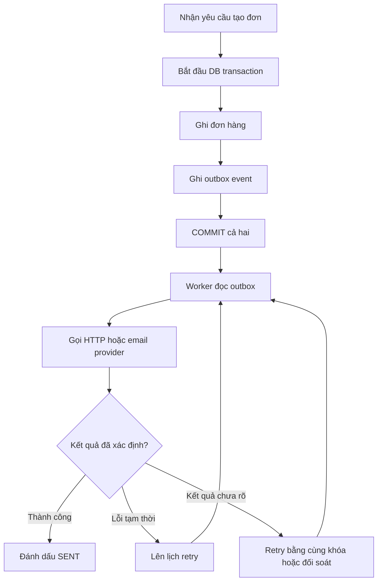
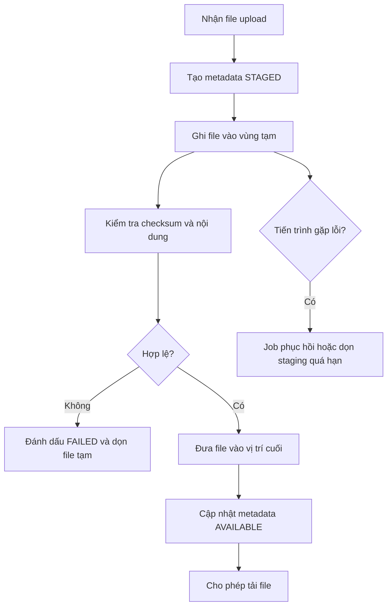
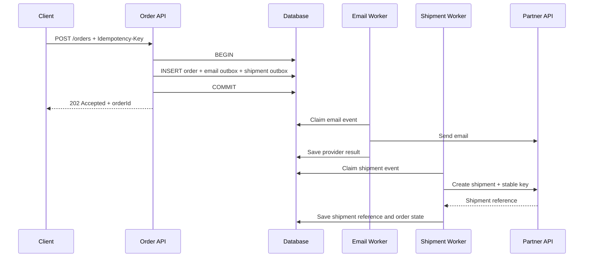

# Giới hạn nguyên tử khi kết hợp cơ sở dữ liệu với HTTP, email hoặc tệp

## Một transaction database bảo vệ được những gì?

Transaction trong cơ sở dữ liệu gom nhiều thao tác đọc và ghi thành một đơn vị có các thuộc tính ACID. Khi transaction commit, các thay đổi thuộc transaction đó được xác nhận; khi rollback, database hoàn tác các thay đổi chưa commit. Cơ chế này hoạt động trong phạm vi tài nguyên mà database và transaction manager quản lý.

Ví dụ, một thao tác chuyển tiền có thể cập nhật hai tài khoản trong cùng transaction:

```sql
BEGIN;

UPDATE accounts
SET balance = balance - 500000
WHERE id = :source_account;

UPDATE accounts
SET balance = balance + 500000
WHERE id = :destination_account;

COMMIT;
```

Nếu một câu lệnh thất bại trước commit, ứng dụng rollback và cả hai thay đổi được hoàn tác. Database có thể bảo đảm rằng không có trạng thái chỉ trừ tiền ở tài khoản nguồn mà chưa cộng tiền ở tài khoản đích, miễn là các câu lệnh thực sự nằm trong cùng transaction.

Ranh giới đó thay đổi khi thao tác còn gửi HTTP request, gửi email hoặc ghi tệp. Những hệ thống bên ngoài này không tự động tham gia transaction của database. Một lệnh `ROLLBACK` không thể thu hồi một HTTP request mà server khác đã xử lý, rút lại email đã được nhà cung cấp chấp nhận hoặc xóa tác dụng của một file đã được ghi ra filesystem.

**Nguyên tử trong database không đồng nghĩa nguyên tử trên toàn bộ hệ thống.** Mỗi hệ thống có trạng thái, cơ chế commit và lỗi riêng. Ứng dụng phải thiết kế cách phối hợp giữa chúng.

## Vì sao gọi dịch vụ bên ngoài trong transaction không tạo ra tính nguyên tử?

Giả sử ứng dụng tạo đơn hàng và gọi dịch vụ vận chuyển để đặt lịch giao hàng:

```java
@Transactional
public Order createOrder(CreateOrderRequest request) {
    Order order = orderRepository.save(Order.from(request));
    shippingClient.createShipment(order);
    return order;
}
```

Đoạn mã trông như một quy trình duy nhất, nhưng `@Transactional` chỉ điều khiển transaction database được cấu hình cho phương thức. HTTP client không tự tham gia transaction đó. Có hai cửa sổ lỗi quan trọng:

1. Dịch vụ vận chuyển đã tạo lịch giao hàng, sau đó database transaction rollback. Lịch giao hàng vẫn tồn tại dù đơn hàng nội bộ không được commit.
2. Database commit thành công, nhưng lời gọi HTTP thất bại hoặc ứng dụng bị dừng trước khi gửi request. Đơn hàng tồn tại nhưng chưa có lịch giao hàng.

Đảo thứ tự hai thao tác không giải quyết được vấn đề. Nếu gọi HTTP trước rồi mới ghi database, ta có thể tạo tác dụng bên ngoài mà không có dữ liệu nội bộ. Nếu commit database trước rồi mới gọi HTTP, ta có thể có dữ liệu nội bộ mà chưa có tác dụng bên ngoài.

Ngay cả khi lời gọi HTTP nằm bên trong một phương thức `@Transactional`, database chỉ biết kết quả của những thao tác database. Nó không thể yêu cầu server từ xa hoàn tác nghiệp vụ đã hoàn tất. Một timeout cũng không chứng minh server từ xa chưa xử lý request: server có thể đã commit công việc nhưng phản hồi bị mất.

## Các cửa sổ lỗi khi phối hợp hai hệ thống

Hãy xem một quy trình gồm hai bước: ghi đơn hàng vào database và gọi dịch vụ ngoài.

| Thời điểm xảy ra lỗi | Trạng thái database | Trạng thái dịch vụ ngoài | Rủi ro |
| --- | --- | --- | --- |
| Trước khi ghi database | Chưa có đơn hàng | Chưa có tác dụng | Có thể thử lại từ đầu. |
| Sau khi ghi nhưng trước commit | Transaction chưa commit | Chưa gọi dịch vụ | Rollback có thể hoàn tác phần database. |
| Dịch vụ ngoài thành công, sau đó database rollback | Không có đơn hàng đã commit | Tác dụng ngoài đã tồn tại | Hai hệ thống không nhất quán. |
| Database commit, tiến trình dừng trước khi gọi dịch vụ | Có đơn hàng | Chưa có tác dụng ngoài | Cần cơ chế tiếp tục công việc đã commit. |
| Dịch vụ ngoài xử lý xong nhưng phản hồi bị mất | Tùy thời điểm commit nội bộ | Có thể đã có tác dụng | Retry mù quáng có thể tạo tác dụng trùng. |
| Dịch vụ ngoài từ chối nghiệp vụ | Có thể đã có đơn hàng | Không có tác dụng mong muốn | Cần trạng thái lỗi, thử lại hoặc hành động bù. |

Các tình huống này xuất hiện với thanh toán, gửi email, gọi API đối tác, tải tệp lên object storage, ghi tài liệu ra filesystem và phát thông điệp. Điểm chung là có nhiều nơi lưu trạng thái nhưng không có một transaction manager chung điều khiển tất cả.

## Giữ transaction mở trong lúc gọi HTTP có giúp không?

Thông thường, không nên giữ transaction database mở trong thời gian chờ dịch vụ HTTP. Cách làm đó không tạo ra rollback phân tán, nhưng lại kéo dài thời gian giữ connection, lock và snapshot.

Ví dụ, nếu dịch vụ đối tác mất 8 giây mới phản hồi, transaction có thể giữ lock trong khoảng thời gian đó. Nhiều request khác phải chờ; connection pool bị chiếm; deadlock và timeout có thể tăng. Dù HTTP client trả về lỗi, ứng dụng vẫn không biết chắc server từ xa chưa thực hiện nghiệp vụ.

Chỉ nên dùng transaction database cho phần công việc database cần nhất quán. Hãy commit sớm sau khi lưu trạng thái và ý định cần thực hiện, sau đó dùng worker hoặc một quy trình có thể phục hồi để giao tiếp với hệ thống bên ngoài.

Có những hệ thống dùng distributed transaction hoặc two-phase commit (2PC). Cách đó chỉ có thể phối hợp các resource manager tham gia đúng giao thức và được cấu hình tương thích. HTTP API, nhà cung cấp email và filesystem thông thường không phải participant XA có thể được database yêu cầu prepare/commit. 2PC còn tạo thêm phụ thuộc vận hành, khóa tài nguyên và khả năng bị chặn khi coordinator gặp sự cố. Vì vậy, không thể mặc định bọc một lời gọi HTTP hay gửi email trong `@Transactional` là đã có distributed transaction.

## Transactional outbox: lưu ý định gửi cùng dữ liệu nghiệp vụ

Một cách phổ biến để xử lý tác dụng bên ngoài là **transactional outbox**. Thay vì gọi dịch vụ ngoài ngay trong transaction tạo dữ liệu, ứng dụng ghi một bản ghi outbox mô tả công việc cần thực hiện. Bản ghi nghiệp vụ và bản ghi outbox được commit trong cùng transaction database.

Sau commit, một worker đọc outbox, gửi HTTP request hoặc email rồi cập nhật trạng thái gửi. Nếu worker bị dừng, công việc vẫn còn trong database để worker khác tiếp tục.



### Cấu trúc bảng outbox

Ví dụ dưới đây dùng PostgreSQL:

```sql
CREATE TABLE outbox_events (
    id              UUID PRIMARY KEY,
    aggregate_type  VARCHAR(100) NOT NULL,
    aggregate_id    VARCHAR(100) NOT NULL,
    event_type      VARCHAR(150) NOT NULL,
    payload         JSONB NOT NULL,
    status          VARCHAR(20) NOT NULL DEFAULT 'PENDING',
    attempts        INTEGER NOT NULL DEFAULT 0,
    available_at    TIMESTAMPTZ NOT NULL DEFAULT CURRENT_TIMESTAMP,
    created_at      TIMESTAMPTZ NOT NULL DEFAULT CURRENT_TIMESTAMP,
    sent_at         TIMESTAMPTZ,
    last_error      TEXT,
    CONSTRAINT ck_outbox_status
        CHECK (status IN ('PENDING', 'PROCESSING', 'SENT', 'FAILED'))
);

CREATE INDEX ix_outbox_pending
    ON outbox_events (available_at, created_at)
    WHERE status IN ('PENDING', 'PROCESSING');
```

`id` là định danh ổn định của event. `aggregate_type` và `aggregate_id` cho biết event thuộc thực thể nào. `event_type` mô tả việc cần làm; `payload` chứa dữ liệu cần thiết để worker thực hiện. `status`, `attempts`, `available_at` và `last_error` hỗ trợ retry và vận hành.

Không nhất thiết mọi hệ thống phải dùng đúng các cột này. Có thể thêm `locked_until`, `worker_id`, `version`, `correlation_id`, `tenant_id` hoặc `deduplication_key` tùy yêu cầu. Điều quan trọng là outbox record phải được ghi cùng transaction với thay đổi nghiệp vụ cần nó.

### Ghi nghiệp vụ và outbox trong cùng transaction

```java
@Service
public class OrderApplicationService {
    private final OrderRepository orderRepository;
    private final OutboxRepository outboxRepository;
    private final ObjectMapper objectMapper;

    public OrderApplicationService(
            OrderRepository orderRepository,
            OutboxRepository outboxRepository,
            ObjectMapper objectMapper) {
        this.orderRepository = orderRepository;
        this.outboxRepository = outboxRepository;
        this.objectMapper = objectMapper;
    }

    @Transactional
    public Order createOrder(CreateOrderRequest request) {
        Order order = orderRepository.save(Order.from(request));

        OrderCreatedPayload payload = new OrderCreatedPayload(
                order.getId(),
                order.getCustomerEmail(),
                order.getTotalAmount());

        outboxRepository.save(new OutboxEvent(
                UUID.randomUUID(),
                "Order",
                order.getId().toString(),
                "ORDER_CREATED",
                writeJson(payload)));

        return order;
    }

    private String writeJson(Object value) {
        try {
            return objectMapper.writeValueAsString(value);
        } catch (JsonProcessingException e) {
            throw new IllegalStateException("Cannot serialize outbox payload", e);
        }
    }
}
```

Nếu lưu đơn hàng thành công nhưng lưu outbox thất bại, exception làm transaction rollback cả đơn hàng. Nếu transaction commit, cả đơn hàng và công việc cần gửi đều tồn tại. Worker có thể tiếp tục xử lý sau khi ứng dụng khởi động lại.

Trong code thực tế, entity outbox có thể dùng JSON/JSONB thay cho chuỗi JSON, và repository phải tham gia cùng transaction manager với `orderRepository`. Không gửi email hoặc gọi HTTP trực tiếp trong phương thức này; nhiệm vụ của transaction là ghi dữ liệu nghiệp vụ và ý định gửi.

### Worker lấy công việc và gửi đi

Worker cần tránh để nhiều instance xử lý cùng một outbox record tại cùng thời điểm. PostgreSQL hỗ trợ `FOR UPDATE SKIP LOCKED` để nhiều worker lấy các hàng khác nhau:

```sql
BEGIN;

WITH candidates AS (
    SELECT id
    FROM outbox_events
    WHERE status = 'PENDING'
      AND available_at <= CURRENT_TIMESTAMP
    ORDER BY created_at
    FOR UPDATE SKIP LOCKED
    LIMIT 20
)
UPDATE outbox_events AS event
SET status = 'PROCESSING',
    attempts = attempts + 1
FROM candidates
WHERE event.id = candidates.id
RETURNING event.*;

COMMIT;
```

Sau khi claim, worker commit việc nhận quyền xử lý rồi mới gọi dịch vụ ngoài. Không giữ transaction và row lock trong suốt thời gian chờ HTTP hoặc email provider. Sau khi nhận được kết quả, worker mở transaction khác để đánh dấu `SENT` hoặc lên lịch retry.

Nếu worker bị dừng sau khi claim nhưng trước khi gửi, record có thể bị kẹt ở `PROCESSING`. Thiết kế thực tế cần lease như `locked_until` hoặc một cơ chế khôi phục record quá hạn về `PENDING`. Worker chỉ được cập nhật record nếu vẫn sở hữu lease hoặc fencing token hiện hành; điều này tránh worker cũ ghi đè trạng thái sau khi worker mới đã tiếp quản.

### Vì sao outbox vẫn có thể gửi trùng?

Xét tình huống:

1. Worker gửi request tới dịch vụ ngoài.
2. Dịch vụ ngoài hoàn tất tác vụ.
3. Worker bị dừng trước khi đánh dấu outbox là `SENT`.
4. Lease hết hạn, worker khác lấy lại record và gửi lần nữa.

Outbox bảo đảm rằng ý định gửi không bị mất khi transaction nghiệp vụ commit. Nó không tự bảo đảm lời gọi ngoài chỉ xảy ra một lần. Worker cần gửi một định danh ổn định như `outbox_events.id` làm idempotency key nếu dịch vụ đích hỗ trợ. Dịch vụ nhận cũng nên lưu định danh này với unique constraint để bỏ qua lần giao trùng.

Nếu dịch vụ ngoài không hỗ trợ idempotency hoặc truy vấn trạng thái theo request ID, không thể luôn phân biệt được “provider chưa xử lý” với “provider đã xử lý nhưng phản hồi bị mất”. Hệ thống cần chấp nhận một chính sách cụ thể: retry và xử lý khả năng trùng, đối soát thủ công/tự động, hoặc đưa kết quả chưa rõ vào hàng chờ xử lý riêng. Không nên đánh dấu `SENT` chỉ vì đã gửi request nếu chưa có bằng chứng phù hợp theo giao thức của provider.

## Kết hợp database với HTTP API

HTTP là giao thức request/response, nhưng phản hồi không phải bằng chứng tuyệt đối về trạng thái nghiệp vụ. Timeout có thể xảy ra trước khi server nhận request, trong khi xử lý, sau khi commit hoặc khi gửi phản hồi. Client không thể suy ra duy nhất một trạng thái từ timeout.

### Dùng idempotency key cho thao tác có thể retry

Nếu API đích hỗ trợ idempotency key, hãy tạo một key ổn định cho một ý định nghiệp vụ và dùng lại key đó ở mọi lần retry:

```http
POST /v1/shipments
Idempotency-Key: 7d4f0d4a-9a8b-4c0e-9d9f-3e3e1b9a6a11
Content-Type: application/json

{
  "orderId": "ORD-1042",
  "addressId": "ADDR-88"
}
```

Không tạo key mới mỗi lần HTTP client timeout. Nếu tạo key mới, provider có thể xem retry là một yêu cầu nghiệp vụ mới và tạo hai shipment. Key nên gắn với event hoặc thao tác outbox để mọi worker retry đều dùng cùng giá trị.

Nếu API đích không hỗ trợ idempotency key, hãy tìm cơ chế khác như client reference duy nhất, API tra cứu theo mã yêu cầu hoặc endpoint upsert. Nếu không có cách nào xác định kết quả của request không rõ trạng thái, cần thiết kế đối soát và trạng thái chờ xác minh.

### Phân loại lỗi trước khi retry

Không phải mọi lỗi HTTP đều có cùng cách xử lý:

| Kết quả | Cách xử lý thường gặp |
| --- | --- |
| Timeout, mất kết nối hoặc reset sau khi gửi | Kết quả chưa rõ; retry cùng idempotency key hoặc tra cứu trạng thái. |
| `429 Too Many Requests` | Tôn trọng `Retry-After` nếu có, áp dụng backoff và giữ cùng key. |
| `5xx` | Có thể là lỗi tạm thời hoặc kết quả chưa rõ; retry có giới hạn và cùng key nếu API hỗ trợ. |
| `400` do payload không hợp lệ | Sửa dữ liệu trước khi gửi lại; retry nguyên payload thường không có ích. |
| `401` hoặc `403` | Sửa xác thực hoặc quyền; không lặp vô hạn. |
| `404` | Phụ thuộc hợp đồng API: tài nguyên không tồn tại có thể là kết quả cuối cùng hoặc do eventual consistency. |
| `409 Conflict` | Đọc chi tiết conflict và trạng thái hiện có; không đổi key một cách tùy tiện. |

Chính sách retry nên có giới hạn số lần hoặc thời gian, exponential backoff và jitter để tránh nhiều worker đồng loạt dồn request lên dịch vụ đang lỗi. Lỗi vĩnh viễn cần chuyển sang trạng thái `FAILED` hoặc hàng chờ xử lý thủ công thay vì retry mãi.

### Lưu trạng thái nghiệp vụ thay vì giả vờ mọi bước cùng commit

Với quy trình cần người dùng theo dõi, có thể lưu trạng thái:

```text
CREATED -> PENDING_EXTERNAL -> CONFIRMED
                         \-> RETRY_WAIT
                         \-> FAILED
                         \-> UNKNOWN
```

`UNKNOWN` có ý nghĩa khi request đã được gửi nhưng client chưa xác định được kết quả. Worker hoặc tác vụ đối soát sẽ truy vấn provider bằng external reference, sau đó chuyển trạng thái sang `CONFIRMED` hoặc `FAILED`. Không nên tự chuyển `UNKNOWN` thành `FAILED` chỉ vì timeout; tác vụ bên ngoài có thể đã hoàn thành.

Nếu nghiệp vụ yêu cầu API trả lời ngay, API có thể trả `202 Accepted` cùng mã thao tác và URL tra cứu trạng thái. Nếu cần phản hồi đồng bộ, ứng dụng có thể chờ trong một giới hạn thời gian, nhưng vẫn phải lưu trạng thái có thể tiếp tục và xử lý kết quả chưa rõ. Thời gian chờ của HTTP request không nên quyết định việc nghiệp vụ có tồn tại hay không.

## Kết hợp database với email

Gửi email là tác dụng bên ngoài. SMTP server hoặc email provider có thể chấp nhận thông điệp trong khi ứng dụng mất kết nối trước khi nhận phản hồi. Database rollback không thu hồi được email đã được provider nhận, và việc provider trả thành công cũng không chứng minh email đã vào hộp thư đến: thông điệp có thể bị trì hoãn, bounce hoặc đưa vào spam.

### Không gửi email trước khi transaction nghiệp vụ commit

Ví dụ không an toàn:

```java
@Transactional
public void register(RegisterRequest request) {
    User user = userRepository.save(User.from(request));
    emailClient.sendWelcomeEmail(user.getEmail());
    auditRepository.save(AuditEvent.userRegistered(user.getId()));
}
```

Nếu email được gửi rồi `auditRepository.save` thất bại, transaction rollback nhưng email chào mừng đã đi ra ngoài. Người nhận nhận thông báo về một tài khoản chưa được tạo trong database.

Nếu chuyển email ra sau commit mà không có outbox, ứng dụng vẫn có cửa sổ lỗi: database commit xong, tiến trình bị dừng trước khi gọi email provider. Không có bản ghi công việc nào để worker biết email cần gửi.

### Dùng email outbox

Trong transaction tạo người dùng, lưu một event `USER_REGISTERED` hoặc một email job. Worker lấy job sau commit và gửi email:

```java
@Transactional
public User register(RegisterRequest request) {
    User user = userRepository.save(User.from(request));

    emailOutboxRepository.save(EmailOutbox.pending(
            UUID.randomUUID(),
            "WELCOME_EMAIL",
            user.getId(),
            user.getEmail()));

    return user;
}
```

Worker đọc email job, dựng nội dung từ template và gửi tới provider. Khi provider xác nhận đã nhận yêu cầu gửi, worker cập nhật job thành `SUBMITTED` hoặc `SENT_TO_PROVIDER` theo đúng ý nghĩa phản hồi của provider. Tên trạng thái cần phản ánh điều hệ thống thực sự biết; `DELIVERED` chỉ nên dùng khi có delivery event đáng tin cậy từ provider.

Email cũng có cửa sổ gửi trùng: provider đã nhận email nhưng worker timeout trước khi lưu trạng thái. Nếu provider hỗ trợ idempotency hoặc API tra cứu message, hãy dùng định danh ổn định của email job. Nếu không, retry có thể gửi email trùng. Có thể giảm tác động bằng nội dung có thể nhận diện, nhưng không thể hứa chắc gửi đúng một lần chỉ dựa trên database outbox.

Với email thông báo quan trọng, nên lưu lịch sử gửi, trạng thái provider, số lần thử, lỗi cuối và thời điểm gửi. Không ghi nội dung nhạy cảm không cần thiết vào log. Email chứa token xác thực hoặc liên kết dùng một lần cần được thiết kế để việc gửi trùng không tạo ra nhiều trạng thái bảo mật mâu thuẫn.

## Kết hợp database với tệp trên filesystem

Filesystem có thể hỗ trợ thao tác nguyên tử trong phạm vi của chính nó, nhưng transaction database không tự quản lý các thao tác file. Nếu ghi file và ghi metadata trong hai hệ thống riêng, hai thứ tự đều có cửa sổ lỗi.

### Ghi file trước rồi ghi database

```text
1. Ghi /uploads/report.pdf
2. INSERT metadata vào database
3. COMMIT
```

Nếu bước 2 hoặc commit thất bại, file có thể tồn tại nhưng database không tham chiếu tới nó. Đây là **orphan file**. Nếu file có dung lượng lớn, nhiều orphan có thể làm đầy storage.

### Ghi database trước rồi ghi file

```text
1. INSERT metadata với đường dẫn /uploads/report.pdf
2. COMMIT
3. Ghi file /uploads/report.pdf
```

Nếu bước 3 thất bại, database trỏ tới file chưa tồn tại hoặc file rỗng. Người dùng có thể nhìn thấy một tài liệu đã tạo nhưng không tải được nội dung.

Không có cách sắp xếp hai thao tác này để tự động loại bỏ mọi cửa sổ lỗi nếu filesystem không tham gia cùng transaction. Cần một quy trình trạng thái và phục hồi.

### Dùng vùng staging và trạng thái file

Một cách triển khai thực tế là ghi file vào vùng tạm trước, sau đó dùng database điều khiển việc công bố file:

1. Tạo một `upload_id` ổn định và lưu metadata trạng thái `UPLOADING` hoặc `STAGED`.
2. Ghi nội dung vào file tạm hoặc object storage key tạm có chứa `upload_id`.
3. Kiểm tra kích thước, checksum, loại nội dung và quyền truy cập.
4. Đưa file vào vị trí cuối cùng hoặc đánh dấu object đã sẵn sàng.
5. Cập nhật metadata database thành `AVAILABLE` và commit.
6. Chỉ cho phép ứng dụng tải file khi metadata ở trạng thái `AVAILABLE`.
7. Có job dọn file staging quá hạn và đối soát các file cuối không có metadata tương ứng.



Thứ tự cụ thể phụ thuộc storage. Nếu file cuối được tạo trước khi metadata `AVAILABLE` commit, người dùng vẫn không truy cập được file qua ứng dụng vì ứng dụng kiểm tra metadata. Nếu cập nhật metadata thất bại, có thể dọn file cuối mồ côi bằng job đối soát. Nếu metadata `AVAILABLE` commit trước khi file cuối thực sự sẵn sàng, ứng dụng có thể trả liên kết hỏng; vì vậy chỉ công bố trạng thái sau khi storage xác nhận thao tác hoàn tất theo hợp đồng của nó.

### Ghi file tạm rồi đổi tên

Với filesystem cục bộ, một mẫu thường dùng là ghi đầy đủ vào file tạm, flush dữ liệu cần thiết, sau đó rename sang tên cuối. Rename trong cùng filesystem thường có tính nguyên tử về khả năng quan sát tên file: người đọc thấy file cũ hoặc file mới thay vì file cuối đang được ghi dở. Hành vi và độ bền sau mất điện phụ thuộc filesystem, hệ điều hành và việc đồng bộ dữ liệu/metadata.

```java
Path temporary = uploadDirectory.resolve(uploadId + ".part");
Path destination = uploadDirectory.resolve(uploadId + ".bin");

try (FileChannel channel = FileChannel.open(
        temporary,
        StandardOpenOption.CREATE_NEW,
        StandardOpenOption.WRITE)) {
    ByteBuffer buffer = ByteBuffer.wrap(content);
    while (buffer.hasRemaining()) {
        channel.write(buffer);
    }
    channel.force(true);
}

Files.move(
        temporary,
        destination,
        StandardCopyOption.ATOMIC_MOVE);
```

`ATOMIC_MOVE` có thể không được hỗ trợ nếu nguồn và đích khác filesystem hoặc provider không hỗ trợ atomic move; ứng dụng cần xử lý `AtomicMoveNotSupportedException` theo chính sách rõ ràng. Đổi tên file chỉ nguyên tử trong phạm vi filesystem đó. Nó không commit database metadata cùng lúc và không làm cho hai thao tác trở thành một transaction.

Không nên ghi đè file đích khi chưa xác định rõ semantics. Có thể tạo tên file bất biến theo `upload_id` hoặc content hash để tránh hai upload cạnh tranh ghi vào cùng một đường dẫn. Cũng cần kiểm tra đường dẫn do người dùng cung cấp để tránh path traversal; nên tự tạo tên lưu trữ và lưu tên gốc như metadata riêng.

### Object storage và tệp lớn

Với object storage, thường nên dùng key tạm hoặc upload session, hoàn tất multipart upload, kiểm tra checksum rồi mới cập nhật metadata database thành `AVAILABLE`. Không giả định object storage và database cùng transaction. Cần lưu object key ổn định, version hoặc checksum để đối soát.

Đối với file lớn, không nhất thiết đưa toàn bộ nội dung vào database chỉ để có transaction. Lưu blob trong database có thể hữu ích khi kích thước nhỏ, yêu cầu backup/restore thống nhất hoặc cần ràng buộc dữ liệu chặt; nhưng nó làm tăng kích thước database, backup và tải I/O. Chọn nơi lưu theo đặc tính truy cập và vận hành, rồi thiết kế trạng thái phối hợp phù hợp.

## Khi nào dùng saga và hành động bù?

Transactional outbox giải quyết việc không để mất ý định gửi. Nó không tự hoàn tác tác dụng đã xảy ra ở hệ thống ngoài. Với quy trình nhiều bước, cần **saga**: mô hình hóa từng bước như một giao dịch cục bộ và định nghĩa hành động bù khi quy trình không thể tiếp tục.

Ví dụ đặt chuyến đi có thể gồm:

1. Tạo booking ở hệ thống nội bộ.
2. Giữ chỗ ở nhà cung cấp vận chuyển.
3. Đặt phòng ở nhà cung cấp lưu trú.
4. Thu tiền ở payment provider.

Nếu bước đặt phòng thất bại sau khi đã giữ chỗ vận chuyển, saga có thể yêu cầu hủy giữ chỗ vận chuyển. Nếu thu tiền thất bại sau khi đã đặt phòng, saga có thể hủy phòng theo chính sách hoặc chuyển sang trạng thái cần xử lý. Các hành động bù là nghiệp vụ mới, có thể thất bại hoặc bị trì hoãn; chúng không phải rollback vật lý xóa lịch sử của bước trước.

| Bước đã hoàn thành | Hành động bù có thể có |
| --- | --- |
| Giữ chỗ | Hủy giữ chỗ. |
| Đặt phòng | Hủy đặt phòng nếu điều kiện cho phép. |
| Thu tiền | Hoàn tiền hoặc tạo yêu cầu hoàn tiền. |
| Gửi email | Thường không thể thu hồi; có thể gửi thông báo đính chính nếu cần. |
| Công bố file | Thu hồi quyền truy cập hoặc đánh dấu file không còn hiệu lực. |

Không phải mọi tác dụng đều có thể bù hoàn toàn. Email đã gửi không thể bị kéo khỏi hộp thư người nhận; người dùng có thể đã tải file; đối tác có thể đã bắt đầu xử lý đơn hàng. Vì vậy, saga cần định nghĩa trạng thái trung gian, timeout, retry, hành động bù và quy trình xử lý thủ công cho từng bước.

## Thiết kế state machine cho công việc ngoài transaction

Một công việc tích hợp nên có trạng thái biểu đạt tiến độ và kết quả mà hệ thống biết:

| Trạng thái | Ý nghĩa | Hành động tiếp theo |
| --- | --- | --- |
| `PENDING` | Công việc đã được commit và đang chờ worker. | Claim để xử lý. |
| `PROCESSING` | Một worker đang giữ lease xử lý. | Hoàn tất, gia hạn lease hoặc để lease hết hạn. |
| `RETRY_WAIT` | Gặp lỗi có thể thử lại sau. | Chờ `available_at`, rồi retry. |
| `UNKNOWN` | Request có thể đã được provider xử lý nhưng chưa xác định được kết quả. | Tra cứu, retry bằng idempotency key hoặc đối soát. |
| `SUCCEEDED` | Provider xác nhận kết quả thành công theo hợp đồng. | Ghi nhận hoàn tất và phát event tiếp theo nếu cần. |
| `FAILED` | Lỗi cuối cùng hoặc vượt chính sách retry. | Hiển thị lỗi, bù hoặc xử lý thủ công. |
| `CANCELLED` | Công việc bị hủy theo quy tắc nghiệp vụ. | Dọn tài nguyên hoặc thực hiện bước bù nếu cần. |

Không phải mọi tích hợp cần tất cả trạng thái. Hãy dùng những trạng thái đủ để phân biệt việc chưa gửi, đang gửi, kết quả chưa rõ, thành công và thất bại. Tránh dùng một cờ boolean `sent` nếu hệ thống cần phục hồi sau timeout hoặc nhiều lần retry.

Mỗi lần chuyển trạng thái nên có điều kiện rõ ràng. Ví dụ, worker chỉ được đánh dấu `SUCCEEDED` nếu nó vẫn sở hữu lease hiện tại; một worker cũ không được ghi đè kết quả do worker mới xác nhận. Dùng optimistic locking với cột `version`, hoặc fencing token tăng dần, để bảo vệ cập nhật khi nhiều worker có thể tiếp quản cùng công việc.

## Idempotency ở cả hai phía

Khi phối hợp database và dịch vụ ngoài, thường có hai lớp idempotency:

- **Phía gửi:** outbox event có ID ổn định; worker dùng cùng ID làm idempotency key cho mọi lần gọi lại.
- **Phía nhận:** dịch vụ ngoài lưu ID đã xử lý hoặc có khóa nghiệp vụ duy nhất để không áp dụng tác dụng hai lần.

Nếu hệ thống nhận cũng là do ta quản lý, có thể tạo bảng inbox:

```sql
CREATE TABLE inbox_messages (
    consumer_name VARCHAR(100) NOT NULL,
    message_id    UUID NOT NULL,
    received_at   TIMESTAMPTZ NOT NULL DEFAULT CURRENT_TIMESTAMP,
    CONSTRAINT pk_inbox_messages
        PRIMARY KEY (consumer_name, message_id)
);
```

Consumer ghi inbox record và cập nhật dữ liệu nghiệp vụ trong cùng transaction. Nếu message được giao lại, unique constraint báo message đã được nhận; consumer bỏ qua hiệu ứng trùng và xác nhận message theo giao thức broker. Đây là cách tạo hiệu ứng lũy đẳng ở phía nhận, dù đường truyền vẫn có thể giao nhiều lần.

Nếu dịch vụ đích là bên thứ ba, không thể tự thêm inbox table vào hệ thống của họ. Cần dùng idempotency API, client reference, truy vấn trạng thái hoặc quy trình đối soát mà provider cung cấp. Đừng giả định gửi cùng body hai lần sẽ tự động được provider xem là cùng một thao tác.

## Tính thứ tự khi có nhiều tác dụng ngoài

Một đơn hàng có thể phát sinh nhiều event: `ORDER_CREATED`, `PAYMENT_REQUESTED`, `ORDER_CONFIRMED`. Worker chạy song song có thể gửi event sau trước event trước nếu không có quy tắc thứ tự. Nếu dịch vụ nhận phụ thuộc thứ tự, cần xác định thứ tự theo aggregate hoặc khóa nghiệp vụ.

Một số cách thường dùng:

- Ghi `aggregate_version` tăng dần vào event và dịch vụ nhận từ chối hoặc trì hoãn phiên bản không đúng thứ tự.
- Chỉ cho phép một worker xử lý đồng thời các event của cùng aggregate, trong khi các aggregate khác vẫn chạy song song.
- Dùng partition key theo `aggregate_id` khi phát event qua broker có bảo đảm thứ tự trong partition.
- Để consumer kiểm tra trạng thái hiện tại và xử lý event cũ theo cách lũy đẳng.

Không nên dựa vào thứ tự timestamp tạo record nếu nhiều transaction commit cạnh tranh hoặc đồng hồ giữa các máy lệch nhau. Thứ tự nghiệp vụ nên được biểu diễn bằng version hoặc sequence do database cấp trong phạm vi aggregate.

## Retry, backoff và hàng chờ lỗi

Retry giúp phục hồi lỗi tạm thời, nhưng retry không giới hạn có thể làm tình trạng dịch vụ đích xấu hơn. Một worker tốt cần:

1. Phân loại lỗi có thể retry và lỗi cuối cùng.
2. Dùng exponential backoff, ví dụ tăng khoảng chờ theo số lần thử.
3. Thêm jitter để nhiều worker không retry cùng thời điểm.
4. Tuân thủ `Retry-After` hoặc quota từ provider.
5. Giới hạn số lần thử hoặc thời gian tồn tại của công việc.
6. Chuyển công việc hết giới hạn sang dead-letter queue hoặc trạng thái cần xử lý.
7. Ghi lại lỗi cuối, correlation ID và mã tham chiếu provider để đối soát.

Khi worker không biết provider đã xử lý hay chưa, lỗi phải được phân loại thành `UNKNOWN` thay vì luôn xem là thất bại chắc chắn. Retry với cùng idempotency key có thể giải quyết trường hợp provider hỗ trợ. Nếu không, cần tra cứu trạng thái trước khi gửi lại hoặc chuyển cho quy trình đối soát.

## Bảo đảm phục hồi và đối soát

Một quy trình tích hợp không hoàn chỉnh nếu chỉ có đường chạy thành công. Cần trả lời được: worker chết sau khi claim thì sao, provider timeout thì sao, file tạm bị bỏ lại thì sao, và trạng thái database không khớp với provider thì ai phát hiện?

Các cơ chế vận hành thường gồm:

- Lease hoặc timeout để tiếp quản công việc bị kẹt ở `PROCESSING`.
- Job dọn outbox/inbox đã hết thời hạn theo chính sách lưu trữ.
- Job dọn file staging và file orphan sau một khoảng an toàn.
- Đối soát định kỳ giữa external reference trong database và trạng thái provider.
- Dashboard theo dõi số lượng `PENDING`, `RETRY_WAIT`, `UNKNOWN`, `FAILED`, tuổi của công việc cũ nhất và tỷ lệ lỗi.
- Cảnh báo khi công việc vượt SLA hoặc liên tục thất bại.
- Công cụ retry thủ công có kiểm soát, giữ nguyên idempotency key và ghi audit log.

Không xóa một record `UNKNOWN` chỉ để làm sạch bảng. Nó đại diện cho một kết quả chưa được xác định; cần đối soát trước khi kết luận tác dụng bên ngoài không xảy ra.

## Chọn mẫu thiết kế theo loại tác dụng ngoài

| Tác dụng ngoài | Mẫu thường phù hợp | Điểm cần lưu ý |
| --- | --- | --- |
| HTTP tới API đối tác | Transactional outbox + idempotency key + truy vấn trạng thái | Timeout không xác định được kết quả; cần giữ external reference. |
| Email | Email outbox + retry có giới hạn + lịch sử provider | Không thể thu hồi email đã gửi; trạng thái accepted khác delivered. |
| File cục bộ | Staging file + atomic rename trong cùng filesystem + metadata state | Rename không commit database; cần dọn orphan và kiểm tra đường dẫn. |
| Object storage | Upload key tạm + checksum + metadata `AVAILABLE` + cleanup | Object storage và database có vòng đời độc lập. |
| Nhiều dịch vụ nghiệp vụ | Saga + outbox/inbox + hành động bù | Bù là thao tác mới và có thể thất bại. |

Nếu dữ liệu cần được commit đồng bộ với metadata và có kích thước phù hợp, lưu nội dung trực tiếp trong database có thể đưa nó vào cùng transaction. Đây là lựa chọn kiến trúc, không phải giải pháp mặc định cho mọi file hoặc mọi dịch vụ ngoài.

## Ví dụ tổng hợp: tạo đơn hàng, gửi email và tạo shipment

Giả sử một API tạo đơn hàng cần lưu dữ liệu, gửi email xác nhận và yêu cầu đối tác tạo shipment. Một thiết kế có thể gồm:

1. API kiểm tra idempotency key để nhận diện retry của client.
2. Trong một database transaction, tạo đơn hàng với trạng thái `PENDING_CONFIRMATION`, lưu email outbox event và shipment outbox event.
3. Commit. Từ thời điểm này, đơn hàng và hai ý định gửi đều được lưu bền vững.
4. Email worker gửi email xác nhận và ghi trạng thái provider trả về. Nếu timeout, worker giữ trạng thái chưa rõ và retry theo chính sách.
5. Shipment worker gọi API đối tác với external reference ổn định. Nếu đối tác hỗ trợ idempotency key, dùng ID của outbox event.
6. Khi đối tác xác nhận shipment, worker cập nhật shipment reference và trạng thái đơn hàng trong transaction database.
7. Nếu đối tác từ chối vĩnh viễn, chuyển đơn hàng sang trạng thái lỗi hoặc yêu cầu nhân viên xử lý theo quy tắc nghiệp vụ.
8. Job đối soát phát hiện công việc bị kẹt, shipment đã tạo nhưng nội bộ chưa ghi nhận hoặc email chưa có kết quả cuối.



Nếu client không nhận được phản hồi `202`, nó gửi lại cùng idempotency key. API trả lại order đã tạo hoặc trạng thái thao tác đang xử lý. Các worker tiếp tục dựa trên outbox, kể cả khi API process đã khởi động lại. Nếu shipment provider đã tạo shipment nhưng worker dừng trước khi lưu kết quả, worker dùng cùng key hoặc tra cứu theo external reference để không tạo shipment thứ hai.

Email và shipment có thể hoàn tất ở thời điểm khác nhau. Database cần biểu diễn trạng thái từng phần thay vì giả định toàn bộ quy trình đã hoàn tất ngay khi API trả response. Nếu nghiệp vụ yêu cầu chỉ xác nhận đơn sau khi shipment được tạo, state machine sẽ chuyển `PENDING_CONFIRMATION` sang `CONFIRMED` sau khi nhận xác nhận; nếu thất bại, nó đi theo nhánh xử lý lỗi đã định nghĩa.

## Những cách làm dễ gây lỗi

| Cách làm | Vấn đề | Cách cải thiện |
| --- | --- | --- |
| Gọi HTTP hoặc gửi email trong `@Transactional` rồi kỳ vọng rollback thu hồi tác dụng | Tác dụng ngoài không thuộc transaction database. | Ghi outbox trong transaction và xử lý sau commit. |
| Ghi database xong rồi gọi API mà không lưu công việc cần gửi | Process có thể dừng giữa commit và lời gọi. | Ghi outbox cùng dữ liệu nghiệp vụ. |
| Retry HTTP bằng idempotency key mới | Provider có thể tạo tác dụng mới mỗi lần. | Giữ key ổn định theo ý định nghiệp vụ. |
| Đánh dấu outbox `SENT` trước khi gọi provider | Nếu process dừng trước khi gửi, công việc bị mất. | Chỉ đánh dấu sau kết quả phù hợp từ provider. |
| Gọi provider thành công rồi đánh dấu `SENT`, nhưng không hỗ trợ dedup | Process có thể dừng giữa hai bước và gửi trùng khi retry. | Dùng idempotency phía nhận hoặc đối soát. |
| Giữ DB transaction mở trong khi chờ HTTP | Giữ lock và connection lâu, nhưng không tạo rollback phân tán. | Claim công việc trong transaction ngắn, gọi ngoài transaction. |
| Ghi metadata DB trước khi file sẵn sàng | Người dùng có thể thấy file chưa tồn tại. | Dùng staging và chỉ công bố `AVAILABLE` sau khi file sẵn sàng. |
| Ghi file cuối trước khi lưu metadata rồi bỏ qua cleanup | File orphan tích tụ. | Có upload ID, trạng thái và job dọn file mồ côi. |
| Coi timeout là thất bại chắc chắn | Provider có thể đã hoàn tất. | Dùng `UNKNOWN`, tra cứu trạng thái hoặc retry cùng key. |
| Retry vô hạn mọi lỗi | Tạo tải lớn và lặp lỗi vĩnh viễn. | Backoff, giới hạn retry, dead-letter và xử lý thủ công. |

## Kiểm chứng các cửa sổ lỗi

Khi xây dựng tích hợp, hãy mô phỏng lỗi ở các điểm chuyển giữa hai hệ thống. Những tình huống quan trọng gồm:

1. Ghi nghiệp vụ thành công nhưng ghi outbox thất bại: transaction phải rollback cả hai.
2. Commit outbox xong, dừng API trước khi trả response: client retry cùng key phải nhận lại thao tác đã tạo.
3. Worker claim event xong rồi bị dừng trước khi gửi: lease hết hạn và worker khác có thể tiếp quản.
4. Provider thực hiện tác vụ nhưng response bị mất: retry cùng key hoặc đối soát không tạo tác dụng thứ hai.
5. Provider trả lỗi tạm thời: công việc chuyển `RETRY_WAIT` với thời điểm thử lại phù hợp.
6. Provider trả lỗi cuối cùng: công việc chuyển `FAILED` và kích hoạt quy trình nghiệp vụ tương ứng.
7. File đã được ghi nhưng cập nhật metadata thất bại: file được nhận diện là orphan và có thể dọn an toàn.
8. Metadata đã chuyển `AVAILABLE` nhưng file không còn truy cập được: đối soát phát hiện và sửa trạng thái hoặc khôi phục file.
9. Worker cũ hết lease nhưng vẫn chạy: fencing token hoặc optimistic locking ngăn worker cũ ghi đè kết quả mới.
10. Hai worker cùng nhận một event: claim nguyên tử và idempotency phía nhận bảo vệ khỏi tác dụng trùng.

Kiểm thử nên dùng database thật hoặc môi trường tích hợp có transaction và lock thực tế. Với HTTP, có thể dùng một server giả lập có khả năng hoàn tất tác vụ rồi cố ý làm mất response. Với filesystem, kiểm thử dừng tiến trình ở giữa ghi file và cập nhật metadata. Mục tiêu là xác nhận hệ thống phục hồi đúng từ từng trạng thái đã commit, không chỉ xác nhận đường chạy thành công.

## Bài tập vận dụng

Một endpoint `POST /invoices` tạo hóa đơn trong database, tải bản PDF lên object storage và gửi email có đính kèm liên kết tải. Hãy thiết kế quy trình trả lời các câu hỏi sau:

1. Nếu database commit nhưng upload thất bại thì hóa đơn có trạng thái gì? Người dùng có được tải file không?
2. Nếu upload thành công nhưng cập nhật metadata thất bại thì làm sao nhận diện và dọn object mồ côi?
3. Nếu email provider nhận email nhưng ứng dụng timeout trước khi lưu kết quả thì retry được thực hiện bằng cách nào?
4. Vì sao không thể dùng một `@Transactional` để rollback cả hóa đơn, object storage và email?
5. Những trạng thái nào cần có để phân biệt đang upload, đang gửi email, kết quả chưa rõ và hoàn tất?

Một thiết kế hợp lý có thể tạo hóa đơn ở trạng thái `PENDING_DOCUMENT`, ghi công việc upload vào outbox trong cùng transaction, rồi worker upload vào key tạm và kiểm tra checksum. Khi object sẵn sàng, worker cập nhật metadata và chuyển hóa đơn sang trạng thái có thể tải. Email job chỉ được tạo hoặc kích hoạt sau khi tài liệu sẵn sàng nếu email cần liên kết tải file. Email worker dùng định danh job ổn định, lưu phản hồi provider và xử lý timeout như kết quả chưa rõ. Các job đối soát xử lý upload mồ côi, metadata thiếu object và email chưa xác định kết quả.

Thiết kế như vậy không biến database, object storage và email provider thành một transaction chung. Nó tạo một quy trình có trạng thái bền vững, có thể retry, đối soát và phục hồi khi từng hệ thống gặp lỗi.
